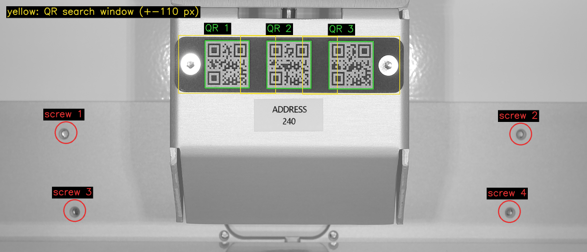

# QR 판 정렬 측정

> 정확도 수치를 읽기 전에 [평가 조건과 재실행 결과](docs/06_평가_방법/6-1_정확도.md)를 확인한다. 내부 계수 실험의 전처리 라벨, 근처 자세로 추정한 영점, 실제 center 사진을 사용하는 평가는 서로 다르다. 정상 상태도 허용오차 통과를 보장하지 않는다.


> 현재 API: 운영 측정 measure_alignment는 영점 설정 성공 후 사용한다. 실패 후에는 보정하지 않는다. 보정 허용 여부는 correction_allowed로 확인하고 모든 알림은 notices에서 읽는다. 샘플과 학습 도구의 영점 없는 측정은 measure_diagnostic을 사용하며 보정이 금지된다. set_zero_value의 반환형은 Result이며 초기화와 영점 실패, clear_zero, 기준 재등록 뒤의 상태 규칙은 03 상태와 알림을 따른다. 매일 영점 갱신은 장비 프로그램의 작업 시작 절차에서 강제한다.

사진 한 장에서 판이 기준 위치에서 얼마나 벗어났는지 **Y (mm), T (도)** 를 잰다.

## 처음 받으셨다면: 실행부터 평가표 확인까지

전체 실행 파일 17개, 사진과 영점 준비, 모든 옵션, 대화형 질문, 결과 파일은 [담당자용 전체 실행 목록](docs/02_사용법.md#6-담당자용-전체-실행-목록)에 정리했습니다.

아래 명령은 **이 README가 있는 폴더에서 PowerShell로 실행**합니다.
필요한 환경은 Windows x64, C++17을 빌드할 Visual Studio C++ 도구, CMake, OpenCV 3.4.15입니다.
검증한 컴파일러는 MSVC v141입니다. 실행에 필요한 OpenCV 파일은 아래 빌드 절차가 실행 파일 옆에 복사합니다.
실행 파일이 없다면 먼저 [1-1 빌드](#1-1-빌드)를 진행하세요.

### [1] 기준 사진과 평가 사진을 선택하세요

[1] 패키지 폴더의 PowerShell에서 실행합니다. 실행 파일이 없다면 아래 빌드 절차를 먼저 완료합니다.

```powershell
./build/Release/score_photos.exe
```

[2] 먼저 기준 사진(center)을 선택합니다.

처음 실행할 때는 동봉한 `data/examples`에서 날짜를 하나 고릅니다. 파일 선택 창은 이 폴더에서 시작합니다. `20261014/center`에는 기준 사진 1장, `20261014/photos`에는 Y 이동과 T 이동을 합한 평가 사진 6장이 있습니다. `20261020/center`에는 기준 사진 1장, `20261020/photos`에는 평가 사진 3장이 있습니다. center 사진을 고르면 다음 창은 같은 날짜의 photos에서 시작합니다. 정답 방식은 '사진 파일명 사용'을 선택합니다. 구성은 무손실 PNG 총 11장, 약 35.5 MB입니다. 출처와 재현 결과는 `data/examples/예시_안내.txt` 및 `sources.txt`에 있으며 실행 연습용으로 전체 정확도 검증을 대신하지 않습니다.

선택 창에서 '사진 선택' 또는 '폴더 선택'을 클릭합니다. 사진은 Ctrl 또는 Shift로 여러 장을 선택할 수 있습니다. 폴더는 하위 폴더까지 BMP와 PNG를 모읍니다. 원본이 있는 위치에서 바로 고르면 되며 지정된 폴더로 미리 옮길 필요가 없습니다.

기준 사진은 같은 날, 같은 설치 조건에서 평가 원점 (Y 0, T 0)에 놓고 촬영한 사진입니다. 같은 자세의 사진 5~10장을 권장하며 처음에는 1장으로도 실행할 수 있습니다. 장비 명령 원점과 평가 정답 원점이 다른 경우 담당자가 확인한 평가 원점 자세를 사용합니다. center라는 파일 이름만으로 원점이 확인되는 것은 아닙니다.

[3] 다음 창에서 평가 사진을 선택합니다.

기준 사진과 마찬가지로 사진 여러 장 또는 폴더를 선택합니다. 서로 다른 날짜나 설치 조건의 사진은 실행을 나누어 평가합니다. 사진은 3840x2160, 8비트 BMP 또는 PNG입니다. 기준 사진과 같은 원본을 함께 선택하면 그 사진은 평가에서 제외합니다. 선택 경로에 clean_YYYYMMDD, YYYYMMDD, clean_round번호처럼 회차가 표시되어 있으면 여러 회차 혼합을 차단하며, 기준과 평가에 표시된 날짜가 다를 때도 중단합니다. 경로만으로 촬영 조건을 모두 알아낼 수는 없으므로 표시가 없는 사진은 담당자가 같은 회차인지 확인해야 합니다.

[4] 정답 방식을 선택합니다.

파일명이 `Y+0.05 T+2.00 (1).bmp`처럼 정답을 담고 있으면 '사진 파일명 사용'을 클릭합니다. 그렇지 않으면 '정답표 선택'을 클릭하고 UTF-8 탭 구분 TSV를 고릅니다. 첫 행은 file, y_mm, t_deg이며 실제 사진 파일명과 평가 정답을 입력합니다. data/sample/answers.tsv는 형식 참고용이며 예제 정답을 본인 사진에 사용하지 않습니다. 정답표를 쓸 때는 선택한 사진의 파일명이 서로 달라야 합니다.

[5] 콘솔에서 선택한 사진 수와 저장 위치를 확인하고 Enter를 누릅니다.

프로그램이 기준 사진으로 영점을 설정한 뒤 평가합니다. `영점: 적용`을 확인합니다. 기준 사진을 설정하지 못하면 평가를 중단합니다. 선택 창에서 취소하면 평가를 시작하지 않습니다. 영점은 메모리에 적용되며 실행할 때마다 기준 사진을 다시 선택합니다.

[6] 마지막에 표시된 explorer.exe 명령으로 결과 폴더를 엽니다.
평가 결과에는 같은 측정값으로 두 통과율을 함께 표시합니다. 기준 1은 Y +/-0.045 mm와 T +/-0.01도, 기준 2는 Y +/-0.09 mm와 T +/-0.01도입니다. 각 기준의 전체 통과율, IN/OUT, 실패, 경고 없는 통과율과 경고 없이 OUT인 건수를 콘솔과 summary.txt에서 확인합니다. 전체 통과율은 실패를 포함한 평가 대상 전체를 분모로 삼고, 실패는 IN/OUT에 넣지 않고 별도로 표시합니다.

results.csv에는 `판정 Y0.045 T0.01`, `판정 Y0.09 T0.01` 열이 추가됩니다. 사진별 TXT에도 두 판정이 기록됩니다. 비교는 반올림 전 오차로 수행합니다. 기존 `--tolerance-y`, `--tolerance-t`는 설정 기준 결과와 기존 CSV 열에 적용되며, 고정된 두 기준 비교에는 영향을 주지 않습니다.

```text
data/results/eval/20261116_153000/
  inputs/
    center/       선택한 기준 사진 사본 (사진별 번호 폴더)
    photos/       선택한 평가 사진 사본 (사진별 번호 폴더)
    answers.tsv   선택한 정답표 사본 (사용한 경우)
  inputs.txt      원본과 사본의 경로 기록
  results.csv     사진별 정답, 예측, 오차, IN/OUT
  summary.txt     평가 조건과 요약
  logs/           사진별 단계 상세 TXT
```

날짜와 시간은 실행 PC의 시각으로 자동 생성하며 같은 초에 다시 실행하면 번호를 붙입니다. 원본은 이동하거나 변경하지 않습니다. 저장 중 오류가 나면 실행 폴더에 일부 사본이 남을 수 있지만 이전 평가 결과는 덮어쓰지 않습니다. 입력 사본은 파일 선택 방식으로 실행할 때 보관하며, 명령 인자로 경로를 지정하는 방식은 기존처럼 원본을 직접 읽고 결과만 저장합니다.

당일 영점 설정과 QR 및 나사의 기준 위치 재등록은 서로 다른 기능입니다. 기준 위치 재등록이 필요한 포팅 작업은 docs/02_사용법.md의 3-4절을 따릅니다. 현재 평가 실행 파일에는 기준 재등록 옵션이 없습니다.

### [2] 결과는 이 순서로 읽으세요

| 확인할 것 | `results.csv`에서 볼 열 | 읽는 방법 |
|---|---|---|
| 정답과 예측 | 정답 Y/T, 측정 Y/T | 단위는 Y mm, T 도 |
| 오차 | 오차 Y/T | 예측 - 정답. 부호를 유지 |
| 허용오차 안인지 | Y 판정, T 판정, 종합 판정 | 기본 기준 Y 0.045 mm, T 0.01도. 두 축 모두 이내면 IN |
| 얼마나 여유/초과인지 | Y 여유 mm, T 여유 도 | 허용오차 - 절대오차. 양수는 여유, 음수는 초과, 0은 경계(IN) |
| 경고가 놓친 오차 | 경고와 실제 오차 | **경고 없음 / OUT (미검출)**을 먼저 확인 |
| 경고 이유 | 상태, 코드, 메시지 | 경고 있음 / IN도 가능. 경고가 실제 오차 크기의 예측은 아님 |
| 측정 실패 | 상태=실패, 종합 판정=평가 불가 | 측정값을 사용하지 않음. 사진 읽기, 검출 실패 사유 확인 |
| 속도 | 시간 ms | 사진 읽기를 제외한 측정 호출 시간 |

`summary.txt`의 **경고 없는 결과의 통과율**은 정상 상태로 반환된 사진 중 실제 IN 비율입니다.
‘정상’이라는 상태와 ‘정답 대비 IN’은 따로 확인해야 합니다.
판정은 반올림 전 값으로 수행하므로 표의 표시값이 경계에 가까우면 여유 열도 함께 확인하세요.
프로그램의 종료 코드 0은 평가 파일 생성 완료이며, 모든 사진이 IN이라는 뜻은 아닙니다.

### [3] 궁금한 사진은 단계별로 확인하세요

```powershell
./build/Release/measure_one.exe data/model "C:/evaluation/photos/001.bmp" "C:/evaluation/center/center_1.bmp"
```

- 모드를 고르지 않습니다. 콘솔에는 결과 요약과 폴더 열기 명령이 나옵니다.
- 한 장 측정은 `data/results/measure/`의 새 폴더에 `measurement.txt`를 저장합니다.
- 일괄 평가는 결과 폴더의 `logs/00001.txt`처럼 사진마다 상세 기록을 저장합니다. `results.csv`의 **상세 로그** 열에서 해당 파일을 찾습니다.
- TXT에는 `[0] 입력`, `[1] QR`, `[2] 나사`, `[3] Y/T 계산`, `[4] 결과 점검`, `[5] 정답 비교` 순서로 기록합니다. `1-1`, `2-1` 등 하위 단계의 실제 추출값과 다음 용도도 포함합니다.
- 실패한 사진은 해당 측정을 중단하고, 후속 단계는 미실행으로 기록합니다. 일괄 평가에서는 그 사진을 실패로 남긴 뒤 다음 사진을 계속 평가합니다.
- **`measure_one`은 별도 정답표를 읽지 않습니다.** `001.bmp`처럼 정답 없는 이름은 오차 평가 불가로 표시합니다. 이런 사진의 정답 비교는 `score_photos`의 CSV에서 확인하세요.
- 이 명령의 영점은 사진 1장입니다. 여러 영점 사진을 평균한 일괄 평가와 수치가 다를 수 있습니다. 동일 결과를 비교하려면 영점 조건도 동일하게 맞춥니다.
- 측정 호출 시간에는 로그 버퍼 기록이 포함되며 사진 읽기와 TXT 저장은 제외됩니다. 하위 단계별 시간은 별도로 측정하지 않습니다. 정식 속도 비교는 `measure_speed`를 사용합니다.

### 동봉 샘플로 실행 확인 (선택)

다음 한 줄을 실행합니다. 별도로 사진을 준비하거나 파일 이름을 바꿀 필요가 없습니다.

```powershell
./build/Release/score_photos.exe data/sample auto --answers data/sample/answers.tsv
```

- 사진 5장을 측정하고, 동봉 정답표의 Y, T와 비교합니다.
- 콘솔에 통과율, 최대 오차, 경고 없이 허용오차를 넘긴 건수와 처리 시간이 나옵니다.
- 마지막에 **결과 폴더의 전체 경로**와 폴더를 여는 `explorer.exe` 명령이 나옵니다.
- 그 폴더의 **`results.csv`를 Excel로 열면 사진별 평가표**를 볼 수 있습니다. `summary.txt`에는 같은 요약과 평가 조건이 남습니다.
- `auto`는 `data/results/eval/` 아래에 새 폴더를 만듭니다. 같은 명령을 다시 실행해도 이전 결과를 덮어쓰지 않습니다.

이 예제의 정답표는 동봉 모델의 기대 출력입니다. **설치, 실행과 결과 확인을 연습하는 용도이며 독립 정확도 검증 자료가 아닙니다.**
이 예제에는 별도 영점을 적용하지 않습니다. 영점 없음 안내가 나오는 것이 맞습니다.
정상 재현 시 평가 5장 모두 IN입니다. 일부 사진은 학습 범위 경고가 있어도 기대 출력과 일치합니다.

### 막히면 확인할 것

| 상황 | 다음 할 일 |
|---|---|
| 실행 파일이 없음 | 아래 빌드 절차 완료 후 실행 |
| OpenCV DLL을 찾지 못함 | 다시 빌드해 자동 복사 결과 확인. 전달받은 실행 파일이라면 같은 폴더에 동봉 DLL이 있는지 확인 |
| 정답표를 읽지 못함 | UTF-8, 탭 구분, 첫 행 `file / y_mm / t_deg`, 숫자와 파일명 확인 |
| 평가할 사진이 0장 | 사진 경로, 확장자, 정답표 확인. 영점 사진은 평가에서 제외됨 |
| 영점 설정 실패 | 영점 사진 경로, 해상도, QR과 나사 가림 확인 후 다시 실행 |
| 출력 폴더가 비어 있지 않음 | 출력 경로 자리에 `auto`를 사용해 새 결과 폴더 생성 |

장비 프로그램 연동은 [02 사용법](docs/02_사용법.md), 수정할 코드 위치는 [04 코드 구조](docs/04_코드_구조.md), 단계별 대조는 [08 포팅 안내서](docs/08_포팅_안내서.md)를 참고하세요.



초록: QR 3개. 빨강: 나사 4개. 두 부분의 가로 이동 차이로 Y 와 T 를 계산한다.

| | |
|---|---|
| 입력 | 3840×2160 사진 한 장 |
| 출력 | `y_mm`, `t_deg`, 상태(정상, 경고, 실패), 알림 메시지 |
| 정확도 | 현재 재실행 결과와 채점 조건은 6-1 정확도를 따른다. 과거 영점 모의실험과 현장 평가를 구분한다 |
| 속도 | 한 장 19.2 ms (스레드 1개), 9.6 ms (스레드 4개). 노트북, 사진 읽기 제외 ([6-2 속도](docs/06_평가_방법/6-2_속도.md)) |
| 환경 | C++17, OpenCV 3.4.15 |

**필수 운영 조건**: 로봇을 명령 (0, 0) 위치로 이동시켜 촬영한 사진으로 매일 영점을 설정한다 ([02 사용법](docs/02_사용법.md) 3절).

## 1. 빠른 시작

명령은 모두 패키지 맨 위 폴더에서 실행한다.

### 1-1. 빌드

먼저 README.md가 있는 패키지 폴더에서 PowerShell을 열고 확인합니다.

```powershell
cmake --version
```

버전이 나오면 아래 빌드 명령으로 진행합니다. `cmake`를 찾지 못하면 다음 명령으로 Visual Studio에 포함된 CMake를 찾아 현재 창의 PATH에 추가합니다.

```powershell
$vswhere = "${env:ProgramFiles(x86)}\Microsoft Visual Studio\Installer\vswhere.exe"
if (Test-Path -LiteralPath $vswhere) {
    $cmakeExe = & $vswhere -latest -products * -find 'Common7\IDE\CommonExtensions\Microsoft\CMake\CMake\bin\cmake.exe' | Select-Object -First 1
    if ($cmakeExe) {
        $env:Path = "$(Split-Path -Parent $cmakeExe);$env:Path"
    }
}
cmake --version
```

여전히 버전이 나오지 않으면 빌드를 진행하지 않습니다. Visual Studio Installer의 수정 화면에서 C++용 CMake 도구를 설치하거나, 별도로 설치한 CMake의 bin 폴더를 PATH에 추가한 뒤 새 PowerShell에서 다시 확인합니다. 위 명령의 PATH 변경은 현재 창에만 적용됩니다.

PowerShell을 열 때 `profile.ps1` 실행 정책 오류가 나오면 `powershell -NoProfile`을 입력해 프로필을 읽지 않는 셸에서 진행할 수 있습니다. 이 경우 CMake 확인도 그 셸에서 다시 수행합니다. 프로필 오류와 CMake 경로 오류는 별개이며, 빌드를 위해 시스템 실행 정책을 변경할 필요는 없습니다.

설정과 빌드는 한 번에 붙여 넣지 말고 아래 순서로 실행합니다.

```
cmake -S . -B build -A x64 -T v141 -DOpenCV_DIR="C:/opencv/build"
```

설정이 성공하고 `Build files have been written to`가 나오면 빌드합니다. 오류가 나오면 해결 후 진행합니다.

```powershell
cmake --build build --config Release
```

DLL은 프로그램 실행에 필요한 OpenCV 파일입니다. 검증한 OpenCV 3.4.15 Windows 패키지에서는 빌드할 때 선택된 DLL을 실행 파일 옆에 자동 복사합니다. Release 실행 파일을 전달할 때 같은 폴더의 `opencv_world3415.dll`도 함께 전달합니다. 다른 버전의 DLL을 따로 받아 섞지 마세요. Visual C++ 실행 환경은 받는 PC에서도 필요하며 별도 PC 검증 대상입니다.

위 명령의 OpenCV 경로는 실제 설치 위치로 바꿉니다. v141 C++ 도구 집합과 Windows SDK가 설치되어 있어야 합니다. 다른 도구 집합으로 만든 기존 build 폴더가 있으면 새 빌드 폴더를 사용하세요.

실패와 경고의 현재 문구, 대응 방법, 구현된 차단 기능은 [03 상태와 알림](docs/03_상태와_알림.md)에 모아 두었습니다. 대표 알림 코드만으로 보정 여부를 판단하지 마세요.


예제 사진 5장으로 빌드가 맞는지 확인한다.

```
build/Release/check_photos data/model data/sample/list.tsv out.tsv data/sample/expected.tsv
```

`Y 차이 최대 0.00000000 mm, T 차이 최대 0.00000000 도` 가 나오면 맞다. 자세한 것은 [02 사용법](docs/02_사용법.md) 1절.

### 1-2. 준비 (평가와 학습 전에 필요한 것)

평가와 학습은 사진을 정해진 자리에 넣고, 영점 사진을 같이 준비해야 실행할 수 있다.

**(1) 사진 넣기**

촬영한 날마다 폴더를 하나 만들고, 받은 사진을 **이름 그대로** 넣는다.

```
data/new_photos/
├── 20261014/                      촬영 날짜 (폴더 이름은 자유)
│   ├── Y+0.00 T+0.00 (1).bmp      영점 사진: 명령 0 에서 찍은 사진 5 ~ 10장
│   ├── Y+0.05.bmp                 Y 만 움직인 사진 (T 는 0)
│   ├── T-0.30.bmp                 T 만 움직인 사진 (Y 는 0)
│   └── Y+0.05 T+0.01 (2).bmp      둘 다 움직인 사진. (2) 는 같은 자세의 두 번째 사진
└── 20261020/
```

- 파일 이름의 `Y`, `T` 뒤 숫자가 로봇 명령값이다 (Y 는 mm, T 는 도). 이 값을 정답으로 쓴다.
- 이름에 명령값이 없는 사진(예: `center.bmp`)은 정답을 알 수 없어 쓰지 않는다.
- 사진은 3840×2160, 8비트 (`.bmp` 또는 `.png`).

**(2) 영점 사진**

촬영한 날마다 **로봇을 명령 0 (Y 0, T 0) 으로 보내 5 ~ 10장** 찍어 같은 폴더에 넣는다. 이름은 `Y+0.00 T+0.00 (1).bmp`, `(2)`, … 로 한다.

| 영점 사진 | 처음 보는 날의 통과율 |
|---|---|
| 없음 | 31.6% |
| 5장 | 현재 재실행 결과와 채점 조건은 6-1 정확도를 따른다. 과거 영점 모의실험과 현장 평가를 구분한다 |

로봇의 명령 0 자리가 날마다 Y 로 0.04 ~ 0.13 mm 다르기 때문이다. 이 차이는 사진만으로는 알 수 없다. 자세한 것은 [02 사용법](docs/02_사용법.md) 3절.

### 1-3. 평가

인자 없이 실행하면 기준 사진(center), 평가 사진, 정답 방식 순서로 선택 창을 연다. 사진 다중 선택과 폴더 선택을 지원하며 원본을 미리 옮길 필요는 없다.

```
build/Release/score_photos
```

- 결과는 `data/results/eval/<날짜_시간>/`에 입력 사본, `results.csv`, `summary.txt`, 사진별 TXT로 저장된다.
- 여러 날 사진은 날마다 따로 평가한다. 영점은 그날 사진에만 맞다.
- 결과를 읽는 방법은 [6-5 평가 절차](docs/06_평가_방법/6-5_평가_절차.md).

### 1-4. 학습

설비가 바뀌었거나 사진이 더 생겼을 때 계수를 다시 만든다. 인자 없이 실행하면 사진 폴더를 묻고, 사진 재기부터 정확도 확인까지 차례로 진행한다.

```
build/Release/train
```

- 1-2 에서 넣은 `data/new_photos/` 의 사진을 모두 쓴다.
- 새 계수는 `data/results/train/<날짜_시각>/model/` 에 저장된다. 지금 쓰는 `data/model/` 은 바뀌지 않는다.
- 자세한 것은 [07 학습과 데이터](docs/07_학습과_데이터.md).

## 2. 장비 연동

측정 코드를 장비 프로그램에 넣을 때 할 일을 순서대로 적었다.

### 2-1. 장비로 복사할 것

저장소 전체가 아니라 아래 네 가지만 장비 쪽으로 가져가면 된다.

| 복사할 것 | 왜 필요한가 |
|---|---|
| `include/alignment.hpp` | 장비 프로그램이 부를 함수가 모두 여기에 선언되어 있다. 장비 코드는 이 파일만 include 한다. |
| `src/` | 그 함수들의 실제 측정 코드다. |
| `data/model/` | 측정할 때 코드가 읽는 파일이다(기준 사진, 위치, 계수, 점검식). 없으면 측정할 수 없다. |
| OpenCV 3.4.15 | 측정 코드가 쓰는 영상 처리 라이브러리다. 장비 PC에 이 버전이 있어야 한다. |

`tools/`, `docs/`, 사진은 개발과 설명에만 쓰므로 장비로 복사하지 않는다.
각 파일이 하는 일은 [04 코드 구조]에 있다.

### 2-2. 호출 순서와 입출력

```cpp
#include "alignment.hpp"

auto ready = alignment::initialize("data/model");
if (ready.status == alignment::Status::Failed) return;
auto zero = alignment::set_zero_from_photos(zero_photos);
if (zero.status == alignment::Status::Failed) return;
alignment::Result r = alignment::measure_alignment(photo);     // 사진마다
if (!r.correction_allowed) return; // action과 notices 확인 후 처리
```

| | 내용 |
|---|---|
| 입력 | 3840×2160, 8비트. 회색 또는 컬러(BGR, BGRA) |
| 출력 | `y_mm` (mm), `t_deg` (도). 보정 이동은 (-`y_mm`, -`t_deg`) |
| 오류 처리 | 잡은 예외는 Result로 알린다. 모든 함수가 예외를 막지는 않으므로 호출 경계에서 예외도 처리한다 |

자세한 것은 [02 사용법](docs/02_사용법.md).

### 2-3. 측정 결과 처리

| 상태 | 장비 동작 |
|---|---|
| 정상 | correction_allowed가 true인 운영 측정만 보정에 사용한다 |
| 경고 | correction_allowed와 action을 확인한다. 금지 결과로 이동하지 않는다 |
| 실패 | 멈춘다 |

코드마다 조건, 위험, 조치는 [03 상태와 알림](docs/03_상태와_알림.md).

### 2-4. 포팅 후 확인

1. 단계를 하나 옮길 때마다 `show_steps` 가 찍는 단계별 값과 비교한다.
2. 다 옮긴 뒤 예제 사진 5장의 최종 값을 `data/sample/expected_steps.tsv` 와 비교한다. 소수 4자리까지 맞으면 된다.

포팅 순서와 단계별 확인 값은 [08 포팅 안내서](docs/08_포팅_안내서.md) 1절.

### 2-5. 먼저 확인할 유의 사항

| 유의 사항 | 내용 |
|---|---|
| 컬러 채널 순서 | 컬러 사진은 BGR 순서로 본다. RGB 로 넣으면 경고 없이 값이 틀린다. 회색으로 넣는 것이 안전하다 |
| 재시작 | 영점은 메모리에만 있다. 프로그램을 다시 켜면 영점을 다시 설정한다 |
| 카메라 여러 대 | 상태가 하나라서 카메라마다 프로세스를 나눈다 |
| 설비 변경 | 카메라, 렌즈, 거리, 판이 바뀌면 계수를 다시 학습한다 (1-4 학습) |

전체 유의 사항 13가지는 [08 포팅 안내서](docs/08_포팅_안내서.md) 2절.

## 3. 폴더

```
include/alignment.hpp   쓰는 사람이 부르는 함수 전부
src/                    측정 코드
config/                 설정
data/model/             측정할 때 읽는 파일 (장비에는 이것만 보낸다)
data/sample/            확인용 예제 사진 5장과 기대값
tools/                  써 보기(try), 학습(train), 평가(evaluate), 환경 시험(environment)
docs/                   문서
```

자세한 것은 [04 코드 구조](docs/04_코드_구조.md).

## 4. 제한 사항

- 결과는 모두 멈춰 있는 사진으로 확인했다. 실제로 로봇을 움직여 센터로 되돌리는 시험은 하지 않았다.
- 계수는 받은 사진(Y ±2 mm, T ±1도)으로 학습했다. 그 밖에서는 경고를 낸다.
- 카메라, 렌즈, 거리, 판이 바뀌면 계수를 다시 만들어야 한다 (07).
- 다루지 않은 것과 확인하지 못한 것 전체는 [01 개요](docs/01_개요.md) 7절에 있다.

## 5. 상태 코드 요약

경고나 실패가 났을 때 바로 찾아보는 표다. 코드마다 조건, 위험, 조치는 [03 상태와 알림](docs/03_상태와_알림.md)에 있다.

| 상태 | 코드 | 한 줄 뜻 |
|---|---|---|
| 정상 | (없음) | 알림 없이 값이 나왔다 |
| 경고 | `W_COARSE` | 나사가 한쪽에만 있거나 없다. 대략값이다 |
| 경고 | `W_VALUES_DISAGREE` | 값들이 서로 맞지 않는다 (가림, 반사 의심) |
| 경고 | `W_SCREW_MISSING` | 나사 일부를 못 찾았다. 좌우에 남은 나사의 조합으로 계산했다. 허용오차 통과 보장은 아니다 |
| 경고 | `W_OUT_OF_RANGE` | 학습한 범위 밖이다 |
| 경고 | `W_ZERO_RESET` | 기준을 다시 잡다가 영점이 새로 정해졌다 |
| 실패 | `E_SETTINGS`, `E_DATA` | 설정이나 모델 파일을 읽지 못했다 |
| 실패 | `E_NOT_INITIALIZED` | 준비(`initialize`)를 하지 않았다 |
| 실패 | `E_PHOTO` | 사진의 크기나 형식이 다르다 |
| 실패 | `E_QR_NOT_FOUND` | QR 3개를 모두 찾지 못했다 (가림, 반사, 화면 밖, 간격 불일치) |
| 실패 | `E_SCREW_PARTIAL` | 나사 머리 일부가 가려졌거나 오염된 것으로 보인다 |
| 실패 | `E_ZERO` | 영점을 잡지 못했다 |
| 실패 | `E_REFERENCE` | 기준을 다시 잡지 못했다 |
| 실패 | `E_INTERNAL` | 예상하지 못한 오류가 났다 |
