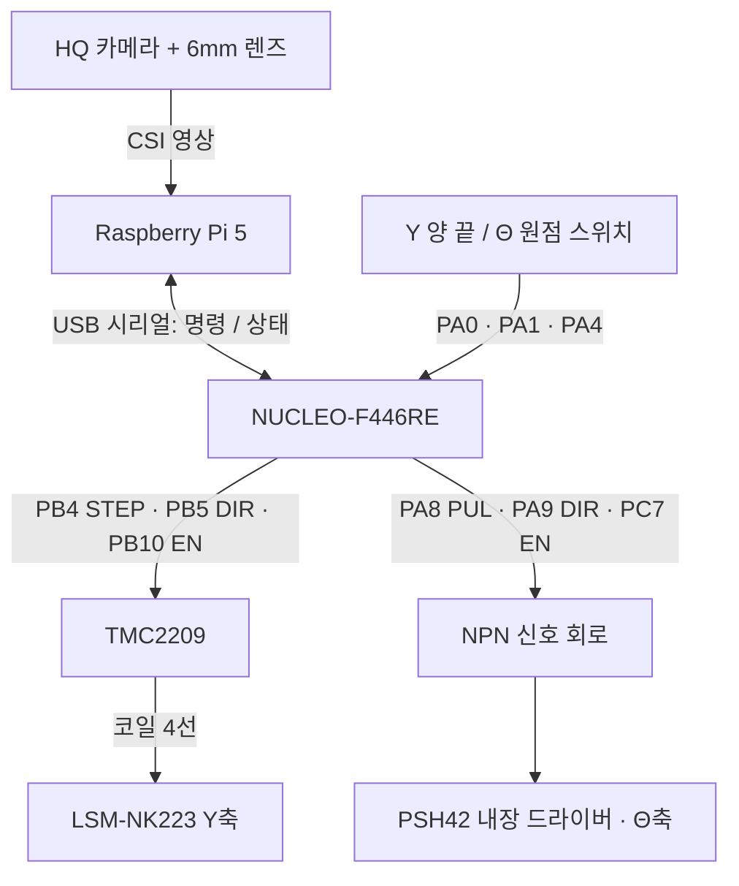

# A507 STM32 모션 제어 개발 컨텍스트

> **최신 변경 (2026-11-03):** 요청당 1600펄스 상한을 펌웨어·PC 스크립트에서 제거했다.
> 새 범위는 uint32의 1~4,294,967,295펄스이며 기계적 허용 거리가 아니다.
> 사용자 확인 환산은 약 1600펄스/mm. 주파수 16~3200Hz, 단일 실행, STOP은 유지한다.
> 스위치 제한은 계속 비활성이고 소프트 리미트·가감속·단절 자동정지는 없다.
> 모의 시험으로 1601/16000펄스 실행, uint32 최대 요청 접수·정지, PC 범위 초과 거절을 검증했다.
> Debug/Release 빌드 통과. 2026-11-03 보드 재연결 후 최신 Debug ELF 다운로드·플래시 검증·리셋 성공.
> COM4에서 IDLE, ready=1, output_allowed=1 확인. 실제 이동 명령은 보내지 않았다.

> **문서 운영:** 이 파일 하나를 개발 기준 문서로 갱신한다. 작업마다 별도 진행/검증 Markdown을 추가하지 않는다.
> **읽는 순서:** 최신 PC Y축 시험 기능은 22절과 [README.md](README.md), 펄스 계층은 21절, 통신 구현은 [20절](#20-바이너리-통신-구현과-검증)을 확인한다. 통신 계약은 [robot_stage_protocol.md](robot_stage_protocol.md)이다. 1~18절은 설계 배경과 이전 제안이며, 19절의 ASCII 통신 구현은 바이너리 통신으로 교체되었다.
> **현재 보유 장비:** STM32 NUCLEO-F446RE와 Raspberry Pi 5. 모터·드라이버·스위치 실물 검증은 아직 할 수 없다.

> **실물 시험 업데이트 (2026-11-02):** 스위치 제한 제거 버전 다운로드 후 사용자가 PC jog 명령으로 실제 모터가 정상 동작한다고 보고했다. 이동 거리·정밀도·전류·발열의 정량 측정 및 스위치 검증은 미실시다.

> **최신 변경 (2026-11-02):** 사용자 요청으로 스위치 제한을 제거했다. `Y_MOTOR_USE_LIMITS=0`이 기본이며 PC도 입력 High를 차단하지 않는다. 빌드·모의 테스트 통과 후 보드 재연결로 최신 Debug ELF 다운로드·플래시 검증·리셋까지 성공했다. COM4에서 IDLE, ready=1, output_allowed=1, Y_HOME=1, Y_LIMIT=1을 확인했다. 실제 이동 명령은 보내지 않았다. 자세한 내용은 README 참조.


작성일: 2026-10-20 · 대상: NUCLEO-F446RE 펌웨어 개발자 및 VS Code 코딩 AI

> 이 파일을 VS Code 프로젝트 최상위 폴더에 두고, 코딩 AI에게 파일을 읽도록 명시한다. 파일을 두는 것만으로 모든 확장이 자동 참조하는 것은 아니다.
>
> **현재 기준: 첨부 전장회로도의 핀 배정을 사용한다. Y축은 PB4/TIM3_CH1, Θ축은 PA8/TIM1_CH1이다.** 이전 대화에서 제안했던 Y축 PA8/TIM1, Θ축 PB6/TIM4 배정은 폐기했다.
>
> 이 문서는 하드웨어 연결과 개발 방향을 설명한다. 펌웨어 구현 완료·실물 구동·정밀도 검증을 뜻하지 않는다.
## 0. 알아 둘 것
- CubeMX가 생성해 주는 파일: main.c, 인터럽트·주변장치 초기화 코드 등
- 필요하면 직접 만드는 파일: motor.c, protocol.c처럼 기능별로 분리할 파일
직접 .c 파일을 만드는 건 코드가 길어졌을 때 정리하려고 나누는 것이야. RTOS가 없어서 반드시 만들어야 하는 건 아니야.

지금은 main.c의 USER CODE 영역에서 UART 통신과 모터 동작부터 확인하고, 이후 기능별로 나눠도 돼.

## 1. 먼저 알아야 할 프로젝트 목표

SEMES 기업연계 A507 프로젝트의 목표는 QR 마커 영상으로 Y축 이동과 Θ축 회전의 영향을 구분하고, 목표 정렬 상태에 필요한 ΔY·ΔΘ를 계산하는 것이다. 팀은 알고리즘을 시연할 Y·Θ 2축 카메라 이동 장비도 제작한다.

현재 시연 장비는 일반적인 다관절 로봇팔이 아니라 **직선 스테이지 위에 회전 모터를 올리고, 그 위에 카메라를 장착하는 구조**다. QR 마커 3개가 있는 판은 고정하고 카메라 조립체가 이동·회전한다.

| 구성 요소 | 맡는 일 |
| --- | --- |
| Raspberry Pi 5 | HQ 카메라 촬영, 영상 처리 또는 처리 결과 수신, 보정 명령 전송, 재촬영 관리 |
| STM32 NUCLEO-F446RE | 명령 수신, 이동량→펄스 변환, 가감속, 펄스 생성, 원점·리미트 감지, 상태 응답 |
| TMC2209 | Y축 모터의 코일 전류를 제어하는 외부 드라이버 |
| LSM-NK223 | Y축 직선 이동을 만드는 모터 일체형 스테이지 |
| PSH42-NK174020ED | Θ축 회전. 감속기·모터·엔코더·드라이버가 결합된 제품 |
| KW-10 스위치 3개 | Y축 양 끝 2개와 Θ축 원점 1개 감지 |

**STM32에서 이미지·QR 인식·AI 추론을 수행하지 않는다.** STM32는 영상 처리 결과인 이동 명령을 실행한다. 최종 정렬 여부는 새 이미지로 확인한다.

기업 제공 이미지 기반 C++ 알고리즘 검증과 자체 장비 시연은 구분한다. 기존 Windows C++ Vision SW에서 연산할 경우 Pi는 카메라/명령 중계 역할을 할 수 있지만, PC↔Pi의 통신 방식은 아직 확정되지 않았다. STM32 코드는 그 상위 연산 위치에 종속되지 않도록 만든다.

## 2. 근거 자료와 확정 수준

| 근거 | 문서에 반영한 내용 |
| --- | --- |
| `전체전장회로도_NUCLEO-F446RE.html` | 최종 기준 신호 핀, 전원 분배, NPN 입력 회로, 스위치 연결 |
| `A507_MotionController(2).ioc` | 검토 당시 실제 저장된 MCU 설정 |
| `15기_2학기_자율프로젝트_교보재신청서_A507_최종(1).xlsx` | 이전 검토 기록: 구매 모델, 24V/5A 어댑터, HQ 카메라·6mm 렌즈, T6×1/50mm 표기. Y축 모델은 아래 최신 사용자 전달 정보 우선 |
| 사용자 최신 결정 | VS Code + ST 공식 확장, CubeMX CMake/GCC 생성 방향, Bare-metal + HAL |

### 확정된 개발 방향

- 보드: **NUCLEO-F446RE**, MCU: **STM32F446RET6**, Cortex-M4.
- 펌웨어: **Bare-metal + STM32 HAL**, FreeRTOS 미사용.
- 펌웨어 초기 언어: C. 기존 코드 확인 없이 프로젝트 전체를 C++로 전환하지 않는다.
- IDE: VS Code, 확장: **STM32CubeIDE for Visual Studio Code**, 게시자 STMicroelectronics.
- 코드 생성: STM32CubeMX에서 **CMake / GCC**를 선택하는 방향.
- Pi↔STM32: **NUCLEO의 ST-LINK USB를 통한 가상 COM 포트**, STM32 내부는 USART2.

### 검토한 `.ioc`와 현재 PC 프로젝트의 차이

마지막으로 직접 검토한 `A507_MotionController(2).ioc`에는 `TargetToolchain=STM32CubeIDE`가 저장돼 있었다. 이후 사용자가 VS Code를 선택해 **CMake로 변경하도록 안내했고 개발 준비가 됐다고 알려왔다.** 실제 생성된 CMake 프로젝트 파일은 이 문서 작성 시 제공되지 않았다.

따라서 코딩 AI는 작업 전에 로컬 `.ioc`, `CMakeLists.txt`, `CMakePresets.json`, 생성된 초기화 코드를 읽고 현재 상태를 확인한다. 오래된 첨부 파일을 근거로 툴체인을 되돌리지 않는다.

## 3. 전체 연결 구조



TMC2209는 **LSM-NK223에 있는 Y축 모터**에 사용한다. 하모닉 모터에는 드라이버가 내장돼 있으므로 TMC2209를 추가로 연결하지 않는다. 신청서의 TMC2209 4개는 설치 1개와 예비 3개다.

## 4. 최종 STM32 핀 배정 — 이 표를 기준으로 구현

`D5`, `A0`는 보드 Arduino 헤더 이름이고, `PB4`, `PA0`는 MCU 핀 이름이다. 같은 핀을 가리키며 서로 다른 핀이 아니다. CN 번호는 NUCLEO-F446RE의 Morpho 커넥터 기준이다.

| 용도 | MCU 핀 | 보드 표시 | Morpho 위치 | CubeMX 기능 / HAL 라벨 | 연결 대상 |
| --- | --- | --- | --- | --- | --- |
| Y축 펄스 | **PB4** | D5 | CN10-27 | TIM3_CH1 / `Y_STEP` | TMC2209 STEP |
| Y축 방향 | **PB5** | D4 | CN10-29 | GPIO_Output / `Y_DIR` | TMC2209 DIR |
| Y축 Enable | **PB10** | D6 | CN10-25 | GPIO_Output / `Y_EN_N` | TMC2209 EN/ENN |
| Θ축 펄스 | **PA8** | D7 | CN10-23 | TIM1_CH1 / `THETA_PUL` | NPN Q1 입력 회로 |
| Θ축 방향 | **PA9** | D8 | CN10-21 | GPIO_Output / `THETA_DIR` | NPN Q2 입력 회로 |
| Θ축 Enable | **PC7** | D9 | CN10-19 | GPIO_Output / `THETA_EN` | NPN Q3 입력 회로 |
| Y 원점·왼쪽 끝 | **PA0-WKUP** | A0 | CN7-28 | GPIO_Input / `Y_HOME` | 왼쪽 KW-10 입력 회로 |
| Y 오른쪽 끝 | **PA1** | A1 | CN7-30 | GPIO_Input / `Y_LIMIT` | 오른쪽 KW-10 입력 회로 |
| Θ 원점 | **PA4** | A2 | CN7-32 | GPIO_Input / `THETA_HOME` | Θ KW-10 입력 회로 |
| 상위 통신 TX | **PA2** | D1 | CN10-35 | USART2_TX / `USART_TX` | 보드 내부 ST-LINK VCP |
| 상위 통신 RX | **PA3** | D0 | CN10-37 | USART2_RX / `USART_RX` | 보드 내부 ST-LINK VCP |
| 디버깅 | PA13 / PA14 | SWD | — | Serial Wire | 보드 내부 ST-LINK |

라벨 이름은 생성된 `main.h`에서 실제 `*_Pin`·`*_GPIO_Port` 매크로를 확인한다. 펄스 핀은 타이머 Alternate Function을 사용하며 일반 GPIO 토글 방식으로 바꾸지 않는다.

PA0-WKUP는 PA0의 다른 기능을 함께 표기한 이름이다. 현재 선택 기능은 GPIO_Input이며 Wake-Up 기능을 사용한다는 의미가 아니다.

검토 파일에는 보드 기본 PA5 LED, PC13 USER 버튼, PB3 SWO, 외부 발진기 관련 핀 예약도 남아 있었다. 주 제어 핀과 혼동하지 않는다. PB3 SWO는 이번 펌웨어의 필수 기능이 아니며, 외부 발진기 핀 예약만 보고 실제 시스템 클록이 HSE라고 판단하지 않는다.

## 5. Raspberry Pi 5와의 USB 통신

### 물리 연결과 MCU 기능이 다른 이유

| 구간 | 연결 / 동작 |
| --- | --- |
| 외부 케이블 | **Pi USB-A → 데이터 지원 USB Mini-B 케이블 → NUCLEO ST-LINK CN1** |
| NUCLEO 내부 | ST-LINK가 USB 가상 COM 포트와 USART2를 중계 |
| STM32 내부 | **USART2 PA2(TX)·PA3(RX)**로 데이터 송수신 |
| Pi 소프트웨어 | USB 시리얼 장치를 열어 바이트 송수신 |

따라서 **외부 연결은 USB, STM32 코드에서는 UART HAL 사용**이 동시에 맞다. STM32 타깃 MCU의 USB_OTG_FS/USB CDC를 활성화하는 방식이 아니다. Pi GPIO TX/RX 점퍼선을 PA2·PA3에 추가로 연결하지 않는다. 보드 기본 ST-LINK↔USART2 연결이 변경되지 않았다는 전제다.

| 항목 | 사용 기준 |
| --- | --- |
| Baud rate | **115200** |
| Data bits / Parity / Stop bits | **8 / None / 1** |
| Flow control | None |
| UART mode | TX + RX, Asynchronous |
| 초기 수신 구현 | UART RX 인터럽트 + 고정 크기 수신 버퍼 |
| 확장 가능 방식 | 필요 시 DMA + Receive-to-IDLE 등 검토 |
| UART IRQ | USART2 global interrupt 활성화 |

검토한 `.ioc`는 비동기 USART2와 IRQ 활성화를 포함한다. 115200/8N1 항목은 기본값으로 생략돼 있으므로 생성된 `MX_USART2_UART_Init()`에서 다시 확인한다.

### 개발 PC와 Pi의 관계

- 초기 개발·다운로드·시리얼 시험은 **PC → NUCLEO CN1** 연결로 한다.
- Pi와 통합할 때는 USB 호스트 연결을 **Pi → NUCLEO CN1**로 옮긴다.
- 하나의 CN1을 USB Y 케이블로 PC와 Pi 두 호스트에 동시에 연결하지 않는다.
- Pi의 시리얼 포트는 `/dev/ttyACM0`처럼 잡힐 수 있으나 번호를 고정 가정하지 않는다. 가능하면 `/dev/serial/by-id/`의 실제 항목을 사용한다.
- Windows에서는 장치 관리자에 표시되는 실제 COM 번호를 확인한다.
- 동일 포트를 터미널·Pi 프로그램 등 여러 프로세스가 동시에 점유하지 않게 한다.
- 시리얼 포트 열기/재연결 중 MCU가 재시작될 가능성에 대비해 호스트가 상태를 다시 확인한다.

명령 수신 IRQ를 켜는 것만으로 애플리케이션이 데이터를 받지는 않는다. 코드에서 `HAL_UART_Receive_IT()` 등으로 수신을 시작하고, 콜백에서 다음 수신을 재등록하며 오류 처리도 구현해야 한다.

### 역할 분담

Pi는 `ΔY(mm), ΔΘ(deg)`를 보내고 이동 완료를 기다린다. STM32가 이동 중일 때는 새로운 보정 이동을 겹쳐 보내지 않는다. 영상이나 모터의 개별 STEP 펄스를 USB로 전송하지 않는다.

## 6. Y축 — STM32 → TMC2209 → LSM-NK223

| STM32 / 전원 | TMC2209 측 연결 |
| --- | --- |
| PB4 / TIM3_CH1 | STEP |
| PB5 | DIR |
| PB10 | EN 또는 ENN |
| NUCLEO 3V3 | 모듈 VIO/VDD 논리 전원 — 실제 모듈 핀 표기 확인 |
| STM32 GND | 논리 GND·공통 GND |
| 퓨즈를 지난 +24V | VM 모터 전원 |
| 24V 전원 − | 전력 GND |
| 출력 OA1/OA2 | 모터 코일 한 쌍 |
| 출력 OB1/OB2 | 모터의 다른 코일 한 쌍 |

전장회로도는 MS1·MS2를 3.3V에 연결하는 안이다. TMC2209 칩 기준 두 핀 High는 STEP 입력 16 마이크로스텝 설정이지만, **구매한 MKS 모듈의 핀 연결·저항·UART 설정을 확인하기 전까지 환산값을 확정하지 않는다.** 내부 256 보간과 외부 STEP 한 펄스의 이동량을 혼동하지 않는다.

- PB10 High: TMC2209 비활성화. 초기 `.ioc`에 High가 저장돼 있다.
- PB10 Low: 활성화. 전류 제한·배선을 검증한 이후에만 실행한다.
- 리셋 중에는 MCU 핀이 초기화 전이므로 초기 High 설정만으로 충분하지 않다. EN–3.3V 외부 풀업을 하드웨어에서 검토한다.
- DIR의 High/Low가 실제 좌/우 중 어느 쪽인지는 낮은 속도의 시험으로 결정해 설정값으로 둔다.
- 모터 코일 쌍은 색만 추측하지 말고 데이터시트나 저항 측정으로 확인한다.
- 정격 전류, 전류 감지 저항, VREF 또는 UART 전류 설정을 대조한다. 24V 어댑터 전류와 모터 상전류는 같은 값이 아니다.
- 커패시터는 VM–GND 가까이에 100µF/50V를 극성에 맞춰 연결하는 계획이다.

**현재 핀 배정에는 TMC2209 설정용 UART를 할당하지 않았다.** USART2는 Pi 통신용이다. TMC UART가 필요해지면 별도 핀·단선 UART 회로를 설계하고 문서를 갱신한다. Pi USART2를 임의로 공유하지 않는다.

### 당시 사용자 전달 정보와 구현 보류 (2026-10-28)

아래는 당시 기록이다. 이후 사용자 요청에 따라 2026-10-30 Y축 펄스 계층을 구현했다(21절). 실물 구동 검증은 수행하지 않았다.

- 사용자가 알려준 제품 표기: **Linear Actuator LSM-NK223 T6*2-50mm**.
  이전 자료의 `T6×1` 표기를 실제 사용 제품의 확정 사양으로 사용하지 않는다.
- 사용자는 리드·스텝각, TMC2209 모듈 모델·MS1/MS2·전류, 스위치 연결,
  원점 기준 허용 이동거리 모두 **미확인**이라고 밝혔다. 제품명 문자열만으로
  1회전당 이동량이나 안전한 소프트 리밋 값을 확정하지 않는다.
- 회로가 아직 나오지 않아 실제 구동은 할 수 없으며, 사용자는 모터 코드 구현을
  오늘 진행하지 않아도 된다고 했다. Y축 모션 구현과 구동 README 작성은
  회로·사양 확인 뒤 이어서 진행한다. 이번에는 모터 코드를 추가하거나
  구동 잠금을 해제하거나 보드에 새 펌웨어를 다운로드하지 않았다.
- 현재 동작은 20절의 통신 시험용 펌웨어이며 MOVE/HOME은 NAK(FAULT)를
  반환한다. PB4/PB5/PB10 및 PA0/PA1은 현재 펌웨어와 기존 문서의 핀 계획이며,
  완성된 실제 회로와 배선이 검증됐다는 뜻은 아니다.

## 7. Θ축 — STM32 → NPN 회로 → 하모닉 내장 드라이버

모델은 **PSH42-NK174020ED**, 신청 옵션은 **1/100 감속비, 1000CPR 엔코더·드라이버 일체형**이다. 1000CPR 엔코더 값은 외부 명령 펄스/회전과 같지 않다.

첨부 회로도는 아래의 **공통 +5V, NPN 싱크 구동 후보 회로**를 사용한다. 단자 번호와 신호명은 회로도에 적힌 값이며, 실제 제품의 매뉴얼·커넥터와 대조한 뒤 통전한다.

| 회로도상 PSH42 단자 | 연결 계획 |
| --- | --- |
| 1 V+ / 2 V− | +24V / 전원 GND |
| 3 PU+ / 4 PU− | +5V / Q1 Collector |
| 5 DR+ / 6 DR− | +5V / Q2 Collector |
| 7 EN+ / 8 EN− | +5V / Q3 Collector |
| 9 AL+ / 10 AL− | 알람 출력. 현재 미연결 |

| MCU 출력 | NPN 회로 |
| --- | --- |
| PA8 / Θ PUL | 2.2kΩ 후보 저항 → Q1 Base |
| PA9 / Θ DIR | 2.2kΩ 후보 저항 → Q2 Base |
| PC7 / Θ EN | 2.2kΩ 후보 저항 → Q3 Base |
| 각 Q의 Emitter | 공통 GND |
| 각 Q의 Base–Emitter | 10kΩ 풀다운 |

트랜지스터는 신청서의 2N2222 TO-92 제품이다. **실제 제조사의 다리 배열, 드라이버 입력 전류, 허용 주파수·최소 펄스 폭, EN 의미·극성은 미확정**이다. 2.2kΩ을 검증된 값으로 취급하지 않는다.

NPN이 켜지면 드라이버 입력에 전류가 흐르는 구조다. MCU 핀의 High/Low와 드라이버가 인식하는 펄스·Enable을 회로 전체로 확인한다. 특히 **PC7 Low가 모터 비활성이라는 보장은 없다.** 미확인 상태의 기본값을 실제 활성화 코드로 사용하지 않는다.

엔코더는 현재 내장 드라이버가 내부 폐루프에 사용하는 계획이다. STM32로 엔코더 A/B 신호를 배선한 구성이 아니므로 STM32에 Encoder Mode나 PID를 임의로 추가하지 않는다. 또한 모터측 엔코더만으로 감속 후 카메라의 실제 각도를 측정했다고 표시하지 않는다.

## 8. 스위치 — 만능기판을 거쳐도 STM32 입력이 필요함

만능기판은 배선·저항을 고정하는 기판이며 스위치 상태를 처리하는 MCU를 대신하지 않는다.

| 스위치 | STM32 입력 | 역할 |
| --- | --- | --- |
| Y 왼쪽 KW-10 | PA0 / Y_HOME | Y 원점복귀 기준 및 왼쪽 이동 한계 |
| Y 오른쪽 KW-10 | PA1 / Y_LIMIT | 오른쪽 이동 한계 |
| Θ KW-10 | PA4 / THETA_HOME | Θ 원점 감지 |

회로도: COM→GND, NC 접점 노드→1kΩ→MCU 입력. NC 노드→4.7kΩ→3.3V, MCU 입력→100nF→GND.

| 물리 상태 | 논리 입력 | 소프트웨어 의미 |
| --- | --- | --- |
| NC 닫힘, 스위치 미눌림 | Low | 접점 연결 정상, 미감지 |
| 스위치 눌림 | High | 원점 또는 끝 위치 감지 |
| NC 접점에서 입력까지 선이 끊김 | 풀업이 입력에 유효하게 남는 조건에서 High | 눌림과 구별 불가. 점검·정지 처리 필요 |

일부 단선·단락은 이 회로로 검출되지 않는다. 이 입력을 인증된 안전회로로 표현하지 않는다.

검토한 `.ioc`는 PA0·PA1·PA4 모두 내부 Pull-up이다. 외부 풀업과 함께 사용해도 되며, 외부 회로를 확인한 후 No pull로 바꿀 수 있다. 회로도의 1kΩ·100nF는 신청서에서 별도 확보를 확인해야 하는 부품이다.

### 동작 상태에 따라 스위치 의미가 달라짐

- 처음에는 1ms 등 정해진 주기의 폴링을 사용한다. 바쁜 루프를 돌았다는 사실만으로 입력 확인 주기를 보장했다고 판단하지 않는다.
- 짧은 접점 튐을 처리한다. 리미트의 즉시 정지 경로와 원점 확정용 안정 시간은 구분한다.
- Y 끝 감지는 그 끝을 향한 이동을 막는다. 복귀를 위한 반대 방향 이탈은 별도 제한된 절차로 허용한다.
- 원점에서 시작해 이미 스위치가 눌린 경우는 제한 거리 내 이탈→저속 재진입 절차가 필요하다.
- Θ 원점 스위치는 범용 양 끝 리미트가 아니다. 원점을 지난다는 이유만으로 모든 정상 이동을 오류 처리하지 않는다.
- 원점 탐색에는 거리·시간 제한을 모두 둔다. Θ 회전은 카메라 FPC가 감기지 않도록 기구 허용 범위를 함께 제한한다.

## 9. 전원과 DC/DC 모듈의 위치

| 공급원 | 부하 | 연결 계획 |
| --- | --- | --- |
| 공식 Pi 27W USB-C 어댑터 | Pi 5 | Pi USB-C 전원 입력 |
| Pi 또는 개발 PC의 USB | NUCLEO | ST-LINK CN1. 보드 USB 전원 선택 상태 확인 |
| Pi CSI 포트 | HQ 카메라 | 22핀↔15핀 카메라 케이블로 영상·전원 |
| 완제품 24V/5A 어댑터 | TMC2209 | WAGO 분배→Y 분기 퓨즈→VM |
| 같은 24V/5A 어댑터 | PSH42 | 분배→Θ 분기 퓨즈→V+ |
| 같은 24V/5A 어댑터 | SZH-AT010 | 분배→DC/DC 분기 퓨즈→IN+ |
| SZH-AT010 출력 5V | PSH42 신호 입력 회로 | PU+・DR+・EN+의 공통 공급 후보 |

**SZH-AT010은 24V를 신호 회로용 5V로 바꾸는 전원 모듈이다. STM32 GPIO·UART로 제어하지 않으므로 CubeMX에서 설정할 항목이 없다.** 다른 회로에 연결하기 전에 멀티미터로 출력을 5V에 맞춘다.

- 24V를 STM32 GPIO·3V3·5V 핀이나 Pi에 직접 연결하지 않는다.
- USB로 전원을 받는 NUCLEO의 +5V에 DC/DC 출력을 추가 연결하지 않는다.
- 공통 GND: 모터 전원 −, TMC GND, PSH V−, DC/DC −, STM32 GND, NPN Emitter.
- 모터 전류는 굵은 전력선으로 전원 분배부에 귀환시킨다. STM32의 가는 신호 GND선을 모터 전류 경로로 사용하지 않는다.
- 신청 퓨즈는 Y/DC-DC 1A, Θ 3A다. 배선·기동전류에 대한 적합성은 실물 확인 전까지 검증 완료로 표시하지 않는다.
- WAGO 한 개 안의 포트는 같은 전위다. +24V와 GND를 같은 커넥터에 넣지 않는다.
- 보드 USER 버튼은 펌웨어 입력, RESET은 재부팅이다. 모터 전원을 직접 차단하는 비상정지 장치가 아니다.

## 10. 카메라와 기구 배치

| 항목 | 최신 신청서 기준 |
| --- | --- |
| 카메라 | Raspberry Pi HQ Camera, Sony IMX477, C/CS mount |
| 렌즈 | 6mm 광각 CS 렌즈 |
| CSI 케이블 | Pi 5 22핀 0.5mm ↔ 카메라 15핀 1mm, 500mm |
| Pi 위치 | 카메라 근처의 고정 위치 |
| 움직이는 부분 | Y 스테이지 캐리지 위의 Θ 모터·카메라 조립체 |
| 촬영 거리 계획 | 약 308mm. 실제 QR 크기·시야·초점으로 확인 |

구형 3D HTML의 12.5mm 렌즈·385mm 배치를 그대로 최신 확정값으로 쓰지 않는다. 카메라 제공 여부와 산업용 카메라 내부 리사이즈 방식도 별도 확인 사항이며, 시연용 HQ 카메라와 동일하다고 가정하지 않는다.

FPC는 이동·회전에 충분한 여유와 고정점을 둔다. 전체 스트로크·회전 범위를 통전 전에 손으로 확인한다. 회전축을 무제한 회전시키지 않는다. 하드웨어 시연의 목표 범위를 산업 장비의 보증 정밀도·성능으로 표현하지 않는다.

## 11. 현재 CubeMX 설정과 코드에서 확인할 값

| 항목 | 기준 |
| --- | --- |
| SYS Debug | Serial Wire |
| HAL timebase | SysTick |
| System clock | HSI 16MHz, AHB /1, APB1 /1, APB2 /1 |
| TIM1 clock / TIM3 clock | 각각 16MHz |
| TIM1 | CH1 PWM, PA8, PSC=15, ARR=999, CCR1=500 |
| TIM3 | CH1 PWM, PB4, PSC=15, ARR=999, CCR1=500 |
| 공통 타이머 모드 | Up, PWM mode 1, High polarity, ARR preload Enable |
| OC preload | Disable — 초기 고정 주파수 시험 설정 |
| TIM1 repetition | 생성 코드에서 0 확인 |
| DIR GPIO | Push-Pull, 초기 Low |
| TMC EN PB10 | Push-Pull, 초기 High |
| Θ EN PC7 | 초기 Low. 실제 비활성 보장값은 미확정 |
| 스위치 | PA0·PA1·PA4 Input + Pull-up, 현재 EXTI 미사용 |
| USART2 IRQ | 활성화 |
| 타이머 IRQ·DMA | 현재 파일에 추가 활성화 안 됨 |

현재 타이머 계산은 `16MHz / (15+1) = 1MHz`, `1MHz / (999+1) = 1kHz`, `500/1000 = 50%`다. 1kHz는 시험 파형 설정이며 실제 모터의 검증된 시작 속도는 아니다.

`HAL_TIM_PWM_Init()`로 초기화됐다고 펄스가 자동 시작되는 것은 아니다. 부팅 직후 `HAL_TIM_PWM_Start()`를 무조건 호출하지 않는다.

**두 타이머가 독립적으로 동작해도 목표 펄스 개수 정지는 자동 구현되지 않는다.** 현재 설정은 연속 PWM을 만들 준비까지만 한다. 유한 펄스·가감속을 추가할 때 인터럽트/DMA/카운터 구조를 설계하고 `.ioc` 또는 수동 초기화 반영을 일관되게 관리한다.

HSI 16MHz는 초기 검증용 기준이다. 주파수 오차는 UART 여유·속도에 영향을 줄 수 있으며, 이후 필요하면 보드의 외부 클록 경로를 검토한다. 클록 변경 시 PSC·ARR·통신 설정을 다시 확인한다.

## 12. 이동량을 펄스로 바꾸는 규칙

상위 입력 단위는 **Y=mm, Θ=degree**로 고정하는 방향이다. Pi가 보내는 값은 목표 정렬을 위해 실제로 적용할 **보정 이동 명령**이다. 관측 오차와 적용 명령의 부호를 혼동하지 않는다.

### Y축

신청 스테이지 옵션은 T6×1, 스트로크 50mm다. 1회전당 이동량은 1mm인 계획이다.

```text
y_pulses_per_mm = full_steps_per_motor_rev × input_microsteps / lead_mm_per_rev
y_target_pulses = round(delta_y_mm × y_pulses_per_mm)
```

예를 들어 실제 모터가 1.8°/200 full steps이고 외부 입력이 16분주, 리드가 1mm이면 3200pulse/mm다. **이는 조건부 계산 예시**이며 실제 모터 스텝각·모듈 분주 확인 전에는 고정 상수로 활성화하지 않는다.

### Θ축

```text
theta_pulses_per_degree = input_pulses_per_motor_rev × gear_ratio / 360
theta_target_pulses = round(delta_theta_deg × theta_pulses_per_degree)
```

위 식은 제품 설정값이 '모터 1회전 기준 외부 입력 펄스'일 때만 사용한다. 출력축 1회전 기준 값이 이미 제공된다면 감속비를 다시 곱하지 않는다.

**SEMES 장비에서 전달받은 81920pulse/360° 같은 값은 자체 PSH42 장치의 설정값으로 그대로 복사하지 않는다.** 감속비·전자기어·외부 입력 분주를 확인해 자체 장치 값을 정한다.

- 장비에 고정된 Y+/Θ+ 기준과 MCU DIR 레벨 대응을 문서화한다.
- 위치는 원점 기준의 정수 펄스로 관리하고 mm/degree는 환산 표시한다.
- 작은 보정 반복에서 반올림 손실이 누적되지 않도록 잔여량 누적 또는 절대 목표 환산 방식을 정한다.
- 요구 이동이 0pulse로 반올림되면 움직였다고 보고하지 않는다. 응답에 요청값·실제 명령 펄스 수를 포함할 수 있다.
- Y 위치는 현재 펄스 명령 기반 추정이다. 엔코더로 측정한 실제 위치처럼 표시하지 않는다.
- 소프트 리미트는 실제 원점·기구 여유로 결정한다. 스트로크 50mm만으로 좌표를 곧바로 ±25mm라고 고정하지 않는다.

## 13. Pi↔STM32 명령 규약 — 전체 설계 제안 (현재 부분 구현은 19절)

다음은 첫 구현을 위한 **제안 v0.1**이다. 기존 Pi 코드/통신 계약이 있으면 먼저 대조한다. 여기 적힌 명령이 현재 MCU에서 동작한다고 가정하지 않는다.

### 기본 형식

- ASCII 한 줄 명령, 끝은 LF(`\n`). CRLF를 받으면 CR을 제거한다.
- 숫자 seq는 부호 없는 32비트 요청 ID, 연결 세션 안에서 중복을 관리한다.
- MOVE의 첫 숫자는 ΔY(mm), 두 번째는 ΔΘ(deg).
- MCU는 한 번에 이동 명령 하나만 실행한다. 이동 중 추가 MOVE/HOME은 `BUSY`로 거절한다.
- PING·STATUS·STOP은 이동 중에도 처리한다.
- 한 줄 최대 128byte 제안. 초과하면 다음 LF까지 폐기하고 오류를 보고한다.
- 소수는 점(`.`)을 사용하며 NaN·Inf·범위 초과·추가 토큰은 거절한다.

| 방향 | 예시 — 실제 전송 시 끝에 LF | 의미 |
| --- | --- | --- |
| Pi→STM32 | `PING 1` | 연결 확인/하트비트 |
| STM32→Pi | `PONG 1` | 살아 있음 |
| Pi→STM32 | `STATUS 2` | 상태 요청 |
| STM32→Pi | `STATE 2 UNHOMED` | 상태 응답의 최소 형식 |
| Pi→STM32 | `HOME 3` | 원점복귀 요청 |
| STM32→Pi | `ACK 3` | 검증 후 요청 접수 |
| STM32→Pi | `DONE 3` | 원점복귀 절차 완료 |
| Pi→STM32 | `MOVE 4 0.100 -0.020` | Y +0.100mm, Θ −0.020°의 상대 이동 |
| STM32→Pi | `ACK 4` | 접수. 아직 이동 완료가 아님 |
| STM32→Pi | `DONE 4` | 계획한 펄스 출력 완료 |
| Pi→STM32 | `STOP 5` | 진행 중 동작 정지 요청 |
| STM32→Pi | `ACK 5` → `ERR 4 ABORTED` → `DONE 5` | 이동 4 취소와 정지 요청 5 완료를 구분 |
| STM32→Pi | `ERR 6 NOT_HOMED` | 원점 미확인 명령 거절 |
| STM32→Pi | `ERR 7 BUSY` | 다른 이동 실행 중 |

실제로는 STATE에 원점 플래그, 두 축의 명령 위치, 스위치 원시/필터값, 오류, 현재 명령 ID를 추가하는 것이 좋다. 필드와 순서는 Pi 담당자와 확정한다.

### 통신 오류 처리 원칙

- UART 한 번 수신된 데이터가 명령 한 줄과 같다고 가정하지 않는다. 여러 번 나뉘거나 여러 줄이 한 번에 들어올 수 있다.
- ACK는 문법·상태·범위 검사를 통과해 접수됐다는 뜻이다. DONE은 정렬 성공의 뜻이 아니다.
- 각 수락된 명령에는 최종 DONE 또는 ERR가 한 번 대응되도록 한다.
- 같은 세션에서 같은 seq·같은 명령을 재수신하면 재실행하지 않고 기존 상태/결과를 응답한다. 같은 seq에 다른 내용이면 거절한다.
- MCU 재부팅 후에는 원점 상태와 중복 처리 기록이 소실될 수 있다. 호스트는 연결 세션을 새로 확인하고 이전 MOVE를 자동 재전송하지 않는다.
- 통신 단절 중 이동을 계속하지 않도록 하트비트와 수신 만료 정책을 정의한다. 주기·만료 시간은 설정값으로 두고 실측 후 확정한다.
- 초기 줄 기반 규약에는 체크섬이 없다. 실제 이동 전에 무결성 요구를 검토하고, 필요하면 양쪽 합의로 CRC·버전·길이를 추가한다. STM32만 독자적으로 형식을 바꾸지 않는다.

## 14. Bare-metal 펌웨어 구조 제안

태스크 대신 **빠르게 반복하는 메인 루프 + 짧은 인터럽트 + 상태 머신**으로 구성한다.

| 모듈 예시 | 책임 |
| --- | --- |
| `app_config.h` | 환산 계수, 방향, 리미트, 속도·가속도, 사양 확인 플래그 |
| `board_io.c/.h` | Enable 극성 추상화, GPIO 읽기, 보드 연결 |
| `serial_link.c/.h` | UART RX 버퍼, 오류 복구, TX 큐 |
| `protocol.c/.h` | 줄 조립, 파싱, seq, ACK/DONE/ERR |
| `motion_axis.c/.h` | 축별 펄스·속도·가감속·완료 처리 |
| `switches.c/.h` | 원시 입력, 필터, 입력 유효성 |
| `homing.c/.h` | 제한된 탐색·이탈·재접근·원점 설정 |
| `app.c/.h` | 상태 머신, 명령 승인, 오류 관리 |

모듈명은 제안이다. 기존 생성 프로젝트 구조와 사용자 파일을 먼저 확인하고 불필요한 재구성을 피한다.

### 권장 상태

| 상태 | 의미 / 허용 동작 |
| --- | --- |
| `UNHOMED` | 부팅 직후. PING·STATUS·STOP 허용, 사양 확인 후 HOME 허용, 일반 MOVE 거절 |
| `HOMING` | 원점 탐색. STOP·상태 조회 처리 |
| `IDLE` | 두 축 원점 유효, 이동 요청 대기 |
| `MOVING` | 펄스 출력 중. 추가 MOVE 거절 |
| `FAULT` | 오류 고정. 자동 이동 재시작 금지. 원인 제거·명시적 복구 절차 필요 |

소프트 리미트 위반 등 사전 거절과 실제 리미트 충돌·위치 불확실 같은 실행 오류를 구분한다. 출력 펄스가 완료됐어도 Y 탈조나 기구 미끄러짐까지 증명되지는 않는다.

### 실행 규칙

1. 부팅 시 모터 펄스 시작 금지, Y EN 비활성화, Θ EN은 검증된 비활성 레벨 적용.
2. 하모닉 EN·전류·펄스 환산 등 필요한 사양이 미확정이면 모션 기능을 잠그고 통신·입력 시험만 허용.
3. RX ISR에서는 버퍼 저장·재수신 등록·플래그 처리만 한다. 파싱·printf·긴 대기는 메인 루프에서 한다.
4. `HAL_Delay()` 또는 busy-wait로 STEP을 생성하지 않는다. 타이머를 사용한다.
5. 필요한 펄스 수·주파수 범위에서 정확히 종료되는 방법을 설계하고 측정한다. 단순히 PWM을 켜고 메인 루프 시간으로 끄는 방식을 정밀 이동으로 취급하지 않는다.
6. ARR/CCR 갱신은 글리치·추가 에지·최소 펄스 폭을 고려해 경계에서 적용한다. 가감속 도입 시 preload와 업데이트 이벤트 사용도 재검토한다.
7. DIR은 첫 STEP 전의 setup time, 마지막 STEP 뒤 hold time을 제품 사양대로 확보한다.
8. 상대 이동은 목표 위치를 먼저 검증한다. 두 축은 초기에는 순차 이동 후 재촬영으로 구현해도 된다. 동시 시작과 경로 보간 동기화는 별도 기능이다.
9. 통신·스위치·정지 처리는 이동 중에도 계속 서비스한다. 최악 응답 지연을 측정한다.
10. STOP의 감속 정지와 리미트 오류의 정지 정책을 구분한다. 강제 차단·리셋 등으로 위치 신뢰가 깨지면 원점 유효 플래그를 해제한다.
11. 첫 구현은 정적 버퍼 중심으로 구성하고 ISR 공유 데이터는 동시성·원자성을 검토한다. `volatile`만으로 모든 경쟁 문제가 해결되지는 않는다.

## 15. VS Code / CMake 작업 시 지킬 사항

1. 먼저 `.ioc`, `CMakeLists.txt`, `CMakePresets.json`, `main.c`, `main.h`, GPIO/UART/TIM 초기화와 IRQ 핸들러를 읽는다.
2. 생성된 `htim1`, `htim3`, `huart2` 핸들과 매크로가 실제로 존재하는지 확인한다. 생성 옵션에 따라 코드가 `main.c` 또는 별도 `tim.c`, `usart.c`, `gpio.c`에 있을 수 있다.
3. CubeMX가 생성한 HAL·CMSIS 파일은 그대로 사용한다. 생성 파일에 필요한 연결 코드는 `USER CODE BEGIN/END` 영역에 넣는다.
4. 사용자 모듈은 별도 파일로 두고, 생성기가 덮어쓰지 않는 사용자 CMake 영역에 소스를 등록한다. 생성된 목록을 임의로 대체하지 않는다.
5. 펌웨어 타깃은 STM32 크로스 컴파일러다. Pi/Linux용 serial 라이브러리·OpenCV 코드를 MCU 빌드에 넣지 않는다.
6. CMake preset·컴파일러 경로는 실제 로컬 환경을 확인한다. 다른 사람 PC의 절대 경로를 하드코딩하지 않는다.
7. CubeMX 재생성 후에도 사용자 코드·소스 등록이 유지되는지 확인한다.
8. 빌드 성공, 다운로드 성공, 통신 성공, 실물 이동 성공을 구분해서 보고한다.

## 16. 구현·검증 순서와 완료 기준

| 단계 | 구현 | 확인할 결과 |
| --- | --- | --- |
| 1 | 생성 코드 빌드·다운로드 | 모터 24V OFF, 기본 부팅·LED 확인 |
| 2 | UART 수신·응답 | PC에서 PING/STATUS. 분할 수신·연속 줄·오버플로 복구 |
| 3 | 스위치 입력 | 미연결 High, GND 연결 Low, 실제 NC 동작·접점 튐 확인 |
| 4 | 무부하 펄스 계측 | TIM3 PB4, TIM1 PA8 주파수·펄스 수·정지 후 추가 에지 없음 확인 |
| 5 | Y축 단독 | 전류·코일·분주 확인 후 저속 짧은 이동, 방향·실제 이동거리 검증 |
| 6 | Θ축 단독 | 입력 회로·EN·환산 확인 후 작은 회전, FPC 간섭 확인 |
| 7 | 원점복귀 | 시작 시 눌림, 미감지, 단선, 탐색 만료, 끝 위치 정지 검증 |
| 8 | Pi 통합 | USB 장치 탐색·연결·명령·완료 대기·단절·재부팅 처리 |
| 9 | 영상 보정 반복 | 이동→진동 안정→이동 후 새 프레임→재계산. 오래된 프레임 폐기 |

프레임을 계속 촬영하는 것과 매 프레임마다 모터 명령을 보내는 것은 다르다. 첫 구현은 이동 완료 응답과 안정 시간을 확인한 뒤 새 이미지로 보정한다. 움직이는 동안의 연속 비전 서보는 지연·롤링셔터·노출·큐 적체를 별도 평가한 후 확장한다.

## 17. 아직 확인이 필요한 값 — 임의 확정 금지

- [ ] 실제 LSM 모터 스텝각·상전류·코일 선·기구 유효 스트로크.
- [ ] 구매한 MKS TMC2209 모듈 버전·핀·전류 감지 저항·분주·전류 제한.
- [ ] PSH42 실제 단자 배치·입력 전류·최소 펄스 폭·DIR 타이밍·EN 의미와 극성.
- [ ] PSH42 외부 명령 펄스/회전 설정과 그것이 모터측/출력측 중 어느 기준인지.
- [ ] 2N2222 실제 다리 배열·2.2kΩ 적합성·출력 펄스 파형.
- [ ] Y+/Θ+ 방향과 원점 좌표·각 축 소프트 리미트·속도·가속도.
- [ ] 하트비트·만료 시간·정지 정책·프로토콜 최종 합의.
- [ ] 기구 CAD·받침·체결·간섭·배선 여유·퓨즈 정격의 실물 검증.
- [x] 생성 프로젝트의 CMake/GCC 설정과 USART2 115200/8N1 초기화 코드 확인. 실통신 검증과는 별개다.

확인하지 못한 값을 0이나 임의의 정상값으로 두고 모션을 활성화하지 않는다. `motion_config_valid` 같은 명시적 검증 상태로 구동 허용 여부를 관리하는 것이 좋다.


## 18. 공식 참고 자료

- [ST UM1724 — Nucleo-64 보드 매뉴얼](https://www.st.com/resource/en/user_manual/dm00105823.pdf): ST-LINK VCP, 전원, F446RE 헤더 핀.
- [ST STM32F446 데이터시트](https://www.st.com/resource/en/datasheet/stm32f446re.pdf): MCU 핀과 Alternate Function.
- [ADI TMC2209 데이터시트](https://www.analog.com/media/en/technical-documentation/data-sheets/TMC2209_datasheet_rev1.09.pdf): STEP/DIR, ENN, 전류 제어·분주. 칩 문서이며 MKS 모듈 회로는 별도 확인.
- [모터뱅크 PSH42-NK174020ED](https://www.motorbank.kr/goods/goods_view.php?goodsNo=1000035760): 제품 구성·옵션 확인. 실제 커넥터 매뉴얼과 설정값 추가 확보 필요.
- [ST 공식 VS Code 확장](https://marketplace.visualstudio.com/items?itemName=stmicroelectronics.stm32-vscode-extension)
- [ST CMake 통합 안내](https://community.st.com/stm32-mcus-60/cmake-integration-in-stm32cubemx-and-usage-in-stm32cubeide-for-visual-studio-code-158397)

향후 핀이나 통신 규약을 변경하면 이 문서·전장회로도·`.ioc`·Pi 코드·펌웨어를 함께 갱신한다.


## 19. 이전 ASCII 통신 구현과 검증 (2026-10-20 기록)

> 아래는 이전 버전의 기록이다. 현재 펌웨어는 문자열 `PING/STATUS`를 받지 않는다.
> 최신 사용법과 제한은 20절을 따른다.

### 확인한 기준

- 요청된 `A507_STM32_개발컨텍스트.md`는 없고, 실제 파일
  `A507_STM32_Context.md`를 읽었다.
- 회로도 HTML/첨부 원본은 작업 폴더에 없었다. 문서의 핀 표와 로컬
  `.ioc`, `main.h`, GPIO/TIM/UART MSP 설정을 대조했다.
- Y PB4/TIM3_CH1, Θ PA8/TIM1_CH1, 스위치 PA0/PA1/PA4를 유지한다.
- HSI 16MHz, TIM1/TIM3 PSC=15, ARR=999, CCR1=500, USART2
  PA2/PA3 115200/8N1/흐름제어 없음, USART2 IRQ 활성화를 확인했다.
- `.ioc`는 CMake 타깃이며 기존 Debug/Release GCC 프리셋을 유지한다.
- 기존 사용자 동작은 500ms LED 점멸이었다. 기존 UART 콜백, 명령 파서,
  Pi 통신 코드/계약은 폴더에서 발견하지 못했다. 아래 규약은 v0.1 제안의
  **통신 시험용 부분 구현**이며 Pi 담당자와 최종 합의한 계약은 아니다.

### 모터 전제

**실물 테스트 시 모터 24V 전원을 끈다.**

Y EN(PB10)은 High로 유지한다. TIM1/TIM3의 CH1과 카운터, TIM1 MOE를
초기화 후 명시적으로 끄며, PWM 시작/모터 활성화 코드는 없다.
STEP/PUL 핀의 Alternate Function 배정은 그대로다.

PC7은 생성 코드의 초기 Low를 유지한다. **Low가 Θ 드라이버 비활성이라는
보장은 없으며**, 이를 검증된 disable 신호라고 보고하지 않는다. 이 펌웨어는
모션 명령/펄스를 막지만 드라이버 전류·여자 상태를 측정하거나 보장하지 않는다.
리셋 중 GPIO 상태와 외부 EN 풀업/풀다운도 실물 확인 대상이다.

`app_config.h`의 미확정 사양은 `APP_SPEC_UNKNOWN`이고, 구동 잠금 해제는
컴파일 오류다. 상수만 변경해서 모터를 시작할 수 없다. 원점·실제 위치·속도·
펄스 환산·하트비트 정지 정책은 구현되지 않았다.

### 사용 방법

모터 24V OFF 상태를 확인한 후 사용자가 펌웨어를 다운로드한다.
ST-LINK 가상 COM 포트를 115200/8N1, 흐름제어 없음으로 열고 다음을 보낸다.
포트 번호는 장치 관리자에서 확인하며 다른 터미널과 동시에 열지 않는다.

```text
PING 1
STATUS 2
```

실제 전송 시 각 명령 끝에 LF (`\n`) 또는 CRLF (`\r\n`)를 붙인다.
응답은 CRLF로 끝난다.

```text
PONG 1
STATE 2 UNHOMED LOCK=1 CFG_VALID=0 PULSE=OFF Y_EN=DISABLED THETA_EN=UNKNOWN HOMED=0 POS=UNKNOWN SW_RAW=7 SW_FILTERED=7 SW_VALID=7 UART_ERR=0 RX_OVF=0 TX_ERR=0
```

위 STATE는 **예시**다. 스위치와 오류 카운터는 실제 입력에 따라 다르다.

| 필드 | 의미 |
| --- | --- |
| `SW_RAW` | 가장 최근 폴링한 입력 비트마스크 |
| `SW_FILTERED` | 연속 안정 샘플로 확정한 비트마스크; 유효 비트와 함께 읽는다 |
| `SW_VALID` | 필터값이 현재 유효한 입력 비트마스크 |
| bit0 (1) | PA0 Y_HOME |
| bit1 (2) | PA1 Y_LIMIT |
| bit2 (4) | PA4 THETA_HOME |
| `UART_ERR` | UART 오류 콜백/초기 수신 시작 실패 횟수 |
| `RX_OVF` | RX 링 버퍼 포화 횟수 |
| `TX_ERR` | 송신 시작 시 HAL_BUSY 이외의 실패 횟수 |

NC 회로 기준 High=접점 열림/감지, Low=접점 닫힘이다. 단선과 눌림을
구분하지 않는다. 미연결 풀업 입력은 통상 7이며 GND 연결 시 해당 비트가
0이 되는지 확인한다. 필터 초기값 0은 `SW_VALID=0` 동안 미감지를 뜻하지 않는다.

메인 루프는 HAL tick 변화마다 1회 샘플링한다. 정확히 1ms 간격인 연속
10개 샘플(첫 샘플부터 최소 9ms 범위)이 같으면 유효하다. 변화/1ms 초과
지연이 있으면 해당 필터의 유효 비트를 해제하고 다시 수집한다. 이는 실측된
하드 실시간 1ms 보장이 아니다. 원시값은 필터와 별도로 제공한다.
향후 모션 리미트 즉시 정지 경로는 별도로 설계해야 한다.

### 파서와 오류 정책

- 대문자 `PING <seq>`, `STATUS <seq>`만 지원한다.
- seq는 0..4294967295의 부호 없는 십진수다. 부호, 범위 초과,
  잘못된 문자와 추가 인수는 거절한다. 공백은 ASCII space만 지원한다.
- payload 최대 128바이트(종료 LF 및 선택적 끝 CR 제외).
- CR은 LF 바로 앞에 한 개만 허용한다. NUL/비ASCII/제어문자/중간 CR은
  해당 줄을 폐기한다. 빈 줄은 무시한다.
- 분할 수신과 여러 줄 연속 수신을 지원한다.
- 너무 긴 줄은 다음 LF까지 버리고 `ERR 0 LINE_TOO_LONG`을 응답한다.
- 잘못된 입력은 `BAD_FORMAT`, `BAD_SEQ`, `UNKNOWN_COMMAND`로 응답한다.
  seq를 신뢰할 수 없는 프레이밍/seq 오류는 `ERR 0 ...`이다.
- `MOVE/HOME/ENABLE/STOP <유효 seq> ...`는 인수 해석 전에
  `ERR <seq> MOTION_LOCKED`로 거절한다. STOP도 ACK/DONE이나
  물리적 모터 비활성을 거짓 보고하지 않는다.
- 정상 조회에는 ACK/DONE 없이 PONG/STATE 한 줄만 응답한다.
- 조회는 부작용이 없어 재전송 시 다시 응답한다. **seq 중복 캐시/다른 명령
  충돌 검출은 이번 부분 구현에 없다.** STATUS 재전송 결과는 최신 상태다.
  실제 이동 구현 전 v0.1의 중복 실행 방지/세션 처리가 필요하다.

RX 링 버퍼는 512바이트(사용 가능 511)다. TX는 정적 응답 버퍼 하나를
인터럽트로 송신하며 완료 전 재사용하지 않는다. 호스트는 기본적으로 응답을
받고 다음 명령을 보낸다. 무제한 연속 요청은 보장하지 않는다.

UART 오류/링 포화 시 큐와 미완성 줄을 폐기하고 **그 이후 LF까지 버린다**.
오류 시점에 큐에 있던 정상 명령도 유실될 수 있다. `ERR 0 RX_LOSS` 이후
새 seq로 다시 조회한다. 복구 시 호스트가 LF 한 개를 보내 재동기화하고,
응답을 받은 다음 PING을 보내는 방식이 안전하다. UART 오류 복구는
수신만 중단/재등록하고 진행 중인 송신은 유지한다.

### 파일과 재생성

- `Core/Src/app.c`: UART 링 버퍼/오류 복구, 파서, 상태 응답, 스위치 필터,
  비차단 LED, 구동 잠금 초기화.
- `Core/Inc/app_config.h`: 정적 버퍼/필터 설정과 미확정 모터 사양.
- `Core/Src/main.c`: USER CODE 영역에 초기화/폴링/UART 콜백 연결.
- 루트 `CMakeLists.txt`의 사용자 소스 목록에 `app.c` 등록.
- `.ioc`, 생성 CMake 하위 파일, HAL/CMSIS, GPIO/TIM/UART 초기화는 수정하지 않음.

CubeMX 재생성 시 사용자 코드 보존 옵션을 유지하고 `app.c`/헤더 및 루트
CMake 등록을 확인한 뒤 다시 빌드한다. 재생성 작업 자체는 이번에 실행하지 않았다.

### 검증 기록과 미실행 테스트

실행한 검증 (2026-10-20):

- ST GCC 14.3.1로 Debug 빌드 성공: FLASH 21,632B / RAM 3,304B.
- 같은 컴파일러로 Release 구성 및 빌드 성공: FLASH 12,896B / RAM 3,304B.
- 두 빌드 모두 경고 출력 없이 ELF 링크 완료.
- 로컬 HAL의 오류 처리 순서를 검토해, 오류 바이트 RX 콜백에서 재수신을
  등록하며 ErrorCode를 먼저 지우지 않도록 처리했다.

빌드 성공은 UART/스위치 실물 검증이나 모터 비활성 전기적 검증을 의미하지 않는다.

**보드 다운로드·아래 실물 테스트는 이번 작업에서 실행하지 않았다.**

| 실물 확인 항목 | 기대 결과 |
| --- | --- |
| `PING 1\n`, `STATUS 2\r\n` | 각각 PONG, STATE; LOCK=1, 원점/위치 미확정 |
| `PI` → `NG 3\n` 분할 전송 | 줄 완료 전 응답 없음; PONG 3 |
| `PING 4\nPING 5\n` 연속 전송 | 순서대로 PONG 4, PONG 5 |
| `PING 4294967295\n` | PONG 4294967295 |
| `PING 4294967296\n`, `PING -1\n` | BAD_SEQ |
| `PING 6 extra\n` | ERR 6 BAD_FORMAT |
| 129개 ASCII 문자 후 LF, 이어서 `PING 7\n` | LINE_TOO_LONG 후 PONG 7 |
| NUL/중간 CR 포함 줄, 이후 정상 줄 | BAD_FORMAT 후 정상 복구 |
| `MOVE 8 0.1 0.1\n`, `HOME 9\n`, `STOP 10\n` | MOTION_LOCKED; PWM 시작 없음 |
| 입력 미연결, 각 입력 GND 연결, 실제 NC 스위치 | RAW/필터/유효 비트 확인 |
| 접점 튐 및 메인 루프 지연 | 필터 유효 해제 후 연속 안정 샘플로 복귀 |
| 과다 연속 STATUS로 큐 포화 유도 | RX_OVF 증가, RX_LOSS; LF 재동기화 후 PING |
| UART FE/NE/ORE 오류 주입 | 오류 증가/수신 재등록; 잘린 줄이 명령으로 실행되지 않음 |
| TX 중 연속 RX와 재부팅 | 응답 버퍼 훼손 없음; 재부팅 후 UNHOMED/LOCK 유지 |
| 로직 분석기로 PB4/PA8 및 PB10/PC7 확인 | 펄스 미출력, Y EN High; Θ 극성은 별도 확인 |

이 펌웨어에는 자동 실물 테스트나 네이티브 파서 단위 테스트 실행 결과가 없다.

### 현재 장비로 진행할 개발 범위

- STM32↔Pi USB 시리얼 연결, PING/STATUS 송수신과 재연결·타임아웃 처리.
- 명령 파싱, 잘못된 입력, 분할/연속 수신, 버퍼 초과 복구 테스트.
- 모터와 분리된 상태 머신·이동 계획·설정 검증을 시뮬레이션/단위 테스트로 개발.
- 모터 구동 잠금은 유지한다. 시뮬레이션 성공을 실제 이동/원점복귀/정밀도 검증으로 기록하지 않는다.
- 스위치 미연결 입력 조회는 가능하지만, 실제 접점 동작·튀는 현상·배선 검증은 보류한다.
- 위 항목은 향후 개발 범위이며, 이 문서 정리만으로 구현 또는 검증 완료된 것이 아니다.

## 20. 바이너리 통신 구현과 검증

기준일: 2026-10-28. [통신 계약](robot_stage_protocol.md)의 VER `0x01` 프레임을
구현했다. **통신 시험용 부분 구현이며 모터 구동 잠금은 유지한다.** 계약 문서의
내용을 수정하거나 새 NAK 코드/버전을 임의로 추가하지 않았다.

### 지원 범위와 임시 제약

| 요청/알림 | 현재 동작 |
| --- | --- |
| PING | PONG: 프로토콜 1, 펌웨어 0.1.0 |
| GET_STATUS | STATUS 20바이트, state=FAULT, 원점 플래그 0 |
| STOP | 펄스 출력을 다시 차단하고 ACK. 진행 중 이동이 없어 DONE 없음 |
| HOME | mask 1~3이면 NAK(FAULT), 0 또는 미정의 비트는 NAK(BAD_PARAM) |
| MOVE_REL / MOVE_ABS / SET_SPEED | NAK(FAULT). 실제 이동·속도 변경 없음 |
| GET_CONFIG | NAK(FAULT). 미확정 리밋을 CONFIG로 만들어 보내지 않음 |
| 부팅 | EVENT(BOOT) 1회, 독립 이벤트 SEQ는 0부터 시작 |
| Y 끝 입력의 안정된 Low→High 변화 | EVENT(LIMIT_HIT). 부팅 시 초기 입력은 기준값만 설정 |
| 알 수 없는 TYPE / 잘못된 명령 길이 | NAK(UNKNOWN_TYPE) / NAK(BAD_LEN) |

**Pi와 통합할 때 확인할 임시 예외:** 계약은 GET_CONFIG에 항상 CONFIG를
요구하지만, 현재 하드웨어 리밋이 확정되지 않아 NAK(FAULT)를 반환한다.
FAULT에서 HOME을 통해 복구하는 기능도 아직 없다. 모터 설정과 동작 구현 전까지
state=FAULT를 유지한다. 이 단계는 전체 모션 계약 준수를 의미하지 않는다.

STATUS의 좌표·스텝과 EVENT의 좌표는 모두 0으로 채운 **미확정 자리값**이다.
실제 원점/위치 측정값으로 사용하지 않는다. STATUS의 homed 비트는 항상 0이며,
BOOT/LIMIT 이벤트도 위치가 유효하다는 뜻이 아니다. Pi는 이 펌웨어 버전을
통신 시험용으로 취급해야 한다. 계약에 설정 유효/위치 유효/구동 잠금 표현을
추가하려면 Pi와 합의해 문서·공용 헤더·VER를 함께 갱신한다.

STATUS flags의 bit2/3/4는 PA0/PA1/PA4 입력에 대응한다. 1ms 간격의 10개
연속 샘플로 필터를 확정하고, 필터 미확정/지연 시에는 원시 입력을 보고한다.
VER 1에는 필터 유효 비트가 없다. High는 NC 접점 열림으로, 단선과 눌림은
구분하지 않는다. Θ 원점은 끝 리밋이 아니므로 LIMIT_HIT 이벤트를 만들지 않는다.
TX 혼잡 중 여러 Y 입력 변화는 하나의 대기 이벤트로 합쳐질 수 있다.

STOP ACK는 펄스 생성이 멈춰 있다는 뜻이며, Θ 드라이버의 실제 EN 극성이나
여자 해제를 보장하지 않는다. 19절의 전기적 제약은 계속 적용된다.

### 프레임·재전송·UART 처리

- SOF `AA 55`, 최대 payload 32바이트, 최대 프레임 40바이트.
- CRC-16/CCITT-FALSE: VER부터 PAYLOAD까지 계산, CRC 하위 바이트 먼저 송신.
- CRC/VER/LEN 범위 오류는 무응답. 버린 시작 바이트 다음부터 SOF를 다시
  탐색하며, 잘못된 프레임 안에 포함된 유효 SOF도 탐색한다.
- 바이트 간격이 20ms 이상이면 미완성 프레임을 폐기한다. RX 인터럽트에서
  수신 시각을 함께 기록하므로 메인 루프/TX 지연을 실제 수신 간격과 구분한다.
- 직전 명령의 SEQ+TYPE과 응답을 캐시한다. 같은 SEQ+TYPE은 payload가
  달라도 계약대로 캐시 응답을 보낸다. STATUS도 재전송이면 이전 스냅샷이다.
  새 상태 조회에는 새 SEQ를 사용한다. 독립 EVENT는 명령 캐시를 덮어쓰지 않는다.
- RX 링 버퍼는 512칸(사용 가능 511), TX 큐는 진행 중 송신을 포함해 16프레임.
  송신 중 버퍼를 유지하며 수신/파싱을 계속한다. TX 시작 실패 시 패킷을 유지한다.
- UART 오류나 RX 포화 시 수신 큐와 미완성 프레임을 폐기한다. 수신만
  재등록하고 진행 중 TX는 유지한다. 텍스트 오류를 보내지 않으며 다음 정상
  바이너리 프레임부터 복구한다. LF를 이용한 재동기화는 더 이상 사용하지 않는다.
- Pi의 100ms/최대 3회 재전송은 Pi에서 구현할 기능이다. STM32에 Pi용
  타임아웃·재전송 스케줄러를 추가하지 않았다.
- 직전 명령 1개만 기억하는 계약은 중간에 다른 명령이 오면 이전 명령의
  중복 방지를 보장하지 않는다. 실제 모션 구현 전 outstanding 명령 관리,
  ACK/DONE 캐시 수명, SEQ 충돌·리셋 처리 규칙을 Pi와 확정해야 한다.

### 변경 파일과 사용 방법

| 파일 | 역할 |
| --- | --- |
| `robot_stage_protocol.h` | 메시지·NAK·payload 구조체·CRC·리틀 엔디언 헬퍼 |
| `Core/Src/robot_stage_transport.c` | HAL 독립 프레임 인코더/스트림 파서 |
| `Core/Src/robot_stage_service.c` | 구동 잠금 상태의 요청 처리·응답 캐시·이벤트 |
| `Core/Src/app.c` | UART 인터럽트 링 버퍼·TX 큐·입력/이벤트 연결 |
| `Core/Inc/app_config.h` | 버퍼/처리량·펌웨어 버전·기존 모터 잠금 설정 |
| 루트 `CMakeLists.txt` | 새 소스 2개와 루트 헤더 경로 등록 |
| `tests/` | ARM 에뮬레이터에서 실행하는 실제 C 코드 및 모의 HAL 테스트 |

Pi 측의 실제 `robot_stage_protocol.h`는 제공되지 않아 계약 문서를 바탕으로
동명 헤더를 작성했다. 커널/일반 C 타입을 지원하지만, Pi 쪽 기존 헤더와 이름·
구조체 선언까지 일치한다고 가정하지 않는다. 통합 전에 대조해야 한다.
다중 바이트 필드는 구조체 포인터 캐스팅 대신 명시적인 바이트 직렬화를 사용한다.

보드 다운로드 후 USART2/ST-LINK VCP를 115200/8N1로 연다. ASCII 터미널의
`PING 1` 입력 대신 아래 **실제 바이트**를 전송한다. 연결 시 EVENT가 먼저
올 수 있으므로 TYPE/SEQ로 응답을 구분한다. 연결을 늦게 열면 BOOT 이벤트를
놓칠 수 있으며 PING/GET_STATUS로 상태를 조회한다.

```text
TX PING seq=1: AA 55 01 01 01 00 75 F6
RX PONG:      AA 55 01 85 01 04 01 00 01 00 90 2D
```

`.ioc`, 생성 초기화 코드, HAL/CMSIS, 핀 배정은 변경하지 않았다. CubeMX
재생성 후 사용자 소스와 루트 include 경로가 빌드에 남아 있는지 확인한다.

### 실행한 검증과 남은 검증

2026-10-28, ST GCC 14.3.1로 두 빌드 모두 경고 출력 없이 링크했다.

| 빌드 | FLASH | RAM |
| --- | --- | --- |
| Debug | 20,096 B | 5,192 B |
| Release | 10,624 B | 5,192 B |

실제 transport/service/app C 소스를 ARM GCC로 빌드하고 Unicorn ARM
에뮬레이터에서 실행했다. HAL/UART/GPIO는 모의 구현이다.

- `TestTransport`: CRC 표준 벡터, 계약의 7개 예시 프레임, 모든 분할 지점,
  연속 프레임, SEQ 순환, 잘못된 CRC/VER/LEN, 중첩 SOF 복구,
  20ms 타임아웃과 tick 오버플로, 최대 프레임을 통과했다.
- `TestService`: PONG 바이트 일치, STATUS 필드, 캐시 스냅샷,
  모든 명령 길이 검사, 잠금 응답, HOME mask 전 범위, 이벤트 SEQ 순환을 통과했다.
- `TestApp`: 초기 펄스 차단, TX 중 연속 RX와 큐 배출, 실제 수신 시각 기반
  타임아웃, UART 오류/버퍼 포화 복구, TX 시작 실패 재시도,
  BOOT와 안정된 Y 리밋 이벤트를 통과했다.

재실행 방법(ARM GCC가 PATH에 있거나 `--gcc`에 전체 경로 지정):

```text
python -m venv build/test-venv
build/test-venv/Scripts/python.exe -m pip install -r tests/requirements.txt
build/test-venv/Scripts/python.exe tests/run_tests.py --gcc arm-none-eabi-gcc
```

Pi 커널 드라이버와의 연동, 실제 UART 오류 주입, 20ms 응답
시간 측정, 실제 스위치/모터 시험은 실행하지 않았다. 임의의 호스트 폭주나
인터럽트 지연에서 20ms 응답을 보장하지 않는다. 실제 모션, 원점복귀,
ACK→DONE 수명주기, 설정 리밋 반환은 후속 구현 사항이다.

### 보드 다운로드와 PC 시리얼 실물 확인 (2026-10-28)

- NUCLEO-F446RE / STM32F446xx, ST-LINK와 Windows `COM4`를 확인했다.
- 기존 플래시 512KB를 `build/board-backups/before-protocol-flash.bin`에
  백업했다. 기존 플래시는 새 Debug 이미지와 달랐다. 이전 코드의 종류는
  식별하지 않았다. `build/`는 Git 추적 대상이 아니므로 백업도 로컬에만 있다.
- 최신 Debug 빌드를 확인한 뒤 STM32CubeProgrammer 2.23.0으로
  `build/Debug/A507_MotionController.elf`를 0x08000000에 기록했다.
  다운로드 후 검증 성공을 확인하고 소프트웨어 리셋했다.
- PC에서 COM4를 115200/8N1로 열어 다음 실제 응답의 TYPE/SEQ/LEN/CRC를
  모두 검증했다. 시험 후 포트를 닫았다.

| 요청 | 실물 응답 |
| --- | --- |
| PING, SEQ=101 | PONG, proto=1, fw=0.1.0 |
| GET_STATUS, SEQ=102 | STATUS, state=FAULT, flags=0x1C, 좌표/스텝=0 |
| STOP, SEQ=103 | ACK, cmd_type=STOP |
| GET_CONFIG, SEQ=104 | NAK, cmd_type=GET_CONFIG, reason=FAULT |

flags=0x1C는 세 입력이 High이고 원점 플래그가 0임을 뜻한다. 미연결 풀업과
부합하지만, 실제 스위치 눌림/배선 상태를 확인한 결과는 아니다.
이번 검증은 **PC↔ST-LINK VCP↔STM32 통신**이며 Pi 연동 검증과 구분한다.

### LD2 점멸 제거 및 보드 적용 (2026-10-28)

사용자 요청에 따라 `App_Poll()`의 LD2 주기 점멸과 관련 시간 변수를 제거했다.
`BSP_LED_Init(LED2)`가 LED를 끈 상태로 초기화하므로 이후 꺼진 상태를 유지한다.
수정 후 Debug 빌드에 성공했다. 사용자 요청으로 새 Debug ELF를 보드에
다운로드하고 플래시 검증 성공 및 소프트웨어 리셋을 확인했다.
COM4에서 PING seq=1에 대한 PONG을 CRC 포함 기대 바이트와 대조해 통과했다.
시험 후 시리얼 포트를 닫았다. LED의 실제 발광 상태를 시각적으로 확인한 것은 아니다.
현재 보드는 LD2 점멸 제거 버전이다. Debug FLASH는 19,964 B, RAM은 5,192 B이며,
위 표의 메모리 사용량은 점멸 제거 전 빌드 기록이다.

## 21. Y축 단발 펄스 출력 계층 (2026-10-30)

사용자가 요청한 2단계로 `Core/Inc/y_motor.h`, `Core/Src/y_motor.c`를 추가했다.
TIM3 레지스터 제어는 `y_motor_tim.c`, 하드웨어 경계는 `y_motor_port.h`로 분리했다.
핀은 기존 PB4 STEP / PB5 DIR / PB10 EN_N을 유지한다. TIM3 IRQ와
App_Init/App_Poll, CMake 소스 목록에 연결했다. 자세한 API와 시험 절차는
[README.md](README.md)를 따른다.

- TIM3 PWM2 + One Pulse Mode로 한 번에 한 펄스만 출력하고 IRQ에서 다음 펄스를 시작한다.
  IRQ가 지연되어도 추가 펄스가 발생하지 않으며, 실제 주기는 그만큼 길어질 수 있다.
- 요청당 1~1,600펄스, 16~3,200Hz. High 폭 5µs, 첫 에지 전 DIR/Enable 준비시간 최소 2ms.
- 비동기 시작, 완료 펄스 집계, 정상 정지, 강제 중단, 원시 리미트 감시를 제공한다.
  강제 중단 시 잘린 펄스의 집계는 불확실할 수 있어 count_exact를 내린다.
- 완료·정지 시 EN을 비활성화한다. 위치 유지용 홀드 정책, 가감속, 원점복귀,
  거리 환산과 절대좌표는 후속 단계다. 두 리미트 중 하나라도 High면 시작을 거절한다.
- `Y_MOTOR_OUTPUT_ALLOWED=0`이 기본값이며 자동 이동 호출은 없다.
  Pi MOVE/HOME은 기존대로 NAK(FAULT)다. 펄스 API와 통신 명령 연결은 아직 하지 않았다.
  기존 UART STOP은 펄스 시험 중에도 즉시 중단 경로를 호출한다.

ST GCC 14.3.1 Debug/Release 빌드가 경고 없이 성공했다.

| 빌드 | FLASH | RAM |
| --- | --- | --- |
| Debug | 21,248 B | 5,216 B |
| Release | 11,272 B | 5,208 B |

Unicorn에서 실제 C 코드와 모의 HAL/타이머를 사용해 TestTransport, TestService,
TestApp, TestYMotor를 기본 잠금 및 `--motor-enabled` 구성으로 모두 통과했다.
출력 활성 구성에서는 1/1,600펄스 경계, 펄스 폭과 개수, IRQ 지연, 중복 시작,
정상/강제 정지, 리미트, 잘못된 클록 거절, 실행 중 UART PING/PONG을 확인했다.
이는 실물 타이머 파형이나 기계 이동을 측정한 결과는 아니다.

펄스 계층 구현 직후에는 보드 다운로드를 하지 않았으며, 이후 사용자 요청으로
2026-10-30 최신 Debug ELF를 NUCLEO-F446RE(ST-LINK SN 0671FF525771555067223705)에
다운로드했다. STM32CubeProgrammer의 플래시 검증 성공과 소프트웨어 리셋을 확인했다.
COM4 115200/8N1에서 PING seq=1을 전송하고 PONG 전체 바이트(CRC 포함)가
`AA 55 01 85 01 04 01 00 01 00 90 2D`와 일치함을 확인한 뒤 포트를 닫았다.
출력 잠금은 유지되며 USER 버튼과 MOVE 명령의 모터 연결은 추가하지 않았다.
모터 방향·이동거리·전류·발열과
Pi에서 이동 요청→ACK→구동→DONE 전체 흐름은 후속 실물/통합 검증 대상이다.

## 22. PC USB를 통한 Y축 시험 명령 추가 (2026-10-30)

사용자 요청에 따라 기존 프로젝트에 `y_test.c/.h`와 `tools/y_motor_test.py`를 추가했다.
별도 펌웨어 프로젝트를 만들지 않고 기존 UART 파서·TX 큐·Y축 펄스 출력을 재사용한다.
**Y_MOTOR_OUTPUT_ALLOWED 기본값은 이제 1**이며, PC 시험 명령으로 출력을 시작할 수 있다.
부팅·USER·RESET으로 자동 이동하지 않는다. 기존 Pi MOVE/HOME/좌표 서비스는 그대로 잠겨 있다.

원점과 위치 관리가 없는 단계에서 MOVE_REL의 의미를 바꾸지 않도록 `0x30 Y_TEST_JOG`,
`0x31 Y_TEST_GET`, `0xB0 Y_TEST_REPORT`를 시험 전용으로 추가했다. 원본 Pi 계약은 변경하지
않았다. payload·SEQ·중복 캐시 수명과 사용법은 README의 PC 시험 확장 패킷 절을 따른다.
접수 ACK 후 비동기로 유한 펄스를 출력하고 완료/중단을 원래 SEQ의 시험 보고로 전달한다.
STOP은 기존 0x05 명령을 사용한다. 최대 1600펄스·16~3200Hz, 두 리미트 High 거절,
완료 시 Enable 해제를 유지한다. 누적 소프트 리미트·원점복귀·가감속은 구현하지 않았다.

스크립트는 CRC/바이너리 송수신을 처리하고, 상태·입력 조회 후 한 번만 jog를 보낸다.
같은 포트의 다른 프로그램을 닫아야 한다. Ctrl+C/통신 오류 시 STOP을 시도하며 이동을
자동 재전송하지 않는다. USB 단절 시 STOP 도달을 보장하지 않는다.
마지막 jog SEQ를 조회해 중복을 피한다. 다중 송신자나 오래된 패킷 재생은 지원하지 않는다.

Debug FLASH 22,704 B / RAM 5,288 B, Release FLASH 12,112 B / RAM 5,288 B로
빌드 성공. ARM 에뮬레이터에서 TestTransport, TestService, TestApp, TestYMotor,
TestYTest, TestPCJog를 잠금/허용 구성 모두 통과했다. PC 클라이언트 테스트도 통과했다.
펄스 모델 검증과 실제 모터 측정은 구분한다.

앞선 다운로드 요청에 이어 새 Debug ELF를 ST-LINK SN 0671FF525771555067223705에
다운로드했고 플래시 검증 성공 및 리셋을 확인했다. 설치한 `build/pc-venv`와 COM4로
새 상태 명령을 실행해 `IDLE`, `pulses=0/0`, `EN=0`, `ready=1`, `output_allowed=1`을 확인했다.
Y_HOME=1 / Y_LIMIT=1도 확인했다. 입력 미연결·눌림·단선 중 어느 원인인지는 확인하지 않았다.
실제 jog 명령은 전송하지 않았다. 실물 모터 이동·방향·거리·전류·발열은 미검증이다.
