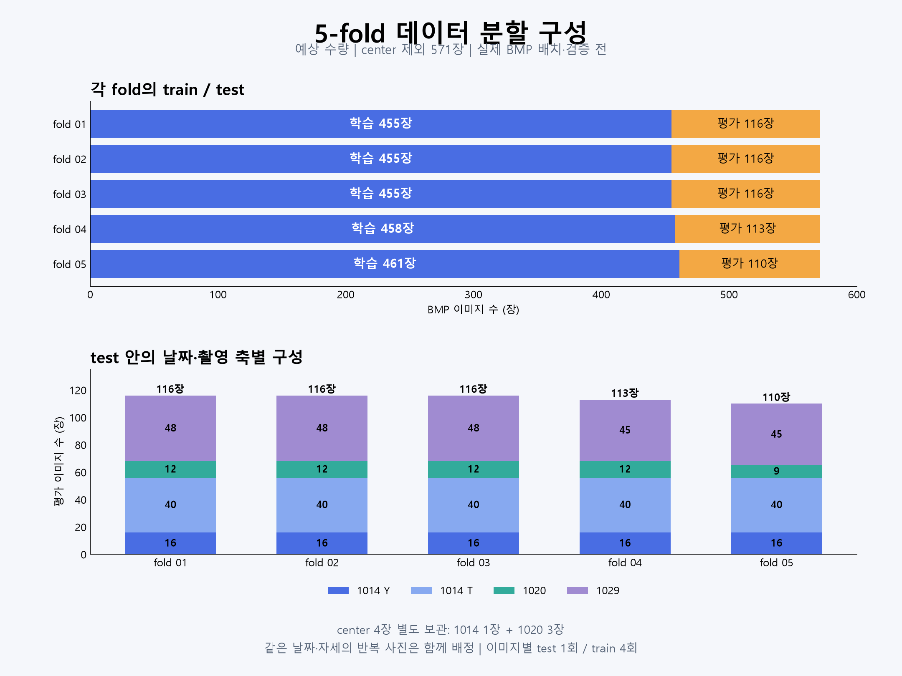
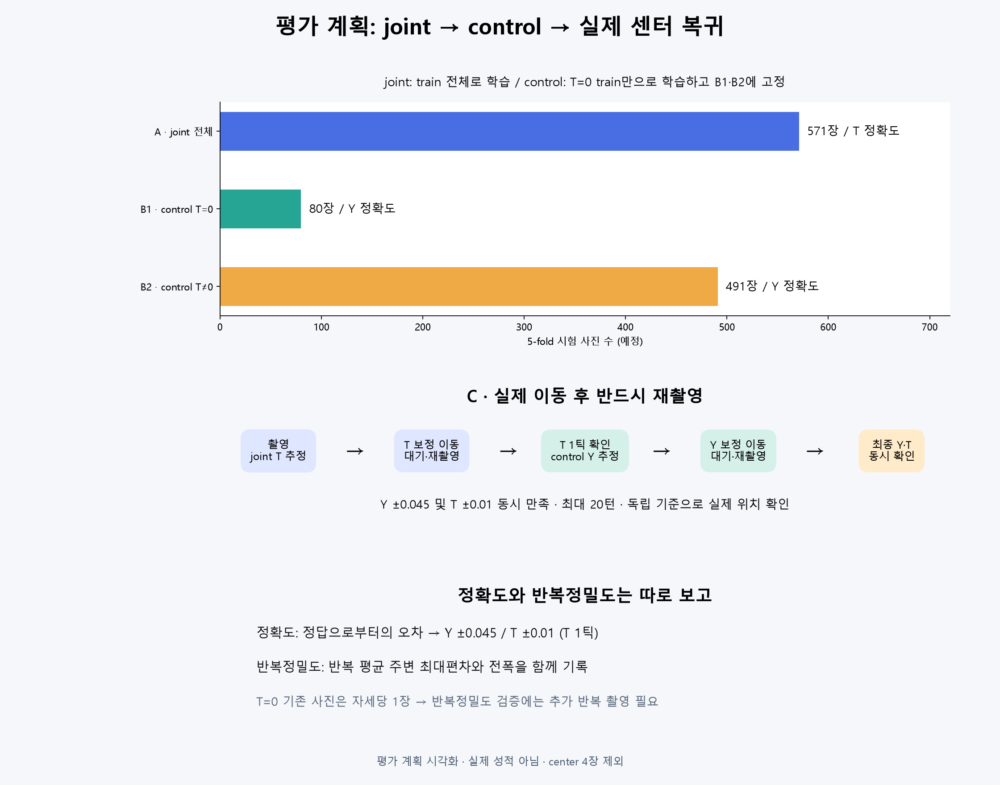

# 날짜를 보존한 그룹 5-fold 데이터셋

작성일: 2026-11-04. **현재 상태: 그룹 분할과 실제 BMP 배치·SHA-256 검증 완료. 학습·평가는 미실행.** 원본 575장(분할 대상 571장, center 4장)을 보존하고 5개 fold에 2,855장, 별도 center에 4장, 총 2,859개 BMP를 복사했다. 표의 fold별 합계는 확정 배정에서도 일치했다. 1029의 2장·4장 그룹이 있어 개별 자세 반복 수는 균일하지 않다.

확정 파일은 [fold별 라벨 목록](_metadata/fold_labels.md), [이미지·라벨·해시 목록](_metadata/images.csv), [그룹 배정표](_metadata/assignments.tsv), [날짜별 실제 수량](_metadata/counts.csv), [검증 결과](_metadata/integrity_checks.json)를 참조한다. CSV/TSV는 검증 기록이며 학습·평가용 사진은 폴더 안의 실제 BMP다.

## 예상 분할 수량 시각화



그림은 예상 수량으로 작성했으며 이번 확정 배정에서도 fold별·날짜별 합계가 일치함을 확인했다.

## 1. 데이터 위치와 폴더 구조

정제 원본은 `../clean/clean_20261014`, `../clean/clean_20261020`, `../clean/clean_20261029`에 보존한다. 이 데이터셋에는 CSV 목록 대신 실제 BMP 이미지를 배치하고 원래 파일명을 유지한다. 원본을 이동하거나 덮어쓰지 않는다.

```text
data/fivefold_seed20261104/
├── README.md
├── center/
│   ├── 20261014/                 # center BMP 1장
│   └── 20261020/                 # center BMP 3장
├── fold_01/
│   ├── train/
│   │   ├── 20261014/
│   │   │   ├── Y/*.bmp
│   │   │   └── T/*.bmp
│   │   ├── 20261020/*.bmp
│   │   └── 20261029/*.bmp
│   └── test/
│       ├── 20261014/
│       │   ├── Y/*.bmp
│       │   └── T/*.bmp
│       ├── 20261020/*.bmp
│       └── 20261029/*.bmp
├── fold_02/                     # fold_01과 동일한 구조
├── fold_03/
├── fold_04/
└── fold_05/
```

날짜 폴더는 train/test 각각에서 유지한다. 1014의 Y/T 구분은 촬영 축 구분이며 joint/control 모델 구분이 아니다. center는 모든 fold에 공통으로 별도 보관하며 train/test에 넣지 않는다. 1029에는 원 방법론상 center가 없다. 날짜별 center 보관은 시험 날짜 center를 이용한 재영점 허용을 의미하지 않는다. 영상 정합에는 기존에 고정한 `assets/center.bmp`를 사용한다.

## 2. 사용 사진과 제외 사진

| 날짜 | 원본 BMP | center 별도 보관 | train/test 분할 대상 |
|---|---:|---:|---:|
| 20261014 | 281 | 1 | 280 (Y 80, T 200) |
| 20261020 | 60 | 3 | 57 (19자세 × 3장) |
| 20261029 | 234 | 0 | 234 (78자세 × 3장) |
| 합계 | 575 | 4 | 571 |

파일명에서 읽은 Y/T 명령은 평가용 정답이며 독립 계측한 실제 자세가 아니다. 데이터 준비·평가 도구만 정답을 읽는다. 추론 함수에는 BMP 영상만 제공하며 파일명, 명령값, 날짜, 반복 번호, fold 번호로 정답을 알려주지 않는다.

## 3. train/test 분할 방법

1. 원본 경로와 BMP SHA-256을 기록하고 center 4장을 분리한다. center 판별 근거와 원본 경로를 남긴다.
2. 그룹 키는 `(촬영 날짜, 자세 ID)`로 정한다. 실제 Y/T 및 파일 목록과 대조해 자세 ID를 확인한다. 같은 날짜·같은 자세의 반복 3장은 한 그룹으로 묶는다. 반복 번호만 다른 사진을 따로 나누지 않는다. 1014도 실제 자세와 반복 구성을 확인하고 그룹을 만든다.
3. 층은 `1014_Y`, `1014_T`, `1020`, `1029` 네 개다. 각 층에서 그룹 ID를 정렬해 초기 순서를 고정하고, seed `20261104`와 층 ID로 구분한 독립 난수 흐름으로 그룹 목록을 섞는다. 구현 시 난수 엔진, 층별 seed 유도식, shuffle 알고리즘과 버전을 기록한다. 실제 구현과 배정은 아래 코드 및 `_metadata/assignments.tsv`로 확정했다.
4. 섞인 그룹 목록을 fold 1~5에 연속 구간으로 균등 배정한다. 그룹 수를 5로 나눈 나머지만큼 앞 fold부터 1그룹씩 추가한다. 이미지 수가 아니라 그룹 수로 균등 배정한다.
5. fold k의 test에는 k에 배정된 그룹을 넣고, train에는 나머지 네 fold의 그룹을 넣는다. 각 집합 안에서 날짜별 폴더를 유지한다. 서로 다른 날짜 이미지를 하나의 폴더로 합치지 않는다.
6. 경로 중복·동일 바이트 이미지 중복을 검사한다. 중복이 있으면 다른 test fold로 흩어 놓지 않는다. 서로 다른 자세 그룹에 중복이 걸리면 누출 방지를 위해 관련 그룹을 함께 다루고 재배정 근거와 수량 변화를 기록한다. 표에 맞추려고 중복을 숨기거나 이미지를 삭제하지 않는다.
7. 생성 후 이미지별 그룹·test fold·원본 해시와 배정 알고리즘을 별도 검증 기록으로 남긴다. seed만으로 플랫폼 간 동일 분할을 보장하지 않는다. 확정된 실제 배정과 BMP 목록이 정본이다.

각 원본 이미지는 5개 fold 전체에서 test에 정확히 1번, train에 4번 나타난다. 동일 fold 안에서는 train/test의 사진·그룹·중복 이미지가 겹치면 안 된다. fold 간 train 중복은 의도된 구성이다.

### 예상 배정 수량

아래는 원 방법론의 그룹 구성이 확인되고 중복·비정상 그룹이 없을 때의 예상이다.

| fold | test 1014 Y | test 1014 T | test 1020 | test 1029 | 전체 test | 전체 train |
|---|---:|---:|---:|---:|---:|---:|
| 01 | 16 | 40 | 12 | 48 | 116 | 455 |
| 02 | 16 | 40 | 12 | 48 | 116 | 455 |
| 03 | 16 | 40 | 12 | 48 | 116 | 455 |
| 04 | 16 | 40 | 12 | 45 | 113 | 458 |
| 05 | 16 | 40 | 9 | 45 | 110 | 461 |
| test 합계 | 80 | 200 | 57 | 234 | 571 | — |

날짜별 train 수량은 해당 날짜 전체 사용 사진 수에서 해당 fold의 test 수량을 뺀 값이다. 80/20은 그룹 기준이며 모든 날짜가 매번 정확히 20% 사진 수로 나뉘는 것은 아니다.

## 4. 최신 평가 계획: 세 가지 시험을 구분한다

2026-11-04 사용자 최신 지시를 적용한다. 이전 방법론의 control 잔여 T 학습·보정 정책은 이번 평가에 적용하지 않는다. 목표의 단일 원본은 [공통 규칙](../../ALGORITHM_RULES.md)의 최신 항목이다. 아래 수치는 그 항목을 쉽게 설명한 것이다.



| 평가 | 학습에 쓰는 사진 | 시험에 쓰는 사진 | 알고 싶은 것 |
|---|---|---|---|
| A. joint | 해당 fold train 전체 | 해당 fold test 전체 | Y와 T가 함께 틀어져도 T를 1틱 이내로 추정하는가? |
| B1. control 기본 | 해당 fold train 중 T=0만 | 해당 fold test 중 T=0만 | T가 맞춰졌을 때 Y를 정확히 추정하는가? |
| B2. control 범위 | B1 모델 그대로 고정 | 해당 fold test 중 T≠0 | T가 조금 남으면 Y가 얼마나 틀어지는가? |
| C. 실제 복귀 | 평가 시작 전 모델 고정 | 새로 수행하는 실제 이동·재촬영 시행 | T를 맞추고 Y를 맞춘 뒤 실제 센터에 돌아오는가? |

날짜 폴더는 계속 분리한다. A는 각 fold의 날짜별 train을 함께 읽되 BMP를 한 폴더로 합치지 않는다. B1은 날짜와 관계없이 T=0인 train만 선택한다. 현재 center 제외 라벨 목록에서는 1014/Y 80장만 T=0이고, 그 외 491장은 T≠0이다. 따라서 기본 control은 fold당 64장 학습·16장 시험이 예상된다. 1020/1029의 T=0 시험 성능은 자료가 없으므로 `해당 자료 없음`으로 표시한다.

### 4.1 ± 허용범위와 반복정밀도는 어떻게 읽나?

Y는 ±0.045, T는 ±0.01 안인지 비교한다. **±는 한쪽 폭이므로 전체 띠의 폭은 Y 0.09, T 0.02다.** 예전의 “Y 전폭 0.045” 보조 조건과 섞지 않는다. T의 0.01은 사용자 정의 1틱이며 Y 0.045를 Y 장비 1틱이라고 임의 해석하지 않는다.

두 가지 표를 반드시 따로 낸다.

- **정확도:** 정답을 중심으로 오차가 허용범위 안인가? joint는 `|예측 T-정답 T|≤0.01`, control은 `|예측 Y-정답 Y|≤0.045`를 채점한다.
- **반복정밀도:** 같은 자세를 반복했을 때 출력이 얼마나 흔들리는가? 이 문서의 보고 정의는 반복 평균을 중심으로 한 최대 절대편차다. Y 편차가 0.045 이하, T 편차가 0.01 이하인지 보고하고, `최댓값-최솟값`인 전폭도 함께 적는다. 평균 중심 정의는 실행 전 고정하는 보고 규약이며 장비 인증 규격을 뜻하지 않는다.

예를 들어 Y 정답이 0인데 반복 예측이 0.100, 0.101, 0.102라면 흔들림은 ±0.001로 작지만 모두 정답에서 0.045 이상 벗어난다. 반복정밀도가 좋아도 센터를 정확히 찾은 것은 아니다. 반대로 정답 근처에 오더라도 반복마다 크게 흔들리면 안정적이지 않다. 평균 편향, 정답 기준 최대오차, 평균 중심 최대편차, 전폭을 함께 보여준다.

### 4.2 공통 채점 규칙

각 fold의 모델은 자기 train으로만 학습한다. 계수·가중치·정규화 등 배우는 값은 train에서만 구하며 test로 조정하지 않는다. B1의 T=0 학습 조건은 이런 모든 학습값에 적용된다. T≠0 사진으로 잔여 T 보정값을 배우면 이번 B1 조건과 달라진다. T=0 회귀로 식별할 수 없는 T 보정 계수를 임의 적합하지 않는다.

모델에는 영상만 준다. 평가 도구가 파일명 정답을 읽어 채점한다. “T=0 가정”은 학습·운용 조건이며 사진 파일명에서 실제 T를 읽어 추론기에 알려주는 기능이 아니다. center는 어떤 회귀 학습·시험에도 넣지 않는다.

실패·보류 사진도 배정된 시험 분모에 남긴다. 예측 실패를 정상 (0,0)으로 채우지 않는다. 통과율은 `통과 수/전체 배정 시험 수`다. MAE·p95·최대오차는 유효 예측에서 계산하고 유효 수를 함께 쓴다. p95는 오차를 오름차순 정렬한 후 `ceil(0.95×유효 수)`번째 값으로 고정한다. 빈 집합은 0점 대신 `자료 없음`으로 기록한다.

## 5. 평가를 실행하는 순서와 이유

### 평가 A: joint는 전체 평가셋으로 T를 시험한다

1. fold 01의 train 전체로 joint를 학습하고 모델을 저장한다. **이유:** Y가 0이 아니어도 T를 맞춰야 하므로 혼합 자세를 포함한다.
2. fold 01의 test 전체를 한 장씩 예측한다. T=2 같은 큰 자세도 빼지 않는다. **이유:** 어려운 사진을 제외하면 전수 성능이 과장된다.
3. T 정답·예측·절대오차·1틱 통과 여부와 실패 사유를 남긴다. Y 출력은 참고로만 기록한다.
4. fold 02~05에서도 각각 새 모델을 학습하고 같은 절차를 반복한다. 모든 test 예측을 합치면 OOF 571장이 예정된다. **이유:** 각 사진을 자신이 학습에 들어가지 않은 모델로 한 번씩 시험하기 위해서다.
5. 날짜별·전체 통과율, T MAE/p95/최대오차, 실패 수, 시간을 보고한다. 날짜별 성적이 나쁜데 전체 평균만 좋다고 결론 내리지 않는다.

### 평가 B1: control은 T=0 사진만으로 학습하고 평가한다

1. 각 fold의 train에서 T=0만 선택한다. 현재는 1014/Y 64장이 예상된다. **이유:** 먼저 회전이 제대로 맞춰졌다는 가정 아래 Y 추정 자체를 확인하기 위해서다.
2. 그 자료만으로 Y 모델을 적합하고 고정한다. T≠0 train이나 test로 계수·보정값·문턱을 고르지 않는다.
3. 같은 fold의 test 중 T=0만 평가한다. 현재는 1014/Y 16장씩, 다섯 fold 합계 80장이 예상된다.
4. Y 절대오차 ±0.045 통과율과 MAE/p95/최대오차·실패·시간을 보고한다. 1014/Y는 자세당 한 장이므로 이 자료만으로 같은 자세의 반복정밀도를 측정했다고 쓰지 않는다. **정확도와 반복정밀도는 서로 다른 시험이다.**

### 평가 B2: control이 잔여 T를 어디까지 견디는지 시험한다

1. B1에서 학습한 해당 fold 모델을 그대로 사용한다. 재학습하지 않는다. **이유:** T=0 가정이 깨질 때 얼마나 성능이 변하는지를 보기 위해서다.
2. 해당 fold test 중 T≠0인 모든 사진을 예측한다. 현재 예정 분모는 전체 OOF 491장이다. 1014/T는 Y=0, 1020/1029는 Y≠0 조건이므로 날짜·Y 조건을 나눠 보고한다.
3. Y 오차를 정답 T의 크기별로 집계한다. 예시 구간은 `0<|T|≤0.01`, `0.01<|T|≤0.03`, `0.03<|T|≤0.10`, `0.10<|T|≤0.30`, `0.30<|T|≤1`, `|T|>1`이다. 구간은 겹치지 않으며 T=0 기본 성적은 별도다.
4. 각 구간의 사진 수·자세 수·Y 통과 수/전체 수·MAE/p95/최대오차·실패 수를 쓴다. 혼합 자세는 가능한 한 실제 T 라벨별 표도 낸다. 자료가 없는 구간은 빈칸 또는 자료 없음으로 표시한다.
5. 잔여 T 한계를 요약할 때는 `|T|≤r`의 누적 성적도 함께 낸다. 한 장만 있는 구간의 통과로 넓은 안전 범위를 보장하지 않는다. 특정 구간에서 좋아졌다 나빠지는 결과도 숨기지 않는다.
6. 이 결과를 보고 운용 허용 T를 고르면 개발용 선택임을 명시하고 새 촬영으로 확인한다. 선택 후 같은 B2 점수를 독립 성능이라고 부르지 않는다. 시험 정답 T로 구간을 나눈 것은 사후 분석이며 실제 장비가 T를 정확히 안다는 의미가 아니다.
7. 1020/1029 반복 사진으로 Y 출력 반복편차와 전폭도 보고한다. 2장·4장 예외는 반복 수를 적는다. T=0 반복 촬영을 새로 확보해야 기본 운용 조건의 반복정밀도를 직접 확인할 수 있다.

### 평가 C: 두 단계를 거쳐 실제로 센터로 돌아오는지 시험한다

정지 사진을 순서대로 나열하는 것으로 대신할 수 없다. T를 움직이면 다음 영상이 달라지고 Y 이동으로 T도 영향을 받을 수 있기 때문이다. 새 실제 시행마다 다음 순서로 진행한다.

1. 시작 Y/T 조건과 모델 버전을 기록한다. 시작 자세·반복 시행 수·최대 20턴·정지 판정·이동량 제한·촬영 대기시간을 실행 전에 고정한다. 특정 방향·작은 자세만 골라 시험하지 않는다.
2. **촬영 → joint로 T 추정 → 장비의 검증된 부호/단위/이동 제한으로 T 보정 이동 → 정지 대기 → 재촬영.** 추정값의 부호를 확인 없이 그대로 명령에 연결하지 않는다.
3. 새 영상으로 잔여 T가 1틱 이내인지 확인한다. 실제 운용의 단계 전환 판단에는 사용 가능한 추정/측정만 사용한다. T가 여전히 크거나 측정 실패면 control을 강행하지 않고 T 재정렬 또는 실패로 기록한다.
4. **새 영상 → control로 Y 추정 → Y 보정 이동 → 정지 대기 → 재촬영.** 이전 사진을 재사용하지 않는다. **이유:** 이동 후의 현재 상태를 보아야 하기 때문이다.
5. 최종 사진·독립 기준기로 실제 잔여 Y/T를 확인한다. **Y ±0.045, T ±0.01을 동시에 만족해야 센터 복귀 성공**이다. Y가 맞아도 T가 벗어나면 성공이 아니다. 필요하면 다시 joint 단계로 돌아가되 총 20턴 제한을 지킨다. 턴은 보정 이동 1회로 세고 촬영/대기 횟수도 따로 기록한다.
6. 같은 시작 조건에서 복귀를 반복해 최종 위치의 평균 편향·반복 평균 중심 최대편차·전폭을 Y/T 각각 보고한다. 각 시행의 허용범위 동시 충족률과 반복정밀도 충족 여부를 따로 적는다.
7. 시행별 시작·각 단계 추정·실제 명령·이동 후 측정·최종 잔차·턴 수·총 시간·실패 이유를 기록한다. 성공률 분모에는 최대 턴 초과, 추적 실패, 보류 등 시작된 모든 평가 시행을 넣는다.

최종 실제 위치 검증에는 가능하면 추정기와 독립된 계측을 사용하고 분해능·불확도를 기록한다. 자기 추정값만 0 근처라는 사실은 실제 센터 도착 증거와 구분한다. 독립 기준이 없으면 `영상 기반 자기 점검`으로 표시하고 실제 복귀 정확도 확정은 보류한다. 장비가 목표 띠보다 충분히 정밀한지 확인하지 않고 소수점 자리수만으로 정확도를 주장하지 않는다.

### 팀원이 작성할 결과표

| 시험 | 날짜/조건 | 배정 수 또는 시행 수 | 유효 수 | 통과 수/전체 수 | MAE/p95/최대오차 | 반복편차/전폭 | 시간·턴 | 상태 |
|---|---|---|---|---|---|---|---|---|
| A joint | 날짜별·전체 | 미실행 | — | — | T 기준 | 가능한 반복 그룹 | 처리시간 | 미실행 |
| B1 control | T=0 | 미실행 | — | — | Y 기준 | 기존 사진은 반복 부족 | 처리시간 | 미실행 |
| B2 control | 날짜·잔여 T 구간별 | 미실행 | — | — | Y 기준 | 반복 수 병기 | 처리시간 | 미실행 |
| C 실제 복귀 | 시작 자세별·전체 | 미실행 | — | Y/T 동시 통과 | 최종 잔차 | 반복 복귀 기준 | 총시간·턴 수 | 미실행 |

빈칸을 0으로 채우지 않는다. 수치 예시는 설명용이고 실제 결과는 실행 후 채운다. 시험 결과로 후보를 비교할 때도 사진·분할·분모를 동일하게 유지한다.

## 6. 비전공자를 위한 단계별 실행 안내

### Step 1. 용어와 라벨 이해하기

라벨은 사진의 정답표다. 여기서는 파일명에 적힌 Y/T 이동 명령을 정답으로 쓴다. Y는 이동 축, T는 회전 축의 명령값이며 물리 단위·부호는 공통 규칙과 장비 정의를 따른다. 임의로 mm나 도로 바꾸지 않는다. `(Y,T)`가 같으면 같은 명령 자세다. 실제 장비가 명령과 정확히 같은 위치에 도착했다는 독립 측정은 아니다.

| 항목 | 뜻 | 예시 |
|---|---|---|
| Y 라벨 | Y축 명령 정답 | `Y+0.05` → +0.05 |
| T 라벨 | 회전축 명령 정답 | `T+0.10` → +0.10 |
| 반복 번호 | 같은 명령 자세를 다시 찍은 순번 | `(1)`, `(2)`, `(3)`; 회귀 정답은 아님 |
| 날짜 | 촬영 조건을 구별하는 정보 | 20261020; 예측 입력으로 사용하지 않음 |
| 그룹 | 함께 분할할 사진 묶음 | `20261020_Y+0.05_T+0.10` |
| train | 모델이 계산 규칙을 배우는 사진 | 연습 문제에 해당 |
| test | 학습에 쓰지 않고 마지막에 채점하는 사진 | 시험 문제에 해당 |
| fold | 시험 담당 그룹을 바꿔 가는 한 번의 실행 | fold 01~05, 총 다섯 번 |
| seed | 난수 발생기의 시작 번호 | 20261104 |
| OOF | 각 사진을 학습하지 않은 모델이 낸 시험 예측 모음 | 사진당 1개, 총 571개 예정 |

`Y+0.05 T+0.10 (2).bmp`의 정답은 Y=+0.05, T=+0.10이고 반복 번호는 2다. `Y+0.10.bmp`는 1014 단독축 촬영 정의상 Y=+0.10, T=0이다. `T-0.20.bmp`는 Y=0, T=-0.20이다. 비활성 축의 0은 데이터 준비 단계에서 해석하는 라벨이며 운용 중 모델에 알려주는 힌트가 아니다.

### Step 2. 날짜별 실제 라벨 확인하기

기존 worktree `S15P31A507/data/clean/clean_<날짜>/_metadata/manifest.csv`의 파일명 명령 열을 읽어 아래 구성을 확인했다. 이는 메타데이터 확인이며 BMP 해시·디코딩 재검증 완료를 뜻하지 않는다. 파일마다의 자세 목록은 [label_inventory.md](label_inventory.md)에 전부 정리했다. 확정 fold 배정은 [_metadata/fold_labels.md](_metadata/fold_labels.md)에서 확인한다.

| 폴더 대상 | 실제 라벨 구성 | 사진 수 |
|---|---|---:|
| 1014/Y | Y=±0.05부터 ±2.00까지 0.05 간격, T=0; 자세당 1장 | 80 |
| 1014/T | T=±0.01부터 ±1.00까지 0.01 간격, Y=0; 자세당 1장 | 200 |
| 1020 | Y=+0.05,+0.10,+0.50,+1.00의 혼합 자세 19쌍; 각 3장 | 57 |
| 1029 | Y=+0.05 고정, T=+0.04~+0.82 중 +0.10 제외, 78쌍 | 234 |
| center/1014 | Y=0,T=0, `center.bmp` | 1 |
| center/1020 | Y=0,T=0, `center1.bmp`~`center3.bmp` | 3 |

**1029 예외:** 파일명 명령 기준 T=+0.32는 2장, T=+0.33은 4장이다. 나머지는 각 3장이다. 따라서 기존의 “78자세 모두 3장” 가정은 실제 메타데이터와 다르다. 파일명 오기인지 실제 촬영 차이인지 아직 확인하지 않았으므로 라벨을 임의 수정하지 않는다. 현재 라벨 기준으로 각각 2장·4장 그룹을 보존하면 test 장수는 예상 표·그래프와 달라질 수 있다. 해당 표와 그림은 계속 예상 자료로만 사용한다.

**이유:** 라벨을 잘못 읽으면 맞는 예측도 틀린 것으로 채점할 수 있다. +0.1과 +0.10은 같은 수치로 정규화하되 파일명은 보존한다. 동봉 TXT의 `Y_Actual/T_Actual`은 파일명 명령과 다른 정보이며 좌표계·단위를 확인하지 않고 섞어 쓰지 않는다.

### Step 3. 반복 사진을 그룹으로 묶기

1014는 확인한 라벨상 자세당 1장이므로 Y 80그룹과 T 200그룹을 각각 섞는다. 1020·1029는 같은 날짜·같은 `(Y,T)`를 하나의 그룹으로 묶는다. 1029의 2장·4장 예외도 해당 라벨 그룹 그대로 보존한다.

**이유:** 같은 자세의 사진 2장을 학습하고 나머지 1장을 시험하면 이미 본 자세를 다시 찍는 능력을 평가한다. 이번 목적은 학습하지 않은 자세를 추정하는 능력이므로 반복 전체를 함께 시험에 둔다. 함께 배정하면 반복 사진도 동일 모델로 예측되어 흔들림을 비교하기 쉽다. 1014 Y/T를 따로 섞는 이유는 Y 또는 T 한쪽 사진만 특정 fold에 몰리지 않게 하기 위해서다.

### Step 4. 그룹을 랜덤화하고 fold 정하기

실제 랜덤화 소스는 [tool/fivefold_group_split.cpp](../../tool/fivefold_group_split.cpp)다. 이미지가 아닌 **그룹 ID 목록**을 입력받아 각 그룹의 test fold를 출력한다. 컴파일·실행을 완료했다. BMP 복사·중복 검사·라벨 추출은 [materialize_fivefold.ps1](../../tool/materialize_fivefold.ps1)이 수행한다. 사용한 컴파일러는 설치된 MSVC Build Tools 18이며 팀 기준 v141의 수치 알고리즘 빌드·성능 검증과는 별개다.

알고리즘은 다음 순서로 고정했다.

1. 입력의 네 층은 `1014_Y`, `1014_T`, `1020`, `1029`다. 그룹 ID는 날짜와 Y/T를 포함한 고정 소수점 ASCII로 작성한다. 예: `20261020_Y+0.05_T+0.10`.
2. 각 층의 그룹 ID를 문자열 오름차순 정렬한다. 폴더를 읽는 순서가 달라도 초기 순서가 같도록 하기 위해서다.
3. `std::mt19937` 난수 엔진을 사용한다. 층 순서대로 seed는 20261104, 20261105, 20261106, 20261107이다. 층을 바꾸거나 임의의 실행 seed를 다시 뽑지 않는다.
4. Fisher–Yates 방식으로 목록 끝부터 무작위 위치와 교환한다. 위치 추첨에는 rejection sampling을 적용해 나머지 연산의 편향을 피한다. `std::shuffle` 구현 차이 대신 소스에 명시한 교환 절차를 사용한다.
5. 섞인 목록을 앞에서부터 fold 1~5의 test 그룹으로 나눈다. 19그룹은 4/4/4/4/3, 78그룹은 16/16/16/15/15다. 나머지 네 묶음이 그 fold의 train이다.

예시 입력 `groups.tsv`는 헤더 없이 한 줄에 `층 이름`, 탭, `그룹 ID`를 쓴다. 각 그룹은 한 번만 적으며 네 층을 모두 포함해야 한다. 아래는 형식 예시이며 전체 입력이 아니다.

```text
1014_Y<TAB>20261014_Y+0.05_T+0.00
1014_T<TAB>20261014_Y+0.00_T+0.01
1020<TAB>20261020_Y+0.05_T+0.10
1029<TAB>20261029_Y+0.05_T+0.04
```

`<TAB>`은 실제 탭 문자로 바꾼다. Visual Studio x64 개발자 명령 프롬프트에서 저장소 루트 기준 명령은 다음과 같다. 생성 파일은 실험 작업 폴더에 둔다.

```bat
cl /nologo /EHsc /std:c++17 /utf-8 tool\fivefold_group_split.cpp /Fe:fivefold_group_split.exe
fivefold_group_split.exe groups.tsv > assignments.tsv
```

출력에는 `stratum`, `group_id`, `test_fold`가 들어간다. TSV는 배정 근거를 남기는 보조 기록이며 실제 학습/시험 데이터는 요청한 폴더의 BMP다. 배정표를 확인한 다음 이미지를 배치한다. seed와 코드만 같아도 입력 그룹 ID나 그룹 구성이 다르면 결과는 달라지므로 입력·출력·소스 해시를 함께 보관한다.

**확인:** test 성적을 보고 seed를 바꾸거나 좋은 성적이 나오는 분할을 고르지 않는다. 라벨 범위 분포는 평가 전에 점검하고, 추가 층화가 필요하면 방법을 먼저 수정·기록한 후 모든 후보에 같은 분할을 적용한다.

### Step 5. BMP를 배치하고 누출 검사하기

그룹의 test fold가 2라면 해당 그룹의 모든 BMP는 `fold_02/test/<날짜>/`에 들어간다. 같은 BMP는 fold 01·03·04·05의 train에 들어간다. 원본을 보존하며 날짜와 원래 파일명을 유지한다.

**확인:** 각 fold에서 train/test 사진과 그룹이 겹치지 않는지, 동일 이미지 해시가 양쪽에 나타나지 않는지, 각 이미지가 test 1회·train 4회인지 확인한다. 1029 예외를 반영한 실제 수량을 보고한다. 파일을 복사만 해 놓고 이런 검사를 생략하면 이미 본 사진으로 시험을 보는 실수를 발견하기 어렵다.

### Step 6. 모델을 학습하고 고정하기

모델은 영상에서 얻은 이동·기울기와 라벨 사이 관계를 train으로 학습한다. 학습이 끝난 모델로만 test를 예측한다. 영상 처리 기준과 자료에서 배우는 보정값을 구분한다. 자료에서 배우는 값은 반드시 train에서만 구한다. 후보 조정이 필요하면 train 안을 다시 그룹 단위로 나눠 선택한다.

**이유:** test를 보고 계수나 문턱을 고치면 시험 문제를 보며 공부한 셈이다. 이 경우 test 성적이 실제 미학습 사진 성능보다 좋아질 수 있다. 날짜 폴더 분리와 학습 조건을 구분하고 4절의 joint 전체 학습/control T=0 전용 학습 정책을 따른다.

### Step 7. 사진별 예측과 실패를 먼저 기록하기

모델에는 영상만 주고 Y/T 예측을 얻는다. 이후 평가 도구가 정답과 비교한다. 결과 기록에는 날짜, 원본 경로, 그룹 ID, test fold, 후보/모델 ID, Y/T 정답과 예측, 성공/실패, 실패 사유, 처리 시간을 남긴다. 기록용 정보와 모델 입력은 구분한다.

실패 예시는 영상 읽기 실패, 추적 실패, 계산 불능, 운용 전제 미충족으로 인한 보류다. 사유를 구분하며 실패 사진을 목록에서 삭제하지 않는다. 영상 측정 성공은 허용오차 통과와 다른 개념이다. 숫자가 나왔어도 틀릴 수 있다.

### Step 8. 오차와 통과 여부 계산하기

절대오차는 `|예측 - 정답|`이다. 예를 들어 정답 T=0.100, 예측 T=0.106이면 T 절대오차는 0.006이다. 음수와 양수 오차가 서로 상쇄되지 않도록 절댓값을 쓴다. 아래 수치는 계산 설명용 예시이며 실험 결과가 아니다.

| 지표 | 쉬운 뜻 | 계산·해석 |
|---|---|---|
| 통과율 | 기준 안에 맞힌 사진 비율 | 통과 수 ÷ 전체 배정 test 수 × 100 |
| MAE | 보통 어느 정도 틀리는지 | 유효 예측의 절대오차 합 ÷ 유효 예측 수 |
| p95 오차 | 큰 오차 쪽까지 보면 어느 정도인지 | 오차 정렬 후 95백분위; 실행 시 계산 방식을 고정 |
| 최대오차 | 가장 크게 틀린 유효 예측 | 유효 예측 중 가장 큰 절대오차 |
| 실패율 | 아예 예측하지 못하거나 보류한 비율 | 실패·보류 수 ÷ 전체 배정 test 수 |
| 시간 중앙값/p95 | 보통 속도와 느린 쪽 속도 | 동일 기기·Release·스레드 조건으로 측정 |

joint는 T 정렬용이므로 T 오차를 주 평가하고, control은 Y 정렬용이므로 Y 오차를 주 평가한다. 현재 허용오차는 연결한 공통 규칙의 최신 단계별 기준을 확인해 결과에 기록한다. 두 모델을 임의의 같은 문턱으로 채점하지 않는다.

예를 들어 test 116장 중 110장만 예측되고 100장이 통과했다면 통과율은 `100/116=86.2%`다. `100/110=90.9%`를 전체 통과율이라고 쓰면 실패 6장이 숨겨진다. MAE는 110장 기준으로 계산하되 반드시 `유효 110/116장`이라고 붙인다.

### Step 9. fold 다섯 번을 합쳐 날짜별·전체 결과 쓰기

다섯 번 모두 새로 학습하고 각자의 test만 채점한다. 다른 fold 모델을 대신 쓰거나 학습 사진의 예측을 최종 점수에 넣지 않는다. 모든 사진은 자기 test fold의 예측 1개를 최종 결과로 낸다.

날짜별 표는 1014, 1020, 1029를 분리하고 joint/control도 분리한다. 전체 OOF는 날짜별 원래 사진 수의 비중대로 통과 수를 합쳐 계산한다. fold 크기가 다르므로 백분율 다섯 개를 단순 평균하지 않는다. 같은 사진을 다섯 번 독립 시험한 것처럼 `571×5`장을 분모로 쓰지 않는다.

### Step 10. 정확도와 반복 정밀도 구분하기

정확도는 정답에 가까운지, 반복 정밀도는 같은 자세를 다시 찍어도 비슷한 답을 내는지다. 반복 예측이 0.101, 0.104, 0.099라면 전폭은 `0.104-0.099=0.005`다. 모두 비슷하게 틀려도 전폭은 작을 수 있으므로 전폭만으로 정확하다고 판단하지 않는다. 1029의 2장·4장 그룹은 실제 반복 수를 표시하고 3장 그룹과 구분한다.

control은 T가 0에 가까운 상태에서 쓰므로 전체 사진 성적과 T≈0 부분 성적을 따로 보여준다. 정답 T로 나눈 분석은 “그런 조건에서 성능이 어떤가”를 사후 확인하는 것이며 실제 운용에서 그 조건을 알아맞혔다는 증거가 아니다. 추정 T로 승인했을 때의 오승인과 거부도 별도로 보고한다.

### Step 11. 비교·최종 결론 작성하기

기준 모델과 후보 모델은 동일 사진·동일 분할·동일 분모로 비교한다. 한 날짜의 악화를 전체 평균으로 가리지 않는다. 통과율뿐 아니라 실패, 최대오차, 반복 전폭, 처리시간을 함께 본다. 후보 중 가장 좋은 것을 고른 점수에는 선택 영향이 있으므로 새 촬영의 고정 모델 시험으로 최종 확인한다. 현재 평가만으로 새 날짜 성능이나 실제 로봇 이동·복귀 성공을 입증했다고 쓰지 않는다.

결과표의 빈칸은 0으로 채우지 말고 `미실행` 또는 `측정 불가(사유)`로 표시한다. 최종 보고에는 실행 코드 버전, 원본/분할 해시, 환경, 적용 허용오차, 날짜별/전체 점수, 실패 사진 목록, 반복 분석, 한계와 채택/보류 이유를 포함한다.

## 7. 생성·검증·실행 상태

- [x] 폴더 구조, 분할 규칙, 평가 방법 명세 작성
- [x] 원본 575장과 날짜·자세·반복 구성 확인
- [x] center 4장 식별 및 별도 배치
- [x] 해시 중복 검사와 그룹 확정
- [x] 난수·shuffle 구현 기록 및 5-fold 배정 확정
- [x] 원본 BMP를 보존하며 각 train/test에 실제 BMP 배치
- [x] fold별 사진·그룹 누출 0, 이미지별 test 1회/train 4회 검증
- [x] 예상 수량과 실제 수량 대조 및 차이 사유 기록
- [ ] 학습·평가 실행, 날짜별·OOF 결과 작성

이미지 생성이나 실험 완료를 이 명세의 예상 표로 대신하지 않는다. 후보 비교 결과·모델·측정 캐시는 이미지 분할 폴더와 분리해 해당 실험 폴더에서 관리한다.

## 8. 근거

- [원 방법론: 문헌 방법 비교와 v3 승격 실험](../../experiments/hye/20261104_110546_문헌방법_v3_그룹분할검증/방법론.md)
- [공통 알고리즘 규칙](../../ALGORITHM_RULES.md)
- [저장소 작업 지침](../../AGENTS.md)

원 방법론의 CSV 중심 배치 대신 사용자 지정 `data/ → fold → train/test → 날짜 → BMP` 배치를 적용한다. center는 별도 보관한다. 원 방법론 파일과 기존 데이터는 보존했다. 최신 평가 조건은 공통 규칙에 추가했으며 이전 control 학습 정책보다 우선한다.

## 실제 생성 기록 (2026-11-04)

- 원본 575장과 복사된 BMP 2,859개 각각의 SHA-256을 검사했다. 원본 내 동일 해시는 0개다. 모든 파일은 복사 후 원본 해시와 일치했다.
- 분할 그룹은 1014 Y 80, T 200, 1020 19, 1029 78개다. 동일 라벨 그룹은 한 test fold에만 배정했다.
- fold별 train/test 수는 455/116, 455/116, 455/116, 458/113, 461/110이다. center는 1장+3장 별도 보관했다.
- 1029에서 `Y+0.05 T+0.33 (3).bmp`라는 이름이 두 번 나오지만 영상 해시는 서로 다르다. 하나는 원본 `Y+0.05 T+0.32/` 아래에 있었다. 파일명 라벨 그대로 T=0.33 그룹으로 배정하고 파일명 충돌분은 날짜 아래 원본 하위 경로를 보존했다. 날짜 폴더는 BMP를 재귀 탐색해야 한다. 원본 파일명·라벨을 임의 수정하지 않았다. 이 예외의 실제 자세는 촬영자 확인이 필요하다.
- 실행 도구: `tool/fivefold_group_split.cpp`(그룹 난수 분할), `tool/materialize_fivefold.ps1`(메타데이터 읽기·원본 해시 검사·BMP 복사·복사 해시 검사·기록 생성).
- 원본 위치: 기존 `S15P31A507/data/clean/`. 복사 완료된 BMP는 원본 위치에 대한 링크가 아닌 독립 파일이다.
- 학습·예측·실제 센터 복귀 평가는 수행하지 않았다. 커밋·push하지 않았다.
