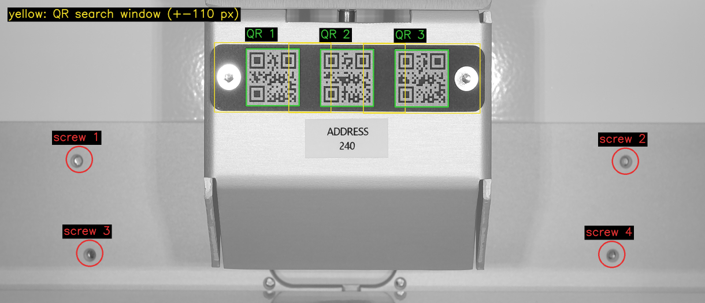
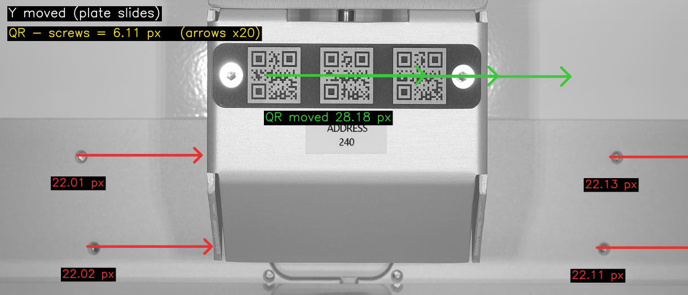
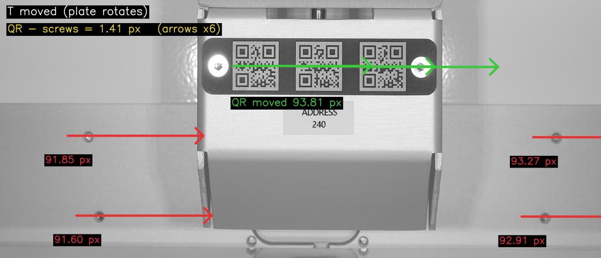
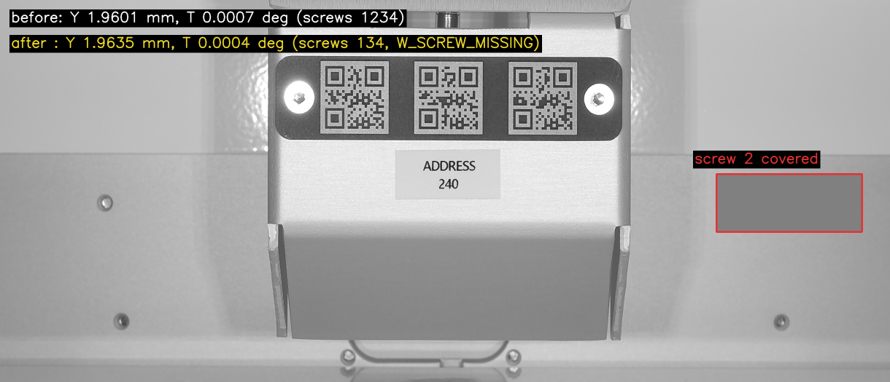
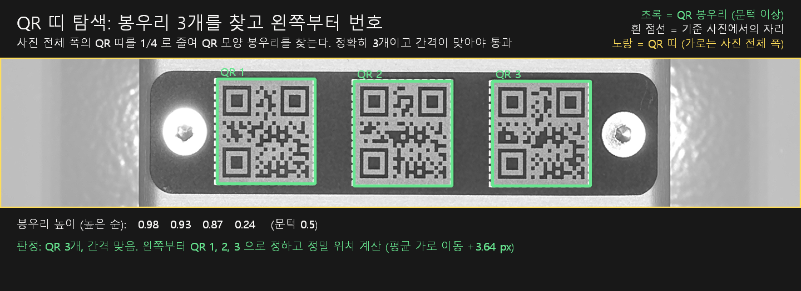

# 01. 개요

> 정확도 수치를 읽기 전에 [평가 조건과 재실행 결과](06_평가_방법/6-1_정확도.md)를 확인한다. 내부 계수 실험의 전처리 라벨, 근처 자세로 추정한 영점, 실제 center 사진을 사용하는 평가는 서로 다르다. 정상 상태도 허용오차 통과를 보장하지 않는다.


이 패키지가 **무슨 문제를 풀고, 어떤 원리로, 어디까지 풀었는지**를 한 문서로 정리했다. README 다음에 가장 먼저 읽는다.

## 1. 요약

### 1-1. 목표

카메라 사진 한 장을 넣으면, QR 판이 기준 위치에서 얼마나 벗어났는지 **Y (mm), T (도)** 를 돌려준다. 로봇은 그 반대 방향으로 움직여 판을 되돌린다.

### 1-2. 측정 대상



| 표시 | 뜻 |
|---|---|
| 초록 상자 | QR 3개 |
| 빨간 원 | 나사 4개 |
| 노란 상자 | QR 을 찾는 범위 |

기준 사진에서 이들의 위치를 알고 있고, 새 사진에서 **각각 가로로 몇 px 움직였는지**를 잰다.

### 1-3. 측정 원리

QR 판과 나사는 카메라에서 본 깊이가 다르다. 그래서 판이 움직이는 방식에 따라 화면에서 다르게 움직인다.

**Y 로 약 2 mm 움직였을 때**: QR 은 28 px, 나사는 22 px 움직인다. 6 px 차이가 난다.



**T 로 약 1도 돌았을 때**: QR 과 나사가 거의 같이 94 px, 92 px 움직인다. 차이는 1 px 남짓이다.



| 알고 싶은 것 | 읽는 방법 |
|---|---|
| T | 전체가 얼마나 움직였나 (1도에 약 80 px) |
| Y | QR 과 나사가 얼마나 다르게 움직였나 (1 mm 에 약 3 px 차이) |

### 1-4. 처리 단계

| 단계 | 하는 일 | 자세한 문서 |
|---|---|---|
| 1 | QR 3개의 가로 이동을 잰다 | [5-1](05_구현_방법/5-1_QR.md) |
| 2 | 나사 4개의 가로 이동을 잰다 | [5-2](05_구현_방법/5-2_나사.md) |
| 3 | 값 5개로 Y, T 를 계산한다 | [5-3](05_구현_방법/5-3_YT계산.md) |
| 4 | 값이 서로 맞는지, 학습한 범위 안인지 점검한다 | [5-4](05_구현_방법/5-4_결과점검.md) |

### 1-5. 결과

| | 값 | 근거 |
|---|---|---|
| 정확도 | 학습에 안 쓴 사진 572장에서 허용오차(Y 0.045 mm, T 0.01도) 밖 0장 | [6-1](06_평가_방법/6-1_정확도.md) |
| 처음 보는 날 | 근처 자세 5장의 명령값으로 영점을 추정한 내부 실험. 현장 center 평가와 다름 | [6-1](06_평가_방법/6-1_정확도.md) |
| 속도 | 한 장 19.2 ms (스레드 1개), 9.6 ms (스레드 4개) | [6-2](06_평가_방법/6-2_속도.md) |

### 1-6. 경고와 실패 알림

나사 하나가 가려지면 나머지 3개로 계산하고 경고(`W_SCREW_MISSING`)를 붙인다.



QR 은 사진 전체 폭의 QR 띠에서 QR 모양 3개를 한 번에 찾고 왼쪽부터 번호를 붙인다. 판이 멀리 가도 다시 찾지 않고, QR 하나가 가려지거나 반사로 망가지면 이웃 QR 을 대신 잡지 않고 실패한다.



잴 수 없으면 틀린 값을 내지 않고 실패로 알린다. 경고와 실패 전체는 [03 상태와 알림](03_상태와_알림.md).

### 1-7. 필수 조건

**매일 로봇을 명령 0 으로 보내 찍은 사진으로 영점을 잡는다.** 로봇의 명령 0 위치가 날마다 다르기 때문이다 ([02 사용법](02_사용법.md) 3절).

---

## 2. 문제 정의

로봇이 QR 이 붙은 판을 카메라 앞에 가져다 놓는다. 판은 정해진 자리(센터)에서 조금 벗어나 있다. **사진 한 장을 보고 판이 센터에서 얼마나 벗어났는지를 잰다.**

| 재는 값 | 뜻 | 단위 |
|---|---|---|
| Y | 판이 옆으로 밀린 양 | mm |
| T | 판이 돌아간 양 | 도 |

로봇은 이 값의 반대 방향으로 움직여 판을 센터로 되돌린다 (보정 이동 = −Y, 보정 회전 = −T).

```
사진 1장 → [이 패키지] → Y (mm), T (도), 상태(정상, 경고, 실패) → 로봇이 −Y, −T 만큼 이동
```

---

## 3. 입력과 출력

### 3-1. 입력

| 항목 | 조건 |
|---|---|
| 사진 | 3840×2160, 8비트. 회색 또는 컬러(BGR, BGRA) |
| 사진에 보여야 하는 것 | QR 3개, 나사 4개 |
| 카메라, 렌즈, 거리, 판 | 학습에 쓴 사진을 찍은 설비와 같아야 한다. 바뀌면 계수를 다시 만든다 |
| 영점 사진 | 그날 로봇을 명령 0 (Y 0, T 0) 으로 보내 찍은 사진 5 ~ 10장 (5-2 의 어려움 때문에 필요하다) |

### 3-2. 출력

| 항목 | 내용 |
|---|---|
| `y_mm`, `t_deg` | 센터에서 벗어난 양 |
| `status` | 정상(구현된 점검 통과, 정확도 보장은 아님), 경고(값은 있지만 정확도가 떨어질 수 있음), 실패(값 없음, 멈춤) |
| `code`, `message` | 경고나 실패의 이유와 다음에 할 일 |
| 확인용 값 | 단계마다 중간 값 (옮긴 코드가 맞는지 비교할 때 쓴다) |

함수와 구조체는 `include/alignment.hpp` 에 있다.

---

## 4. 제공 자료

기업 측에서 네 번에 걸쳐 찍은 사진을 받았다. **정답은 파일 이름에 적힌 로봇 명령값이다.** 따로 잰 정답(측정기 값)은 없다.

| 촬영 | 쓸 수 있는 사진 | 특징 |
|---|---:|---|
| 1차 (10/14) | 280장 | Y 만 움직이거나 T 만 움직인 사진 |
| 2차 (10/20) | 45장 | Y 와 T 를 같이 움직인 사진 |
| 3차 (10/29) | 234장 | Y 와 T 를 같이 움직인 사진 |
| 4차 | 143장 | Y 와 T 를 같이 크게 움직인 사진 |
| 합계 | 702장 | 받은 사진은 715장 |

- 사진의 범위: Y ±2 mm, T ±1도 안.
- 로봇 명령의 한 칸: Y 0.05 mm, T 0.01도.
- 파일 이름 규칙은 [07 학습과 데이터](07_학습과_데이터.md) 1-2.

---

## 5. 어려운 점

### 5-1. Y 와 T 의 구분

판이 옆으로 밀려도(Y), 돌아가도(T) 사진에서는 **QR 이 가로로 움직인다.** QR 하나만 보면 둘을 구분할 수 없다.

구분하는 단서는 QR 과 나사의 **깊이 차이**다. 판이 옆으로 밀리면 카메라에 가까운 것이 더 많이 움직인다. 돌아갈 때는 둘이 거의 같이 움직인다.

| | QR 의 가로 이동 | 나사의 가로 이동 | 둘의 차이 |
|---|---:|---:|---:|
| Y 1 mm | 약 14 px | 약 11 px | 약 3 px |
| T 1도 | 약 80 px | 약 81 px | 약 1 px |

그래서 T 는 "전체가 얼마나 움직였나"로, Y 는 "QR 과 나사의 이동 차이"로 잰다 (그림은 5분 요약). 문제는 그 차이가 작다는 것이다.

| | 값 |
|---|---|
| Y 한 칸 (0.05 mm) 에 생기는 차이 | 약 0.16 px |
| 허용오차 (0.045 mm) 에 해당하는 차이 | 약 0.14 px |

**QR 과 나사의 위치를 0.1 px 보다 훨씬 정밀하게** 재야 한다. 지금 방법의 흔들림은 나사 0.012 px 다 ([부품별 정밀도](06_평가_방법/6-4_부품별_정밀도.md)).

### 5-2. 날마다 다른 명령 0 위치

같은 명령값이라도 촬영한 날에 따라 판이 놓이는 자리가 조금 다르다. 받은 사진에서 구한 차이는 아래와 같다.

| 촬영 | 그날 명령 0 이 공통 0 에서 떨어진 양 (Y) |
|---|---:|
| 1차 | 0.037 mm |
| 2차 | 0.129 mm |
| 3차 | 0.126 mm |
| 4차 | 0.065 mm |

허용오차(0.045 mm)보다 큰 날이 있다. 이 차이는 **사진 한 장만으로는 알 수 없다.** 사진은 판이 어디 있는지만 보여 주고, 로봇이 그 자리를 뭐라고 부르는지는 보여 주지 않기 때문이다.

그래서 **매일 명령 0 에서 사진을 찍어 그날의 0 을 맞춘다** (영점 잡기, [구현 방법 step 0](05_구현_방법/5-0_준비와_영점.md)).

### 5-3. 틀린 값의 알림

나사가 가려지거나, 빛이 바뀌거나, 판이 멀리 가면 값이 틀릴 수 있다. 이때 "정상"이라고 하면서 틀린 값을 내면 로봇이 잘못 움직인다. **믿기 어려운 값은 경고로, 잴 수 없으면 실패로 알려야 한다.**

---

## 6. 목표와 현재 결과

통과 기준: **사진 한 장에서 Y 오차 0.045 mm 이하이고 T 오차 0.01도 이하** (둘 다 만족).

- Y 0.045 mm 는 로봇 한 칸(0.05 mm)보다 작게 잡은 값이다.
- T 0.01도는 로봇 한 칸이다.
- 이 기준은 개발하면서 쓴 값이다. 기업 측의 합격 기준은 8절에서 확인이 필요하다.

| 목표 | 뜻 | 지금 결과 | 자세한 문서 |
|---|---|---|---|
| 정확도 | 처음 보는 사진에서 통과 기준을 만족한다 | 학습에 안 쓴 사진 100% (572장, 5묶음 10번), 마지막 확인 130장 99.2% | [정확도](06_평가_방법/6-1_정확도.md) |
| 처음 보는 날의 정확도 | 회차 하나를 제외해 계수를 학습하는 내부 실험 | 실제 center 평가와 구분 | [6-1](06_평가_방법/6-1_정확도.md) |
| 속도 | 사진 한 장을 빨리 잰다 | 측정만 19.2 ms (스레드 1개), 9.6 ms (스레드 4개). 가운뎃값, 노트북 | [속도](06_평가_방법/6-2_속도.md) |
| 강건성 | 가림, 빛, 흐림, 카메라 변화에 버틴다 | 상황마다 생기는 일과 대처를 표로 정리 | [강건성](06_평가_방법/6-3_강건성.md) |
| 못 잴 때의 알림 | 틀린 값을 조용히 내지 않는다 | 정상, 경고 7가지, 실패 8가지. 경고마다 다음에 할 일을 알려 준다 | [03 상태와 알림](03_상태와_알림.md), [step 4](05_구현_방법/5-4_결과점검.md) |
| 옮기기 쉬움 | 기업 측 환경에 코드를 옮겨 같은 값이 나온다 | C++17, OpenCV 3.4.15. 단계마다 비교할 확인 값과 예제 사진 5장 | [08 포팅 안내서](08_포팅_안내서.md) |
| 계수 다시 만들기 | 설비가 바뀌면 새 사진으로 계수를 다시 만든다 | `train` 하나로 사진 재기부터 정확도 확인까지 | [07 학습과 데이터](07_학습과_데이터.md) 3절 |
| 직접 평가 | 기업 측이 찍은 사진으로 손으로 채점한다 | `score_photos` 가 엑셀용 표를 만든다 | [평가 절차](06_평가_방법/6-5_평가_절차.md) |

### 6-1. 처리 단계 요약

| 단계 | 하는 일 | 문서 |
|---|---|---|
| step 0 | 준비, 그날의 영점 잡기 | [step 0](05_구현_방법/5-0_준비와_영점.md) |
| step 1 | QR 3개의 가로 이동을 잰다 | [step 1](05_구현_방법/5-1_QR.md) |
| step 2 | 나사 4개의 가로 이동을 잰다 | [step 2](05_구현_방법/5-2_나사.md) |
| step 3 | 값 5개로 Y, T 를 계산한다 | [step 3](05_구현_방법/5-3_YT계산.md) |
| step 4 | 값이 서로 맞는지, 학습 범위 안인지 점검한다 | [step 4](05_구현_방법/5-4_결과점검.md) |

---

## 7. 다루지 않은 것과 확인하지 못한 것

| 항목 | 지금 상태 |
|---|---|
| 실제 로봇으로 되돌리기 | **하지 않았다.** 지금 결과는 모두 멈춰 있는 사진을 채점한 것이다. "재고, 옮기고, 다시 재기"를 반복해 센터에 도달하는지는 확인하지 못했다 |
| 독립된 정답 | 없다. 정답이 로봇 명령값이라서, 로봇이 명령대로 못 간 양은 우리 오차에 섞여 있다 |
| 학습 범위 밖 (Y ±2 mm, T ±1도 밖) | T 2도 사진 12장이 있다. 내부 범위 밖 시험은 전처리 라벨 기준으로 95.3%이며 Y 0.31%, T 0.44% 비례 오차가 나왔다. 더 먼 자세는 경고(`W_OUT_OF_RANGE`)를 낸다 ([먼 자세의 T 오차](09_추가_논의/9-2_먼_자세의_T_오차.md)) |
| 4차 촬영의 낮은 정확도 | 처음 보는 날 시험에서 4차가 가장 낮다 (영점 5장으로 86.3%). 원인을 찾지 못했다 |
| 영점 사진 없이 쓰기 | 그날 로봇 0 의 차이가 그대로 오차가 된다. 사진만으로 자동 보정하는 방법은 [영점 자동 보정](09_추가_논의/9-1_영점_자동_보정.md)에 정리했다 |
| 다른 카메라, 렌즈, 거리, 판 | 계수를 다시 만들어야 한다. 그대로는 쓸 수 없다 ([적용 환경과 카메라 화면](09_추가_논의/9-5_적용_환경과_카메라_화면.md)) |
| 세로 방향(X), 높이 | 재지 않는다. Y 와 T 만 잰다 |
| 가장 느린 경우의 시간 | 재지 않았다. 속도 숫자는 정상 사진의 값이다 |
| 실제 현장의 가림, 빛 | 강건성 시험은 사진을 일부러 바꾼 것이다. 현장과 다를 수 있다 |
| 설비 컴퓨터에서의 속도 | 노트북 한 대에서만 쟀다 |

---

## 8. 기업 측과 협의할 사항

| 번호 | 정할 것 | 왜 필요한가 |
|---|---|---|
| 1 | 합격 기준 (Y, T 허용오차와 통과율) | 지금은 Y 0.045 mm, T 0.01도로 개발했다. 기준이 다르면 결과 숫자도 달라진다 |
| 2 | 속도 기준 (ms), 무엇까지 포함하는지 | 사진 읽기를 포함하면 약 180 ms, 측정만이면 10 ~ 20 ms 로 크게 다르다 |
| 3 | 매일 명령 0 사진을 찍을 수 있는지 | 없으면 처음 보는 날 정확도가 31.6% 로 떨어진다 |
| 4 | 평가할 자세의 범위 | 범위 밖 T 2도 사진은 12장으로 제한적이며 더 넓은 현장 검증이 필요하다 |
| 5 | T 명령값의 단위 | 문서에서는 도로 적었다. 로봇 명령 1 이 정확히 1도인지 확인이 필요하다 |
| 6 | 경고일 때 로봇을 더 움직여도 되는지 | 경고마다 action이 다르다. 범위 밖 경고만 있으면 보정 가능하며 대략값은 자동 보정 금지다 |
| 7 | 실패일 때의 처리 | 지금은 값을 내지 않고 멈춘다 |
| 8 | 센터에 도달했다고 보는 기준과 최대 반복 횟수 | 되돌리기 시험을 하려면 필요하다 |
| 9 | 입력 사진의 조건 (크기, 형식, 조명) 이 바뀔 수 있는지 | 3840×2160 만 받는다. 바뀌면 계수를 다시 만든다 |
