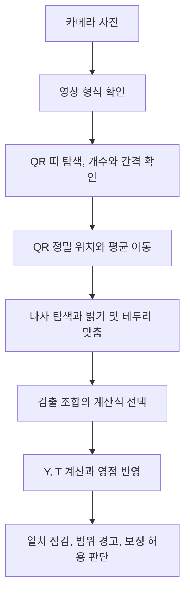

# 알고리즘과 코드 대응

## 전체 흐름



## 1. QR 탐색

구현은 src/steps/01_find_qr.cpp다. reference.json에 QR 3개의 기준 상자를 둔다. 기준 QR을 가우시안 sigma 2.0으로 흐려 정밀 비교 조각을 만든다.

대략 탐색은 사진 전체 가로 폭과 QR 기준 세로 범위에 위아래 40 px 여유를 더한 띠에서 수행한다. 영상을 1/4 크기로 줄여 세 템플릿으로 NCC 비교한다. 상관도 0.5 이상인 봉우리가 정확히 3개여야 하며, 이웃 간격이 기준에서 25 px보다 많이 다르면 거부한다.

정밀 탐색은 대략 위치 주변 +/-8 px에서 수행한다. 상관도 0.8 미만이거나 봉우리가 창 끝에 걸리면 실패다. 봉우리 좌우와 상하 3점으로 포물선 보간을 하고 QR 3개의 가로 이동을 평균한다. 세로 이동은 나사 탐색 위치에 사용하며 Y, T 선형식의 직접 입력은 아니다.

넓은 탐색은 가로 방향의 탐색 개선이다. 사진 전체 세로 영역을 무제한 탐색하는 기능은 아니다. QR이 사진 밖으로 나가거나 세로 띠에서 벗어나면 학습 범위 경고와 별개로 검출에 실패할 수 있다.

## 2. 나사 측정

구현은 src/steps/02_find_screws.cpp다. QR 이동량으로 예상 위치를 잡고 근처 +/-60 px에서 나사를 찾는다. 필요할 때 기준 위치 주변 +/-260 px 탐색을 시도한다. 상관도와 QR 예상 위치로부터의 거리를 검사한다.

초기 위치에서 밝기 차이를 줄이는 맞춤을 수행하고, 경사 크기 영상의 테두리를 ECC 방식으로 맞춰 소수 위치를 구한다. 최종 나사 머리 모양과 밝기 맞춤, 테두리 맞춤의 차이로 품질을 확인한다. 예상 위치와의 15px 거리 제한은 제거했으며 거리는 참고값으로 기록한다.

위치 탐색이나 맞춤 계산이 완료되지 않은 나사는 조합에서 제외한다. 위치 계산이 완료되었다면 모양 또는 맞춤 차이 기준을 넘어도 W_SCREW_UNSTABLE 경고와 함께 계산한 위치를 유지하고 Y/T를 반환한다.

## 3. 조합별 Y, T 계산

src/steps/03_compute_yt.cpp에서 QR 평균 가로 이동과 나사 1~4 가로 이동을 사용한다. 실제로 검출된 나사 조합과 같은 coefficients/screws_조합.tsv를 선택한다.

각 축의 기본 계산은 다음과 같다.

```text
정규화값[i] = (관측값[i] - 평균[i]) / 크기[i]
축 추정값 = 절편 + 합계(정규화값[i] * 축 가중치[i])
최종값 = 축 추정값 + 기준 연결값 - 영점
```

16개 조합에는 나사 4개부터 하나도 없는 경우까지 포함된다. 왼쪽 나사 1 또는 3과 오른쪽 나사 2 또는 4를 모두 확보해야 정밀 조합이다. 한쪽만 있거나 나사가 없으면 대략값으로 반환하며 보정을 허용하지 않는다.

## 4. 결과 점검

src/steps/04_check_result.cpp는 추정한 Y, T에서 예상되는 관측값과 실제 QR 및 나사 이동량의 차이를 확인한다. 학습 범위는 별도로 점검한다.

W_OUT_OF_RANGE만 있으면 정확도 경고와 값을 반환하고 보정을 허용한다. W_VALUES_DISAGREE, W_COARSE, 실제 검출 실패와 영점 미설정은 다른 조건이며 계속 차단한다. 최종 상태 합성은 src/alignment.cpp가 담당한다.
