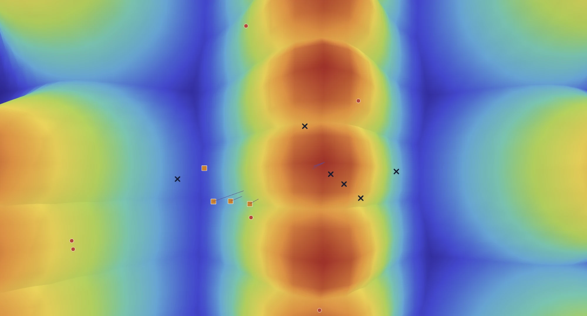

# 5-0. step 0: 준비와 영점

사진을 재기 전에 하는 일이다. 프로그램을 시작할 때 한 번 하는 **준비**와, 매일 하는 **영점 잡기**로 나뉜다.

| | 하는 일 | 언제 | 함수 |
|---|---|---|---|
| 준비 | 설정과 모델 파일을 읽고, 기준 사진에서 QR 과 나사 조각을 잘라 둔다 | 프로그램을 시작할 때 한 번 | `initialize` |
| 사진 검사 | 들어온 사진의 크기와 형식을 확인하고 회색으로 바꾼다 | 사진마다 | `measure_alignment` 안에서 |
| 영점 잡기 | 그날 로봇의 0 자리를 출력의 0 으로 맞춘다 | 매일 | `set_zero_from_photos` |
| 기준 다시 잡기 | 화면이 많이 밀렸을 때 QR 과 나사 위치를 다시 찾는다 | 필요할 때만 | `set_reference_from_photos` |

코드: `include/alignment.hpp`, `src/alignment.cpp`, `src/common/reference`, `src/setup/settings`, `src/setup/find_new_reference`

**목차**

| 번호 | 제목 |
|---|---|
| 1 | 준비 |
| 1-1 | `initialize` 가 읽는 것 |
| 1-2 | 사진 검사 |
| 1-3 | 기준 다시 잡기 (`set_reference_from_photos`) |
| 2 | 영점 설정 |
| 2-1 | 한 줄 요약 |
| 2-2 | 용어 |
| 2-3 | 코드에서 영점이 하는 일 |
| 2-4 | 언제 잡나 |
| 2-5 | 어떻게 찍나 |
| 2-6 | 영점과 기준은 다르다 |
| 2-7 | 평가 |
| 2-8 | 자주 묻는 것 |

---

## 1. 준비

### 1-1. `initialize` 가 읽는 것

| 순서 | 읽는 것 | 파일 | 못 읽으면 |
|---|---|---|---|
| 1 | 설정 (쓸 나사, 값이 안 맞을 때 실패로 볼지, 로그 파일) | `config/settings.json` (안 주면 기본값) | `E_SETTINGS` |
| 2 | 기준 사진, QR 상자 3개, 나사 중심 4개, 학습한 범위 | `data/model/center.bmp`, `reference.json` | `E_DATA` |
| 3 | Y, T 계산 계수 (나사 조합 16가지) | `data/model/coefficients/` | `E_DATA` |
| 4 | 값 일치 점검식 (나사 2개 이상 조합 11가지) | `data/model/checks/` | `E_DATA` |
| 5 | 기준 사진에서 QR 조각 3개, 나사 조각 4개를 잘라 둔다 | | |

- 다 읽은 뒤에야 상태를 바꾼다. 중간에 실패하면 그 전 상태가 그대로 남는다.
- 모든 측정은 "기준 사진에서 얼마나 움직였나"를 잰다. 그래서 기준 사진과 위치 파일이 가장 먼저다.

### 1-2. 사진 검사

| 검사 | 통과 조건 | 아니면 |
|---|---|---|
| 크기 | 3840×2160 | `E_PHOTO` |
| 깊이 | 8비트 | `E_PHOTO` |
| 채널 | 1(회색), 3(BGR), 4(BGRA) | `E_PHOTO` |

- 3채널 사진은 **BGR 순서**로 보고 회색으로 바꾼다. 카메라가 RGB 로 주면 회색 밝기가 달라져 값이 틀리는데, 이건 사진만 보고는 알 수 없어 경고가 나오지 않는다. **회색(1채널)으로 넣는 것이 가장 안전하다.**
- 크기를 3840×2160 으로 고정한 이유: QR 상자와 나사 중심을 기준 사진의 화소 좌표로 정해 두었다.

### 1-3. 기준 다시 잡기 (`set_reference_from_photos`)

카메라가 처지거나 밀려서 QR 을 못 찾을 때(`E_QR_NOT_FOUND` 가 계속 날 때)만 쓴다.

1. 판이 센터 근처에 있는 사진을 넘긴다 (여러 장이면 평균).
2. 그 사진에서 QR 상자 3개를 원래 자리 주변 ±120 px에서 찾는다. QR 이동량의 가운뎃값만큼 나사 탐색 시작점도 옮긴 뒤, 주변 ±70 px의 테두리로 나사 중심 4개를 찾는다. 화면이 크게 밀렸을 때 예전 나사 자리에서 다른 테두리를 잡는 일을 줄인다.
3. 같은 사진을 바꾸기 전 기준과 새 기준으로 각각 재서, 값이 같아지도록 차이를 기억한다. 그래서 **영점이 이어진다.**
4. 바꾸기 전 기준으로 잴 수 없을 만큼 밀렸으면 그 사진을 새 0 으로 삼고 `W_ZERO_RESET` 으로 알린다. 이때는 영점을 다시 잡는다.

이 탐색 시작점 보정은 기준 사진을 바꿀 때만 실행한다. 일반 사진 측정이나 영점만 잡을 때는 실행하지 않는다.

확인: 화면을 아래로 40 px 밀어 QR 을 못 찾게 만든 뒤 기준을 다시 잡으면, 처음 값과 Y 0.004 mm, T 0.0004도 차이였다.

---

## 2. 영점 설정

영점이 무엇이고 왜 잡는지, 언제 몇 장을 어떻게 찍어 넣는지, 그렇게 했을 때 정확도와 안정성이 어떤지를 정리했다. 숫자는 받은 사진 4회차(10/14, 10/20, 10/29, 4차)로 잰 것이다.

---

### 2-1. 한 줄 요약

**알고리즘은 "절대 영점에서 얼마나 떨어졌나"를 재고, 기업 측은 "그날 로봇 0 에서 얼마나 떨어졌나"로 본다. 그 둘의 차이(그날 로봇 0 의 어긋남)를 매일 맞춰 주는 것이 영점 잡기다.**

---

### 2-2. 용어

| 용어 | 뜻 |
|---|---|
| **절대 영점** | 학습에 쓴 모든 회차의 사진을 함께 맞췄을 때 정해지는 공통의 0. 회차마다 다른 로봇 0 을 하나로 맞추려고 우리가 정한 기준이다. 날이 바뀌어도 변하지 않는다. 물리적으로 "정답 자리"라는 뜻은 아니다 |
| **기준 사진** (`data/model/center.bmp`) | QR, 나사의 이동을 잴 때 비교하는 사진. 이 사진의 이동은 모두 0 이지만, 이 사진의 (Y, T) 가 절대 영점과 정확히 같지는 않다 (지금 계수로 Y −0.004 mm, T −0.0003도) |
| **그날 로봇 0** | 로봇이 그날 "Y 0, T 0" 이라고 부르는 자리. 날마다 절대 영점에서 조금씩 다르다 |
| **그날 어긋남** | 그날 로봇 0 이 절대 영점에서 떨어진 양 |
| **영점 (`zero`)** | 출력에서 빼는 값. 영점을 잡으면 그날 어긋남이 들어간다 |
| **기준 (`reference`)** | QR, 나사를 찾을 때 비교하는 사진과 위치. 영점과는 다르다 (2-6) |

#### (1) 그림으로 보기



- 이 그림은 (Y, T) 평면에서, 각 자리에 사진의 (Y, T) 가 놓일 가능성을 색으로 나타낸 것이다. 빨간색일수록 가능성이 높다.
- **빨간 중심**: 우리가 부르는 **절대 영점**이다.
- **주황 네모 (원점 센터 사진 4장)**: 기업 측에서 받은 센터 사진(10/14 `center.bmp`, 10/20 `center1~3.bmp`)을 측정한 자리다. 파일에 붙은 라벨은 모두 (0, 0) 이지만, 측정하면 절대 영점에서 떨어져 있다. 예를 들어 `center.bmp` 를 그 사진 없이 학습한 식으로 예측하면 Y +0.024 mm, T −0.0005도다. "센터 사진 = 0" 이 아니라는 뜻이다.
- **× (회차별 역추정 원점)**: 각 회차 사진의 측정값과 명령값의 차이로 거꾸로 구한 "그날 로봇 0" 의 자리다. 회차마다 흩어져 있다.
- **점**: 사진 하나하나. 자기 라벨(명령값)의 자리가 가장 가까운 사진과, 다른 라벨의 자리가 더 가까운 사진을 색으로 나눴다.

#### (2) 회차별로 거꾸로 구한 그날 로봇 0

그날 사진마다 (측정값 − 명령값) 을 구해 가운뎃값을 낸 것이다. 절대 영점 기준으로 그날 로봇 0 이 놓인 자리다. 계수는 그 회차를 빼고 학습한 것을 썼다.

| 회차 | 묶음 | 사진 수 | Y (mm) | T (도) |
|---|---|---:|---:|---:|
| 10/14 | 전체 | 280 | −0.040 | 0.0000 |
| | Y 만 움직인 사진 | 80 | −0.041 | 0.0000 |
| | T 만 움직인 사진 | 200 | −0.039 | −0.0006 |
| 10/20 | 전체 | 45 | −0.126 | +0.0120 |
| | 반복 1, 2, 3 | 15씩 | −0.127, −0.126, −0.125 | +0.0109, +0.0141, +0.0120 |
| 10/29 | 전체 | 234 | −0.121 | +0.0098 |
| | 반복 1, 2, 3 | 78씩 | −0.122, −0.123, −0.120 | +0.0088, +0.0112, +0.0096 |
| 4차 | 전체 | 144 | −0.054 | +0.0039 |

- **회차 안에서는 거의 같다.** 같은 날 반복끼리 Y 0.002 mm, T 0.003도 안쪽이다. 그날 로봇 0 은 하루 동안 안정적이다.
- **회차 사이에는 크게 다르다.** Y 가 −0.040 에서 −0.126 까지, 폭이 허용오차(0.045 mm)의 두 배쯤 된다.
- 그래서 영점은 **회차(날)마다 한 번** 잡으면 되고, **날이 바뀌면 반드시 다시** 잡아야 한다.

흩어진 폭(Y 약 0.09 mm)이 허용오차(Y 0.045 mm)의 두 배다. 그래서 **어떤 고정값으로도 대신할 수 없고, 매일 잡아야 한다** (2-7 의 "평균을 기본값으로" 결과).

---

### 2-3. 코드에서 영점이 하는 일

출력 계산은 한 줄이다 (`src/alignment.cpp` 의 `make_result`).

```
출력 = 계산값 + carry_over − zero
```

| 이름 | 뜻 | 기본값 | 바꾸는 함수 |
|---|---|---|---|
| 계산값 | 절대 영점 기준으로 잰 Y, T | (사진마다) | 없음 |
| `zero` | 영점. 출력의 0 을 어디로 둘지 | 0 (= 절대 영점) | `set_zero_from_photos`, `set_zero_value`, `clear_zero` |
| `carry_over` | 기준을 다시 잡았을 때 절대 영점을 잇기 위해 더하는 값 | 0 | `set_reference_from_photos` (2-6) |

- **영점을 잡으면 그날 모든 출력이 같은 양만큼 평행이동된다.** 판이 움직이는 것이 아니라 "0 눈금"이 옮겨진다. 사진끼리의 간격은 그대로다.

예: 10/29 (그날 어긋남 Y −0.121)

| 사진 (파일 이름) | 출력 (영점 없음) | 출력 (영점 잡은 뒤) |
|---|---:|---:|
| `Y+0.05` | −0.071 | +0.050 |
| `Y+1.00` | +0.879 | +1.000 |
| `Y-0.50` | −0.621 | −0.500 |

#### (1) 영점으로 없어지는 것과 안 없어지는 것

| | 영점으로 없어지나 | 예 |
|---|---|---|
| 모든 사진에 **똑같이** 붙는 치우침 | 없어짐 | 그날 로봇 0 의 어긋남, 카메라가 살짝 돌거나 밀림, 판을 다시 조립함 |
| 자세마다 **다르게** 붙는 치우침 | 안 없어짐 | 크게 움직일수록 더 틀림 (배율, Y 와 T 가 섞임) |

---

### 2-4. 언제 잡나

| 때 | 이유 |
|---|---|
| **매일 작업을 시작할 때** | 그날 로봇 0 이 어제와 다르다 |
| 카메라, 조명, 판을 손댄 뒤 | 화면 전체가 조금 움직였을 수 있다 (카메라 0.05도 회전 = Y 0.27 mm) |
| 프로그램을 다시 켰을 때 | 영점은 메모리에만 있다. 다시 잡거나 적어 둔 값을 `set_zero_value` 로 넣는다 |
| `set_reference_from_photos` 뒤에 `W_ZERO_RESET` 이 났을 때 | 영점이 이어지지 못하고 새로 정해졌다 |
| 모든 사진에서 `W_VALUES_DISAGREE` 가 날 때 | 그날 화면 상태가 바뀌었다는 신호 |

---

### 2-5. 어떻게 찍나

#### (1) 무엇을 찍나: **명령값을 아는 자리**의 사진

- 가장 좋은 것: 로봇을 **명령 (0, 0)** 으로 보내고 찍는다.
- (0, 0) 으로 보내기 어렵다면: 명령값을 아는 다른 자세(예: Y+0.05)라도 된다. 아래 (4) 처럼 그 명령값을 빼서 계산한다.
- **주의**: "센터 사진"이라고 따로 찍은 사진이 그날 명령 0 자리라는 보장이 없다. 우리 사진에서 기업 측의 `center.bmp`, `center1~3.bmp` 는 그날 명령 0 과 Y 0.03 ~ 0.04 mm 달랐다. 그 사진으로 영점을 잡으면 정확도가 73% 근처로 떨어졌다 (2-7 의 (1)). **반드시 로봇 명령값과 같이 기록된 사진을 쓴다.**

#### (2) 몇 장 찍나: **5 ~ 10장**

| 장 수 | 영점 흔들림 Y (mm) | 정확도 평균 (가장 나쁜 경우) | 판단 |
|---|---:|---|---|
| 1장 | 0.003 ~ 0.016 | 10/14: 89.6% (61.3%), 4차: 77.0% (42.0%) | 운이 나쁘면 그날 전체가 치우침 |
| 3장 | 0.001 ~ 0.008 | 10/14: 95.6% (85.6%), 4차: 84.8% (75.9%) | 최소 |
| 5장 | 0.0005 ~ 0.006 | 10/14: 96.4% (87.3%), 4차: 84.4% (75.5%) | **권장** |
| 10장 | 0.001 ~ 0.003 | 10/14: 97.9% (91.5%), 4차: 85.4% (78.4%) | 가장 안정 |

- 흔들림은 대략 √(장 수) 만큼 줄어든다.
- 같은 자리에서 연달아 찍어도 되고, 로봇을 조금 움직였다 돌아와서 찍으면 로봇 반복 오차까지 평균되어 더 좋다.

#### (3) 찍을 때 지킬 것

- 판이 멈춘 뒤 찍는다 (흔들림 없이).
- QR 3개와 나사 4개가 모두 보여야 한다. 아니면 `E_ZERO` 로 실패하고 영점은 그대로다.
- 3840×2160, 8비트. 평소 측정과 같은 조명, 노출.

#### (4) 코드로 넣는 법

**(가) 명령 (0, 0) 에서 찍은 경우** : 함수 하나

```cpp
std::vector<cv::Mat> zero_photos = { 사진1, 사진2, 사진3, 사진4, 사진5 };   // 명령 (0, 0) 에서 5장
alignment::Result zero = alignment::set_zero_from_photos(zero_photos);
if (zero.status == alignment::Status::Failed) { /* 멈추고 사진 확인 */ }
// zero.y_mm, zero.t_deg = 잡힌 영점 (= 그날 어긋남). 기록해 두면 재시작 때 set_zero_value 로 다시 넣을 수 있다
```

- 여러 장을 넘기면 **화소를 평균한 사진 한 장**으로 잰다.

**(나) 명령값을 아는 다른 자세에서 찍은 경우** : 지금 함수로 직접 계산

```cpp
alignment::clear_zero();                                     // 절대 영점 기준으로 재기 위해
double sum_y = 0, sum_t = 0;
for (int i = 0; i < count; ++i) {
    alignment::Result r = alignment::measure_alignment(사진[i]);
    sum_y += r.y_mm - 명령_y[i];                               // 측정 − 명령 = 그날 어긋남
    sum_t += r.t_deg - 명령_t[i];
}
alignment::set_zero_value(sum_y / count, sum_t / count);     // 평균을 영점으로
```

- 경고나 실패가 난 사진은 빼고 평균한다.

#### (5) 어디에 넣나

| 쓰임 | 넣는 곳 |
|---|---|
| 실사용 | 파일로 둘 필요 없음. 찍은 사진을 위 함수에 바로 넘긴다. 잡힌 영점 값(`zero.y_mm`, `zero.t_deg`)은 로그에 남긴다 |
| 학습, 평가용 데이터 | `data/new_photos/<회차>/` 안에, 파일 이름에 명령값을 그대로 (`Y+0.00 T+0.00 (1).bmp` …). 명령 0 사진이 있으면 평가 도구가 그것으로 영점을 잡는다 |
| 명령값 기준 채점 (`score_photos`) | 채점할 회차 폴더 안에 같이. 파일 이름 = 명령값 |

---

### 2-6. 영점과 기준은 다르다

| | 영점 (`zero`) | 기준 (`reference`) |
|---|---|---|
| 하는 일 | 출력의 0 을 옮김 (평행이동) | QR, 나사를 찾을 때 비교할 사진과 위치를 바꿈 |
| 언제 | 매일 | 화면이 많이 밀려 QR 을 못 찾을 때만 (`E_QR_NOT_FOUND` 가 계속 남) |
| 함수 | `set_zero_from_photos`, `set_zero_value`, `clear_zero` | `set_reference_from_photos` |
| 서로의 관계 | | 기준을 바꿔도 `carry_over` 로 절대 영점이 이어진다. 이을 수 없으면 `W_ZERO_RESET` 과 함께 영점이 0 으로 돌아간다 → 영점을 다시 잡는다 |

`set_zero_value` 와 `clear_zero` 는 영점 값만 바꾸고 점검 기준은 유지한다. 재시작 후 영점 숫자만 복원해도 이전 점검 기준은 돌아오지 않는다.

기준을 다시 잡은 뒤에는 영점도 다시 잡는 것을 권한다.

---

### 2-7. 평가

#### (1) 정확도: 영점 방법에 따라

조건: 정답 = 파일 이름의 명령값 (명령값 기준 채점). 계수는 채점하는 회차를 빼고 나머지 3회차로 다시 학습 (처음 보는 날 흉내). 통과 = |Y 오차| ≤ 0.045 mm 그리고 |T 오차| ≤ 0.01도.

| 영점 | 10/14 (280) | 10/20 (45) | 10/29 (234) | 4차 (144) |
|---|---:|---:|---:|---:|
| 참고: 우리 내부 정답(절대 영점 기준)으로 채점 | 99.6% | 97.8% | 100% | 92.4% |
| 영점 안 잡음 (zero = 0) | 70.7% | 0% | 0% | 18.1% |
| 다른 날들의 평균 어긋남을 기본값으로 | 5.4% | 15.6% | 54.7% | 61.1% |
| 받은 센터 사진 1장 | 73.6% | 73.3 ~ 91.1% | 사진 없음 | 사진 없음 |
| 받은 센터 사진 3장 평균 | | 73.3% | | |
| **명령값을 아는 사진 5장** | **96.4%** | **93.9%** | **100%** | **84.4%** |
| 명령값을 아는 사진 10장 | 97.9% | 91.4% | (사진 부족) | 85.4% |

- 영점을 안 잡거나 고정값을 쓰면 30%대. **매일 잡는 것이 필수**다.
- 명령값을 아는 사진으로 잡으면 우리 내부 성적에 가까워진다.
- 4차는 영점을 어떻게 잡아도 85% 근처다. Y 와 T 를 동시에 크게 움직인 자세가 많고, 평행이동으로 못 고치는 "자세마다 다른 치우침"이 있다.
- 10/29, 4차에는 명령 0 사진이 없어 센터 근처(|Y| ≤ 0.25, |T| ≤ 0.05) 사진으로 흉내 냈다.


#### (2) 안정성: 1장과 여러 장

| | 1장 | 3장 | 5장 | 10장 |
|---|---:|---:|---:|---:|
| 영점 흔들림 Y (mm) | 0.003 ~ 0.016 | 0.001 ~ 0.008 | 0.0005 ~ 0.006 | 0.001 ~ 0.003 |
| 영점 흔들림 T (도) | 0.0004 ~ 0.0042 | 0.0002 ~ 0.0020 | 0.0001 ~ 0.0015 | 0.0002 ~ 0.0006 |
| 가장 나쁜 날 정확도 (10/14) | 61.3% | 85.6% | 87.3% | 91.5% |

#### (3) 직접 확인하는 법

1. 그날 명령값을 아는 사진들(명령 0 포함)을 `data/new_photos/<회차>/` 에 이름 그대로 넣는다.
2. `score_photos` 로 채점한다. 명령 0 사진이 있으면 그것으로 영점을 잡고, 영점 안 잡은 점수와 같이 낸다.
3. `results.csv` 를 엑셀로 열어 "오차 Y" 열의 평균을 본다. 평균이 0 에서 멀면 영점이 맞지 않은 것이다.

---

### 2-8. 자주 묻는 것

- **Q. 기본값(영점 안 잡음)으로 써도 되나요?** A. 출력이 절대 영점 기준이라, 그날 로봇 0 과 0.04 ~ 0.13 mm 차이가 날 수 있습니다. 로봇 명령과 맞춰 쓰려면 매일 잡아야 합니다.
- **Q. 영점을 잡으면 정확도가 좋아지나요?** A. 날마다 똑같이 붙는 치우침만 없어집니다. 사진마다의 흔들림(Y 약 0.01 ~ 0.02 mm)이나 자세마다 다른 치우침은 그대로입니다.
- **Q. 센터 사진은 아무 때나 찍어도 되나요?** A. 아니요. 로봇 명령값과 함께 기록된 사진이어야 합니다. 명령을 모르는 "센터 사진"으로 잡으면 그 사진이 명령 0 과 다른 만큼 치우칩니다.
- **Q. 영점 값이 매일 크게 바뀌면요?** A. 0.04 ~ 0.13 mm 정도는 우리 사진에서도 있었습니다. 그보다 훨씬 크면 카메라나 판이 움직였을 수 있으니 확인하세요.
