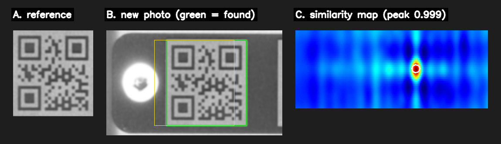
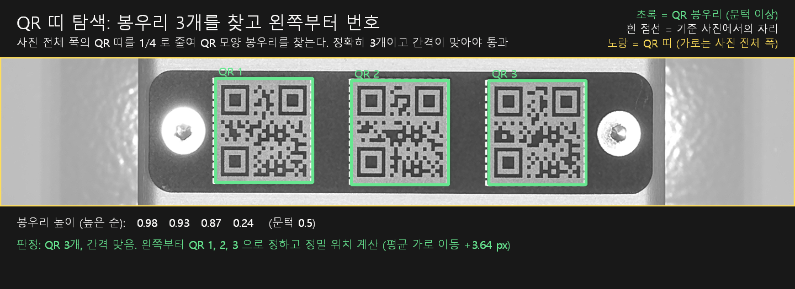
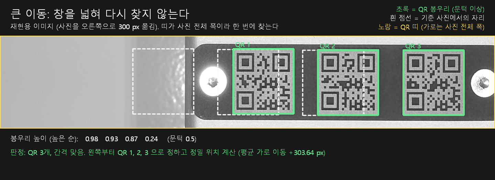
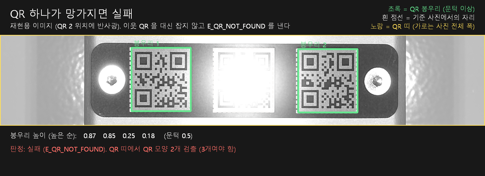

# 5-1. step 1: QR 이동

QR 3개가 기준 사진에서 **가로로 몇 px 움직였는지** 잰다. 뒤의 모든 계산이 이 값에서 시작한다.

코드: `src/steps/01_find_qr.hpp`, `01_find_qr.cpp`

**목차**

| 번호 | 제목 |
|---|---|
| 1 | 기능 |
| 2 | 개발 과정 |
| 2-1 | QR 만으로 Y 와 T 를 알 수 있나 → 없다 |
| 2-2 | QR 에서 무엇을 잴까: 점 여러 개 → 가로 이동 하나 |
| 2-3 | 점을 찾을까, 조각을 맞출까 → 조각 맞추기 |
| 2-4 | 조각을 무엇으로 맞추고, 소수 px 는 어떻게 구할까 |
| 2-5 | 최종 결정: 536점 추적 대신 "흐린 뒤 NCC + 포물선" |
| 2-6 | 탐색 방식: QR 띠에서 봉우리 3개를 찾는다 |
| 2-7 | 이전 탐색 방식 (2026-11-15 까지): 좁게 시작해서 넓힌다 |
| 2-8 | 소수 위치: 포물선 대신 가우스 맞춤 (2026-11-16) |
| 3 | 최종 방법과 보정 |
| 4 | 이 단계의 결과 |
| 5 | 한계와 확인하지 못한 것 |

---

## 1. 기능

왼쪽: 기준 QR. 가운데: 새 사진에서 찾은 위치. 오른쪽: 붉을수록 닮은 자리.

| | |
|---|---|
| 입력 | 회색 사진 3840×2160 |
| 출력 | QR 3개의 가로 이동 평균 `dx` (px, 소수), 세로 이동 평균 `dy`, QR 별 정밀 결과, 실패 사유 |
| 함수 | `QrFinder::find_qr_shift` → `find_peaks` (대략) → `find_one` (정밀) |
| 쓰는 곳 | `dx` 는 Y, T 계산의 첫 번째 값. `dx`, `dy` 는 나사를 어디서부터 찾을지 정하는 데도 쓴다 |

**대략: QR 띠에서 봉우리 찾기** (`find_peaks`)

1. QR 띠를 잡는다. 가로는 사진 전체 폭, 세로는 QR 상자 범위의 위아래 40 px 이다.
2. 띠와 기준 QR 3개를 1/4 로 줄인다(면적 평균 후 흐림 σ 0.5).
3. 기준 QR 3개로 각각 닮은 정도(NCC)를 구하고, 자리마다 셋 중 가장 큰 값을 쓴다. 그래서 QR 마다 자기 조각과 맞아 봉우리가 높다.
4. 세로 방향으로 가장 큰 값을 모아 가로 곡선을 만들고, 100 px 이상 떨어진 봉우리를 높은 순으로 찾는다.

**판정** (`find_qr_shift`)

1. 문턱 0.5 이상인 봉우리가 **정확히 3개**가 아니면 실패한다.
2. 왼쪽부터 QR 1, 2, 3 으로 정한다.
3. 이웃 봉우리 간격이 기준 간격(기준 사진 QR 상자에서 계산, 약 257 px)과 25 px 넘게 다르면 실패한다.

**정밀: QR 마다 소수 위치** (`find_one`)

1. 기준 사진을 흐리게 한 뒤(σ 2 px) QR 조각을 잘라 둔다. 이건 준비 때 한 번만 한다.
2. 대략 위치 둘레 가로, 세로 ±8 px 창을 8 px 넓게 잘라 똑같이 흐린 뒤 창만 남긴다.
3. 조각을 창 위에서 한 칸씩 옮겨 가며 닮은 정도를 구하고, 가장 닮은 자리를 찾는다.
4. 그 자리와 양옆의 닮은 정도 세 값의 로그에 포물선을 맞춰(3점 가우스 맞춤) **소수 px** 까지 구한다. 흐린 영상끼리의 닮은 정도 봉우리는 종 모양에 가깝고, 종 모양은 로그를 취하면 포물선이 되기 때문이다 (2-8). 세 값 중 0 이하가 있으면 로그 없이 포물선으로 구한다.
5. 닮은 정도가 0.8 보다 낮거나 가장 닮은 자리가 창 가장자리면 실패한다. QR 하나라도 실패하면 1단계 전체가 실패다.
6. QR 3개의 평균을 낸다. 대략 비교와 정밀 맞춤은 각각 QR 3개를 동시에 처리한다.

실패하면 측정 결과는 `E_QR_NOT_FOUND` 이고, 메시지에 사유(봉우리 개수, 간격, 정밀 실패한 QR)가 적힌다 ([03 상태와 알림](../03_상태와_알림.md)).

---

## 2. 개발 과정

질문마다 여러 방법을 시험하고 하나를 골랐다. 표의 조건이 서로 다른 것은 표마다 적었다.

### 2-1. QR 만으로 Y 와 T 를 알 수 있나 → 없다

판이 Y 로 1 mm 움직이면 QR 은 약 14 px, T 로 1도 돌면 약 80 px 움직인다. **둘 다 같은 방향(가로)** 이다. QR 판 위의 점은 모두 카메라에서 같은 거리에 있어서, 어느 점을 봐도 Y 와 T 의 움직임이 같은 비율로 섞여 있다.

| 시도 | 결과 | 조건 |
|---|---|---|
| QR 3개의 이동만으로 계산 | Y 를 140장 중 62장만 맞힘 | 10월, 사진 280장, 한 축씩 판정 |
| QR 안의 점 232개로 계산 | 축은 98.6% 맞히지만 Y 를 가르는 한계가 0.22 mm | 같음 |
| 지금 구성에서 QR 만 사용 | 560장 중 181장이 허용오차 밖 (QR + 좌우 나사는 0.2장) | 11월, 사진 702장 |

**고른 것**: QR 만으로는 안 되고, **QR 과 다른 깊이에 있는 나사**를 같이 잰다. Y 로 움직이면 QR(14 px/mm)과 나사(11 px/mm)가 다르게 움직이고, T 로 돌면 거의 같이 움직인다. 그 차이로 Y 를 안다 (step 2, step 3).

### 2-2. QR 에서 무엇을 잴까: 점 여러 개 → 가로 이동 하나

| 시도 | 결과 | 조건 |
|---|---|---|
| QR 모서리 표식(finder) 66점 | 다시 재면 Y 가 81%만 같음 | 10월 280장 |
| QR 안쪽 점 205점 | 93% | 같음 |
| QR 안쪽 점 536점 (바깥쪽 점 94개 제외) | 280장 모두 통과 | 같음 |
| 536점의 가로, 세로 위치를 모두 사용 (1072개 값) | 702장 중 639장 | 11월 702장 |
| QR 마다 9개 가상 점 (54개 값) | 698장. 처음 보는 날 71% | 같음 |
| **QR 3개의 가로 이동 평균 (값 1개)** | 처음 보는 날 98% 이상 (나사와 함께) | 같음 |

**고른 것**: 값을 많이 쓸수록 같은 날 사진은 잘 맞지만 **다른 날 사진에서 나빠졌다.** 점이 많으면 그날 화면의 미세한 차이까지 외우기 때문이다. 특히 세로 방향 값은 변화의 75 ~ 90% 가 촬영한 날의 차이였다. 그래서 QR 은 가로 이동 평균 하나만 쓴다.

### 2-3. 점을 찾을까, 조각을 맞출까 → 조각 맞추기

| 방법 | 통과 (280장) | 점 위치 흔들림 | 잘못 짝지은 비율 | 시간 |
|---|---|---|---|---|
| QR 무늬에서 정한 점 536개 + 조각 맞추기 | 273 ~ 276 | 0.028 px | 0% | 9 ~ 59 ms |
| 일반 모서리 검출기 3종 (800점) + 추적 | 274 ~ 275 | 0.031 ~ 0.033 px | 0% | 9 ms |
| 특징점 짝짓기 2종 (ORB, BRISK) | 233 ~ 251 | 0.44 ~ 0.51 px | 15 ~ 16% | 35 ~ 74 ms |
| 특징점 짝짓기 2종 (AKAZE, KAZE) | 271 ~ 274 | 0.23 ~ 0.26 px | 9% | 68 ~ 311 ms |

조건: 10월, 사진 280장.

**고른 것**: 조각 맞추기. 특징점 짝짓기는 QR 이 **같은 무늬가 되풀이되는 그림**이라 9 ~ 16% 를 옆 칸과 잘못 짝지었다. QR 마다 조각을 통째로 맞추면 이 문제가 생기지 않는다.

### 2-4. 조각을 무엇으로 맞추고, 소수 px 는 어떻게 구할까

합성 사진(기준 사진을 정해진 만큼 옮긴 것)으로 정답과 비교했다.

| 방법 | 위치 오차 (95%) | 소수 위치에 따른 치우침 | 시간 |
|---|---|---|---|
| NCC, 정수 px 만 | 0.61 px | ±0.40 px | 9.9 ms |
| **NCC + 포물선** | 0.17 px | ±0.04 px | 10.1 ms |
| NCC + 위상 상관 | 0.48 px | 정수와 비슷 | 19.9 ms |
| NCC + 한 번 추적 (LK) | 0.037 px | ±0.003 px | 15.9 ms |
| NCC → 추적 → 정밀 맞춤 (536점 방식) | 0.005 px | ±0.0003 px | 37.7 ms |
| NCC + ECC | 0.035 px | ±0.016 px | 179 ms |

조건: 10월, 합성 사진 72장.

가장 정밀한 것은 점 536개를 하나씩 추적하는 방식이다. 다만 느리고, 밝기가 바뀌면 점을 버려서 못 재는 경우가 생겼다.

### 2-5. 최종 결정: 536점 추적 대신 "흐린 뒤 NCC + 포물선"

| 방법 | 허용오차 밖 (560장 중, 10번 평균) | Y 오차 (rms) | 마지막 확인 142장 | 처음 보는 날 | 시간 (QR 만) |
|---|---|---|---|---|---|
| 536점 추적 | 0.1장 | 0.01315 mm | 0장 | 98.8% | 약 23 ms |
| NCC + 포물선 (흐림 없음) | 2.6장 | 0.01504 mm | 3장 | | 약 5 ms |
| NCC + 포물선, 흐림 σ 1 | 0.1장 | 0.01332 mm | | | 약 5 ms |
| **NCC + 포물선, 흐림 σ 2** | **0.2장** | **0.01317 mm** | **0장** | **98.4%** | **약 5 ms** |

조건: 11월, 사진 702장. 이때는 값 7개(바 기울기 포함) 구성이었다.

**고른 것**: 흐림 σ 2. **정확도는 536점 추적과 같고 시간은 4분의 1** 이다.

**왜 흐리면 좋아지나**: 받은 사진은 QR 의 흑백 경계가 선명하다. 그러면 닮은 정도의 봉우리가 뾰족해져서, 세 점으로 맞춘 포물선이 소수 위치에 따라 한쪽으로 치우친다. 흐리면 봉우리가 둥글어져 포물선이 잘 맞는다.

| | 흐림 없음 | 흐림 σ 2 |
|---|---|---|
| 소수 위치에 따른 치우침 폭 | 0.061 px | 0.003 px |

2026-11-15 에 정밀 단계 대안을 다시 비교했다(사진 715장, 대략 위치는 같게 두고 정밀 단계만 바꿈). 흐림을 빼면 분명히 나빠졌다(자세 묶음 교차검증 통과 642 → 635장). 그래서 흐림 σ 2 는 그대로 둔다. 가우스 맞춤(로그 포물선)은 합성 소수 이동 오차가 작아서(0.0023 → 0.0014 px) 2026-11-16 에 소수 위치 계산을 가우스 맞춤으로 바꿨다 (2-8).

### 2-6. 탐색 방식: QR 띠에서 봉우리 3개를 찾는다

이전 방식(2-7)은 QR 마다 자기 조각을 따로 찾았다. 그런데 QR 3개는 약 257 px 간격으로 늘어서 있고 모서리 무늬가 같아서, **이웃 QR 도 닮은 정도가 0.81 ~ 0.85 로 문턱 0.8 을 넘는다.** 진짜 QR 이 반사, 가림, 큰 이동으로 0.8 아래가 되거나 창 밖으로 나가면, 창 안의 이웃 QR 이 대신 잡혀 판 위치가 약 26 mm 틀린 값이 실패 없이 나갔다 ([9-7](../09_추가_논의/9-7_QR_가림과_개수_판정.md), [9-8](../09_추가_논의/9-8_QR_띠_봉우리_탐색으로_전환.md)).

그래서 QR 을 하나씩 찾지 않고, **QR 띠 전체에서 QR 모양을 모두 찾은 뒤 센다.** 판에는 QR 이 3개뿐이므로 봉우리는 늘 3개다. 3개가 아니면 실패하고, 3개이면 왼쪽부터 번호를 붙인다. QR 하나가 망가지면 봉우리가 2개가 되거나 정밀 단계에서 걸려 실패하므로, 이웃 QR 을 대신 잡는 일이 원리적으로 없다.

| 항목 | 이전 방식 (2-7) | 띠 봉우리 방식 | 조건 |
|---|---|---|---|
| 자세 묶음 교차검증 / 날짜 통째 제외 통과 | 642 / 618 | 642 / 618 (통과 사진도 같음) | 명목 652장 |
| QR 값 차이 | — | 최대 0.00005 px. 같은 사진 Y 차이 최대 0.000017 mm | 사진 715장 |
| QR 을 못 찾은 사진 | 0 | 0 | 사진 715장 |
| 조용히 틀린 값 | 529번 | **0번** (그 경우 모두 실패) | 합성 변화 30종 × 사진 60장 = 1800번 |
| 세로로 30 px 움직인 사진 | 60번 모두 실패 (세로 탐색 ±22 px 밖) | 60번 모두 맞음 | 합성 60장 |
| 띠 안에 QR 처럼 생긴 다른 물체 | 120번 맞음 | 113번 실패 (틀린 값은 0) | 합성 120장 |
| 시간, 보통 사진 (한 스레드 / 22 스레드) | 5.2 / 2.6 ms | 4.2 / 2.6 ms | 사진 60장, 같은 실행에서 비교 |
| 시간, 위험한 경우 최악 (한 스레드) | 108 ms (창을 넓혀 다시 찾음) | 14 ms | 반사, 가림, 큰 이동 |

**봉우리 문턱 0.5 의 근거**: 받은 사진 715장에서 3번째 봉우리(가장 낮은 QR)는 최소 0.77, 4번째 봉우리(QR 이 아닌 것)는 최대 0.25 였다. 문턱을 그 가운데에 두었다. 1/4 로 줄이면 픽셀 격자 위치에 따라 QR 봉우리가 낮아질 수 있어, 처음 시험한 문턱 0.8 에서는 정상 사진 50장이 실패했다. 1/2 로 줄이면 3번째 봉우리 최소가 0.90 이 되어 문턱 0.8 도 쓸 수 있지만, 대략 단계가 약 10 ms 로 느려진다.

**템플릿 3개를 쓰는 이유**: QR 템플릿 하나로 띠를 훑으면 다른 QR 봉우리가 낮아져 3번째 봉우리 최소가 0.69 로 떨어진다. 템플릿 3개를 쓰면 세 봉우리가 모두 자기 템플릿과 맞는다.

### 2-7. 이전 탐색 방식 (2026-11-15 까지): 좁게 시작해서 넓힌다

QR 마다 자기 조각을 좁은 창(가로 ±110, 세로 ±22 px)에서 찾고, 3개를 다 못 찾으면 ±250 px, 사진 전체 폭으로 넓혀 다시 찾았다. 전체 폭에서는 1 ~ 2개만 찾아도 그 평균을 쓰고 경고(`W_QR_PARTIAL`)했다. 넓혀서 찾으면 `N_WIDE_SEARCH`(±250), `W_FAR`(전체 폭)를 냈다.

| 방식 | 평소 시간 | 판이 멀리 간 자세 35개 |
|---|---|---|
| 늘 좁게 (±110 px) | 13.2 ms | 66% 만 측정 |
| 늘 넓게 (±250 px) | 15.5 ms | 100% |
| **좁게 → 못 찾으면 넓게** | 13.2 ms | 100% |

- 넓은 창과 좁은 창이 낸 값의 차이는 최대 0.00007 px 였다. 창 크기는 정확도에 영향을 주지 않는다. 진짜 QR 이 이미 좁은 창 안에 있으면 창을 넓혀도 같은 자리를 고르기 때문이다.
- 이 방식은 2-6 의 이유로 바꾸었다.

### 2-8. 소수 위치: 포물선 대신 가우스 맞춤 (2026-11-16)

가장 닮은 칸과 양옆 값 a, m, d 로 소수 위치를 구하는 식을 바꿨다.

| | 식 | 맞추는 모양 |
|---|---|---|
| 이전 (포물선) | `0.5 × (a − d) / (a − 2m + d)` | 꼭대기 둘레를 2차식으로 봄 |
| **지금 (가우스 맞춤)** | `0.5 × (ln a − ln d) / (ln a − 2 ln m + ln d)` | 봉우리 전체를 종 모양으로 봄 |

- **왜**: 사진과 기준 QR 을 둘 다 흐린 뒤 비교하므로 닮은 정도 봉우리가 종 모양에 가깝다. 종 모양은 로그를 취하면 정확히 포물선이 되어, 세 값의 로그로 꼭대기를 구하면 모양 차이로 생기는 치우침이 작다. 포물선은 꼭대기에서 떨어진 칸을 실제보다 낮게 보므로 소수 위치를 가까운 정수 칸 쪽으로 끌어당긴다.
- **합성 시험**: QR 띠를 0.05 ~ 0.95 px 옮긴 사진에서 소수 위치 오차 0.0024 → 0.0014 px.
- **실제 사진**: QR 값 변화는 최대 0.0028 px 이고, 그 94% 가 픽셀 격자 위치에 따라 + 와 − 로 갈리는 변화다. 정확도, 속도, 안정성은 같다 (사진 719장 통과 714 → 714장).
- 세 값 중 0 이하가 있으면 로그를 쓸 수 없어 포물선으로 구한다. 받은 사진과 합성 시험에서 이런 경우는 없었다.
- 비교 전체는 [9-10](../09_추가_논의/9-10_QR_소수위치_가우스맞춤으로_전환.md).

---

## 3. 최종 방법과 보정

| 보정 | 보정 전 문제 | 보정 전 → 후 | 코드 |
|---|---|---|---|
| **흐린 뒤 맞춘다** (σ 2 px) | 선명한 경계 때문에 소수 위치가 치우침 | 치우침 0.061 → 0.003 px. 허용오차 밖 2.6 → 0.2장 | `kBlurSigma`, `blurred_area` |
| 창을 8 px 넓게 잘라 흐린 뒤 잘라 낸다 | 창 가장자리에서 흐림 결과가 달라짐 | 기준 조각과 같은 조건이 됨 | `kBlurMargin` |
| 3점 맞춤으로 소수 px | 정수 px 로는 0.6 px 까지 틀림 | 0.61 → 0.17 px (95%, 포물선으로 잰 값) | `gaussian_offset` |
| 포물선 대신 가우스 맞춤 | 포물선이 소수 위치를 픽셀 격자 쪽으로 조금 끌어당김 | 합성 소수 이동 오차 0.0023 → 0.0014 px. 실제 사진 정확도는 같음 (2-8) | `gaussian_offset` |
| 닮은 정도 0.8 미만, 창 가장자리면 버린다 | 가려진 QR 에서 엉뚱한 자리를 냄 | 틀린 값 대신 실패 | `kMinSimilarity` |
| QR 3개의 평균 | QR 하나의 흔들림이 그대로 들어감 | 값을 일부러 0.3 px 흔든 시험에서 통과율 54 ~ 67% → 88% | `find_qr_shift` |
| **QR 띠 봉우리로 찾고 센다** | 이웃 QR 을 대신 잡아 26 mm 틀린 값이 실패 없이 나감 | 조용히 틀린 값 529 → 0번 (합성 1800번) | `find_peaks`, `kPeakThreshold`, `kCoarseScale`, `kBandMarginY` |
| 이웃 간격 확인 | 띠 안의 다른 물체가 QR 대신 들어올 수 있음 | 간격이 기준과 25 px 넘게 다르면 실패 | `expected_gap`, `kQrGapTolerance` |
| 대략 위치 둘레에서만 정밀 맞춤 | | 창이 작아 빠름. 값은 이전 방식과 0.00005 px 안 | `find_one`, `kFineHalfWidth` |
| QR 3개를 동시에 처리 | | 결과는 하나씩 할 때와 같고 시간만 줄어듦 | `cv::parallel_for_` |

---

## 4. 이 단계의 결과

| 항목 | 결과 | 조건 |
|---|---|---|
| QR 을 못 찾은 사진 | 0장 | 받은 사진 715장 |
| 봉우리 여유 | QR 봉우리 최소 0.77, QR 이 아닌 봉우리 최대 0.25 (문턱 0.5) | 받은 사진 715장 |
| 감도 | Y 1 mm 에 약 14 px, T 1도에 약 80 px | |
| 소수 위치 치우침 | 0.003 px | 536점 추적 결과와 비교 |
| 시간 (1단계만, 사진 읽기 제외) | 한 스레드 4.4 ms, 22 스레드 3.0 ms (가운데값) | 받은 사진 715장 |
| 밝기 ×0.6, ×1.5, ±50, 감마, 고르지 않은 조명, 흐림 σ 3, 잡음 σ 16 | 모두 맞음, 값 변화 0.012 px 이하 | 합성 60장씩 |
| QR 하나가 가려지거나 반사로 망가짐 | 실패 (`E_QR_NOT_FOUND`). 이웃 QR 을 잡지 않음 | 합성 ([강건성](../06_평가_방법/6-3_강건성.md)) |
| QR 하나가 사진 밖으로 나감 | 실패 | 합성 |

부품 하나하나의 정밀도는 [평가 방법 4. 부품별 정밀도](../06_평가_방법/6-4_부품별_정밀도.md)에 모았다.

---

## 5. 한계와 확인하지 못한 것

- 봉우리 문턱 0.5 와 1/4 축소는 받은 사진 715장의 결과를 보고 정했다. 새 회차 사진으로 3번째 봉우리 최소(지금 0.77)와 4번째 봉우리 최대(지금 0.25)를 다시 확인해야 한다. `show_steps` 가 사진 한 장의 봉우리 높이를 보여 준다.
- 띠 안에 QR 비슷한 표시(라벨, 글자, 다른 QR)가 생기면 봉우리가 4개가 되어 실패한다. 실제 판에 그런 표시가 있는지는 확인하지 않았다.
- QR 3개가 모두 보여야 값을 낸다. 이전 방식처럼 QR 2개로 계속 재지 않는다.
- 기준 간격과 띠 세로 범위는 이 판, 이 카메라 기준이다. 카메라 거리(배율)가 10% 넘게 바뀌면 간격 확인에 걸린다. 이때는 기준 사진과 계수를 다시 만들어야 한다 ([08 포팅 안내서](../08_포팅_안내서.md)).
- 위험한 경우의 시험은 모두 합성이다. 실제로 가리거나 반사된 사진으로는 확인하지 못했다.
- 같은 자세를 여러 번 찍었을 때 QR 끼리의 차이 흔들림은 0.004 ~ 0.007 px 였다. 이것이 정확도를 막지는 않는다(QR 0.01 px 는 Y 0.003 mm).
