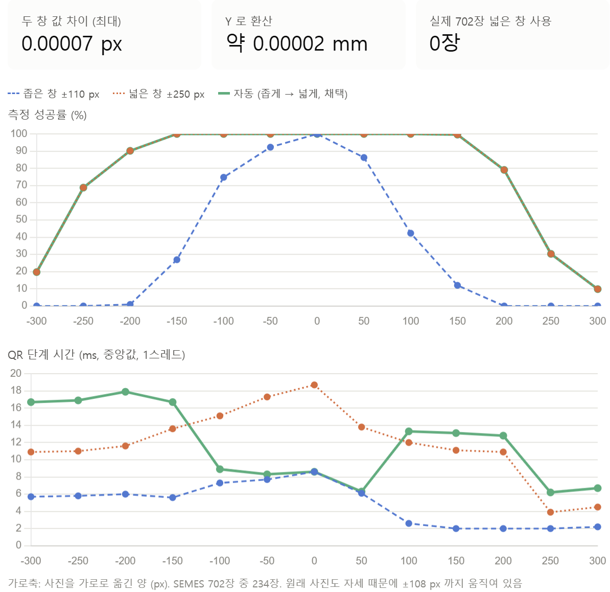

# 5-1. step 1: QR 이동

QR 3개가 기준 사진에서 **가로로 몇 px 움직였는지** 잰다. 뒤의 모든 계산이 이 값에서 시작한다.

코드: `src/steps/01_find_qr.hpp`, `01_find_qr.cpp`

**목차**

| 번호 | 제목 |
|---|---|
| 1 | 기능 |
| 2 | 개발 과정 |
| 2-1 | QR 만으로 Y 와 T 를 알 수 있나 → 없다 |
| 2-2 | QR 에서 무엇을 잴까: 점 여러 개 → 가로 이동 하나 |
| 2-3 | 점을 찾을까, 조각을 맞출까 → 조각 맞추기 |
| 2-4 | 조각을 무엇으로 맞추고, 소수 px 는 어떻게 구할까 |
| 2-5 | 최종 결정: 536점 추적 대신 "흐린 뒤 NCC + 포물선" |
| 2-6 | 탐색 창: 좁게 시작해서 넓힌다 |
| 3 | 최종 방법과 보정 |
| 4 | 이 단계의 결과 |
| 5 | 한계와 확인하지 못한 것 |

---

## 1. 기능

왼쪽: 기준 QR. 가운데: 새 사진에서 찾은 위치. 오른쪽: 붉을수록 닮은 자리.

| | |
|---|---|
| 입력 | 회색 사진 3840×2160 |
| 출력 | QR 3개의 가로 이동 평균 `dx` (px, 소수), 세로 이동 평균 `dy`, 찾은 QR 수, 어느 탐색 창에서 찾았는지 |
| 함수 | `QrFinder::find_qr_shift` → `find_all` → `find_one` |
| 쓰는 곳 | `dx` 는 Y, T 계산의 첫 번째 값. `dx`, `dy` 는 나사를 어디서부터 찾을지 정하는 데도 쓴다 |

**QR 하나를 찾는 순서** (`find_one`)

1. 기준 사진을 흐리게 한 뒤(σ 2 px) QR 조각을 잘라 둔다. 이건 준비 때 한 번만 한다.
2. 새 사진에서 QR 이 있을 만한 창(가로 ±110 px, 세로 ±22 px)을 잘라 똑같이 흐린다.
3. 조각을 창 위에서 한 칸씩 옮겨 가며 닮은 정도(NCC)를 구하고, 가장 닮은 자리를 찾는다.
4. 그 자리와 양옆의 닮은 정도 세 값에 포물선을 맞춰 **소수 px** 까지 구한다.
5. 닮은 정도가 0.8 보다 낮거나 가장 닮은 자리가 창 가장자리면 "못 찾음"으로 한다.

**세 QR 을 묶는 순서** (`find_qr_shift`)

1. 좁은 창(±110 px)에서 3개를 모두 찾으면 평균을 내고 끝낸다. 평소에는 여기서 끝난다.
2. 아니면 넓은 창(±250 px)으로 다시 찾는다.
3. 그래도 아니면 사진 전체 폭에서 찾는다. 여기서는 1 ~ 2개만 찾아도 그 평균을 쓰고 경고한다.

---

## 2. 개발 과정

질문마다 여러 방법을 시험하고 하나를 골랐다. 표의 조건이 서로 다른 것은 표마다 적었다.

### 2-1. QR 만으로 Y 와 T 를 알 수 있나 → 없다

판이 Y 로 1 mm 움직이면 QR 은 약 14 px, T 로 1도 돌면 약 80 px 움직인다. **둘 다 같은 방향(가로)** 이다. QR 판 위의 점은 모두 카메라에서 같은 거리에 있어서, 어느 점을 봐도 Y 와 T 의 움직임이 같은 비율로 섞여 있다.

| 시도 | 결과 | 조건 |
|---|---|---|
| QR 3개의 이동만으로 계산 | Y 를 140장 중 62장만 맞힘 | 10월, 사진 280장, 한 축씩 판정 |
| QR 안의 점 232개로 계산 | 축은 98.6% 맞히지만 Y 를 가르는 한계가 0.22 mm | 같음 |
| 지금 구성에서 QR 만 사용 | 560장 중 181장이 허용오차 밖 (QR + 좌우 나사는 0.2장) | 11월, 사진 702장 |

**고른 것**: QR 만으로는 안 되고, **QR 과 다른 깊이에 있는 나사**를 같이 잰다. Y 로 움직이면 QR(14 px/mm)과 나사(11 px/mm)가 다르게 움직이고, T 로 돌면 거의 같이 움직인다. 그 차이로 Y 를 안다 (step 2, step 3).

### 2-2. QR 에서 무엇을 잴까: 점 여러 개 → 가로 이동 하나

| 시도 | 결과 | 조건 |
|---|---|---|
| QR 모서리 표식(finder) 66점 | 다시 재면 Y 가 81%만 같음 | 10월 280장 |
| QR 안쪽 점 205점 | 93% | 같음 |
| QR 안쪽 점 536점 (바깥쪽 점 94개 제외) | 280장 모두 통과 | 같음 |
| 536점의 가로·세로 위치를 모두 사용 (1072개 값) | 702장 중 639장 | 11월 702장 |
| QR 마다 9개 가상 점 (54개 값) | 698장. 처음 보는 날 71% | 같음 |
| **QR 3개의 가로 이동 평균 (값 1개)** | 처음 보는 날 98% 이상 (나사와 함께) | 같음 |

**고른 것**: 값을 많이 쓸수록 같은 날 사진은 잘 맞지만 **다른 날 사진에서 나빠졌다.** 점이 많으면 그날 화면의 미세한 차이까지 외우기 때문이다. 특히 세로 방향 값은 변화의 75 ~ 90% 가 촬영한 날의 차이였다. 그래서 QR 은 가로 이동 평균 하나만 쓴다.

### 2-3. 점을 찾을까, 조각을 맞출까 → 조각 맞추기

| 방법 | 통과 (280장) | 점 위치 흔들림 | 잘못 짝지은 비율 | 시간 |
|---|---|---|---|---|
| QR 무늬에서 정한 점 536개 + 조각 맞추기 | 273 ~ 276 | 0.028 px | 0% | 9 ~ 59 ms |
| 일반 모서리 검출기 3종 (800점) + 추적 | 274 ~ 275 | 0.031 ~ 0.033 px | 0% | 9 ms |
| 특징점 짝짓기 2종 (ORB, BRISK) | 233 ~ 251 | 0.44 ~ 0.51 px | 15 ~ 16% | 35 ~ 74 ms |
| 특징점 짝짓기 2종 (AKAZE, KAZE) | 271 ~ 274 | 0.23 ~ 0.26 px | 9% | 68 ~ 311 ms |

조건: 10월, 사진 280장.

**고른 것**: 조각 맞추기. 특징점 짝짓기는 QR 이 **같은 무늬가 되풀이되는 그림**이라 9 ~ 16% 를 옆 칸과 잘못 짝지었다. QR 마다 조각을 통째로 맞추면 이 문제가 생기지 않는다.

### 2-4. 조각을 무엇으로 맞추고, 소수 px 는 어떻게 구할까

합성 사진(기준 사진을 정해진 만큼 옮긴 것)으로 정답과 비교했다.

| 방법 | 위치 오차 (95%) | 소수 위치에 따른 치우침 | 시간 |
|---|---|---|---|
| NCC, 정수 px 만 | 0.61 px | ±0.40 px | 9.9 ms |
| **NCC + 포물선** | 0.17 px | ±0.04 px | 10.1 ms |
| NCC + 위상 상관 | 0.48 px | 정수와 비슷 | 19.9 ms |
| NCC + 한 번 추적 (LK) | 0.037 px | ±0.003 px | 15.9 ms |
| NCC → 추적 → 정밀 맞춤 (536점 방식) | 0.005 px | ±0.0003 px | 37.7 ms |
| NCC + ECC | 0.035 px | ±0.016 px | 179 ms |

조건: 10월, 합성 사진 72장.

가장 정밀한 것은 점 536개를 하나씩 추적하는 방식이다. 다만 느리고, 밝기가 바뀌면 점을 버려서 못 재는 경우가 생겼다 (아래 2-6).

### 2-5. 최종 결정: 536점 추적 대신 "흐린 뒤 NCC + 포물선"

| 방법 | 허용오차 밖 (560장 중, 10번 평균) | Y 오차 (rms) | 마지막 확인 142장 | 처음 보는 날 | 시간 (QR 만) |
|---|---|---|---|---|---|
| 536점 추적 | 0.1장 | 0.01315 mm | 0장 | 98.8% | 약 23 ms |
| NCC + 포물선 (흐림 없음) | 2.6장 | 0.01504 mm | 3장 | | 약 5 ms |
| NCC + 포물선, 흐림 σ 1 | 0.1장 | 0.01332 mm | | | 약 5 ms |
| **NCC + 포물선, 흐림 σ 2** | **0.2장** | **0.01317 mm** | **0장** | **98.4%** | **약 5 ms** |

조건: 11월, 사진 702장. 이때는 값 7개(바 기울기 포함) 구성이었다.

**고른 것**: 흐림 σ 2. **정확도는 536점 추적과 같고 시간은 4분의 1** 이다.

**왜 흐리면 좋아지나**: 받은 사진은 QR 의 흑백 경계가 선명하다. 그러면 닮은 정도의 봉우리가 뾰족해져서, 세 점으로 맞춘 포물선이 소수 위치에 따라 한쪽으로 치우친다. 흐리면 봉우리가 둥글어져 포물선이 잘 맞는다.

| | 흐림 없음 | 흐림 σ 2 |
|---|---|---|
| 소수 위치에 따른 치우침 폭 | 0.061 px | 0.003 px |

### 2-6. 탐색 창: 좁게 시작해서 넓힌다

| 방식 | 평소 시간 | 판이 멀리 간 자세 35개 |
|---|---|---|
| 늘 좁게 (±110 px) | 13.2 ms | 66% 만 측정 |
| 늘 넓게 (±250 px) | 15.5 ms | 100% |
| **좁게 → 못 찾으면 넓게** | 13.2 ms | 100% |

- 넓은 창과 좁은 창이 낸 값의 차이는 최대 0.00007 px 였다. 창 크기는 정확도에 영향을 주지 않는다.
- 사진을 통째로 옆으로 옮긴 시험에서, 사진 전체 폭까지 넓히면 ±600 px 까지 모두 찾았다.

---

## 3. 최종 방법과 보정

| 보정 | 보정 전 문제 | 보정 전 → 후 | 코드 |
|---|---|---|---|
| **흐린 뒤 맞춘다** (σ 2 px) | 선명한 경계 때문에 소수 위치가 치우침 | 치우침 0.061 → 0.003 px. 허용오차 밖 2.6 → 0.2장 | `kBlurSigma`, `blurred_area` |
| 창을 8 px 넓게 잘라 흐린 뒤 잘라 낸다 | 창 가장자리에서 흐림 결과가 달라짐 | 기준 조각과 같은 조건이 됨 | `kBlurMargin` |
| 포물선으로 소수 px | 정수 px 로는 0.6 px 까지 틀림 | 0.61 → 0.17 px (95%) | `parabola_offset` |
| 닮은 정도 0.8 미만, 창 가장자리면 버린다 | 가려진 QR 에서 엉뚱한 자리를 냄 | 틀린 값 대신 "못 찾음" | `kMinSimilarity` |
| QR 3개의 평균 | QR 하나의 흔들림이 그대로 들어감 | 값을 일부러 0.3 px 흔든 시험에서 통과율 54 ~ 67% → 88% | `find_all` |
| 탐색 창 자동 확장 | 판이 멀리 가면 못 찾음 | 2-6 | `kNarrowHalfWidth`, `kWideHalfWidth`, `find_qr_shift` |
| QR 3개를 동시에 찾는다 | | 결과는 하나씩 찾을 때와 같고 시간만 줄어듦 | `cv::parallel_for_` |

---

## 4. 이 단계의 결과

| 항목 | 결과 | 조건 |
|---|---|---|
| QR 을 못 찾은 사진 | 0장 | 받은 사진 715장 |
| 넓은 창까지 간 사진 | 0장 (모두 좁은 창에서 끝남) | 받은 사진 702장 |
| 감도 | Y 1 mm 에 약 14 px, T 1도에 약 80 px | |
| 소수 위치 치우침 | 0.003 px | 536점 추적 결과와 비교 |
| 밝기 ×0.6, 밝기 ±40 | 영향 작음 | 합성 |
| 흐림 σ 2 px | 702장 중 212장을 못 재고, 27장은 틀린 값 (영점을 잡으면 0장) | 합성 |
| QR 하나가 절반 넘게 가려짐 | 옆 QR 자리에 잘못 맞을 수 있음 | 합성 ([강건성](../06_평가_방법/6-3_강건성.md) 3-3) |

부품 하나하나의 정밀도는 [평가 방법 4. 부품별 정밀도](../06_평가_방법/6-4_부품별_정밀도.md)에 모았다.

---

## 5. 한계와 확인하지 못한 것

- 같은 자세를 여러 번 찍었을 때 QR 값이 얼마나 흔들리는지는 따로 재지 않았다.
- 흐림 정도는 σ 1 과 σ 2 만 비교했다. 1.5 나 3 은 시험하지 않았다.
- 세로 탐색 범위(±22 px)와 닮은 정도 기준(0.8)이 가장 좋은 값인지는 시험하지 않았다.
- QR 3개를 평균 말고 다른 방법(가운뎃값, 가중 평균)으로 묶는 것은 시험하지 않았다.
- 판이 크게 움직였을 때의 시험은 사진을 통째로 옮긴 것이다. 실제로 크게 움직인 사진(렌즈 가장자리 왜곡, 원근 변화 포함)으로는 확인하지 못했다.
- 흐린 뒤 NCC 방식은 지금 가진 702장으로 고르고 평가했다. 새로 찍은 받은 사진으로 다시 확인해야 한다.
