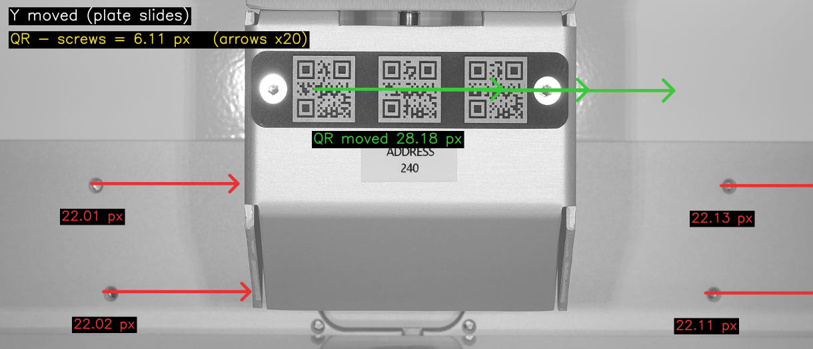
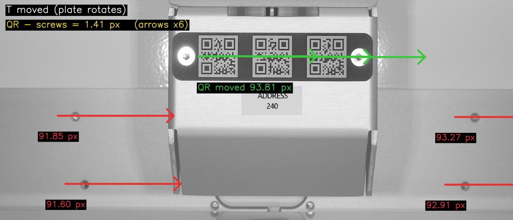

# 5-3. step 3: Y, T 계산

step 1, 2 에서 잰 값 5개(QR 가로 이동 1개 + 나사 가로 이동 4개)로 **Y (mm) 와 T (도)** 를 계산한다.

코드: `src/steps/03_compute_yt.hpp`, `03_compute_yt.cpp`. 계수 파일: `data/model/coefficients/`

**목차**

| 번호 | 제목 |
|---|---|
| 1 | 기능 |
| 2 | 개발 과정 |
| 2-1 | 어떤 값을 쓸까 → 가로 이동만 |
| 2-2 | 바(가로 막대)를 쓸까 → 쓰지 않는다 |
| 2-3 | 어떤 식으로 계산할까 → 선형식, 튀는 사진을 덜 믿는 학습 |
| 2-4 | 학습에 쓰는 정답: 촬영마다 로봇 0 의 차이를 뺀다 |
| 3 | 최종 방법과 보정 |
| 4 | 이 단계의 결과 |
| 5 | 한계와 확인하지 못한 것 |

---

## 1. 기능



Y 이동: QR과 나사의 이동량 차이.



T 회전: QR과 나사가 거의 함께 이동.

| | |
|---|---|
| 입력 | 값 5개: QR 가로 이동, 나사 1 ~ 4 가로 이동 (px). 어느 나사를 찾았는지 |
| 출력 | Y (mm), T (도). 영점을 빼기 전 값 |
| 함수 | `choose_coefficient_set` (계수 고르기) → `compute_yt` (계산) |

**계산식**

```
정규화 = (값 − mean) / scale
Y = intercept_Y + Σ weight_Y × 정규화
T = intercept_T + Σ weight_T × 정규화
```

`mean`, `scale`, `weight`, `intercept` 가 계수다. 사진으로 미리 학습해서 파일에 넣어 두었다.

**계수 고르기**: 찾은 나사에 따라 계수 파일이 다르다.

| 찾은 나사 | 쓰는 파일 | 결과 |
|---|---|---|
| 4개 모두 | `screws_1234.tsv` | 정밀 |
| 3개, 또는 좌우에 하나씩 있는 2개 | `screws_134.tsv`, `screws_14.tsv` 등 | 정밀 + 경고 `W_SCREW_MISSING` |
| 한쪽에만, 또는 0개 | `screws_13.tsv`, `screws_none.tsv` 등 | 대략값 + 경고 `W_COARSE` |

조합은 모두 16가지다.

**원리**

| 판이 움직이면 | QR | 나사 |
|---|---|---|
| T 로 1도 | 약 80 px | 약 81 px (거의 같이) |
| Y 로 1 mm | 약 14 px | 약 11 px (다르게) |

- "전체가 얼마나 움직였나"로 T 를 안다.
- "QR 과 나사가 얼마나 다르게 움직였나"로 Y 를 안다.
- 실제 계수도 그렇게 되어 있다. Y 의 가중치는 QR 에 +11.4, 나사 4개에 합쳐서 −11.3 이다.

---

## 2. 개발 과정

### 2-1. 어떤 값을 쓸까 → 가로 이동만

| 구성 | 같은 날들 안에서 허용오차 밖 | 처음 보는 날 통과율 |
|---|---|---|
| 가로, 세로 값 모두 (66개 값) | 1.3장 | 64% (네 번째 촬영은 7%) |
| **세로 값을 뺌** | 0.0 ~ 0.1장 | **98 ~ 99%** |
| 세로를 뺀 뒤 나사 세로 값 하나만 다시 넣음 | | 네 번째 촬영이 93% → 62% |

조건: 11월, 받은 사진 702장.

**고른 것**: 세로 방향 값은 하나도 쓰지 않는다. 세로 값의 변화는 75 ~ 90% 가 판의 움직임이 아니라 **촬영한 날마다 다른 화면 차이**였다. 세로 값을 넣으면 그날의 차이를 외워 버려서 다른 날에 틀린다.

덤으로, 카메라가 아래로 처져 화면이 세로로 밀려도 값이 변하지 않는다 (20 px 까지 차이 0.00001 mm).

### 2-2. 바(가로 막대)를 쓸까 → 쓰지 않는다

판에는 QR 위아래로 가로 막대가 있다. 막대의 기울기를 값으로 쓸 수 있는지 시험했다.

**바를 재는 방법 비교**

| 방법 | 통과율 | 시간 | 비고 |
|---|---|---|---|
| **64 px 칸으로 나눠 밝기 단면을 맞춤 → 직선** | 97.5 ~ 97.7% | 1.8 ms | 가장 좋았음 |
| 위 방법 + 튀는 칸을 덜 믿는 직선 | 96.8 ~ 97.0% | | 튀는 칸이 없어서 이득 없음 |
| 열마다 경계의 가장 센 곳 | 36.9 ~ 38.5% | | 소수 위치 치우침이 큼 |
| 구간마다 ECC | 95.0 ~ 95.3% | 57 ms | 바 안에 무늬가 적어 불안정 |

조건: 11월 초, 받은 사진 575장 (그때의 구성에 바 값만 바꿔 넣어 비교).

**바를 넣었을 때와 뺐을 때**

| | 허용오차 밖 | 처음 보는 날 |
|---|---|---|
| QR + 나사 + 바 기울기 (값 7개) | 0.1장 | 98.8% |
| **QR + 나사 (값 5개)** | 0.0 ~ 0.2장 | 98.2% |

조건: 11월, 받은 사진 702장.

**고른 것**: 바를 뺀다. 넣어도 정확도가 같았다. 그리고 다음 이유로 빼는 쪽이 안전하다.

- 바의 세로 위치는 변화의 85 ~ 90% 가 날마다 다른 차이였다 (바 경계가 판의 그림자라서 조명에 따라 움직인다).
- 우리 시험 장비에서 판을 다른 순서로 찍은 날에는 바 1698장을 모두 못 쟀다 (바가 탐색 범위 ±11.5 px 를 벗어남).
- 측정할 것이 줄어 빠르고, 틀릴 곳이 하나 줄어든다.

### 2-3. 어떤 식으로 계산할까 → 선형식, 튀는 사진을 덜 믿는 학습

| 식 | 결과 | 조건 |
|---|---|---|
| 기본 선형식 | 허용오차 밖 0.1장, 처음 보는 날 98% | 11월 702장 |
| **선형식 + 튀는 사진을 덜 믿는 학습 (Huber)** | 0.1장, 99% | 같음 |
| 선형식 + 강한 ridge | 164.5장, 41% | 같음 |
| 2차항 추가 | T 흔들림이 25% 줄지만 Y 는 그대로 | 같음 |
| 3차항 추가 | 과적합으로 나빠짐 | 같음 |
| 물리 모형 (판의 기하로 식을 세움) | 통과율 47 ~ 53% | 10 ~ 11월, 다른 구성 |

**고른 것**: 선형식. 2차, 3차식은 학습한 범위 안에서는 조금 낫지만 **범위 밖에서 크게 휘어서** 더 틀릴 수 있다. 예를 들어 T 2도 사진의 통과율이 선형식 66.7% 에서 2차, 3차식 0 ~ 16.7% 로 떨어졌다.

**학습 방법** (`tools/train/fit_coefficients`, `tools/common/coefficient_fit`)

1. 값마다 평균과 표준편차로 정규화한다.
2. Y 와 T 를 함께 보면서, 오차가 큰 사진의 가중치를 낮추는 계산을 6번 되풀이한다. 가중치 = min(1, 1 / max(|Y 오차| / 0.045, |T 오차| / 0.01)).
3. 계산이 흔들리지 않게 아주 작은 ridge(1e-7 × 사진 수)를 더한다.

### 2-4. 학습에 쓰는 정답: 촬영마다 로봇 0 의 차이를 뺀다

받은 사진의 정답은 파일 이름의 명령값이다 (`Y+0.05 T+0.01.bmp`). 그런데 **로봇의 "명령 0" 자리가 촬영한 날마다 Y 로 0.04 ~ 0.13 mm 달랐다.** 같은 "Y 0" 이라도 날마다 판이 다른 자리에 있었다는 뜻이다.

그대로 학습하면 날마다 다른 0 이 섞여 식이 흐려진다. 그래서 **학습할 때만** 촬영마다 그날 0 의 차이를 구해 정답에서 뺀다.

| 학습에 쓴 정답 | 처음 보는 날, 받은 정답으로 채점, 그날 영점을 잡음 |
|---|---|
| 받은 정답 그대로 | 89.5% |
| **촬영마다 로봇 0 의 차이를 뺀 정답** | **95.3%** |

- **채점할 때의 정답은 기업 측이 준 명령값 그대로다.** 고치지 않는다.
- 그날 0 의 차이는 사진만으로는 알 수 없다. 그래서 쓸 때는 매일 영점을 잡는다 ([step 0](5-0_준비와_영점.md)).
- 차이를 구하는 계산은 `tools/train/prepare_dataset` 에 있다. 값마다 "명령에 따른 변화 + 촬영마다 다른 상수"를 함께 맞춘 뒤, 그 상수가 0 이 되는 명령을 그 촬영의 0 으로 삼는다.

---

## 3. 최종 방법과 보정

| 보정 | 보정 전 문제 | 보정 전 → 후 | 코드, 파일 |
|---|---|---|---|
| 가로 값만 쓴다 | 세로 값이 그날의 화면 차이를 외움 | 처음 보는 날 64% → 98 ~ 99% | 값 5개 (`kValueNames`) |
| 나사 조합마다 계수를 따로 둔다 | 나사 하나가 가려지면 계산을 못 함 | 나사 하나를 가려도 Y 0.007 mm 차이 | `data/model/coefficients/` 16개, `choose_coefficient_set` |
| 튀는 사진을 덜 믿는 학습 | 이상한 사진 몇 장이 계수를 끌고 감 | 처음 보는 날 98 → 99% | `fit_coefficient_set` |
| 학습 정답에서 촬영마다 로봇 0 의 차이를 뺀다 | 날마다 다른 0 이 섞임 | 89.5 → 95.3% | `prepare_dataset` |
| 학습한 범위를 기록한다 | 범위 밖 값을 정밀값으로 믿게 됨 | 범위 밖이면 경고 `W_OUT_OF_RANGE` | `reference.json` 의 `trained_y_mm`, `trained_t_deg` |

---

## 4. 이 단계의 결과

받은 사진 702장. 통과 = Y 오차 0.045 mm 이하이고 T 오차 0.01도 이하. 시험에 쓴 사진은 그 시험의 학습에 쓰지 않았다.

| 시험 | 결과 |
|---|---|
| 같은 촬영들 안의 처음 보는 사진 (572장을 5묶음으로, 10번) | 100% (허용오차 밖 0장) |
| 떼어 둔 마지막 확인 사진 130장 | 99.2% (1장) |
| 처음 보는 날 (그날 로봇 0 의 차이를 아는 경우) | 99.3%, 97.8%, 100%, 93.0% |
| 처음 보는 날 (받은 정답으로 채점, 그날 영점을 잡음) | 96.8%, 93.7%, 100%, 86.3% |
| 학습한 범위 밖 (안쪽 절반으로 배우고 바깥을 시험) | 95.3%. Y 는 0.31%, T 는 0.44% 크게 읽음 |

자세한 방법과 표는 [평가 방법 1. 정확도](../06_평가_방법/6-1_정확도.md).

---

## 5. 한계와 확인하지 못한 것

- 네 번째 촬영은 다른 촬영보다 낮다 (93.0%, 받은 정답으로는 86.3%). Y 와 T 를 함께 크게 움직인 자세가 많은 촬영이다. 원인은 확인하지 않았다.
- 먼 자세(|T| 0.6 ~ 1.0도)에서는 날마다 T 가 조금씩 비례해서 틀린다. 대책은 [추가 논의: 먼 자세의 T 오차](../09_추가_논의/9-2_먼_자세의_T_오차.md).
- 정답은 로봇 명령값에서 만든 것이다. 따로 잰 실제 위치가 아니다.
- 계수는 받은 사진으로 학습했다. 카메라, 렌즈, 거리, 판이 바뀌면 다시 학습해야 한다 (`tools/train`).
- 촬영은 4번뿐이다.
