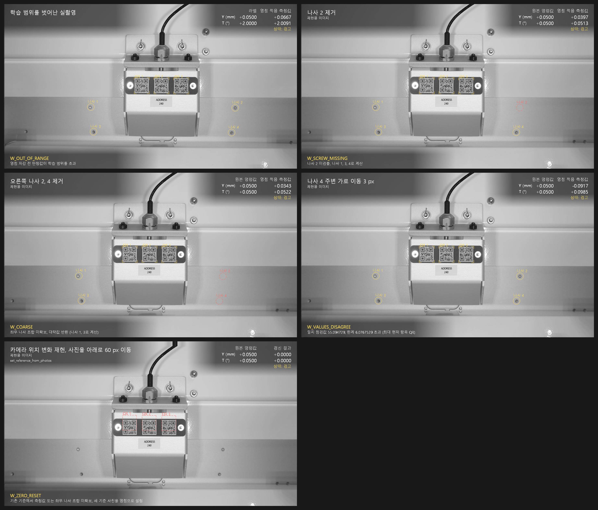
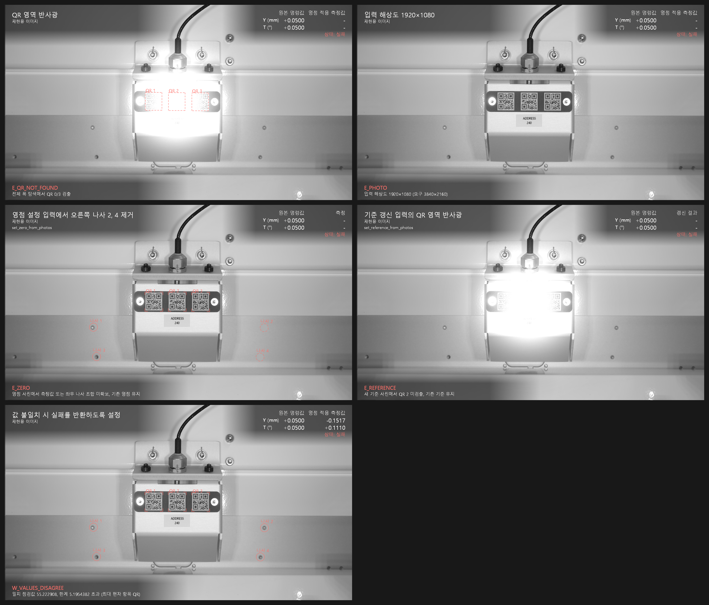

# 5-4. step 4: 결과 점검과 알림

계산값의 내부 일치 여부와 학습 범위를 점검한다. 정답과의 오차를 직접 검사하는 기능은 아니므로 경고가 없어도 허용오차 밖일 수 있다. 실패 결과의 Y, T는 NaN으로 반환하며 사용하면 안 된다.

코드: `src/steps/04_check_result.hpp`, `04_check_result.cpp`, `src/alignment.cpp` 의 `make_result`, `add_notices`. 점검식 파일: `data/model/checks/`

---

## 1. 기능

실제 사진에서 경고와 실패가 나온 모습 (사진마다 왼쪽 아래에 코드와 이유):





| | |
|---|---|
| 입력 | 값 5개 (QR, 나사 1 ~ 4 의 가로 이동), step 3 에서 구한 Y, T, 영점을 잡을 때 저장한 기준 |
| 출력 | 상태 (정상, 경고, 실패), 코드, 사람이 읽는 메시지. 확인용으로 점검값과 기준값 |
| 함수 | `check_values_agree` (값 일치 점검), `check_in_trained_range` (범위 점검), `add_notices` (알림 붙이기) |

**점검 두 가지**

| 점검 | 무엇을 보나 | 걸리면 |
|---|---|---|
| 값 일치 점검 | QR 과 나사의 값이 **하나의 자세로 함께 설명되는지** | `W_VALUES_DISAGREE` |
| 범위 점검 | Y, T 가 **계수를 학습한 범위 안**인지 | `W_OUT_OF_RANGE` |

**상태 세 가지**

| 상태 | 뜻 | 값 | 로봇 |
|---|---|---|---|
| 정상 | 구현된 점검을 통과했다. 정확도 보장은 아님 | 나옴 | correction_allowed와 장비 이동 조건 확인 |
| 경고 | 조건별 확인 필요 | 나옴 | action, correction_allowed, notices에 따라 처리 |
| 실패 | 잴 수 없다 | 없음 | 멈춘다 |

코드마다의 조건, 예상되는 위험, 다음 할 일은 [03 상태와 알림](../03_상태와_알림.md)의 표에 모두 있다.

---

## 2. 개발 과정

### 2-1. 왜 값 일치 점검을 넣었나

step 2 의 약점 때문이다. 나사가 반쯤 가려지면 나사를 "찾았다"고 보고 엉뚱한 자리를 내는 경우가 있었다 (우리 시험 장비 사진에서 641장, Y 가 2.5 mm 까지 틀림). 이때 상태는 정상으로 나왔다. **틀린 값을 정상이라고 내는 것이 가장 위험하다.**

### 2-2. 점검하는 방법

판의 자세는 Y, T 두 개뿐인데, 잰 값은 3 ~ 5개(QR 1개 + 나사 2 ~ 4개)다. 정상이면 모든 값이 하나의 (Y, T) 로 설명된다. 나사 하나가 엉뚱하게 재지면 **그 값만** 어긋난다.

```
기대값 = c1 + cY * Y + cT * T + cYY * Y² + cYT * Y * T + cTT * T²      (값마다 계수가 다르다)
어긋남 = |측정값 − 기대값 − 기준 어긋남| ÷ scale
점검값 = 어긋남 중 가장 큰 것
점검값 > threshold 이면 "값들이 서로 맞지 않는다"
```

| 숫자 | 정하는 방법 |
|---|---|
| 기대값의 계수 | 정상 사진에서 각 값을 (Y, T) 의 2차식으로 맞춤 |
| `scale` | 정상 사진에서 (측정값 − 기대값)이 흔들리는 정도. 튀는 사진에 끌려가지 않게 가운뎃값으로 구함 |
| `threshold` | 정상 사진 점검값의 99.9% 지점에 1.5 를 곱함 (나사 4개 조합은 6.077) |
| 기준 어긋남 | 영점을 잡을 때 그 사진의 (측정값 − 기대값). 그날의 화면 상태를 0 으로 삼기 위해 뺀다 |

- 점검식은 나사 2개 이상인 조합 11가지에만 있다. 나사가 0 ~ 1개면 비교할 값이 모자라서 점검하지 않는다 (이때는 `W_COARSE` 가 난다).
- 점검식도 계수와 같이 학습 도구가 만든다 (`tools/common/coefficient_fit` 의 `fit_agreement_check`).

### 2-3. 과거 시험에서 점검이 잡은 것

아래 합성 시험의 검출률은 해당 조건에서의 기록이다. 모든 실제 오차를 검출한다는 뜻이 아니다. 현재 사진 평가에서 경고 없이 OUT인 사진도 확인되었다.

| | 결과 | 조건 |
|---|---|---|
| 나사 가림으로 틀린 641장 | 500장에서 경고. **Y 가 0.1 mm 넘게 틀린 경우는 모두 경고** | 우리 시험 장비 사진, 나사 하나를 반쯤 가림 |
| 정상 사진에서 괜한 경고 | 0장 | 받은 사진 702장 |
| 정상 사진에서 괜한 경고 | 0장 | 우리 시험 장비, 학습한 날 1959장 |
| 학습하지 않은 날, 영점을 안 잡음 | 251장 (15%) | 우리 시험 장비 1680장 |
| 같은 사진, **그날 영점을 잡음** | 3장 (0.2%) | 같음 |

영점을 날마다 잡으면 괜한 경고가 거의 없다. 반대로 **여러 사진에서 반복되면 촬영 상태, 영점, 모델 적합성을 함께 확인해야 한다**.

### 2-4. 일부러 망가뜨린 사진으로 본 결과

| 변화 | 결과 |
|---|---|
| 카메라가 0.05도 돌아감 | Y 가 0.27 mm 틀어짐. 영점을 다시 잡으면 허용오차 밖 0장 |
| 화면이 가로로 2 px 밀림 | T 가 0.025도 틀어짐. 영점을 다시 잡으면 0장 |
| 배율이 0.2% 바뀜 | Y 가 0.04 mm 틀어짐. 영점을 다시 잡으면 거의 없어짐 |
| 흐림 σ 1 px, 밝기 ×0.6, 밝기 ±40, 약한 노이즈 | 영향 작음 |
| QR 하나를 가림, 반사 | 못 찾거나 영향 작음 |
| 화면이 세로로 25 px 밀림 | QR 을 못 찾음 (틀린 값을 내지 않음) |

조건: 받은 사진 702장과 우리 시험 장비 사진 1959장에 32가지 변화를 넣음. 변화의 종류와 세기는 결과를 보기 전에 정했다.

상황별 정리는 [평가 방법 3. 강건성](../06_평가_방법/6-3_강건성.md)에 있다.

### 2-5. 알림의 원칙

| 원칙 | 이유 |
|---|---|
| 측정 중 잡은 `std::exception` 을 실패로 알림 | `E_INTERNAL` 반환. 모든 함수의 예외 방지를 보장하지는 않음 |
| 경고일 때도 값을 낸다 | 검토용 수치다. W_OUT_OF_RANGE와 W_COARSE는 자동 보정을 허용하지 않는다 |
| 실패면 값 사용 금지 | 실패 Y, T는 NaN이다. status와 correction_allowed를 먼저 확인 |
| `code` 는 가장 제한적인 조치의 알림 | Stop, Recapture, Review, Correct 순으로 우선한다. 같은 우선순위에서는 먼저 추가된 코드. 모든 알림은 notices로 확인 |
| 메시지에 관측한 조건과 처리 결과를 쓴다 | 왜 그 상태가 됐는지 메시지만 보고 알 수 있게. 다음 할 일은 [03 상태와 알림](../03_상태와_알림.md)의 표에 있다 |

**알림을 붙이는 순서** (`add_notices`). 대표 code는 추가 순서만이 아니라 조치 우선순위로 정한다.

| 순서 | 조건 | 코드 |
|---|---|---|
| 1 | 나사가 한쪽에만 있거나 없음 | `W_COARSE` |
| 2 | 값이 서로 맞지 않음 | `W_VALUES_DISAGREE` |
| 3 | 나사 일부를 못 찾음 (좌우는 남음) | `W_SCREW_MISSING` |
| 4 | 학습한 범위 밖 | `W_OUT_OF_RANGE` |

2026-11-16 QR 탐색을 바꾸며 `W_QR_PARTIAL`(QR 1 ~ 2개), `W_FAR`(전체 폭 탐색), `N_WIDE_SEARCH`(넓은 창, 참고)를 없앴다. QR 3개를 얻지 못하면 알림을 붙이기 전에 `E_QR_NOT_FOUND` 로 실패한다 ([03 상태와 알림](../03_상태와_알림.md) 4절).

---

## 3. 최종 방법과 보정

| 보정 | 보정 전 문제 | 보정 전 → 후 | 코드, 파일 |
|---|---|---|---|
| 값 일치 점검 | 가려진 나사로 틀린 값이 정상으로 나옴 | Y 0.1 mm 넘게 틀린 경우를 모두 경고 | `check_values_agree`, `data/model/checks/` |
| 영점을 잡을 때 기준 어긋남을 저장 | 날마다 화면 상태가 달라 괜한 경고가 남 | 괜한 경고 15% → 0.2% | `reset_baselines` |
| 범위 점검 | 학습한 범위 밖의 값을 정밀값으로 믿음 | 범위 밖이면 경고 | `check_in_trained_range` |
| 불일치를 실패로 볼지 설정으로 정함 | 현장마다 원하는 동작이 다름 | `fail_on_disagreement` 를 1 로 하면 실패로 표시 | `config/settings.json` |

---

## 4. 과거 시험의 결과

각 행은 시험 데이터와 변화 조건에 한정된다. 현재 전체 사진에 대한 무경고 오차 검출 보장으로 인용하면 안 된다.

| 항목 | 결과 |
|---|---|
| 정상 사진의 괜한 경고 (받은 사진 702장) | 0장 |
| 가려진 나사로 Y 가 0.1 mm 넘게 틀린 경우 | 모두 경고 |
| 화면 변화 43가지를 합성한 시험에서 알림 없이 틀린 경우 | 0가지 |
| 알림 없이 틀리는 것으로 알고 있는 경우 | 판을 다시 조립해 QR 과 나사 사이가 밀림, 컬러 사진이 RGB 순서로 들어옴, 거친 노이즈 (702장 중 8장) |

---

## 5. 한계와 확인하지 못한 것

- 값 일치 점검은 **값끼리 서로 다르게 틀릴 때**만 잡는다. 카메라가 통째로 밀리면 값이 다 같이 움직여서 서로는 맞는다. 이런 변화는 영점을 다시 잡아서 없앤다.
- 판을 다시 조립해 QR 판과 나사 사이가 밀리면, 판이 움직인 것과 구별할 수 없다. 판을 손댄 뒤에는 영점을 다시 잡는다.
- Y 가 0.1 mm 보다 작게 틀린 경우는 못 잡을 수 있다.
- 현재 QR 단계는 후보 3개, 기준 대비 간격 차이, 정밀 맞춤을 검사하며 실패하면 E_QR_NOT_FOUND다. 이 검사도 모든 오검출을 수학적으로 배제하는 보장은 아니다.
- 값 불일치를 실패로 설정하면 Y, T를 NaN으로 반환하고 보정을 금지한다.
- 영점 없이 measure_alignment를 호출하면 E_ZERO_REQUIRED로 실패한다. measure_diagnostic은 별도 진단 함수이며 보정을 허용하지 않는다.
- 시험은 사진을 일부러 바꾼 것이다. 실제 현장의 가림, 반사, 조명과는 다를 수 있다.
