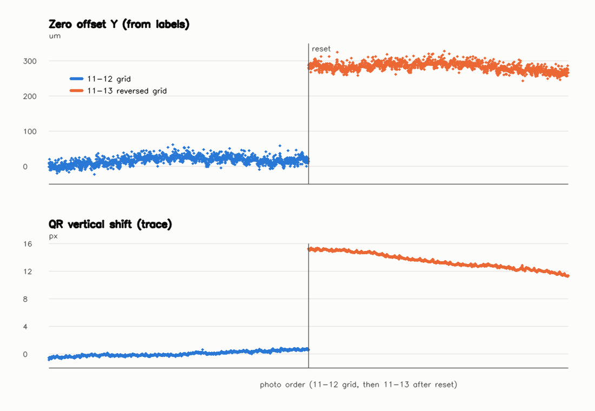
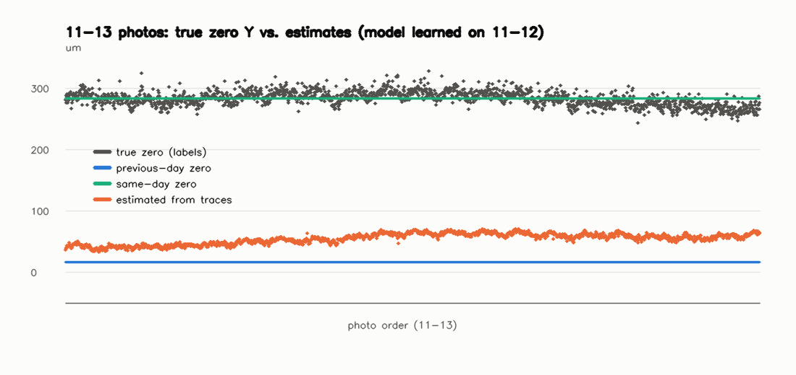

# 9-1. 영점 자동 보정

> 이 문서는 개발 실험과 제안의 기록을 포함한다. 제안된 설정이나 알고리즘이 모두 구현된 것은 아니다. 현재 호출 계약은 03 상태와 알림, 현재 정확도 조건은 6-1 정확도를 따른다. 과거 시험 수치는 해당 데이터와 설정에서만 해석한다.


## 1. 요약

- **지금은 그날 영점을 잡는 것이 최선이다.** 로봇을 명령 0 으로 보내 찍은 사진 5 ~ 10장으로 `set_zero_from_photos` 를 부른다 ([구현 방법 step 0](../05_구현_방법/5-0_준비와_영점.md)).
- 추가로 개발할 수 있는 것: 측정 결과(`Result`)에 Y, T 와 함께 **"이 사진은 영점에서 얼마나 틀어진 상태인가"(영점 어긋남 추정값)** 를 같이 내는 것.
- 지금 받은 사진으로는 만들 수 없다. 촬영이 4번뿐이라 배울 정답이 4개밖에 없다.
- 우리 장비 사진(3638장)으로 해 보니, 영점이 바뀐 것은 흔적으로 분명히 **감지**되지만(리셋 때 세로 13 px), 얼마나 바뀌었는지 **맞히지는 못했다**. 영점이 다르게 틀어진 촬영을 10번 이상 모으면 다시 시험할 수 있다 (5절).

## 2. 목표

```
지금:   Result = { y_mm, t_deg, ... }
추가:   Result = { y_mm, t_deg, zero_y_mm, zero_t_deg, ... }
                               └ 사진 한 장으로 추정한 그날 영점 어긋남
```

이 값이 믿을 만하면, 영점을 따로 잡지 않아도 `y_mm − zero_y_mm` 로 그날 기준 값을 얻을 수 있다. 믿을 만하지 않더라도, 잡아 둔 영점과 크게 다르면 "영점을 다시 잡으세요" 경고에 쓸 수 있다.

## 3. 방법

| 단계 | 내용 |
|---|---|
| 1. 흔적 값 모으기 | 판의 Y, T 로는 설명되지 않는 값. QR 세로 이동, 왼쪽과 오른쪽 QR 의 세로 이동 차이(카메라 기울어짐), QR 사이 가로 간격(거리, 배율), 나사 4개의 세로 이동. **모두 지금도 계산하고 있는 값**이다 |
| 2. 정답 만들기 (데이터 보정) | 촬영마다, 명령값을 아는 사진으로 그날 영점 어긋남을 구한다. 영점 어긋남 = 평균(측정값 − 명령값) |
| 3. 학습 | 흔적 값 → 그날 영점 어긋남 을 맞히는 식을 학습한다 |
| 4. 평가 | 촬영 하나를 통째로 빼고 학습, 그 촬영의 영점 어긋남을 맞히는지 본다. 맞힌 영점으로 받은 정답(명령값)을 채점해, 영점을 직접 잡은 경우(95.3%)와 비교한다 |

속도: 새로 사진을 처리하지 않는다. 이미 계산한 값에 식 하나를 더하는 것이라 측정 시간(약 15 ms)에 영향이 없다.

## 4. 현재 적용이 어려운 이유

| 이유 | 내용 |
|---|---|
| 정답이 4개뿐 | 영점 어긋남은 촬영마다 하나다. 기업 측 촬영 4번이면 정답 4개로 식을 배워야 한다. 믿을 수 없다 |
| 로봇 0 자체의 변화는 흔적이 없다 | 판이 실제로 다른 자리에 놓인 경우는 사진이 "판이 그 자리에 있는 사진"과 같다. 이 방법으로 추정할 수 있는 것은 **카메라나 고정대가 움직여 생긴 부분**뿐이다 |
| 비슷한 시도가 처음 보는 날에 실패했다 | 세로 값을 넣으면 같은 날 사진은 좋아졌지만 처음 보는 날은 61 ~ 64% 로 떨어졌다. 날마다 생기는 어긋남 방향을 지우는 방법은 앞 3번의 촬영에 없던 방향이 나온 4차에서 35% 였다 |

그래도 가능성은 있다. 판의 움직임으로 설명되지 않는 어긋남이 큰 촬영(2차, 3차: 0.25 ~ 0.31 px)이 영점 어긋남도 컸고(약 0.13 mm), 작은 촬영(1차, 4차: 0.05 px)은 영점 어긋남도 작았다(0.04 ~ 0.07 mm).

## 5. 자체 장비 사진 시험 결과

우리 장비 사진 3638장(11-12 두 세트, 11-13 한 세트)으로 3절 방법을 시험했다. 11-13 아침 장비 리셋으로 영점이 Y 0.27 mm, T 33 mdeg 바뀌었다.

### 5-1. 흔적은 리셋을 분명히 본다

| 세트 | 영점 Y | 영점 T | QR 세로 이동 | 나사 세로 이동 |
|---|---:|---:|---:|---:|
| 11-12 | +0.017 mm | −0.024도 | +0.1 px | −0.1 px |
| 11-13 (리셋 뒤) | +0.284 mm | −0.056도 | **+13.5 px** | **+7.0 px** |



- 위: 사진마다의 영점 Y (µm). 파랑은 11-12, 주황은 11-13. 가운데 세로선에서 장비를 리셋했다.
- 아래: 같은 사진의 QR 세로 이동 (px, 흔적 값).
- 리셋에서 영점과 흔적이 **함께 크게 뛴다.** 감지에는 충분한 신호다.
- 11-13 안에서는 흔적이 15 px 에서 11 px 로 서서히 줄지만 영점은 거의 그대로다. 흔적의 크기가 영점의 크기를 그대로 알려 주지는 않는다는 뜻이다.

### 5-2. 하지만 맞히지는 못한다

| 시험 | 보정 없음 (전날 영점) | 그날 영점을 잡음 | 흔적으로 추정 |
|---|---:|---:|---:|
| 11-12 로 배워 11-13 영점 맞히기 | 0% | 85.9% | 0% |
| 11-13 로 배워 11-12 영점 맞히기 | 0% | 85.9% | 0% |

(영점 오차만으로 허용오차 Y 0.045 mm, T 0.01도 안에 든 비율)



- 11-13 사진의 실제 영점 Y(회색)와 세 가지 추정을 겹쳤다. 식은 11-12 사진으로만 배웠다.
- 초록(그날 영점을 잡음)은 실제와 겹친다. 파랑(전날 영점)과 주황(흔적으로 추정)은 0.2 mm 넘게 아래에 있다.
- 흔적 추정이 전날 영점보다 조금 위로 올라오긴 하지만, 실제 영점까지는 한참 모자라다.

- 한 날 사진으로 배운 식은 리셋 같은 큰 변화를 본 적이 없어서, 13 px 흔적을 엉뚱하게 해석했다(T 를 0.18도 틀림).
- 리셋이 자료에 한 번뿐이라 "흔적 → 영점" 관계를 배울 점이 하나뿐이다.
- 한 날 안에서 시간에 따라 흐르는 영점도 맞히지 못했다(통과 81.5% → 64 ~ 71%).

### 5-3. 결론과 다음 단계

| | 지금 | 다음에 필요한 것 |
|---|---|---|
| 영점 **자동 보정** | 불가 | 영점이 서로 다르게 틀어진 촬영 10번 이상 (리셋, 카메라를 일부러 조금씩 옮기기 등). 촬영 하나가 관계식의 점 하나라서, 흔적 값 수(7개)보다 촬영이 많아야 하고 검증용 촬영이 따로 있어야 한다. 흔적을 1 ~ 2개로 줄이면 5 ~ 6번으로 시험은 해 볼 수 있다. 우리 장비는 직접 찍을 수 있어 먼저 모을 수 있다 |
| 영점이 바뀐 것을 **감지** | 가능성 큼. 리셋 때 세로 이동 13 px 대 평소 0.1 px | 감지 경고("영점을 다시 잡으세요")를 만들고 괜한 경고율을 잰다 |

**성공 기준 (제안)**: 처음 보는 촬영에서 맞힌 영점의 오차가 Y 0.01 mm, T 0.002도 안쪽이고, 그 영점으로 채점한 통과율이 영점을 직접 잡은 경우와 같거나 높을 것.
