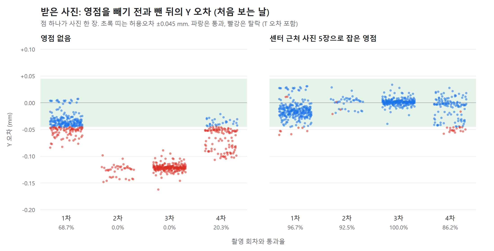
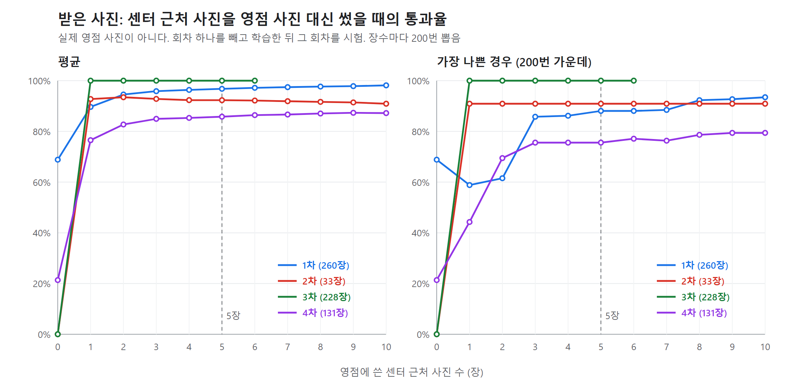
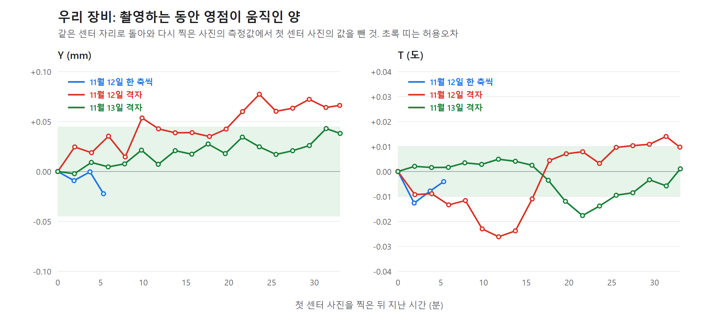
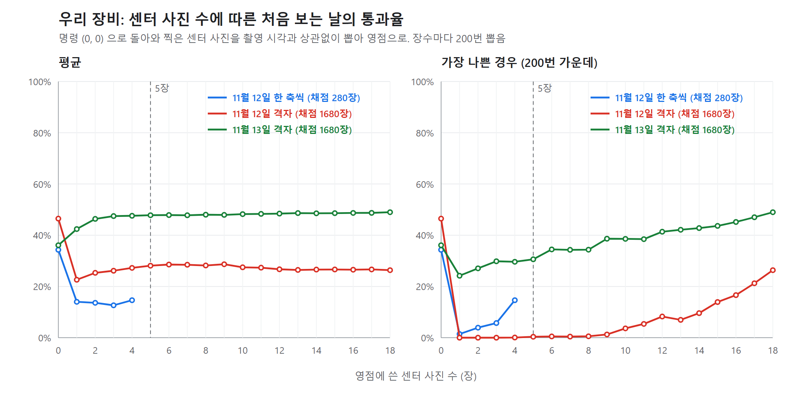
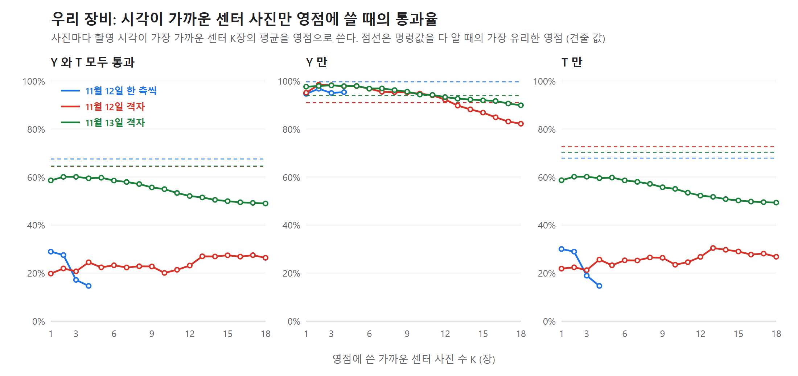

# 9-6. 영점 사진을 몇 장, 언제 찍어야 하나

그날 영점은 로봇을 명령 0 으로 보내 찍은 사진으로 잡는다. 이 문서는 **그 사진을 몇 장, 언제 찍어야 하는지**를 가진 사진으로 재 본 결과다. 결론부터 말하면 **장수와 시기는 확인하지 못했다.** 답하는 데 필요한 사진이 받은 사진에도 우리 장비 사진에도 없다. 확인한 것과 확인하지 못한 것을 나눠 적고, 확인하려면 찍어야 하는 사진을 정리했다.

**목차**

| 번호 | 제목 |
|---|---|
| 1 | 요약 |
| 2 | 가진 사진 |
| 3 | 받은 사진으로 잰 것 |
| 3-1 | 영점을 빼기 전과 뺀 뒤 |
| 3-2 | 센터 근처 사진을 영점 사진 대신 썼을 때 |
| 4 | 우리 장비 사진으로 잰 것 |
| 4-1 | 촬영하는 동안 영점이 움직인다 |
| 4-2 | 센터 사진 수에 따른 통과율 |
| 4-3 | 시각이 가까운 센터 사진만 쓸 때 |
| 5 | 확인한 것과 확인하지 못한 것 |
| 6 | 확인하려면 찍어야 하는 사진 |
| 7 | 기업 측에 확인할 것 |

## 1. 요약

- **영점을 잡지 않으면 크게 틀린다.** 받은 사진에서 영점 없이 채점하면 처음 보는 날의 통과율이 31.5% 다. 2차와 3차는 한 장도 통과하지 못한다. 이것은 확인했다.
- **영점 사진을 몇 장 찍으면 몇 % 가 나오는지는 확인하지 못했다.** 받은 사진에는 명령 0 에서 찍은 사진이 4장뿐이고 이름에 명령값이 없다. 다른 문서의 "영점 5장으로 95.5%"는 **센터 근처 자세 사진을 영점 사진 대신 써서** 잰 값이다. 실제 영점 사진으로 잰 값이 아니다.
- **실제 센터 사진이 있는 우리 장비에서는 그 숫자가 재현되지 않았다.** 센터 사진을 18장까지 늘려도 통과율이 26 ~ 49% 에 머문다.
- **우리 장비에서는 영점이 촬영 중에 움직였다.** 33분 동안 같은 자리의 측정값이 Y 로 최대 0.077 mm, T 로 최대 0.026도 달라졌다. 허용오차(0.045 mm, 0.01도)보다 크다.
- **영점 사진은 측정할 사진과 가까운 시각에 찍은 것이 낫다.** 우리 장비에서 Y 만 보면, 가까운 시각의 센터 1 ~ 3장을 쓸 때 95 ~ 98%, 촬영 전체의 센터를 평균하면 82 ~ 90% 다. T 는 어떤 방법으로도 20 ~ 60% 였고 원인을 가려내지 못했다.

| 물음 | 답 | 근거 |
|---|---|---|
| 영점을 잡아야 하나 | 잡아야 한다 | 받은 사진. 영점 없이 31.5% |
| 몇 장이 좋은가 | 확인 못 함 | 연달아 찍은 영점 사진이 없다 |
| 언제 찍어야 하나 | 측정과 가까운 시각이 낫다. 얼마나 자주인지는 확인 못 함 | 우리 장비. Y 만 본 결과 |
| 기업 측 장비에서도 영점이 움직이나 | 확인 못 함 | 받은 사진으로는 알 수 없다 |

## 2. 가진 사진

"영점 사진이 몇 장이면 되나"에 답하려면, **같은 자리에서 연달아 찍은 영점 사진 여러 장**과 **그 직후에 찍은, 정답을 믿을 수 있는 자세 사진**이 있어야 한다. 가진 사진은 아래와 같다.

| | 받은 사진 | 우리 장비 사진 |
|---|---|---|
| 사진 수 | 702장 (촬영 4번) | 3,640장 (세 세트, 이틀) |
| 명령 0 에서 찍은 사진 | 4장. 1차에 1장, 2차에 3장. 이름에 명령값이 없어 실험에 쓰지 않는다 | 40장. 자세 사진 100장마다 센터로 돌아와 1장씩 |
| 연달아 찍은 영점 사진 | 없음 | 없음 (약 2분 간격) |
| 정답을 믿을 수 있나 | 대체로 맞다 | Y 는 맞다. T 명령값은 실제 각도와 최대 0.02도 다를 수 있다 (허용오차의 2배) |
| 촬영 중에 영점이 가만히 있나 | 알 수 없다 | 아니다 (4-1) |

우리 장비는 기업 측 장비와 다른 장비다. 카메라와 판의 자리가 달라서, 받은 사진으로 만든 계수를 쓰지 않고 우리 장비 사진으로 계수를 따로 만들었다. 그래서 우리 장비의 통과율을 받은 사진의 통과율과 그대로 견줄 수 없다. 여기서는 **영점 사진을 쓰는 방법끼리의 차이**만 본다.

## 3. 받은 사진으로 잰 것

### 3-1. 영점을 빼기 전과 뺀 뒤

촬영 하나를 통째로 빼고 나머지 셋으로 계수를 만든 뒤, 뺀 촬영의 사진을 쟀다. 받은 명령값 그대로 채점했다.

- 왼쪽이 영점을 잡지 않은 경우다. 2차와 3차는 사진 전체가 Y 로 약 0.12 mm 치우쳐 있어 한 장도 통과하지 못한다. 측정이 흔들려서가 아니라, 그날 로봇의 명령 0 자리가 달라서다.
- 오른쪽은 그 치우침을 뺀 경우다. 네 촬영 모두 허용오차 띠 안으로 들어온다.
- 오른쪽에서 뺀 값은 **실제 영점 사진으로 구한 것이 아니다.** 센터 근처 자세 사진 5장의 (측정값 − 명령값) 평균이다 (3-2).

| 촬영 | 영점 없음 | 그날 로봇 0 의 차이를 정확히 아는 경우 |
|---|---:|---:|
| 1차 | 68.9% | 99.3% |
| 2차 | 0% | 97.8% |
| 3차 | 0% | 100% |
| 4차 | 19.6% | 93.0% |
| 합계 | 31.5% | 98.1% |

"정확히 아는 경우"는 그 촬영의 사진 전체로 치우침을 구한 값이다. 측정 자체가 얼마나 정확한지를 보여 주는 값이고, 영점 사진으로 이만큼 나온다는 뜻이 아니다.

### 3-2. 센터 근처 사진을 영점 사진 대신 썼을 때

받은 사진에는 쓸 수 있는 영점 사진이 없어서, 센터 근처(Y 0.25 mm 이내, T 0.05도 이내) 자세 사진을 영점 사진 대신 썼다. N장을 뽑아 (측정값 − 명령값)의 평균을 영점으로 잡고, 나머지 사진을 채점했다. 뽑는 방법을 200번 바꿨다.

| 촬영 | 채점한 사진 | 대신 쓸 수 있는 센터 근처 사진 |
|---|---:|---:|
| 1차 | 260장 | 20장 |
| 2차 | 33장 | 12장 |
| 3차 | 228장 | 6장 |
| 4차 | 131장 | 12장 |

| 쓴 사진 수 | 1차 | 2차 | 3차 | 4차 |
|---|---:|---:|---:|---:|
| 0장 | 68.8% | 0% | 0% | 21.4% |
| 1장 | 89.6% | 92.7% | 100% | 76.5% |
| 3장 | 95.9% | 92.8% | 100% | 84.9% |
| 5장 | 96.8% | 92.3% | 100% | 85.8% |
| 10장 | 98.1% | 90.9% | 사진 부족 | 87.2% |

가장 나쁜 경우 (200번 가운데)

| 쓴 사진 수 | 1차 | 2차 | 3차 | 4차 |
|---|---:|---:|---:|---:|
| 1장 | 58.8% | 90.9% | 100% | 44.3% |
| 3장 | 85.8% | 90.9% | 100% | 75.6% |
| 5장 | 88.1% | 90.9% | 100% | 75.6% |
| 10장 | 93.5% | 90.9% | 사진 부족 | 79.4% |

- 1장만 쓰면 뽑힌 사진에 따라 크게 달라진다. 1차는 58.8% 까지 떨어진다. 영점을 잡지 않은 68.8% 보다 낮다.
- 평균은 3장부터 거의 평평하다.

**이 결과를 "영점 사진 N장이면 몇 %"로 읽으면 안 된다.** 이유는 두 가지다.

1. 대신 쓴 사진은 명령 0 에서 찍은 사진이 아니다. 조금 움직인 자세에서 찍었고, 그 명령값을 안다고 보고 뺀 것이다.
2. 대신 쓴 사진은 촬영 내내 흩어져 찍혔다. 여러 장을 평균하면 그 촬영 전체의 평균 영점이 된다. 실제로는 측정 전에 한 번 찍으므로, 촬영 중에 영점이 움직이는 장비라면 이 평균과 다르다.

## 4. 우리 장비 사진으로 잰 것

우리 장비 사진에는 자세 사진 100장마다 명령 0 으로 돌아와 찍은 센터 사진이 있다.

| 세트 | 촬영 | 자세 사진 | 센터 사진 | 계수를 만든 사진 |
|---|---|---:|---:|---|
| 11월 12일 한 축씩 | Y 와 T 를 한 축씩 움직임. 5분 | 280장 | 4장 | 11월 13일 격자 |
| 11월 12일 격자 | Y 와 T 를 함께 움직임. 33분 | 1,680장 | 18장 | 11월 13일 격자 |
| 11월 13일 격자 | 같은 자세를 반대 순서로. 33분 | 1,680장 | 18장 | 11월 12일 두 세트 |

- 사진은 패키지의 측정 코드로 쟀다. 3,680장 가운데 못 잰 사진은 없다.
- 장비가 달라서, 세트마다 첫 센터 사진으로 기준을 다시 등록했다 (`set_reference_from_photos`).
- 계수는 다른 날 찍은 세트로 만들었다 (처음 보는 날). 학습 정답은 파일 이름의 명령값 그대로다.
- 채점도 파일 이름의 명령값으로 했다. 통과 기준은 Y 0.045 mm, T 0.01도.

### 4-1. 촬영하는 동안 영점이 움직인다

같은 센터 자리로 돌아와 다시 찍은 사진을 재고, 첫 센터 사진의 값을 뺐다. 영점이 가만히 있으면 0 에 머물러야 한다.

| 세트 | 시간 | Y 가 움직인 최대 | T 가 움직인 최대 |
|---|---|---:|---:|
| 11월 12일 한 축씩 | 5분 | 0.022 mm | 0.013도 |
| 11월 12일 격자 | 33분 | 0.077 mm | 0.026도 |
| 11월 13일 격자 | 33분 | 0.043 mm | 0.018도 |

- 11월 12일 격자는 10분쯤 지나 Y 가 허용오차를 넘었고, T 는 2분 만에 허용오차에 닿았다.
- 그래서 촬영을 시작할 때 찍은 센터 1장을 끝까지 쓰면 통과율이 낮다. 11월 12일 격자 5.4%, 11월 13일 격자 36.9%.

### 4-2. 센터 사진 수에 따른 통과율

센터 사진을 촬영 시각과 상관없이 N장 뽑아, 그 측정값의 평균을 영점으로 잡았다. 3-2 와 같은 방법이고, 이번에는 실제로 명령 0 에서 찍은 사진이다.

| 세트 | 0장 | 1장 | 5장 | 전부 | 5장, 가장 나쁜 경우 |
|---|---:|---:|---:|---:|---:|
| 11월 12일 한 축씩 | 34.3% | 14.0% | 센터 4장뿐 | 14.6% | |
| 11월 12일 격자 | 46.5% | 22.6% | 28.1% | 26.4% | 0.4% |
| 11월 13일 격자 | 36.1% | 42.4% | 47.8% | 49.0% | 30.6% |

- **받은 사진(3-2)과 다르게, 장수를 늘려도 올라가지 않는다.** 두 세트는 0장보다 낮다.
- 여기서 "0장"은 영점이 없는 경우가 아니다. 기준을 등록할 때 첫 센터 사진을 이미 썼다. 받은 사진의 "영점 없음"과 같은 뜻으로 견줄 수 없다.
- 떨어지는 쪽은 T 다. 11월 12일 격자에서 5장을 쓸 때, Y 만 보면 82.1%, T 만 보면 29.9% 다.

### 4-3. 시각이 가까운 센터 사진만 쓸 때

영점이 움직이므로, 사진마다 촬영 시각이 가장 가까운 센터 K장만 평균해 영점으로 썼다.

| 세트 | 방법 | 통과 | Y 만 | T 만 |
|---|---|---:|---:|---:|
| 11월 12일 격자 | 센터 18장 전부 평균 | 26.4% | 82.2% | 26.8% |
| | 가까운 2장 | 21.9% | 98.5% | 22.4% |
| | 직전에 찍은 1장 | 19.0% | 97.7% | 19.9% |
| 11월 13일 격자 | 센터 18장 전부 평균 | 49.0% | 89.9% | 49.3% |
| | 가까운 2장 | 60.1% | 97.9% | 60.1% |
| | 직전에 찍은 1장 | 60.8% | 97.7% | 61.0% |
| 11월 12일 한 축씩 | 센터 4장 전부 평균 | 14.6% | 95.4% | 14.6% |
| | 가까운 2장 | 27.5% | 96.8% | 28.9% |

- **Y 는 가까운 센터 1 ~ 3장이면 95 ~ 98% 다.** 먼 시각의 센터를 섞을수록 내려간다 (그림 가운데 칸).
- **T 는 어떤 방법으로도 20 ~ 60% 다.** 명령값을 다 안다고 보고 가장 유리하게 영점을 잡아도 T 만 68 ~ 73% 다 (그림의 점선).
- 가까운 1장과 가까운 2 ~ 3장이 비슷하다. 센터 사진이 2분 간격이라, 두 번째로 가까운 사진이 이미 2분 떨어져 있다. 장수를 늘린 효과와 시각이 멀어진 효과가 섞여서, 이 사진으로는 둘을 나눌 수 없다.

T 가 낮은 원인은 가려내지 못했다. 센터 사진이 가리키는 T 영점과 자세 사진들이 가리키는 T 영점이 0.010 ~ 0.021도 다르다는 것까지 확인했다. 우리 장비의 T 명령값이 실제 각도와 최대 0.02도 다를 수 있어서, 측정이 틀린 것인지 정답이 틀린 것인지 이 사진만으로는 알 수 없다.

## 5. 확인한 것과 확인하지 못한 것

| | 내용 | 근거 |
|---|---|---|
| 확인함 | 영점을 잡지 않으면 크게 틀린다 | 받은 사진. 영점 없이 31.5%, 2차와 3차는 0% |
| 확인함 | 측정 자체는 그날의 치우침만 알면 정확하다 | 받은 사진. 98.1% |
| 확인함 | 장비에 따라 영점이 촬영 중에 허용오차보다 크게 움직일 수 있다 | 우리 장비. 33분에 Y 0.077 mm |
| 확인함 (Y 만) | 영점 사진은 측정과 가까운 시각의 것이 낫다 | 우리 장비. Y 만 95 ~ 98% 대 82 ~ 90% |
| 한계가 있음 | 1장만 쓰면 뽑힌 사진에 따라 크게 달라진다 | 받은 사진. 대신 쓴 사진으로 잰 것 |
| 확인 못 함 | 영점 사진 N장이면 통과율이 얼마인가 | 실제 영점 사진으로 잰 적이 없다 |
| 확인 못 함 | 몇 장이 가장 좋은가 | 연달아 찍은 영점 사진이 없다 |
| 확인 못 함 | 얼마나 자주 다시 찍어야 하나 | 기업 측 장비의 영점이 얼마나 움직이는지 모른다 |
| 확인 못 함 | 우리 장비에서 T 가 낮은 원인 | T 명령값을 믿을 수 없다 |

다른 문서에 있는 "영점 사진 5장으로 95.5%"와 "5 ~ 10장을 권한다"는 3-2 의 방법으로 잰 값에서 나온 것이다. 실제 영점 사진으로 확인한 값이 아니므로, 그 숫자를 영점 사진의 성능으로 쓰지 않는 것이 맞다.

## 6. 확인하려면 찍어야 하는 사진

| 찍을 것 | 왜 필요한가 | 양 |
|---|---|---|
| 명령 0 에서 **연달아** 찍은 사진 | 장수의 효과만 따로 본다. 같은 시각이라 영점이 움직이기 전이다 | 10장 |
| 바로 이어서 찍은 자세 사진 | 그 영점으로 채점한다 | 30 ~ 50장 |
| 다시 명령 0 에서 연달아 찍은 사진 | 그 사이 영점이 얼마나 움직였는지 본다 | 10장 |
| 위를 되풀이 | 시간이 지날수록 얼마나 나빠지는지 본다 | 한 번의 촬영에 3번 이상, 날을 바꿔 2번 이상 |

이 사진이 있으면 아래를 잰다.

1. 연달아 찍은 1장, 3장, 5장, 10장으로 영점을 잡고 바로 뒤의 자세 사진을 채점한다. 장수의 효과다.
2. 같은 영점으로 더 뒤의 자세 사진을 채점한다. 영점을 얼마 동안 쓸 수 있는지다.
3. 앞뒤 영점 사진의 차이로, 그 장비의 영점이 시간당 얼마나 움직이는지 구한다.

기업 측 장비에서 찍는 것이 가장 좋다. 우리 장비에서 찍으면 T 정답 문제가 남으므로 Y 만 따로 채점해서 본다.

## 7. 기업 측에 확인할 것

| 확인할 것 | 왜 필요한가 |
|---|---|
| 명령 0 사진을 측정 직전에 찍을 수 있는지, 하루에 몇 번 찍을 수 있는지 | 영점이 움직이는 장비라면 아침에 한 번으로는 모자랄 수 있다 |
| 같은 자리로 돌아왔을 때 판이 같은 자리에 오는 정도 (반복 정밀도) | 영점 사진을 얼마나 자주 찍어야 하는지가 여기서 정해진다 |
| 6절의 사진을 찍어 줄 수 있는지 | 장수와 시기를 실제 영점 사진으로 확인하는 데 필요하다 |
| 받은 `center.bmp`, `center1 ~ 3.bmp` 가 명령 0 에서 찍은 사진이 맞는지, 언제 찍었는지 | 맞다면 1차와 2차는 실제 영점 사진으로 다시 채점해 볼 수 있다 |
