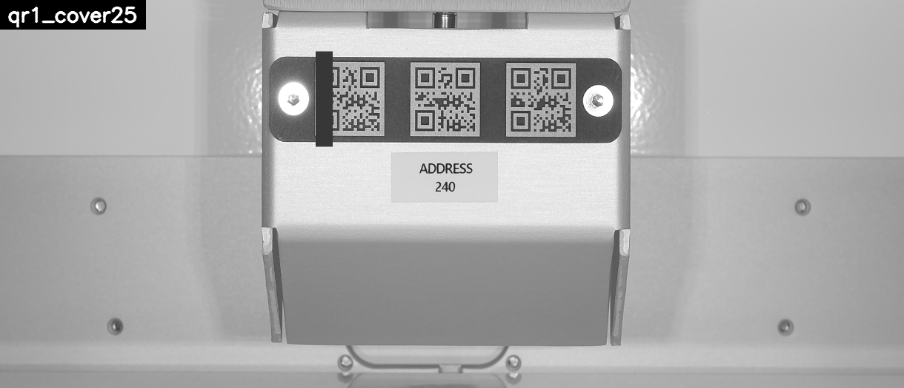
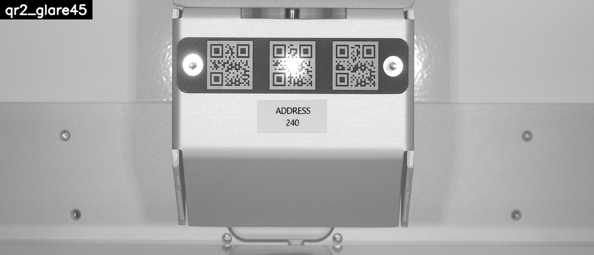
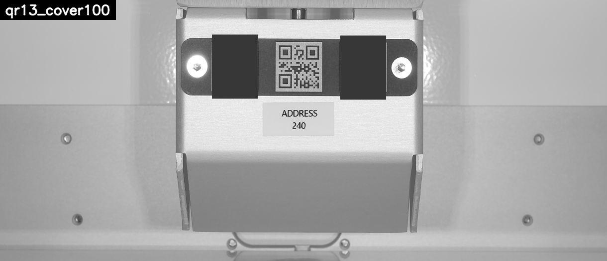

# 9-7. QR 이 가려지거나 반사될 때: 개수 판정, 감지, 실패와 계산

> 이 문서는 개발 실험과 제안의 기록을 포함한다. 제안된 설정이나 알고리즘이 모두 구현된 것은 아니다. 현재 호출 계약은 03 상태와 알림, 현재 정확도 조건은 6-1 정확도를 따른다. 과거 시험 수치는 해당 데이터와 설정에서만 해석한다.


> **2026-11-16 갱신**: 1단계 QR 탐색을 QR 띠 봉우리 방식으로 바꿨다 ([9-8](9-8_QR_띠_봉우리_탐색으로_전환.md), [5-1 QR](../05_구현_방법/5-1_QR.md) 2-6). 이 문서의 "지금 코드"는 바꾸기 전 방식(QR 마다 ±110 → ±250 px → 사진 전체 폭)을 말한다. 2절의 "사진에서 QR 모양을 모두 찾고 왼쪽부터 번호를 붙인다" 방식이 지금 패키지에 들어갔고, 그래서 "3개가 아니면 실패" 규칙이 그대로 통한다. QR 2개로 계산하는 처리(7절)는 넣지 않았다. 감지하면 실패(`E_QR_NOT_FOUND`)다. `check_qr_blocking` 의 "지금" 줄은 이제 새 방식의 결과를 낸다.

QR 하나가 가려지거나 반사로 안 보일 때를 다룬다. 세 가지를 검토했다.

- 이런 일이 생길 수 있는가
- 이것을 막으려고 코드를 바꾸면, 지금의 속도나 정확도가 떨어질 수 있는가
- 감지했을 때 실패로 처리할지, 남은 QR 로 계산할지

## 1. 요약

- **"QR 이 3개가 아니면 실패" 규칙은 지금 코드에서는 가림을 잡지 못한다.** 지금 코드는 QR 마다 자기 조각을 따로 찾는다. QR 하나가 가려지면 그 조각이 옆 QR 자리에 맞아서 **"3개 찾음"** 이 된다 (시험한 1239장 모두).
- **지금은 그 값이 경고와 함께 나간다.** Y 가 최대 26 mm, T 가 최대 3.6도 틀린 값이다. 실패가 아니라 경고(`W_COARSE`, `W_VALUES_DISAGREE`)다.
- **감지는 숫자 비교 두 가지로 된다.** 세 QR 의 이동량이 서로 1 px 넘게 다른지(간격 검사), 닮은 정도가 0.95 보다 낮은 QR 이 있는지(닮은 정도 검사). 정상 사진 702장에서 두 검사에 걸린 사진은 0장이다.
- **감지한 뒤 남은 QR 2개로 계산할 수 있다.** QR 묶음마다 계산식을 따로 만들어 두면, 가리기 전 값과의 차이가 최대 Y 0.006 mm, T 0.0008도였다 (기준 0.045 mm, 0.01도).
- **조용히 틀리는 구간이 하나 있었다.** QR 을 5% 만 가리면 옆 QR 에 맞지는 않지만, 알림 없이 Y 가 최대 0.034 mm 달라진다. 닮은 정도 검사로 잡힌다.
- **제안**: 간격 검사와 닮은 정도 검사는 넣는다. 감지했을 때의 처리는 설정으로 고르게 하고, 실제 가림 사진으로 확인하기 전까지 기본값은 실패로 둔다 (7절).

| 물음 | 답 | 근거 |
|---|---|---|
| 생길 수 있나 | 받은 사진 702장에서는 한 번도 없었다. 현장에서 얼마나 자주 생기는지는 모른다 | 5-1, 3절 |
| 바꾸면 지금 것이 나빠지나 | 검사 두 개는 정상 사진의 값과 시간을 바꾸지 않는다. QR 2개 계산은 계산식을 따로 만들지 않으면 통과율이 99.9% 에서 97.9 ~ 98.9% 로 떨어진다 | 5-3, 6절 |
| 실패인가 계산인가 | 1개 가림은 계산할 수 있다. 2개 이상 가림은 실패가 맞다 | 5-2, 7절 |

이 문서의 가림은 모두 **합성**이다. 실제로 가린 사진은 없다 (11절).

## 2. 물음: "3개가 아니면 실패" 규칙

검토한 규칙은 다음과 같다.

> 판정: 3개가 아니면 실패를 띄운다. 3개이면 왼쪽부터 QR 1, 2, 3 으로 정한다. 이 검사로 QR 번호 오대응을 줄인다. 모든 오검출을 배제하는 보장은 아니다.

이 규칙이 성립하려면 **QR 을 먼저 모두 찾고, 그다음에 센다**는 순서여야 한다. QR 을 찾는 방법에 따라 결과가 다르다.

| QR 을 찾는 방법 | QR 하나가 가려지면 | 규칙이 통하나 |
|---|---|---|
| 사진에서 QR 모양을 모두 찾고 왼쪽부터 번호를 붙인다 | 2개만 찾는다 | 통한다. 2개이므로 실패 |
| **지금 코드**: QR 1, 2, 3 의 조각을 각각 따로 찾는다 (`find_one`) | 가려진 QR 의 조각이 **옆 QR 자리에 맞는다.** 3개를 찾은 것이 된다 | **통하지 않는다.** 3개이므로 통과 |

지금 코드에서 옆 QR 에 맞는 이유는 다음과 같다.

1. 좁은 창(±110 px)에서 가려진 QR 을 못 찾는다 (닮은 정도 0.8 미만).
2. 넓은 창(±250 px), 사진 전체 폭으로 넓혀 다시 찾는다.
3. QR 3개가 약 257 px 간격으로 늘어서 있고 모서리 무늬가 같다. 넓힌 창 안에서 옆 QR 이 닮은 정도 0.81 ~ 0.85 로 맞는다. 기준 0.8 을 넘으므로 "찾음"이 된다.

그래서 지금 코드에 필요한 것은 개수가 아니라 **"세 QR 이 같은 만큼 움직였는가"** 를 보는 검사다.

## 3. 이런 일이 생길 수 있나

**받은 사진에서는 없었다.** 702장 모두 좁은 창에서 QR 3개를 찾았고, 닮은 정도의 최소값이 0.9855 였다.

현장에서 생길 수 있는 경우는 [9-5](9-5_적용_환경과_카메라_화면.md) 에서 정리한 환경에서 온다.

| 원인 | 어떤 환경 | 화면 |
|---|---|---|
| 로봇 팔, 케이블, 사람이 카메라와 판 사이를 지남 | AMR 도킹, EFEM, 반송 장치 | QR 일부나 전체가 어둡게 가려짐 |
| 금속 면이나 조명이 QR 에 비침 | EFEM, 세정, 식각 설비 | QR 가운데가 하얗게 날아감 |
| 물방울, 오염, 라벨 긁힘 | 세정 설비, 오래 쓴 판 | QR 일부가 지워짐 |
| 판이 화면 가장자리로 밀림 | 큰 자세 | QR 하나가 사진 밖으로 나감 |

- 얼마나 자주 생기는지는 우리가 가진 자료로 알 수 없다. 기업 측에 확인한다 (10절).
- 반사는 한 장에만 나타났다 사라질 수 있다. 가림은 물체가 치워질 때까지 계속된다. 대처가 다르다 (7절).

## 4. 시험 방법

| | 내용 |
|---|---|
| 1부. 실제 사진 | 받은 사진 702장. 가림 없음. QR 3개의 이동량 차이, 닮은 정도, QR 일부만 썼을 때의 정확도, QR 탐색 시간을 쟀다 |
| 2부. 합성 가림 | 702장에서 12장마다 1장씩 고른 59장. 사진마다 사례 31가지를 만들어 쟀다 |
| 가림 | QR 의 왼쪽부터 5, 10, 25, 50, 75, 100% 를 어두운 띠(밝기 55)로 덮음. QR 1, 2, 3 각각 |
| 반사 | QR 가운데에 반지름 20, 45, 90 px 의 밝은 반사광. QR 1, 2, 3 각각 |
| 여러 개 가림 | QR 2개를 모두 덮음 (3가지), QR 3개를 모두 덮음 |
| 채점 | 같은 사진을 가리기 전에 잰 값과 비교. 차이가 \|Y\| <= 0.045 mm, \|T\| <= 0.01도 이면 "맞음" |

합성한 화면의 예 (첫 사진).

| QR 1 을 5% 가림 | QR 1 을 25% 가림 |
|---|---|
|  |  |

| QR 2 에 반사광 (45 px) | QR 1, 3 을 모두 가림 |
|---|---|
|  |  |

비교한 판정은 다섯 가지다.

| 판정 | 내용 |
|---|---|
| 지금 | 지금 코드 그대로 (`measure_alignment`) |
| 개수 규칙 | 찾은 QR 이 3개가 아니면 실패. 3개이면 그대로 계산 |
| 간격 검사 | 3개를 찾았고 세 이동량의 차이가 1 px 안일 때만 계산. 아니면 실패 |
| 맞는 QR 로 계산 | 이동량이 서로 같은(1 px 안) QR 이 2개 이상이면 그 QR 만으로 계산. 계산식은 지금 것, 또는 그 QR 묶음으로 따로 만든 것 |
| 닮은 정도 검사 추가 | 닮은 정도가 0.95 미만인 QR 을 먼저 뺀다. 남은 QR 에 위 판정을 적용한다. 남는 것이 2개 미만이면 빼지 않는다 |

## 5. 결과

### 5-1. 지금 코드의 반응

사례마다 59장이다. QR 1, 2, 3 의 결과가 같은 모양이라 묶어서 적는다.

| 화면 | 생기는 일 | 가리기 전과의 차이 (최대) | 상태 |
|---|---|---|---|
| QR 하나에 작은 반사광 (20 px) | 영향이 없다 | Y 0.004 mm, T 0.0005도 | 정상 |
| **QR 하나를 5% 가림** | 옆 QR 에 맞지는 않는다. **가려진 QR 의 위치가 조금 밀린다** | **Y 0.034 mm, T 0.0047도** | **정상 (알림 없음)** |
| QR 하나를 10 ~ 100% 가림 | 그 QR 이 옆 QR 자리에 맞는다 (59장 모두) | Y 26.3 mm, T 3.63도 | 경고 |
| QR 하나에 반사광 (45, 90 px) | 위와 같다 (59장 모두) | Y 26.3 mm, T 3.63도 | 경고 |
| QR 2개를 모두 가림 | 가려진 두 QR 이 남은 QR 자리에 맞는다 | Y 1.86 mm, T 3.55도 | 경고 |
| QR 3개를 모두 가림 | 못 찾는다 | | 실패 (`E_QR_NOT_FOUND`) |

- QR 하나를 10% 넘게 가린 사진과 큰 반사광 사진은 모두 21가지 × 59장 = **1239장**이고, **모두 틀린 값이 경고와 함께 나갔다.** 실패는 0장이다.
- 붙은 경고는 `W_COARSE`(나사를 못 찾아 대략값) 또는 `W_VALUES_DISAGREE`(값들이 서로 맞지 않음)이다. `W_QR_PARTIAL` 은 나오지 않는다. 3개를 찾은 것으로 되기 때문이다.
- QR 1, 3 을 함께 가린 경우에는 경고가 `W_FAR` 하나뿐이고 차이가 Y 0.168 mm, T 0.023도다. 크게 틀린 값처럼 보이지 않아서 더 위험하다.
- **5% 가림은 알림이 없다.** 가려진 QR 의 닮은 정도가 0.82 ~ 0.84 로 기준 0.8 을 겨우 넘어 "찾음"이 된다. 세 QR 의 이동량 차이는 0.2 ~ 0.4 px 로, 정상(0.12 px)보다 조금 클 뿐이라 간격 검사로는 잡히지 않는다. 차이는 기준 안이지만 기준의 절반에서 4분의 3을 쓴다.

[6-3 강건성](../06_평가_방법/6-3_강건성.md) 에는 "QR 이 1/4 가려지면 영향이 작다"고 적혀 있다. 이번 시험에서는 어두운 띠로 10% 만 덮어도 옆 QR 에 맞았다. 가리는 물체의 밝기와 자리에 따라 달라지는 것으로 보이며, 두 시험의 조건 차이는 확인하지 않았다.

### 5-2. 판정 규칙 비교

"맞음"은 값을 냈고 가리기 전 값과 기준 안, "틀림"은 값을 냈는데 기준 밖, "실패"는 값을 내지 않은 것이다.

**QR 하나를 10% 넘게 가리거나 큰 반사광 (1239장)**

| 판정 | 맞음 | 틀림 | 실패 | 값을 낸 사진의 최대 차이 |
|---|---|---|---|---|
| 지금 | 0 | 1239 (모두 경고) | 0 | Y 26.3 mm, T 3.63도 |
| 개수 규칙 | 0 | **1239** | 0 | Y 26.3 mm, T 3.63도 |
| 간격 검사 | 0 | 0 | **1239** | |
| 맞는 QR 로 계산, 지금 계산식 | 1239 | 0 | 0 | Y 0.035 mm, T 0.0048도 |
| **맞는 QR 로 계산, 묶음별 계산식** | **1239** | **0** | **0** | **Y 0.006 mm, T 0.0008도** |

**QR 하나를 5% 가림 (177장)**

| 판정 | 맞음 | 틀림 | 실패 | 최대 차이 | 감지했나 |
|---|---|---|---|---|---|
| 지금, 개수 규칙, 간격 검사, 맞는 QR 로 계산 | 177 | 0 | 0 | Y 0.034 mm, T 0.0047도 | 아니오 |
| **닮은 정도 검사 추가, 묶음별 계산식** | 177 | 0 | 0 | **Y 0.006 mm, T 0.0007도** | 예 |

**QR 2개를 가림 (177장)**

| 판정 | 맞음 | 틀림 | 실패 |
|---|---|---|---|
| 지금, 개수 규칙 | 0 | 177 | 0 |
| 간격 검사, 맞는 QR 로 계산, 닮은 정도 검사 추가 | 0 | 0 | 177 |

- **개수 규칙은 지금과 결과가 같다.** 가려진 QR 이 옆 QR 에 맞아 3개가 되므로 걸러지지 않는다.
- **간격 검사는 모두 잡는다.** 옆 QR 에 맞으면 이동량이 약 257 px 또는 516 px 다르다. 정상 사진의 차이는 최대 0.38 px 이다.
- **남은 QR 2개로 계산하면 값이 맞다.** 묶음별 계산식을 쓰면 가리기 전과 거의 같다.
- **2개가 가려지면 계산할 수 없다.** 남은 QR 하나가 맞는 자리에 있는지 다른 QR 로 확인할 수 없다.
- 닮은 정도 검사는 작은 반사광(20 px)도 뺀다. 영향이 없던 QR 을 빼는 것이지만, 뺀 뒤의 차이도 Y 0.006 mm 이하다.

### 5-3. QR 2개로 계산할 때의 정확도

가리지 않은 실제 사진 702장에서, QR 이동량을 QR 일부의 평균으로 바꿔 계산했다.

| 쓴 QR | 지금 계산식 통과율 | Y 오차 (rms) | T 오차 (rms) | 그 묶음으로 계산식을 다시 만들면 |
|---|---|---|---|---|
| QR 1, 2, 3 (지금) | 99.9% | 0.0131 mm | 0.0029도 | 100% |
| QR 1, 2 | 97.9% | 0.0181 mm | 0.0033도 | 100% |
| QR 1, 3 | 98.9% | 0.0165 mm | 0.0032도 | 100% |
| QR 2, 3 | 98.3% | 0.0157 mm | 0.0032도 | 100% |
| QR 1 만 | 92.9% | 0.0224 mm | 0.0037도 | 99.8% |
| QR 2 만 | 92.0% | 0.0268 mm | 0.0043도 | 100% |
| QR 3 만 | 93.6% | 0.0248 mm | 0.0042도 | 99.7% |

조건: "지금 계산식" 열은 그 사진들로 학습한 계산식이라 학습에 쓴 사진으로 채점한 값이다. "다시 만들면" 열은 572장을 5묶음으로 나눠 학습에 안 쓴 사진으로 채점했다. 나사는 4개를 모두 쓴 경우다.

- **지금 계산식에 QR 2개의 평균을 그대로 넣으면 정확도가 떨어진다** (99.9% → 97.9 ~ 98.9%). QR 마다 평소 이동량이 조금씩 다른데, 지금 계산식은 3개의 평균에 맞춰져 있기 때문이다.
- **QR 묶음마다 계산식을 따로 만들면 떨어지지 않는다** (100%).
- QR 하나만으로도 계산식을 따로 만들면 99.7 ~ 100% 다. 다만 QR 하나일 때는 그 QR 이 맞는 자리에 있는지 확인할 수단이 없다 (5-2).

### 5-4. 속도

QR 탐색(`find_qr_shift`)에 걸린 시간의 가운데값이다. 이 PC, OpenCV 기본 스레드 수.

| 화면 | QR 탐색 시간 | 이유 |
|---|---|---|
| 정상 (702장) | 2.4 ms | 좁은 창에서 끝난다 |
| QR 하나를 5% 가림, 작은 반사광 | 2.2 ~ 2.6 ms | 좁은 창에서 끝난다 |
| QR 2 또는 QR 3 하나가 가려짐 | 6.8 ~ 7.3 ms | 넓은 창까지 찾는다 |
| QR 1 이 가려짐, QR 2개 이상이 가려짐 | 28.6 ~ 29.3 ms | 사진 전체 폭까지 찾는다 |

- 가려지면 지금도 QR 탐색이 3 ~ 12배 느려진다. 그 시간을 들여 찾은 것이 옆 QR 이다.
- 간격 검사와 닮은 정도 검사는 이미 구한 숫자 3개를 비교하는 것이다. 사진을 다시 처리하지 않는다. 걸리는 시간은 따로 재지 않았다.

## 6. 바꾸면 지금 것의 속도, 정확도가 떨어질 수 있나

바꾸는 것마다 정상 사진에 주는 영향을 나눠 본다.

| 바꾸는 것 | 정상 사진의 정확도 | 정상 사진의 속도 | 남는 위험 | 확인 |
|---|---|---|---|---|
| 간격 검사 (차이 1 px 넘으면 감지) | 그대로. 702장 중 걸린 사진 0장 (최대 차이 0.38 px) | 그대로 | 학습 범위 밖의 큰 회전에서는 세 QR 의 이동량 차이가 커질 수 있다. 한계 1 px 이 맞는지 T 2도 사진으로 확인해야 한다 | 702장으로 확인. 범위 밖은 확인 안 함 |
| 닮은 정도 검사 (0.95 미만이면 뺌) | 그대로. 702장의 최소값 0.9855 | 그대로 | 흐림이나 조명 변화로 세 QR 의 닮은 정도가 함께 내려가는 날. 2개 이상이 0.95 미만이면 빼지 않도록 했지만, 1개만 경계 아래로 내려가는 경우는 확인하지 않았다 | 702장으로 확인. 흐린 화면은 확인 안 함 |
| QR 2개로 계산, 지금 계산식 그대로 | 가려진 사진에서 97.9 ~ 98.9% 수준. 정상 사진은 그대로 | 그대로 | 가려졌을 때 기준의 4분의 3까지 쓰는 값이 나간다 (Y 0.035 mm) | 확인함 |
| QR 2개로 계산, 묶음별 계산식 | 정상 사진은 그대로. 가려진 사진도 100% | 그대로 | 계수 파일이 16개에서 64개로 늘어난다 (QR 묶음 4가지 × 나사 조합 16가지). 점검식도 같이 늘어난다. 학습과 포팅의 일이 늘고, 사진이 적은 조합에서 계산식이 약해질 수 있다 | 나사 4개 조합만 확인. 나사가 빠진 조합은 확인 안 함 |
| 가려졌을 때 창 넓히기를 생략 | 떨어질 수 있다 | 가려진 사진이 29 ms → 약 2 ms | 판이 실제로 110 px 넘게 움직인 사진과 구별하지 못한다. 그런 사진에서 옆 QR 2개가 "서로 같은 이동량"으로 맞아 틀린 값을 낼 수 있다 | 시험 안 함. **권장하지 않는다** |
| QR 최소 닮은 정도를 0.8 에서 0.9 로 올림 | 떨어질 수 있다 | 그대로 | 옆 QR 의 닮은 정도가 0.81 ~ 0.85 이므로 옆 QR 에 맞는 일은 없어진다. 대신 흐리거나 어두운 날 정상 QR 도 못 찾을 수 있다 | 시험 안 함 |

정리하면 다음과 같다.

- **검사를 더하는 것은 지금 것을 나쁘게 하지 않는다.** 정상 사진은 지금과 같은 순서로 QR 3개를 찾고, 그 뒤에 숫자를 비교할 뿐이다. 값도 시간도 같다.
- **지금 것을 나쁘게 할 수 있는 것은 탐색 순서나 기준값을 바꾸는 것**이다 (창 넓히기 생략, 최소 닮은 정도 올리기). 이 둘은 하지 않는 것을 권한다.
- **계산까지 하려면 계산식을 따로 만들어야 정확도가 유지된다.** 이것은 정확도가 아니라 관리할 파일 수가 늘어나는 비용이다.

## 7. 감지하면 실패인가, 계산인가

| 상황 | 감지 방법 | 실패로 할 때 | 계산할 때 | 제안 |
|---|---|---|---|---|
| QR 1개가 가려지거나 반사됨. 남은 2개의 이동량이 같음 | 간격 검사, 닮은 정도 검사 | 정렬이 멈춘다. 가림이 치워질 때까지 못 잰다 | 남은 2개로 계산하고 경고한다. 묶음별 계산식이면 차이 Y 0.006 mm 이하 | **설정으로 고른다.** 기본값은 실패, 확인 뒤 계산으로 바꾼다 |
| QR 1개가 조금 가려짐 (5%) | 닮은 정도 검사 | 정상에 가까운 사진까지 멈춘다 | 그 QR 을 빼고 계산한다. 차이 Y 0.006 mm 이하 | 위와 같은 설정을 따른다 |
| QR 2개가 가려짐 | 이동량이 같은 QR 묶음이 없음 | 멈춘다 | QR 1개로는 그 자리가 맞는지 확인할 수 없다 | **실패** |
| QR 3개가 가려짐 | 못 찾음 | 지금과 같다 (`E_QR_NOT_FOUND`) | 계산할 것이 없다 | **실패** (지금 그대로) |

**어느 쪽이든 고쳐야 하는 것**: 지금은 옆 QR 에 맞은 값(Y 26 mm, T 3.6도 틀림)이 경고와 함께 나간다. 경고는 "값을 써도 되지만 주의"라는 뜻인데, 이 값은 쓰면 안 된다. 간격 검사를 넣어 이 경우를 실패나 계산 중 하나로 바꿔야 한다.

**실패를 기본값으로 제안하는 이유**

- 계산해도 된다는 근거가 합성 사진 59장뿐이다. 실제로 가린 사진으로 확인한 적이 없다.
- 틀린 보정은 멈추는 것보다 피해가 크다. 멈추면 다시 찍으면 된다.
- 반사는 한 장에만 나타날 수 있다. 실패한 뒤 다시 찍으면 지나갈 수 있다.

**계산으로 바꿀 조건**

- 우리 장비에서 실제로 가린 사진으로 9절의 시험을 통과한다.
- 가림이 오래 이어지는 설비라서 멈추는 비용이 크다는 것을 기업 측이 확인한다.

**설정과 알림 (제안)**

| 항목 | 내용 |
|---|---|
| 설정 | `config/settings.json` 에 `fail_on_qr_blocked` 를 더한다. 1 이면 실패, 0 이면 남은 QR 로 계산하고 경고. 지금의 `fail_on_disagreement` 와 같은 모양이다 |
| 알림 코드 | `W_QR_BLOCKED` (가칭). 문구에 어느 QR 을 뺐는지, 왜 뺐는지(이동량이 다름, 닮은 정도가 낮음)를 적는다 |
| 2개 이상 가림 | `E_QR_BLOCKED` (가칭) 실패 |

## 8. 가능한 방법

위에서 시험한 것과 아직 시험하지 않은 것을 함께 적는다.

**감지하는 방법**

| 번호 | 방법 | 내용 | 정상 사진에 주는 영향 | 시험 |
|---|---|---|---|---|
| 1 | 간격 검사 | 세 QR 의 이동량이 서로 1 px 안인지 본다 | 없음 | 함 |
| 2 | 닮은 정도 검사 | 닮은 정도가 0.95 미만인 QR 을 가려진 것으로 본다 | 없음 | 함 |
| 3 | 값 일치 점검 강화 | 지금도 있는 4단계 점검(QR 과 나사가 서로 맞는지)에서 QR 이 크게 어긋나면 실패로 한다 | 없음 | 안 함. 지금은 경고만 한다 |
| 4 | 옆 QR 자리 금지 | 넓힌 창에서 찾은 자리가 다른 QR 의 자리(±257 px)와 겹치면 버린다 | 없음 | 안 함. 그러면 "2개 찾음"이 되어 개수 규칙이 통한다 |
| 5 | QR 내용 읽기 | QR 을 읽어 번호를 확인한다 | 읽는 시간이 든다 | 안 함. 흐리거나 가려지면 못 읽는다 |

**감지한 뒤 계산하는 방법**

| 번호 | 방법 | 내용 | 비용 | 시험 |
|---|---|---|---|---|
| 6 | 묶음별 계산식 | QR 묶음(1-2, 1-3, 2-3)마다 계산식을 따로 만든다 | 계수 파일 16개 → 64개 | 함 (나사 4개 조합) |
| 7 | QR 별 이동량 보정 | QR 마다 "평균과의 평소 차이"를 구해 두고, 빠진 QR 의 몫을 채워 지금 계산식에 넣는다 | QR 마다 숫자 몇 개 | 안 함. 파일이 늘지 않는 대안 |
| 8 | 가려지지 않은 부분만 맞추기 | QR 을 여러 칸으로 나눠 닮은 칸만으로 위치를 구한다 | QR 탐색 시간이 늘 수 있다 | 안 함. 5% 가림처럼 일부만 가려질 때 QR 3개를 모두 쓸 수 있다 |
| 9 | QR 3개를 한 조각으로 맞추기 | QR 판 전체를 한 번에 찾는다. 하나가 가려져도 나머지로 자리가 정해진다 | 조각이 커서 느리다. 가려진 만큼 위치가 밀린다 | 안 함 |

**계산하지 않고 넘기는 방법 (운영, 설비)**

| 번호 | 방법 | 내용 |
|---|---|---|
| 10 | 다시 찍기 | 실패하면 잠깐 뒤에 한 번 더 찍는다. 순간적인 반사와 지나가는 물체에 맞다 |
| 11 | 여러 장 찍기 | 2 ~ 3장을 찍어 QR 3개가 모두 보이는 사진을 쓴다 |
| 12 | 설비 쪽 대처 | 조명 각도를 바꿔 반사를 없앤다. 무광 라벨을 쓴다. 카메라 앞을 지나는 케이블을 묶는다 |

권장 순서: 1, 2 를 먼저 넣는다 (정상 사진에 영향이 없고 가장 큰 위험을 없앤다). 계산이 필요해지면 6 또는 7 을 더한다. 10 은 코드와 상관없이 쓸 수 있다.

## 9. 우리 장비로 확인하는 단계

합성이 아닌 실제 가림으로 확인한다.

| 단계 | 하는 일 | 확인할 것 |
|---|---|---|
| 1 | 판을 여러 자세에 두고 가림 없이 찍는다 | 가리기 전 값 (기준) |
| 2 | 같은 자세에서 QR 하나를 검은 테이프, 종이, 손가락으로 일부와 전부 가리고 찍는다 | 간격 검사와 닮은 정도 검사가 모두 잡는지. 남은 QR 2개로 계산한 값이 1단계와 기준 안에서 같은지 |
| 3 | 손전등이나 조명 각도로 QR 하나에 반사를 만든다 | 위와 같음. 반사의 크기에 따라 어디서부터 잡히는지 |
| 4 | 가리는 물체의 밝기를 바꾼다 (검은색, 회색, 흰색) | 5-1 의 "10% 부터 옆 QR 에 맞음"이 물체 밝기에 따라 달라지는지 |
| 5 | 가림 없는 사진을 조명과 초점을 바꿔 찍는다 | 두 검사가 정상 사진을 잘못 잡지 않는지 |

판정: 2, 3 단계에서 틀린 값이 경고 없이 나가거나 경고만 달고 나가는 사진이 0장. 5 단계에서 잘못 잡은 사진이 0장.

## 10. 기업 측에 확인할 것

1. 현장에서 QR 이 가려지거나 반사되는 일이 실제로 있는가. 있다면 얼마나 자주, 얼마나 오래 이어지는가.
2. 가려졌을 때 설비가 멈추는 것과 남은 QR 로 계속 정렬하는 것 중 어느 쪽을 원하는가.
3. 실패했을 때 다시 찍을 시간이 있는가.
4. 계수 파일이 16개에서 64개로 늘어나는 것을 받아들일 수 있는가.

## 11. 한계

- 가림과 반사는 모두 합성이다. 실제 물체의 그림자, 반투명한 가림, 번진 반사는 시험하지 않았다.
- 가림은 QR 의 왼쪽부터 덮는 어두운 띠(밝기 55) 한 가지다. 위나 오른쪽에서 가리는 경우, 밝은 물체로 가리는 경우는 시험하지 않았다.
- 2부는 59장이다. 묶음별 계산식은 이 사진들이 든 702장으로 만들었으므로, 2부의 "묶음별 계산식" 결과는 학습에 쓴 사진으로 본 것이다. 학습에 안 쓴 사진으로 본 값은 5-3 이다.
- 묶음별 계산식은 나사 4개를 모두 찾은 경우만 시험했다. QR 과 나사가 함께 가려진 경우는 보지 않았다.
- 대안 판정은 측정 코드에 넣지 않았다. 시험 도구 안에서 계산한 것이다. 4단계 값 일치 점검과 함께 썼을 때의 결과는 보지 않았다.
- 한계값 1 px 과 0.95 는 정상 사진 702장의 값(최대 0.38 px, 최소 0.9855)을 보고 정했다. 학습 범위 밖 자세, 흐린 화면, 다른 조명에서는 다시 정해야 할 수 있다.
- 시간은 QR 탐색만 쟀다. 측정 전체 시간은 재지 않았다.

## 12. 코드와 실행

| 무엇 | 위치 |
|---|---|
| 시험 도구 | `tools/environment/check_qr_blocking.cpp` |
| 결과 전체 | `docs/09_추가_논의/images/qr_blocking_report.txt` |
| 사진별 결과 | `docs/09_추가_논의/images/qr_blocking_cases.tsv` |
| 합성 화면 예 | `docs/09_추가_논의/images/qr_block_*.png` |
| 지금의 QR 탐색 | `src/steps/01_find_qr.cpp` (`find_one`, `find_qr_shift`) |
| 지금의 알림 | `src/alignment.cpp` (`add_notices`) |

실행 (패키지 폴더에서):

```
build/Release/check_qr_blocking data/model data/new_photos/tables <출력 폴더>
```
