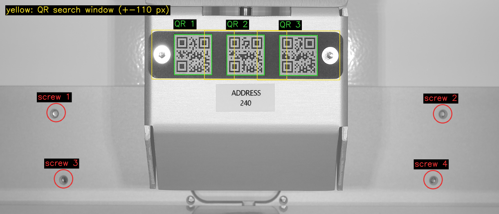
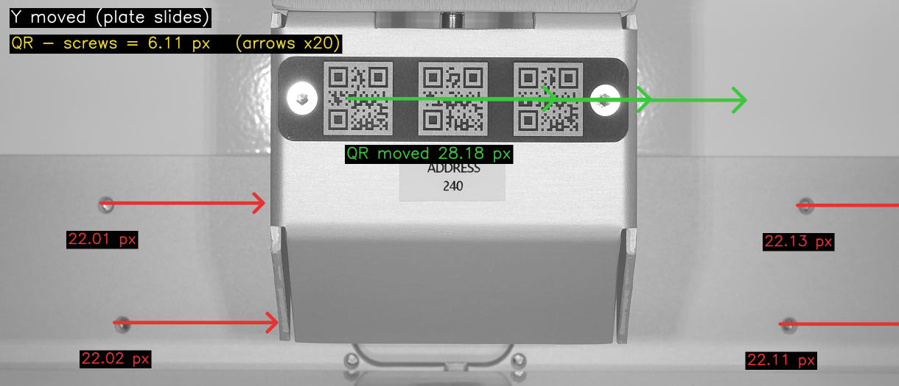
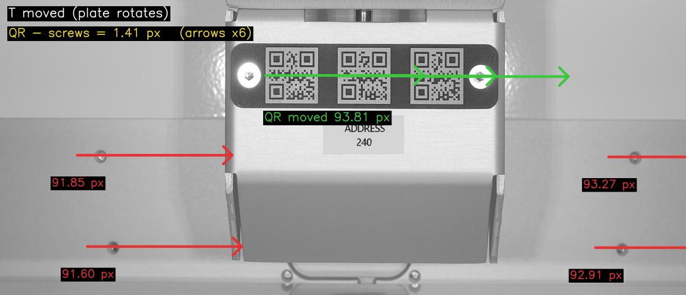
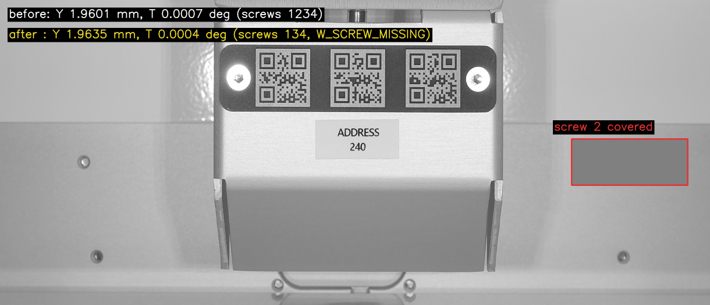
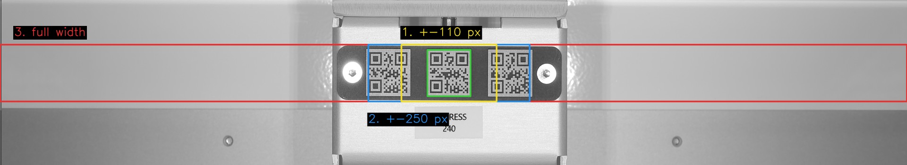

# 1. 한눈에 보기

5분 안에 "무엇을 하는 코드인지"를 알 수 있게 쓴 문서다.

- 코드를 옮기려면 [2_포팅안내서.md](2_포팅안내서.md)를 본다.
- 왜 이렇게 만들었는지 궁금하면 [3_근거보고서.md](3_근거보고서.md)를 본다.

## 하는 일

카메라 사진 한 장을 넣으면, QR 판이 기준 위치에서 얼마나 벗어났는지 **Y (mm), T (도)** 를 돌려준다.

```cpp
alignment::initialize("data");
alignment::Result r = alignment::measure_alignment(photo);
// r.y_mm, r.t_deg, r.status, r.message
```

## 사진에서 보는 곳



| 표시 | 뜻 |
|---|---|
| 초록 상자 | QR 3개 |
| 빨간 원 | 나사 4개 |
| 노란 상자 | QR 을 찾아보는 범위 |

기준 사진(`data/center.bmp`)에서 이들의 위치를 알고 있고, 새 사진에서 **각각 가로로 몇 px 움직였는지**를 잰다.

## 원리: QR 과 나사가 다르게 움직인다

QR 판과 나사는 카메라에서 본 깊이가 다르다. 그래서 판이 움직이는 방식에 따라 화면에서 다르게 움직인다.

**Y 로 약 2 mm 움직였을 때**: QR 은 28 px, 나사는 22 px 움직인다. **6 px 차이**가 난다.



**T 로 약 1도 돌았을 때**: QR 과 나사가 거의 같이 94 px, 92 px 움직인다. 차이는 1 px 남짓이다.



| 알고 싶은 것 | 읽는 법 |
|---|---|
| T | 전체가 얼마나 움직였나 (1도 ≈ 80 px) |
| Y | QR 과 나사가 얼마나 다르게 움직였나 (1 mm ≈ 3.1 px 차이) |

이 관계를 SEMES 사진 702장으로 미리 학습한 계수(`data/coefficients/`)로 계산한다.

## 네 단계

| 단계 | 함수 | 하는 일 | 파일 |
|---|---|---|---|
| 1 | `find_qr_shift` | QR 3개의 가로 이동 | `src/steps/01_find_qr` |
| 2 | `find_screw_shifts` | 나사 4개의 가로 이동 | `src/steps/02_find_screws` |
| 3 | `compute_yt` | Y, T 계산 | `src/steps/03_compute_yt` |
| 4 | `check_values_agree`, `check_in_trained_range` | 결과 점검 | `src/steps/04_check_result` |

## 숫자 다섯 개

| | 값 | 어떻게 쟀나 |
|---|---|---|
| 정확도 | 560장 중 평균 0.2장만 허용오차(Y 0.045 mm, T 0.01도) 밖 | 학습에 안 쓴 사진으로 시험, 10회 반복 |
| 처음 보는 촬영 날 | 98.2% 통과 | 촬영 회차 하나를 통째로 빼고 학습 |
| 속도 | 한 장 약 7 ms | 노트북, 702장 중앙값 |
| 측정 범위 | QR 이 ±600 px 움직여도 값을 냄 (T 로 약 ±7도) | 사진을 옮긴 합성 시험 |
| 문제가 생기면 | 멈추지 않고 값과 경고를 함께 냄 | 나사 가림, 화면 밀림 시험 |

## 문제가 생겨도 값을 낸다

나사 하나를 가려도 나머지 3개로 계산하고 경고(`W_SCREW_MISSING`)를 붙인다. 아래 사진에서 값 차이는 Y 0.003 mm 다.



QR 이 멀리 가면 찾는 범위를 자동으로 넓힌다(노랑 → 파랑 → 빨강).



경고와 실패 전체 목록은 [README](../README.md) 5장에 있다.

## 꼭 지킬 것 하나

**영점을 날마다 다시 잡는다**(`set_zero_from_photos`). 카메라·조명·판을 건드린 뒤에도 잡는다.

- 카메라가 0.05도만 돌아도 Y 가 0.27 mm 틀어진다.
- 영점을 다시 잡으면 이런 변화가 없어진다.
