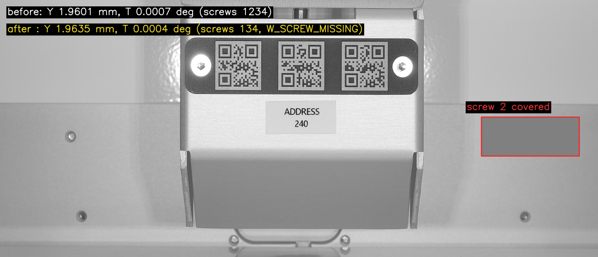

# 3. 근거 보고서

"왜 이렇게 만들었나", "이런 일이 생기면 어떻게 되나"에 답하는 문서다.

- 숫자는 모두 정지 사진으로 잰 것이다. 따로 적지 않으면 SEMES 사진 702장이다.
- 통과 기준: Y 오차 0.045 mm 이하이고 T 오차 0.01도 이하.
- 세부 실험은 저장소 `chore/hye/merge` 브랜치의 `experiments/hye/` 에 있다(실험 폴더 141개, 폴더 이름 = 날짜_시간_주제). 아래에서 `[ ]` 안이 그 폴더 이름의 앞부분이다.

## 1. 이런 일이 생기면?

| 상황 | 어떻게 되나 | 근거 |
|---|---|---|
| 평소 (센터 근처 ~ Y ±2 mm, T ±1도) | 560장 중 평균 0.2장만 기준 밖. rms 오차 Y 0.013 mm, T 0.003도 | 고정 검증 [20261113_2000] |
| 처음 보는 촬영 날 | 98.2% 통과 (촬영 회차 4개 중 3개는 99~100%, 하나는 93%) | 회차 빼기 [20261114_0330] |
| 학습 범위 밖으로 벗어남 | Y 는 탈락 없음(비례 오차 0.3%). T 는 가장자리에서 1~1.5% 크게 읽음 | [20261114_0130] |
| QR 이 화면에서 멀리 감 | ±600 px 까지 값을 냄. 그 밖은 대략값 + 경고, QR 이 사진 밖이면 실패 | [20261114_0230], `tools/try/check_setup` |
| 나사 하나가 가려지거나 없음 | 나머지 3개로 계산 + 경고. 가리기 전과 Y 0.007 mm 차이 | 이 폴더 `tools/try/check_setup` |
| 나사가 한쪽에만 남음 | 대략값 + 경고. 그 값으로 센터 쪽으로 옮긴 뒤 다시 잼 | [20261114_0330] |
| 나사가 가려졌는데 엉뚱하게 재짐 | 값 일치 점검이 경고. Y 가 0.1 mm 넘게 틀린 경우는 모두 경고함 | [20261113_2230] (우리 장비 사진) |
| 카메라가 처져 화면이 위아래로 밀림 | 20 px 까지 값이 그대로(차이 0.00001 mm). 21 px 부터 QR 을 못 찾음 → 기준 다시 잡기 | 이 폴더 `tools/try/check_photos`(아래로 옮김), `tools/try/check_setup` |
| 카메라가 조금 돌거나 옆으로 밀림 | 값이 일정하게 치우침 → 영점을 다시 잡으면 없어짐 | [20261113_2130] |
| 조명이 밝아지거나 어두워짐 | ×0.6 배, ±40 까지 영향 작음 | [20261113_2130] |
| 사진이 흐림 | 흐림 σ1 까지 영향 작음. σ2 이상은 일부 틀리거나 못 찾음 | [20261113_2130] |
| 노이즈 | 약한 노이즈(σ3)는 영향 작음. 거친 노이즈(σ8)는 약 1% 탈락 | [20261113_2130] |
| QR 판과 나사 사이가 통째로 밀림 (판 재조립) | **사진으로는 알 수 없다.** Y 가 조용히 틀어짐(0.1 px 에 약 0.03 mm) | 판을 손대면 영점 다시 잡기 |

## 2. 왜 이렇게 만들었나 (실험 지도)

질문마다 여러 방법을 시험하고 하나를 골랐다. 고를 때는 결과를 보기 전에 방법·기준을 미리 적어 두었고, 마지막 확인용 사진 142장은 고른 뒤 한 번만 봤다.

### 무엇을 잴까

| 시험한 것 | 결과 | 고른 것 |
|---|---|---|
| QR 만 | 560장 중 181장 탈락. Y 와 T 를 가를 수 없음 | |
| QR + 바(가로 막대) | 78장 탈락 | |
| QR + 나사 한쪽 | 128~170장 탈락 | |
| **QR + 좌우 나사** | 0.2장 탈락 | **이것** |
| 여기에 바를 더함 | 0.2장. 차이 없음 | 넣지 않음 |

근거: [20261114_0330], 이전 비교 [20261021_1804], [20261104_173000], [20261112_1905](바), [20261112_1756](나사)

### 세로 이동을 쓸까

- 세로 이동과 바의 세로 위치를 쓰면 같은 날 사진에서는 좋았다.
- 그런데 처음 보는 날에는 61~64% 로 떨어졌다. 바 세로 이동은 변화의 90%, 나사와 QR 의 세로 차이는 75% 가 촬영 날의 차이였다.
- 세로 값을 빼고 가로 이동만 쓰니 98~99% 가 됐다.

근거: [20261112_1806], [20261112_1835]

### QR 을 어떻게 잴까

| 방법 | 정확도 (탈락) | 속도 | 비고 |
|---|---|---|---|
| QR 안 536점을 하나씩 추적 | 0.0~0.1장 | 약 23 ms | 밝기 변화·흐림에 측정 거부 |
| NCC + 포물선 | 2.6장 | 약 5 ms | 선명한 사진에서 소수 위치가 ±0.03 px 치우침 |
| **흐린 뒤 NCC + 포물선** | 0.2장 | 약 5 ms | 치우침 0.003 px. 밝기 변화에 강함 |

근거: [20261113_1700](속도는 우리 장비 사진에서 잰 값), [20261113_2000]. 그 전의 특징점·부화소 정합 비교 [20261029_112722] 등

### 나사를 어떻게 잴까

| 방법 | 탈락 |
|---|---:|
| **대략 찾기(NCC) → 밝기로 다듬기 → 테두리 ECC** | 0.1장 |
| 위상 상관 (밝기) | 8.8~12.2장 |
| 위상 상관 (테두리) | 28.5~28.8장 |

근거: [20261113_2223], [20261112_1756]

### Y, T 를 어떻게 계산할까

- 선형식(Huber 강건 회귀)을 골랐다.
- 릿지·GLS 같은 다른 회귀는 단순 선형 회귀를 이기지 못했다. 물리 모형은 날짜가 바뀌어도 성적이 변하지 않았지만 통과율이 낮았다(52.7%) [20261102_131730].
- 2차항을 넣으면 T 흔들림이 약 25% 줄었지만 Y 는 그대로였고, 3차항은 과적합으로 나빠졌다 [20261112_1321]. 학습 범위 밖에서 휘는 식은 더 크게 틀릴 수 있어 넣지 않았다.
- 선형식은 범위 밖에서도 Y 비례 오차 0.3%, T 1~1.5% 였다 [20261114_0130].

### 영점을 어떻게 둘까

- 촬영 날마다 "명령 0" 의 자리가 Y 0.04~0.10 mm 달랐다(회차별 +0.039, +0.100, +0.091, +0.065 mm). 명령값을 정답으로 쓰면 날마다 정답이 달라진다.
- 그래서 영점을 "QR·나사가 기준 사진과 같은 상태"로 정했다(절대 영점). 날마다 센터 사진으로 다시 잡을 수 있게 했다.

근거: [20261104_132026], [20261112_1731], [20261113_0950]

### 탐색 창을 얼마나 넓게

| 방식 | 센터 근처 시간 | 넓은 범위(성현 님 평가 자세 35개) |
|---|---:|---:|
| 늘 ±110 px | 13.2 ms | 66% 만 측정 |
| 늘 ±250 px | 15.5 ms | 100% |
| **좁게 → 못 찾으면 넓게** | 13.2 ms | 100% |

근거: [20261114_0230], [20261114_0430]

### 넣지 않은 것

| 시험한 것 | 넣지 않은 이유 |
|---|---|
| 큰 Y 일 때 536점으로 다시 재기 | 정확도가 그대로(탈락 수 같음), 시간만 늘어남 [20261114_0400] |
| 두 날 사진을 평균한 라벨로 학습 | 흔들림이 오히려 커짐 [20261113_1510] |
| 이웃 사진으로 라벨 보정 | 다른 날로 옮겨지지 않음 [20261113_1345] |
| 데이터 증강 (날 차이를 흉내 낸 값 추가) | 처음 보는 날을 66% → 83% 로 올렸지만, 세로 값을 빼는 쪽이 증강 없이 98% 라 필요 없어짐 [20261112_1806], [20261112_1835] |

## 3. 일부러 망가뜨려 본 시험 (영상 교란)

SEMES 702장과 우리 장비 사진 1959장에 32가지 변화를 넣었다. 변화의 종류와 세기는 결과를 보기 전에 정했다.

| 변화 | 결과 |
|---|---|
| 카메라 회전 0.05도 | Y 가 0.27 mm 틀어짐. **영점을 다시 잡으면 탈락 0** |
| 화면 가로 2 px 밀림 | T 가 0.025도 틀어짐. 영점을 다시 잡으면 탈락 0 |
| 배율 0.2% 변화 | Y 가 0.04 mm 틀어짐. 영점을 다시 잡으면 거의 없어짐 |
| 흐림 σ1, 밝기 ×0.6, ±40, 약한 노이즈 | 영향 작음 |
| QR 하나 가림·반사 | 못 찾거나 영향 작음(틀린 값을 내지 않음) |
| 나사 하나 가림·반사 (우리 장비 사진) | 점검 없이는 조용히 틀림(Y 최대 3 mm) → 값 일치 점검으로 Y 0.1 mm 넘는 경우 모두 경고 |
| 화면 세로 25 px 밀림 | QR 을 못 찾음(틀린 값을 내지 않음) |

근거: [20261113_2130], [20261113_2230]

## 4. 값 일치 점검이 괜히 울리지는 않나

| 사진 | 경고 |
|---|---:|
| SEMES 702장 | 0 |
| 우리 장비, 학습한 날 1959장 | 0 |
| 우리 장비, 학습 안 한 날 1680장, 영점을 다시 잡지 않음 | 251 (15%) |
| 같은 사진, 그날 센터 사진으로 영점을 다시 잡음 | 3 (0.2%) |

영점을 날마다 잡으면 괜한 경고가 거의 없다. 근거: [20261113_2230]

## 5. 이 폴더의 코드가 실험 때의 코드와 같은가

- 이 폴더의 코드는 실험에 쓴 코드를 읽기 쉽게 다시 쓴 것이다. 계산식은 바꾸지 않았다.
- SEMES 702장에서 두 코드의 Y, T 가 모두 같았다(차이 0). 그래서 위의 실험 결과가 이 코드에도 그대로 해당한다.
- 한 가지를 더했다: 나사 이동이 QR 이동과 100 px 넘게 다르면 버린다(아주 큰 이동에서 옆 나사를 잘못 잡는 것을 막음). 702장 결과는 그대로다.

## 6. 솔직한 한계

- **실제 정렬 복귀 시험을 하지 않았다.** 측정값으로 로봇을 움직여 센터로 돌아오는지는 확인하지 못했다.
- 정답(라벨)은 스테이지 명령과 영상 값에서 만든 것이다. 독립된 측정기로 잰 정답이 아니다.
- 다른 환경은 SEMES 촬영 4회와 우리 장비 2일뿐이다.
- 큰 이동(Y ±7 mm, T ±2도)은 사진을 옮긴 합성 시험과 범위 밖 예측 시험으로만 확인했다. 실제 사진은 없었다.
- 영상 교란은 인위로 넣은 것이라 실제 초점 흐림, 고르지 않은 조명과는 다르다.
- 계수는 SEMES 사진으로 학습했다. 카메라·판·나사 배치가 달라지면 기준 사진과 계수를 다시 만들어야 한다.
