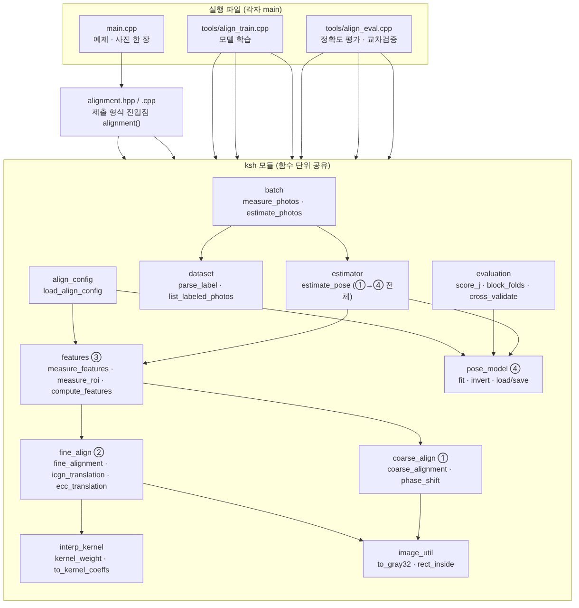

# Alignment — 사진 한 장으로 Y·Θ 어긋남 추정 (김성현)

정렬·분석 코드를 **함수 단위 모듈(`ksh::`)** 로 나눈 프로젝트. 팀원과 함수 단위로 공유하기 위한 정리본이다.

- 제출 형식 진입점 `alignment()` 는 그대로 (스켈레톤 `src/main.cpp`, `include/alignment.hpp`, `src/alignment.cpp`)
- 알고리즘 본문은 ksh 모듈(`include/ksh/*.hpp`, `src/modules/*.cpp`)에 있고, 모든 모듈 함수는 **상태 없이** 입력·설정을 인자로 받는다
- 모델 학습(`align_train`)과 정확도 평가(`align_eval`)는 별도 실행 파일
- C++17, OpenCV 3.4.15 API. 수치는 모두 `config/alignment.yml` 에 둔다



## 처리 흐름

| 단계 | 모듈 · 함수 | 하는 일 |
|---|---|---|
| ① Coarse Alignment (대략 정렬) | `coarse_align` · `coarse_alignment()` | 플레이트 주변 900×400 창 위상 상관(FFT) → 수십 px 이동을 한 번에 |
| ② Fine Alignment (정밀 정렬) | `fine_align` · `fine_alignment()` | ROI 마다 IC-GN 가우스–뉴턴 + 3차 O-MOMS 보간 → 화소 이하 이동 |
| ③ 시차 특징 | `features` · `measure_features()` | s = QR 3개 평균 이동, d = s − 하단 문 홀(W2·W3) 평균 |
| ④ 자세 추정 | `pose_model` · `invert_pose_model()` | s, d 두 식을 동시에 만족하는 (Y, Θ) — 1/σ² 가중 가우스–뉴턴 |
| 전체 | `estimator` · `estimate_pose()` | ①~④ 를 한 번에 (기준 영상·설정·모델을 인자로) |

## 모듈과 공개 함수 (`include/ksh/*.hpp`)

| 모듈 | 공개 함수 · 자료형 | 의존 |
|---|---|---|
| `image_util` | `to_gray32`, `rect_inside`, `round_point`, `rect_around`, `roi_rect`, `RoiSpec` | OpenCV |
| `coarse_align` ① | `phase_shift`, `coarse_alignment`, `CoarseParams` | image_util |
| `interp_kernel` | `parse_kernel`, `kernel_weight`, `kernel_radius`, `kernel_pole`, `prefilter_1d`, `to_kernel_coeffs`, `Kernel` | — |
| `fine_align` ② | `fine_alignment`, `icgn_translation`, `ecc_translation`, `FineParams`, `FineResult` | interp_kernel, image_util |
| `features` ③ | `measure_features`, `measure_roi`, `compute_features`, `FeatureParams`, `FeatureMeasurement` | coarse_align, fine_align |
| `pose_model` ④ | `fit_pose_model`, `invert_pose_model`, `eval_feature`, `load_pose_model`, `save_pose_model`, `PoseModel` | OpenCV |
| `estimator` | `estimate_pose`, `PoseEstimate` | features, pose_model |
| `align_config` | `load_align_config`, `resolve_path`, `AlignConfig`, `Tolerance` | features, pose_model |
| `dataset` | `parse_label`, `list_labeled_photos`, `is_training_photo`, `save/load_feature_csv` | pose_model |
| `batch` | `measure_photos`, `estimate_photos`, `to_samples` | estimator, dataset |
| `evaluation` | `score_j`, `summarize_groups`, `block_folds`, `cross_validate`, `summary_table`, `save_predictions_csv` | pose_model, align_config |

예 — 다른 기준 사진·설정으로 한 장 추정 (전역 상태 없음)

```cpp
#include "ksh/align_config.hpp"
#include "ksh/estimator.hpp"
#include "ksh/image_util.hpp"

ksh::AlignConfig cfg;
std::string err;
ksh::load_align_config("config/alignment.yml", cfg, err);
const cv::Mat ref32 = ksh::to_gray32(cv::imread("center.bmp", cv::IMREAD_GRAYSCALE));
const ksh::PoseEstimate e = ksh::estimate_pose(ref32, image, cfg.features, cfg.model);
if (e.ok) { /* e.y_mm, e.t_deg — 보정 이동 = (−Y, −Θ) */ }
```

## 폴더

```
(저장소 루트)
  src/main.cpp, include/alignment.hpp, src/alignment.cpp   제출 형식 (예제 · 진입점)
  include/ksh/*.hpp                        모듈 선언 (공개)
  src/modules/*.cpp                        모듈 구현
  tool/ksh/align_train.cpp                 모델 학습 도구
  tool/ksh/align_eval.cpp                  정확도 평가 도구
  config/alignment.yml                     설정 (ROI, 정렬 방법, 허용 범위, 학습·평가 조건, 모델 선택)
  config/model_s1d1.yml, model_s3d2.yml    학습된 모델 (align_train 출력)
  CMakeLists.txt                           팀 기준 CMake (ksh_align 라이브러리 + 실행 파일 3개)
  experiments/KSH/Alignment_vs/           이전 Visual Studio 프로젝트 사본 (QR_Image.slnx 용)
```

## 추정식 선택 (`model_file`)

| 모델 파일 | 식 | 언제 |
|---|---|---|
| `model_s1d1.yml` (기본) | s, d 모두 Θ 1차 (계수 6개) | 학습·선택에 쓰지 않은 2차 목표 근처 사진에서 더 정확 |
| `model_s3d2.yml` | s Θ 3차 · d Θ 2차 (계수 9개) | 학습 범위 가장자리(\|Θ\| ≥ 0.5°)에서 더 정확 |

## 실행 (작업 폴더 = 저장소 루트)

| 명령 | 동작 |
|---|---|
| `alignment` | `demo.image` 한 장 추정 → 콘솔 + 결과 창 |
| `alignment <사진> [기준 사진]` | 지정한 사진 한 장 추정 |
| `align_train [--order-s N --order-d N] [--out 파일] [--features CSV]` | 학습 사진(`training`) 측정 → 계수 학습 → 모델 파일 저장 (`results/train_features.csv` 도 저장) |
| `align_eval [--model 파일]` | 라벨 사진 전체 평가 → `results/eval_photos.csv · .md` |
| `align_eval --cv [--orders all] [--features CSV]` | 학습 사진 블록 교차검증 (Θ 1~3차 9가지 비교 가능) → `results/eval_cv.csv · .md` |

## 검증 (2026-10-30, 리눅스 OpenCV 4.6 · 3.4 호환 API, 모듈화 전후 비교)

- 모듈화 전 `alignment()` 와 추정값이 같음 (337장 최대 차 1e-9 — CSV 출력 자릿수)
- `align_train` 이 실험계획(DOE) 계수를 그대로 재현 (상대 차 1e-10 이하), `align_eval --cv --orders all` 의 J·통과 수가 DOE 표와 같음
- 시뮬레이터를 새 모듈로 빌드해도 시험별 결과가 같음
- 처리 시간 : 측정 약 25 ms/장 (리눅스 2코어, 사진 읽기 제외). Windows Release 에서 다시 잴 것

허용 범위 ±45 µm · ±0.005° (과제 ±90 µm · ±0.01° 의 절반)

| 2차 묶음 | 기본 (s1d1) 허용 안 | s3d2 허용 안 | 과제 허용 안 (둘 다) |
|---|---|---|---|
| 목표 근처 Θ ±0.2° 이내 (33) | 33 / 33 (Θ RMS 0.0021°, Y RMS 10.5 µm) | 33 / 33 (0.0024°, 11.6 µm) | 33 / 33 |
| Θ = 1° (12) | 1 / 12 | 3 / 12 | 9 / 12 |
| Θ = 2° (12, 학습 범위 밖) | 0 / 12 | 0 / 12 | 0 / 12 |

## 3rd 세트 평가 (2026-10-30, 학습·방법 선택에 한 번도 쓰지 않은 사진)

- 사진 : `data/img/3rd/` 234장 — 10/15 촬영, Y +0.05 mm 고정, Θ +0.04 ~ +0.82° (78 자세 × 3장), 기준 center1
- 명령 : `align_eval --model config/model_s1d1.yml --dir data/img/3rd --tag 3rd_om_s1d1` (2차 기준 사진을 바꾸려면 `--ref2 center2`)

| 방법 | 허용 안 (±45 µm · ±0.005°) | 과제 허용 안 | J | Θ RMS | Y RMS | 시간 (ms/장) |
|---|---|---|---|---|---|---|
| 이전 (OpenCV ECC + 1차식) | 219 / 234 | 234 / 234 | 0.638 | 0.0029° | 12.8 µm | 63 |
| **현재 기본 (IC-GN · O-MOMS + 1차식)** | **228 / 234** | 234 / 234 | **0.571** | 0.0025° | 11.7 µm | 25 |
| IC-GN · O-MOMS + s3·d2 식 | 223 / 234 | 234 / 234 | 0.575 | 0.0026° | 11.1 µm | 25 |

- 기본 대비 이전 방식 ΔJ +0.067 (자세 단위 부트스트랩 95 % 구간 +0.050 ~ +0.084, 유의). s3·d2 식과 1차식은 차이 없음 (−0.017 ~ +0.024)
- 기준 사진 영향 : center2 (10:43) 227/234, center3 (12:54, 3rd 촬영 뒤) 179/234 — 시간이 지나 원점이 움직이면 정확도가 떨어짐 → 기준 사진은 측정 직전에 찍는다

## 주의

- `typedef double error_t;` 는 스켈레톤 그대로. 리눅스 glibc 와 겹치므로 리눅스 빌드는 `-D__error_t_defined=1` (CMake 가 자동으로 넣음)
- 배경 ROI(하단 문 홀 W2·W3)는 설정으로 바꿀 수 있다. 바꾸면 `align_train` 으로 다시 학습해야 한다
- 이전 형식 설정(`model:` 을 설정 파일 안에 직접 적은 것, `tolerance_y_um` 등)도 그대로 읽는다
