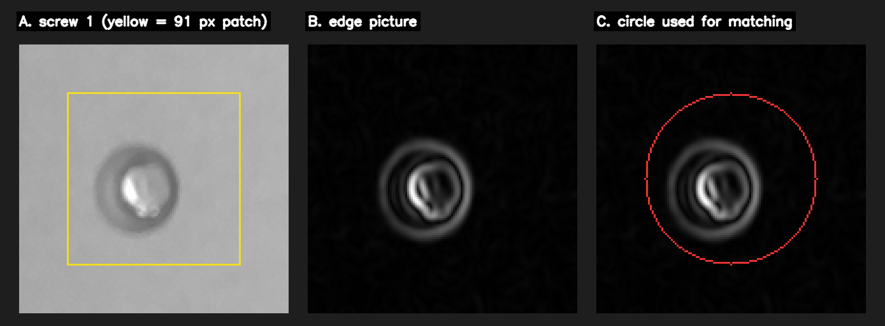

# 5-2. step 2: 나사 이동

나사 4개가 기준 사진에서 **가로로 몇 px 움직였는지** 잰다. QR 과 나사는 카메라에서 거리가 달라서, 판이 Y 로 움직이면 둘이 다르게 움직인다. 이 차이가 Y 를 알려 준다.

코드: `src/steps/02_find_screws.hpp`, `02_find_screws.cpp`

**목차**

| 번호 | 제목 |
|---|---|
| 1 | 기능 |
| 2 | 개발 과정 |
| 2-1 | 나사를 무엇으로 맞출까 → 테두리 그림 |
| 2-2 | OpenCV 의 ECC 함수를 그대로 쓰지 않은 이유 |
| 2-3 | 나사를 어디서부터 찾을까 → QR 이 움직인 자리 근처 |
| 2-4 | 나사를 몇 개, 어느 것을 쓸까 → 4개 모두, 좌우에 하나씩은 꼭 |
| 2-5 | 날마다 나사가 QR 에 대해 조금씩 다른 자리에 있다 |
| 3 | 최종 방법과 보정 |
| 4 | 이 단계의 결과 |
| 4-1 | 알려진 약점: 나사가 반쯤 가려졌을 때 |
| 5 | 한계와 확인하지 못한 것 |

---

## 1. 기능

왼쪽: 나사 주변 조각. 가운데: 테두리. 오른쪽: 위치를 맞출 때 쓰는 원 안쪽.

| | |
|---|---|
| 입력 | 회색 사진, step 1 에서 구한 QR 이동 (dx, dy), 설정에서 고른 나사 |
| 출력 | 나사마다 찾았는지, 가로 이동 `dx` (px, 소수) |
| 함수 | `ScrewFinder::find_screw_shifts` → `find_one` → `locate_screw`, `refine_by_brightness`, `refine_by_edges` |
| 나사 번호 | 1 왼쪽 위, 2 오른쪽 위, 3 왼쪽 아래, 4 오른쪽 아래 |

**나사 하나를 세 번에 걸쳐 좁혀 간다** (`find_one`)

| 순서 | 함수 | 하는 일 | 정밀도 |
|---|---|---|---|
| 1 | `locate_screw` | 나사 조각(91×91 px)을 옮겨 가며 가장 닮은 자리를 찾는다 (NCC). QR 이 움직인 만큼 옮긴 자리 주변 ±60 px 를 먼저 보고, 못 찾으면 원래 자리 주변 ±260 px 를 본다 | 정수 px |
| 2 | `refine_by_brightness` | 밝기 차이가 줄어드는 쪽으로 조금씩 밀어 위치를 다듬는다. 매번 밝기의 배율과 더하기를 맞춰 조명 차이를 없앤다 | 소수 px |
| 3 | `refine_by_edges` | 나사 **테두리만 남긴 그림**(밝기가 급히 바뀌는 곳)으로 정밀하게 맞춘다 (ECC). 나사 중심에서 반지름 45 px 안쪽만 본다 | 소수 px (최종 값) |

- 3번이 가장 정밀하지만 시작 위치가 가까워야 제대로 맞는다. 그래서 1, 2번으로 먼저 가까이 간다.
- 나사 하나를 못 찾아도 멈추지 않는다. 그 나사만 빼고 나머지로 계속한다 (step 3 에서 남은 나사에 맞는 계수를 고른다).

---

## 2. 개발 과정

### 2-1. 나사를 무엇으로 맞출까 → 테두리 그림

| 방법 | 나사 위치 흔들림 | 허용오차 밖 (560장 중, 10번 평균) | 비고 |
|---|---|---|---|
| 밝기 조각 그대로 맞춤 | 0.019 px | 2.3장 | |
| **테두리 그림으로 맞춤, 반지름 45 px** | **0.012 px** | **0장** | 지금 방법 |
| 테두리 그림, 테두리 고리 부분만 | 0.018 px | 0.2장 | |
| 밝기 조각, 테두리 고리 부분만 | 0.057 px | 10.2장 | |
| 원 테두리를 식으로 맞춤 | 10 px | | 계산이 불안정했다 |
| 위상 상관 (밝기 조각) | | 12.2장 | 소수 위치 흔들림이 0.065 px 이상 |
| 위상 상관 (테두리 그림) | | 28.8장 | |

조건: 11월, 받은 사진 702장.

**고른 것**: 테두리 그림 맞춤. 나사 머리 안쪽은 빛 반사에 따라 밝기가 달라지지만, 테두리 모양은 덜 변한다.

### 2-2. OpenCV 의 ECC 함수를 그대로 쓰지 않은 이유

OpenCV 3.4.15 의 ECC 함수(`findTransformECC`)는 그림을 옮겨 읽을 때 좌표를 **1/32 px 단위로 끊는다.** 그래서 결과에 약 0.01 ~ 0.02 px 의 계단 모양 오차가 생겼다.

| | 허용오차 밖 (10번 평균) |
|---|---|
| OpenCV 함수 그대로 | 0.50장 |
| **같은 식을 정확한 보간으로 직접 계산** | 0.10장 |

그래서 같은 계산을 직접 구현했다 (`ecc_shift`, `value_at`).

### 2-3. 나사를 어디서부터 찾을까 → QR 이 움직인 자리 근처

| 방식 | 대략 찾기 시간 | 정확도 |
|---|---|---|
| 늘 원래 자리 주변 ±260 px | 32.8 ms | 같음 |
| **QR 이동만큼 옮긴 자리 주변 ±60 px 먼저** | **5.7 ms** | 같음 |

나사는 QR 과 거의 같이 움직인다. QR 을 먼저 찾았으니 그 근처만 보면 된다. 못 찾을 때만 넓게 본다. 넓게 볼 때는 나사 이동이 QR 이동과 100 px 넘게 다르면 "옆의 다른 나사"로 보고 버린다.

### 2-4. 나사를 몇 개, 어느 것을 쓸까 → 4개 모두, 좌우에 하나씩은 꼭

| 쓰는 나사 | 허용오차 밖 (560장 중, 10번 평균) |
|---|---|
| **4개 모두** | 0.2장 |
| 아래 하나를 뺀 3개 | 1.1 ~ 2.0장 |
| 위 2개 | 2.8장 |
| **왼쪽 2개만, 오른쪽 2개만** | **127.9 ~ 136.1장** |
| 1개만 | 145 ~ 170장 |

조건: 11월, 받은 사진 702장.

**고른 것**: 4개 모두. 하나가 가려져도 **왼쪽과 오른쪽에 하나씩 남아 있으면** 정밀하게 잴 수 있다. 한쪽에만 남으면 대략값이 된다 (`W_COARSE`). 한쪽만으로 안 되는 원인은 따로 분석하지 않았다.

### 2-5. 날마다 나사가 QR 에 대해 조금씩 다른 자리에 있다

로봇을 같은 명령 0 에 두어도, 촬영한 날마다 (나사 − QR) 의 가로 차이가 +0.12, +0.42, +0.41, +0.21 px 로 달랐다. 재는 방법을 바꿔도 같았다. 재는 방법의 문제가 아니라 **화면에서 나사가 실제로 다른 자리에 있는 것**이다.

이 차이는 그날 모든 사진에 똑같이 붙는다. 그래서 매일 영점을 잡으면 없어진다 ([step 0](5-0_준비와_영점.md)).

---

## 3. 최종 방법과 보정

| 보정 | 보정 전 문제 | 보정 전 → 후 | 코드 |
|---|---|---|---|
| QR 이동 주변 ±60 px 를 먼저 찾는다 | 넓게 찾으면 느림 | 32.8 → 5.7 ms | `kNearSearch`, `kFarSearch`, `locate_screw` |
| QR 이동과 100 px 넘게 다르면 버린다 | 넓게 찾을 때 옆 나사를 잡음 | 잘못 잡은 나사를 "못 찾음"으로 | `kMaxAwayFromQr` |
| 밝기 배율과 더하기를 매번 맞춘다 | 조명이 바뀌면 밝기 차이가 위치 오차로 들어감 | 밝기 ×0.6, ±40 에서 영향 작음 | `refine_by_brightness` |
| 다듬다가 한 번에 3 px 넘게, 또는 처음 자리에서 8 px 넘게 가면 버린다 | 가려진 나사에서 엉뚱한 곳으로 감 | 틀린 값 대신 "못 찾음" | `kBrightnessMaxStep`, `kMaxDriftFromLocate` |
| 테두리 그림으로 맞춘다 | 나사 머리 안쪽 밝기가 반사에 따라 변함 | 흔들림 0.019 → 0.012 px, 허용오차 밖 2.3 → 0장 | `edge_picture`, `refine_by_edges` |
| 정확한 보간으로 직접 계산한다 | OpenCV 함수의 1/32 px 끊김 | 허용오차 밖 0.50 → 0.10장 | `ecc_shift`, `value_at` |
| 나사 4개를 동시에 찾는다 | | 결과는 같고 시간만 줄어듦 | `cv::parallel_for_` |

"밝기로 다듬기"(2번 순서)를 넣었을 때와 뺐을 때의 차이는 따로 재지 않았다.

---

## 4. 이 단계의 결과

| 항목 | 결과 | 조건 |
|---|---|---|
| 나사를 못 찾은 사진 | 0장 | 받은 사진 715장 |
| 나사 위치 흔들림 | 0.012 px | 받은 사진 702장, 나사끼리 비교 |
| 감도 | Y 1 mm 에 약 11 px, T 1도에 약 81 px | |
| 나사 하나를 통째로 가림 | 나머지 3개로 계산하고 경고. 가리기 전과 Y 0.007 mm, T 0.0006도 차이 | 합성 |
| 나사에 반사광 | 그 나사를 빼고 계산 (Y 0.001 mm 차이) | 합성 |
| 밝기 ×0.6, ±40 | 영향 작음 | 합성 |

### 4-1. 알려진 약점: 나사가 반쯤 가려졌을 때

우리 시험 장비 사진에서 나사 하나를 반쯤 가리면, 나사를 "찾았다"고 판단한 뒤 테두리 맞춤이 엉뚱한 곳으로 가는 경우가 있었다.

| | 사진 수 |
|---|---|
| 못 찾고 그 나사를 뺌 (정상 동작) | 416장 |
| **찾았다고 보고 틀린 값을 냄** | **641장** (Y 가 95% 에서 2.5 mm 까지 틀림) |

이 문제 때문에 step 4 의 **값 일치 점검**을 넣었다. 점검은 이 641장 중 500장에서 경고했고, **Y 가 0.1 mm 넘게 틀린 경우는 모두 경고했다.** 0.1 mm 아래로 틀린 경우는 못 잡을 수 있다.

반쯤 가려진 나사가 왜 "찾았다"는 기준(닮은 정도 0.6)을 통과하는지는 따로 분석하지 않았다.

---

## 5. 한계와 확인하지 못한 것

- 같은 자세를 여러 번 찍었을 때 나사 값이 얼마나 흔들리는지는 따로 재지 않았다.
- 소수 위치에 따른 치우침을 나사에 대해서는 재지 않았다.
- 실제 현장의 가림, 반사, 기름때로는 확인하지 못했다. 위 결과는 사진의 일부를 일부러 덮은 것이다.
- 닮은 정도 기준(0.6)이 가장 좋은 값인지는 시험하지 않았다.
- 흐린 사진(σ 2 px 이상)에서는 나사를 놓친다. 흐린 화면에서 나사를 잡는 방법은 만들지 않았다.
