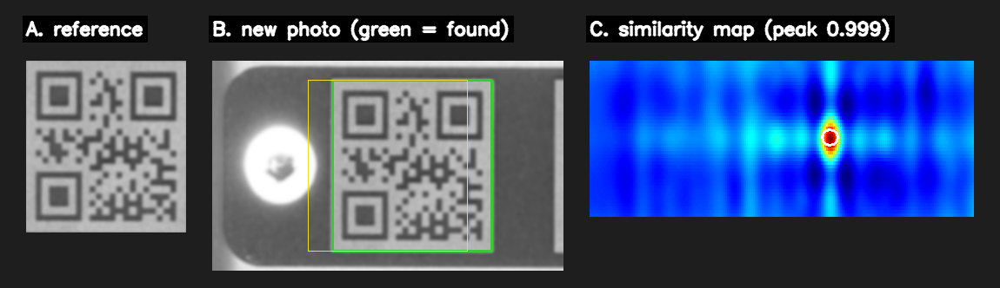
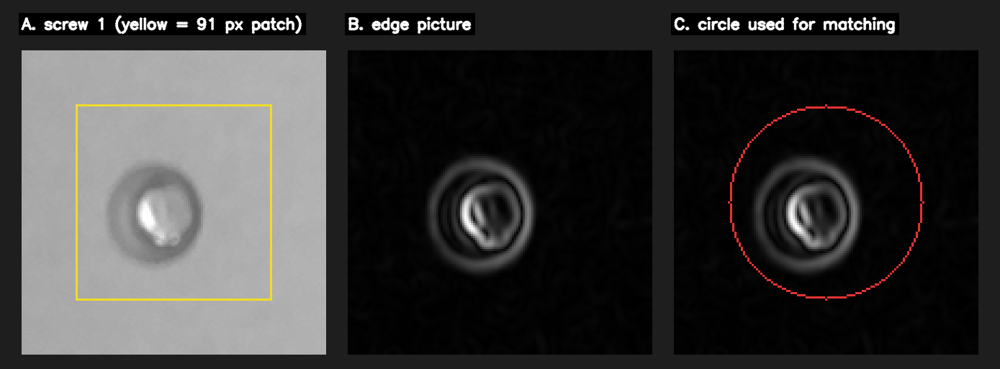

# 08. 포팅 안내서

코드를 옮기는 사람을 위한 문서다. 두 부분으로 되어 있다.

**목차**

| 번호 | 제목 |
|---|---|
| 1 | 포팅 순서와 단계별 확인 값 |
| 1-1 | 포팅 순서 |
| 1-2 | 값을 비교하는 방법 |
| 1-3 | 1단계 `find_qr_shift` — QR 이동량 |
| 1-4 | 2단계 `find_screw_shifts` — 나사 이동량 |
| 1-5 | 3단계 `compute_yt` — Y, T 계산 |
| 1-6 | 4단계 결과 점검 |
| 1-7 | 통합과 설정 |
| 1-8 | 최종 값 (예제 사진 5장) |
| 2 | 포팅할 때 유의할 점 |
| 2-1 | 컬러 채널 순서 (우선 확인) |
| 2-2 | 사진 크기와 카메라 조건 |
| 2-3 | 계수 재학습이 필요한 경우 |
| 2-4 | 재시작하면 초기화되는 값 |
| 2-5 | 여러 스레드와 여러 카메라 |
| 2-6 | 내부 병렬 처리와 속도 |
| 2-7 | 실패를 알리는 방식 |
| 2-8 | 숫자 형식 |
| 2-9 | OpenCV 버전 |
| 2-10 | 소스 파일 인코딩 |
| 2-11 | 한글 경로 |
| 2-12 | 조정 값 (탐색 창, 기준값) |
| 2-13 | 포팅 후 확인 |

---

## 1. 포팅 순서와 단계별 확인 값

코드를 다른 환경으로 **함수 단위로 옮기는 사람**을 위한 문서다. 한 단계를 옮기고, 예제 사진으로 값을 비교하고, 다음 단계로 넘어간다.

### 1-1. 포팅 순서

1. `src/common/reference` — 기준 사진과 위치 읽기
2. `src/steps/01_find_qr` → 아래 1단계 값과 비교
3. `src/steps/02_find_screws` → 2단계 값과 비교
4. `src/steps/03_compute_yt` → 3단계 값과 비교
5. `src/steps/04_check_result` → 4단계 값과 비교
6. `src/alignment.cpp` — 단계를 묶고 알림 붙이기
7. `src/setup/` — 영점, 기준 다시 잡기, 설정

### 1-2. 값을 비교하는 방법

이 폴더에서 아래를 실행하면 단계마다의 값이 나온다. 옮긴 코드에 같은 사진을 넣고 같은 자리의 값을 비교한다.

```
build/Release/show_steps data/model data/sample/sample_3.png
```

- 예제 사진 5장의 최종 값은 `data/sample/expected_steps.tsv` 에 있다.
- 아래 표는 `sample_3.png`(Y 가 약 +1.96 mm 인 사진)의 값이다.
- 소수 4자리까지 맞으면 제대로 옮긴 것이다. NCC 계산 방식에 따라 5~6자리부터는 달라질 수 있다.

---

### 1-3. 1단계 `find_qr_shift` — QR 이동량

| | |
|---|---|
| 파일 | `src/steps/01_find_qr.hpp`, `.cpp` |
| 입력 | 회색 사진 3840×2160 (8비트) |
| 출력 | `dx`, `dy` (px, 소수), 찾은 QR 수, 탐색 단계 |
| 쓰는 OpenCV 함수 | `GaussianBlur`, `matchTemplate(TM_CCOEFF_NORMED)`, `minMaxLoc` |



A 는 기준 사진의 QR 조각, B 는 새 사진의 탐색 창(초록이 찾은 자리, 노랑이 기준 자리), C 는 자리마다 닮은 정도다(빨강이 가장 닮은 곳).

**순서 (QR 하나)**

1. 기준 사진을 σ 2.0 으로 흐리고 QR 상자를 잘라 둔다(초기화 때 한 번).
2. 새 사진에서 탐색 창(가로 ±110, 세로 ±22 px)을 8 px 넓게 잘라 σ 2.0 으로 흐린 뒤 탐색 창만 남긴다.
3. `matchTemplate` 으로 닮은 정도 지도를 만들고 가장 높은 자리(peak)를 찾는다.
4. 닮은 정도가 0.8 미만이거나 peak 가 지도 가장자리면 "못 찾음".
5. peak 와 양옆 값(a, m, d)으로 소수 위치를 구한다: `0.5 × (a − d) / (a − 2m + d)`. 가로, 세로 따로 한다.
6. 이동 = 창 왼쪽 위 + peak + 소수 위치 − 기준 상자 왼쪽 위

**세 QR 을 묶는 법**: 세 개 모두 찾으면 평균. 하나라도 못 찾으면 창을 ±250 px 로, 그래도 안 되면 사진 전체 폭으로 넓혀 다시 한다. 전체 폭에서는 1~2개만 찾아도 그 평균을 쓴다.

**확인 값 (`sample_3.png`)**

| | dx | dy | 닮은 정도 |
|---|---:|---:|---:|
| QR 1 | 28.147047 | 0.073585 | 0.998837 |
| QR 2 | 28.191931 | 0.058476 | 0.998571 |
| QR 3 | 28.200434 | 0.062428 | 0.998414 |
| **평균 (결과)** | **28.179804** | 0.064830 | |

**틀리기 쉬운 곳**

- 흐림을 탐색 창에만 하면 가장자리 값이 달라진다. 8 px 넓게 잘라 흐린 뒤 잘라 낸다.
- 흐림 커널 크기는 OpenCV 가 σ 에서 정한다(`Size(0, 0)`). 8비트 사진에서 σ 2.0 이면 13×13 이다.
- `matchTemplate` 결과는 `float` 이다.

---

### 1-4. 2단계 `find_screw_shifts` — 나사 이동량

| | |
|---|---|
| 파일 | `src/steps/02_find_screws.hpp`, `.cpp` |
| 입력 | 회색 사진, 1단계의 QR 이동 (dx, dy) |
| 출력 | 나사마다 `found`, `dx`, `dy` (px, 소수) |
| 쓰는 OpenCV 함수 | `matchTemplate`, `Sobel`, `GaussianBlur`, `filter2D`, `magnitude` |



A 는 나사 조각(노랑이 91 px 조각), B 는 테두리 그림, C 는 맞춤에 쓰는 원(반지름 45 px)이다.

나사 하나를 세 번에 걸쳐 좁혀 간다.

#### (1) `locate_screw` — 대략 위치 찾기 (정수 px)

1. QR 이동을 반올림한 만큼 옮긴 자리 주변 ±60 px 에서 91×91 조각을 `matchTemplate` 으로 찾는다.
2. 닮은 정도 0.6 이상이고 peak 가 가장자리가 아니면 그 자리를 쓴다.
3. 아니면 기준 자리 주변 ±260 px 에서 다시 찾는다. 이때 찾은 이동이 QR 이동과 100 px 넘게 다르면 버린다(다른 나사를 잡은 것).

#### (2) `refine_by_brightness` — 밝기로 정밀화 (소수 px)

최대 50번 반복한다.

1. 지금 위치에서 91×91 조각을 3차 보간(a = −0.75)으로 잘라 낸다.
2. 조각의 가로·세로 기울기를 구한다(`Sobel` 3×3, 배율 1/8).
3. 밝기 배율(gain)과 더하기(offset)를 기준 조각에 맞춘다.
4. 남은 밝기 차이를 줄이는 방향으로 위치를 옮긴다(2×2 연립방정식).
5. 한 번에 옮긴 양이 0.0001 px 보다 작으면 끝. 3 px 넘게 옮기려 하거나, 2-1 의 자리에서 8 px 넘게 멀어지면 실패.

#### (3) `refine_by_edges` — 테두리로 정밀 맞춤 (ECC)

1. 2-2 의 결과를 **반올림한 정수 자리**에서 141×141 조각을 자른다.
2. 테두리 그림을 만든다: σ 1.5 흐림 → `Sobel` 가로·세로 → 크기(`magnitude`).
3. 기준의 테두리 그림과 ECC 로 맞춰 남은 이동(소수)을 구한다(`ecc_shift`, 최대 200번).
4. 결과 = 반올림한 자리 + 남은 이동. **이 값의 dx 가 나사 값이다.**

**확인 값 (`sample_3.png`, QR 이동을 반올림한 예상 이동 = (28, 0))**

| 나사 | 2-1 대략 | 닮은 정도 | 2-2 밝기로 다듬기 | 2-3 테두리 맞춤 (결과) |
|---|---|---:|---|---|
| 1 | (22, 0) | 0.990612 | (22.033613, 0.034750) | (**22.012527**, 0.075517) |
| 2 | (22, 0) | 0.992287 | (22.058023, 0.032020) | (**22.129009**, 0.050070) |
| 3 | (22, 0) | 0.995063 | (21.988323, 0.048615) | (**22.023315**, −0.002908) |
| 4 | (22, 0) | 0.994238 | (22.045957, 0.065327) | (**22.109609**, 0.123679) |

**틀리기 쉬운 곳**

- 2-3 은 2-2 의 소수 값이 아니라 **반올림한 정수**에서 시작한다.
- ECC 에서 사진을 옮겨 읽을 때 OpenCV `warpAffine` 을 쓰면 좌표가 1/32 px 로 끊겨 약 0.02 px 오차가 난다. 그래서 이웃 4점 보간을 직접 한다(`value_at`).
- ECC 의 원(마스크)은 반지름 45 px 원을 5×5 로 흐린 뒤 0.95 보다 큰 곳만 남긴 것이다(`make_edge_mask`).
- 기울기와 합은 원 안쪽만 쓴다. 원 밖 기울기는 0 으로 둔다.

---

### 1-5. 3단계 `compute_yt` — Y, T 계산

| | |
|---|---|
| 파일 | `src/steps/03_compute_yt.hpp`, `.cpp` |
| 입력 | 값 5개: QR dx, 나사 1~4 dx |
| 출력 | Y (mm), T (도) |
| 자료 | `data/model/coefficients/screws_XXXX.tsv` (나사 조합마다 하나) |

**식**

```
정규화 = (값 − mean) / scale
Y = intercept_Y + Σ weight_Y × 정규화
T = intercept_T + Σ weight_T × 정규화
```

**계수 고르기**: 찾은 나사 번호로 파일을 고른다. 4개 모두 찾았으면 `screws_1234`, 나사 2 를 못 찾았으면 `screws_134`, 하나도 못 찾았으면 `screws_none`. 왼쪽(1, 3)과 오른쪽(2, 4) 나사가 모두 있는 조합만 정밀하고, 나머지는 대략값이다.

**확인 값 (`sample_3.png`, `screws_1234`)**

| 값 | 측정 | 정규화 | Y 에 더하는 양 | T 에 더하는 양 |
|---|---:|---:|---:|---:|
| QR | 28.179804 | 0.401807 | 4.582600 | −0.631561 |
| 나사 1 | 22.012527 | 0.232151 | −0.331706 | 0.052656 |
| 나사 2 | 22.129009 | 0.221741 | −0.621296 | 0.057626 |
| 나사 3 | 22.023315 | 0.234472 | −1.086380 | 0.182941 |
| 나사 4 | 22.109609 | 0.222760 | −0.544521 | 0.168003 |
| 절편 | | | −0.038578 | 0.171032 |
| **합 (결과)** | | | **1.960119 mm** | **0.000696 도** |

출력은 여기에 영점을 뺀 값이다: `y_mm = Y + carry_over − zero` (`src/alignment.cpp` 의 `make_result`).

---

### 1-6. 4단계 결과 점검

| | |
|---|---|
| 파일 | `src/steps/04_check_result.hpp`, `.cpp` |
| 입력 | 값 5개, 3단계의 Y, T (영점을 빼기 전) |
| 출력 | 점검값, 기준값, 학습 범위 안인지 |
| 자료 | `data/model/checks/screws_XXXX.tsv`, `data/model/reference.json` 의 `trained_…` |

**값 일치 점검 식**

```
기대값   = c1 + cY·Y + cT·T + cYY·Y² + cYT·Y·T + cTT·T²        (값마다 계수가 다르다)
어긋남   = |측정값 − 기대값 − 기준 어긋남| / scale
점검값   = 어긋남 중 가장 큰 것
점검값 > threshold 이면 "값들이 서로 맞지 않는다"
```

"기준 어긋남"은 영점을 잡을 때 그 센터 사진에서 잰 (측정값 − 기대값)이다. 영점을 잡지 않았으면 0 이다.

**확인 값 (`sample_3.png`)**

| 값 | 측정값 − 기대값 (px) | scale | 어긋남 |
|---|---:|---:|---:|
| QR | 0.000947 | 0.037456 | 0.025272 |
| 나사 1 | 0.050183 | 0.090656 | 0.553552 |
| 나사 2 | −0.066298 | 0.063247 | 1.048238 |
| 나사 3 | 0.047661 | 0.078431 | 0.607678 |
| 나사 4 | −0.039811 | 0.039313 | 1.012675 |
| **점검값** | | | **1.048238** (기준 5.195438, 서로 맞음) |

---

### 1-7. 통합과 설정

| 파일 | 함수 | 하는 일 |
|---|---|---|
| `src/alignment.cpp` | `measure_values` | 1 → 2 → 3단계를 차례로 부른다 |
| | `make_result` | 영점을 빼고 4단계 점검을 한다 |
| | `add_notices` | 상황마다 경고 코드와 메시지를 붙인다 (중요한 순서대로) |
| | `set_zero_from_photos` | 센터 사진을 재서 영점과 기준 어긋남을 기억한다 |
| | `set_reference_from_photos` | 새 기준을 만들고, 같은 사진이 전과 같은 값이 나오도록 `carry_over` 를 맞춘다 |
| `src/setup/find_new_reference` | `find_qr_box` | 새 센터 사진에서 QR 상자를 NCC 로 찾는다 (±120 px) |
| | `find_screw_center` | 나사 테두리의 무게중심으로 중심을 3번 고쳐 잡는다 |
| `src/setup/settings` | `load_settings` | `config/settings.json` 읽기 |

### 1-8. 최종 값 (예제 사진 5장)

| 사진 | QR (px) | 나사 1~4 (px) | Y (mm) | T (도) | 상태 |
|---|---:|---|---:|---:|---|
| sample_1 | 0.2988 | 0.2085, 0.3408, 0.2161, 0.3632 | 0.0030 | 0.0026 | 정상 |
| sample_2 | −28.7128 | −22.4518, −22.4394, −22.4492, −22.5436 | −2.0116 | −0.0011 | 정상 |
| sample_3 | 28.1798 | 22.0125, 22.1290, 22.0233, 22.1096 | 1.9601 | 0.0007 | 정상 |
| sample_4 | −80.9915 | −82.6832, −81.9509, −82.3527, −81.5742 | −0.0325 | −1.0032 | 경고 `W_OUT_OF_RANGE` |
| sample_5 | 93.8149 | 91.8547, 93.2679, 91.5965, 92.9081 | 0.8703 | 1.0159 | 경고 `W_OUT_OF_RANGE` |

자릿수를 다 보려면 `data/sample/expected_steps.tsv` 를 본다.

---

## 2. 포팅할 때 유의할 점

항목마다 **지금 어떻게 되어 있는지**와 **바꾸려면 어디를 고치는지**를 적었다. 무엇을 고치든 마지막에는 `check_photos` 로 예제 사진 5장의 값이 그대로인지 확인한다 ([02 사용법](02_사용법.md) 1절).

### 2-1. 컬러 채널 순서 (우선 확인)

- **지금**: 3채널 사진은 **BGR** 로 보고 회색으로 바꾼다. 카메라가 RGB 로 주면 회색 밝기가 달라져 값이 조용히 틀린다. 경고도 나오지 않는다.
- **위치**: [src/common/reference.cpp](../../src/common/reference.cpp) `to_gray`: `cv::COLOR_BGR2GRAY`, `cv::COLOR_BGRA2GRAY`
- **바꾸려면** (셋 중 하나)
  - 넣기 전에 회색(1채널)으로 바꿔서 넣는다. 1채널은 그대로 쓰므로 순서 문제가 없다.
  - 넣기 전에 `cv::cvtColor(photo, photo, cv::COLOR_RGB2BGR)` 로 순서를 바꾼다.
  - `to_gray` 안의 `cv::COLOR_BGR2GRAY` 를 `cv::COLOR_RGB2GRAY` 로, `cv::COLOR_BGRA2GRAY` 를 `cv::COLOR_RGBA2GRAY` 로 바꾼다.

### 2-2. 사진 크기와 카메라 조건

- **지금**: 사진은 3840×2160 8비트만 받는다. QR 상자와 나사 중심은 기준 사진의 **px 절대 좌표**로 박혀 있다.
- **위치**: 크기는 [src/common/reference.hpp](../../src/common/reference.hpp) `kPhotoWidth`, `kPhotoHeight`. 좌표는 `data/model/reference.json` 의 `qr`, `screws`
- **바꾸려면**
  - 화면이 조금 밀린 정도(카메라가 처지거나 살짝 움직임)면 코드는 그대로 두고 `set_reference_from_photos` 를 부른다 ([02 사용법](02_사용법.md) 3절).
  - 해상도나 잘라내기(ROI)를 바꾸면 상수만 바꿔서는 안 된다. 기준 사진, 좌표, 계수를 모두 새 조건으로 다시 만들어야 한다(9-3).

### 2-3. 계수 재학습이 필요한 경우

- **지금**: `data/model/coefficients/` 와 `data/model/checks/` 는 받은 사진 702장(Y ±2 mm, T ±1도)으로 학습한 결과다. 학습 코드는 `tools/train/`, 공통 계산은 `tools/common/` 에 있다.
- **다시 만들어야 하는 때**: 카메라, 렌즈, 카메라와 판 사이 거리, QR 판이나 나사 배치가 바뀌었을 때. 영점이나 기준을 다시 잡는 것으로는 해결되지 않는다.
- **바꾸려면**: 새 조건에서 Y, T 를 알고 있는 사진을 모아 계수를 다시 학습해야 한다. `train` 또는 `prepare_dataset`, `fit_coefficients` 를 사용한다 ([07 학습과 데이터](07_학습과_데이터.md) 3절). 파일 형식은 지금 파일의 머리줄 설명을 따르면 코드는 고치지 않아도 된다.

### 2-4. 재시작하면 초기화되는 값

- **지금**: 아래 상태는 메모리에만 있다. 다시 켜면 `initialize` 직후 상태(처음 기준 사진, 영점 0)로 돌아간다.
  - 영점 (`zero`)
  - 기준을 다시 잡은 결과 (새 QR, 나사 위치, 영점을 잇는 값 `carry_over`)
  - 값 일치 점검의 기준 어긋남 (`baselines`)
- **위치**: [src/alignment.cpp](../../src/alignment.cpp) `struct State`
- **다시 넣을 수 있는 것**: 영점 값만 `set_zero_value(y, t)` 로 넣을 수 있다. 점검 기준은 바뀌지 않는다. 재시작 직후에는 0 이며, 이전 실행의 점검 기준은 복원되지 않는다.
- **바꾸려면**
  - 코드 수정 없이: 켤 때마다 명령 0 사진으로 `set_zero_from_photos` 를 다시 부른다. 기준을 다시 잡았던 장비라면 그 앞에 `set_reference_from_photos` 도 부른다. 가장 단순하고 안전하다.
  - 코드 수정: `alignment.cpp` 에 `state.reference`, `state.zero`, `state.carry_over`, `state.baselines` 를 파일로 쓰고 읽는 함수를 더하고 `include/alignment.hpp` 에 선언한다. 기준 사진은 `center.bmp`, 위치는 `reference.json` 형식으로 쓰면 그 폴더를 `initialize` 에 그대로 넘길 수 있다.

### 2-5. 여러 스레드와 여러 카메라

- **지금**: 상태가 프로그램 전체에 하나뿐이고(`state`), 상태를 사용하는 공개 함수가 같은 잠금(`state_mutex`)을 건다. 사진 파일을 읽는 `read_photo` 는 제외한다. 여러 스레드에서 불러도 안전하지만 **한 번에 한 장씩** 잰다. 카메라 여러 대를 각각 다른 기준으로 재는 구조는 지원하지 않는다.
- **위치**: [src/alignment.cpp](../../src/alignment.cpp)
- **바꾸려면**
  - 카메라마다 프로그램(프로세스)을 따로 띄운다. 코드 수정이 없다.
  - 한 프로그램에서 하려면 `State` 와 잠금을 클래스 멤버로 옮기고, 상태를 쓰는 공개 함수 6개(`read_photo` 를 뺀 나머지)를 그 클래스의 함수로 바꾼다. 단계 코드(`src/steps/`)는 이미 상태를 갖지 않아서 고칠 필요가 없다.

### 2-6. 내부 병렬 처리와 속도

- **지금**: QR 3개, 나사 4개를 `cv::parallel_for_` 로 동시에 찾는다. 하나씩 찾을 때와 결과가 같다. 속도는 OpenCV 스레드 수에 따라 달라진다(1스레드 19.2 ms, 4스레드 9.6 ms, 사진 읽기 제외).
- **위치**: [src/steps/01_find_qr.cpp](../../src/steps/01_find_qr.cpp), [src/steps/02_find_screws.cpp](../../src/steps/02_find_screws.cpp)
- **바꾸려면**: 코드 대신 `cv::setNumThreads(n)` 으로 스레드 수를 정한다. 병렬을 아예 끄려면 `cv::setNumThreads(0)` 이다.

### 2-7. 실패를 알리는 방식

- **지금**: 실패 여부는 `status` 로 확인한다. 불일치 판정 실패는 Y, T 가 남아 있어도 사용하면 안 된다. 초기화 중 잡은 `std::exception` 은 `E_DATA`, 측정과 영점, 기준 변경 중 잡은 것은 `E_INTERNAL` 로 알린다. `read_photo` 등 모든 호출의 예외를 막는 구조는 아니다.
- **위치**: [src/alignment.cpp](../../src/alignment.cpp) `failed`
- **바꾸려면**: 라이브러리는 그대로 두고, 부르는 쪽에서 `status == Status::Failed` 일 때 예외를 던지는 감싸는 함수를 만드는 것을 권한다.

### 2-8. 숫자 형식

- **지금**: 계산은 모두 `double` 이다. OpenCV `matchTemplate` 결과만 `float` 이다.
- **바꾸려면**: `float` 으로 바꾸면 이 문서 1절의 확인 값이 소수 4자리에서 어긋날 수 있다. 바꾼다면 `show_steps` 로 단계마다 비교한다.

### 2-9. OpenCV 버전

- **지금**: OpenCV 3.4.15 에서 확인했다. 쓰는 함수는 `GaussianBlur`, `matchTemplate`, `minMaxLoc`, `Sobel`, `filter2D`, `magnitude`, `cvtColor`, `imdecode`, `FileStorage`, `parallel_for_` 이다. ECC 는 OpenCV 것을 쓰지 않고 직접 풀었다(1/32 px 끊김 문제, 포팅 안내서 2-3).
- **위치**: [CMakeLists.txt](../../CMakeLists.txt) `find_package(OpenCV REQUIRED)`
- **바꾸려면**: 다른 버전으로 빌드한 뒤 `check_photos` 로 예제 5장을 비교한다. 흐림과 NCC 의 끝자리 차이는 생길 수 있고, 소수 4자리까지 맞으면 된다.

### 2-10. 소스 파일 인코딩

- **지금**: 소스는 UTF-8 이고 주석과 알림 메시지가 한글이다. Visual Studio 는 `/utf-8` 옵션이 없으면 경고나 오류가 나고 메시지가 깨진다.
- **위치**: [CMakeLists.txt](../../CMakeLists.txt) 의 `target_compile_options` 에 있는 `/utf-8`
- **바꾸려면**: CMake 를 쓰지 않고 다른 프로젝트에 파일을 넣을 때도 같은 옵션을 켠다. GCC, Clang 은 기본이 UTF-8 이라 따로 할 일이 없다.

### 2-11. 한글 경로

- **지금**: 사진(`center.bmp`)은 바이트로 읽어서 한글 경로도 된다. `reference.json`, `settings.json` 은 OpenCV `FileStorage` 로 읽어서 Windows 에서 한글 경로를 못 읽을 수 있다.
- **위치**: [src/common/reference.cpp](../../src/common/reference.cpp), [src/setup/settings.cpp](../../src/setup/settings.cpp)
- **바꾸려면**: 영문 경로에 두는 것이 가장 쉽다. 코드로 고치려면 `read_photo`(같은 파일)처럼 파일을 바이트로 읽은 뒤 `cv::FileStorage(내용, cv::FileStorage::READ | cv::FileStorage::MEMORY)` 로 연다.

### 2-12. 조정 값 (탐색 창, 기준값)

- **지금**: 탐색 창 크기, NCC 기준값, 반복 횟수 같은 숫자는 파일 맨 위 상수로 모아 두었다.
- **위치**: [src/steps/01_find_qr.cpp](../../src/steps/01_find_qr.cpp) (흐림 σ 2.0, 가로 ±110 → ±250 px, 세로 ±22 px, NCC 0.8), [src/steps/02_find_screws.cpp](../../src/steps/02_find_screws.cpp) (조각 반지름 45 px, ±60 → ±260 px, NCC 0.6 등), [src/setup/find_new_reference.cpp](../../src/setup/find_new_reference.cpp)
- **바꾸려면**: 상수만 고치면 된다. 다만 흐림 σ, 조각 크기, 원 반지름은 계수와 점검식을 학습할 때의 값이라 바꾸면 계수도 다시 만들어야 한다. 탐색 창 크기와 반복 횟수는 바꿔도 계수와 상관없다. 바꾼 뒤에는 `check_photos` 로 예제 5장을 확인한다.

### 2-13. 포팅 후 확인

1. 단계를 하나 옮길 때마다 `show_steps` 출력과 비교한다. 단계별 확인 값은 이 문서 1절에 있다.
2. 다 옮긴 뒤 예제 5장의 최종 값을 `data/sample/expected_steps.tsv` 와 비교한다. 소수 4자리까지 맞으면 된다.
3. 영점과 기준 다시 잡기는 `check_setup` 과 같은 순서로 확인한다.
