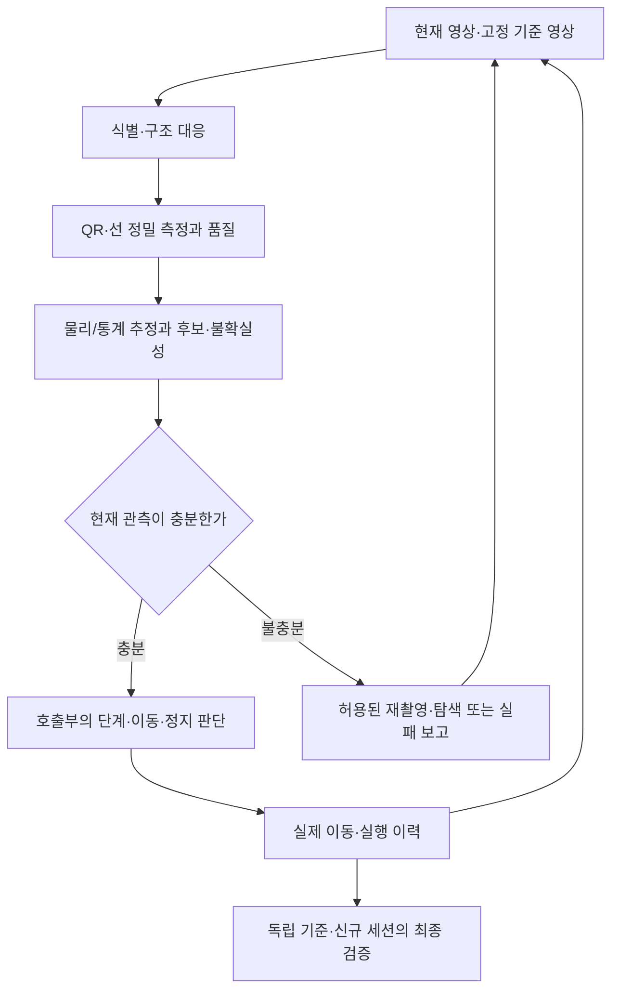

# 문헌연구 종합 결과보고 v2 — SEMES Y/T 분리와 자동 티칭

개정: 2026-10-30 · 114개 등록 항목의 폴더별 분석을 통합한 재작성본

## 1. 종합 판단

우리 과제의 핵심은 **영상 위치를 정밀하게 재는 일**, **그 변화에서 Y와 T를 구별하는 일**, **실제 이동 후 목표에 도달했는지 확인하는 일**을 연결하는 것이다. 문헌은 이 세 문제에 서로 다른 해결책을 제공한다. 고정밀 정합 하나, 호모그래피 분해 하나, 반복 제어 하나만으로 전체 정밀도가 확보된다고 해석해서는 안 된다.

현재 가장 설득력 있는 연구 방향은 **관측 가능성 진단 → QR·선의 편향/잡음 평가 → 축·카메라 교정과 정규화 비교 → 필요한 경우 능동 재관측 → 실제 복귀·독립 기준 검증**이다. 이는 문헌을 종합한 설계 권고이며, 신규 실험으로 원인이나 성능을 확정한 결과는 아니다.

이 v2는 이전의 계획서에서 더 나아가 논문·특허 폴더 10개에 **문헌별 상황·문제·해결·결과·공통점/차이점·SEMES 적용 카드 114개**, 주제 폴더 5개에 **논문–특허 통합 비교**, 이 문서에 **18개 가설과 설계·실험 우선순위**를 제공한다.

## 2. 분석 범위와 읽는 순서

| 주제 | 등록 구성 | 논문·기술자료별 분석 | 특허별 분석 | 주제 통합 비교 |
|---|---|---|---|---|
| 원인분석 | 15 + 8 = 23 | [15개 카드](01_주제_관련/원인분석/논문/00001_심층비교분석_v2.md) | [8개 카드](01_주제_관련/원인분석/특허/00001_심층비교분석_v2.md) | [원인 트리·경쟁 설명](01_주제_관련/원인분석/00001_심층비교분석_v2.md) |
| 유사연구 | 17 + 9 = 26 | [17개 카드](01_주제_관련/유사연구/논문/00001_심층비교분석_v2.md) | [9개 카드](01_주제_관련/유사연구/특허/00001_심층비교분석_v2.md) | [SEMES 전이 매트릭스](01_주제_관련/유사연구/00001_심층비교분석_v2.md) |
| QR 분석 | 15 + 8 = 23 | [15개 카드](02_QR_분석/논문/00001_심층비교분석_v2.md) | [8개 카드](02_QR_분석/특허/00001_심층비교분석_v2.md) | [계측·편향·품질 비교](02_QR_분석/00001_심층비교분석_v2.md) |
| Y/T 분리 | 13 + 7 = 20 | [13개 카드](03_Y_T_분리/논문/00001_심층비교분석_v2.md) | [7개 카드](03_Y_T_분리/특허/00001_심층비교분석_v2.md) | [기하·교정·능동 관측 비교](03_Y_T_분리/00001_심층비교분석_v2.md) |
| Y/T 오차 보정 | 15 + 7 = 22 | [15개 카드](04_Y_T_오차_보정/논문/00001_심층비교분석_v2.md) | [7개 카드](04_Y_T_오차_보정/특허/00001_심층비교분석_v2.md) | [오차 예산・폐루프・검증](04_Y_T_오차_보정/00001_심층비교분석_v2.md) |
| 합계 | **75 + 39 = 114** | | | |

전체 출처와 PDF 존재·중복 해시는 [문헌대장 v2](00002_문헌대장_v2.md)에 있다. 분석 설계와 가설 ID는 [마스터플랜](00001_문헌_심층분석_마스터플랜.md)을 따른다. 운영 목표·모델·입력·평가 기준의 단일 원본은 [ALGORITHM_RULES.md](../../../ALGORITHM_RULES.md)이며 이 보고서가 이를 변경하지 않는다.

### 수량과 근거 수준

114는 주제별 등록 수다. 75개 중 Matrox·NIST·GUM 같은 기술자료·지침이 포함되어 있어 모두 학술 논문이라고 부르지 않는다. 같은 미국 대표 번호를 합친 특허는 34개지만, 세계 패밀리 수·유효 권리 수를 의미하지 않는다.

기존 보고서의 논문 72편·원문 66편은 이전 집계다. 이번 대조에서는 Adiv·Malis·Collins의 동일 DOI 중복을 확인했고, Irani의 학회판/저널판 혼합과 Wang 학위논문/학회논문의 연구군 중복도 표시했다. 고유 출판물 수, 연구군 수, 검증된 원문 수는 별개로 취급한다.

이번 작업은 기존 요약·조사 결과의 재분석과 파일 점검이다. 각 카드에서 초록·번역·OCR·기존 원문 확인 기록을 구분했다. 모든 PDF의 식·수치를 새로 전수 대조한 것은 아니다. 파일이 있거나 번역이 존재한다고 전문 검증 완료로 계산하지 않는다.

## 3. 다섯 폴더를 잇는 문제–해결 구조

| 관측 상황 | 실제 문제 | 문헌이 제공하는 해결 | SEMES와의 공통점 | 중요한 차이 | 도입할 요소 |
|---|---|---|---|---|---|
| 협소 시야의 평면 QR | Y/T 영상 감도가 유사 | Daniilidis·Young·Szeliski의 정보/민감도 분석 | 병진–회전의 관측 결합 | 실제 축·잡음·거리 확인 필요 | 약한 축 조합을 수치로 진단 |
| 평면 자세의 작은 원근 신호 | 여러 자세 후보·큰 분산 | Schweighofer·IPPE·호모그래피 분해 | 평면 마커 | 두 후보와 국소 공선성은 다른 현상 | 후보 유지·추가 관측 판별 |
| QR와 배경 선의 다른 반응 | 왜 추가 특징이 분리에 도움이 되는지 불명 | Irani의 시차·회전 투영·축 교정 | 다른 관측 정보 활용 | 선 법선만 측정·오프셋 회전의 병진 | 전체 변위장으로 경쟁 설명 비교 |
| 미세 위치를 재는 영상 | 위상 편향·블러·오매칭 | 직접 정합·IC-GN·구조 ID·품질 지표 | 고정 QR 구조점 | PIV·체커·노광과 영상 조건이 다름 | 편향·분산·대응 실패 분리 |
| 축·카메라 관계 미상 | 명령과 영상의 물리 연결 부족 | Ji·Ha·Hou·Omron·Cognex 교정 | 알려진 이동으로 관계 추정 | 소각 PAN·척도·게이지 미확정 | 식별 가능한 전방 모델 |
| 단일 영상 정보가 약함 | 모호한 상태에서 잘못된 보정 | Wang 능동 티칭·온라인 자코비안 | 이동·재촬영 가능 | 이동 비용·백래시·실행 불확실성 | 필요한 조건에서 정보 높은 탐색 |
| 실제 구동 뒤 잔차 | 방향/열/양자화·진동 | 백래시 보상·피드백·ILC | 반복 자동 티칭 | 기구·센서·경로가 다름 | 실행 이력과 외부 기준을 포함 |
| 개발 성적은 높음 | 선택 편향·일반화·정확도 미입증 | Varma·Cawley·GUM·NIST | 모델 선택·반복 측정 | 정지 사진과 실기 성능의 차이 | 고정 모델 신규 촬영·실제 복귀 검증 |

## 4. 18개 경쟁 가설: 근거·반증 조건·행동

모든 가설은 복수 원인으로 공존할 수 있다. 문헌에 같은 현상이 있다는 사실은 우리 장비에서의 확인과 다르다. ‘현재 판단’은 이번 문헌 비교의 상태다.

| ID | 가설 | 문헌군 근거 | 구별할 실험·반증 조건 | 성립하면 할 일 | 현재 판단 |
|---|---|---|---|---|---|
| H01 | Y/T 감도가 거의 공선 | 원인 PA01~06 | 정규화·백색화 J의 약한 방향과 실오차가 일치하는가; 충분히 독립이면 지배 원인 아님 | 관측 배치·추가 관측 | 이론 근거 강함, 장비 정량 검증 필요 |
| H02 | 복수 평면 자세 후보 | 원인 PA09~11·분리 PA10 | 두 후보가 유사 우도를 갖는가; 한 후보가 안정적으로 배제되면 우선순위 하락 | 후보 유지·추가 정보로 선택 | 조건부 가능 |
| H03 | 좁은 관측 범위 | 원인 PA13·유사 PT03 계열 | 같은 점 수·품질에서 외곽/분산 배치 이득이 있는가 | 기준선·시야 활용 | 실측 필요 |
| H04 | 선은 깊이 시차를 제공 | 원인 PA03·분리 PA01 | 정렬 후 잔여 벡터·법선 성분이 깊이 모델과 맞는가 | 비공면 관측 설계 | H05/H06과 경쟁 |
| H05 | 선은 회전 투영을 관측 | Irani 운동식·분리 PT02 | 영상 위치별 선 반응이 회전 모델과 맞는가 | 물리 선 특징 | H04/H06과 경쟁 |
| H06 | 축 기울기·편심·척도 미교정 | 원인 PA12·분리 PA03/07/11·교정 특허 | 교정 후 신규 자세의 구조 잔차가 감소하는가 | 축·카메라 전방 모델 | 주요 후보 |
| H07 | 왜곡이 축 신호로 학습됨 | QR PA04/09/13 | 영역별 잔차가 독립 왜곡 교정으로 줄어드는가 | 광학 교정·모델 분리 | 올바른 09 원문도 필요 |
| H08 | 부화소 위상 편향 | QR PA01/02/11·PT04 | 실측 이동에서 주기 잔차가 보간기와 함께 달라지는가 | 편향 저감·보정 | 관련 메커니즘 근거 있음 |
| H09 | 광학·광도 조건이 편향 생성 | QR PA03/08/10·PT04/05 | 자세 고정에서 노출/블러만 바꿔도 축 추정이 변하는가 | 광학 조건·강건 측정 | 실측 필요 |
| H10 | 구조 대응 오류 | QR PA05/06·PT01 | 실패 영상에 ID 점프·셀 단위 오매칭이 있는가 | 절대 ID·이상치·실패 처리 | 실패 사례 확인 필요 |
| H11 | 점 간 상관으로 평균 효과 제한 | 원인 PA02·QR PA12 | 공분산을 포함하면 점 수 증가 효과가 달라지는가 | GLS·배치·유효 정보 | 반복 자료 필요 |
| H12 | 세션별 영점을 축 변화로 오인 | 원인 PT06·오차 PA15 | 같은 자세의 날짜/재설치 분산이 세션 내보다 큰가 | 기준 재관측·영점 상태 | 원인 미확정 |
| H13 | 접근 방향·이력이 잔차 생성 | Nordin·오차 PA03/09·PT02/06 | 방향을 바꾼 동일 목표의 독립 위치가 재현성 있게 다른가 | 접근 정책·방향 보상 | 백래시 단정 전 판별 |
| H14 | 시간·온도 드리프트 | 오차 PA03/11·TEL PT04/05 | 방향을 통제한 반복에서 시간/온도 효과가 남는가 | 드리프트 모델·재교정 | 교차 자료 필요 |
| H15 | 수치 정규화가 부족 | 분리 PA12 | 같은 정보에서 규제로 독립 성능이 개선되는가 | Ridge·공분산 추정 안정화 | 정보 한계와 별도 판단 |
| H16 | 탐색 이동이 후보/감도를 구분 | 유사 PA01·분리 PA04/05·교정 특허 | 실제 전후 관측이 고정 모델보다 정보·성능을 높이는가 | 조건부 능동 재관측 | 실행량 불확실성 포함 필요 |
| H17 | 추정보다 제어가 병목 | 오차 PA04/07/14·PT01/03 | 단일 사진 오차는 작지만 실기 복귀가 진동/정체하는가 | 이득·양자화·전환/정지 개선 | 실제 폐루프 검증 필요 |
| H18 | 선택 편향·범위 외 일반화 | 분리 PA13·오차 PA05/08 | 모델 고정 후 새 날짜/사분면/QR에서 성능이 달라지는가 | 독립 검증·선택 절차 분리 | 기존 개발 성적의 해석에 필수 |

표의 PA/PT 번호는 해당 주제의 개별 분석 카드 번호이며 전역 고유 번호가 아니다. 자세한 상황·결과 확인 수준·SEMES 수정안은 10개 개별 분석에서 확인한다.

## 5. 다양한 해결 접근의 비교와 우선순위

| 접근 | 무엇을 바꾸는가 | 먼저 확인할 것 | 장점 후보 | 비용·한계 | 우선도 |
|---|---|---|---|---|---|
| 구조 ID·대응 관리 | 데이터 연결 | 실제 오매칭 사례 | 큰 실패 차단 | 미세 편향은 남음 | 즉시 진단 |
| 광학·부화소 개선 | 측정 편향/잡음 | 위상·조명·블러 반복 | 기존 하드웨어 활용 | 정보 부족 자체는 남음 | 우선 |
| IC-GN·사전 계산 | 계산 방식 | 같은 관측의 수치 동등성 | 프레임 처리 비용 절감 | 초기화·실행 분리 필요 | 정확도 유지 조건 |
| 분산 점·선 특징 | 관측 방향 | 공간 감도·공분산 | 독립 정보 증가 가능 | 가림·해석·잡음 상관 | 우선 |
| 기구·카메라 교정 | 물리 전방 모델 | 축·척도·식별성 | 원인 설명·범위 예측 | 게이지·교정 데이터 비용 | 우선 |
| 호모그래피·IPPE | 관측의 물리 표현 | 후보·척도·K | 설명 가능한 대조군 | 약원근 민감도 | 대조군 |
| Ridge·GLS | 추정 규제·잡음 가중 | 훈련 내 선택·독립 평가 | 분산 감소 | 편향·외삽·공분산 추정 | 병행 |
| 능동 시험 이동 | 관측 시퀀스 | 충분한 자극·허용 이동 | 후보 판별·현장 감도 | 턴·시간·기구 이력 | 필요 조건에서 |
| 온라인 감도 갱신 | 현장 모델 | 실행량·잡음·적용 범위 | 드리프트 대응 가능 | 갱신 불안정 | 실기 대조 |
| 방향/열 보상 | 기구 이력 | 원인의 반복 재현 | 잔여 영점 감소 | 부정확한 상태 추론 | 원인 확인 후 |
| ILC | 반복 경로의 앞먹임 | 반복 외란·기준 계측 | 같은 경로 오차 감소 | 무작위 외란에 한계 | 후순위 대안 |
| 거리/다중 카메라·마커 | 하드웨어 정보 | 필요한 독립 감도·설치 | 물리적 정보 보강 | 공간·청정·교정 비용 | 현 구성 한계 확인 후 |

## 6. 실험 묶음과 결과에 따른 분기

### E1. 정지 반복·세션 분해 — H08/H09/H11/H12

같은 자세를 유지해 반복 촬영하고, 날짜·재설치 자료는 별도 묶음으로 수집한다. 점/선 측정 공분산·공통 모드·세션 절편을 구한다. 세션 내보다 세션 간 변동이 크면 점 정밀화만 더 하기보다 기준·영점 모델을 먼저 검토한다.

### E2. 독립 축 감도·공간 절제 — H01/H03/H05/H06

Y-only/T-only의 통제된 이동에서 QR-only, 선-only, 결합 관측을 같은 분할·점 수 조건으로 비교한다. 축 단위·잡음으로 정규화한 정보량과 독립 시험 축 오차가 함께 좋아지는지 확인한다. 개선이 없으면 추가 특징의 실제 유효성을 재검토한다.

### E3. 선 반응의 원인 판별 — H04/H05/H06/H07

QR 평면 정렬 전후의 선 법선 잔차를 영상 위치·깊이·축 기울기 후보 모델로 예측한다. 선은 전체 2D 흐름을 주지 않는다는 제약을 포함한다. 가능하면 깊이 또는 관측 위치를 바꿔 경쟁 모델이 다르게 예측하는 조건을 촬영한다.

### E4. 위상·광학 시험 — H07/H08/H09/H10

실측 미세 이동·노출/초점 변화·인위 가림으로 측정 편향·분산·오매칭을 나누어 비교한다. 합성 이동은 재표본화기의 영향을 포함하므로 실측의 보조로 둔다. 점 쌍 간격은 예상 투영 변화를 제거한 후 사용하며 공통 편향 소거의 한계도 기록한다.

### E5. 교정·규제 대조 — H02/H06/H15

기구 전방 모델, 호모그래피/IPPE, 기존 회귀, 규제 회귀를 같은 시험 자료에서 비교한다. 교정·표준화·정규화·공분산·임계값 선택은 훈련 자료에 한정한다. 두 후보·비식별 파라미터는 숨기지 않고 신규 자세 오차로 판단한다.

### E6. 방향·온도·실제 위치 — H12/H13/H14

같은 목표에 정·역 접근하고 경과 시간·온도·대기 시간을 기록한다. 독립 기준으로 실제 도달 위치를 재어 명령값–기구 오차와 영상 추정 오차를 분리한다. 방향 효과가 재현될 때 방향 보상·단방향 정책을 검토한다.

### E7. 능동 관측·폐루프 — H16/H17

같은 시작 조건에서 고정 모델, 탐색 관측, 온라인 갱신을 비교한다. 영상·추정값·실행 명령·실행 확인·재촬영·정지 판정·총시간을 기록한다. 기존 정지 사진을 조합한 결과와 실제 이동·재촬영의 성적을 분리한다.

### E8. 모델 고정 후 최종 시험 — H18

개발에 사용하지 않은 날짜·혼합 자세·작업 범위·QR 조건에서 평가한다. 반복 사진은 같은 그룹으로 묶는다. 축별 평균/최대오차, 동시 통과율·실패율·신뢰구간, 실제 복귀 턴·총시간을 보고한다. 최종 시험 결과를 보고 다시 튜닝하면 그 자료는 개발 자료로 전환하고 새로운 시험을 구분한다.

반복 수·임계값·이동 범위는 장비 허용 범위와 예비 분산을 확인한 후 본평가 전에 고정한다. 이 보고서는 촬영을 수행하거나 장비 이동을 실행한 기록이 아니다.

## 7. 통합 아키텍처 권고

현재 계산 API는 영상을 받아 추정 (y,t)를 반환하고 실제 이동은 호출부가 맡는다. 실제 헤더에는 별도 진단 API도 있다. 따라서 ‘반환형에 상태가 없다’와 ‘진단 경로가 전혀 없다’를 혼동하지 않는다. 진단값이 존재한다고 관측 안정성이 검증됐다는 뜻도 아니며, 추가 신뢰도는 실제 측정과 연결해야 한다.

근거: [공개 API](../../../include/alignment.hpp), [위임 구현](../../../src/alignment.cpp), [호출 예제](../../../src/main.cpp). 기존 joint/control 모델·규칙·오류 처리는 이 문서 작성으로 변경하지 않았다.

## 8. 이전 v2 해석에서 고친 부분

| 이전 표현 | 이번 v2의 해석 |
|---|---|
| QR-only 성적이 낮으므로 원리적으로 분리 불가능 | 현재 구성의 정보 부족은 강한 후보지만 실측 잡음·감도·후보 분석으로 검증 |
| QR 측정은 이미 이론 하한에 가까움 | 장비별 하한 계산과 편향 모델이 확인되기 전 보류 |
| 가로선은 시차, 또는 선 부호만으로 원인 확정 | 깊이·투영·축 오프셋·법선 관측의 경쟁 모델로 비교 |
| PAN 회전 성분은 깊이와 무관 | 광학 중심 순수 회전 성분의 성질과 오프셋 축 회전에 동반되는 병진을 구분 |
| 영상 QR 궤적 원 맞춤으로 실제 회전축 복원 | 3D 원 궤적과 영상 투영을 구분; 일반적으로 영상 궤적은 원이 아님 |
| 강체 점 사이 영상 간격은 항상 일정 | 물리 간격과 투영 간격 구분; 예상 기하 변화·공통 편향을 고려 |
| 세션 영점 변동=백래시 | 방향·온도·재설치·측정 기준 변동을 경쟁 원인으로 유지 |
| 명령 해상도를 균등 오차로 넣은 U는 장비 예산 | 분포·감도·상관 가정의 예시와 검증된 예산을 구분 |
| 이산 안정성은 고유값 0~2, g=0.8~0.9면 단방향 | 일반 조건은 ρ(I−GWJ)<1; 실수 고유값일 때 단순화, 단방향·턴 수 보장 불가 |
| 280/280·337/341이 독립 실기 성공률 | 개발 사진 성적이며 실제 폐루프·외부 기준 정확도와 구분 |
| 50 μm를 서브미크론으로 표현 | 50 μm=0.05 mm, 서브미크론 아님 |
| 114개를 독립 원문 근거 수로 집계 | 주제별 등록·출판물·연구군·원문 검증 수를 분리 |
| %GRR·ndc를 NIST 의무 수용 기준으로 인용 | 지표 정의·분모·원전·프로젝트 적용 조건을 별도 확인 |

이전 v1 보고서와 개별 원문·요약·번역은 보존했다. 수정된 이 문서와 폴더별 v2를 이번 비교 분석의 진입점으로 사용한다.

## 9. 근거 확인과 남은 공백

이번에 추가로 확인한 것은 114개 등록 폴더·요약 연결, PDF 파일 해시 중복, 현재 API/규칙, 일부 주요 1차 출처다. QR/논문/09 렌즈왜곡 PDF가 07 IC-GN PDF와 동일 바이트인 것은 실제 해시 점검 결과다. 올바른 렌즈왜곡 원문은 전문 근거에서 제외했다.

| 1차 출처 | 이번에 확인한 범위 | 적용 범위 |
|---|---|---|
| [IPPE 저자 구현 설명](https://github.com/tobycollins/IPPE) | 두 후보·재투영 오차, 약원근에서의 모호성 설명 | 후보를 드러내는 비교군이며 장비 성능 보장 아님 |
| [BIPM GUM 원문](https://www.bipm.org/documents/20126/2071204/JCGM_100_2008_E.pdf) | 측정 불확도 지침 원문 접근 | 구체 합성은 해당 가정·감도·상관을 확인해 적용 |
| [NIST Gauge R&R 2.4](https://www.itl.nist.gov/div898/handbook/mpc/section4/mpc4.htm) | 반복성·재현성·안정성·편향의 구분 | 생산 측정계 설계, 수용 임계값의 일괄 근거 아님 |
| [van Hulst 2026 공개 초록](https://arxiv.org/abs/2608.03669) | 히스테리시스–엔코더 대리 신호–ILC와 IEEE 투고 상태 | 반복 외란 보상의 대안, SEMES 성능 수치로 전이 불가 |

Irani 저자 공개 PDF의 이번 웹 재접근은 시간 초과였으며 기존 로컬 요약·판본 기록을 근거로 삼았다. 나머지 문헌의 원문·청구항·수치 전체를 이번에 새로 전수 검증했다고 주장하지 않는다. 원문과 요약이 충돌하는 항목은 개별 카드에서 확인 수준을 낮춰 표시했다.

T의 실제 회전축·단위·부호, 카메라와 표적 중 이동 주체, 거리·마커 크기·렌즈, 허용 탐색 범위, 독립 위치 기준, 신규 혼합/반복 촬영은 적용 설계를 확정하는 데 필요한 미확인 조건이다. 기존 문서는 T를 PAN으로 설명하지만 요청문의 틸트와 다르므로 정의를 맞추기 전 수식을 확정하지 않는다.

## 10. 이번 작업의 완료 범위

- 논문/기술자료 75개와 특허 39개의 문헌별 비교 카드를 10개 하위 폴더에 작성했다.
- 5개 주제 폴더에 논문–특허 통합 비교와 가설별 적용·실험 조건을 작성했다.
- 이 종합 v2에 18개 가설, 12개 해결 접근, 8개 검증 묶음과 통합 아키텍처를 연결했다.
- 문헌대장에 114개 출처와 파일 존재·동일 PDF 점검 결과를 기록했다.

실험·장비 촬영·모델 변경·신규 성능 검증은 수행하지 않았다. 다음 실행은 E1/E2의 반복·감도 진단이며, 그 결과로 측정 개선·기구 교정·능동 관측의 우선순위를 선택한다.
