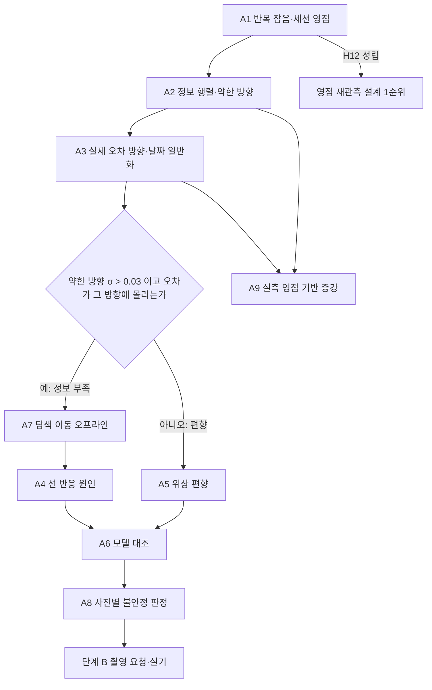

# 실험 계획 — 문헌 v3 가설의 장비 검증

> **2026-11-02 실행 완료 (단계 A 9건).** 결과는 [종합보고서](../../../experiments/hye/20261102_142904_종합보고서_단계A9건_단계B6건.md)에 있다. 실험별 폴더는 `experiments/hye/20261102_*` 이며 각 폴더에 `계획서.md`, `실험/`(C++), `결과/`(결과.md·보고서.md·그림)가 있다.
> 허용 절대오차는 사용자 확인에 따라 **±0.045**(0.09는 5회 반복 정밀도 전폭)로 바뀌었다. 아래 본문의 0.09·0.03 기준은 작성 당시 값이다.

작성: 2026-10-30 · 근거: [문헌 종합 v3](00000_문헌연구_종합_결과보고_v3.md) · 규칙: [ALGORITHM_RULES](../../../ALGORITHM_RULES.md)

## 1. 목적과 원칙

**목적:** 문헌 v3의 가설 18개 중 어떤 것이 우리 장비의 오차를 지배하는지 가려, 측정 개선·축 교정·탐색 이동·제어 개선 중 무엇에 먼저 힘을 쓸지 정한다.

**원칙** (ALGORITHM_RULES를 따름)

- 실험마다 `experiments/hye/<YYYYMMDD_HHMM_문제_해결>/` 폴더를 만들고 `실험/`(C++·CMake)과 `결과/`(이미지·`결과.md`·`보고서.md`)로 나눈다. 시각은 실험 코드의 가장 이른 파일 시각이다.
- 입력은 `data/clean/`의 원본 영상만 쓴다. 옛 CSV·측정값은 가져오지 않고 다시 측정한다.
- 측정은 기존 고정 630점 구조 ID 경계 측정(`00001_common`)을 기준으로 쓴다. 바꾸는 실험은 바꾼 것만 다르게 둔다.
- 학습·정규화·공분산·임계값은 fold 안의 학습 사진에서만 정한다. 같은 명령의 반복 사진은 같은 fold에 묶는다.
- **1029도 학습에 쓰지만, 항상 fold 검증 안에서만 쓴다.** 모든 실험은 아래 두 분할 중 하나 또는 둘 다로 평가하고, 어느 사진도 자기를 학습한 모델로 시험하지 않는다. 분할 파일은 A1 시작 전에 한 번 만들어 고정하고 모든 실험이 같은 파일을 쓴다.
  - **혼합 분할(주 평가):** 1014·1020·1029 전체를 4-fold로 나눈다. 날짜와 조건(Y 단독·T 단독·혼합, 1029의 T 크기 구간)이 fold마다 고르게 들어가게 층화하고, 같은 명령의 반복 3장은 한 fold에 묶는다. 기존 1014 280장 고정 4-fold의 배정은 그대로 두고, 1020·1029를 추가 배정한다(기존 결과와 비교 가능하게).
  - **날짜 분할(일반화 평가):** 날짜 하나를 통째로 빼고 나머지 두 날짜로 학습하는 3-fold.
  - 전체 학습 후 재대입 성적은 따로 보고하고 성능 근거로 쓰지 않는다.
- **판정 기준은 실험 전에 이 문서에 적어 두고**, 결과를 본 뒤 바꾸면 그 사실을 보고서에 적는다.
- 기존 341장(+1029의 234장)은 개발에 노출된 자료다. 여기서 나온 성적은 원인 진단용이며 독립 성능이 아니다.

## 2. 자료와 수치 기준

| 자료 | 구성 | 쓰는 곳 |
|---|---|---|
| 1014 | center 1, Y 단독 80(0.05 mm 간격), T 단독 200 | 감도 J, 위상 편향, 선 반응 |
| 1020 | center 3, 혼합 19조건×3장 | 반복 잡음, 세션 영점, 혼합 오차 |
| 1029 | Y+0.05 고정, T 0.04~0.82 78조건×3장 | 반복 잡음, T 크기별 오차, 날짜 간 비교 |

수치 기준: Y 14.25 px/mm, T 80.04 px/T, T 1 = Y 5.62 mm 상당. 명령 간격 Y 0.05(0.71 px), T 0.01(0.80 px). 허용 절대오차 각 0.09. **판정에 쓰는 "작다/크다"는 모두 허용오차 대비로 적는다.** 독립 기준으로 쓰려면 허용오차의 1/3(0.03) 이하 정밀도가 필요하다(Cheng 2013의 ±50 µm 대 기준 ±15 µm 비율).

## 3. 단계 A — 기존 자료로 지금 할 수 있는 실험

### A1. 반복 잡음·점 간 상관·세션 영점 — H11, H12

- **질문:** 같은 명령에서 점 측정은 얼마나 흔들리고, 점끼리 함께 흔들리는가? 날짜가 바뀌면 영점이 움직이는가?
- **자료:** 1020·1029의 3장 반복(97조건), 1020 center 3장, 1014 center.
- **방법:**
  1. 조건별 평균을 뺀 점 잔차로 점별 σ(px)와 공분산 Σ를 구한다.
  2. 유효 독립 점 수 N_eff = (tr Σ)² / tr(Σ²)를 630점·536점·QR별로 낸다.
  3. 공통 모드(판 전체가 함께 움직이는 성분)의 분산 비율을 낸다.
  4. 날짜 간 영점 차이를 두 가지로 잰다. 두 날짜에 똑같이 겹치는 명령은 없다(1029는 1020의 T+0.10을 건너뜀).
     - 1014 center와 1020 center 3장의 차이
     - 1020 Y+0.05 T+0.10과 1029 Y+0.05 T+0.09·T+0.11 두 조건의 내삽값의 차이
     - 둘 다 Y·T 단위로 환산한다.
- **판정:**
  - **H11 성립:** N_eff가 명목 점 수의 10% 미만이거나, 공통 모드가 잔차 분산의 50%를 넘는다. 이 경우 점을 더 늘리는 개선은 효과가 작다고 보고 A2에서 GLS를 기본으로 쓴다.
  - **H12 성립:** 날짜 간 차이가 세션 내 반복 SD의 3배를 넘고, 동시에 0.03을 넘는다. 이 경우 영점 재관측(매 티칭 시 center 재촬영)을 설계 1순위로 올린다.
- **산출:** 점별 σ 지도, N_eff 표, 날짜 간 영점 차 표.

### A2. 정보 행렬과 약한 방향 — H01, H03 (+ Adiv 조건표)

- **질문:** 현재 관측으로 Y·T가 이론적으로 얼마나 구별되는가? 약한 방향은 ΔY = −5.62·ΔT인가?
- **자료:** 1014 Y 80·T 200(감도), A1의 Σ.
- **방법:**
  1. fold 안에서 점별 감도 J(px/Y, px/T)를 선형으로 맞춘다.
  2. F = Jᵀ Σ⁻¹ J로 정보 행렬을 만든다.
  3. 관측 4조건(QR만, +위 선, +아래 선, +양쪽)별로 최소 고유값, 약한 방향 각도, 예측 표준편차 σ_Y·σ_T를 허용오차 단위로 낸다.
  4. 같은 점 수에서 바깥 점만 쓸 때와 안쪽 점만 쓸 때를 비교한다(H03).
  5. Adiv의 8개 조건(시야, 기울기, 거리, 이동량, 해상도, 잡음, 점 밀도)에 우리 값을 넣은 표를 만든다.
- **판정:**
  - 약한 방향이 −5.62 mm/T와 10° 이내면 Daniilidis 예측이 맞은 것이다.
  - 약한 방향 예측 σ가 0.03을 넘으면 **정보 부족이 주원인(H01)** 이다. 선 추가·탐색 이동(A7)을 우선한다.
  - 0.03 이하면 정보는 충분하므로 **편향(H06~H08) 쪽**을 우선한다.

### A3. 실제 오차의 방향과 날짜 일반화 — H01 실측, H18

- **질문:** 현재 모델의 오차가 A2의 약한 방향에 몰리는가? 학습에 안 쓴 날짜에서 성적이 떨어지는가?
- **자료:** 1014·1020·1029 세 날짜 전부. 1029는 학습에 쓰는 자료이므로(2026-10-30 사용자 확인), 따로 떼어 둔 시험셋으로 두지 않는다. 대신 **날짜 하나를 빼고 학습하는 교차검증**(3-fold, 같은 명령의 반복 사진은 같은 fold)으로 날짜 일반화를 본다.
- **방법:**
  1. 현재 1차 기준 모델 구조(QR+위·아래 선 공동 추정)를 고정한다. 날짜 fold마다 학습만 다시 한다.
  2. 빠진 날짜의 오차 (e_Y, e_T)에 대해 상관계수와 주축 각도를 낸다.
  3. 1029에서 T 크기(0.04~0.82)별 오차 곡선을 그린다.
  4. 같은 모델의 혼합 분할(1절, 날짜 섞은 4-fold) OOF 성적과 나란히 둔다.
- **판정:**
  - **H01 실측 확인:** |r| > 0.8이고 주축이 A2의 약한 방향과 10° 이내.
  - **H18 확인:** 날짜를 뺀 fold의 동시 통과율이 날짜를 섞은 4-fold보다 10%p 이상 낮음. 이 경우 이후 모든 성능 비교를 날짜 단위 fold로 바꾼다.
  - T가 학습 범위 밖으로 갈수록 오차가 커지면 외삽 한계로 기록한다.
- **주의:** 세 날짜 모두 개발에 노출되므로, 이 결과도 독립 성능이 아니다. 독립 성능은 B6에서만 낸다.

### A4. 위·아래 선 반응의 원인 판별 — H04, H05, H06

- **질문:** 선이 Y/T 구별에 도움이 되는 이유가 깊이 시차인가, 회전 투영인가, 축 기울기인가?
- **자료:** 1014 Y 단독·T 단독.
- **방법:** 위·아래 선의 블록별 법선 변위를 영상 가로 위치 x에 대해 그리고, 세 모델을 맞춰 fold 내부 AIC로 비교한다.
  - (a) 깊이 시차: Y에도 반응하고, 크기가 깊이 차에 비례한다.
  - (b) 회전 투영: T에 반응하고, 위·아래 선의 기울기 부호가 반대이며, 크기가 y/f·Ω에 맞는다.
  - (c) 축 기울기(롤 성분): 위·아래 선의 기울기 부호가 같다.
- **판정:** AIC 차가 10 이상이면 그 모델을 채택한다. 아니면 경쟁 상태로 남기고 B4 촬영으로 넘긴다.

### A5. 부화소 위상 편향 — H08

- **질문:** 0.71 px 간격의 Y 이동에서 측정에 1 px 주기의 편향이 보이는가? 그 편향이 Y 추정에 얼마나 남는가?
- **자료:** 1014 Y 80장.
- **방법:**
  1. 같은 QR 안 점 쌍 간격에서 예상 투영 변화를 뺀다. 강체라 물리 간격은 일정하므로 남는 변동이 측정 편향이다.
  2. 남은 변동을 부화소 위상에 대해 그리고 1 px 주기 성분의 진폭을 맞춘다.
  3. 보간(쌍선형/3차)과 창(현재/5×5 σ=1)을 바꿔 같은 분석을 반복한다(Yamamoto·QR PA-10 근거).
  4. Y 추정 잔차의 주기 성분도 함께 본다.
- **판정:** Y 추정 잔차의 주기 성분이 0.01 mm를 넘으면 편향 보정에 이득이 있다. 그 아래면 위상 편향은 주원인에서 뺀다.

### A6. 추정 모델 대조 — H02, H06, H07, H15

- **질문:** 같은 측정에서 물리 모델·규제 회귀가 현재 GLS보다 나은가?
- **자료:** 1절의 혼합 분할(주 평가)과 날짜 분할. A3에서 H18이 확인되면 날짜 분할을 주 평가로 바꾼다.
- **비교군:**
  1. 현재 GLS(대조)
  2. Ridge·GLS+Ridge: λ를 fold 내부 CV로 선택
  3. 호모그래피/IPPE 물리 모델: 두 후보 비용 차 기록(H02)
  4. 축 오프셋·기울기를 넣은 기구 전방 모델(H06)
  5. 2에 방사 왜곡 1~2항을 추가(H07)
- **지표:** Y·T 평균/최대 절대오차, 동시 0.09 통과율, 실패 수(분모 포함), C++ 처리 시간 중앙값·p95.
- **판정:** 대조 대비 최대오차가 20% 이상 줄고 통과율이 떨어지지 않으면 후보로 올린다. IPPE 두 후보의 비용 차가 대부분 잡음의 10배 이상이면 H02는 기각한다.

### A7. 알려진 탐색 이동의 효과(오프라인) — H16

- **질문:** 알려진 상대 이동 1회 뒤 다시 찍은 영상을 함께 쓰면 약한 방향이 풀리는가?
- **자료:** 1029의 이웃 T 조건 쌍(같은 Y, T 차이를 아는 쌍), 1020 조건 쌍.
- **방법:** 두 영상의 변화량과 알려진 명령 차를 함께 넣어 추정한다. 단일 영상 추정과 약한 방향 분산·오차를 비교한다.
- **주의:** 서로 다른 시점의 정지 사진을 조합한 **오프라인 분석**이며 실제 이동·재촬영 성적이 아니다(규칙 62행).
- **판정:** 약한 방향 오차의 SD가 절반 이하로 줄면, B5에서 조건부 탐색을 기본 후보로 넣는다.

### A8. 사진별 불안정 판정 지표 — 규칙 39~45행

- **질문:** 이 사진의 추정을 믿을지 사진마다 미리 알 수 있는가?
- **방법:** A2의 정보 행렬을 사진별 유효 점으로 다시 계산해 예측 σ를 낸다. OOF 오차를 예측 σ로 나눈 z값의 분포가 표준정규에 가까운지 본다(보정 확인).
- **판정:**
  - z의 SD가 0.7~1.4이면 예측 σ를 "불안정 → 탐색 이동" 판정에 쓴다.
  - 그 밖이면 판정 기준으로 쓰지 않고, 이유를 기록한다.

### A9. 실측 영점 기반 데이터 증강 — H12, H18 (검토 중인 방향)

- **질문:** 증강 자료를 더하면 날짜 일반화(A3)가 나아지는가? 증강 생성기가 실제 사진을 맞게 예측하는가?
- **생성 방식** (규칙 64행):
  - 영점은 균등 노이즈가 아니라 A1에서 잰 실측 center·세션 영점을 쓴다.
  - 그 영점에서 로봇이 움직였을 때의 점별 변위를 A2의 감도 J로 예측한다.
  - 판 전체를 평행이동하지 않고 고정 점별 변위로 만든다.
  - 각 점에 A1의 반복 잡음(공분산 Σ)을 넣는다.
  - Y·T 결합항을 0으로 두지 않고, 1020·1029 혼합 자세에서 추정한 값을 쓴다.
  - 영점이 흔들릴 가능성이 높은 방향(A2의 약한 방향)의 추가 영점 후보는 실측 영점과 구분 표시한다.
- **평가는 두 단계로 한다.**
  1. A3의 날짜 단위 fold에서, 학습 날짜로만 생성기를 만들고 빠진 날짜를 예측한다. 실측만 학습한 경우와 비교한다.
  2. 새로 받는 자료(B6)에 대해 생성기를 고정하고 사전 예측을 한다.
- **판정:** 날짜 fold의 최대오차가 실측만 학습했을 때보다 줄고 통과율이 떨어지지 않으면 채택 후보로 둔다. 증강 성적은 실측 추정 성적으로 표기하지 않는다.
- **선행 조건:** A1(영점·Σ)과 A2(J)가 끝나야 생성기를 만들 수 있다.

## 4. 단계 B — 새 촬영이 필요한 실험 (SEMES 요청 목록)

기존 사진으로는 판별할 수 없는 가설이다. 요청 시 촬영 조건을 함께 기록해 달라고 한다: 시각, 정지 후 대기 시간, 접근 방향, 온도.

| ID | 가설 | 촬영 요청 | 판정 |
|---|---|---|---|
| B1 | H12·H14 | center에서 이동 후 정지 대기 0·0.5·1·2·5 s별 각 10장, 같은 날 3회 반복, 다른 날 1회 | 대기 시간별 영점 변화, 날짜 간 차이가 세션 내 SD의 3배 초과인지 |
| B2 | H13 | Y·T 목표 각각에 +방향·−방향 접근 각 30회(ISO 9283식). 가능하면 다이얼 게이지·레이저 등 독립 기준 병행 | 두 방향 평균 차 > 3S면 방향 의존 성립 → 단방향 접근 정책 검토 |
| B3 | H09 | center·Y·T 대표 자세에서 노출 ±1단, 초점 ±소량 | 노출·초점만 바꿨는데 추정이 0.03 이상 변하면 성립 |
| B4 | H04~H06 | 허용 범위 안에서 가장 넓은 T 스윕(축 교정용). 가능하면 카메라–판 거리를 다르게 한 1세트 | 축 위치 식별 가능 여부, 선 반응 모델 판별 |
| B5 | H16·H17 | 실제 폐루프: 무작위 시작 자세 30개에서 측정→이동→재촬영을 20턴 이내로 반복. 매 턴 영상·명령·실행 기록 | 턴 수 중앙값·p95, 총시간, 정지 시 잔차(독립 기준), 진동·정체 사례 |
| B6 | H18 | 모델·임계값 고정 후 새 날짜 100장 이상(혼합 자세, 가능하면 QR 내용 변경 포함) | 한 번만 평가. 0 실패라도 95% 상한 약 3%(3/n)로 보고 |

## 5. 순서와 분기

- **1주차:** A1·A2·A3. 가장 빠르고, H01·H11·H12·H18 네 개를 한 번에 가른다.
- **2주차:** 분기에 따라 A7·A4 또는 A5·A6. 이어서 A8, 그리고 A1·A2 결과로 A9(증강)을 시작한다.
- **단계 B 요청은 지금 바로 보낸다.** 촬영까지 시간이 걸리므로, B1·B2·B6 조건표를 A1 시작과 같이 보낸다.

## 6. 실험별 보고서 형식

`결과/보고서.md`에 다음을 넣는다(실험 폴더 규칙).

- 문제·해결·결과를 각 한 문장으로
- 대표값 표
- 튀는 값의 사진·좌표 표와 Y/T 이미지
- 방법 특성 → 결과 이유 한줄평
- 이 계획서의 판정 기준 대비 성립/기각/보류와, 그에 따라 바뀌는 가설 우선순위

## 7. 아직 정해야 할 것

- **T의 물리 단위:** T가 PAN인 것은 확정했다(2026-10-30). 물리 단위는 아직 모른다. 이 값에 따라 A4의 해석과 B4의 스윕 범위가 달라지므로 SEMES에 확인을 요청한다.
- **독립 기준기 가능 여부:** B2·B5의 정지 잔차를 영상 밖에서 잴 수 있는지 확인해야 한다.
- **판정 임계값:** 0.03, 3배, 10°, 20% 등은 허용오차와 문헌 비율에서 잡은 초기값이다. A1 결과(실제 잡음 크기)를 본 뒤 단계 A 본실험 전에 한 번 고정하고, 고정한 날짜를 기록한다.
