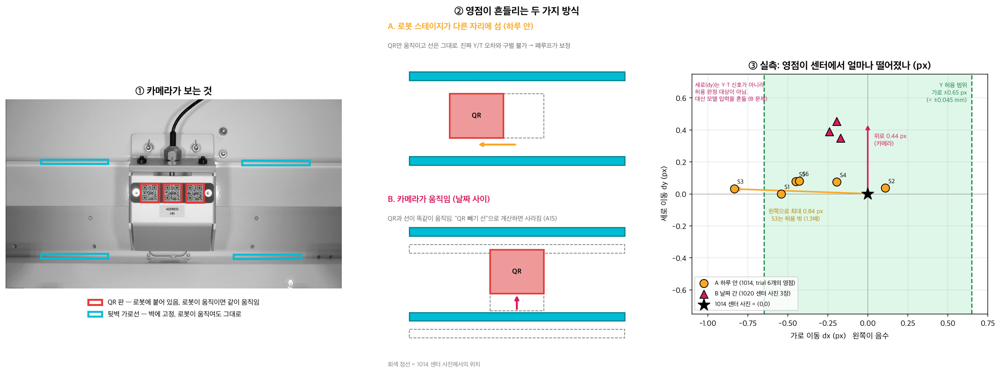
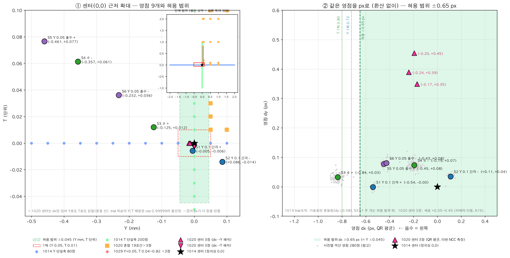

# 영점 분석 — 센터 (0,0)은 실제로 어디에 있나

작성 2026-11-04 · 대상: 팀원 (px·틱 단위를 처음 보는 사람 기준)

## 1. 영점 문제란 무엇인가

**영점 = 명령 (0,0)일 때 QR 판이 실제로 서는 자리.** 우리는 10월 14일 센터 사진 1장을 (0,0)으로 *정의*했다. 모든 추정은 "이 사진에서 몇 px 움직였나"로 잰다.

그런데 같은 명령 0이라도 판은 같은 자리에 서지 않는다.
- **A. 로봇 스테이지가 조금 다른 자리에 선다** (하루 안에서도). 기어 틈(백래시)과 시간 드리프트 때문이다.
- **B. 날짜가 바뀌면 카메라와 판의 관계가 바뀐다.** 카메라가 미세하게 움직인다.

그래서 센터 사진 1장은 "낡은 기준"이 되고, 그 위에서 잰 모든 Y/T에 같은 오프셋이 들어간다.

- ① 카메라가 보는 것: 빨강 QR은 로봇에 붙어 있고, 하늘색 가로선은 뒷벽에 고정돼 있다.
- ② A는 QR만 움직인다. B는 QR과 선이 함께 움직인다. 이 차이로 둘을 가른다.
- ③ 실측. 초록 띠가 Y 허용 범위(가로 ±0.65 px = ±0.045 mm). 세로는 허용 판정 대상이 아니다. 노랑(A)은 왼쪽으로 최대 0.84 px, 분홍(B)은 위로 0.44 px.

## 2. 단위

| 1틱 | px | 허용오차 ±0.045 |
|---|---|---|
| Y 0.05 mm | 0.72 px (14.36 px/mm) | 0.65 px |
| T 0.01 | 0.80 px (80.3 px/단위) | 3.6 px |

## 3. 영점이 얼마나 흔들리나 — 가진 영점 10개

| 영점 | 출처 | dx (px) | dy (px) | Y 환산 (mm) | T 환산 | 허용 0.65px |
|---|---|---|---|---|---|---|
| 1014 센터 | 사진 1장, 기준 | 0 | 0 | 0 | 0 | 정의 |
| 1020 center1 | 사진, 명령 (0,0) | −0.17 | **+0.35** | −0.012 | −0.002 | 통과 (dx) |
| 1020 center2 | 〃 | −0.24 | **+0.39** | −0.017 | −0.003 | 통과 |
| 1020 center3 | 〃 | −0.20 | **+0.45** | −0.014 | −0.002 | 통과 |
| S1 Y+ | 1014 trial 외삽 | −0.54 | 0.00 | −0.038 | −0.007 | 통과 (0.83배) |
| S2 Y− | 〃 | +0.11 | +0.04 | +0.008 | +0.001 | 통과 |
| S3 T+ | 〃 | **−0.84** | +0.03 | −0.058 | −0.010 | **초과 (1.3배)** |
| S4 T− | 〃 | −0.19 | +0.07 | −0.013 | −0.002 | 통과 |
| S5 Y+ | 〃 | −0.45 | +0.08 | −0.031 | −0.006 | 통과 |
| S6 Y− | 〃 | −0.43 | +0.08 | −0.030 | −0.005 | 통과 |

- 1014 하루 안 범위: dx **0.95 px** (Y 0.066 mm, 1.3틱), dy ≤ 0.08
- 1020 센터 3장끼리 산포: dx 0.07, dy 0.10 px (QR 영역 NCC로 이번에 잰 값, 정식 실험 아님)
- 같은 자리 반복 3장: dx SD 0.085 (측정잡음 0.009의 10배 → 판이 실제로 움직임), dy SD 0.0055
- 1020 → 1029: 거의 0 (dx 0.006)

> [!Summary]
> **A 하루 안 가로(≤0.84 px, 허용의 1.3배)** 는 스테이지 백래시·드리프트. 폐루프가 보정한다.
> **B 날짜 간 세로(+0.44 px)** 는 카메라 쪽. 센터 사진이 낡아지는 문제라 폐루프로 못 고친다.
> 둘 다 "센터 1장 고정"이 흡수 못 하는 양이고, 절대위치는 ±0.03 mm 불확실하다.

## 4. 상세 그래프

왼쪽: Y–T 평면 (0,0) 근처 확대. 초록 = 허용 범위, 빨간 점선 = 1틱. 오른쪽: 같은 영점을 환산 없이 px로. Y·T 열의 cos가 0.99999라 Y/T 배분이 불안정하므로 **px 쪽이 더 믿을 만하다.**

- 가로(dx)로 흔들리고 거의 다 음수(왼쪽). 세로는 하루 안 0.08 px 이하.
- 구조가 있다. **백래시 + 시간 드리프트** 두 항으로 Y 잔차 27 → 1.7 µm (16배). β: Y −0.34 px, T −0.48 px. 드리프트: Y +0.004, T −0.025 px/분.
- 날짜 간 dy +0.44는 어떤 명령도 dy를 만들지 않으므로 로봇이 아니라 카메라·거치대 변화. 세션 내 dy 변동의 81배.

| 종류 | 크기 | 원인 | 폐루프 흡수 |
|---|---|---|---|
| A 하루 안 가로 | ≤0.84 px, 1.2틱 | 스테이지 백래시·드리프트 | **함** (비전이 0이라 할 때까지) |
| B 날짜 간 세로 | 0.44 px | 카메라·판 설치 변화 | **못 함** (센터 재촬영 또는 선 기준 보정) |

## 5. 상쇄·예측 방법론

| 영점 종류 | 상쇄 되나 | 방법 | 상태 |
|---|---|---|---|
| B 날짜 간 카메라 이동 | **됨** | QR − 뒷벽 선 (ASM US7248931) | A15 확인: 0.44 → 0.04 px. 선을 이미 쓰는 joint엔 효과 0, **control(QR만)엔 날짜 일반화 3.3배** |
| A 하루 안 스테이지 | 안 됨 / 불필요 | 실제 위치 변화라 Y 신호와 같은 것. 폐루프가 보정 | 라벨(명령값)이 실제와 다른 문제로만 남음 → 방향+시간으로 예측 (5방법 ①) |
| Y↔T 분리 | 원리상 됨 | 평면 정렬 후 잔여 시차 (Irani 1997) | 가로선은 세로만 재서 Y 시차(가로)를 못 봄 → **세로 구조물 필요 (B4)** |

현재 control의 6절편 후보는 A의 예측을 "학습된 6개 중 고르기"로 흉내 낸 것이다. 직전 이동 방향·경과 시간을 입력으로 주면 후보 선택이 필요 없어진다(접근 방향을 고정하면 백래시 항은 사라진다, Omron US9424646).

> [!Warning] 재확인 필요
> A15는 뒷벽 선이 +0.49 px 움직였다고 보고했다. 이번에 긴 선 상자 NCC로 거칠게 재 보니 +0.03~0.12였다. A15의 프로파일 정합이 맞을 가능성이 높지만 "카메라가 움직였다"는 B 판정의 핵심 숫자이므로 B1 촬영 전에 다시 잰다.

## 6. 다음 작업

1. A15 보정을 `control()`에 적용 (날짜 일반화 3.3배, 가장 싸고 확실)
2. 1014 trial 원점을 "직전 방향 + 경과 시간" 2파라미터로 회귀해 6후보를 대체할 수 있는지 확인
3. B1 촬영 설계에 정지 대기 시간별 반복, 단방향 접근 추가
4. A15 선 이동량 재확인

## 출처
- [trial 원점 절편외삽](../../../../experiments/hye/20261022_1750_trial원점_절편외삽역산/결과/보고서.md)
- [0점 정렬 5방법](../../../../experiments/hye/20261014_1313_정답값0점오차_0점정렬5방법/결과/보고서.md)
- [A1 반복잡음·세션영점](../../../../experiments/hye/20261102_125341_A1_반복잡음과세션영점_공분산과유효점수/결과/보고서.md)
- [A15 선을 영점 기준으로](../../../../experiments/hye/20261102_170138_A15_선을영점기준으로_ASM방식/결과/보고서.md)
