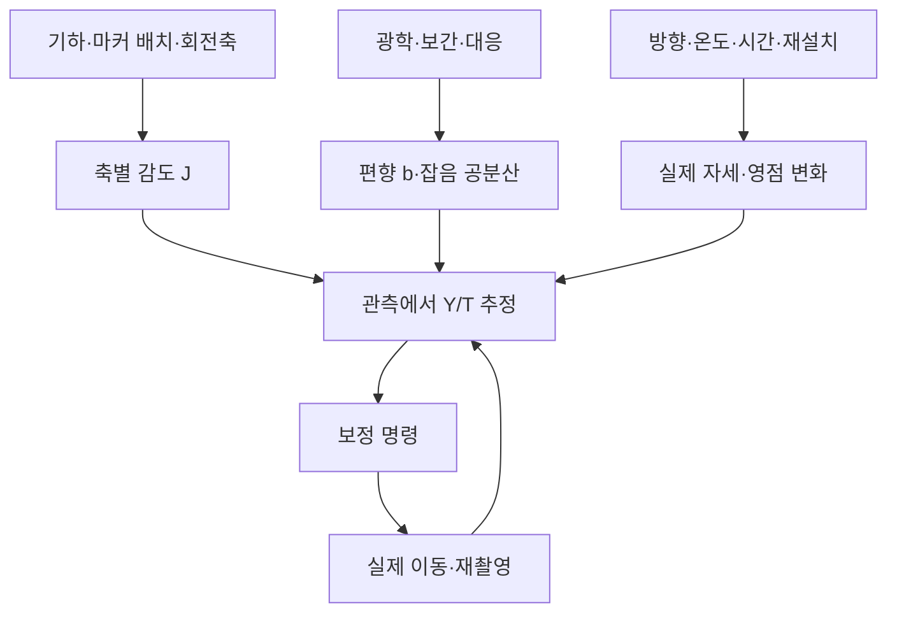

# 원인분석 — 상황·문제·해결의 통합 비교 v2

작성: 2026-10-30 · 논문 15편 + 특허 8건 = 등록 23개

[논문 15편 개별 분석](논문/00001_심층비교분석_v2.md) · [특허 8건 개별 분석](특허/00001_심층비교분석_v2.md) · [전체 종합 v2](../../00000_문헌연구_종합_결과보고_v2.md)

## 1. 이 폴더에서 도출되는 결론

Y/T가 영상에서 비슷한 이동을 만드는 현상은 **관측 기하의 약한 방향**, **측정 편향·잡음**, **축·카메라 관계의 미교정**, **기계 이력·영점 변화**를 나누어 설명해야 한다. 문헌은 이 네 원인의 가능성과 진단법을 제공한다. 어느 원인이 현재 장비에서 지배적인지는 신규 실측 없이 확정할 수 없다.

기존 QR-only 모델의 실패율만으로 모든 알고리즘의 한계를 증명할 수 없고, 높은 영상 정합 점수만으로 물리 축이 맞았다고 볼 수도 없다. 문헌 분석의 첫 산출물은 특정 알고리즘의 채택보다 **원인별 관측 예측을 비교하는 표**다.

## 2. 원인–증상–해결 매트릭스

| 원인군 | 어떤 상황인가 | 나타날 수 있는 문제 | 논문에서의 접근 | 특허의 대응 | SEMES에 필요한 수정 |
|---|---|---|---|---|---|
| 관측 감도 공선성 | 평면·협소 시야·비슷한 영상 운동 | 서로 상쇄하는 Y/T 조합이 약하게 관측됨 | Daniilidis·Young·Adiv·Szeliski의 감도/정보 분석 | 두 기준점·다중 시야·시험 이동 | 축/잡음 단위 정규화 후 QR·선의 독립 정보량 확인 |
| 평면 자세 후보 모호성 | 약원근에 가까운 평면 영상 | 두 후보가 비슷한 재투영 오차 | Oberkampf·Schweighofer·IPPE | 기지 회전·중심 교정 등 추가 조건 | 한 후보를 임의 선택하지 않고 선·이동으로 판별 |
| 측정 편향·잡음 | 블러·포화·반복 패턴·렌즈 왜곡 | 구분 단서가 왜곡되거나 잡음에 묻힘 | 통계적 하한과 신호 모델 | SEMES 조명, Cognex 가중 관측 | 편향과 분산을 분리하고 점 간 공분산 포함 |
| 미교정 기구 | 회전축이 카메라 중심에서 떨어짐 | 회전에 병진 성분이 결합 | Chai의 공간 변환 교정 | Omron·Cognex·Kawasaki의 축/중심 탐색 | 실제 PAN 축과 투영을 포함한 모델 사용 |
| 기계 이력·드리프트 | 접근 방향·시간·온도·재장착 변화 | 같은 명령에도 영점이 달라짐 | Nordin의 백래시 모델 계열 | TEL 이중 실측, ASM 상대 기준 | 방향·시간을 교차하고 기준 자체의 변동 확인 |
| 제어 불안정 | 근사 감도와 반복 보정 | 영상은 가까워져도 축 잔차·진동 발생 | Chaumette·Malis의 서보 분석 | 순차 보정·재측정 | 추정 정확도와 실제 폐루프 성능 분리 |

## 3. 관측 모델과 비교의 기준

국소 관측을 열벡터 s, 두 축 상태를 q=[Y,T]ᵀ로 정의하면 다음을 분석 출발점으로 둔다.

\[
\Delta s = J\Delta q + b + \epsilon
\]

J는 실측 축 감도, b는 현재 모델로 설명하지 못한 편향, ε는 반복 변동이다. Y/T의 단위가 다르므로 임의 단위의 조건수만 비교하지 않는다. 작업 범위·허용오차로 축을 정규화하고, 반복 관측 공분산으로 백색화한 J의 최소 특이값을 비교한다. 잡음 공분산이 특이하거나 표본이 부족하면 그 추정의 안정화와 한계도 보고한다.

작은 특이값은 **국소 약한 조합**을 나타낸다. 두 개의 멀리 떨어진 자세 후보가 있다는 결과와 동일하지 않다. 한 후보 근방의 불확실성과 후보 사이 선택을 각각 검사한다.

## 4. 문헌이 충돌하는 것처럼 보이는 지점

**“평면 자세를 구할 수 있다”와 “회전·병진이 모호하다”**는 양립한다. 관측이 충분하고 보정·척도가 알려진 이론적 문제와, 실제 잡음·약원근에서 비슷한 후보가 남는 문제의 조건이 다르기 때문이다. 따라서 PnP 가능 여부로 판정하지 않고 후보 잔차 차이와 실제 축 오차를 확인한다.

**“두 점이면 회전과 병진을 나눈다”**는 해당 특허의 평면 좌표 기하에서 해석해야 한다. PAN 투영에서 두 점의 움직임이 독립인지 먼저 확인해야 한다. 평균·차이/간격 식을 그대로 적용하면 축 기울기나 깊이 차를 다른 축으로 오인할 수 있다.

**“가로선이 T에 반응하므로 시차다”**는 관측된 상관과 원인을 섞는다. 평면 정렬 뒤 비평면 잔차, 순수 회전 투영, 축 오프셋 때문에 회전에 동반되는 병진, 선 법선 방향만 보는 측정을 모두 비교한다. 상·하 선의 부호만으로 축 기울기를 확정하지 않는다.

**“영점 차이는 백래시다”** 역시 방향별 재현 시험이 필요하다. 카메라 고정·온도·촬영 세션·평면 기준 변동을 대안 원인으로 남긴다.

## 5. 인과관계와 경쟁 가설

가설 ID의 정의는 [마스터플랜](../../00001_문헌_심층분석_마스터플랜.md)을 따른다.

| 가설 | 연결 근거 | 경쟁 설명 | 판별 관측 | 현재 판단 |
|---|---|---|---|---|
| H01 감도 공선성 | Daniilidis·Young·Adiv·Szeliski | H07 왜곡·H12 영점 | 백색화 감도와 실제 축 오차의 약한 방향 | 이론 동기 있음, 장비 정량 검증 필요 |
| H02 복수 자세 | Oberkampf·Schweighofer·IPPE | 단일 해 근방의 큰 분산 | 두 후보의 자세 간격·우도·외부 기준 | 조건부 가능 |
| H03 관측 범위 | Baker·SEMES 두 기준점·FANUC | 점 수 증가 효과 | 같은 점 수·품질에서 분산 배치 대조 | 검증 후보 |
| H04/H05/H06 선 반응 | Irani·Chai·축 교정 특허 | 깊이·투영·축 오프셋 | 선 위치·깊이·축 방향을 포함한 변위장 | 경쟁 설명 유지 |
| H11 상관 잡음 | Young의 정보 분석 계열 | 독립 점 평균의 효과 | 정지 반복의 공분산·점 수별 분산 | 미측정 |
| H12/H13/H14 영점 | Nordin·TEL·ASM | 방향/온도/재설치 | 교차 반복과 고정 기준의 상대량 | 원인 미확정 |
| H17 제어 | Chaumette·Malis | 추정 자체 오류 | 추정값·실행량·재촬영·외부 잔차 로그 | 실제 폐루프 검증 필요 |

## 6. 우선 실험과 결과별 행동

1. **정지 반복:** 동일 자세에서 반복 촬영해 점·선의 편향 후보와 공분산을 구한다. 독립 점 가정이 깨지면 단순 점 수 확대보다 배치·가중을 비교한다.
2. **독립 축 스윕:** 같은 접근 조건의 Y-only/T-only에서 국소 J와 비선형 잔차를 추정한다. QR+선의 최소 특이값이 개선되면 그 관측을 우선한다.
3. **세션·방향 교차:** 정지 반복은 작지만 방향/날짜에 따라 잔차가 달라지면 정합기 변경보다 영점·기구 모델을 우선한다.
4. **후보 판별:** 두 자세 후보가 남으면 선·허용 탐색 이동의 판별력을 평가한다. 후보를 구분하지 못하면 단일 결과에 높은 신뢰도를 부여하지 않는다.

이 문서는 기존 문헌 기록의 비교·해석 결과다. 이번 작성으로 위 실험을 수행하거나 원인 하나를 확정한 것은 아니다.
