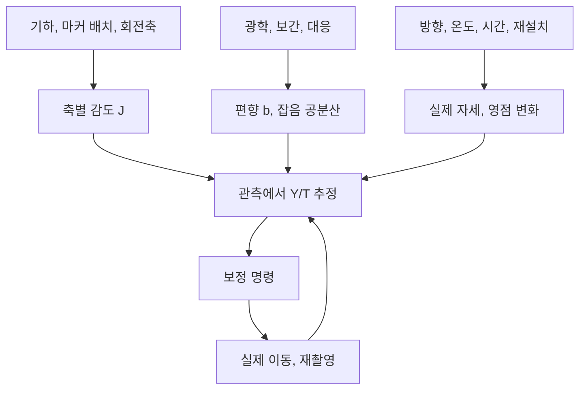

# 원인분석: 상황, 문제, 해결의 통합 비교 v3

작성 2026-10-30 (v2), 갱신 2026-11-02 (v3, 7절 실측 결과 추가). 논문 15편 + 특허 8건 = 등록 23개

[논문 15편 개별 분석](논문/00001_심층비교분석_v2.md), [특허 8건 개별 분석](특허/00001_심층비교분석_v2.md), [전체 종합 v2](../../00000_문헌연구_종합_결과보고_v2.md)

## 1. 이 폴더에서 도출되는 결론

Y/T가 영상에서 비슷한 이동을 만드는 현상은 **관측 기하의 약한 방향**, **측정 편향과 잡음**, **축, 카메라 관계의 미교정**, **기계 이력, 영점 변화**를 나누어 설명해야 한다. 문헌은 이 네 원인의 가능성과 진단법을 제공한다. 어느 원인이 현재 장비에서 지배적인지는 신규 실측 없이 확정할 수 없다.

기존 QR-only 모델의 실패율만으로 모든 알고리즘의 한계를 증명할 수 없고, 높은 영상 정합 점수만으로 물리 축이 맞았다고 볼 수도 없다. 문헌 분석의 첫 산출물은 특정 알고리즘의 채택보다 **원인별 관측 예측을 비교하는 표**다.

## 2. 원인–증상–해결 매트릭스

| 원인군 | 어떤 상황인가 | 나타날 수 있는 문제 | 논문에서의 접근 | 특허의 대응 | SEMES에 필요한 수정 |
|---|---|---|---|---|---|
| 관측 감도 공선성 | 평면, 협소 시야, 비슷한 영상 운동 | 서로 상쇄하는 Y/T 조합이 약하게 관측됨 | Daniilidis, Young, Adiv, Szeliski의 감도/정보 분석 | 두 기준점, 다중 시야, 시험 이동 | 축/잡음 단위 정규화 후 QR, 선의 독립 정보량 확인 |
| 평면 자세 후보 모호성 | 약원근에 가까운 평면 영상 | 두 후보가 비슷한 재투영 오차 | Oberkampf, Schweighofer, IPPE | 기지 회전, 중심 교정 등 추가 조건 | 한 후보를 임의 선택하지 않고 선, 이동으로 판별 |
| 측정 편향과 잡음 | 블러, 포화, 반복 패턴, 렌즈 왜곡 | 구분 단서가 왜곡되거나 잡음에 묻힘 | 통계적 하한과 신호 모델 | SEMES 조명, Cognex 가중 관측 | 편향과 분산을 분리하고 점 간 공분산 포함 |
| 미교정 기구 | 회전축이 카메라 중심에서 떨어짐 | 회전에 병진 성분이 결합 | Chai의 공간 변환 교정 | Omron, Cognex, Kawasaki의 축/중심 탐색 | 실제 PAN 축과 투영을 포함한 모델 사용 |
| 기계 이력, 드리프트 | 접근 방향, 시간, 온도, 재장착 변화 | 같은 명령에도 영점이 달라짐 | Nordin의 백래시 모델 계열 | TEL 이중 실측, ASM 상대 기준 | 방향, 시간을 교차하고 기준 자체의 변동 확인 |
| 제어 불안정 | 근사 감도와 반복 보정 | 영상은 가까워져도 축 잔차, 진동 발생 | Chaumette, Malis의 서보 분석 | 순차 보정, 재측정 | 추정 정확도와 실제 폐루프 성능 분리 |

## 3. 관측 모델과 비교의 기준

국소 관측을 열벡터 s, 두 축 상태를 q=[Y,T]ᵀ로 정의하면 다음을 분석 출발점으로 둔다.

\[
\Delta s = J\Delta q + b + \epsilon
\]

J는 실측 축 감도, b는 현재 모델로 설명하지 못한 편향, ε는 반복 변동이다. Y/T의 단위가 다르므로 임의 단위의 조건수만 비교하지 않는다. 작업 범위, 허용오차로 축을 정규화하고, 반복 관측 공분산으로 백색화한 J의 최소 특이값을 비교한다. 잡음 공분산이 특이하거나 표본이 부족하면 그 추정의 안정화와 한계도 보고한다.

작은 특이값은 **국소 약한 조합**을 나타낸다. 두 개의 멀리 떨어진 자세 후보가 있다는 결과와 동일하지 않다. 한 후보 근방의 불확실성과 후보 사이 선택을 각각 검사한다.

## 4. 문헌이 충돌하는 것처럼 보이는 지점

**“평면 자세를 구할 수 있다”와 “회전과 병진이 모호하다”**는 양립한다. 관측이 충분하고 보정, 척도가 알려진 이론적 문제와, 실제 잡음, 약원근에서 비슷한 후보가 남는 문제의 조건이 다르기 때문이다. 따라서 PnP 가능 여부로 판정하지 않고 후보 잔차 차이와 실제 축 오차를 확인한다.

**“두 점이면 회전과 병진을 나눈다”**는 해당 특허의 평면 좌표 기하에서 해석해야 한다. PAN 투영에서 두 점의 움직임이 독립인지 먼저 확인해야 한다. 평균, 차이/간격 식을 그대로 적용하면 축 기울기나 깊이 차를 다른 축으로 오인할 수 있다.

**“가로선이 T에 반응하므로 시차다”**는 관측된 상관과 원인을 섞는다. 평면 정렬 뒤 비평면 잔차, 순수 회전 투영, 축 오프셋 때문에 회전에 동반되는 병진, 선 법선 방향만 보는 측정을 모두 비교한다. 상하 선의 부호만으로 축 기울기를 확정하지 않는다.

**“영점 차이는 백래시다”** 역시 방향별 재현 시험이 필요하다. 카메라 고정, 온도, 촬영 세션, 평면 기준 변동을 대안 원인으로 남긴다.

## 5. 인과관계와 경쟁 가설

가설 ID의 정의는 [마스터플랜](../../00001_문헌_심층분석_마스터플랜.md)을 따른다.

| 가설 | 연결 근거 | 경쟁 설명 | 판별 관측 | 현재 판단 |
|---|---|---|---|---|
| H01 감도 공선성 | Daniilidis, Young, Adiv, Szeliski | H07 왜곡, H12 영점 | 백색화 감도와 실제 축 오차의 약한 방향 | 이론 동기 있음, 장비 정량 검증 필요 |
| H02 복수 자세 | Oberkampf, Schweighofer, IPPE | 단일 해 근방의 큰 분산 | 두 후보의 자세 간격, 우도, 외부 기준 | 조건부 가능 |
| H03 관측 범위 | Baker, SEMES 두 기준점, FANUC | 점 수 증가 효과 | 같은 점 수, 품질에서 분산 배치 대조 | 검증 후보 |
| H04/H05/H06 선 반응 | Irani, Chai, 축 교정 특허 | 깊이, 투영, 축 오프셋 | 선 위치, 깊이, 축 방향을 포함한 변위장 | 경쟁 설명 유지 |
| H11 상관 잡음 | Young의 정보 분석 계열 | 독립 점 평균의 효과 | 정지 반복의 공분산, 점 수별 분산 | 미측정 |
| H12/H13/H14 영점 | Nordin, TEL, ASM | 방향/온도/재설치 | 교차 반복과 고정 기준의 상대량 | 원인 미확정 |
| H17 제어 | Chaumette, Malis | 추정 자체 오류 | 추정값, 실행량, 재촬영, 외부 잔차 로그 | 실제 폐루프 검증 필요 |

## 6. 우선 실험과 결과별 행동

1. **정지 반복:** 동일 자세에서 반복 촬영해 점, 선의 편향 후보와 공분산을 구한다. 독립 점 가정이 깨지면 단순 점 수 확대보다 배치, 가중을 비교한다.
2. **독립 축 스윕:** 같은 접근 조건의 Y-only/T-only에서 국소 J와 비선형 잔차를 추정한다. QR+선의 최소 특이값이 개선되면 그 관측을 우선한다.
3. **세션, 방향 교차:** 정지 반복은 작지만 방향/날짜에 따라 잔차가 달라지면 정합기 변경보다 영점, 기구 모델을 우선한다.
4. **후보 판별:** 두 자세 후보가 남으면 선, 허용 탐색 이동의 판별력을 평가한다. 후보를 구분하지 못하면 단일 결과에 높은 신뢰도를 부여하지 않는다.

이 문서는 기존 문헌 기록의 비교, 해석 결과다. 이번 작성으로 위 실험을 수행하거나 원인 하나를 확정한 것은 아니다.

## 7. 실측 결과 (2026-11-02)

6절의 실험을 실제로 돌린 결과다. 위 1절부터 6절까지는 문헌 비교의 결론이고, 이 절은 그 비교가 예측한 것을 장비 자료로 확인한 기록이다.

### 7.1 무엇을 돌렸나

| 항목 | 내용 |
|---|---|
| 실행일 | 2026-11-02 |
| 자료 | 575장 (clean_20261014 281, clean_20261020 60, clean_20261029 234), 조건 묶음 379개 |
| 정답 | 파일명 명령값 (Y mm, T 명령단위) |
| 측정 | 채택 측정기 그대로. center.bmp 기준 고정 630점 (선택 536점) NCC + 피라미드 LK + 스플라인 GN, 위아래 가로선 48블록 법선 프로파일 |
| 허용 절대오차 | 한 장 ±0.045 (5회 반복 정밀도 0.09의 절반), 판정용 "작다" 경계 0.015 |
| 코드 | C++17, OpenCV 3.4.15, MSVC v141. 실험 17건 (A0부터 A16) 전부 다시 빌드하고 다시 실행 |
| 재현성 | A0 측정 캐시 재실행 결과가 이전 실행과 바이트 동일 (disp.f32 md5 일치), 측정 실패 0장 |

실험 색인: [20261102_142904_실험색인.md](../../../../../experiments/hye/20261102_142904_실험색인.md)

6절의 번호와 실제 실험의 대응은 다음과 같다.

| 6절 실험 | 실제 실험 | 비고 |
|---|---|---|
| 1. 정지 반복 | A1 반복잡음과 세션영점 | 반복 2장 이상 묶음 98개로 수행 |
| 2. 독립 축 스윕 | A2 YT 식별성, A13 물리모형 자기보정 | 1014의 Y 단독 80장, T 단독 200장 사용 |
| 3. 세션, 방향 교차 | A3 날짜 fold 대조, A9 영점 증강 | 날짜 교차만 가능. 방향 교차는 자료 없음 (B2 대기) |
| 4. 후보 판별 | A6 모델 대조, A7 탐색 이동, A14 호모그래피 분해 | A14에서 후보 개수와 간격까지 쟀다 |
| (추가) 문헌 방법 직접 시험 | A14 호모그래피 분해와 왜곡, A16 특허 두 건 | 문헌과 특허의 방법을 그대로 구현해 성적을 냈다 |
| (추가) 선을 영점 기준으로 | A15 ASM 방식 | 날짜 영점을 선으로 상쇄하는 시도 |

### 7.2 2절 원인군별 판정

| 원인군 | 판정 | 핵심 실측값 | 근거 실험 |
|---|---|---|---|
| 관측 감도 공선성 | **성립 (기전 확인)** | 오차 주축이 dY = -5.617 dT 와 이루는 각 0.18도, 오차 상관 r = -0.914 | A2, A3 |
| 평면 자세 후보 모호성 | **성립 (후보는 실재한다)** | 호모그래피 분해에서 519장 전부 후보가 2개 이상, 두 후보의 Y 차이 중앙값 0.8683 mm, 최대 5.2360 mm | A14 |
| 측정 편향, 잡음 | **상관은 성립, 위상 편향은 기각** | 점별 잡음 0.0087 px인데 유효 독립 차원 N_eff 18.86 / 536 (3.5%). 부화소 위상 편향의 Y 환산 0.00602 mm | A1, A5 |
| 미교정 기구 | **성립 (회전 투영)** | 가로선 T 반응에서 회전 투영 모델이 단순 모델보다 AIC 251.1 낮음. 유도 회전반경 315.9 mm | A4, A13 |
| 기계 이력, 드리프트 | **세션 영점은 기각, 날짜 일반화는 실패** | 날짜 간 판 이동 Y 환산 0.0173 mm (기각선 미만). 날짜 fold 통과율 46.9% 대 혼합 fold 95.7% | A1, A3, A9 |
| 제어 불안정 | **미검증 (오프라인만)** | 오프라인 짝의 약한 방향 SD 비 0.808 (절반 이하 아님) | A7, A8 |

### 7.3 3절 관측 모델의 실측값

3절이 제안한 대로 축을 정규화하고 반복 관측 공분산으로 백색화한 뒤 약한 방향을 냈다. 결과는 **약한 방향이 문헌이 예측한 바로 그 방향**이고, **그 방향의 정보량 자체는 허용오차에 비해 부족하지 않다**는 것이다.

| 관측 조건 | sigma_Y (mm) | sigma_T | 약한 방향 sigma | 약한 방향 각도 | 조건수 |
|---|---|---|---|---|---|
| QR만 (536점) | 0.01224 | 0.00218 | 0.01243 | 0.00도 | 7,267,529 |
| QR + 위 선 | 0.01110 | 0.00197 | 0.01127 | 0.00도 | 5,971,334 |
| QR + 아래 선 | 0.01121 | 0.00200 | 0.01139 | 0.00도 | 6,093,621 |
| QR + 양쪽 선 | 0.01076 | 0.00191 | 0.01093 | 0.00도 | 5,611,688 |
| QR만, 아핀 미제거 잔차 | 0.11040 | 0.01969 | 0.11214 | 0.00도 | 8,981 |
| QR + 양쪽 선, 아핀 미제거 잔차 | 0.02299 | 0.00395 | 0.02330 | 0.75도 | 419 |

읽는 법이 두 가지로 갈린다. 이 갈림이 이 절에서 가장 중요하다.

- **측정 잡음만 넣으면** 약한 방향 sigma 0.01093 < 0.015 이므로 정보는 충분하다. 그러면 남은 문제는 분산이 아니라 **편향 b** 쪽이다.
- **반복 촬영 사이 판이 실제로 움직인 양까지 넣으면** 0.02330 > 0.015 이므로 정보가 부족하다. 아핀 제거가 J가 사는 부분공간을 같이 지우므로 위쪽 값들은 낙관적인 하한이다.

A1이 잰 판 실제 이동량(반복 3장 사이 dx SD 0.0852 px)이 측정 잡음(0.0087 px)의 약 10배다. 따라서 **현재 자료로는 두 번째 읽기가 실제에 가깝고, 약한 방향의 정보 부족이 남아 있다고 보는 쪽이 안전하다.** 다만 반복 3장 사이에 로봇을 다시 움직였는지 촬영 기록이 없어 그 변동이 재현 오차인지 드리프트인지는 가를 수 없다.

3절이 경계한 대로, 작은 특이값과 "멀리 떨어진 두 자세 후보"는 별개다. 둘 다 실재하는 것으로 나왔다. A14에서 호모그래피를 분해하니 519장 전부 후보가 2개 이상 남았고 두 후보의 Y 차이가 중앙값 0.8683 mm, 최대 5.2360 mm였다. 허용오차 0.045 mm의 19배에서 116배다. 다만 현재 채택 모델은 후보를 만들지 않는 회귀이므로 이 모호성이 그대로 성적에 들어오지는 않는다.

### 7.4 4절 충돌 지점의 결판

| 4절의 명제 | 실측 결과 |
|---|---|
| "평면 자세를 구할 수 있다"와 "회전, 병진이 모호하다" | 양립이 확인됐다. 자세는 구해지지만(혼합 fold 통과율 95.7%) 남은 오차는 전부 약한 방향으로 몰린다(r = -0.914, 0.18도). |
| "두 점이면 회전과 병진을 나눈다" | **현 장비에서는 성립하지 않는다.** QR만 쓰는 관측은 혼합 fold 통과율 24.6%, 날짜 fold 14.2%다. QR에 가로선 48블록을 더해야 95.7%, 46.9%가 된다. 536점을 써도 QR 영역만으로는 부족하다. |
| "가로선이 T에 반응하므로 시차다" | **시차가 아니라 회전 투영이다.** 깊이 시차 모델(H04)은 Y 감도가 선 측정 잡음의 2.3배로 판정선 3배에 못 미쳤다. T축에서 회전 투영 모델(H05)이 깊이 시차와 롤 모델보다 AIC 251.1 낮고, 위아래 선의 기울기 부호가 반대(-1.524, +2.741)로 나왔다. 부호 반대는 회전 투영의 예측이다. |
| "영점 차이는 백래시다" | **보류.** 날짜 간 판 이동의 Y 환산은 0.0173 mm로 판정선 0.015를 넘지만 dx 흩어짐의 2.89배로 3배 기준에 못 미쳤다. 같은 명령을 날짜만 바꿔 찍은 자료가 없어 직접 비교가 불가능하다. 방향별 재현 시험(B2)이 필요하다는 4절의 요구는 그대로 남는다. |

### 7.5 5절 가설표 갱신

| 가설 | v2의 현재 판단 | 2026-11-02 실측 판정 | 판정 근거 |
|---|---|---|---|
| H01 감도 공선성 | 이론 동기 있음, 장비 정량 검증 필요 | **성립** | 오차 상관 -0.914, 주축 각 0.18도 (A3) |
| H02 복수 자세 | 조건부 가능 | **성립** | 519/519 장에서 후보 2개 이상, Y 차이 중앙값 0.8683 mm (A14) |
| H03 관측 범위 | 검증 후보 | **약하게 성립** | 바깥 절반 sigma_Y 0.01649 대 안쪽 0.02072 (A2) |
| H04 깊이 시차 | 경쟁 설명 유지 | **지지 안 됨** | Y 감도 0.05999 px, 잡음의 2.3배 (A4) |
| H05 회전 투영 | 경쟁 설명 유지 | **채택** | AIC 차 251.1, 위아래 기울기 부호 반대 (A4) |
| H06 축 기울기 | 경쟁 설명 유지 | **Y축은 보류** | Y축 AIC 차 3.7로 판정선 10 미만 (A4) |
| H08 부화소 위상 | (5절 미등재) | **기각** | Y 추정 주기 성분 0.00602 mm < 0.015 (A5) |
| H11 상관 잡음 | 미측정 | **성립** | N_eff 18.86 / 536 (A1) |
| H12 세션 영점 | 원인 미확정 | **기각** | 두 경로 모두 판정선 미달 (A1) |
| H13, H14 방향, 온도 | 원인 미확정 | **미검증** | 자료 없음 (B2, B3 대기) |
| H15 정규화 부족 | (5절 미등재) | **기각** | Ridge, 백색화 Ridge 모두 대조보다 최대오차 증가 (A6) |
| H16 탐색 이동 | (5절 미등재) | **부분 성립** | 오프라인 짝 SD 비 0.808 (A7) |
| H17 제어 | 실제 폐루프 검증 필요 | **미검증** | 실기 운전 자료 없음 (B5 대기) |
| H18 평가 누수 | (5절 미등재) | **성립** | 혼합 95.7% 대 날짜 46.9%, 차 48.8%p (A3) |

### 7.6 2절 "SEMES에 필요한 수정" 열의 결과

| v2가 요구한 수정 | 수행 | 결과 |
|---|---|---|
| 축, 잡음 단위 정규화 후 QR과 선의 독립 정보량 확인 | 했다 (A2) | 선을 더하면 약한 방향 sigma 0.01243에서 0.01093으로 개선. 실제 통과율은 24.6%에서 95.7%로 개선 |
| 한 후보를 임의 선택하지 않고 선, 이동으로 판별 | 측정만 했다 (A14) | 후보는 519장 전부에서 2개 이상 나왔고 Y 차이가 중앙값 0.8683 mm다. 선이나 탐색 이동으로 고르는 판별기는 아직 만들지 않았다 |
| 편향과 분산을 분리하고 점 간 공분산 포함 | 했다 (A1, A6) | 공분산 가중(백색화 Ridge)은 통과율 95.2%로 대조 95.7%보다 낫지 않았다. 점 간 공분산이 있다는 것은 확인했으나 그것을 가중에 넣어도 성적은 안 올랐다 |
| 실제 PAN 축과 투영을 포함한 모델 사용 | 했다 (A13) | 제약 2차 모형으로 f 4492 px, 주점 (1919, 1097), Z 315.3 mm, 등가 회전반경 315.9 mm, T 1 명령단위 = -1.0187도를 얻었다. 문헌 정리 식 (7)의 322 mm와 2% 차이. 다만 x^2 계수와 xy 계수의 비가 0.9345(모형이 맞으면 1)이고 1차항, 상수항이 0이 아니어서 모형이 완전히 맞지는 않는다. 물리 전방 역해 추정기(A6 M3)는 통과율 52.7%로 회귀 모델보다 낮다 |
| 방향, 시간을 교차하고 기준 자체의 변동 확인 | 날짜만 했다 | 날짜 교차에서 통과율이 95.7%에서 46.9%로 떨어진다. 방향, 시간 교차는 자료가 없다 |
| 추정 정확도와 실제 폐루프 성능 분리 | 못 했다 | 실기 운전 기록이 없다 |

### 7.6-1 문헌과 특허 방법을 그대로 돌린 성적

v2가 인용만 했던 방법들을 구현해서 같은 자료로 돌렸다.

| 방법 | 출처 | 학습량 | 장수 | Y 평균 | Y 최대 | 통과 ±0.045 |
|---|---|---|---|---|---|---|
| 호모그래피 분해 | Malis, IPPE 계열 (A14) | 척도와 절편 2개만 | 519 | 1.6945 | 12.6226 | 0.0250 |
| 기준 모델 66d (대조) | 진단용 대리 모델 | fold마다 66x2 계수 | 562 | 0.0171 | 0.1927 | 0.9573 |

호모그래피 분해는 T는 거의 맞힌다 (명령 대비 기울기 0.9008, 잔차 RMS 0.0244도). Y는 맞히지 못한다 (기울기 -0.1586, 부호까지 반대). 즉 **회전은 물리만으로 복원되지만 병진은 복원되지 않는다.** 이것이 2절 "관측 감도 공선성"의 가장 직접적인 증거다.

선을 날짜 영점의 기준으로 쓰는 ASM 방식(A15)은 효과가 없었다.

| 특징 | 혼합 4-fold 통과 | 날짜 3-fold 통과 |
|---|---|---|
| V0 기준 QR + 선 66d | 0.9573 | 0.4689 |
| V1 선 평균을 뺀 QR 세로 | 0.9573 | 0.4689 |
| V2 위아래 선 평균을 뺀 QR 세로 | 0.9573 | 0.4689 |
| V4 QR만 18d + 선 평균 세로 보정 | 0.2509 | 0.1847 |
| V5 QR만 18d + 선 세로와 가로 보정 | 0.1406 | 0.0480 |

V1과 V2가 V0과 소수점 네 자리까지 같다. 66차원 선형 모델 안에서는 선을 빼든 안 빼든 같은 부분공간이라 결과가 바뀌지 않는다. 진단(A15 1절)에서는 1020과 1014 사이에 선도 0.4863 px 움직여 카메라 쪽 성분이 있었지만, 1020과 1029 사이에는 선이 0.0039 px로 사실상 안 움직였다. **날짜 영점 차이를 선으로 상쇄할 수 있는 경우와 없는 경우가 섞여 있다.**

특허 두 건(A16)은 성적이 아니라 물리량을 냈다. 조건 쌍 42,463개에서 등가 회전 반경 316.0 mm가 나와 A13의 315.9 mm, 문헌 식 (7)의 322 mm와 맞는다. Kawasaki의 대칭과 극값으로 찾은 주점 x0은 1882.2로 최소제곱의 1919.0과 36.8 px 차이다. Cognex의 1/tan(각/2) 관계로 보면 T 범위를 현재 1.0에서 22.1로 넓혀야 중심 오차가 1/22로 준다.

### 7.7 이 결과로 바뀌는 것

1. **가로선의 성격이 확정됐다.** 보조 선은 깊이 시차가 아니라 회전 투영을 보는 관측이다. 따라서 선을 "QR 보조"가 아니라 **T의 주 관측**으로 다루는 쪽이 모델 구조와 맞는다. QR만 24.6% 대 QR + 선 95.7%의 차이가 이것으로 설명된다.
2. **약한 방향은 설계로 줄여야 한다.** 추정기 쪽 손질(Ridge, 백색화, 2차항, PCA, 물리 역해 7종)은 전부 대조보다 낫지 않았다. 남은 지렛대는 관측 배치와 촬영 조건이다.
3. **가장 큰 미해결은 날짜 일반화다.** 혼합 fold 95.7%와 날짜 fold 46.9%의 48.8%p 차이가 현재 가장 큰 단일 격차다. 그런데 세션 영점(H12)은 기각됐고 영점 증강(A9)도 효과가 없었다. **원인이 아직 특정되지 않은 채로 가장 크다.**
4. **품질 지표를 신뢰할 수 없다.** 정답을 쓰지 않는 지표 6종의 실제 오차 순위 상관이 최대 0.079였고, 예측 sigma로 나눈 z의 표준편차가 6.395였다. 사진 한 장을 보고 그 장의 추정이 위험한지 판정할 수단이 현재 없다.

### 7.8 한계

- 575장 전부 **개발에 노출된 자료**다. 이 절의 어떤 통과율도 독립 성능이 아니다. H18이 성립했다는 것 자체가 이 한계의 측정값이다.
- 7.2의 기준 모델(QR별 아핀 18 + 선 48 = 66차원)은 팀에 전달한 joint와 control 모듈이 **아니다.** fold마다 다시 학습해야 해서 만든 진단용 대리 모델이다. 전달 모듈의 재대입 성적은 joint 96.98%, control 52.58%다 (A10).
- "미검증"으로 적은 셋(H13 접근 방향, H14 온도, H17 폐루프)은 전부 **신규 촬영이나 실기 운전이 있어야** 한다. 현재 사진으로는 대신할 수 없다. H02는 후보가 실재한다는 것까지만 쟀고, 후보를 고르는 판별기는 아직 없다.
- 이 절은 원인 하나를 단독 원인으로 확정하지 않는다. 확정된 것은 가로선의 물리적 성격(H05)과 오차가 몰리는 방향(H01), 평면 자세 후보의 실재(H02), 점 간 잡음 상관(H11), 그리고 날짜 일반화 실패의 크기(H18)다.
