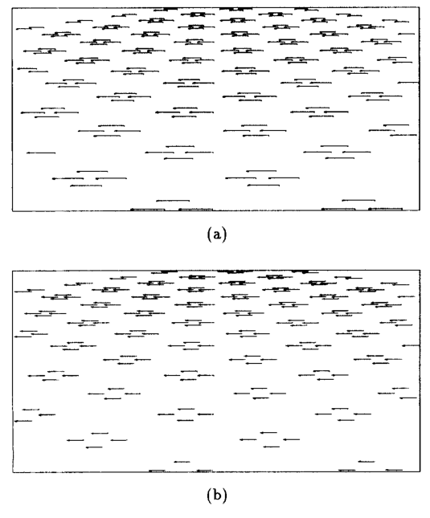
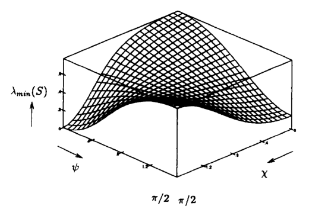
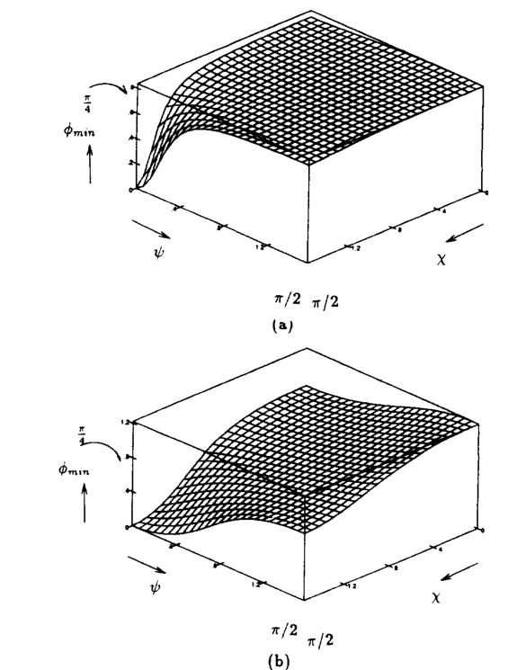
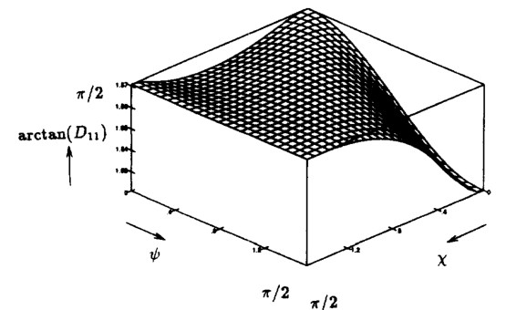

# 평면 운동 추정에서 회전과 평행이동의 결합 (Daniilidis 1993)

- 원제: The Coupling of Rotation and Translation in Motion Estimation of Planar Surfaces
- 원문: 같은 폴더의 `Daniilidis1993_CVPR_planar_motion.pdf` (Proc. IEEE CVPR 1993, pp. 188–193, 사용자 제공)
- 저자: Konstantinos Daniilidis (Institut für Algorithmen und Kognitive Systeme, Fakultät für Informatik, Universität Karlsruhe (TH)), Hans-Hellmut Nagel (Fraunhofer-Institut für Informations- und Datenverarbeitung (IITB), Karlsruhe)
- 번역 범위: 전문
- 그림: 원문 그림 4개를 `그림/`에 넣고 본문에서 처음 언급되는 곳에 삽입

## 초록

이 논문은 순간 운동장(instantaneous motion field)으로부터 평면의 3차원 운동과 법선(normal)을 추정할 때의 오차 민감도(error sensitivity)를 다룬다. 추정된 운동·구조 파라미터의 오차 공분산에 대한 크라메르-라오 하한(Cramér-Rao lower bound)이라는 통계 이론을 사용하며, 이로써 운동장에 가우스 잡음이 있다는 가정 아래 임의의 불편 추정기(unbiased estimator)에 대해 성립하는 결과를 유도할 수 있다. 얻은 하한 행렬을 측정 잡음, 시야(field of view)의 크기, 운동-기하 배치(motion-geometry configuration)에 대해 해석적으로 연구한다. 이 분석의 주된 결과는 평행이동과 회전 사이의 결합(coupling)이며, 이 결합은 시야와 평면의 기울기(slant)가 작아질수록, 그리고 평행이동이 시선 방향(viewing direction)에서 벗어날수록 심해진다. 부수적 결과로, 각 미지 운동 파라미터의 불확도(uncertainty) 한계가 평행이동과 평면 법선 사이의 각, 시야 크기, 관측 평면까지의 거리, 평행이동 크기와 맺는 관계를 얻었다.

## 1 서론 (Introduction)

단안 영상 시퀀스로부터의 3차원 운동·구조 추정은 둘 이상의 해가 존재하는 문제(모호성 문제, ambiguity problem)와 측정 잡음에 대한 높은 민감도로 어려움을 겪는다. 최근 모호성과 민감도 문제를 극복하기 위해 정성적(qualitative), 목적 지향적(purposive), 능동적(active) 비전이라는 최신 패러다임을 따르는 새로운 문제 정식화가 제시되었다. 그럼에도 이 문제들에 관한 질문은 여전히 열려 있으며, 우리의 노력은 제안된 기법이 언제 안정적으로 동작하고 언제 그렇지 않은지를 보장하기 위한 해석적 답을 찾는 데 있다.

우리는 단안 영상 시퀀스로부터의 3차원 운동 추정에서 고전적인 2단계 방식을 따른다. 첫 단계는 카메라와 환경 사이의 상대 운동으로 생기는 특징 대응(feature correspondence, 이산적 경우) 또는 광류 벡터(optical flow vector, 연속적 경우)를 계산하는 것이다. 둘째 단계는 — 이제부터 연속적 경우만 고려한다 — 평행이동 속도와 각속도, 그리고 장면 내 점들까지의 거리를 추정하는 것이다. 첫 단계 측정의 오차에 대한 둘째 단계의 오차 민감도가 우리 연구의 초점이다.

운동장 벡터가 대응되는 영상 내 모든 점에 대해, 일반적으로는 대응하는 3차원 점까지의 거리를 미지수로 도입해야 한다. 그러면 구조 추정치의 민감도와 추정 오차의 구조 의존성에 대한 연구는 해석적으로 다루기 어려워진다. 미지수의 수를 줄이기 위해 분석을 평면의 경우로 제한한다. 그러면 구조를 평면 법선의 방향을 나타내는 미지수 두 개만으로 기술할 수 있다. 평면과 카메라 사이의 거리는 잘 알려진 스케일 모호성(scale ambiguity) 때문에 평행이동 크기와 결합된다. 또한 운동장은 매우 특별한 형태를 얻는다. 영상점 위치에 대해 2차식이며 여덟 개의 파라미터로 완전히 기술된다. 운동장 측정값은 이 파라미터들에 선형으로 의존하며, 이 파라미터들은 평행이동 속도와 법선에 대해서는 쌍선형(bilinear), 각속도에 대해서는 선형이다.

평면의 3차원 운동과 법선에 대한 해법은 연속적 경우에 대해 [13]이, 이산적 경우에 대해 [18]이 처음 제시했다. 모든 접근은 운동장 방정식에서 직접 유도하거나 3 × 3 대칭 행렬의 특성방정식으로 얻은 3차 방정식의 해에 기반한다. 평행이동이 평면에 수직이 아니면 운동 파라미터와 법선에 대해 두 개의 해가 존재한다. 이 두 겹 모호성은 여러 번 증명되었다(최초는 [11]).

운동 추정에서 평면의 경우는 응용 면에서 특별한 관심 대상이다. 실외·실내 자율주행 차량 운전과 항공기 착륙 같은 항법 과제는 평평한 지면에 대한 카메라의 운동으로 생긴 운동장의 해석을 포함한다. 이 장(field)의 특별한 2차 형태 덕분에 장애물과 다른 움직이는 장면 요소를 검출할 수 있다. 조립 작업에서는 다면체 물체의 경우가 매우 흔하다. 로봇 매니퓰레이터는 그리퍼에 달린 카메라가 기록한 운동장을 이용해 물체의 평면 면을 향하는 궤적을 따라갈 수 있어야 한다.

운동 추정의 민감도는 실험적·해석적 연구의 대상이었다. Maybank [14]와 이후 Heeger와 Jepson [9]은 표면이 충분히 비평면적이면 오차 곡면의 최소점들이 평행이동 방향 단위구 위의 특정 선 근처에 놓인다는 것을 증명했다. 이 선은 단위구 위에서 평행이동 방향과 시선 방향에 해당하는 점들을 잇는다. Barron [2]과 Weng 등 [19]은 각각 출력 오차 증폭(output-error amplification)과 오차 분산을 입력 데이터 오차의 함수로 계산하는 방법을 보였으나, 이 의존성은 닫힌 형태가 아니라 절차로 주어진다. 이들은 합성 데이터를 이용해 넓은 시야, 움직이는 물체까지의 거리에 대한 평행이동 크기의 큰 비, 광축 방향의 평행이동이 운동 추정의 강건성에 기여함을 보였다. 평행이동 방향의 역할과 사용된 오차 척도의 기하학적 의미는 [17, 19]가 지적했고 [5]가 명시적으로 증명했다. Horn [10]은 미지 운동 파라미터의 선형 섭동 후 오차 함수의 2차 상승으로 나타나는 민감도를 일으키는 표면·운동 배치를 연구했다.

움직이는 평면과 그에 따른 추정 민감도는 [1, 20]이 연구했다. Adiv [1]는 평면의 서로 다른 평행이동과 법선이 만드는 운동장들이 2차 항에서만 서로 다르다는 것을 증명했다. 이 차이는 시야와 평면의 기울기가 작을 때, 그리고 평행이동 크기가 물체까지의 거리에 비해 작을 때 무시할 만하다. Adiv [1]와 Buxton 등 [3]은 평행이동과 회전을 운동장의 1차·2차 항에 나타나는 기울기 성분을 통해서만 구별할 수 있다고 지적했다. 우리는 속도와 평면 법선에 대한 오차 공분산의 하한을 해석적으로 연구해 같은 사실을 보이고자 한다. 같은 기법을 Young과 Chellappa [20]가 사용했으며 이들은 우리와 공통되는 많은 결과를 유도했다. 우리의 기여는 불확도 방향 — 오차 타원체의 주축 — 의 분석을 통해 평행이동과 회전 사이의 상호작용을 조사한 데 있으며, 운동 파라미터의 대각 원소, 즉 분산만 살핀 Young과 Chellappa [20]의 분석과는 다르다.

물체가 카메라에 대해 평행이동 속도 $\boldsymbol{v} = (v_x, v_y, v_z)^T$와 각속도 $\boldsymbol{\omega} = (\omega_x, \omega_y, \omega_z)^T$로 움직인다고 하자. 카메라 좌표계에 대한 물체 위 점의 위치를 $\boldsymbol{X}$, 영상 평면 $Z = 1$ 위로의 사영을 $\boldsymbol{x} = (x, y, 1)^T$로 나타낸다. 운동장 벡터는 다음과 같다 [15].

$$\dot{\boldsymbol{x}} = \frac{1}{\hat{\boldsymbol{z}}^T\boldsymbol{X}}\,\hat{\boldsymbol{z}} \times (\boldsymbol{v} \times \boldsymbol{x}) + \hat{\boldsymbol{z}} \times (\boldsymbol{x} \times (\boldsymbol{x} \times \boldsymbol{\omega})). \qquad (1)$$

위 속도로 카메라가 자기 운동(ego-motion)을 하고 환경이 정지해 있는 경우에는, 위 식과 이후의 모든 식에서 $\boldsymbol{v}$와 $\boldsymbol{\omega}$의 부호를 반대로 읽어야 한다. 깊이 미지수의 수를 줄이기 위해 일반성을 희생하고 관측되는 움직이는 표면이 평면이라고 가정한다. 평면이 식 $\boldsymbol{N}^T\boldsymbol{X} = 1$로 주어진다고 하자. 여기서 $\boldsymbol{N} = (N_x, N_y, N_z)^T$는 평면의 법선 방향을 가지며 크기는 원점에서 평면까지 거리의 역수와 같다. 깊이로 나누면 $1/\hat{\boldsymbol{z}}^T\boldsymbol{X} = \boldsymbol{N}^T\boldsymbol{x}$를 얻고, 이를 식 (1)에 대입한다.

$$\dot{\boldsymbol{x}} = (\boldsymbol{N}^T\boldsymbol{x})(\hat{\boldsymbol{z}} \times (\boldsymbol{v} \times \boldsymbol{x})) + \hat{\boldsymbol{z}} \times (\boldsymbol{x} \times (\boldsymbol{x} \times \boldsymbol{\omega})). \qquad (2)$$

평행이동-법선 쌍의 한 파라미터족 $(\boldsymbol{v}/s, s\boldsymbol{N})$이 같은 운동장을 만든다는 것을 보면 스케일 모호성이 분명해진다. 따라서 실제 미지수의 수는 여덟 개이다. $\boldsymbol{\omega}$에 셋, $\boldsymbol{v}$와 $\boldsymbol{N}$의 방향에 넷, 그리고 평행이동 크기 대 원점-평면 거리의 비에 하나이며, 이 비는 곱 $\|\boldsymbol{v}\|\,\|\boldsymbol{N}\|$으로 주어진다.

항을 재배열하면 다음을 얻는다.

$$\dot{\boldsymbol{x}} = \hat{\boldsymbol{z}} \times (P\boldsymbol{x} \times \boldsymbol{x}) \qquad (3)$$

여기서

$$P = \boldsymbol{v}\boldsymbol{N}^T + [\boldsymbol{\omega}]_\times, \qquad (4)$$

이고 $[\boldsymbol{\omega}]_\times$는 $[\boldsymbol{\omega}]_\times\boldsymbol{x} = \boldsymbol{\omega} \times \boldsymbol{x}$ 성질을 갖는 반대칭 행렬이다. 행렬 $P$의 원소들은 서로 독립이 아니다. $\det(P + P^T) = 0$임을 쉽게 보일 수 있다. 이런 비선형 제약을 피하기 위해, 식 (3)이 모든 행렬 $P + \rho I$에 대해 성립함에 주목한다([15] 참조). 따라서 (3)의 임의의 해 $Q$를 구한 다음, $P = Q - \rho I$에 대해 $\det(P + P^T) = 0$이 되도록 하는 $\rho$ 값을 찾는다.

이 특정 해법에 대한 오차 분석은 하지 않는다. 우리가 관심을 두는 것은 크라메르-라오 이론이 제공하는, 방법에 무관한 오차 분석 기법이다. 다만 위 설명은 다음 단계에서 사용할 중간 파라미터를 어떻게 고르는지를 분명히 해 준다.

## 2 크라메르-라오 부등식 (Cramer-Rao inequality)

$\boldsymbol{p}$를 미지 파라미터 벡터 — 우리 경우에는 운동 파라미터와 법선이며, 뒤에서 정의한다 — 라 하고, $\mathcal{Z}$를 모든 측정값의 집합 — 우리 경우에는 모든 운동장 벡터 — 이라 하자. 피셔 정보 행렬(Fisher information matrix)은 다음과 같이 정의된다 [16].

$$F = E\!\left[\frac{\partial \ln p(\mathcal{Z}|\boldsymbol{p})}{\partial \boldsymbol{p}}^T \frac{\partial \ln p(\mathcal{Z}|\boldsymbol{p})}{\partial \boldsymbol{p}}\right], \qquad (5)$$

여기서 $p(\mathcal{Z}|\boldsymbol{p})$는 조건부 확률 밀도 함수이다. 추정기 $\hat{\boldsymbol{p}}$의 불확도는 그 오차 공분산 $E[(\boldsymbol{p} - \hat{\boldsymbol{p}})(\boldsymbol{p} - \hat{\boldsymbol{p}})^T]$로 주어진다. 크라메르-라오 부등식 [16]에 따르면, *불편* 추정기의 오차 공분산은 피셔 정보 행렬의 역행렬로 아래에서 제한된다.

$$E[(\boldsymbol{p} - \hat{\boldsymbol{p}})(\boldsymbol{p} - \hat{\boldsymbol{p}})^T] \geq F^{-1}. \qquad (6)$$

행렬에 대한 부등식은 좌변에서 우변을 뺀 차가 양의 준정부호(positive semidefinite) 행렬이라는 뜻이다. 양의 준정부호 행렬의 대각 원소는 0 이상이므로 미지수의 분산에 대한 스칼라 하한을 직접 얻을 수 있다. 그러나 피셔 정보 행렬의 역행렬은 파라미터 공간에서 오차에 가장 민감한 방향과 가장 덜 민감한 방향에 대해 훨씬 풍부한 정보를 준다. 효율적 추정기(efficient estimator)라는 낙관적 경우에는, 추정치를 중심으로 하는 다음 불확도 타원체로 불확도를 나타낼 수 있다.

$$(\boldsymbol{p} - \hat{\boldsymbol{p}})^T F (\boldsymbol{p} - \hat{\boldsymbol{p}}) = c. \qquad (7)$$

참값 $\boldsymbol{p}$가 타원체 안에 있을 확률은 상수 $c$로 주어지며, $c$는 기하학적으로 타원체가 늘어난 정도를 나타낸다. 타원체 대칭축의 방향은 $F$의 고유벡터로 주어진다. 반축의 길이는 $\sqrt{(c/\lambda)}$이며 $\lambda$는 대응하는 $F$의 고유값이다. 불확도가 가장 낮은 방향은 $F$의 가장 큰 고유값에 대응하는 고유벡터로 주어진다 — 오차 공분산 하한이 $F$의 역행렬과 같다는 것을 떠올리면 이는 모순이 아니다. 이 방향은 각 파라미터 추정치가 그 자체로는 불확도가 클지라도, 미지 파라미터들의 어떤 선형 결합(파라미터 벡터의 부분공간으로의 사영)을 강건하게 추정할 수 있는지에 대한 통찰을 준다. 다음 절에서 평행이동과 회전 사이의 결합을 밝히기 위해 이 사실을 논의한다.

피셔 정보 행렬을 해석적으로 계산하려면 측정값의 확률 밀도 함수 모델이 필요하다. 모든 측정 운동장 벡터가 평균 0, 공분산 $\sigma^2 I$인 가우스 분포를 따른다고 가정한다. 측정 잡음이 등방적이고 일정하다는 가정은 광류 측정에서는 성립하지 않는다. 광류 추정의 불확도는 명암값 구조의 풍부함에 의존한다는 것이 잘 알려져 있다. 이 불확도를 모델링해 계산에 포함하는 것은 향후 연구 방향이다. 위 가정 아래에서 피셔 정보 행렬은 다음과 같음을 증명할 수 있다.

$$F = \iint_D \frac{\partial \boldsymbol{h}}{\partial \boldsymbol{p}}^T \frac{\partial \boldsymbol{h}}{\partial \boldsymbol{p}}\, dx\, dy. \qquad (8)$$

카메라에 대해 상대적으로 움직이는 환경 부분의 사영 면적과 같은 영역 $D$ 위에 조밀한 운동장이 있다고 가정하며, 이 영역을 *유효 시야(effective field of view)* 라 부른다. 환경이 정지해 있고 카메라가 자기 운동하는 경우 유효 시야는 시야와 같다. 운동장 (1)의 측정 함수 $\boldsymbol{h}(\boldsymbol{p})$는 다음과 같다.

$$\dot{\tilde{\boldsymbol{x}}} = B\boldsymbol{q} = \begin{pmatrix} 1 & x & y & 0 & 0 & 0 & x^2 & xy \\ 0 & 0 & 0 & 1 & x & y & xy & y^2 \end{pmatrix} \boldsymbol{q}$$

$$\text{with}\quad \boldsymbol{q} = (v_xN_z + \omega_y,\ v_xN_x - v_zN_z,\ v_xN_y - \omega_z,\ v_yN_z - \omega_x,\ v_yN_x + \omega_z,\ v_yN_y - v_zN_z,\ \omega_y - v_zN_x,\ -v_zN_y - \omega_x)^T.$$

$\mathbb{R}^3$에 속하고 셋째 성분이 0인 (1)의 $\dot{\boldsymbol{x}}$와 구별하기 위해, $\mathbb{R}^2$의 운동장 벡터에는 다른 기호 $\dot{\tilde{\boldsymbol{x}}}$를 썼다. 벡터 $\boldsymbol{q}$의 원소들은 1절 끝에서 정의한 행렬 $Q$의 원소에 대응하며, 열을 재배열하고 $\rho = -v_zN_z$를 대입하고 $Q_{31}$과 $Q_{32}$의 부호를 바꾼 것이다.

미지 파라미터 $\boldsymbol{p}$에 대한 측정 함수의 도함수는 다음과 같이 쓸 수 있다.

$$\frac{\partial \boldsymbol{h}}{\partial \boldsymbol{p}} = \frac{\partial \boldsymbol{h}}{\partial \boldsymbol{q}}\frac{\partial \boldsymbol{q}}{\partial \boldsymbol{p}} = B\frac{\partial \boldsymbol{q}}{\partial \boldsymbol{p}}.$$

야코비안 $\partial\boldsymbol{q}/\partial\boldsymbol{p}$는 영상 좌표와 무관하므로 다음이 성립한다.

$$F = \frac{\partial \boldsymbol{q}}{\partial \boldsymbol{p}}^T \left\{\iint_D B^TB\, dx\, dy\right\} \frac{\partial \boldsymbol{q}}{\partial \boldsymbol{p}}. \qquad (9)$$

적분 영역 $D$, 즉 유효 시야를 영상 중심에 놓인 변의 길이 $\alpha$와 $\beta$인 직사각형으로 모델링한다. 적분 행렬

$$B_{int} = \iint_D B^TB\, dx\, dy \qquad (10)$$

는 시야 크기에만 의존하며 $\alpha\beta$의 배수이다. 따라서 오차 공분산은 유효 시야 크기의 단조 감소 함수이다. 그 행렬식은 다음과 같다.

$$\det(B_{int}) = \frac{1}{25}\alpha^8\beta^8\mathrm{A}^3\mathrm{B}^3(4\mathrm{A} + 5\mathrm{B})(5\mathrm{A} + 4\mathrm{B}). \qquad (11)$$

여기서 $\mathrm{A} = \alpha^2/12$ und $\mathrm{B} = \beta^2/12$이다. [역주: 원문에 독일어 "und"(=and)가 그대로 인쇄되어 있다.]

야코비안 $\partial\boldsymbol{q}/\partial\boldsymbol{p}$를 계산하기 전에 $\boldsymbol{v}$, $\boldsymbol{\omega}$, $\boldsymbol{N}$의 원소 중에서 독립 미지수 여덟 개를 골라야 한다. $N_z \neq 0$, 즉 평면이 광축에 평행하지 않다고 가정하고 다음과 같이 치환한다. $N'_x = N_x/N_z$, $N'_y = N_y/N_z$, $v'_x = v_x/N_z$, $v'_y = v_y/N_z$, $v'_z = v_z/N_z$. 식을 간단히 하기 위해 프라임 기호 대신 프라임 없는 기호를 그대로 쓴다. 그러면 독립 미지 파라미터 벡터는 다음과 같다.

$$\boldsymbol{p} = (\,v_x\ \ v_y\ \ v_z\ \ \omega_x\ \ \omega_y\ \ \omega_z\ \ N_x\ \ N_y\,).$$

피셔 정보 행렬의 역행렬을 구하기 전에 그 행렬식을 계산한다.

$$\det(F) = \det{}^2\!\left(\frac{\partial \boldsymbol{q}}{\partial \boldsymbol{p}}\right)\det(B_{int})$$

야코비안 $\partial\boldsymbol{q}/\partial\boldsymbol{p}$의 행들을 지루하게 더하고 빼면 다음을 얻는다.

$$\det\!\left(\frac{\partial \boldsymbol{q}}{\partial \boldsymbol{p}}\right) = \|\boldsymbol{N} \times \boldsymbol{v}\|^2. \qquad (12)$$

이 결과는 이렇게 일반적인 형태로는 새로운 것이다 — 법선 $\boldsymbol{N}$의 셋째 원소가 1이라는 것만 가정한다 — 다만 모호성 연구의 틀에서는 이미 언급된 바 있다 [12, 6, 18]. 법선과 평행이동이 평행한 경우에는 해가 유일하게 존재하지만, 두 해가 존재하는 일반적 경우의 퇴화(degenerate) 경우이므로 이 유일 해는 잡음에 민감하다. 이 퇴화 경우에 피셔 정보 행렬이 특이(singular)해지고 크라메르-라오 하한이 무한히 커짐을 관찰한다.

또한 피셔 정보 행렬은 각속도와 무관하다. 측정 함수가 $\boldsymbol{\omega}$에 대해 선형이므로, [20]이 이미 논한 것처럼 이 관찰은 자명하다.

(9)의 행렬 곱을 수행하면 다음을 얻는다.

$$F = \begin{pmatrix} K & L \\ L^T & M \end{pmatrix} \qquad (13)$$

여기서 $K$, $L$, $M$은 각각 6 × 6, 6 × 2, 2 × 2 행렬이다. 지면 제약으로 생략한 이 부분행렬들의 긴 식은 [4]를 참조하라.

## 3 평행이동과 회전 사이의 혼동 (Confusion between translation and rotation)

운동장 벡터는 두 성분의 합이다. 하나는 환경에 대한 정보를 담은 평행이동 성분이고 다른 하나는 회전 성분이다(식 (1)도 참조). 영상 평면에 거의 평행하고 같은 방향인 운동 — $(v_x, \omega_y)$ 쌍과 $(v_y, -\omega_x)$ 쌍 같은 — 은 관측자에게 혼동을 일으켜, 운동장이 평행이동으로 생긴 것인지 회전으로 생긴 것인지를 구별할 수 없게 한다(그림 1 참조).

*그림 1 — 각각 $v_x$ 평행이동과 $\omega_y$ 회전으로 생긴 순수 평행이동 운동장 (a)와 순수 회전 운동장 (b). 넓은 시야에서는 (a)의 흐름 크기 변화를 통해 깊이 변화를 지각할 수 있다. 중심 주변의 좁은 시야에서는 (a)와 (b) 두 경우 모두 거의 같은 장을 담는다. 이 운동장들은 보정판(calibration plate) 앞에서 그리퍼에 달린 카메라의 운동을 모사해 만들었다.*

이 혼동은 시야가 작거나 환경에 깊이 변화가 없을 때 지배적이 된다. 그러나 다른 저자들이 이미 논했듯이, 합 $v_xN_z + \omega_y$와 차 $v_yN_z - \omega_x$로 나타나는 운동량은 강건하게 계산할 수 있다. 이들은 운동장을 영상 좌표 $(x, y)$에 대한 다항식으로 볼 때 0차 항을 이루기 때문이다. 이하에서는 오차 공분산의 하한을 이용해, 각 미지수의 추정치는 잡음에 민감하더라도 그런 "강건한" 미지수 결합이 실제로 존재함을 보인다.

앞 절에서 계산한 피셔 정보 행렬의 역행렬을 구하기 위해 다음 공식 [7]을 사용한다.

$$F^{-1} = \begin{pmatrix} E^{-1} & -E^{-1}LM^{-1} \\ -M^{-1}L^TE^{-1} & M^{-1} + M^{-1}L^TE^{-1}LM^{-1} \end{pmatrix} \qquad (14)$$

$$\text{with}\quad E = (K - LM^{-1}L^T)$$

여기서 $F$는 (13)과 같다. 피셔 정보 행렬은 시야와 스케일된 평행이동 속도 크기의 함수이며, 평행이동 속도 $\boldsymbol{v}$와 법선 $\boldsymbol{N}$의 방향의 함수이기도 하다. $v_y = 0$, $N_y = 0$으로 두면 행렬 $E$는 다음과 같은 블록 대각 형태를 얻는다.

$$E = \begin{pmatrix} E_{135} & 0 \\ 0 & E_{246} \end{pmatrix}, \qquad (15)$$

이는 평행이동 속도와 법선이 모두 $XZ$ 평면 위에 놓인다는 뜻이다. 광축과 $\boldsymbol{v}$, 광축과 $\boldsymbol{N}$ 사이의 각을 각각 $\psi$와 $\chi$로 도입한다.

$$\boldsymbol{v} = (\,v_x\ \ 0\ \ v_z\,) = (\,\|\boldsymbol{v}\|\sin\psi\ \ 0\ \ \|\boldsymbol{v}\|\cos\psi\,)$$
$$\boldsymbol{N} = (\,N_x\ \ 0\ \ 1\,) = (\,\tan\chi\ \ 0\ \ 1\,).$$

블록 행렬 $E_{135}$와 $E_{246}$은 각각 미지수 세 쌍 $(v_x, v_z, \omega_y)$와 $(v_y, \omega_x, \omega_z)$에 대응한다. 따라서 두 3 × 3 블록 행렬의 역행렬을 구해 행렬 $E$의 역행렬을 얻을 수 있다.

$$E^{-1} = \begin{pmatrix} E_{135}^{-1} & 0 \\ 0 & E_{246}^{-1} \end{pmatrix}. \qquad (16)$$

역행렬 $E_{135}^{-1}$과 $E_{246}^{-1}$은 MAPLE 기호 연산 패키지로 계산했다. 두 미지수 세 쌍 사이의 불확도는 분리(decoupled)되어 있다. 첫째 세 쌍 $(v_x, v_z, \omega_y)$를 연구하며, 둘째 세 쌍도 같은 방식으로 연구할 수 있다. 대각 원소는 $v_x$, $v_z$, $\omega_y$ 분산의 하한에 대응한다. 평행이동과 법선이 평행한 경우($\chi = \psi$) $v_x$와 $\omega_y$ 분산의 하한은 무한대가 되며, 이는 피셔 정보 행렬의 행렬식 계산으로 이미 증명되었다. $v_z$ 추정치의 불확도는 평행이동과 법선에 무관하며 특이점 $\boldsymbol{v} \parallel \boldsymbol{N}$의 영향을 받지 않는다.

다음으로 파라미터 공간 $(v_x, \omega_y)$의 불확도에 초점을 맞춘다. 단위벡터 $\boldsymbol{u} = (\cos\phi, 0, \sin\phi)^T$를 도입한다. 이차 형식 $\boldsymbol{u}^TE_{135}^{-1}\boldsymbol{u}$는 방향 $\phi$의 불확도를 나타낸다. $(v_x, \omega_y)$ 공간의 불확도는 기하학적으로 타원체와 평면의 교선으로 나타낼 수 있다. $S$를 $E_{135}$의 첫째와 셋째 행·열로 만든 2 × 2 부분행렬이라 하자. 이차 형식 $\boldsymbol{u}^TE_{135}^{-1}\boldsymbol{u}$의 한계는 $S$의 가장 작은 고유값과 가장 큰 고유값으로 주어진다 [8].

$$\lambda_{min}(S) \leq \boldsymbol{u}^TE_{135}^{-1}\boldsymbol{u} \leq \lambda_{max}(S). \qquad (17)$$

우리가 관심을 두는 것은 $\lambda_{min}(S)$에 비례하는 최저 불확도의 값이다. MAPLE로 계산한 $\lambda_{min}(S)$의 식은 매우 길다. 여기서는 이를 $\psi$와 $\chi$의 함수로 그리는 데 그친다. 그림 2는 가장 작은 고유값이 특이점 $\chi = \psi$의 영향을 받지 않음을 보여 준다. 그러나 $v_x$와 $\omega_y$의 오차 분산은 무한히 커진다. 이 사실은 하한 공분산 행렬의 전체 구조를 활용하는 우리 방법론을 뒷받침한다. 그림 2는 최저 불확도 방향의 분산이, 평행이동이 영상 평면에 평행하면($\psi = \pi/2$) 기울기 $\chi$의 증가 함수이고, 평행이동이 광축에 평행하면($\psi = 0$) 기울기 $\chi$의 감소 함수임을 보여 준다. 다음으로 최저 불확도 방향을 주는 각 $\phi_{min}$을 MAPLE로 계산한다. 그림 3은 좁은 시야에서 각 $\phi_{min}$이 거의 모든 곳에서 $\pi/4$에 가까운 값을 가짐을 보여 준다. 따라서 최저 불확도 방향은 $(\cos\pi/4, \sin\pi/4)$이며, 이는 합 $v_x + \omega_y$를 강건하게 추정할 수 있다는 뜻이다. $\phi_{min}$ 값이 0 근처라는 것은 $(v_x, \omega_y)$ 공간에서 가장 강건한 방향이 $(1, 0)$이라는 뜻이며, 평행이동 속도 $v_x$의 추정치가 강건하다는 뜻이다. 이는 평면이 광축에 평행하고($\chi$가 $\pi/2$ 근처) 평행이동도 광축에 평행한($\psi$가 0 근처) 경우에 일어난다. 광축에 평행한 평면은 운동장 벡터 크기에 큰 변화를 일으킨다. 광축에 평행한 평행이동은 방사상으로 퍼지는 운동장을 일으킨다. 두 경우 모두 운동장을 영상 평면에 평행한 축에 대한 순수 회전이 만든 운동장과 혼동할 수 없다. $(v_x, \omega_y)$ 공간에서 지배적 방향이 나타나는 효과는 시야가 넓으면 약해진다(그림 3 아래). 각 $\phi_{min}$은 $\pi/4$보다 큰 값을 가질 수 있으나 결코 $\pi/2$에 가깝지 않으며, 그래서 $\omega_y$의 추정치는 최저 불확도를 가질 수 없다.

*그림 2 — 좁은 시야($\mathrm{A} = 0.1$)에서 평행이동의 각 $\psi$와 법선의 각 $\chi$(광축과 이루는 각)의 함수로 나타낸 $S$의 가장 작은 고유값.*

*그림 3 — 두 시야 크기 $\mathrm{A} = 0.1$ (a)과 $\mathrm{A} = 1.0$ (b)에 대해, 평행이동의 각 $\psi$와 법선의 각 $\chi$(광축과 이루는 각)의 함수로 나타낸 최저 불확도 방향의 각 $\phi_{min}$. 좁은 시야인 (a)의 경우 이 각은 거의 모든 곳에서 $\pi/4$와 같다. 따라서 최저 불확도 방향은 $(1, 1)$이며 합 $v_x + \omega_y$를 강건하게 추정할 수 있다. 이 효과는 시야가 넓을수록 약해진다.*

$(v_y, \omega_x)$ 공간의 분석도 같은 방식으로 수행할 수 있다. 좁은 시야의 경우 최저 불확도 방향이 $-\pi/4$임을 알아냈으며, 이로써 차 $-v_y + \omega_x$를 강건하게 계산할 수 있다.

법선 방향 $(N_x, N_y)$의 불확도 하한에 대한 정보는 (14)의 피셔 정보 행렬 역행렬의 오른쪽 아래 부분행렬에 담겨 있다. 이 부분행렬을 $D$로 나타낸다.

$$D = M^{-1} + M^{-1}L^TE^{-1}LM^{-1}. \qquad (18)$$

법선과 평행이동에 대해 같은 가정 $v_y = 0$, $N_y = 0$을 적용하면 $D$는 대각 행렬이 되고, $N_x$와 $N_y$에 대한 하한 분산 $D_{11}$과 $D_{22}$를 각각 얻는다. [역주: 원문에는 이 자리에 $D_{11}$, $D_{22}$의 식이 인쇄되어 있지 않고 곧바로 다음 문장이 이어진다.] 둘 다 평행이동이 법선에 평행하면 특이해진다. 스케일된 평행이동 크기가 작아지면 하한이 커진다. 사라지는 평행이동으로는 깊이를 복원할 수 없으므로 이는 예상된 바이다. $N_x$ 분산의 함수 그래프(그림 4 — $N_y$의 그래프는 비슷하며 지면 제약으로 생략)에서는 무한대 값의 경우를 포함하기 위해 분산의 arctan을 사용한다. 우리 모델링의 부산물로, 광축에 평행한 평면에 대해서도 분산이 무한대가 된다. 이 경우 시야 안에 보이는 평면 부분이 무한한 깊이에 해당하기 때문이다.

*그림 4 — 시야 크기 $\mathrm{A} = 0.1$에서 평행이동의 각 $\psi$와 법선의 각 $\chi$(광축과 이루는 각)의 함수로 나타낸 $N_x$ 오차 분산의 arctan. 값 $\pi/2$는 무한대 오차 분산을 나타내며, 평행이동과 법선이 평행한 경우($\chi = \psi$)에 나타난다.*

평면이 정면을 향하고($\chi = 0$) 평행이동이 영상 평면에 평행하면($\psi = \pi/2$) 추정치가 덜 민감함을 관찰한다. 따라서 운동 계산과 구조 계산 사이에 상충(trade-off)이 생긴다. 법선을 강건하게 추정할 수 있게 하는 기하-운동 배치(오차 분산의 arctan이 작은 값 — 그림 4 참조)는 운동의 민감한 추정, 즉 $S$의 가장 작은 고유값이 상당히 0이 아닌 값을 갖는 결과를 낳는다(그림 2 참조).

## 4 결론 (Conclusion)

평행이동-회전이 섞인 파라미터 공간에서 최저 불확도 방향은 영상 평면에 평행한 운동을 일으키는 속도 성분들의 합과 차에 해당함을 보였다. 각 성분 개별의 하한은 더 높으며, 이 효과는 시야 크기와 평면의 기울기가 작아질수록 증폭된다. 불확도 하한은 크라메르-라오에 따른 것이며, 운동장에 평균 0인 가우스 잡음이 있다는 가정 아래 임의의 불편 추정기에 대해 유효하다. 피셔 정보 행렬의 역행렬을 구하고 민감도에 영향을 주는 파라미터 수를 줄이기 위해, 평행이동 속도, 법선, 시선 방향이 한 평면 위에 있는 경우로 분석을 제한했다. 평행이동이 법선에 평행하면 오차 분산은 무한대가 된다(12). 또한 오차 분산은 시야 크기의 감소 함수이다. 평면 법선의 파라미터는 평행이동이 영상 평면에 평행하고 평면의 기울기가 작을 때 더 강건하게 추정할 수 있다. 다음 연구 단계는 다중 프레임 운동 추정의 민감도 분석을 포함한다. 우리는 재귀 알고리즘을 개발하고 실제 및 합성 실험으로 검증했다 [4]. 결과는 운동이 순수 평행이동이면 평행이동과 회전 사이의 결합이 시간에 걸쳐 지속됨을 보여 준다. 실제 실험의 성공을 뒷받침할 엄밀한 안정성 증명을 제공하기 위해, 새로운 능동적 및/또는 정성적 운동 추정 기법에 대한 오차 민감도 연구가 앞으로 이루어져야 한다.

## 각주

\* 연락처: K. Daniilidis, Computer Science Institute, Kiel University, Preusserstr. 1-9, D-2300 Kiel, Germany, email: kd@informatik.uni-kiel.dbp.de. 제1저자에 대한 독일 학술교류처(DAAD)의 재정 지원에 감사한다. 유익하고 동기를 부여한 토론을 해 준 Y. Aloimonos, A. Zisserman, D. Murray, F. Bergholm, H. Sawhney, V. Sundareswaran에게 감사한다.

## 참고문헌

- [1] G. Adiv. Inherent ambiguities in recovering 3-D motion and structure from a noisy flow field. IEEE Trans. Pattern Analysis and Machine Intelligence, PAMI-11:477–489, 1989.
- [2] J.L. Barron, A.D. Jepson, and J.K. Tsotsos. The feasibility of motion and structure from noisy time-varying image velocity information. International Journal of Computer Vision, 5:239–269, 1990.
- [3] B.F. Buxton, D.W. Murray, H. Buxton, and N.S. Williams. Structure from motion algorithms for computer vision on an SIMD architecture. Computer Physics Communications, 37:273–280, 1985.
- [4] K. Daniilidis. On the error sensitivity in the recovery of object descriptions and relative motions from image sequences. Doctoral dissertation, Department of Informatics, University of Karlsruhe, Germany, July 1992. in German.
- [5] K. Daniilidis and H.-H. Nagel. Analytical results on error sensitivity of motion estimation from two views. Image and Vision Computing, 8:297–303, 1990.
- [6] O.D. Faugeras and F. Lustman. Motion and structure from motion in a piecewise planar environment. International Journal of Pattern Recognition and Artificial Intelligence, 2:485–508, 1988.
- [7] B. Friedland. Control System Design. McGraw-Hill, New York, 1986.
- [8] G.H. Golub and C.F. van Loan. Matrix Computations. The Johns Hopkins University Press, Baltimore, Maryland, 1983.
- [9] D.J. Heeger and A.D. Jepson. Subspace methods for recovering rigid motion I: Algorithm and implementation. International Journal of Computer Vision, 7:95–117, 1992.
- [10] B.K.P. Horn. Relative orientation. International Journal of Computer Vision, 4:59–78, 1990.
- [11] J. Krames. Zur Ermittlung eines Objektes aus zwei Perspektiven - Ein Beitrag zur Theorie der "gefährlichen Örter". Monatshefte für Mathematik und Physik, 49:327–354, 1940.
- [12] H.C. Longuet-Higgins. The visual ambiguity of a moving plane. Proc. Royal Society of London, B223:165–175, 1984.
- [13] H.C. Longuet-Higgins and K. Prazdny. The interpretation of a moving retinal image. Proc. Royal Society of London, B208:385–397, 1980.
- [14] S.J. Maybank. A theoretical study of optical flow. PhD thesis, University of London, November 1987.
- [15] S. Negahdaripour and B.K.P. Horn. Direct passive navigation. IEEE Trans. Pattern Analysis and Machine Intelligence, PAMI-9:168–176, 1987.
- [16] H.W. Sorenson. Parameter Estimation, Principles and Problems. Marcel Dekker, New York and Basel, 1980.
- [17] M.E. Spetsakis and Y. Aloimonos. Optimal visual motion estimation: A note. IEEE Trans. Pattern Analysis and Machine Intelligence, PAMI-14:959–964, 1992.
- [18] R.Y. Tsai, T.S. Huang, and W. Zhu. Estimating three-dimensional motion parameters of a rigid planar patch, II: Singular value decomposition. IEEE Trans. Acoustics, Speech, and Signal Processing, ASSP-30:525–534, 1982.
- [19] J. Weng, T.S. Huang, and N. Ahuja. Motion and structure from two perspective views: algorithms, error analysis, and error estimation. IEEE Trans. Pattern Analysis and Machine Intelligence, PAMI-11:451–476, 1989.
- [20] G.-S.J. Young and R. Chellappa. Statistical analysis of inherent ambiguities in recovering 3-D motion from a noisy flow field. IEEE Trans. Pattern Analysis and Machine Intelligence, PAMI-14:995–1013, 1992.
