# 잡음 있는 흐름장으로부터 3차원 운동을 복원할 때의 내재적 모호성에 대한 통계적 분석 (Young 1992)

- 원제: Statistical Analysis of Inherent Ambiguities in Recovering 3-D Motion from a Noisy Flow Field
- 원문: 같은 폴더의 `Young1992_PAMI_motion_ambiguity_CRLB.pdf` (IEEE Trans. PAMI, vol. 14, no. 10, pp. 995–1013, Oct. 1992, 사용자 제공. 텍스트 층이 없는 스캔본이라 쪽 이미지를 읽어 번역함)
- 저자: Gem-Sun Jason Young, Rama Chellappa (Fellow, IEEE)
- 번역 범위: 전문 (부록, 각주, 저자 소개 포함)
- 그림: 원문 그림을 `그림/`에 넣고 본문에서 처음 언급되는 곳에 삽입

## 초록

이 논문에서는 단일 광류장(optical flow field)으로부터 3차원 운동 정보를 복원할 때의 내재적 모호성(inherent ambiguity)을 통계적 모델을 사용해 연구한다. 이 모호성은 운동 파라미터 추정치의 오차 분산에 대한 하한인 크라메르-라오 하한(Cramer-Rao lower bound)을 사용해 정량화한다. 이 성능 한계는 운동 추정 알고리즘과 무관하며, 강체 표면의 임의의 3차원 운동에 대해 5 × 5 행렬의 역행렬을 구함으로써 언제나 계산할 수 있다. 특수한 경우로, 3차원 강체 평면의 운동에 대한 성능 한계를 자세히 연구한다. 이 한계가 기저 운동, 표면 위치, 표면 방향, 시야(field of view), 사용 가능한 화소의 밀도 같은 여러 요인에 어떻게 의존하는지를 닫힌 형태의 식으로 유도한다. 우리 결과의 일부는 운동 파라미터의 내재적 모호성에 대한 Adiv의 분석을 뒷받침한다. 임의 표면의 일반 운동에 대해서는, 모든 화소가 3차원 운동 추정에 관한 정보를 주는 것은 아님이 밝혀진다. 광류 계산의 조리개 문제(aperture problem)가 3차원 운동에 관한 자명하지 않은 정보를, 흐름 속도의 두 성분이 모두 관측 가능한 희소한 화소 집합으로 제한함을 보인다. 컴퓨터 시뮬레이션을 사용해, 비평면 환경 앞에서의 운동에 대해 내재적 모호성이 기저 운동, 시야, 특징점 수에 어떻게 의존하는지 연구한다. 3차원 깊이에 국소 패치를 맞춤으로써 도입되는 평활성 제약(smoothness constraint)이 더 낮은 하한을 줌을 보인다. 그러나 이 감소는 매우 작다. 또한 국소 패치를 맞추면 운동 정보가 광류의 두 성분이 모두 관측 가능한 점들로 제한되지 않으므로 조리개 문제도 완화된다.

## I. 서론 (Introduction)

컴퓨터 비전 문헌에서는 단안 영상 시퀀스로부터 3차원 운동 및/또는 구조 파라미터를 추정하는 연구가 상당히 이루어져 왔다. 기존 접근은 사용하는 측정 데이터에 따라 두 그룹으로 나눌 수 있다. 하나는 광류장에 기반하고, 다른 하나는 점, 선, 윤곽 같은 이산 특징의 대응에 기반한다. 많은 연구가 잡음 있는 영상 두 장을 사용했다. 이런 2시점 단안 영상 기반 알고리즘의 비강건성과 수치적 안정성 부족은 여러 연구자가 지적했다 [2], [4]–[7], [17]–[19], [21], [24]. 이렇게 문서화된 문제들 때문에, 잡음 있는 두 영상으로부터 3차원 운동과 구조를 복원할 때의 내재적 모호성을 분석하는 것은 가치가 있다 [2].

운동·구조 파라미터의 추정은 영상 측정에 기반하므로, 알고리즘의 성능은 사용하는 측정에 담긴 정보에 의해 본질적으로 제한된다. 영상 측정에 운동과 구조에 관한 정보가 부족하면 파라미터 추정에 모호성이 생긴다. 이 모호성은 구현된 알고리즘과 무관하다는 의미에서 내재적이다. 이런 모호성에 대한 해석적 결과는 잡음 없는 [16], [23] 영상 측정과 잡음에 오염된 [2] 영상 측정 모두에 대해 결정론적 분석으로 얻어졌다.

이 논문은 광류장 기반 알고리즘의 모호성을 다룬다. 영상 속도장으로부터의 운동 추정에 대한 일반적 접근은 두 단계로 이루어진다. 광류장 계산과, 계산된 흐름장으로부터의 운동 및/또는 구조 파라미터 추정이다. Horn [16]은 첫 단계가 오차 없이 수행된다고 가정하고, 잡음 없는 속도장으로부터 운동 파라미터를 계산할 때의 내재적 모호성을 분석한다. Adiv [2]는 첫 단계에서 얻은 광류 속도 벡터의 두 성분이 모두 잡음에 오염되었다고 가정하고 둘째 단계의 내재적 모호성을 조사한다. 그러나 첫 단계에 관련된 조리개 문제 [13], [14] — 대다수 화소에서 광류장의 두 성분을 모두 얻지 못하게 하는 — 의 영향은 [2], [16]에서 다루어지지 않았다. 또한 이런 내재적 모호성 분석에서는, 적절한 평활성 제약을 부과하는 것이 불량 조건(ill-posed) 문제를 안정화하는 유용한 기법이라는 통념에도 불구하고, 평활성 제약을 넣지 않은 경우만 분석되었다. 따라서 잡음 있는 광류장 기반 방법에서 불량 조건성을 정칙화(regularizing)하는 효과는 고려되지 않았다.

이 논문에서는 이 문제들을 통계적 맥락에서 크라메르-라오 하한(CRLB) [4], [8]–[10], [12], [20], [26], [27]을 사용해 연구한다. 이는 무작위 잡음에 오염된 측정에 기반한 추정 과정을 모델링하는 자연스러운 방법이다. 우리 접근에서 3차원 운동 복원 알고리즘은 잡음 있는 흐름장으로부터 운동 파라미터를 추정하는 추정기(estimator)로 모델링된다. 입력인 잡음 있는 흐름장의 무작위성 때문에 추정기는 운동 파라미터의 무작위적이고 잡음 있는 추정치를 낸다. 따라서 운동 추정 알고리즘, 즉 운동 추정기의 성능은 그 추정치가 참 운동 파라미터에서 벗어나는 정도를 조사해 연구할 수 있다. 무작위 추정치의 이런 편차를 정량화하는 자연스러운 척도는 오차 분산이다. 이 맥락에서 좋은 운동 추정 알고리즘은 오차 분산이 작은 추정치를 주는 추정기여야 한다. 그러나 오차 분산은 임의로 작게 줄일 수 없으며 크라메르-라오 부등식 [20]에 의해 아래로 제한된다. 오차 분산의 하한은 가정한 특정 잡음 분포와 밀접하게 연결된다. 우리 결과의 특수한 경우가 Adiv의 모호성 분석을 뒷받침함을 보인다. 또한 CRLB에 의한 내재적 모호성의 정량적 기술은 조리개 문제, 평활화 등이 3차원 운동 추정에 미치는 영향에 대해 더 나은 통찰을 준다.

우리 연구에서는 운동 파라미터의 불편(unbiased) 추정치를 주는 운동 추정 알고리즘만 고려할 수 있다. 성능 한계는 닫힌 형태로 유도되며 5 × 5 양의 정부호 행렬의 역행렬을 구해 계산할 수 있다. 이 한계는 회전 운동 파라미터와 무관하다는 것이 밝혀진다. 어떤 운동과 표면에 대해서도 성능 한계는 언제나 계산할 수 있으며, 기저 3차원 운동의 내재적 모호성을 정량적으로 기술한다. 광류장 계산에 관련된 조리개 문제가 매우 심각해서 대다수 화소의 속도 성분이 성능 한계에 아무 정보도 기여하지 못함을 보인다. 운동 파라미터에 관한 자명하지 않은 정보는 광류의 $x$, $y$ 성분이 모두 관측 가능한 희소한 화소 집합에만 담겨 있다. 일정한 명암 등고선에 수직인 성분만 얻을 수 있는 점들은 CRLB 계산에 기여하지 않는다. 강체 평면이라는 특수한 경우에 대해, 성능 한계가 시야의 범위, 평면의 기울기(tilt)와 거리, 영상의 잡음 수준, 화소 밀도, 평행이동 운동 파라미터 같은 여러 요인에 명시적으로 어떻게 의존하는지 유도한다. 이 결과의 일부는 [2]의 분석을 뒷받침한다. 평면 운동의 분석은 임의 표면의 운동에 대해 추가적인 통찰을 준다. 비평면 표면에 대해서는 CRLB의 해석적 형태를 얻기 어렵다. 그러나 CRLB의 수치 값은 임의의 표면 앞에서의 임의의 운동에 대해 어떤 잡음 분포 아래에서도 언제나 쉽게 계산할 수 있다. 이로써 수치 계산을 사용해 비평면 환경에서 운동 추정의 내재적 모호성을 조사할 수 있다. 또한, 3차원 매끄러운 표면에 국소 패치를 맞춤으로써 [25] 도입되는 평활성 제약은 자유 파라미터 공간의 자유도를 줄여 추정 과정에 더 많은 정보를 도입하므로 CRLB를 감소시킴을 보인다. 그러나 국소 패치를 맞춰도 CRLB는 아주 미미한 양만 줄어든다. 국소 패치를 맞추는 것의 또 다른 효과는, 일정한 밝기 등고선에 수직인 흐름 성분이 CRLB를 낮추므로 조리개 문제가 완화된다는 것이다. 이는 앞서 언급한, 국소 패치를 맞추지 않아 수직 흐름 성분만으로는 CRLB 계산에 아무 정보도 기여하지 않는 경우와 대조된다.

II절은 표면의 일반 3차원 운동에 대한 운동 파라미터의 CRLB를 유도한다. III절에서는 조리개 문제로 생기는 내재적 운동 모호성을 논한다. 평면의 일반 운동은 IV절에서 연구한다. 비평면 표면의 일반 운동에 대한 컴퓨터 시뮬레이션 결과는 V절에서 제시한다. VI절은 3차원 표면에 국소 패치를 맞추는 효과를 조사한다. VII절은 이 연구의 가능한 확장을 논한다.

> 원문 첫 쪽 각주: 원고 접수 1989년 9월 29일, 수정 1992년 4월 13일. 이 연구는 미국 국방고등연구계획국(Defense Advanced Research Projects Agency, ARPA order NO. 6989)과 미 육군 공병 지형연구소(U.S. Army Engineer Topographic Laboratories, 계약 DACA76-89-0019)의 지원을 받았다. 부편집위원 N. Ahuja의 게재 추천. G.-S. J. Young은 IBM Corporation, Austin, TX 소속이다. R. Chellappa는 Department of Electrical Engineering, Institute for Advanced Computer Studies and the Center for Automation Research, University of Maryland, College Park, MD 20742 소속이다. IEEE Log Number 9201897.

## II. 불편 운동 파라미터 추정기에 대한 크라메르-라오 하한 (Cramer-Rao Lower Bounds for Unbiased Motion Parameter Estimators)

광류장으로부터 운동 파라미터를 복원하는 것은, 결정론적 미지 파라미터 $\underline{\theta}$(운동과 구조 파라미터)를 잡음에 오염된 영상 측정 $\underline{\mathbf{z}}$(모든 화소에서의 광류 속도 성분)로부터 추정하는 추정 문제이다. 운동 추정 알고리즘이 주는 결과는 측정 $\underline{\mathbf{z}}$를 사용해 계산한 운동·구조 추정기 $\hat{\underline{\boldsymbol{\theta}}}$이다. 잡음 있는 영상 측정 $\underline{\mathbf{z}}$의 무작위성 때문에 어떤 운동·구조 추정기 $\hat{\underline{\boldsymbol{\theta}}}$도 불확도(uncertainty)를 갖는다. (이 논문에서 모든 확률 변수는 굵은 글씨로 쓰고, 추정기는 ˆ 기호로 나타낸다. 물론 추정기는 확률 변수이다.) 불편 추정기 $\hat{\underline{\boldsymbol{\theta}}}$의 좋음을 정량화하는 한 방법은 참 운동·구조 파라미터 $\underline{\theta}$에 조건부인 $\hat{\underline{\boldsymbol{\theta}}}$의 오차 공분산 행렬이다.

$$E\left\{(\hat{\underline{\boldsymbol{\theta}}} - \underline{\theta})(\hat{\underline{\boldsymbol{\theta}}} - \underline{\theta})^T \,\middle|\, \underline{\theta}\right\} \qquad (1)$$

여기서 $E$는 기댓값 연산자이다. 오차 공분산이 더 작은 운동·구조 추정기 $\hat{\underline{\boldsymbol{\theta}}}$는 불확도가 적으므로 더 좋다고 본다. $\underline{\theta}$가 주어졌을 때 $\underline{\mathbf{z}}$의 조건부 확률 밀도 함수

$$f(\underline{\mathbf{z}}|\underline{\theta})$$

를 안다고 가정하자. 그러면 불편 추정기 $\hat{\underline{\boldsymbol{\theta}}}$의 불확도는 크라메르-라오 부등식 [20]에 의해 아래로 제한된다.

$$E\left\{(\hat{\underline{\boldsymbol{\theta}}} - \underline{\theta})(\hat{\underline{\boldsymbol{\theta}}} - \underline{\theta})^T \,\middle|\, \underline{\theta}\right\} \geq J^{-1} \qquad (2)$$

여기서 $J^{-1}$은 피셔 정보 행렬(Fisher information matrix)

$$J = E\left\{\left[\frac{\partial}{\partial \underline{\theta}}\ln f(\underline{\mathbf{z}}|\underline{\theta})\right]^T\left[\frac{\partial}{\partial \underline{\theta}}\ln f(\underline{\mathbf{z}}|\underline{\theta})\right] \,\middle|\, \underline{\theta}\right\} \qquad (3)$$

의 역행렬(존재한다고 가정)이다. (2)의 부등식의 정의는, 임의의 두 대칭 행렬 $A$와 $B$에 대해 $A \geq B$가 $(A - B)$가 양의 준정부호라는 뜻으로 정의된다는 것이다. 따라서 (2)는 행렬

$$E\left\{(\hat{\underline{\boldsymbol{\theta}}} - \underline{\theta})(\hat{\underline{\boldsymbol{\theta}}} - \underline{\theta})^T \,\middle|\, \underline{\theta}\right\} - J^{-1}$$

이 양의 준정부호임을 뜻한다. 모든 양의 준정부호 행렬은 음이 아닌 대각 항을 가지므로

$$E\left\{(\hat{\underline{\boldsymbol{\theta}}} - \underline{\theta})(\hat{\underline{\boldsymbol{\theta}}} - \underline{\theta})^T \,\middle|\, \underline{\theta}\right\} - J^{-1}$$

은 음이 아닌 대각 항을 갖는다. 따라서

$$E\left\{(\hat{\underline{\boldsymbol{\theta}}} - \underline{\theta})(\hat{\underline{\boldsymbol{\theta}}} - \underline{\theta})^T \,\middle|\, \underline{\theta}\right\}\text{의 } i\text{번째 대각 항} \geq J^{-1}\text{의 } i\text{번째 대각 항}. \qquad (4)$$

$\hat{\underline{\boldsymbol{\theta}}}$의 $i$번째 성분을 $\hat{\boldsymbol{\theta}}_i$로 나타내자. $E\{(\hat{\underline{\boldsymbol{\theta}}} - \underline{\theta})(\hat{\underline{\boldsymbol{\theta}}} - \underline{\theta})^T|\underline{\theta}\}$의 $i$번째 대각 항은 $\hat{\boldsymbol{\theta}}_i$의 오차 분산이므로 (4)는 다음이 된다.

$$\hat{\boldsymbol{\theta}}_i\text{의 오차 분산} \geq J^{-1}\text{의 } i\text{번째 대각 항} \ (\equiv \theta_i\text{의 CRLB}). \qquad (5)$$

이 맥락에서 $J^{-1}$의 $i$번째 대각 항은 $\theta_i$의 어떤 추정기의 오차 분산도 아래로 제한하므로 $\theta_i$의 CRLB라 부른다. (3)에 의해 피셔 정보 행렬 $J$는 $\hat{\underline{\boldsymbol{\theta}}}$와 무관하므로, (5)에 의해 CRLB는 운동·구조 추정기 $\hat{\underline{\boldsymbol{\theta}}}$와 무관하다. 따라서 어떤 불편 추정기를 적용하든 추정된 파라미터의 오차 분산은 결코 CRLB 아래로 줄어들 수 없다. 즉, CRLB는 모든 불편 운동 추정 알고리즘과 무관하며, 추정된 운동 파라미터의 오차 분산을 아래로 제한한다. 그러므로 CRLB는 운동 추정 문제에 관련된 내재적 불확도를 정량적으로 기술한다. 한편 $J$가 $\underline{\theta}$의 함수이므로 CRLB는 3차원 운동과 표면 구조에 의존한다. 이 성질을 이용하면 CRLB로 어떤 종류의 3차원 운동과 표면이 운동 추정에 내재적 모호성을 일으키는가라는 질문을 연구할 수 있다. 또한 $J$는 $\underline{\mathbf{z}}$에도 의존하므로 CRLB는 측정의 종류에 의존한다. 여러 종류의 측정에 대한 CRLB를 계산하고 나면 한 종류의 측정의 좋음을 다른 종류와 비교할 수 있다.

특히 측정이 독립 동일 분포(independent identically distributed, IID) 가법 가우스 잡음에 오염된 경우, 즉 다음 측정 모델을 가정하는 경우를 생각하자.

$$\underline{\mathbf{z}} = \underline{h}(\theta) + \underline{\mathbf{n}} \qquad (6)$$

여기서 $\underline{h}$는 결정론적이고, 잡음 벡터 $\underline{\mathbf{n}}$의 성분은 평균 0, 분산 $\sigma^2$인 IID 가우스 확률 변수이다. 그러면 피셔 정보 행렬 (3)은 다음과 같이 단순화된다.

$$J = \frac{1}{\sigma^2}\left(\frac{\partial \underline{h}}{\partial \underline{\theta}}\right)^T\left(\frac{\partial \underline{h}}{\partial \underline{\theta}}\right) = \frac{1}{\sigma^2}\sum_i\left(\frac{\partial h_i}{\partial \underline{\theta}}\right)^T\left(\frac{\partial h_i}{\partial \underline{\theta}}\right) \qquad (7)$$

여기서 $h_i$는 $\underline{h}$의 $i$번째 성분이다. (7)에서 기울기 $\partial h_i/\partial \underline{\theta}$는 행 벡터로 정의했다.

광류장으로부터 운동 파라미터를 추정하는 데 [1], [11], [15]에서 쓰인 전형적인 모델을 생각하자. 그림 1처럼 정지한 환경에서 움직이는 카메라 한 대와, 카메라에 고정되고 $z$축이 광축을 따르는 3차원 좌표계 $I$라는 시나리오를 가정한다. 강체 운동만 고려하면 운동은 평행이동 속도 벡터

$$(U', V', W')^T$$

와 원점을 지나는 축에 대한 각속도 벡터

$$(A, B, C)^T$$

로 분해할 수 있다.

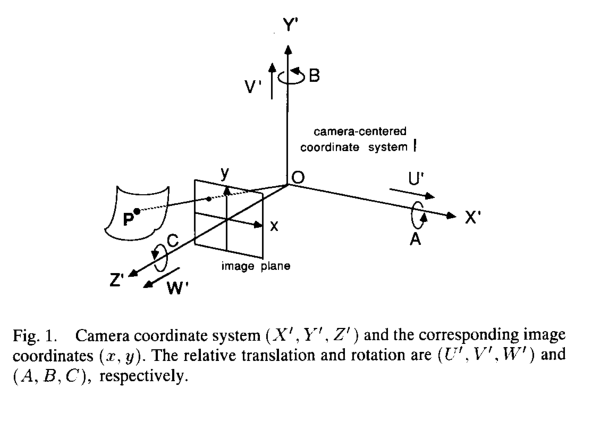
*그림 1 — 카메라 좌표계 $(X', Y', Z')$와 대응하는 영상 좌표 $(x, y)$. 상대 평행이동과 회전은 각각 $(U', V', W')$와 $(A, B, C)$이다.*

다음과 같이 두자.

- $(X', Y', Z')^T$: 환경 내 점 $P$의 순간 좌표
- $(x, y)^T$: 영상 평면 위 $P$의 상의 좌표
- $(u, v)^T = (\dot{x}, \dot{y})^T$: 점 $(x, y)^T$에서의 운동 흐름(motion flow)

그러면 운동 흐름장을 구조·운동 파라미터에 관련짓는 식은 다음과 같다 [15].

$$u = \left(-\frac{U'}{Z'} - B + Cy\right) - x\left(-\frac{W'}{Z'} - Ay + Bx\right)$$
$$v = \left(-\frac{V'}{Z'} - Cx + A\right) - y\left(-\frac{W'}{Z'} - Ay + Bx\right). \qquad (8)$$

단안 시스템에서 평행이동 성분은 전역 스케일 인자까지만 결정할 수 있으므로, 이 모호성을 고려해 $W'$에 대해 다음과 같이 정규화한다.

$$\frac{1}{Z} \equiv \frac{Z'}{W'}, \qquad U \equiv \frac{U'}{W'}, \qquad V \equiv \frac{V'}{W'}. \qquad (9)$$

$Z$를 "정규화 역깊이(normalized reciprocal depth)"라 부른다. (9)를 (8)에 대입하고 $i$번째 점에 대응하는 양에 첨자 $i$를 붙이면 다음을 얻는다.

$$u_i = (-UZ_i - B + Cy_i) - x_i(-Z_i - Ay_i + Bx_i) \equiv h_{ui}(U, V, A, B, C, Z_i)$$
$$v_i = (-VZ_i - Cx_i + A) - y_i(-Z_i - Ay_i + Bx_i) \equiv h_{vi}(U, V, A, B, C, Z_i). \qquad (10)$$
추출된 운동장의 잡음이 다음의 단순 가우스 모델을 따른다고 가정한다.

$$\begin{cases} \mathbf{u}_i = h_{ui}(U, V, A, B, C, Z_i) + \mathbf{n}_{ui} \\ \mathbf{v}_i = h_{vi}(U, V, A, B, C, Z_i) + \mathbf{n}_{vi} \end{cases} \qquad (11)$$

여기서 $\mathbf{n}_{ui}$와 $\mathbf{n}_{vi}$는 분산 $\sigma^2$인 IID 평균 0 가우스 확률 변수이다.

$M$개의 영상점에서 광류장을 얻을 수 있는 경우, 자유 파라미터는 다섯 개의 운동 파라미터

$$\underline{\psi} \equiv (U, V, A, B, C)^T$$

와 $M$개의 구조 파라미터

$$\underline{Z} \equiv (Z_1, Z_2, \ldots, Z_M)^T$$

이다. 측정은 다음과 같다.

$$\mathbf{u}_i, \mathbf{v}_i, \quad i = 1, 2, \ldots, M.$$

정성적으로는, 직관적으로 정의한 다음의 과잉 추정도(overestimation) [3]를 볼 수 있다.

$$\text{overestimation} \equiv \frac{\text{number of measurements}}{\text{number of parameters}} = \frac{2M}{5 + M} \rightarrow 2 \quad \text{as} \quad M \rightarrow \infty. \qquad (12)$$

[역주: overestimation = 측정 수 / 파라미터 수.] 영상점 수가 늘어도 과잉 추정도는 기본적으로 2로 일정하게 유지된다.

정량적으로는 CRLB를 사용해 파라미터 추정치의 분산을 조사할 수 있다. 단순 모델 (11) 아래에서 피셔 정보 행렬은 (7)에 의해 다음과 같다.

$$J = \frac{1}{\sigma^2}\sum_{i=1}^{M}\left[\left(\frac{\partial h_{ui}}{\partial \underline{\theta}}\right)^T\left(\frac{\partial h_{ui}}{\partial \underline{\theta}}\right) + \left(\frac{\partial h_{vi}}{\partial \underline{\theta}}\right)^T\left(\frac{\partial h_{vi}}{\partial \underline{\theta}}\right)\right] \qquad (13)$$

여기서

$$\underline{\theta} = (U, V, A, B, C, Z_1, Z_2, \ldots, Z_M)^T = (\underline{\psi}^T, \underline{Z}^T)^T.$$

그러면 피셔 정보 행렬 (13)은 다음과 같이 분할된다.

$$J = \begin{pmatrix} \alpha & \beta \\ \beta^T & \gamma \end{pmatrix} \qquad (14)$$

여기서 $\alpha$는 5 × 5 행렬이고,

$$\alpha = \frac{1}{\sigma^2}\sum_{i=1}^{M}\left[\left(\frac{\partial h_{ui}}{\partial \underline{\psi}}\right)^T\left(\frac{\partial h_{ui}}{\partial \underline{\psi}}\right) + \left(\frac{\partial h_{vi}}{\partial \underline{\psi}}\right)^T\left(\frac{\partial h_{vi}}{\partial \underline{\psi}}\right)\right]$$
$$\beta = \frac{1}{\sigma^2}\sum_{i=1}^{M}\left[\left(\frac{\partial h_{ui}}{\partial \underline{\psi}}\right)^T\left(\frac{\partial h_{ui}}{\partial \underline{Z}}\right) + \left(\frac{\partial h_{vi}}{\partial \underline{\psi}}\right)^T\left(\frac{\partial h_{vi}}{\partial \underline{Z}}\right)\right]$$
$$\gamma = \frac{1}{\sigma^2}\sum_{i=1}^{M}\left[\left(\frac{\partial h_{ui}}{\partial \underline{Z}}\right)^T\left(\frac{\partial h_{ui}}{\partial \underline{Z}}\right) + \left(\frac{\partial h_{vi}}{\partial \underline{Z}}\right)^T\left(\frac{\partial h_{vi}}{\partial \underline{Z}}\right)\right]. \qquad (15)$$

(10)으로부터 $\gamma$는 $j$번째 대각 항이 다음과 같은 대각 행렬임을 알 수 있다.

$$[\gamma]_{jj} = \frac{1}{\sigma^2}[(x_j - U)^2 + (y_j - V)^2].$$

따라서 $\gamma^{-1}$도 $j$번째 대각 항이 다음과 같은 대각 행렬이다.

$$[\gamma^{-1}]_{jj} = \frac{\sigma^2}{(x_j - U)^2 + (y_j - V)^2}. \qquad (16)$$

운동 파라미터 $(U, V, A, B, C)$의 CRLB는 $J^{-1}$의 처음 다섯 대각 항이므로, 다음 5 × 5 행렬 $Q$의 다섯 대각 항이다.

$$J^{-1} = \begin{pmatrix} \alpha & \beta \\ \beta^T & \gamma \end{pmatrix}^{-1} \equiv \begin{pmatrix} Q & S \\ S^T & G \end{pmatrix}. \qquad (17)$$

$J$가 정칙이면 다음 항등식이 성립한다 [20].

$$Q = (\alpha - \beta\gamma^{-1}\beta^T)^{-1} = \alpha^{-1} + \alpha^{-1}\beta G\beta^T\alpha^{-1}$$
$$G = (\gamma - \beta^T\alpha^{-1}\beta)^{-1} = \gamma^{-1} + \gamma^{-1}\beta^TQ\beta\gamma^{-1}$$
$$S = -Q\beta\gamma^{-1} = -\alpha^{-1}\beta G. \qquad (18)$$

(15), (16), (18)에 의해 $Q$는 이 쪽 아래의 (19)와 같이 계산할 수 있다.

$$Q = (\alpha - \beta\gamma^{-1}\beta^T)^{-1} = \sigma^2\left\{\sum_{j=1}^{M}\frac{\left[(y_j - V)\frac{\partial h_{uj}}{\partial \underline{\psi}} - (x_j - U)\frac{\partial h_{vj}}{\partial \underline{\psi}}\right]^T\left[(y_j - V)\frac{\partial h_{uj}}{\partial \underline{\psi}} - (x_j - U)\frac{\partial h_{vj}}{\partial \underline{\psi}}\right]}{(x_j - U)^2 + (y_j - V)^2}\right\}^{-1}. \qquad (19)$$

따라서 다섯 운동 파라미터 $(U, V, A, B, C)$의 CRLB는 $Q$의 대각 항이며, 어떤 3차원 운동과 표면에 대해서도 5 × 5 행렬의 역행렬을 구해 계산할 수 있다. (19)로부터 CRLB가 회전 파라미터 $(A, B, C)$와 무관하고 $\sigma^2$에 비례함도 알 수 있다. CRLB가 크면 운동 파라미터 추정치의 불확도가 높다는 뜻이므로, 임의 환경에서의 일반 운동의 파라미터 모호성에 대해 다음을 관찰한다.

- 광류장의 잡음 수준이 높으면 운동 파라미터는 모호하다.
- 운동 파라미터(평행이동과 회전 파라미터 모두)의 모호성은 참 회전 운동과 무관하다.

익명의 심사자가 지적했듯이, 이 회전 파라미터 무관성은 측정이 회전 파라미터의 선형 함수인 기본 식 (10)에서 알 수 있다.

## III. 조리개 문제 (The Aperture Problem)

위 계산에서는 영상의 모든 점이 "특징점(feature point)"이라고 가정했다. 특징점은 영상 밝기 패턴의 변화로부터 영상 흐름 속도의 두 성분을 모두 관측할 수 있는 점으로 정의된다. 고립된 점 같은 특징과 모서리 같은 두드러진 점이 "특징점"의 예이며, 이들은 추적할 수 있고 영상 운동의 두 성분을 모두 결정할 수 있다. 조리개 문제 [13], [14] 때문에, 질감이 아주 풍부하지 않은 영상에서 "특징점"은 대개 희소하다. 그 결과 대다수 화소에서는 영상 밝기 패턴의 기울기 벡터에 평행한 흐름 성분만 관측할 수 있다. 따라서 일반점에서는 직접 측정을 많아야 하나 얻을 수 있다. 이하에서 "특징점"이 아닌 점은 모두 "일반점(regular point)"이라 부른다. 일반점이 운동 파라미터의 CRLB에 정보를 기여하지 않음을 보이겠다.

조리개 문제 때문에 국소적으로 평탄한 밝기 영역 안의 점에서는 직접적인 영상 속도 측정을 얻을 수 없으므로, 기울기가 0인 영상점은 제외한다. 영상 밝기 패턴의 기울기 벡터가

$$(\cos\theta_i, \sin\theta_i)^T$$

방향인 $i$번째 일반점을 생각하자. 이 방향은 오차 없이 얻을 수 있다고 가정한다. (성능의 하한만 다루므로 이는 문제가 되지 않을 것이다.) 잡음 모델 (11)로부터, 방향 (3)에 평행한 광류 성분은 다음과 같다. [역주: 원문 "direction (3)"은 바로 위의 기울기 방향 $(\cos\theta_i, \sin\theta_i)^T$를 가리키는 것으로 보인다.]

$$\mathbf{w}_i \equiv (\mathbf{u}_i, \mathbf{v}_i) \cdot (\cos\theta_i, \sin\theta_i) = h_{ui}\cos\theta_i + h_{vi}\sin\theta_i + \mathbf{n}_{ui}\cos\theta_i + \mathbf{n}_{vi}\sin\theta_i = h_i + \mathbf{n}_i \qquad (20)$$

여기서

$$h_i \equiv h_{ui}\cos\theta_i + h_{vi}\sin\theta_i, \qquad \mathbf{n}_i \equiv \mathbf{n}_{ui}\cos\theta_i + \mathbf{n}_{vi}\sin\theta_i. \qquad (21)$$

(21)에 따르면 $\mathbf{n}_i$는 여전히 평균 0, 분산 $\sigma^2$인 IID 가우스 분포를 따른다. 다음과 같이 두자.

$$M_f = \text{특징점 수}, \qquad M_r = \text{일반점 수}.$$

이하에서 일반점은 $i$로, 특징점은 $j$로 색인한다. 그러면 측정은

$$\text{일반점}: \mathbf{w}_i,\ i = 1, 2, \ldots, M_r; \qquad \text{특징점}: \mathbf{u}_j, \mathbf{v}_j,\ j = 1, 2, \ldots, M_f$$

이고, 자유 파라미터는

$$\underline{\theta} = (U, V, A, B, C, Z_{r1}, Z_{r2}, \ldots, Z_{rM_r}, Z_{f1}, Z_{f2}, \ldots, Z_{fM_f})^T$$

이다. $Z_{ri}$는 $i$번째 일반점의 정규화 역깊이이고, $Z_{fj}$는 $j$번째 특징점의 정규화 역깊이이다. 여기서 과잉 추정도를 다음과 같이 계산할 수 있다.

$$\frac{\text{측정 수}}{\text{파라미터 수}} = \frac{2M_f + M_r}{5 + (M_f + M_r)} \rightarrow 1 \ \text{if}\ M_r \gg M_f.$$

이 더 현실적인 모델에서 과잉 추정도는 (12)의 절반에 불과하다. 측정 수가 파라미터 수에 매우 가까우므로 시스템은 잡음에 취약할 것으로 예상된다.

일반점에 대한 측정 모델 (20)과 특징점에 대한 (11)을 고려하면, (7)에 의해 피셔 정보 행렬은 다음과 같다.

$$J = \frac{1}{\sigma^2}\left\{\sum_{i=1}^{M_r}\left(\frac{\partial h_i}{\partial \underline{\theta}}\right)^T\left(\frac{\partial h_i}{\partial \underline{\theta}}\right) + \sum_{j=1}^{M_f}\left[\left(\frac{\partial h_{uj}}{\partial \underline{\theta}}\right)^T\left(\frac{\partial h_{uj}}{\partial \underline{\theta}}\right) + \left(\frac{\partial h_{vj}}{\partial \underline{\theta}}\right)^T\left(\frac{\partial h_{vj}}{\partial \underline{\theta}}\right)\right]\right\}.$$

$J$를 (14)의 형태로 분할하면 이 쪽 아래에 보인 (22)를 얻는다. 여기서 구조 파라미터는 다음과 같다.

$$\underline{Z} = (Z_{r1}, Z_{r2}, \ldots, Z_{rM_r}, Z_{f1}, Z_{f2}, \ldots, Z_{fM_f})^T.$$

$$\alpha = \frac{1}{\sigma^2}\left\{\sum_{i=1}^{M_r}\left(\frac{\partial h_i}{\partial \underline{\psi}}\right)^T\left(\frac{\partial h_i}{\partial \underline{\psi}}\right) + \sum_{j=1}^{M_f}\left[\left(\frac{\partial h_{uj}}{\partial \underline{\psi}}\right)^T\left(\frac{\partial h_{uj}}{\partial \underline{\psi}}\right) + \left(\frac{\partial h_{vj}}{\partial \underline{\psi}}\right)^T\left(\frac{\partial h_{vj}}{\partial \underline{\psi}}\right)\right]\right\}$$
$$\beta = \frac{1}{\sigma^2}\left\{\sum_{i=1}^{M_r}\left(\frac{\partial h_i}{\partial \underline{\psi}}\right)^T\left(\frac{\partial h_i}{\partial \underline{Z}}\right) + \sum_{j=1}^{M_f}\left[\left(\frac{\partial h_{uj}}{\partial \underline{\psi}}\right)^T\left(\frac{\partial h_{uj}}{\partial \underline{Z}}\right) + \left(\frac{\partial h_{vj}}{\partial \underline{\psi}}\right)^T\left(\frac{\partial h_{vj}}{\partial \underline{Z}}\right)\right]\right\}$$
$$\gamma = \frac{1}{\sigma^2}\left\{\sum_{i=1}^{M_r}\left(\frac{\partial h_i}{\partial \underline{Z}}\right)^T\left(\frac{\partial h_i}{\partial \underline{Z}}\right) + \sum_{j=1}^{M_f}\left[\left(\frac{\partial h_{uj}}{\partial \underline{Z}}\right)^T\left(\frac{\partial h_{uj}}{\partial \underline{Z}}\right) + \left(\frac{\partial h_{vj}}{\partial \underline{Z}}\right)^T\left(\frac{\partial h_{vj}}{\partial \underline{Z}}\right)\right]\right\}. \qquad (22)$$

따라서

$$\frac{\partial h_{uj}}{\partial \underline{Z}} = \left(\frac{\partial h_{uj}}{Z_{r1}}, \frac{\partial h_{uj}}{Z_{r2}}, \ldots, \frac{\partial h_{uj}}{Z_{rM_r}}, \frac{\partial h_{uj}}{Z_{f1}}, \frac{\partial h_{uj}}{Z_{f2}}, \ldots, \frac{\partial h_{uj}}{Z_{fM_f}}\right) = \left(0, \ldots, 0, \frac{\partial h_{uj}}{Z_{fj}}, 0, \ldots, 0\right). \qquad (23)$$

마지막 등식은 (10)에서 나오며, (10)은 $h_{uj}$에 관련된 유일한 깊이 파라미터가 $Z_{fj}$임을 보여 준다. 마찬가지로 다음을 얻는다.

$$\frac{\partial h_{vj}}{\partial \underline{Z}} = \left(0, \ldots, 0, \frac{\partial h_{vj}}{Z_{fj}}, 0, \ldots, 0\right). \qquad (24)$$

$i$는 일반점의 색인에만 쓰였으므로 (10)과 (21)로부터 다음을 얻는다.

$$h_i = h_{ui}(U, V, A, B, C, Z_{ri})\cos\theta_i + h_{vi}(U, V, A, B, C, Z_{ri})\cos\theta_i \qquad (25)$$

[역주: (21)에 따르면 둘째 항은 $\sin\theta_i$여야 하나 원문은 $\cos\theta_i$로 인쇄되어 있다.]

따라서 $h_i$에 관련된 유일한 깊이 파라미터는 $Z_{ri}$이다. 그 결과 다음을 얻는다.

$$\frac{\partial h_i}{\partial \underline{Z}} = \left(0, \ldots, 0, \frac{\partial h_i}{Z_{ri}}, 0, \ldots, 0\right). \qquad (26)$$

식 (23), (24), (26)으로부터 다음이 나온다.

$$\left(\frac{\partial h_i}{\partial \underline{\psi}}\right)^T\left(\frac{\partial h_i}{\partial \underline{Z}}\right) = \left(\underline{0}, \ldots, \underline{0}, \left(\frac{\partial h_i}{\partial \underline{\psi}}\right)^T\left(\frac{\partial h_i}{\partial Z_{ri}}\right), \underline{0}, \ldots, \underline{0}\right) \qquad (27)$$

$$\left(\frac{\partial h_{uj}}{\partial \underline{\psi}}\right)^T\left(\frac{\partial h_{uj}}{\partial \underline{Z}}\right) = \left(\underline{0}, \ldots, \underline{0}, \left(\frac{\partial h_{uj}}{\partial \underline{\psi}}\right)^T\left(\frac{\partial h_{uj}}{\partial Z_{fj}}\right), \underline{0}, \ldots, \underline{0}\right) \qquad (28)$$

$$\left(\frac{\partial h_{vj}}{\partial \underline{\psi}}\right)^T\left(\frac{\partial h_{vj}}{\partial \underline{Z}}\right) = \left(\underline{0}, \ldots, \underline{0}, \left(\frac{\partial h_{vj}}{\partial \underline{\psi}}\right)^T\left(\frac{\partial h_{vj}}{\partial Z_{fj}}\right), \underline{0}, \ldots, \underline{0}\right) \qquad (29)$$

여기서 $\underline{0}$은 5 × 1 영벡터이다. (23), (24), (26)으로부터 각각 0이 아닌 성분을 하나만 갖는 다음 대각 행렬들을 얻는다.

$$\left(\frac{\partial h_i}{\partial \underline{Z}}\right)^T\left(\frac{\partial h_i}{\partial \underline{Z}}\right) = \mathrm{DIAG}\left(0, \ldots, 0, \left(\frac{\partial h_i}{\partial Z_{ri}}\right)^2, 0, \ldots, 0\right) \qquad (30)$$

$$\left(\frac{\partial h_{uj}}{\partial \underline{Z}}\right)^T\left(\frac{\partial h_{uj}}{\partial \underline{Z}}\right) = \mathrm{DIAG}\left(0, \ldots, 0, \left(\frac{\partial h_{uj}}{\partial Z_{fj}}\right)^2, 0, \ldots, 0\right) \qquad (31)$$

$$\left(\frac{\partial h_{vj}}{\partial \underline{Z}}\right)^T\left(\frac{\partial h_{vj}}{\partial \underline{Z}}\right) = \mathrm{DIAG}\left(0, \ldots, 0, \left(\frac{\partial h_{vj}}{\partial Z_{fj}}\right)^2, 0, \ldots, 0\right). \qquad (32)$$

(22), (24), (31), (32)를 사용하면 $\gamma$가 다음 대각 행렬임을 안다. (유도를 간단히 하기 위해 지금부터 $\sigma^2$ 항은 생략한다.)

$$\gamma = \mathrm{DIAG}\left(\left(\frac{\partial h_1}{\partial Z_{r1}}\right)^2, \ldots, \left(\frac{\partial h_{M_r}}{\partial Z_{rM_r}}\right)^2, \left(\frac{\partial h_{u1}}{\partial Z_{f1}}\right)^2 + \left(\frac{\partial h_{v1}}{\partial Z_{f1}}\right)^2, \ldots, \left(\frac{\partial h_{uM_f}}{\partial Z_{fM_f}}\right)^2 + \left(\frac{\partial h_{vM_f}}{\partial Z_{fM_f}}\right)^2\right).$$

따라서

$$\gamma^{-1} = \mathrm{DIAG}\left(\left(\frac{\partial h_1}{\partial Z_{r1}}\right)^{-2}, \ldots, \left(\frac{\partial h_{M_r}}{\partial Z_{rM_r}}\right)^{-2}, \left[\left(\frac{\partial h_{u1}}{\partial Z_{f1}}\right)^2 + \left(\frac{\partial h_{v1}}{\partial Z_{f1}}\right)^2\right]^{-1}, \ldots, \left[\left(\frac{\partial h_{uM_f}}{\partial Z_{fM_f}}\right)^2 + \left(\frac{\partial h_{vM_f}}{\partial Z_{fM_f}}\right)^2\right]^{-1}\right). \qquad (33)$$

식 (22), (27), (28), (29)로부터 다음을 얻는다.

$$\beta = \left(\left(\frac{\partial h_1}{\partial \underline{\psi}}\right)^T\left(\frac{\partial h_1}{\partial Z_{r1}}\right), \ldots, \left(\frac{\partial h_{M_r}}{\partial \underline{\psi}}\right)^T\left(\frac{\partial h_{M_r}}{\partial Z_{rM_r}}\right), \left(\frac{\partial h_{u1}}{\partial \underline{\psi}}\right)^T\left(\frac{\partial h_{u1}}{\partial Z_{f1}}\right) + \left(\frac{\partial h_{v1}}{\partial \underline{\psi}}\right)^T\left(\frac{\partial h_{v1}}{\partial Z_{f1}}\right), \ldots, \left(\frac{\partial h_{uM_f}}{\partial \underline{\psi}}\right)^T\left(\frac{\partial h_{uM_f}}{\partial Z_{fM_f}}\right) + \left(\frac{\partial h_{vM_f}}{\partial \underline{\psi}}\right)^T\left(\frac{\partial h_{vM_f}}{\partial Z_{fM_f}}\right)\right). \qquad (34)$$

따라서 (33)과 (34)로부터 다음이 나온다.

$$\beta\gamma^{-1} = \left(\frac{\left(\frac{\partial h_1}{\partial \underline{\psi}}\right)^T}{\left(\frac{\partial h_1}{\partial Z_{r1}}\right)}, \ldots, \frac{\left(\frac{\partial h_{M_r}}{\partial \underline{\psi}}\right)^T}{\left(\frac{\partial h_{M_r}}{\partial Z_{rM_r}}\right)}, \frac{\left(\frac{\partial h_{u1}}{\partial \underline{\psi}}\right)^T\left(\frac{\partial h_{u1}}{\partial Z_{f1}}\right) + \left(\frac{\partial h_{v1}}{\partial \underline{\psi}}\right)^T\left(\frac{\partial h_{v1}}{\partial Z_{f1}}\right)}{\left(\frac{\partial h_{u1}}{\partial Z_{f1}}\right)^2 + \left(\frac{\partial h_{v1}}{\partial Z_{f1}}\right)^2}, \ldots, \frac{\left(\frac{\partial h_{uM_f}}{\partial \underline{\psi}}\right)^T\left(\frac{\partial h_{uM_f}}{\partial Z_{fM_f}}\right) + \left(\frac{\partial h_{vM_f}}{\partial \underline{\psi}}\right)^T\left(\frac{\partial h_{vM_f}}{\partial Z_{fM_f}}\right)}{\left(\frac{\partial h_{uM_f}}{\partial Z_{fM_f}}\right)^2 + \left(\frac{\partial h_{vM_f}}{\partial Z_{fM_f}}\right)^2}\right).$$

그러므로 다음 쪽에 보인 (35)를 얻는다. (22)와 (35)를 사용하면 역시 다음 쪽에 있는 (36)을 얻는데, 마지막 등식은 스칼라 $a$, $b$와 행렬 $\boldsymbol{A}$, $\boldsymbol{B}$에 대해 다음이 성립한다는 사실에 의한다.

$$\boldsymbol{A}^T\boldsymbol{A} + \boldsymbol{B}^T\boldsymbol{B} - \frac{(a\boldsymbol{A}^T + b\boldsymbol{B}^T)(a\boldsymbol{A} + b\boldsymbol{B})}{a^2 + b^2} = \frac{(b\boldsymbol{A} - a\boldsymbol{B})^T(b\boldsymbol{A} - a\boldsymbol{B})}{a^2 + b^2}.$$

(10)을 사용하면 다음을 얻는다.

$$\frac{\partial h_{uj}}{\partial Z_{fj}} = x_j - U, \qquad \frac{\partial h_{vj}}{\partial Z_{fj}} = y_j - V.$$

이를 (36)에 대입하면 다음 쪽에 보인 (37)을 얻으며, 이는 일반점과 무관하다. 따라서 특징점만이 운동 파라미터의 CRLB에 정보를 기여한다. 즉, 운동 파라미터의 내재적 모호성을 줄이는 유용한 정보는 특징점에서의 흐름장에만 담겨 있다.

$$\beta\gamma^{-1}\beta^T = \sum_{i=1}^{M_r}\left(\frac{\partial h_i}{\partial \underline{\psi}}\right)^T\left(\frac{\partial h_i}{\partial \underline{\psi}}\right) + \sum_{j=1}^{M_f}\frac{\left[\left(\frac{\partial h_{uj}}{\partial \underline{\psi}}\right)^T\left(\frac{\partial h_{uj}}{\partial Z_{fj}}\right) + \left(\frac{\partial h_{vj}}{\partial \underline{\psi}}\right)^T\left(\frac{\partial h_{vj}}{\partial Z_{fj}}\right)\right]\left[\left(\frac{\partial h_{uj}}{\partial \underline{\psi}}\right)\left(\frac{\partial h_{uj}}{\partial Z_{fj}}\right) + \left(\frac{\partial h_{vj}}{\partial \underline{\psi}}\right)\left(\frac{\partial h_{vj}}{\partial Z_{fj}}\right)\right]}{\left(\frac{\partial h_{uj}}{\partial Z_{fj}}\right)^2 + \left(\frac{\partial h_{vj}}{\partial Z_{fj}}\right)^2} \qquad (35)$$

$$\begin{aligned}
\alpha - \beta\gamma^{-1}\beta^T &= \sum_{j=1}^{M_f}\left\{\left[\left(\frac{\partial h_{uj}}{\partial \underline{\psi}}\right)^T\left(\frac{\partial h_{uj}}{\partial \underline{\psi}}\right) + \left(\frac{\partial h_{vj}}{\partial \underline{\psi}}\right)^T\left(\frac{\partial h_{vj}}{\partial \underline{\psi}}\right)\right] - \frac{\left[\left(\frac{\partial h_{uj}}{\partial \underline{\psi}}\right)^T\left(\frac{\partial h_{uj}}{\partial Z_{fj}}\right) + \left(\frac{\partial h_{vj}}{\partial \underline{\psi}}\right)^T\left(\frac{\partial h_{vj}}{\partial Z_{fj}}\right)\right]\left[\left(\frac{\partial h_{uj}}{\partial \underline{\psi}}\right)\left(\frac{\partial h_{uj}}{\partial Z_{fj}}\right) + \left(\frac{\partial h_{vj}}{\partial \underline{\psi}}\right)\left(\frac{\partial h_{vj}}{\partial Z_{fj}}\right)\right]}{\left(\frac{\partial h_{uj}}{\partial Z_{fj}}\right)^2 + \left(\frac{\partial h_{vj}}{\partial Z_{fj}}\right)^2}\right\} \\
&= \sum_{j=1}^{M_f}\frac{\left[\left(\frac{\partial h_{vj}}{\partial Z_{fj}}\right)\left(\frac{\partial h_{uj}}{\partial \underline{\psi}}\right) - \left(\frac{\partial h_{uj}}{\partial Z_{fj}}\right)\left(\frac{\partial h_{vj}}{\partial \underline{\psi}}\right)\right]^T\left[\left(\frac{\partial h_{vj}}{\partial Z_{fj}}\right)\left(\frac{\partial h_{uj}}{\partial \underline{\psi}}\right) - \left(\frac{\partial h_{uj}}{\partial Z_{fj}}\right)\left(\frac{\partial h_{vj}}{\partial \underline{\psi}}\right)\right]}{\left(\frac{\partial h_{uj}}{\partial Z_{fj}}\right)^2 + \left(\frac{\partial h_{vj}}{\partial Z_{fj}}\right)^2}
\end{aligned} \qquad (36)$$

$$Q = (\alpha - \beta\gamma^{-1}\beta^T)^{-1} = \sigma^2\left\{\sum_{j=1}^{M_f}\frac{\left[(y_j - V)\frac{\partial h_{uj}}{\partial \underline{\psi}} - (x_j - U)\frac{\partial h_{vj}}{\partial \underline{\psi}}\right]^T\left[(y_j - V)\frac{\partial h_{uj}}{\partial \underline{\psi}} - (x_j - U)\frac{\partial h_{vj}}{\partial \underline{\psi}}\right]}{(x_j - U)^2 + (y_j - V)^2}\right\}^{-1} \qquad (37)$$

추가 가정이 있으면 일반점의 측정이 CRLB에 기여하는 경우가 있다. 지금까지는 한 화소의 깊이가 다른 화소의 깊이와 무관한 경우만 다루었다. 서로 다른 화소의 깊이가 서로 관련되어 있으면, 예를 들어 환경이 매끄럽다고 가정하면, 일반점은 일반적으로 CRLB에 정보를 기여한다. VI절이 그런 예를 보인다. 또 다른 경우는 두 장보다 많은 영상을 고려하고, 서로 다른 시각의 운동 관계를 세우기 위해 운동학적 운동 모델(kinematic motion model) [8]–[10]을 부과하는 경우이다.

## IV. 평면 환경에서의 운동 (Motion in a Planar Environment)

카메라가 평면 환경 앞에서 움직일 때는 해석적 CRLB를 얻을 수 있다. 평면 경우의 연구는 운동 파라미터 추정이 본질적으로 불안정해지는 일반 조건에 대한 통찰을 줄 수 있다 [2]. 이 논문에서 얻은 결과의 일부가 운동 파라미터의 내재적 모호성에 대한 Adiv의 분석 [2]을 뒷받침함을 보이겠다. 이 내재적 모호성이 기저 운동, 표면 위치, 표면 방향, 시야, 사용 가능한 화소의 밀도 같은 여러 요인에 어떻게 의존하는지를 닫힌 형태의 식으로 유도한다.

평면 환경을 가정하자.

$$Z' = pX' + qY' + s. \qquad (38)$$

그러면

$$\frac{1}{Z'} = \frac{1}{s} - \frac{p}{s}\left(\frac{X'}{Z'}\right) - \frac{q}{s}\left(\frac{Y'}{Z'}\right) = \frac{1}{s} - \frac{p}{s}x - \frac{q}{s}y \qquad (39)$$

이며, 마지막 등식은 초점거리를 1로 정규화한 카메라의 중심 투영에 의해 성립한다. 다음 약어를 사용하면

$$Z_0 \equiv W'/s, \qquad Z_x \equiv -pZ_0, \qquad Z_y \equiv -qZ_0 \qquad (40)$$

(9), (39)를 다음과 같이 쓸 수 있다.

$$Z = Z_xx + Z_yy + Z_0.$$

일반성을 잃지 않고 이 절에서는 영상의 모든 점이 특징점이라고 가정하자. $d$를 영상의 화소 간 거리, $\Omega$를 시야라 하자. 그러면 (19)는 이 쪽 아래에 보인 (41)로 근사할 수 있다.

$$Q = \sigma^2\left\{\frac{1}{d^2}\iint_\Omega\frac{\left[(y - V)\frac{\partial h_u}{\partial \underline{\psi}} - (x - U)\frac{\partial h_v}{\partial \underline{\psi}}\right]^T\left[(y - V)\frac{\partial h_u}{\partial \underline{\psi}} - (x - U)\frac{\partial h_v}{\partial \underline{\psi}}\right]}{(x - U)^2 + (y - V)^2}\,dx\,dy\right\}^{-1}. \qquad (41)$$

영상 평면 위의 시야 $\Omega$가 다음과 같으면, 이중 적분은 $(U, V)^T$를 중심으로 한 극좌표계를 사용해 계산할 수 있다.

$$\Omega = \{(x, y)^T \mid (x - U)^2 + (y - V)^2 \leq r^2\}. \qquad (42)$$

그러면 (41)은 이 쪽 아래에 보인 (43)이 된다. 여기서

$$k = Z_xU + Z_yV + Z_0$$

이고 특징점의 밀도는

$$\rho_f = d^{-2}$$

이다.

$$Q(U, V, Z_x, Z_y, Z_0, r) = \frac{16\sigma^2}{\pi r^2\rho_f} \times \begin{pmatrix}
r^2(Z_x^2 + 3Z_y^2) + 8k^2 & -2Z_xZ_yr^2 & r^2(Z_xV - 3Z_yU) - 8UVk & r^2(Z_xU - Z_yV) + 8(1 + U^2)k & -4r^2Z_y - 8Vk \\
-2Z_xZ_yr^2 & r^2(3Z_x^2 + Z_y^2) + 8k^2 & r^2(Z_xU - Z_yV) - 8(1 + V^2)k & r^2(3Z_xV - Z_yU) + 8UVk & 4r^2Z_x + 8Uk \\
r^2(Z_xV - 3Z_yU) - 8UVk & r^2(Z_xU - Z_yV) - 8(1 + V^2)k & r^2(3U^2 + V^2) + 8[U^2V^2 + (1 + V^2)^2] & 2r^2UV - 8UV(2 + U^2 + V^2) & 4U(r^2 - 2) \\
r^2(Z_xU - Z_yV) + 8(1 + U^2)k & r^2(3Z_xV - Z_yU) + 8UVk & 2r^2UV - 8UV(2 + U^2 + V^2) & r^2(U^2 + 3V^2) + 8[U^2V^2 + (1 + U^2)^2] & 4V(r^2 - 2) \\
-4r^2Z_y - 8Vk & 4r^2Z_x + 8Uk & 4U(r^2 - 2) & 4V(r^2 - 2) & 8(r^2 + U^2 + V^2)
\end{pmatrix}^{-1} \qquad (43)$$

$Q$의 대각 항인 CRLB는 (43)으로부터 특징점 밀도 $\rho_f$에 반비례한다. 따라서 평면 환경 앞에서의 일반 운동에 대해 흐름장이 희소하면 운동 파라미터가 모호하다는 것을 안다. 이 결과는 [2]에서 얻어진 바 있다.

### A. 수직 평행이동과 임의 회전을 갖는 운동 (Motion with Perpendicular Translation and Arbitrary Rotation)

이 경우

$$U = V = 0.$$

시야 (42)는 영상 평면 좌표계의 원점을 중심으로 하는 반지름 $r$의 원판이다. (43)의 $Q$는 다음 쪽 아래의 식으로 단순화된다.

$$Q = \frac{8\sigma^2}{\pi r^4\rho_f(Z_x^2 + Z_y^2)}\begin{pmatrix}
2 & 0 & 0 & -2Z_0 & Z_y \\
0 & 2 & 2Z_0 & 0 & -Z_x \\
0 & 2Z_0 & 2Z_0^2 + (Z_x^2 + Z_y^2)r^2/4 & 0 & -Z_xZ_0 \\
-2Z_0 & 0 & 0 & 2Z_0^2 + (Z_x^2 + Z_y^2)r^2/4 & -Z_yZ_0 \\
Z_y & -Z_x & -Z_xZ_0 & -Z_yZ_0 & 3(Z_x^2 + Z_y^2)/4
\end{pmatrix}.$$

$Q$의 대각 항이 운동 파라미터의 CRLB이다.

$$\begin{aligned}
\mathrm{CRLB}(U) = \mathrm{CRLB}(V) &= \frac{16\sigma^2}{\pi r^4\rho_f(Z_x^2 + Z_y^2)} = \frac{16\sigma^2}{\pi r^4\rho_f(p^2 + q^2)}\left(\frac{s}{W'}\right)^2 \\
\mathrm{CRLB}(A) = \mathrm{CRLB}(B) &= \frac{16\sigma^2Z_0^2}{\pi r^4\rho_f(Z_x^2 + Z_y^2)} + \frac{2\sigma^2}{\pi r^2\rho_f} = \frac{16\sigma^2}{\pi r^4\rho_f(p^2 + q^2)} + \frac{2\sigma^2}{\pi r^2\rho_f} \\
\mathrm{CRLB}(C) &= \frac{6\sigma^2}{\pi r^4\rho_f}
\end{aligned} \qquad (44)$$

여기서 (40)을 사용했다. CRLB 값이 크면 운동 파라미터의 불확도가 높다는 뜻이므로, 운동 추정의 내재적 모호성은 (44)로 정량화된다. Adiv [2]는 다음 조건들이 3차원 운동 파라미터 복원의 큰 불확도에 기여함을 발견했다. 이 조건들은 모두 큰 CRLB로 이어지므로 (44)의 직접적인 결과이기도 하다.

- 시야가 좁다($r$이 작다).
- 평면이 기껏해야 완만하게 기울어져 있다($p^2 + q^2$이 작다).
- 물체가 멀리 있다($s$가 크다).
- 평행이동의 절댓값이 작다($|W'|$이 작다).
- 영상의 해상도가 거칠다($\sigma$가 크거나 $\rho_f$가 작다).

또한 (44)로부터 이 소절에서 고려한 운동에 대해 다음과 같은 더 구체적인 관찰을 얻는다. 평면의 방향($p$와 $q$로 나타냄)은 $U$, $V$, $A$, $B$의 정확도에 영향을 주지만 $C$에는 주지 않는다. 평면의 위치($s$로 나타냄)는 평행이동 파라미터의 정확도에만 영향을 주고 회전 파라미터에는 영향이 없다. 따라서 $C$의 정확도는 평면의 기하($p$, $q$, $s$로 나타냄)와 무관하다. 평면의 기울기가 크면(따라서 $p^2 + q^2$이 크면) 평행이동 파라미터의 정확도는 높고, 회전 파라미터의 정확도는 (44)의 둘째 항이 지배적인 한 평면의 기울기와 본질적으로 무관하다. 수직 평행이동이 작으면(즉 $|W'|$이 작으면) 평행이동 파라미터를 추정하기 어렵지만, 회전 파라미터의 정확도는 수직 평행이동과 무관하다.

### B. 일반 운동 (General Motion)

이 소절에서는 먼저 광축에 대한 3차원 좌표계 $I$의 회전 아래에서 CRLB가 어떻게 변환되는지 살핀다. 그러면 CRLB($U$) + CRLB($V$), CRLB($A$) + CRLB($B$), CRLB($C$)는 이 좌표계 회전 아래의 세 불변량으로 볼 수 있으며, 따라서 운동 추정의 내재적 모호성을 잘 나타낸다. 일반 운동 $(U, V, A, B, C)$ 아래의 세 불변량은 운동 $(\sqrt{U^2 + V^2}, 0, A'', B'', C'')$ 아래의 세 불변량과 같음을 보일 것이다. (II절에서 보였듯이 CRLB는 회전 파라미터와 무관하므로 $A''$, $B''$, $C''$는 임의이다.) 이 사실을 이용해 일반 운동의 경우를 평행이동 운동이 $X'$–$Z'$ 평면에 평행한 경우로 단순화한다. 후자의 경우는 다음 소절에서 논한다.

II절에서 정의한 3차원 좌표계 $I$를 카메라 광축에 대해 각 $\theta$만큼 회전해 새 좌표계 $I''$를 얻을 때 운동·구조 파라미터의 변환을 보자. 약어

$$R_\theta = \begin{pmatrix} \cos\theta & \sin\theta \\ -\sin\theta & \cos\theta \end{pmatrix}$$

를 사용하면 다음 변환을 얻는다.

$$\begin{pmatrix} X'' \\ Y'' \\ Z'' \end{pmatrix} = \begin{pmatrix} \cos\theta & \sin\theta & 0 \\ -\sin\theta & \cos\theta & 0 \\ 0 & 0 & 1 \end{pmatrix}\begin{pmatrix} X \\ Y \\ Z \end{pmatrix}$$

$$(U'', V'')^T = R_\theta\,(U, V)^T, \quad (A'', B'')^T = R_\theta\,(A, B)^T, \quad (Z_x'', Z_y'')^T = R_\theta\,(Z_x, Z_y)^T, \quad (p'', q'')^T = R_\theta\,(p, q)^T$$

$$C'' = C, \quad Z_0'' = Z_0, \quad s'' = s$$

위 변환을 사용하면 (43)으로부터 다음을 확인할 수 있다.

$$[Q(U'', V'', Z_x'', Z_y'', Z_0'', r)]^{-1} = R\,[Q(U, V, Z_x, Z_y, Z_0, r)]^{-1}R^T$$

따라서

$$Q(U'', V'', Z_x'', Z_y'', Z_0'', r) = R\,Q(U, V, Z_x, Z_y, Z_0, r)\,R^T \qquad (45)$$

여기서 $R$은 블록 대각 유니터리 행렬

$$R = \begin{pmatrix} R_\theta & & \\ & R_\theta & \\ & & 1 \end{pmatrix}$$

이다. CRLB는 $Q$의 대각 항이므로 (45)로부터 다음을 얻는다.

$$\mathrm{CRLB}(U'') + \mathrm{CRLB}(V'') = \mathrm{CRLB}(U) + \mathrm{CRLB}(V)$$
$$\mathrm{CRLB}(A'') + \mathrm{CRLB}(B'') = \mathrm{CRLB}(A) + \mathrm{CRLB}(B)$$
$$\mathrm{CRLB}(C'') = \mathrm{CRLB}(C).$$

따라서 좌표 회전 아래의 세 불변량을 얻는다. 구체적으로

$$\begin{cases} \cos\theta = U/\sqrt{U^2 + V^2} \\ \sin\theta = V/\sqrt{U^2 + V^2} \end{cases}$$

로 두자. 즉, $x$축이 영상 평면 위로의 평행이동 속도 사영과 일치할 때까지 3차원 좌표계 $I$를 회전한다. 같은 말로, 영상 평면 위로 사영된 평행이동이 순전히 $x$축을 따르도록 카메라 축을 비튼다. 그러면

$$\begin{cases} U'' = \sqrt{U^2 + V^2} \\ V'' = 0. \end{cases}$$

따라서 집합

$$\begin{cases} \text{운동 파라미터} & : (U, V, A, B, C) \\ \text{구조 파라미터} & : (p, q, s) \end{cases}$$

의 세 불변량은 집합

$$\begin{cases} \text{운동 파라미터} : (\sqrt{U^2 + V^2}, 0, A'', B'', C) \\ \text{구조 파라미터} : \left(\dfrac{pU + qV}{\sqrt{U^2 + V^2}}, \dfrac{-pV + qU}{\sqrt{U^2 + V^2}}, s\right) \end{cases}$$

의 세 불변량과 같다. 그러므로 일반 운동의 연구는 $V = 0$인 운동의 연구로 환원될 수 있으며, 이는 이 절에서 정의한 세 불변량을 사용해 다음 절에서 논한다.

### C. $V = 0$인 운동 (Motion with $V = 0$)

구조 파라미터 $(Z_x, Z_y, Z_0)$와 시야 반지름 $r$을 갖는 운동 $(U, 0, A, B, C)$를 생각하자. 이 경우 MACSYMA 컴퓨터 패키지로 (43)의 5 × 5 행렬의 역행렬을 기호적으로 구해 $Q(U, 0, Z_x, Z_y, Z_0, r)$의 대각 항을 계산할 수 있다. 그러면 세 불변량은 다음과 같이 얻어진다.

$$\begin{aligned}
\mathrm{CRLB}(U) + \mathrm{CRLB}(V) &= \eta(s/W')^2\{(p + U)^2[2r^2U^2 + (11U^4 + 24U^2 + 16)] \\
&\quad + q^2[r^2(U^6 + 2U^4 + 2U^2) + (3U^8 + 14U^6 + 35U^4 + 40U^2 + 16)]\} \\[2mm]
\mathrm{CRLB}(A) + \mathrm{CRLB}(B) &= \eta\{(p + U)^2[2r^2(p^2 + q^2) + 11(Up - 12/11)^2 + 32/11] \\
&\quad + q^2[r^2(U^4 + 2U^2 + 2)(p^2 + q^2) + 3(3U^2 + 4)(1 - Up)^2 \\
&\quad + (U^2 + 1)[(3U^4 + 2U^2)p^2 + 3(U^4 + U^2)q^2 + 3U^2 + 4]]\} \\[2mm]
\mathrm{CRLB}(C) &= \eta\{(p + U)^2 \cdot [r^2U^2p^2 + (3U^4 + 2U^2 + 3)p^2 - 2U(3U^2 + 1)p + 3U^2] \\
&\quad + q^2[r^2U^2p^2 + (2U^4 + 8U^2 + 6)p^2 + 3(U^2 + 1)^2q^2 - (6U^5 + 2U^3 - 4U)p + 6U^4 + 6U^2]\}
\end{aligned} \qquad (46)$$

여기서

$$\eta = \frac{2\sigma^2}{\pi r^4\rho_f[(p + U)^2 + q^2(U^2 + 1)]^2}.$$

위 식들로부터 다음과 같이 결론짓는다.

- 물체가 멀리 있으면($s$가 크면) 평행이동 파라미터는 모호하다.
- 회전 파라미터의 불확도는 물체의 거리와 무관하다.

평면 기울기에 대한 불변량의 의존성을 확인하기 위해, 불변량들이 유리함수이며 유일한 특이점이

$$(p, q)^T = (-U, 0)^T \qquad (47)$$

에 있음에 주목한다. 특이점 주변의 거동은 (46)에서 다음 변수 변환

$$\begin{cases} p = -U + \rho\cos\phi \\ q = \rho\sin\phi \end{cases} \qquad (48)$$

을 하고 $\rho$를 0으로 보내 조사할 수 있다. 즉, $(p, q)$ 공간에서 방향각 $\phi$인 직선을 따라 특이점에 접근할 때 불변량의 극한을 본다. (48)을 (46)에 대입하면 세 불변량은 다음 형태가 된다.

$$\frac{\beta\rho^2 + \gamma\rho + \delta}{\alpha\rho^2}, \quad \alpha > 0, \delta > 0.$$

따라서 $\rho$가 0으로 가면 세 불변량은 양의 무한대로 간다. $(p, q)^T$ 공간의 특이점 $(-U, 0)^T$ 주변에서 세 불변량의 이런 거동을 그림 2에 보였다. (이 예에서는 평면 $Z' = pX' + qY' + 10$의 운동을 고려한다. 평행이동 운동은 $(U', V', W') = (0.5, 0, 1)$이다. 시야 반지름은 $r = 1.5$이다. 특징점 밀도는 $\rho_f = 100$이다. $\sigma^2$은 광류 성분의 잡음 분산이다. (46)에 의해 세 불변량은 $\sigma^2$에 비례하므로 높이를 $\sigma^2$의 배수로 그린다. 평면의 기울기 $(p, q)$에 대한 세 불변량의 의존성을 그림 2에서 $-10 \leq p, q \leq 10$ 범위로 보였다. 그림 2의 각 도표에서 $p$축과 $q$축의 눈금은 같다. 그러나 수직축의 눈금은 도표마다 다르다. 차이를 보이기 위해 각 도표에서 한 점의 높이를 표시했다.) (9)와 (47)로부터 세 불변량의 특이점은

$$(p, q, -1)^T = -(U', 0, W')^T/W'$$

일 때, 즉 평면의 방향 벡터 $(p, q, -1)^T$가 평행이동 운동의 방향 $(U', 0, W')^T$에 평행할 때 생긴다. 따라서 평면 환경의 방향이 평행이동 운동의 방향과 기껏해야 약간만 다르면 운동 파라미터는 모호하다. 시야 반지름 $r$에 대한 불변량의 의존성을 확인하기 위해, 세 불변량 (46)이 모두 다음 형태임에 주목한다.

$$\frac{\beta r^2 + \gamma}{\alpha r^4}, \quad \alpha > 0, \beta \geq 0, \gamma > 0. \qquad (49)$$

이는 (46)으로부터 CRLB($U$) + CRLB($V$)와 CRLB($A$) + CRLB($B$)에 대해 분명하다. CRLB($C$)에 대해서도 부록 A에 보인 명제에 의해 (49)가 성립한다. 세 불변량은 두 단조 감소 함수 $\beta/(\alpha r^2)$과 $\gamma/(\alpha r^4)$의 합이므로 $r$이 커지면 항상 감소한다. 또한 $r$이 0으로 가면 (49)에 의해 세 불변량은 양의 무한대로 간다. 따라서 시야가 좁으면 운동 파라미터는 모호하다. $U$에 대한 세 불변량의 의존성은 그림 3에 보인 것처럼 단조적이지 않다. (고려한 평면 환경은 $Z' = -0.5X' - 0.5Y' + 10$이다. 특징점 밀도는 $\rho_f = 100$이다. 평행이동 운동은 $(U', V', W') = (U', 0, 1)$이다. $U$와 시야 반지름 $r$에 대한 세 불변량의 의존성을 그림 3에서 $-2 \leq U \leq 2$, $0.8 \leq r \leq 3$ 범위로 보였다.) 3차원 평행이동 벡터 $(U', 0, W')^T$는 영상 평면 위에 확장 초점(focus of expansion, FOE) [19]이라 불리는 중심 투영

$$(U'/W', 0/W')^T = (U, 0)^T$$

을 가지므로, (46)에 의해 회전 파라미터의 CRLB는 3차원 평행이동 벡터 $(U', V', W')^T$가 아니라 FOE $(U'/W', V'/W')^T$에 의존한다. 그러나 평행이동 파라미터의 CRLB는 FOE뿐 아니라 영상 평면에 수직인 3차원 평행이동 벡터의 성분 $W'$에도 의존한다.

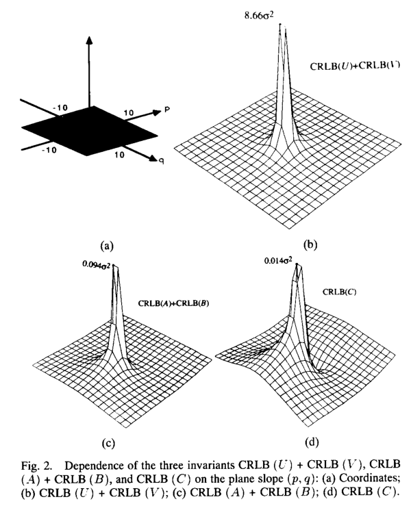
*그림 2 — 세 불변량 CRLB($U$) + CRLB($V$), CRLB($A$) + CRLB($B$), CRLB($C$)의 평면 기울기 $(p, q)$에 대한 의존성: (a) 좌표; (b) CRLB($U$) + CRLB($V$); (c) CRLB($A$) + CRLB($B$); (d) CRLB($C$).*

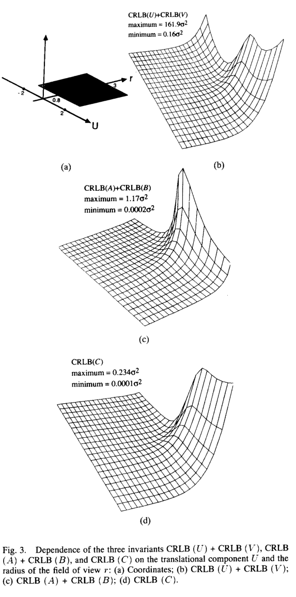
*그림 3 — 세 불변량 CRLB($U$) + CRLB($V$), CRLB($A$) + CRLB($B$), CRLB($C$)의 평행이동 성분 $U$와 시야 반지름 $r$에 대한 의존성: (a) 좌표; (b) CRLB($U$) + CRLB($V$); (c) CRLB($A$) + CRLB($B$); (d) CRLB($C$).*

## V. 임의 환경에서의 운동 (Motion in an Arbitrary Environment)

CRLB의 해석적 형태를 다룰 수 없을 때는 시뮬레이션으로 어느 정도 통찰을 얻을 수 있다. 내재적 모호성 조사에 CRLB를 적용하는 이 편리한 특징은, 표면과 운동이 정해지면 CRLB를 (19)로 언제나 수치 계산할 수 있다는 사실에서 나온다. 여기서는 시뮬레이션으로 비평면 환경 앞에서의 일반 운동 몇 가지 예를 고려한다.

두 개의 모의 표면 $S_1$과 $S_2$를 고려한다. (8)의 구조 파라미터 $Z'$를 영상 좌표 $(x, y)$의 함수로 $S_1$과 $S_2$에 대해 그림 4에 그렸다. $Z'$의 최댓값은 $S_1$에서 13, 최솟값 5이고, $S_2$에서 최댓값 22.7, 최솟값 4.5이다. 평행이동 파라미터 $(U, V)$에 대한 다섯 운동 파라미터 CRLB의 의존성을 $S_1$과 $S_2$의 운동에 대해 각각 그림 5와 6에 그렸다. 초점거리는 1이다. 흐름장의 잡음 분산은 $\sigma^2$이다. 시야는 폭 3인 정사각형이다. 441개의 특징점이 시야 전체에 균일하게 퍼져 21 × 21 격자를 이룬다. 그림 5와 6에서 $U$와 $V$의 범위는

$$-4.02 \leq U, V \leq 4.16$$

이다. 각 도표에 최대·최소 높이를 표시했다. 평행이동 운동 0 $(U, V) = (0, 0)$ 주변의 봉우리는 평행이동 운동이 작을 때 운동이 상대적으로 더 모호함을 보여 준다. 평행이동 운동의 크기가 0에서 커지면 평행이동 파라미터 $U$와 $V$의 모호성은 처음에는 낮아지지만 나중에는 무한대로 커진다. 따라서 큰 평행이동 운동은 평행이동 파라미터에 큰 모호성을 일으킨다. 반면 큰 평행이동 운동은 회전 파라미터 $A$, $B$, $C$의 모호성을 줄인다.

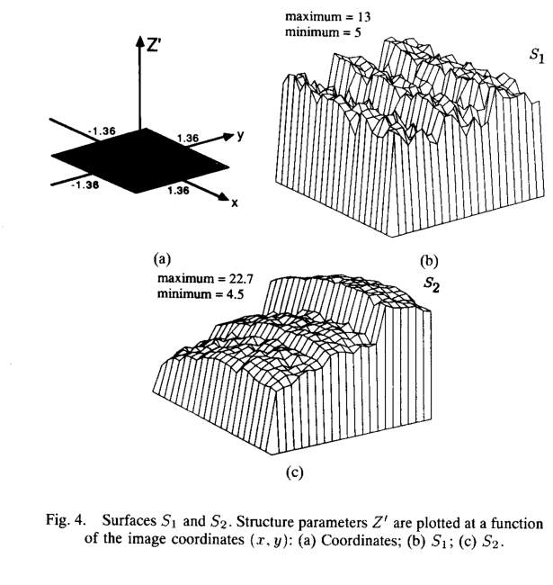
*그림 4 — 표면 $S_1$과 $S_2$. 구조 파라미터 $Z'$를 영상 좌표 $(x, y)$의 함수로 그렸다: (a) 좌표; (b) $S_1$; (c) $S_2$.*

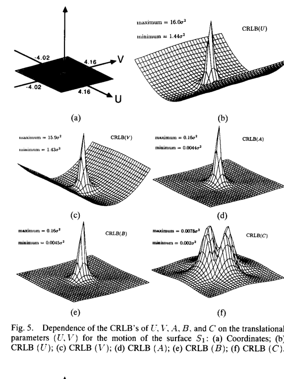
*그림 5 — 표면 $S_1$의 운동에 대해 평행이동 파라미터 $(U, V)$에 대한 $U$, $V$, $A$, $B$, $C$의 CRLB의 의존성: (a) 좌표; (b) CRLB($U$); (c) CRLB($V$); (d) CRLB($A$); (e) CRLB($B$); (f) CRLB($C$).*

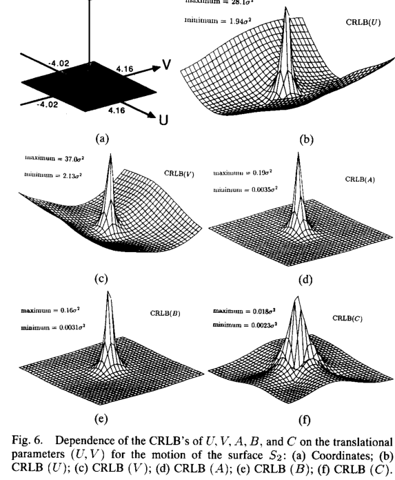
*그림 6 — 표면 $S_2$의 운동에 대해 평행이동 파라미터 $(U, V)$에 대한 $U$, $V$, $A$, $B$, $C$의 CRLB의 의존성: (a) 좌표; (b) CRLB($U$); (c) CRLB($V$); (d) CRLB($A$); (e) CRLB($B$); (f) CRLB($C$).*

(7)을 사용하면 측정을 추가해도 CRLB가 결코 증가하지 않음을 보일 수 있다. 이를 보기 위해 $J$와 $J'$를 $i$번째 측정을 추가하기 전과 후의 피셔 정보 행렬이라 하자. (7)로부터

$$J' = J + \frac{1}{\sigma^2}\left(\frac{\partial h_i}{\partial \underline{\theta}}\right)^T\left(\frac{\partial h_i}{\partial \underline{\theta}}\right).$$

그러면 역행렬 보조정리(matrix inversion lemma) [20]에 의해

$$J^{-1} - J'^{-1} = \left[J^{-1}\left(\frac{\partial h_i}{\partial \underline{\theta}}\right)^T\right] \cdot \left\{\left(\frac{\partial h_i}{\partial \underline{\theta}}\right)J^{-1}\left(\frac{\partial h_i}{\partial \underline{\theta}}\right)^T + \frac{1}{\sigma^2}\right\}^{-1}\left[J^{-1}\left(\frac{\partial h_i}{\partial \underline{\theta}}\right)^T\right]^T.$$

위 중괄호 안의 실수는 $J^{-1}$의 양의 정부호성에 의해 양수이므로 $J^{-1} - J'^{-1}$은 양의 준정부호이다. 따라서 $J^{-1}$의 각 대각 항은 $J'^{-1}$의 대응 항보다 크거나 같다. CRLB는 피셔 정보 행렬 [역주: 의 역행렬]의 대각 항이므로, 관측을 더 추가해도 CRLB는 결코 증가하지 않음을 안다.

이하에서는 측정 수를 두 가지 방식으로 늘릴 때의 CRLB를 그린다. 첫째 경우에는 특징점 밀도를 그림 5, 6과 같은 단위 면적당 441/9점으로 고정한다. 평행이동 운동은 $(U, V) = (0.61, 0.75)$이다. 시야는 정사각형이다. 시야 면적에 대한 CRLB의 의존성을 $S_1$과 $S_2$에 대해 각각 그림 7과 8에 그렸다. 더 많은 특징점을 쓰면 CRLB가 단조 감소함을 볼 수 있다. 둘째 경우에는 시야를 폭 3인 정사각형으로 고정한다. 새로 추가되는 특징점이 시야 안에 무작위로 놓이도록 특징점 수를 늘린다. 특징점 수에 대한 CRLB의 의존성을 $S_1$과 $S_2$에 대해 각각 그림 9와 10에 그렸다. 역시 특징점 수에 대해 단조 감소하는 곡선이 관찰된다. 위 두 경우를 비교하면, 같은 수의 특징점을 쓸 때 특징점이 넓게 퍼질수록 모호성이 작음을 알 수 있다. 특징점이 많을수록 내재적 모호성은 항상 완화된다. 특징점 수가 늘어날수록 내재적 모호성의 완화는 느려진다.

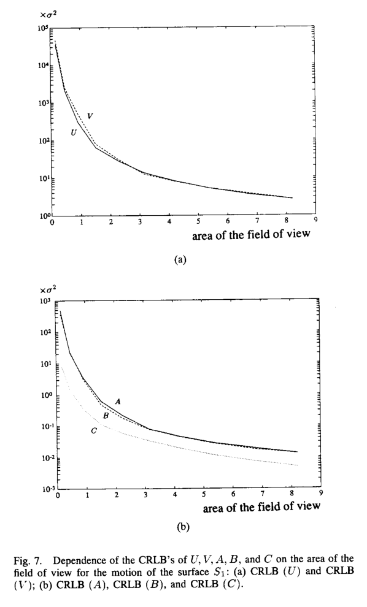
*그림 7 — 표면 $S_1$의 운동에 대해 시야 면적에 대한 $U$, $V$, $A$, $B$, $C$의 CRLB의 의존성: (a) CRLB($U$)와 CRLB($V$); (b) CRLB($A$), CRLB($B$), CRLB($C$).*

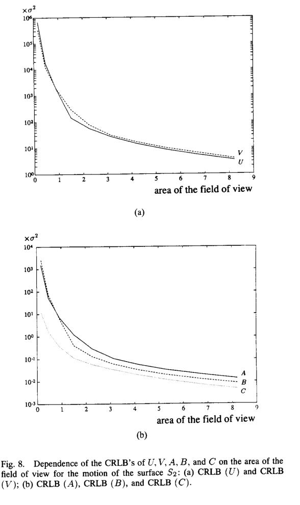
*그림 8 — 표면 $S_2$의 운동에 대해 시야 면적에 대한 $U$, $V$, $A$, $B$, $C$의 CRLB의 의존성: (a) CRLB($U$)와 CRLB($V$); (b) CRLB($A$), CRLB($B$), CRLB($C$).*

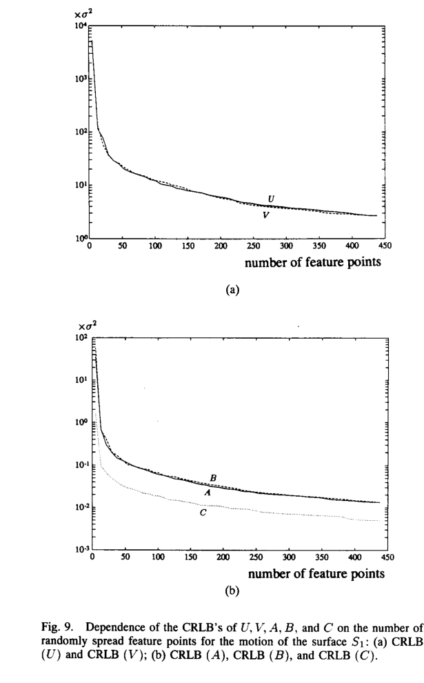
*그림 9 — 표면 $S_1$의 운동에 대해 무작위로 퍼진 특징점 수에 대한 $U$, $V$, $A$, $B$, $C$의 CRLB의 의존성: (a) CRLB($U$)와 CRLB($V$); (b) CRLB($A$), CRLB($B$), CRLB($C$).*

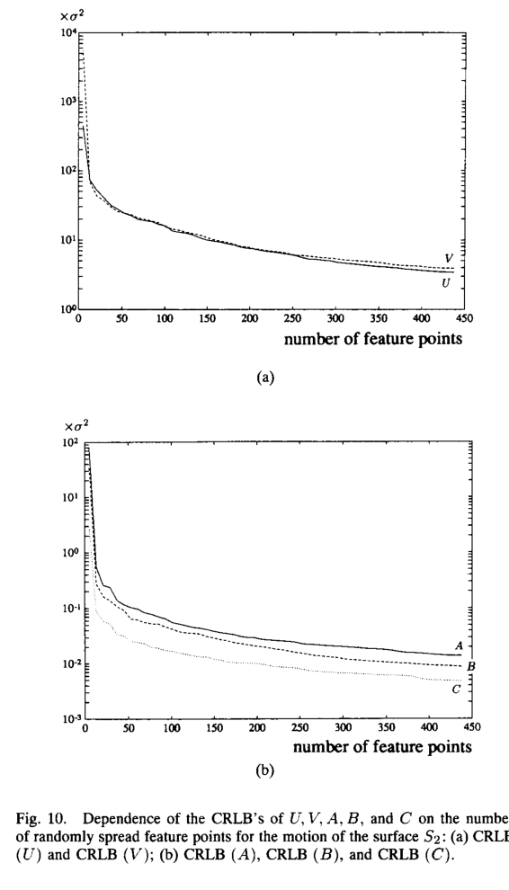
*그림 10 — 표면 $S_2$의 운동에 대해 무작위로 퍼진 특징점 수에 대한 $U$, $V$, $A$, $B$, $C$의 CRLB의 의존성: (a) CRLB($U$)와 CRLB($V$); (b) CRLB($A$), CRLB($B$), CRLB($C$).*

## VI. 매끄러운 표면에 국소 저차 패치를 맞추는 운동 추정 (Motion Estimation by Fitting Local Low Order Patches to Smooth Surfaces)

[역주: 원문 절 제목은 "Fitting Locallow Order Patches"로 붙어 인쇄되어 있다.]

앞 절들에서는 각 화소의 깊이가 다른 화소의 깊이와 무관할 때의 운동 파라미터 CRLB를 계산했다. 깊이가 매끄럽게 변하면 평활성 제약을 넣어 추정 절차에 더 많은 정보를 도입하고, 그 결과 추정된 운동 파라미터의 정확도를 높일 수 있다. 깊이에 평활성 제약을 더하는 한 방법은 영상을 작은 창(window)으로 나누고 각 창에서 표면 패치의 국소 2차 근사를 고려하는 것이다 [25]. CRLB를 얼마나 낮출 수 있는지 보기 위해, 창 안의 정규화 역깊이가 2차 패치로 *정확히* 맞춰지는 최적 조건에서 CRLB를 계산한다. 창 안에서 2차 패치가 근사적으로만 맞춰지는 다른 경우에는, 표면 맞춤의 잔차 잡음 때문에 최적 경우보다 CRLB가 높아야 한다. 이하에서 먼저, 창 크기(한 창 안의 깊이 수)가 6(2차 패치 하나를 나타내는 자유 파라미터 수)보다 크면 2차 맞춤의 최적 경우의 CRLB가 깊이에 평활성 제약을 부과하지 않은 경우의 CRLB보다 항상 낮음을 보인다. 미지 파라미터 공간의 자유도를 줄이면 파라미터 추정 과정이 안정화되므로 이는 예상된 바이다. 사실 CRLB의 감소는, 작은 창 안의 화소 수가 패치당 자유 파라미터 수보다 큰 한, 천천히 변하는 표면에 어떤 차수의 국소 패치를 맞추든 일반적으로 성립한다. 계산 절차를 보이는 예로 2차 패치를 사용한다. 둘째, 컴퓨터 시뮬레이션은 2차 맞춤의 최적 경우의 CRLB조차 표면 맞춤이 없는 CRLB에 비해 아주 적은 양만 낮아짐을 보여 준다. 마지막으로, 국소 패치를 맞추면 각 일반점에서 측정되는 유일한 흐름 성분이 CRLB를 낮춘다는 의미에서 조리개 문제가 완화됨을 보인다. 이는 평활성 제약이 없어 일반점의 측정을 넣어도 CRLB가 영향을 받지 않는 경우와 대조된다.

영상이 각각 $m$개 화소를 포함하는 $N$개의 창으로 분할되어 있다고 하자. $Z_{ij}$를 $i$번째 창의 $j$번째 점의 정규화 역깊이라 하자. 깊이가 매끄럽게 변하면, 성능의 상한을 얻기 위해 $i$번째 창에서 표면 패치가 $i$번째 국소 2차 패치로 *정확히* 맞춰지는 경우를 생각하자 [25].

$$Z_{ij} = a_{i0} + a_{i1}x_{ij} + a_{i2}y_{ij} + a_{i3}x_{ij}^2 + a_{i4}x_{ij}y_{ij} + a_{i5}y_{ij}^2, \quad j = 1, 2, \ldots, m \qquad (50)$$

여기서 $(x_{ij}, y_{ij})$는 영상 평면 좌표계에서 $i$번째 창의 $j$번째 화소의 위치를 나타낸다. 각 창의 국소 패치에 대한 자유 파라미터 모음을

$$\underline{a}_i = (a_{i0}, a_{i1}, a_{i2}, a_{i3}, a_{i4}, a_{i5})^T, \quad i = 1, 2, \ldots, N$$

로, 표면 구조에 대한 모든 자유 파라미터 모음을

$$\underline{a} = (\underline{a}_1^T, \underline{a}_2^T, \ldots, \underline{a}_N^T)^T$$

로 나타내자. 영상의 모든 점이 특징점이라고 가정하자. 그러면 측정은 흐름 속도 성분

$$\mathbf{u}_{ij}, \mathbf{v}_{ij}, \quad i = 1, 2, \ldots, N;\ j = 1, 2, \ldots, m$$

이다. 자유 파라미터는

$$\underline{\theta} = (U, V, A, B, C, \underline{a}^T)^T$$

이다. 따라서

$$\text{overestimation} \equiv \frac{\text{number of measurements}}{\text{number of parameters}} = \frac{2mN}{5 + 6N} \rightarrow m/3 \ \text{as}\ N \rightarrow \infty \ > 2 \ \text{if}\ m > 6.$$

이를 (12)와 비교하면, 창 크기 $m$이 6보다 크면 깊이에 제약을 두지 않은 경우보다 여기서 과잉 추정도가 더 좋다.

피셔 정보 행렬을 (14)처럼 분할하면 다음을 얻는다.

$$\alpha = \frac{1}{\sigma^2}\sum_{i=1}^{N}\sum_{j=1}^{m}\left[\left(\frac{\partial h_{uij}}{\partial \underline{\psi}}\right)^T\left(\frac{\partial h_{uij}}{\partial \underline{\psi}}\right) + \left(\frac{\partial h_{vij}}{\partial \underline{\psi}}\right)^T\left(\frac{\partial h_{vij}}{\partial \underline{\psi}}\right)\right]$$
$$\beta = \frac{1}{\sigma^2}\sum_{i=1}^{N}\sum_{j=1}^{m}\left[\left(\frac{\partial h_{uij}}{\partial \underline{\psi}}\right)^T\left(\frac{\partial h_{uij}}{\partial \underline{a}}\right) + \left(\frac{\partial h_{vij}}{\partial \underline{\psi}}\right)^T\left(\frac{\partial h_{vij}}{\partial \underline{a}}\right)\right]$$
$$\gamma = \frac{1}{\sigma^2}\sum_{i=1}^{N}\sum_{j=1}^{m}\left[\left(\frac{\partial h_{uij}}{\partial \underline{a}}\right)^T\left(\frac{\partial h_{uij}}{\partial \underline{a}}\right) + \left(\frac{\partial h_{vij}}{\partial \underline{a}}\right)^T\left(\frac{\partial h_{vij}}{\partial \underline{a}}\right)\right]. \qquad (51)$$

위 식의 결과로 $\gamma$는 $i$번째 블록 행렬(차원 6 × 6)이 다음과 같은 블록 대각 행렬(차원 $6N \times 6N$)이다.

$$\gamma_i = \frac{1}{\sigma^2}\sum_{j=1}^{m}\left[\left(\frac{\partial h_{uij}}{\partial \underline{a}_i}\right)^T\left(\frac{\partial h_{uij}}{\partial \underline{a}_i}\right) + \left(\frac{\partial h_{vij}}{\partial \underline{a}_i}\right)^T\left(\frac{\partial h_{vij}}{\partial \underline{a}_i}\right)\right].$$

또한 $\beta$(차원 $5 \times 6N$)는 다음 구조를 갖는다.

$$\beta = (\beta_1, \beta_2, \ldots, \beta_N)$$

여기서 부분행렬 $\beta_i$(차원 5 × 6)는

$$\beta_i = \frac{1}{\sigma^2}\sum_{j=1}^{m}\left[\left(\frac{\partial h_{uij}}{\partial \underline{\psi}}\right)^T\left(\frac{\partial h_{uij}}{\partial \underline{a}_i}\right) + \left(\frac{\partial h_{vij}}{\partial \underline{\psi}}\right)^T\left(\frac{\partial h_{vij}}{\partial \underline{a}_i}\right)\right]$$

이다. 따라서 (17)에서

$$Q = (\alpha - \beta\gamma^{-1}\beta^T)^{-1} = \left(\alpha - \sum_{i=1}^{N}\beta_i\gamma_i^{-1}\beta_i^T\right)^{-1}. \qquad (52)$$

위 식은 $Q$를 5 × 5와 6 × 6 행렬의 역행렬을 구해 계산할 수 있음을 보여 준다. 그러면 $Q$의 대각 항이 운동 파라미터의 CRLB를 준다.

이하에서는 국소 패치를 맞춘 후와 전의 운동 파라미터 CRLB를 비교한다. 두 경우 모두 대응하는 피셔 정보 행렬이 특이하지 않도록 충분한 화소가 있다고 가정한다. 깊이에 제약을 두지 않을 때의 CRLB 계산에 관련된 양에는 위첨자 $'$를 쓰자. 제약이 없으면 피셔 정보 행렬은 (13)으로부터 다음과 같이 다시 쓸 수 있다.

$$J' = \frac{1}{\sigma^2}\sum_{i=1}^{N}\sum_{j=1}^{m}\left[\left(\frac{\partial h_{uij}}{\partial \underline{\theta}'}\right)^T\left(\frac{\partial h_{uij}}{\partial \underline{\theta}'}\right) + \left(\frac{\partial h_{vij}}{\partial \underline{\theta}'}\right)^T\left(\frac{\partial h_{vij}}{\partial \underline{\theta}'}\right)\right]$$

여기서

$$\underline{\theta}' = (U, V, A, B, C; Z_{11}, Z_{12}, \ldots, Z_{1m}; \cdots; Z_{N1}, Z_{N2}, \ldots, Z_{Nm})^T = (\underline{\psi}^T, \underline{Z}^T)^T.$$

$J'$를 (14)처럼 분할하면 다음을 얻는다.

$$\alpha' = \frac{1}{\sigma^2}\sum_{i=1}^{N}\sum_{j=1}^{m}\left[\left(\frac{\partial h_{uij}}{\partial \underline{\psi}}\right)^T\left(\frac{\partial h_{uij}}{\partial \underline{\psi}}\right) + \left(\frac{\partial h_{vij}}{\partial \underline{\psi}}\right)^T\left(\frac{\partial h_{vij}}{\partial \underline{\psi}}\right)\right]$$
$$\beta' = \frac{1}{\sigma^2}\sum_{i=1}^{N}\sum_{j=1}^{m}\left[\left(\frac{\partial h_{uij}}{\partial \underline{\psi}}\right)^T\left(\frac{\partial h_{uij}}{\partial \underline{Z}}\right) + \left(\frac{\partial h_{vij}}{\partial \underline{\psi}}\right)^T\left(\frac{\partial h_{vij}}{\partial \underline{Z}}\right)\right]$$
$$\gamma' = \frac{1}{\sigma^2}\sum_{i=1}^{N}\sum_{j=1}^{m}\left[\left(\frac{\partial h_{uij}}{\partial \underline{Z}}\right)^T\left(\frac{\partial h_{uij}}{\partial \underline{Z}}\right) + \left(\frac{\partial h_{vij}}{\partial \underline{Z}}\right)^T\left(\frac{\partial h_{vij}}{\partial \underline{Z}}\right)\right]. \qquad (53)$$

연쇄 법칙

$$\frac{\partial h_{uij}}{\partial \underline{a}} = \frac{\partial h_{uij}}{\partial \underline{Z}}\frac{\partial \underline{Z}}{\partial \underline{a}}$$

의 도움과 (51), (53)의 비교로 다음에 이른다.

$$\alpha = \alpha', \qquad \beta = \beta'\frac{\partial \underline{Z}}{\partial \underline{a}} \equiv \beta'Z_a, \qquad \gamma = \left(\frac{\partial \underline{Z}}{\partial \underline{a}}\right)^T\gamma'\left(\frac{\partial \underline{Z}}{\partial \underline{a}}\right) \equiv Z_a^T\gamma'Z_a \qquad (54)$$

여기서 다음 약어를 사용했다.

$$Z_a \equiv \frac{\partial \underline{Z}}{\partial \underline{a}}. \qquad (55)$$

$Z_a$의 계수(rank)는 창의 모양에 의존한다. $Z_a$가 최대 계수(full rank)를 갖기 위한 충분조건은 부록 B에 주어져 있다. 규칙적인 모양의 창, 예를 들어 2 × 2보다 큰 모든 정사각형 창에 대해서는 $Z_a$가 최대 계수를 갖는다. (17)과 (18)에 따르면, 2차 패치를 맞추는 경우 운동 파라미터의 CRLB는 다음의 대각 항이다.

$$Q = \alpha^{-1} + \alpha^{-1}\beta G\beta^T\alpha^{-1}$$

제약이 없으면 CRLB는 다음의 대각 항이다.

$$Q' = \alpha'^{-1} + \alpha'^{-1}\beta'G'\beta'^T\alpha'^{-1}.$$

(54)에 의해 $Q$는 다음과 같이 쓸 수 있다.

$$Q = \alpha'^{-1} + \alpha'^{-1}\beta'Z_aGZ_a^T\beta'^T\alpha'^{-1}.$$

이 두 CRLB 집합을 비교하기 위해 행렬 차

$$Q' - Q = \alpha'^{-1}\beta'[G' - Z_aGZ_a^T]\beta'^T\alpha'^{-1} \qquad (56)$$

를 생각하자. $G$는 (18)과 (54)를 사용해 $G'$와 관련지을 수 있다.

$$G = (\gamma - \beta^T\alpha^{-1}\beta)^{-1} = (Z_a^T\gamma'Z_a - Z_a^T\beta'^T\alpha'^{-1}\beta'Z_a)^{-1} = [Z_a^T(\gamma' - \beta'^T\alpha'^{-1}\beta')Z_a]^{-1} = (Z_a^TG'^{-1}Z_a)^{-1}.$$

$J'^{-1}$이 양의 정부호라고 가정했으므로 (17)에 의해 $G'$와 $G'^{-1}$도 그렇다. 따라서 $G'^{-1}$은 다음과 같이 분해할 수 있다 [22].

$$G'^{-1} = KK^T \qquad (57)$$

여기서 $K$는 정칙이다. 그러면 (56)의 괄호 안 둘째 양은 다음과 같이 다시 쓸 수 있다.

$$Z_aGZ_a^T = Z_a(Z_a^TG'^{-1}Z_a)^{-1}Z_a^T = K^{T^{-1}}K^TZ_a(Z_a^TKK^TZ_a)^{-1}Z_a^TKK^{-1} \equiv K^{T^{-1}}PK^{-1} \qquad (58)$$

여기서 $P$는 다음과 같이 정의된다.

$$P \equiv K^TZ_a(Z_a^TKK^TZ_a)^{-1}Z_a^TK. \qquad (59)$$

$P$와 $Z_a$의 차원은 각각 $mN \times mN$과 $mN \times 6N$임에 유의하라. 규칙적인 창, 예를 들어 2 × 2보다 큰 모든 정사각형 창에서는 $Z_a$가 최대 계수이므로 $Z_a$의 계수는 $6N$이다. 따라서 (59)는 $P$의 계수가 많아야 $6N$임을 뜻한다. $m > 6$이므로 $P$는 특이하다. $P$가 멱등(idempotent)이고 대칭임, 즉

$$P^2 = P, \qquad P = P^T$$

임을 보이는 것은 간단하다. 따라서 $P$와 $(I - P)$는 모두 사영 행렬이며, 여기서 $I$는 단위 행렬이다. 모든 사영 행렬의 고유값은 0 또는 1이므로 $(I - P)$는 양의 준정부호이며 다음과 같이 분해할 수 있다.

$$I - P = LL^T. \qquad (60)$$

(57), (58), (60)을 사용하면 (56)을 다음과 같이 다시 쓸 수 있다.

$$Q' - Q = \alpha'^{-1}\beta'K^{T^{-1}}(I - P)K^{-1}\beta'^T\alpha'^{-1} = (\alpha'^{-1}\beta'K^{T^{-1}}L)(\alpha'^{-1}\beta'K^{T^{-1}}L)^T.$$

따라서 $Q' - Q$는 양의 준정부호이다. 이는 $Q' - Q$의 대각 항이 0 이상임을 뜻한다. $Q$와 $Q'$의 대각 항은 각각 국소 패치를 맞춘 경우와 맞추지 않은 경우의 CRLB이므로, 매끄러운 표면에 국소 패치를 맞추는 것은 결코 CRLB를 증가시키지 않는다고 결론짓는다.

국소 패치를 맞춤으로써 CRLB가 얼마나 낮아지는지 간단히 보기 위해, 여러 창 크기에 대해 2차 곡면을 맞추기 전과 후의 CRLB를 계산한다. 깊이에 국소 패치를 맞추지 않은 CRLB는 (19)로 계산한다. 국소 2차 패치를 맞춘 후의 CRLB는 (52)로 계산한다. 사용한 표면은 2차 맞춤의 최적 경우, 즉 각 창 안에서 정규화 역깊이가 2차 패치로 정확히 맞춰지는 경우에 해당한다. 맞춤 전후 CRLB의 차를 맞춤 전 CRLB로 나누었다. 결과는 표 I에 보였다. (시야는 폭 3인 정사각형이다. 평행이동 운동은 $(U', V', W') = (0.64, 0.79, 1)$이다. 특징점은 균일한 60 × 60 격자 위에 놓인다. 초점거리는 1로 두었다.) 국소 패치를 맞추면 CRLB가 아주 제한된 양(0.6% 미만)만 낮아짐을 알 수 있다.

표 I — 국소 2차 패치를 맞춤으로써 낮아진 CRLB의 백분율 (Percentage of CRLB's Lowered by Fitting Local Quadratic Patches)

| | 창 크기 3 × 3 | 4 × 4 | 5 × 5 | 6 × 6 |
|---|---|---|---|---|
| $U$ | 0.034% | 0.073% | 0.11% | 0.14% |
| $V$ | 0.029% | 0.075% | 0.10% | 0.14% |
| $A$ | 0.069% | 0.17% | 0.25% | 0.42% |
| $B$ | 0.072% | 0.16% | 0.29% | 0.36% |
| $C$ | 0.13% | 0.21% | 0.34% | 0.51% |

이하에서는 국소 패치를 맞추면 조리개 문제가 완화됨을 보인다. 일반점이 있고 국소 패치를 맞추는 경우, III절과 VI절과 비슷한 유도를 따라 다음의 대각 항으로부터 CRLB를 얻을 수 있다.

$$Q'' = \left(\alpha'' - \sum_{i=1}^{N}\beta_i''\gamma_i''^{-1}\beta_i''^T\right)^{-1} \qquad (61)$$

여기서 $\alpha''$, $\beta_i''$, $\gamma_i''$를 열거하는 식은 이 쪽 아래에 보였다. $M_{if}$와 $M_{ir}$은 각각 $i$번째 창의 특징점과 일반점의 수이고, 일반점에는 첨자 $k$를, 특징점에는 $j$를 붙였으며,

$$h_{ik} \equiv h_{uik}\cos\theta_{ik} + h_{vik}\sin\theta_{ik}$$

이다.

$$\alpha'' = \frac{1}{\sigma^2}\sum_{i=1}^{N}\left\{\sum_{k=1}^{M_{ir}}\left(\frac{\partial h_{ik}}{\partial \underline{\psi}}\right)^T\left(\frac{\partial h_{ik}}{\partial \underline{\psi}}\right) + \sum_{j=1}^{M_{if}}\left[\left(\frac{\partial h_{uij}}{\partial \underline{\psi}}\right)^T\left(\frac{\partial h_{uij}}{\partial \underline{\psi}}\right) + \left(\frac{\partial h_{vij}}{\partial \underline{\psi}}\right)^T\left(\frac{\partial h_{vij}}{\partial \underline{\psi}}\right)\right]\right\}$$
$$\beta_i'' = \frac{1}{\sigma^2}\left\{\sum_{k=1}^{M_{ir}}\left(\frac{\partial h_{ik}}{\partial \underline{\psi}}\right)^T\left(\frac{\partial h_{ik}}{\partial \underline{a}_i}\right) + \sum_{j=1}^{M_{if}}\left[\left(\frac{\partial h_{uij}}{\partial \underline{\psi}}\right)^T\left(\frac{\partial h_{uij}}{\partial \underline{a}_i}\right) + \left(\frac{\partial h_{vij}}{\partial \underline{\psi}}\right)^T\left(\frac{\partial h_{vij}}{\partial \underline{a}_i}\right)\right]\right\}$$
$$\gamma_i'' = \frac{1}{\sigma^2}\left\{\sum_{k=1}^{M_{ir}}\left(\frac{\partial h_{ik}}{\partial \underline{a}_i}\right)^T\left(\frac{\partial h_{ik}}{\partial \underline{a}_i}\right) + \sum_{j=1}^{M_{if}}\left[\left(\frac{\partial h_{uij}}{\partial \underline{a}_i}\right)^T\left(\frac{\partial h_{uij}}{\partial \underline{a}_i}\right) + \left(\frac{\partial h_{vij}}{\partial \underline{a}_i}\right)^T\left(\frac{\partial h_{vij}}{\partial \underline{a}_i}\right)\right]\right\}$$

또한 영상 밝기 패턴의 기울기 벡터가 $i$번째 창의 $k$번째 일반점에서

$$(\cos\theta_{ik}, \sin\theta_{ik})$$

방향이라고 가정했다. (61)에서 일반점이 관련된 항들이 상쇄되지 않으므로, 일반점이 CRLB에 정보를 기여함을 알 수 있다. 이 사실은 컴퓨터 시뮬레이션으로도 확인할 수 있다. 고려한 표면은 그림 11에 보였다. 서로 겹치지 않는 각 3 × 3 창의 중심점은 영상 밝기 패턴의 기울기를 따르는 흐름 성분만 관측 가능한 일반점이라고 가정한다. 각 창의 나머지 여덟 점은 특징점이다. 특징점만에 기반한 CRLB는 (52)로 계산해 표 II의 첫째 열에 나열했다. 특징점과 일반점 모두에 기반한 CRLB는 (61)로 얻어 둘째 열에 나열했다. 각 창 안에서 표면은 2차 곡면으로 정확히 맞춰진다. 평행이동 운동은 $(U', V', W') = (0.61, 0.75, 1)$이다. 시야는 폭 3인 정사각형이다. 화소는 균일한 21 × 21 격자 위에 놓인다. 초점거리는 1이다. 표 II로부터 일반점의 흐름 측정을 추가하면 CRLB가 낮아짐을 알 수 있다.

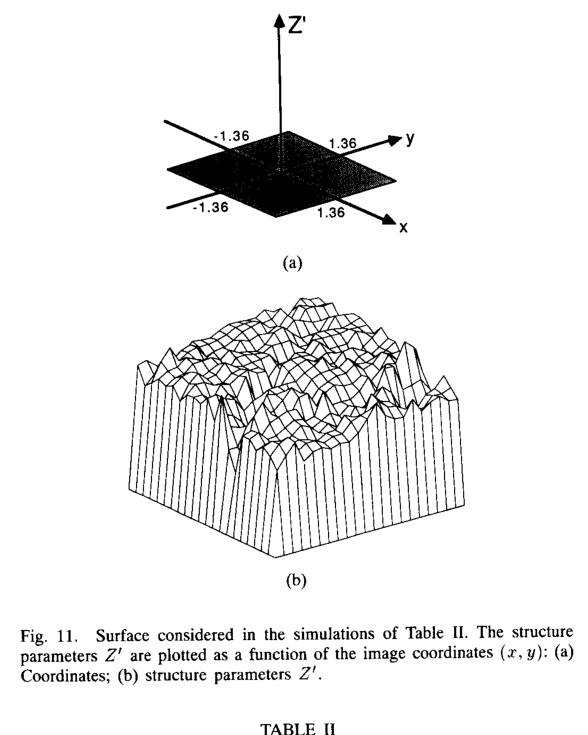
*그림 11 — 표 II의 시뮬레이션에서 고려한 표면. 구조 파라미터 $Z'$를 영상 좌표 $(x, y)$의 함수로 그렸다: (a) 좌표; (b) 구조 파라미터 $Z'$.*

표 II — 그림 11의 표면 운동에 대해 국소 2차 패치를 맞출 때, 일반점의 측정을 적용하지 않은 경우와 적용한 경우의 CRLB. (각 CRLB는 광류 성분의 잡음 분산인 $\alpha^2$으로 정규화했다.) [역주: 원문 캡션은 "$\alpha^2$"로 인쇄되어 있으나 문맥상 $\sigma^2$이다.]

| | 특징점 (feature points) | 특징점과 일반점 (feature and regular points) |
|---|---|---|
| $CRLB(U)$ | 2.52 | 2.43 |
| $CRLB(V)$ | 2.66 | 2.57 |
| $CRLB(A)$ | 0.0111 | 0.0106 |
| $CRLB(B)$ | 0.0127 | 0.0121 |

III절과 VI절의 분석을 다음과 같은 CRLB의 순서로 요약한다.

국소 패치를 맞추지 *않을* 때 특징점만에 기반한 CRLB
= 국소 패치를 맞추지 *않을* 때 특징점과 일반점 모두에 기반한 CRLB
≥ 국소 패치를 맞출 때 특징점만에 기반한 CRLB
≥ 국소 패치를 맞출 때 특징점과 일반점 모두에 기반한 CRLB.

## VII. 논의 (Discussion)

잡음 있는 흐름장으로부터 3차원 운동을 복원할 때의 내재적 모호성을 기술하기 위해 간단한 통계적 모델을 제안했다. 백색 가우스 잡음이 흐름장을 오염시키는 가장 단순한 경우를 연구했다. 가우스 가정은 제한적이지만, 우리의 간단한 통계적 모델의 몇몇 특수한 경우의 결과가 잡음 분포를 가정하지 않은 Adiv의 분석을 뒷받침한다는 것은 흥미롭다. 제안한 모델이 내재적 모호성에 관한 많은 흥미로운 특징을 설명하며 수학적으로 다루기 쉽다는 것을 보였다. 예를 들어 이 모델을 사용하면 조리개 문제와 운동 추정 안정성 사이의 연관을 다룰 수 있고, 평면의 일반 운동에 대한 해석적 결과를 얻을 수 있으며, 국소 패치 맞춤에 의한 추정 과정의 개선을 연구할 수 있다. 비평면 표면의 일반 운동조차 시뮬레이션으로 고려할 수 있다. 또한 우리 연구에서 유도한 성능 한계는 편향(bias)에 대한 식을 갖고 있지 않으므로 *불편* 운동 추정 알고리즘에 대해서만 유효하다는 점도 지적해야 한다. 상당히 *편향된* 운동 추정치를 주는 운동 추정 알고리즘을 고려할 때는 이 논문에 제시한 결과를 신중하게 해석해야 한다.

피셔 정보 행렬의 정량적 형태 (3)을 사용하면 모델을 더 복잡한 잡음 분포로 확장할 수 있다. 예를 들어 가우스가 아닌 잡음 분포를 고려하면, 크라메르-라오 부등식 (2)의 피셔 정보 행렬을 (3)으로 계산할 수 있다. V절에서 보였듯이, 비평면 표면의 일반 운동에 대해서는 대수적 조작이 불가능하지만 수치 결과는 언제나 계산할 수 있고, 그림으로부터 몇몇 일반적 성질을 추론할 수 있다. 어떤 잡음 분포에 대해서도 CRLB는 (2)와 (3)으로부터 직접 계산할 수 있으므로 이 이점은 비가우스 경우에도 이어진다. 그러면 여러 요인에 대한 CRLB의 의존성을 점별로 그릴 수 있다. 그런 다음 V절에서 한 것과 비슷하게 이 그래프들로부터 관찰할 수 있다.

## 부록 A (Appendix A)

**명제(Proposition):** 만약

$$(p, q)^T \neq (-U, 0)^T$$

이면

$$(p + U)^2[(3U^4 + 2U^2 + 3)p^2 - 2U(3U^2 + 1)p + 3U^2] + q^2[(2U^4 + 8U^2 + 6)p^2 + 3(U^2 + 1)^2q^2 - (6U^5 + 2U^3 - 4U)p + 6U^4 + 6U^2] \qquad (62)$$

는 항상 양수이다.

*증명(Proof):* 양 (62)는 다음 형태로 쓸 수 있다.

$$ax^2 + bx + c, \quad x > 0, a > 0, c \geq 0 \qquad (63)$$

여기서

$$x = q^2, \quad a = 3(U^2 + 1)^2, \quad b = (U^2 + 1)[-3U^3p + U^2p^2 + 3U^2 + 2Up + 3p^2] \qquad (64)$$
$$c = (p + U)^2[(3U^4 + 2U^2 + 3)p^2 + (-6U^3 - 2U)p + 3U^2]. \qquad (65)$$

(65)의 괄호 안의 양은 $p$의 2차식이고 판별식이

$$\Delta_p = (-6U^3 - 2U)^2 - 4(3U^4 + 2U^2 + 3)(3U^2) = -32U^2 \leq 0$$

이므로 $c \geq 0$이다. 2차 형식 (63)에 따르면, 다음을 보일 수 있으면 명제의 증명이 끝난다.

$$\Delta_x = b^2 - 4ac \geq 0 \Longrightarrow b \geq 0.$$

따라서 이후로는 다음을 가정하자.

$$\Delta_x \geq 0. \qquad (66)$$

$U = 0$ 또는 $p = 0$인 경우는 (62)가 분명히 양수이므로 논의에서 제외할 수 있다.

$$\Delta_x = b^2 - 4ac = 32U^2p^2(U^2 + 1)^2(1 - Up)(3U^2 + Up + 2)$$

이므로 (66)에 의해 다음을 얻는다.

$$(1 - Up)(3U^2 + Up + 2) \geq 0. \qquad (67)$$

**Case I:** $Up < 0$: 식 (64)로부터

$$b = (U^2 + 1)[3(-Up)U^2 + U^2p^2 + (U + p)^2 + 2(U^2 + p^2)] \geq 0.$$

**Case II:** $0 \leq Up \leq 1$: 식 (64)로부터

$$b = (U^2 + 1)[3(1 - Up)U^2 + U^2p^2 + 2Up + 3p^2] \geq 0.$$

**Case III:** $1 < Up$: 식 (67)로부터

$$-(3U^2 + Up + 2) \geq 0.$$

그러면 (64)는 다음이 된다.

$$b = (U^2 + 1)[Up[-(3U^2 + Up + 2)] + 2U^2p^2 + 2(U^2 + p^2) + U^2 + p^2] \geq 0.$$

## 부록 B (Appendix B)

이 부록에서는 (55)의 행렬 $Z_a$가 최대 계수를 갖기 위한 충분조건을 제시한다. 그림 12의 두 배치 중 하나가 각 창의 부분집합이면 $Z_a$가 최대 계수를 가짐을 보인다.

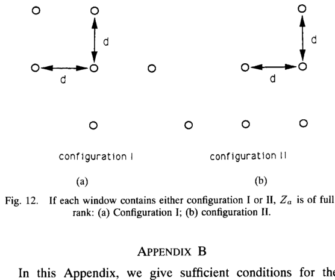
*그림 12 — 각 창이 배치 I 또는 II를 포함하면 $Z_a$는 최대 계수를 갖는다: (a) 배치 I; (b) 배치 II.*

$i$번째 창의 정규화 역깊이 모음을

$$\underline{Z}_i \equiv (Z_{i1}, Z_{i2}, \ldots, Z_{im})^T$$

로 나타내자. 약어

$$Z_{ai} \equiv \frac{\partial \underline{Z}_i}{\partial \underline{a}_i} = \begin{pmatrix} 1 & x_{i1} & y_{i1} & x_{i1}^2 & x_{i1}y_{i1} & y_{i1}^2 \\ 1 & x_{i2} & y_{i2} & x_{i2}^2 & x_{i2}y_{i2} & y_{i2}^2 \\ \vdots & & & & & \vdots \\ 1 & x_{im} & y_{im} & x_{im}^2 & x_{im}y_{im} & y_{im}^2 \end{pmatrix}$$

를 사용하면 다음을 얻는다.

$$Z_a = \begin{pmatrix} Z_{a1} & & & \\ & Z_{a2} & & \\ & & \ddots & \\ & & & Z_{aN} \end{pmatrix}.$$

$Z_a$는 모든 $i$에 대해 $Z_{ai}$가 최대 계수일 때, 그리고 그때에만 최대 계수이다. $Z_{ai}$는 $m > 6$인 $m \times 6$ 행렬이므로, $Z_{ai}$가 최대 계수이기 위한 충분조건은 $Z_{ai}$의 정사각 부분행렬

$$Z'_{ai} \equiv \begin{pmatrix} 1 & x_{i1} & y_{i1} & x_{i1}^2 & x_{i1}y_{i1} & y_{i1}^2 \\ 1 & x_{i2} & y_{i2} & x_{i2}^2 & x_{i2}y_{i2} & y_{i2}^2 \\ \vdots & & & & & \vdots \\ 1 & x_{i6} & y_{i6} & x_{i6}^2 & x_{i6}y_{i6} & y_{i6}^2 \end{pmatrix}$$

의 행렬식이 0이 아닌 것이다. $\{(x_{ij}, y_{ij}) | j = 1, \ldots, 6\}$가 그림 12의 여섯 점 집합 중 하나이면 $Z'_{ai}$의 행렬식은

$$\det(Z'_{ai}) = \pm 4d^8$$

이며, 여기서 $d$는 화소 간 거리이다. $\det(Z'_{ai})$는 창의 위치와 무관함에 유의하라. 따라서 각 창이 그림 12의 여섯 점 집합 중 하나를 포함하면 (55)의 행렬 $Z_a$는 최대 계수를 갖는다고 결론짓는다. 예를 들어 2 × 2를 제외한 모든 정사각형 창은 최대 계수의 $Z_a$를 준다.

## 저자 소개 (원문 마지막 쪽)

**Gem-Sun Jason Young**은 1984년 대만 국립대학(National Taiwan University, Taipei)에서 전기공학 학사(B.S.E.E.)를, 1988년과 1990년에 서던캘리포니아 대학(University of Southern California, Los Angeles, USC)에서 전기공학 석사와 박사 학위를 받았다. 1986–1990년 USC 신호·영상 처리 연구소(Signal and Image Processing Institute) 연구 조교였다. 1990–1992년 Electro Optek Corporation(Torrance, CA)의 연구 엔지니어로 근무했다. 현재 IBM Corporation(Austin, TX)에 있다. 현재 연구 관심사는 컴퓨터 비전, 신호·영상 처리, 컴퓨터 그래픽스, 비선형 추정 이론의 응용이다. Young 박사는 Phi Kappa Phi 회원이다.

**Rama Chellappa** (F'92)는 1953년 인도 마드라스 탄조르(Tanjore)에서 태어났다. 1975년 마드라스 대학(University of Madras)에서 전자·통신공학 학사(우등)를, 1977년 인도 과학원(Indian Institute of Science, Bangalore)에서 전기통신공학 석사(최우등)를 받았다. 1978년과 1981년에 퍼듀 대학(Purdue University)에서 전기공학 석사와 박사 학위를 받았다. 1978년부터 1981년까지 메릴랜드 대학 컴퓨터 비전 연구소의 연구 조교(faculty research assistant)였다. 1981년부터 1991년까지 USC(Los Angeles) 전기공학 시스템 학과 교수진이었다. 1988년부터 1990년까지는 USC 신호·영상 처리 연구소 소장도 맡았다. 현재 메릴랜드 대학 전기공학과 교수이며, 자동화 연구 센터(Center for Automation Research), 컴퓨터 과학과, 고등 컴퓨터 연구소(Institute for Advanced Computer Studies)에도 소속되어 있다. 현재 연구 관심사는 신호·영상 처리, 컴퓨터 비전, 패턴 인식이다.

Chellappa 박사는 1985년 출판된 디지털 영상 처리·분석 선집 두 권의 공동 편집자이다. 1987년부터 1989년까지 IEEE Transactions on Acoustics, Speech, and Signal Processing의 부편집위원이었다. 현재 *Computer Vision, Graphics, and Image Processing: Graphic Models and Image Processing*의 공동 편집장이며, IEEE Transactions on Neural Networks와 IEEE Transactions on Image Processing의 부편집위원이다. 1969년부터 1975년까지 인도 정부의 국가 장학금을, 1975년 인도 정부 교육부의 Jawaharlal Nehru Memorial Award를 받았다. 또한 1985년 NSF Presidential Young Investigator Award와 1985년 IBM Faculty Development Award를 받았다. 1990년 USC 공과대학에서 Excellence in Teaching Award를 받았다. 1992년 국제 패턴 인식 협회(International Association of Pattern Recognition)가 수여한 첫 산업 관련 최우수 논문상의 공동 수상자였다. 책의 장 10편과 120편이 넘는 학술지·학회 논문을 썼다. 1989년 6월 모두 San Diego, CA에서 열린 IEEE Computer Society Conference on Computer Vision and Pattern Recognition과 IEEE Computer Society Workshop on Artificial Intelligence for Computer Vision의 총괄 의장이었다. 역시 1989년 6월 San Diego에서 열린 NSF 후원 Workshop on Markov Random Fields의 프로그램 공동 의장이었다.

## 참고문헌

- [1] G. Adiv, "Determining three-dimensional motion and structure from optical flow generated by several moving objects," IEEE Trans. Patt. Anal. Machine Intell., vol. PAMI-7, no. 4, pp. 384–401, July 1985.
- [2] G. Adiv, "Inherent ambiguities in recovering 3-D motion and structure from a noisy flow field," IEEE Trans. Patt. Anal. Machine Intell., vol. 11, no. 5, pp. 477–489, May 1989.
- [3] J. K. Aggarwal, "Motion and time-varying imagery—An overview," in Proc. IEEE Workshop Motion: Representation Anal. (Kiawah Island, SC), May 1986.
- [4] J. Y. Aloimonos and D. Shulman, Integration of Visual Modules. Boston, MA: Academic, 1989.
- [5] P. Anandan, "Computing dense displacement fields with confidence measures in scenes containing occlusion," in Proc. DARPA Image Understanding Workshop, Oct. 1984, pp. 236–246.
- [6] ——, "A unified perspective on computational techniques for the measurement of visual motion," in Proc. First Int. Conf. Comput. Vision (London), June 1987, pp. 219–230.
- [7] P. Anandan and R. Weiss, "Introducing a smoothness constraint in a matching approach for the computation of displacement fields," in Proc. DARPA Image Understanding Workshop, Dec. 1985, pp. 186–196.
- [8] T. J. Broida, S. Chandrashekhar, and R. Chellappa, "Recursive estimation of 3-D motion from a monocular image sequence," IEEE Trans. Aerospace Elect. Syst., vol. 26, pp. 639–656, July 1990.
- [9] T. J. Broida and R. Chellappa, "Estimation of object motion parameters from noisy images," IEEE Trans. Patt. Anal. Machine Intell., vol. PAMI-8, no. 1, pp. 90–99, Jan. 1986.
- [10] ——, "Performance bounds for estimating three-dimensional motion parameters from a sequence of noisy images," J. Optical Soc. Amer. A, vol. 6, no. 6, pp. 879–889, June 1989.
- [11] A. R. Bruss and B. K. P. Horn, "Passive navigation," Comput. Vision Graphics Image Processing, vol. 21, no. 1, pp. 3–20, Jan. 1983.
- [12] B. Cernuschi-Frias et al., "Toward a model-based bayesian theory for estimating and recognizing parameterized 3-d objects using two or more images taken from different positions," IEEE Trans. Patt. Anal. Machine Intell., vol. 11, no. 10, pp. 1028–1052, Oct. 1989.
- [13] E. C. Hildreth, "Computations underlying the measurement of visual motion," Artificial Intell., vol. 23, pp. 309–354, Aug. 1984.
- [14] ——, The Measurement of Visual Motion. Cambridge, MA: MIT Press, 1984.
- [15] B. K. P. Horn, Robot Vision. Cambridge, MA: MIT Press, 1986.
- [16] ——, "Motion fields are hardly ever ambiguous," Int. J. Comput. Vision, vol. 1, pp. 259–274, Oct. 1987.
- [17] ——, "Relative orientation," Int. J. Comput. Vision, vol. 4, pp. 59–78, Jan. 1990.
- [18] H. C. Longuet-Higgins, "A computer algorithm for reconstructing a scene from two projections," Nature, vol. 293, pp. 133–135, Sept. 1981.
- [19] K. Prazdny, "Egomotion and relative depth map from optical flow," Biol. Cybern., vol. 36, pp. 87–102, Feb. 1980.
- [20] H. W. Sorenson, Parameter Estimation, Principles and Problems. New York: Marcel Dekker, 1980.
- [21] M. E. Spetsakis and J. Aloimonos, "Optimal motion estimation," in Proc. Workshop Visual Motion (Irvine, CA), Mar. 1989, pp. 229–237.
- [22] G. Strang, Linear Algebra and Its Application. New York: Academic, 1980.
- [23] R. Y. Tsai and T. S. Huang, "Uniqueness and estimation of three-dimensional motion parameters of rigid objects with curved surfaces," IEEE Trans. Patt. Anal. Machine Intell., vol. PAMI-6, pp. 13–27, Jan. 1984.
- [24] S. Ullman, "Analysis of visual motion by biological and computer systems," Comput., vol. 14, pp. 57–69, Aug. 1981.
- [25] A. M. Waxman, B. Kamgar-Parsi, and M. Subbarao, "Closed-form solutions to image flow equations for 3d structure and motion," Int. J. Comput. Vision, vol. 1, pp. 239–258, Oct. 1987.
- [26] J. Weng, T. S. Huang, and N. Ahuja, "Motion from images: Image matching, parameter estimation and intrinsic stability," in Proc. Workshop Visual Motion, Mar. 1989, pp. 359–366.
- [27] G. S. Young and R. Chellappa, "3-d motion estimation using a sequence of noisy stereo images: Models, estimation, and uniqueness results," IEEE Trans. Patt. Anal. Machine Intell., vol. 12, no. 8, pp. 735–759, Aug. 1990.
