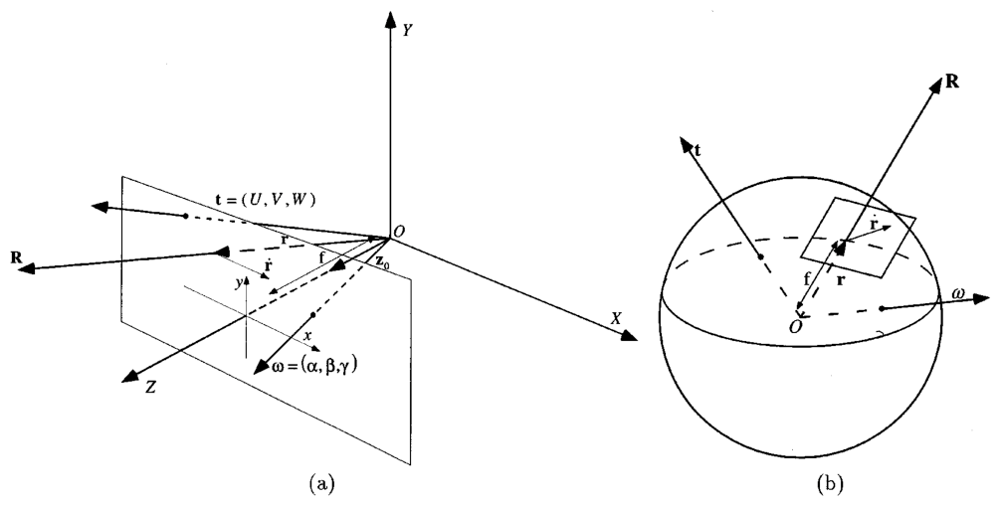
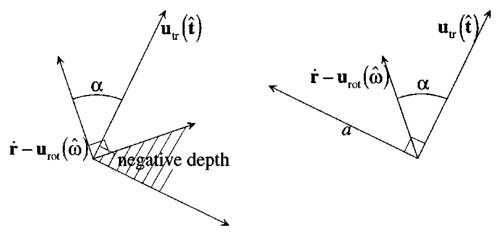
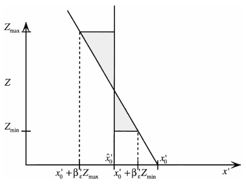
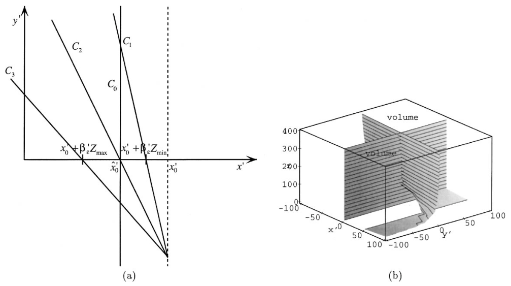
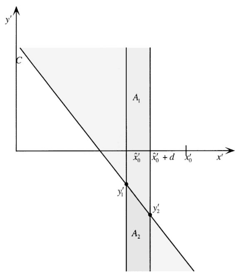
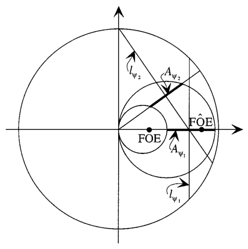
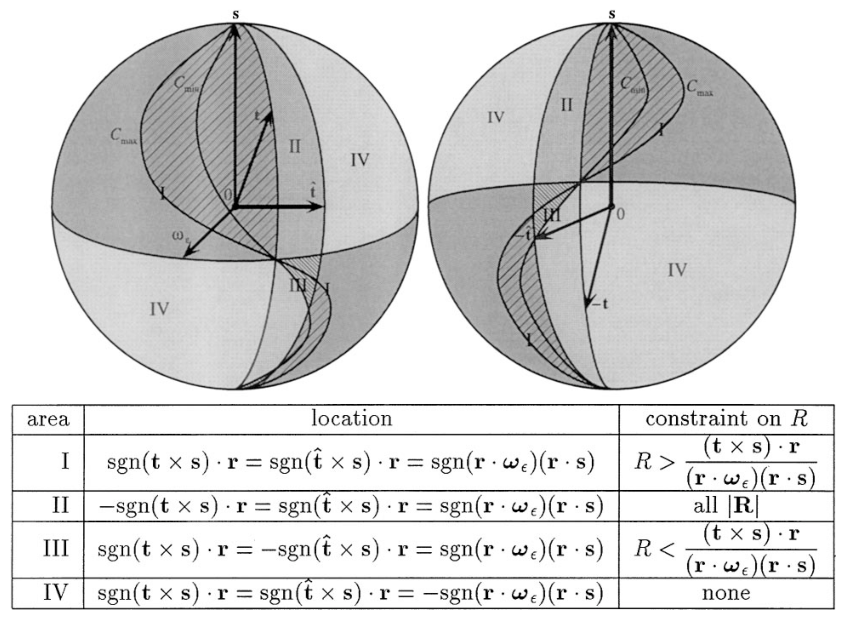
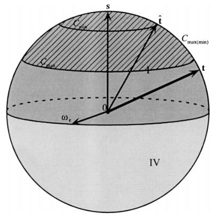
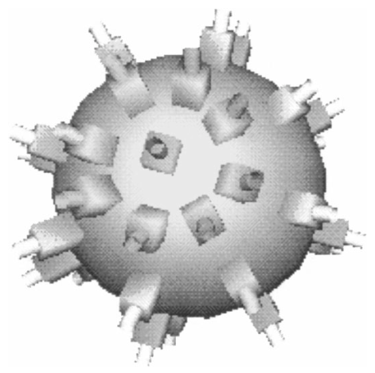

# 3차원 운동의 관측 가능성 (Fermüller 2000)

- 원제: Observability of 3D Motion
- 원문: 같은 폴더의 `Fermuller2000_IJCV_observability.pdf` (C. Fermüller, Y. Aloimonos, International Journal of Computer Vision 37(1), pp. 43–63, 2000, Kluwer Academic Publishers)
- 번역 범위: 전문 (본문, 표 1, 그림 캡션, 부록 A·B, 주 포함. 참고문헌은 원문 그대로)
- 그림: 원문 그림 9개를 `그림/`에 넣고 본문에서 처음 언급되는 곳에 삽입. 표 1은 마크다운 표로 옮김

저자 소속: Computer Vision Laboratory, Center for Automation Research, Institute for Advanced Computer Studies and Computer Science Department, University of Maryland, College Park, MD 20742-3275

## 초록

이 논문은 영상 열(image sequence)로부터 3차원 강체 운동을 관측하는 데 내재한 어려움을 살펴본다. 특정 추정기(estimator)를 고려하지 않고 그렇게 한다. 대신 영상 열로부터 3차원 운동을 추정하는 데 쓸 수 있는 모든 가능한 계산 모델에 대한 통계적 분석을 제시한다. 이 계산 모델들은 그것이 쓰는 수학적 제약과 영상 센서의 특성(제한된 시야와 전체 시야)에 따라 분류된다. 수학적 제약에 관해서는, 움직이는 카메라로 찍은 영상 열을 관련짓는 두 원리가 있다. 하나는 운동장(motion field)에 적용되는 "에피폴라 제약(epipolar constraint)"이고, 다른 하나는 법선 흐름장(normal flow field)에 적용되는 "양의 깊이(positive depth)" 제약이다. 3차원 운동 추정은 이 제약들을 영상 전체에 걸쳐 최적화하는 것이다. 이 제약들을 통계적으로 모델링하면 함수들을 얻게 되며, 이 함수들을 지형 구조(topographic structure), 특히 함수의 최솟값을 나타내는 위치에서의 3차원 운동 파라미터 오차에 관해 연구한다. 제한된 시야를 갖는 일반 비디오 카메라의 경우, 분석은 두 부류 모두에서 모든 운동 파라미터를 동시에 추정하는 알고리즘에 대해, 얻어진 해가 갖는 오차는 평행이동 오차와 회전 오차의 영상 평면 투영이 서로 수직이 되는 형태임을 보인다. 또한 평행이동의 영상 투영 추정치는 원점과 실제 평행이동의 투영을 지나는 직선 위에 놓인다. (파노라마 센서나 일반 카메라들의 시스템으로 얻는) 전체(360도) 시야를 갖는 카메라에서는 상황이 다르다. 이 경우 위 두 함수의 최솟값 위치에서 평행이동 오차나 회전 오차 중 하나가 0이 되는 반면, 제한된 시야의 경우에는 두 오차가 모두 0이 아니다. 전체 시야의 경우에도 일부 모호성이 여전히 남지만, 이는 시각 서보(visual servoing)처럼 3차원 운동 추정을 포함하는 시각 항법 과제가 파노라마 시각을 쓰면 더 쉽게 풀린다는 것을 시사한다. 또한 이 분석은 평행이동을 먼저 추정하고 그 결과를 바탕으로 회전을 추정하는 알고리즘, 그 반대로 하는 알고리즘, 모든 운동 파라미터를 동시에 추정하는 알고리즘의 성질을 비교할 수 있게 하여, 3차원 운동의 관측 가능성(observability)에 대한 건전한 틀을 제공한다. 끝으로, 도입한 틀은 영상 기반 서보 방식의 안정성을 연구하는 새로운 길을 가리킨다.

핵심어(Keywords): 3차원 운동 추정, 오차 분석, 에피폴라 제약, 양의 깊이 제약

## 1. 서론: 시각 서보와 운동 추정 (Introduction: Visual Servoing and Motion Estimation)

시각 서보를 넓게 정의하면 영상 분석에 기반한 운동 제어이다. 따라서 장면의 어떤 특징을 관찰하며 핸들 회전을 조정하는 운전자, 구멍에 핀(peg)을 끼우려는 시스템, 제어반에서 여러 화면을 보며 여러 레버를 조정하는 조작자, 집을 찾아가려는 항법 시스템은 모두 시각 서보 과제를 수행한다. 그런 시스템은 환경 변화에 "적절히" 반응해야 한다. 따라서 높은 수준에서 보면 이들은 진화하는(evolving) 시스템 또는 동적 시스템으로 기술할 수 있으며, 상태와 제어 신호를 새 상태로 보내는 함수로 나타낼 수 있다. 상태와 제어 변수는 모두 시간의 함수일 수 있다. 그런 시스템을 제어하는 한 가지 접근은 상태의 추정치를 얻기 위해 관측기(observer) 또는 상태 추정기를 설계하는 것이다. 예를 들어 이 추정기는 부분적인 시각 복원 과정을 구현할 수 있다. 이 추정치를 제어기 또는 상태 조절기(regulator)가 써서 동적 시스템을 구동할 제어 신호를 계산한다. 이상적으로는 관측과 제어가 분리 가능하다. 즉, 최적 제어기와 최적 관측기가 있으면 둘을 결합한 제어 시스템이 최적임이 보장된다(Dean and Wellman, 1991). 서로 다른 에이전트, 즉 동적 시스템은 서로 다른 능력과 서로 다른 양의 기억을 가지며, 스펙트럼의 한쪽 끝에는 단순한 반응형(reactive) 시스템이, 다른 쪽 끝에는 장면 기술과 추론 과정을 활용하는 매우 정교하고 유연한 시스템이 있다.

시각 제어에 관한 초기 연구에서는 이 스펙트럼의 상층에 노력이 집중되어, 시스템이 정확한 3차원 운동과 환경의 형상을 추정할 수 있게 하려 했다. 이 정보를 정확히 얻을 수 있다고 가정하고, 감각 피드백 로봇공학은 로봇 활동의 계획과 실행을 다뤘다. 이는 "보고 움직이기(look and move)" 접근으로 특징지어졌고, 서보 접근은 "위치 기반 또는 장면 기반(position-or-scene-based)"이었다. 인식을 행동에서 이렇게 분리하는 것의 문제는 두 계산 목표가 모두 매우 어렵다는 것으로 드러났다. 한편으로 3차원 운동과 형상의 복원은 정확히 달성하기 어렵고, 게다가 어려운 보정(캘리브레이션) 문제를 많이 다뤄야 했다. 다른 한편으로 공간 계획과 운동 제어는 시공간 환경 기술의 오차에 매우 민감하다. 이를 깨닫고 능동 시각(active vision)이 등장하면서(Aloimonos et al., 1988; Aloimonos, 1990; Bajcsy, 1988; Ballard and Brown, 1992), 관심은 스펙트럼의 하층으로 옮겨가 시각 처리를 최소화하고 추정기보다 조절기에 중점을 두게 되었다. 정적인 보고 움직이기 제어 전략에 대한 연구에서 얻은 주요 교훈 중 하나는, 영상으로 3차원 운동과 형상을 계산하는 것보다 더 쉽게 할 수 있는 일이 있어야 한다는 것이었다. 이는 제어기가 영상에 작용하도록, 즉 장면이 특정한 모습이 되도록 매니퓰레이터의 관절을 움직이도록 시각 서보 과제를 정식화하는 데 이르렀다. 기술적으로 말하면, 제어기는 특정 좌표계들(손, 눈, 장면 등)이 서로 특정 관계에 놓이도록 작용해야 했다. 게다가 이 관계는 직접 얻을 수 있는 영상 측정값을 제어 루프의 피드백으로 써서 실현할 수 있었다. 이 접근은 영상 기반 로봇 서보(image-based robot servoing)로 알려져 있으며(Espiau et al., 1992; Feddema et al., 1993; Hager et al., 1994), 최근 몇 년간 매우 흥미로운 연구 결과를 냈다(Horaud et al., 1998; Hutchinson et al., 1996). 이 결과의 대부분은 카메라의 내부·외부 파라미터와 함께 영상 야코비안(image Jacobian)(즉, 카메라 좌표계와 장면 좌표계 사이의 미분 관계)의 계산을 다룬다.

시각 서보에서 어떤 철학적 접근(장면 기반 또는 영상 기반)을 택하든, 문제의 본질적 측면은 서로 다른 좌표계 사이(카메라, 그리퍼, 로봇, 장면, 물체 등 사이)의 관계를 복원하는 것이다. 이는 관계 자체일 수도 있고 관계 변화의 표현일 수도 있다. 서보 시스템은 일반적으로 움직이고 있으므로(또는 움직이는 부분을 관측하므로), 근본 문제는 영상 열로부터 3차원 운동을 복원하는 것이다. 이 복원이 명시적이든 암묵적이든, 그것 없이는 서로 다른 좌표계 사이의 관계를 유지할 수 없고 서보 과제를 달성할 수 없다. 더 구체적으로, 3차원 운동의 관측 가능성은 영상 야코비안의 조건수(conditioning)와 직접 관련되며(Feddema et al. (1989), Nelson and Khosla (1994), Sharma and Hutchinson (1995)에서 연구됨), 따라서 영상 기반 시각 서보에서 두드러진 역할을 한다. 학제적 성격 때문에 충분히 인식되지 않았던 이 문제는 이해하기 쉽다. Chaumette (1998)의 명명법을 따르면, 영상 기반 시각 서보는 원하는 값 $s^*$에 도달해야 하는 시각 특징의 집합 $s$를 선택하는 것이다. $M$이 카메라 속도(평행이동과 회전)로 이루어진 6차원 벡터를 나타내면 $\dot s = J_s M$이며, $J_s$는 영상 야코비안이다. 기존의 모든 제어 방식은 로봇 제어기로 보내는 카메라 속도를 $M = f(J_s^+(s - s^*))$로 계산한다. 여기서 $J_s^+$는 $J_s$의 의사역행렬(pseudoinverse)이고 $f$는 적절한 함수(비례 이득, 최적 제어, 비선형 제어 등)이다. 이제 데이터 $\dot s$가 유일하고 강건한 $M$을 보장하지 않으면, $J_s^+$는 어떻게 추정하든 나쁜 조건(ill-conditioned)이 되고 어떤 제어 방식도 문제에 부딪힌다. 뒤의 결론 절에서, 서보 방식의 거동을 이 논문에서 전개하는 운동 관측 가능성의 성질과 관련짓는 것을 목표로 하는 향후 연구 질문 몇 가지를 개괄한다. 따라서 서보가 얼마나 성공적으로 달성될 수 있는지 이해하려면, 3차원 운동을 얼마나 정확히 관측할 수 있는지 이해하는 것이 중요하다.

경험상 실제로 3차원 운동은 정확히 관측하기가 매우 어려우며, 많은 모호성과 민감성이 따른다. 3차원 운동의 모호성이 나타나는 방식에 어떤 규칙성이 있는가? 3차원 운동을 추정하려 할 때 생기는 오차는 어떤 제약을 만족하는가? 3차원 강체 운동은 평행이동과 회전의 합으로 이루어지므로, 3차원 운동의 서로 다른 성분의 복원을 지배하는 고유한 모호성에 차이가 있는가? 또한 이 질문은 특정 최적화 알고리즘과 무관하게 연구해야 한다. 이것이 이 논문이 연구하는 문제이다.

## 2. 접근 방법 (The Approach)

3차원 운동을 추정하는 기법은 그야말로 넘쳐나지만, 결과가 일반적으로 쓰이려면 우리 접근은 알고리즘에 무관해야 한다. 동등하게 말하면, 우리 접근은 영상 열로부터 3차원 운동을 추정하는 데 쓸 수 있는 모든 가능한 계산 모델을 포괄해야 한다. 그러려면 3차원 운동에 대한 모든 가능한 접근을 쓰는 입력과 사용하는 수학적 제약에 따라 분류해야 한다.

시스템이 어떤 환경 속을 움직이면, 장면의 모든 점은 시스템에 대한 속도를 갖는다. 이 속도 벡터들을 시스템의 눈에 투영한 것이 이른바 운동장(motion field)을 이룬다. 광류(optical flow)라 불리는 운동장의 추정은 먼저 영상 밝기 함수의 시공간 미분을 추정하는 데서 시작한다. 이 미분들은 이른바 법선 흐름(normal flow)을 이루는데, 이는 국소 영상 기울기(gradient) 방향, 즉 국소 에지에 수직인 방향의 흐름 성분이다. 시스템은 법선 흐름을 입력으로 3차원 운동 추정을 시작할 수도 있고, 매우 어려운 문제이긴 하지만 먼저 광류를 추정한 뒤 3차원 운동을 추정할 수도 있다. 이는 3차원 운동 추정의 어려움에 대한 분석이 두 입력, 즉 광류장과 법선 흐름장을 모두 고려해야 한다는 뜻이며, 문헌의 알고리즘들은 둘 중 하나를 입력으로 쓴다.

3차원 운동이 입력 영상 운동에 부호화되는 수학적 제약에 관해서는, 이 분야의 광범위한 연구로 장면에 대한 정보가 없으면 그런 제약이 두 개뿐임이 확립되었다. 첫째는 "에피폴라 제약"이고 둘째는 "양의 깊이 제약"이다. 에피폴라 제약은 영상 열에서 대응점들이 장면의 같은 점의 투영임을 보장한다. 양의 깊이 제약은 장면이 카메라 앞에 있으므로 모든 장면 점의 깊이가 양수일 것을 요구한다. 법선 흐름을 안다고 해서 영상 열의 대응점을 아는 것은 아니므로, 법선 흐름만 있을 때는 에피폴라 제약을 쓸 수 없다.

에피폴라 제약은 가장 많은 연구를 끌어왔다. 이 제약은 광류가 있을 때만 쓸 수 있다. 측정값이 많으므로, 영상 전체에 걸쳐 에피폴라 제약으로부터의 편차를 나타내는 함수를 만든다. 문헌에는 에피폴라 편차를 나타내는 데 서로 다른 척도를 쓰고, 결과 함수의 최적화에 서로 다른 기법을 쓰는 다양한 접근이 있다. 또한 먼저 회전을 추정하고 그 결과를 바탕으로 이어서 평행이동을 추정하는 기법(Burger and Bhanu, 1990; Prazdny, 1980, 1981), 그 반대로 하는 기법(Adiv, 1985; Heeger and Jepson, 1992; Horn, 1990; Longuet-Higgins and Prazdny, 1980; Maybank, 1987; Rieger and Lawton, 1985; Spetsakis and Aloimonos, 1989), 모든 운동 파라미터를 동시에 추정하는 기법(Ballard and Kimball, 1983; Bandopadhay, 1986; Faugeras et al., 1987; Philip, 1991; Zhuang et al., 1986)이 있다. 법선 흐름장에 쓰여 온 양의 깊이 제약은 비교적 새로우며, 이른바 직접(direct) 알고리즘에서 쓰인다(Bandopadhay, 1986; Fermüller and Aloimonos, 1995; Horn and Weldon, 1988). 입력과 일관되면서 음의 깊이를 가장 적게 만드는 3차원 운동을 탐색해야 한다. 달리 말하면, 이 접근들에서는 음의 깊이의 양을 나타내는 함수를 최소화해야 한다. 끝으로 광류가 있을 때 "양의 깊이 제약"을 쓸 수도 있겠지만, 이 원리를 구현한 알고리즘은 아직 문헌에 없다.

자연을 보면 시각을 가진 생물에는 매우 다양한 눈 설계가 있다. 중요한 특성은 시야이다. 제한된 시야를 갖는 시각 시스템이 있다. 이는 육상 척추동물의 각막 눈(corneal eye)으로 구현된다. 사람의 눈과 일반 비디오 카메라가 이 범주에 속하며, 기하학적으로는 평면 위로의 중심 투영(central projection)으로 모델링된다. 이런 눈을 평면형 또는 카메라형 눈(planar or camera-type eye)이라 부른다. 전체 360도 시야를 갖는 시각 시스템도 있다. 이는 곤충의 겹눈(compound eye)으로, 또는 새와 물고기처럼 카메라형 눈을 머리 양쪽에 배치하여 구현된다. 파노라마 시각은 구의 중심을 투영 중심으로 하여 구 위로 투영하는 것으로 기하학적으로 적절히 모델링된다. 3차원 운동의 관측 가능성을 연구하면서 제한된 시야와 파노라마 시각을 모두 조사한다. 이 둘은 3차원 운동 추정에 관해 서로 다른 성질을 갖는 것으로 드러난다.

*그림 1 — 평면 (a)와 구 (b) 위의 영상 형성. 시스템은 평행이동 속도 $\mathbf t$와 회전 속도 $\boldsymbol\omega$로 강체 운동한다. 장면 점 $\mathbf R$은 영상 점 $\mathbf r$로 투영되고, 장면 점의 3차원 속도 $\dot{\mathbf R}$은 영상에서 영상 속도 $\dot{\mathbf r}$로 관측된다.*

우리 접근에서는 통계 모델을 써서 제약을 나타내고, 카메라형 눈과 구형 눈(spherical eye) 모두에 대해 에피폴라 기하로부터의 편차 또는 음의 깊이의 양을 나타내는 함수를 유도한다. 3차원 운동 추정을 위한 모든 가능하고 의미 있는 알고리즘은 이 함수들의 최소화로 이해할 수 있다. 따라서 이 함수들의 지형 분석을 수행하여 전역 최솟값과 국소 최솟값을 연구한다. 구체적으로는, 이 곡면들의 최솟값을 나타내는 점에서 3차원 운동 오차들 사이의 관계에 관심이 있다. 그 배경에 있는 생각은, 실제 상황에서는 어떤 추정 절차든 오차에 시달리며, 보통 최소화할 함수의 국소 최솟값이 해로 얻어진다는 것이다.

## 3. 문제 기술 (Problem Statement)

### 3.1. 사전 준비 (Prerequisites)

정적인 환경 속에서 강체 운동하는 단안 관측자의 영상 운동 측정을 표현하는 표준 관례를 쓴다. 관측자의 운동을, 카메라의 절점(nodal point)에 고정된 좌표계 $OXYZ$에 대한 평행이동 속도 $\mathbf t = (U, V, W)$와 회전 속도 $\boldsymbol\omega = (\alpha, \beta, \gamma)$로 기술한다. 좌표 $\mathbf R = (X, Y, Z)$인 각 장면 점 $P$는 카메라에 대해 속도 $\dot{\mathbf R} = -\mathbf t - \boldsymbol\omega \times \mathbf R$를 갖는다. $\dot{\mathbf R}$을 주어진 모양의 망막(retina) 위로 투영하면 영상 운동장이 된다.

영상이 절점으로부터 거리 $f$(초점 거리)에 있고 $Z$축에 수직인 평면(그림 1(a)) 위에 형성되면, 영상 점 $\mathbf r = (x, y, f)$와 대응 장면 점 $\mathbf R$은 $\mathbf r = \frac{f}{\mathbf R\cdot\mathbf z_0}\mathbf R$로 관련된다. 여기서 $\mathbf z_0$는 $Z$축 방향의 단위 벡터이다. 운동장은 다음과 같다.

$$\dot{\mathbf r} = -\frac{1}{(\mathbf R\cdot\mathbf z_0)}(\mathbf z_0 \times (\mathbf t \times \mathbf r)) + \frac{1}{f}\mathbf z_0 \times (\mathbf r \times (\boldsymbol\omega \times \mathbf r)) = \frac{1}{Z}\mathbf u_{\rm tr}(\mathbf t) + \mathbf u_{\rm rot}(\boldsymbol\omega), \tag{1}$$

여기서 $Z = \mathbf R\cdot\mathbf z_0$는 깊이를 나타낸다. 영상이 투영 중심을 원점으로 하는 반지름 $f$의 구(그림 1(b)) 위에 형성되면, 임의의 점 $\mathbf R$의 영상 $\mathbf r$은 $\mathbf r = \frac{\mathbf R f}{|\mathbf R|}$이며, $R$은 $\mathbf R$의 노름(거리, range)이다. 영상 운동은 다음과 같다.

$$\dot{\mathbf r} = \frac{1}{|\mathbf R|f}((\mathbf t\cdot\mathbf r)\mathbf r - \mathbf t) - \boldsymbol\omega \times \mathbf r = \frac{1}{R}\mathbf u_{\rm tr}(\mathbf t) + \mathbf u_{\rm rot}(\boldsymbol\omega). \tag{2}$$

운동장은 두 성분의 합이다. 하나인 $\mathbf u_{\rm tr}$은 평행이동에 의한 것이고, 다른 하나인 $\mathbf u_{\rm rot}$는 회전에 의한 것이다.

장면 점의 깊이 $Z$ 또는 거리 $R$은 평행이동 흐름에 반비례하는 반면, 회전 흐름은 보이는 장면과 무관하다. (1)과 (2)에서 볼 수 있듯이 평행이동과 장면 깊이의 효과는 분리할 수 없으므로, 평행이동의 방향 $\mathbf t/|\mathbf t|$만 계산할 수 있다. 따라서 $\mathbf t$의 길이를 택할 수 있다. 이하 분석 전체에서 $f$는 1로 두고, $\mathbf t$의 길이는 구에서는 1, 평면에서는 $\mathbf t$의 $Z$ 성분을 1로 가정한다. 그러면 3차원 운동 추정 문제는 운동장의 표현으로부터 크기 조정된 벡터 $\mathbf t$와 벡터 $\boldsymbol\omega$를 찾는 것이 된다. 이하에서는 분석을 쉽게 하기 위해 카메라형 눈에 대해 비벡터 표기를 쓴다. 그러면 $\mathbf r$의 처음 두 좌표는 직교 좌표계 $oxy$에서의 영상 점을 나타내며, $ox \parallel OX$, $oy \parallel OY$이고 $o$는 $OZ$와 영상 평면의 교점이다. 평행이동 벡터 $\mathbf t$의 방향을 나타내는 영상 점을 $(x_0, y_0) = (U/W, V/W)$로 나타낸다($W$가 양수인지 음수인지에 따라 확장 초점(Focus of Expansion, FOE) 또는 수축 초점(Focus of Contraction, FOC)이라 한다). 그러면 식 (1)은 흐름 측정 $\mathbf v(x, y) = (u(x, y), v(x, y))$를 표현하는 잘 알려진 식이 된다.

$$\begin{aligned} u(x, y) &= \frac{u_{\rm tr}(x, y)}{Z} + u_{\rm rot}(x, y) = (x - x_0)\frac{W}{Z} + \alpha xy - \beta(x^2 + 1) + \gamma y\\ v(x, y) &= \frac{v_{\rm tr}(x, y)}{Z} + v_{\rm rot}(x, y) = (y - y_0)\frac{W}{Z} + \alpha(y + 1) - \beta xy - \gamma x \end{aligned} \tag{3}$$

[역주: 둘째 식의 $\alpha(y + 1)$은 원문 그대로이다. 표준 형태는 $\alpha(y^2 + 1)$이다.]

여기서 $\frac{\mathbf v_{\rm tr}(x, y)}{Z} = \left(\frac{u_{\rm tr}(x, y)}{Z}, \frac{v_{\rm tr}(x, y)}{Z}\right)$와 $\mathbf v_{\rm rot}(x, y) = (u_{\rm rot}(x, y), v_{\rm rot}(x, y))$는 각각 평행이동 흐름 성분과 회전 흐름 성분이다.

법선 흐름의 값에 관해서는, $\mathbf n$이 영상 점에서 그 점의 기울기 방향을 나타내는 단위 벡터이면 법선 흐름 $v_n$은 다음을 만족한다.

$$v_n = \dot{\mathbf r}\cdot\mathbf n \tag{4}$$

끝으로 논문 전체에서 다음 관례를 쓴다. 추정된 양은 모자(hat) 기호가 붙은 글자로, 실제 양은 표시 없는 글자로 나타내고, 아래첨자 "$\epsilon$"는 오차를 나타낸다. 오차량은 실제 양에서 추정량을 뺀 것으로 정의한다. 예를 들어 $\mathbf u_{\rm rot}(\boldsymbol\omega)$는 실제 회전 흐름, $\mathbf u_{\rm rot}(\hat{\boldsymbol\omega})$는 추정된 회전 흐름, $\mathbf t_\epsilon$은 평행이동 오차 벡터, $x_{0_\epsilon} = x_0 - \hat x_0$, $\alpha_\epsilon = \alpha - \hat\alpha$ 등이다.

### 3.2. 모델 (The Model)

3차원 운동 추정의 고전적 접근은 에피폴라 제약으로부터의 편차를 최소화하는 것이다. 이 제약은 식 (1)(또는 (2))에서 깊이(또는 거리)를 소거하여 얻는다. 평면 눈과 구형 눈 모두에 대해 이 제약은 다음과 같다.

$$(\mathbf t \times \mathbf r)\cdot(\dot{\mathbf r} + \boldsymbol\omega \times \mathbf r) = \mathbf 0. \tag{5}$$

영상 운동을 광류와 같다고 놓으면, 이 제약으로 광류 측정에 기반하여 3차원 강체 운동을 유도할 수 있다. 어떤 편차 기준에 따라 모든 점 $\mathbf r$에서 에피폴라 제약을 가장 잘 만족하는 평행이동 추정치 $\hat{\mathbf t}$와 회전 추정치 $\hat{\boldsymbol\omega}$에 관심이 있다. 보통 유클리드 노름을 쓰며, 이는 다음 함수의 최소화로 이어진다(Horn, 1986; Maybank, 1993).[^1]

$$M_{\rm ep} = \iint_{\rm image}[(\hat{\mathbf t} \times \mathbf r)\cdot(\dot{\mathbf r} + \hat{\boldsymbol\omega} \times \mathbf r)]^2\,d\mathbf r. \tag{6}$$

반면 법선 흐름이 주어지면 벡터 식 (1)과 (2)를 직접 쓸 수 없다. 유일한 제약은 스칼라 식 (4)와, 보이는 표면이 눈 앞에 있으므로 그 깊이가 양수여야 한다는 부등식 $Z > 0$이다. (1) 또는 (2)를 (4)에 대입하고 추정 깊이 $\hat Z$ 또는 거리 $\hat R$에 대해 풀면, 주어진 추정치 $\hat{\mathbf t}$, $\hat{\boldsymbol\omega}$에 대해 각 점 $\mathbf r$에서 다음을 얻는다.

$$\hat Z(\text{or }\hat R) = \frac{\mathbf u_{\rm tr}(\hat{\mathbf t})\cdot\mathbf n}{(\dot{\mathbf r} - \mathbf u_{\rm rot}(\hat{\boldsymbol\omega}))\cdot\mathbf n}. \tag{7}$$

(7)의 분자와 분모의 부호가 반대이면 음의 깊이가 계산된다. 따라서 양수성 제약을 활용하려면 음의 깊이 추정치를 가장 적게 만드는 운동 $\hat{\mathbf t}$, $\hat{\boldsymbol\omega}$를 탐색해야 한다. 형식적으로, $\mathbf r$이 영상 점이면 지시 함수(indicator function)를 다음과 같이 정의한다.

$$I_{\rm nd}(\mathbf r) = \begin{cases} 1 & \text{for } (\mathbf u_{\rm tr}(\hat{\mathbf t})\cdot\mathbf n)((\dot{\mathbf r} - \mathbf u_{\rm rot}(\hat{\boldsymbol\omega}))\cdot\mathbf n) < 0\\ 0 & \text{for } (\mathbf u_{\rm tr}(\hat{\mathbf t})\cdot\mathbf n)((\dot{\mathbf r} - \mathbf u_{\rm rot}(\hat{\boldsymbol\omega}))\cdot\mathbf n) > 0 \end{cases}.$$

그러면 법선 흐름으로부터의 3차원 운동 추정은 다음 함수의 최소화이다(Fermüller and Aloimonnos[역주: 원문 철자 그대로], 1995a, 1995b; Horn and Weldon, 1988).

$$M_{\rm nd} = \iint_{\rm image}I_{\rm nd}(\mathbf r)\,d\mathbf r. \tag{8}$$

(1)과 (2)로부터 $\dot{\mathbf r}$을 실제 운동으로 표현하면, 함수 (6)과 (8)은 실제 및 추정 운동 파라미터 $\mathbf t$, $\boldsymbol\omega$, $\hat{\mathbf t}$, $\hat{\boldsymbol\omega}$(또는 동등하게 실제 운동 파라미터 $\mathbf t$, $\boldsymbol\omega$와 오차 $\mathbf t_\epsilon = \mathbf t - \hat{\mathbf t}$, $\boldsymbol\omega_\epsilon = \boldsymbol\omega - \hat{\boldsymbol\omega}$)와 보이는 장면의 깊이 $Z$(또는 거리 $R$)로 표현할 수 있다. 어떤 분석을 하든 장면 모델이 필요하다. 우리는 모든 가능한 장면에서 나오는 운동 추정치의 통계적 기댓값에 관심이 있다. 따라서 확률 모델로서 장면의 깊이 값이 임의의 두 값 $Z_{\min}$(또는 $R_{\min}$)과 $Z_{\max}$(또는 $R_{\max}$) ($0 < Z_{\min} < Z_{\max}$) 사이에 균일하게 분포한다고 가정한다. 음의 깊이 값의 최소화를 위해서는, 추가로 흐름 측정이 이루어지는 방향이 모든 깊이에 대해 모든 방향으로 균일하게 분포한다고 가정한다. $\mathbf n$을 $\mathbf n$과 $x$축 사이의 각 $\psi$로 매개변수화하면 다음 두 함수를 얻는다.

$$E_{\rm ep} = \int_{Z=Z_{\min}}^{Z_{\max}}M_{\rm ep}\,dZ, \tag{9}$$
$$E_{\rm nd} = \int_{\psi=0}^{\pi}\int_{Z=Z_{\min}}^{Z_{\max}}M_{\rm nd}\,dZ\,d\psi, \tag{10}$$

이들은 각각 에피폴라 제약으로부터의 편차와 음의 깊이의 양을 잰다. 함수 (9)와 (10)은 운동 파라미터의 오차 $\mathbf t_\epsilon$, $\boldsymbol\omega_\epsilon$에 대한 5차원 곡면이다. 끝으로 보이는 장면에 확률 모델을 쓰므로 결과는 통계적 성격을 띤다. 즉, 앞으로 밝힐 (9)와 (10)의 최솟값에서 $\mathbf t_\epsilon$, $\boldsymbol\omega_\epsilon$ 사이의 기하학적 제약은 일어날 가능성이 높은 것으로 해석해야 한다.

### 3.3. 음의 깊이와 깊이 왜곡 (Negative Depth and Depth Distortion)

이 절은 음의 깊이 최소화 연구에 필요한 몇 가지 기술적 준비와, 에피폴라 최소화와 음의 깊이 최소화의 관계를 보이는 기하학적 관찰을 담고 있다.

식 (7)은 법선 흐름 $\dot{\mathbf r}\cdot\mathbf n$과 운동 추정치 $\hat{\mathbf t}$, $\hat{\boldsymbol\omega}$가 주어졌을 때의 추정 깊이 $\hat Z$(또는 거리 $\hat R$)를 보여 준다. 이는 다음과 같이 더 쓸 수 있다.

$$\hat Z(\text{or }\hat R) = Z(\text{or }R)D \tag{11}$$

잡음 없는 운동 측정(즉, $\dot{\mathbf r} = \frac{\mathbf u_{\rm tr}(\mathbf t)}{Z} + \mathbf u_{\rm rot}(\boldsymbol\omega)$)의 경우 $D$는 다음 형태이다.

$$D = \frac{\mathbf u_{\rm tr}(\hat{\mathbf t})\cdot\mathbf n}{(\mathbf u_{\rm tr}(\mathbf t) + Z\mathbf u_{\rm rot}(\boldsymbol\omega_\epsilon))\cdot\mathbf n} \tag{12}$$

식 (11)은 부정확한 3차원 운동 값 때문에 잘못된 깊이 추정치가 어떻게 생기는지 보여 준다. 왜곡 인자(distortion factor) $D$가 실제 깊이 값에 곱해져 추정치를 만든다. 식 (12)는 $D$와 $\mathbf n$의 값을 고정하면 $(\mathbf r, Z)$(또는 $(\mathbf r, R)$) 공간에서 하나의 곡면을 기술하며, 이를 등왜곡 곡면(iso-distortion surface)이라 한다. 그런 곡면은, 영상 측정이 방향 $\mathbf n$일 때 깊이가 같은 곱셈 인자로 왜곡되는 공간 점들의 자취로 이해해야 한다. $\mathbf n$을 고정하고 $D$를 바꾸면, 결과 족(family)의 등왜곡 곡면은 $D$에 따라 연속적으로 변한다. 따라서 음의 깊이 추정치를 낳는 모든 장면 점은 왜곡 0 곡면과 왜곡 $-\infty$ 곡면 사이에 놓인다. 음의 깊이 추정치를 낳는 모든 점에 대한 (모든 방향에 걸친) 적분을 음의 깊이 부피(negative depth volume)라 부른다. 5절에서는 등왜곡 곡면과 음의 깊이 부피를 써서, 음의 깊이 값 최소화에서 나오는 함수 (10)을 기하학적으로 연구한다.

이제 두 최소화를 기하학적 관점에서 살펴보자. 에피폴라 제약으로부터의 편차를 유도할 때는 모든 점과 깊이 값에 걸쳐 다음 식의 적분을 고려한다.

$$[(\hat{\mathbf t} \times \mathbf r)\cdot(\dot{\mathbf r} + \hat{\boldsymbol\omega} \times \mathbf r)]^2$$

또는 동등하게

$$[(\dot{\mathbf r} - \mathbf u_{\rm rot}(\hat{\boldsymbol\omega}))\cdot\mathbf u_{\rm tr}^{\perp}(\hat{\mathbf t})]^2$$

여기서 $\mathbf u_{\rm tr}^{\perp}(\hat{\mathbf t})$는 영상 좌표 평면에서 $\mathbf u_{\rm tr}(\hat{\mathbf t})$에 수직인 벡터를 나타낸다. 음의 깊이 값의 개수를 유도할 때는 모든 점과 깊이 값에 걸쳐 두 벡터

$$\mathbf u_{\rm tr}(\hat{\mathbf t}) \quad\text{와}\quad \dot{\mathbf r} - \mathbf u_{\rm rot}(\hat{\boldsymbol\omega})$$

사이의 각 $\alpha$의 적분을 고려한다. 그림 2에 예시가 있다. 두 최소화에서 고려하는 두 척도는 분명히 서로 관련되어 있다. 음의 깊이의 경우에는 각 $\alpha$를 고려하는 반면, 에피폴라 제약의 경우에는 제곱 거리 $a^2$를 고려하며, 이는 $(\sin\alpha\|\mathbf u_{\rm tr}(\hat{\mathbf t})\|\cdot\|\dot{\mathbf r} - \mathbf u_{\rm rot}(\hat{\boldsymbol\omega})\|)^2$이다.

*그림 2 — 최소화 제약에서 쓰는 서로 다른 척도. (a) 운동장의 투영으로부터 음의 깊이 값을 최소화할 때의 $\angle\alpha$. (b) 에피폴라 제약에서의 $a^2$.*

두 척도를 쓸 때의 주된 차이는 각 $\alpha > 90°$에서 생긴다. 음의 깊이 척도는 $\alpha$에 대해 단조이지만, 에피폴라 제약으로부터의 편차 척도는 양의 값과 음의 값의 깊이 추정치를 구별하지 않으므로 단조가 아니다.

계산된 깊이가 양수여야 한다는 사실은 에피폴라 제약의 최소화를 쓰는 과거 접근들에서 고려되지 않았다. 이 사실은 앞으로, 아마도 에피폴라 제약과 함께, 활용할 수 있는 추가 제약을 제공하므로, 이 제약이 3차원 운동 추정에 미치는 영향에도 관심이 있다. 따라서 위에서 논한 함수 (9)와 (10)의 최소화에 더해 셋째 함수의 최소화를 연구한다. 이 함수는 완전한 흐름 측정(광류)을 가정할 때 음의 깊이를 낳는 값의 개수이며, 그 분석은 부록 B에 제시한다.

### 3.4. 흐름의 잡음 모델 (A Model for the Noise in the Flow)

평면에 대한 분석에서는 영상 측정의 잡음도 고려한다. 즉, $(u + N_x, v + N_y) = \left(\frac{u_{\rm tr}}{Z} + u_{\rm rot} + N_x, \frac{v_{\rm tr}}{Z} + v_{\rm rot} + N_y\right)$ 형태의 흐름 값을 고려한다. 잡음 모델의 선택은 다음 고려에서 비롯된다. 첫째, 잡음은 특정 방향을 선호하지 않아야 한다. 둘째, 잡음이 가산적이면서 곱셈적이라고 가정하면, 평행이동 흐름 성분이 깊이의 역수에 비례하므로 잡음과 깊이 사이에 의존성이 있어야 한다. 따라서 두 확률 변수 $\boldsymbol\epsilon = (\epsilon_x, \epsilon_y)$와 $\boldsymbol\delta = (\delta_x, \delta_y)$를 써서 잡음을 다음과 같이 정의한다.

$$(N_x, N_y) = (\epsilon_x, \epsilon_y)\frac{1}{Z} + (\delta_x, \delta_y) \tag{13}$$

1차와 2차 모멘트는 다음과 같다.

$$\begin{aligned} &E(\epsilon_x) = E(\epsilon_y) = E(\delta_x) = E(\delta_y) = 0\\ &E(\delta_x^2) = E(\delta_y^2) = \sigma_\delta^2 \qquad E(\delta_x\delta_y) = 0\\ &E(\epsilon_x^2) = E(\epsilon_y^2) = \sigma_\epsilon^2 \qquad E(\epsilon_x\epsilon_y) = 0 \end{aligned}$$

그리고 모든 확률 변수는 서로 독립이고, 영상 위치와 독립이며, 깊이와 독립이다.

### 3.5. 논문 개관, 결과 요약, 관련 연구 (Overview of the Paper, Summary of Results and Related Work)

우리 접근은 함수 (9)와 (10)을 $\mathbf t$, $\boldsymbol\omega$, $\mathbf t_\epsilon$, $\boldsymbol\omega_\epsilon$으로 표현하고, 서로 다른 추정 알고리즘의 해를 나타내는 국소 최솟값에서 $\mathbf t_\epsilon$과 $\boldsymbol\omega_\epsilon$이 만족하는 조건을 찾는다. 3차원 운동을 추정하는 절차는, 첫 단계로 평행이동이나 회전 중 하나를 추정하고 둘째 단계로 나머지 성분(즉, 회전이나 평행이동)을 추정하는 것과, 모든 성분을 동시에 추정하는 것으로 분류할 수 있다. 앞의 종류의 절차는 시스템이 운동 성분 중 하나의 추정치를 제공하는 관성 센서를 쓰거나, 두 단계 운동 추정 알고리즘을 쓸 때 생긴다.

따라서 세 경우를 연구해야 한다. 3차원 운동에 대한 사전 정보가 없는 경우와, 평행이동 또는 회전의 추정치가 어떤 오차를 가진 채 주어진 경우들이다. 어떻게든 회전이 오차 $\boldsymbol\omega_\epsilon$을 가진 채 추정되었다고 하자. 그러면 함수들은 변수 $\mathbf t_\epsilon$에 대해 2차원이 되고, 고정된 회전 오차에 대응하는 평행이동 오차 파라미터 공간을 나타낸다. 마찬가지로 평행이동 오차 $\mathbf t_\epsilon$이 주어지면, 함수들은 변수 $\boldsymbol\omega_\epsilon$에 대해 3차원이 되고, 고정된 평행이동 오차에 대응하는 회전 오차 공간을 나타낸다. 일반적인 경우를 연구하려면, 0을 지나는 2차원 부분공간에서 함수의 가장 낮은 골짜기(valley)를 고려해야 한다. 영상 처리 문헌에서는 이런 국소 최솟값을 흔히 협곡선(ravine line) 또는 물길(course)이라 부른다. 세 경우 각각을 네 가지 최적화, 즉 구와 평면에 대한 에피폴라 최소화(전체 시야와 제한된 시야 시각), 그리고 구와 평면에 대한 음의 깊이 최소화에 대해 연구한다. 따라서 12(4 곱하기 3)가지 경우가 있지만, 회전이 영상에 미치는 효과는 깊이와 무관하므로, 평행이동의 추정치가 주어졌다고 가정하고 음의 깊이를 최소화하는 것은 의미가 없다. 따라서 아래에서 연구하는 10가지 경우가 남는다. 이 10가지 경우는 모든 가능하고 의미 있는 운동 추정 절차를 나타낸다.

분석은 다음을 보인다.

1. 카메라형 눈(제한된 시야)의 경우, 두 부류 모두에서 모든 운동 파라미터를 동시에 추정하는 알고리즘(즉, 사전 정보가 없는 경우)에 대해, 얻어진 해는 평행이동에 오차 $(x_{0_\epsilon}, y_{0_\epsilon})$, 회전에 오차 $(\alpha_\epsilon, \beta_\epsilon, \gamma_\epsilon)$을 가지며 $\frac{x_{0_\epsilon}}{y_{0_\epsilon}} = \frac{-\beta_\epsilon}{\alpha_\epsilon}$이고 $\gamma_\epsilon = 0$이다. 이는 평행이동 오차와 회전 오차의 영상 투영이 서로 수직이고, $Z$축에 대한 회전의 모호성이 가장 작다는 뜻이다. 이 제약을 "직교 제약(orthogonality constraint)"이라 부른다. 또한 추정된 평행이동 $(\hat x_0, \hat y_0)$은 영상 원점과 실제 평행이동 $(x_0, y_0)$을 지나는 직선 위에 놓인다. 즉 $\frac{x_0}{y_0} = \frac{\hat x_0}{\hat y_0} = \frac{x_{0_\epsilon}}{y_{0_\epsilon}}$이다. 이 둘째 제약을 "직선 제약(line constraint)"이라 부른다. 평행이동을 먼저 추정하고 그것을 바탕으로 이어서 회전을 찾는 경우에도 비슷한 결과가 나오지만, 회전을 먼저 추정하고 이어서 평행이동을 추정하는 경우는 다른 결과를 낸다. 이 작업은 영상 측정에 오차가 없는 경우 — 이 경우 회전과 평행이동 사이의 고유한 혼동에 대한 기하학적 분석이 된다 — 와, 영상 측정이 3.4절의 모델을 만족하는 잡음으로 오염된 경우 모두에 대해 수행된다. 후자의 경우 국소 및 전역 최솟값의 기댓값을 유도한다. 보이겠지만, 잡음은 국소 최솟값을 바꾸지 않으며, 전역 최솟값은 잡음 없는 함수의 골짜기 안에 놓인다. 따라서 잡음은 함수의 전체 구조를 바꾸지 않는다.
2. 파노라마 시각의 경우, 두 부류 모두에서 모든 운동 파라미터를 동시에 추정하는 알고리즘에 대해, 얻어진 해는 평행이동에 오차가 없고($\mathbf t_\epsilon = 0$), 회전 오차는 평행이동에 수직이다. 또한 광류로부터의 에피폴라 최소화의 경우, 평행이동 오차 $\mathbf t_\epsilon$이 주어지면 얻어진 해는 회전에 오차가 없으며($\boldsymbol\omega_\epsilon = 0$), 법선 흐름으로부터의 음의 깊이 최소화의 경우, 회전 오차가 주어지면 얻어진 해는 평행이동에 오차가 없다. 다른 경우들에는 모호성이 남는다. 구형 눈의 경우 분석은 단순히 잡음 없는 흐름에 대해 수행한다.

과거에 카메라형 눈에 대해서는 많은 오차 분석이 수행되었지만(Adiv, 1989; Daniilidis and Nagel, 1990; Daniilidis and Spetsakis, 1997; Dutta and Snyder, 1990; Jepson and Heeger, 1990; Spetsakis and Aloimonos, 1988; Thomas et al., 1993; Young and Chellappa, 1992), 전체 시야의 경우에 대해서는 이런 종류의 연구가 발표된 바 없다. 그러나 기존 연구 중 어느 것도 서로 다른 운동 기법을 분석할 목적으로 최소화할 함수의 지형적 특성화를 시도하지 않았다. 모든 연구는 영상 측정으로 광류나 대응(correspondence)을 고려하며, 에피폴라 제약에 기반한 최소화를 조사한다. 흔히 장면 구조나 추정기에 대한 제한적인 가정을 두었지만, 얻은 주요 결과는 우리 발견과 일치한다. 특히 다음 두 결과는 이미 문헌에 나온다.

a. 작은 시야와 불충분한 깊이 변화에서, $x$축 방향 평행이동은 $y$축에 대한 회전과 쉽게 혼동될 수 있고, $y$축 방향 평행이동은 $x$축에 대한 회전과 쉽게 혼동될 수 있다. 이 사실은 실험적 관찰로 오래전부터 알려졌으며, 평면 장면 구조와 비편향(unbiased) 추정기에 대해 증명되었다(Daniilidis, 1992). 여기서 찾은 직교 제약은 이 발견을 확인하며, 훨씬 더 제한적인 제약을 부과한다. 또한 이 제약은 $x$-평행이동과 $y$-회전, $y$-평행이동과 $x$-회전이 분리(decouple)되어 있지 않음을 보여 준다. 게다가 $Z$축에 대한 회전이 다른 운동 성분과 가장 쉽게 구별될 수 있음을 발견했다.
b. Maybank (1986, 1987)와 Jepson and Heeger (1990)가 앞서 직선 제약을 확립했지만, 훨씬 더 제한적인 가정 아래에서였다. 특히 이들은 작은 시야, 영상 중심에서 멀리 떨어진 평행이동 $\mathbf t$, 불규칙한 표면에 대해, (9)의 함수가 평행이동 방향 공간에서 참 평행이동과 시선 방향(viewing direction)을 지나는 직선을 따라 최솟값을 가짐을 보였다. 주시(fixation) 상태에서는 시선 방향이 영상 중심이 된다.

## 4. 에피폴라 최소화: 카메라형 눈 (Epipolar Minimization: Camera-Type Eye)

$\mathbf t = (x_0, y_0, 1)$, $\boldsymbol\omega = (\alpha, \beta, \gamma)$라 하자. 시야가 작으므로 영상 좌표의 2차 항은 1차 항과 상수 항에 비해 매우 작아 무시한다. 모든 계산은 기호 대수 계산 소프트웨어 Maple로 수행했으며, 간략히 하기 위해 중간 결과는 제시하지 않는다. 먼저 잡음 없는 흐름의 경우를 연구한다.

반지름 $e$의 원형 조리개(aperture)를 고려하고 초점 거리 $f = 1$, $W = 1$, $\hat W = 1$로 두면, (9)의 함수는 다음과 같다.

$$\begin{aligned}E_1 = E_{\rm ep} = \int_{Z=Z_{\min}}^{Z_{\max}}\int_{r=0}^{e}\int_{\phi=0}^{2\pi}\Bigg\{\bigg(&\left(\frac{x - x_0}{Z} - \beta_\epsilon + \gamma_\epsilon y + x\right)(y - \hat y_0)\\ &- \left(\frac{y - y_0}{Z} + \alpha_\epsilon - \gamma_\epsilon x + y\right)(x - \hat x_0)\bigg)^2 r\Bigg\}\,dr\,d\phi\,dZ\end{aligned}$$

여기서 $(r, \phi)$는 극좌표($x = r\cos\phi$, $y = r\sin\phi$)이다. 적분을 수행하면 다음을 얻는다.

$$\begin{aligned}E_1 = \pi e^2\Bigg(&(Z_{\max} - Z_{\min})\left(\frac13\gamma_\epsilon^2e^4 + \frac14\left(\gamma_\epsilon^2(\hat x_0^2 + \hat y_0^2) + 6\gamma_\epsilon(\hat x_0\alpha_\epsilon + \hat y_0\beta_\epsilon) + \alpha_\epsilon^2 + \beta_\epsilon^2\right)e^2 + (\hat x_0\alpha_\epsilon + \hat y_0\beta_\epsilon)^2\right)\\ &+ (\ln(Z_{\max}) - \ln(Z_{\min}))\left(\frac12\left(3\gamma_\epsilon(x_{0_\epsilon}y_0 - y_{0_\epsilon}x_0) + x_{0_\epsilon}\beta_\epsilon - y_{0_\epsilon}\alpha_\epsilon\right)e^2 + 2(x_{0_\epsilon}y_0 - y_{0_\epsilon}x_0)(\hat x_0\alpha_\epsilon + \hat y_0\beta_\epsilon)\right)\\ &+ \left(\frac{1}{Z_{\min}} - \frac{1}{Z_{\max}}\right)\left(\frac14(y_{0_\epsilon}^2 + x_{0_\epsilon}^2)e^2 + (x_{0_\epsilon}y_0 - y_{0_\epsilon}x_0)^2\right)\Bigg)\end{aligned} \tag{14}$$

(a) 평행이동이 어떤 오차 $\mathbf t_\epsilon = (x_{0_\epsilon}, y_{0_\epsilon}, 0)$을 가진 채 추정되었다고 가정하자. 그러면 (14)의 최솟값에서 3차원 운동 오차들 사이의 관계는 1차 조건 $\frac{\partial E_1}{\partial\alpha_\epsilon} = \frac{\partial E_1}{\partial\beta_\epsilon} = \frac{\partial E_1}{\partial\gamma_\epsilon} = 0$으로부터 얻으며, 이는 다음을 낸다.

$$\alpha_\epsilon = \frac{y_{0_\epsilon}(\ln(Z_{\max}) - \ln(Z_{\min}))}{Z_{\max} - Z_{\min}} \qquad \beta_\epsilon = \frac{-x_{0_\epsilon}(\ln(Z_{\max}) - \ln(Z_{\min}))}{Z_{\max} - Z_{\min}} \qquad \gamma_\epsilon = 0 \tag{15}$$

따라서 $\alpha_\epsilon/\beta_\epsilon = -x_{0_\epsilon}/y_{0_\epsilon}$, $\gamma_\epsilon = 0$이다.

(b) 회전이 오차 $(\alpha_\epsilon, \beta_\epsilon, \gamma_\epsilon)$을 가진 채 추정되었다고 가정하면, 오차들 사이의 관계는 $\frac{\partial E_1}{\partial x_{0_\epsilon}} = \frac{\partial E_1}{\partial y_{0_\epsilon}} = 0$으로부터 얻는다. 이 경우 관계는 매우 복잡하며, 평행이동 오차는 다른 모든 파라미터, 즉 회전 오차, 실제 평행이동, 영상 크기, 깊이 구간에 의존한다. 부록 A를 보라.

(c) 일반적인 경우에는 $E_1$이 절대 최솟값에서 가장 적게 변하는 부분공간을 연구해야 한다. 즉, 운동 오차가 0인 점인 0에서 2계 도함수가 가장 작은 방향에 관심이 있다. 이 방향을 찾기 위해 0에서의 헤시안(Hessian), 즉 다섯 운동 오차 파라미터에 대한 $E_1$의 2계 도함수 행렬을 계산하고, 가장 작은 고윳값에 대응하는 고유벡터를 계산한다. 이 벡터의 크기 조정된 성분은 다음과 같다.

$$\begin{aligned}&x_{0_\epsilon} = x_0 \qquad y_{0_\epsilon} = y_0 \qquad \beta_\epsilon = -\alpha_\epsilon\frac{x_0}{y_0} \qquad \gamma_\epsilon = 0\\ &\alpha_\epsilon = 2y_0Z_{\min}Z_{\max}(\ln(Z_{\max}) - \ln(Z_{\min}))\Big/\Big((Z_{\max} - Z_{\min})(Z_{\max}Z_{\min} - 1)\\ &\qquad + \left((Z_{\max} - Z_{\min})^2(Z_{\max}Z_{\min} - 1)^2 + 4Z_{\max}^2Z_{\min}^2(\ln(Z_{\max}) - \ln(Z_{\min}))^2\right)^{1/2}\Big)\end{aligned}$$

볼 수 있듯이, 이 방향으로 정의되는 점들에서 평행이동 오차와 회전 오차는 "직교 제약" $\alpha_\epsilon/\beta_\epsilon = -x_{0_\epsilon}/y_{0_\epsilon}$과 "직선 제약" $x_0/y_0 = \hat x_0/\hat y_0$으로 특징지어진다.

다음으로 흐름 측정의 잡음을 고려한다. 잡음 $(N_x, N_y)$를 3.4절에서 정의한 대로 모델링하고, $E_{\rm ep}$의 기댓값 $E(E_{\rm ep})$를 유도하면 다음과 같다.

$$E(E_{\rm ep}) = E_1 + \int_{Z=Z_{\min}}^{Z_{\max}}\int_{\phi=0}^{2\pi}\int_{r=0}^{e}\left\{\left(\sigma_\epsilon^2\frac{1}{Z^2}[(\hat y_0 - y)^2 + (\hat x_0 - x)^2] + \sigma_\delta^2[(\hat y_0 - y)^2 + (\hat x_0 - x)^2]\right)r\right\}dr\,d\phi\,dZ \tag{16}$$

따라서

$$E(E_{\rm ep}) = E_1 + e^2\pi\left(\sigma_\epsilon^2\left(\frac{1}{Z_{\min}} - \frac{1}{Z_{\max}}\right) + \sigma_\delta^2(Z_{\max} - Z_{\min})\right)\left(\hat y_0^2 + \hat x_0^2 + \frac{e^2}{2}\right)$$

(a) $x_{0_\epsilon}$과 $y_{0_\epsilon}$을 고정하고

$$\frac{\partial E(E_{\rm ep})}{\partial\alpha_\epsilon} = 0 \quad \frac{\partial E(E_{\rm ep})}{\partial\beta_\epsilon} = 0 \quad \frac{\partial E(E_{\rm ep})}{\partial\gamma_\epsilon} = 0$$

을 풀면, (15)에 기술된 잡음 없는 흐름의 경우와 같은 관계를 얻는다.

이는 첫 단계에서 평행이동을 최소화하는[역주: 원문 표현 그대로. 문맥상 평행이동을 먼저 추정하는] 기법의 기대 거동을 잡음이 바꾸지 않음을 보여 준다.

(b) $\alpha_\epsilon$, $\beta_\epsilon$, $\gamma_\epsilon$을 고정하고

$$\frac{\partial E(E_{\rm ep})}{\partial x_{0_\epsilon}} = 0 \quad \frac{\partial E(E_{\rm ep})}{\partial y_{0_\epsilon}} = 0$$

을 풀면, 앞에서처럼 평행이동 오차, 실제 평행이동, 회전 오차 사이의 복잡한 관계를 얻는다.

(c) 모든 3차원 운동 파라미터에 대해 최소화하는 기법의 거동을 분석하기 위해 $E(E_{\rm ep})$의 전역 최솟값을 연구한다. 회전 파라미터에 대한 최소화로부터 (15)(직교 제약과 $\gamma_\epsilon = 0$)를 얻었다. (15)를 (16)에 대입하고

$$\frac{\partial E(E_{\rm ep})}{\partial x_{0_\epsilon}} = 0 \quad \frac{\partial E(E_{\rm ep})}{\partial y_{0_\epsilon}} = 0$$

을 풀면 추가로 다음을 얻는다.

$$\begin{aligned}x_{0_\epsilon} &= 4x_0(Z_{\max} - Z_{\min})^2(\sigma_\epsilon^2 + \sigma_\delta^2Z_{\max}Z_{\min})\Big/\left((Z_{\max} - Z_{\min})^2(4\sigma_\epsilon^2 + 4\sigma_\delta^2Z_{\max}Z_{\min} + e^2) - Z_{\max}Z_{\min}e^2(\ln(Z_{\max}) - \ln(Z_{\min}))^2\right)\\ y_{0_\epsilon} &= x_{0_\epsilon}\frac{y_0}{x_0}\end{aligned}$$

따라서 $E(E_{\rm ep})$의 절대 최솟값은 $E_1$이 가장 적게 증가하는 방향에서 찾아지며, 제약 $\gamma_\epsilon = 0$, 직교 제약, 직선 제약으로 기술된다.

## 5. 음의 깊이 부피의 최소화: 카메라형 눈 (Minimization of Negative Depth Volume: Camera-Type Eye)

이하 분석에서는 음의 깊이 값을 기술하는 함수를 음의 깊이 부피, 즉 3.3절에서 정의한 음의 깊이 왜곡에 대응하는 점들을 써서 기하학적으로 연구한다. 이렇게 하면 함수를 모든 파라미터에 대해 한꺼번에 고려하지 않고 그 성질을 점진적으로 유도할 수 있다. 간단히 하기 위해 FOE와 추정 FOE가 영상 안에 있다고 가정하며, 여러 방향의 음의 깊이 부피가 시야 밖에 놓여서 생기는 정확한 효과는 고려하지 않는다. 먼저 잡음 없는 경우에 집중한다. 앞에서처럼 영상 좌표의 2차 항을 무시하면, (식 (11)로부터) 왜곡 0 곡면은 다음과 같다.

$$(x - \hat x_0)n_x + (y - \hat y_0)n_y = 0 \tag{17}$$

그리고 왜곡 $-\infty$ 곡면은 다음 형태를 취한다.

$$(x - x_0)n_x + (y - y_0)n_y + Z((-\beta_\epsilon + \gamma_\epsilon y)n_x + (\alpha_\epsilon - \gamma_\epsilon x)n_y) = 0 \tag{18}$$

흐름 방향 $(n_x, n_y)$는 $(\cos\psi, \sin\psi)$로도 쓸 수 있으며, $\psi \in [0, \pi]$는 $[n_x, n_y]^T$와 $x$축 사이의 각을 나타낸다. 여러 방향의 음의 깊이 부피를 시각화하기 쉽게 하기 위해, 흐름 방향을 $x$축에 맞추는 다음 좌표 변환을 수행한다. 각 $\psi$에 대해 좌표계를 각 $\psi$만큼 회전하여 새 좌표를 얻는다.

$$[x', y']^T = R[x, y]^T,\ [x_0', y_0']^T = R[x_0, y_0]^T,\ [\hat x_0', \hat y_0']^T = R[\hat x_0, \hat y_0]^T,\ [\alpha_\epsilon', \beta_\epsilon']^T = R[\alpha_\epsilon, \beta_\epsilon]^T,$$

여기서 $R = \begin{bmatrix}\cos\psi & \sin\psi\\ -\sin\psi & \cos\psi\end{bmatrix}$이다.

따라서 식 (17)과 (18)은 $(x' - \hat x_0') = 0$과 $(x' - x_0') + Z(-\beta_\epsilon' + \gamma_\epsilon y') = 0$이 된다.

(a) 첫 단계로 회전을 추정하는 기법을 조사하기 위해, 먼저 $\gamma_\epsilon = 0$인 경우를 연구한 다음 $\gamma_\epsilon \ne 0$인 일반적인 경우로 분석을 확장한다.

$\gamma_\epsilon = 0$이면, 모든 방향 $\psi$에 대해 음의 깊이 값의 부피는 다음 두 곡면 사이에 놓인다.

$$(x' - \hat x_0') = 0 \quad\text{과}\quad (x' - x_0') - \beta_\epsilon'Z = 0$$

식 $(x' - \hat x_0') = 0$은 원점에서 거리 $\hat x_0'$에 있는 $y'Z$ 평면에 평행한 평면을 기술하고, $(x' - x_0') - \beta_\epsilon'Z = 0$은 기울기 $\frac{1}{\beta_\epsilon'}$로 $y'$축에 평행하며 $x'y'$ 평면과 $x'$ 좌표 $x_0'$에서 만나는 평면을 기술한다. 따라서 $y'$축에 평행한 쐐기 모양의 부피를 얻는다. 그림 3은 $x'Z$ 평면에 평행한 단면으로 이 부피를 보여 준다.

*그림 3 — 한 방향에 대해, 음의 추정 깊이 부피를 $x'Z$ 평면에 평행하게 자른 단면.*

보이는 장면은 깊이 값 $Z_{\min}$과 $Z_{\max}$ 사이에 걸쳐 있다. 방향 $\psi$의 음의 깊이 부피를 $x'Z$ 평면에 평행하게 자른 단면의 넓이를 $A_\psi$로 나타낸다.

그림 3에서 볼 수 있듯이, 최솟값을 얻으려면 $\hat x_0'$이 $x_0' + \beta_\epsilon'Z_{\min}$과 $x_0' + \beta_\epsilon'Z_{\max}$ 사이에 있어야 한다. 그러면 $A_\psi = \int_{Z=Z_{\min}}^{Z_{\max}}|x_0' - \hat x_0' + \beta_\epsilon'Z|\,dZ$이며, 이는 다음과 같다.

$$A_\psi = \left|x_{0_\epsilon}'(Z_{\max} + Z_{\min}) + \frac{\beta_\epsilon'}{2}(Z_{\max}^2 + Z_{\min}^2) + \frac{x_{0_\epsilon}'^2}{\beta_\epsilon}\right| \tag{19}$$

[역주: 마지막 항 분모의 $\beta_\epsilon$은 원문 그대로이다(프라임 없음).]

$\beta_\epsilon'$을 고정하고 $x_{0_\epsilon}'$에 대해 $\frac{\partial A_\psi}{\partial x_{0_\epsilon}'} = 0$을 풀면 다음을 얻는다.

$$x_{0_\epsilon}' = -\frac{\beta_\epsilon'}{2}(Z_{\max} + Z_{\min}) \tag{20}$$

즉, 왜곡 0 곡면은 깊이 구간의 한가운데인 평면 $Z = \frac{(Z_{\max} + Z_{\min})}{2}$에서 왜곡 $-\infty$ 곡면과 만나야 한다.

$\frac{x_{0_\epsilon}'}{\beta_\epsilon'}$은 깊이 구간에만 의존하므로 방향 $\psi$와 무관하다. 따라서 (20)이 모든 방향에서 성립하면 음의 깊이 부피가 최소가 된다. $\beta_\epsilon' = \cos\psi\,\beta_\epsilon - \sin\psi\,\alpha_\epsilon$이고 $x_{0_\epsilon}' = \cos\psi\,x_{0_\epsilon} + \sin\psi\,y_{0_\epsilon}$이므로 $\frac{x_{0_\epsilon}}{y_{0_\epsilon}} = \frac{-\beta_\epsilon}{\alpha_\epsilon}$을 얻는다.

$\gamma_\epsilon \ne 0$이면 왜곡 $-\infty$ 곡면은 $(x' - x_0') + Z(-\beta_\epsilon' + \gamma_\epsilon y') = 0$이 된다.

이 곡면은 $x'y'$ 평면에 평행한 평면들로 잘라 보면 가장 쉽게 이해된다. 각 깊이 값 $Z$에서 기울기 $\frac{-1}{\gamma_\epsilon Z}$이고 $x'$축과 $x' = x_0' + \beta_\epsilon'Z$에서 만나는 직선을 얻는다(그림 4(a) 참조). 주어진 $Z$에 대해 서로 다른 방향의 직선 기울기는 같다. 음의 깊이 부피의 예시는 그림 4(b)에 있다.

*그림 4 — (a) 왜곡 0 곡면($C_0$)과, 깊이 값 $Z = Z_{\min}$ ($C_1$), $Z = -\frac{x_{0_\epsilon}'}{\beta_\epsilon'}$ ($C_2$), $Z = Z_{\max}$ ($C_3$)에서의 왜곡 $-\infty$ 곡면을 $x'y'$ 평면에 평행하게 자른 단면. (b) $\gamma_\epsilon \ne 0$: 왜곡 0 곡면과 왜곡 $-\infty$ 곡면 사이의 음의 깊이 값 부피.*

$\gamma_\epsilon = 0$인 경우에 찾은 $\hat x_0'$의 값을 $\hat x_0' = x_0' + \beta_\epsilon'Z_I$로 나타내자. $\gamma_\epsilon \ne 0$인 일반적인 경우에 음의 깊이 부피를 최소화하는 $\hat x_0'$의 위치를 유도하기 위해, $\hat x_0'$이 $x_0' + \beta_\epsilon'Z_I$에서 변할 때의 부피 변화를 연구한다.

그림 5를 참조하면, 임의의 깊이 값 $Z$에 대해 $Z \ne 0$이라 가정할 때 $\hat x_0'$의 위치를 $\hat x_0' + d$로 바꾸면 음의 깊이 값의 넓이가 $A_c$만큼 변한다는 것을 알 수 있다. 여기서 $A_c = -(y_1' + y_2')d\,\mathrm{sgn}(\gamma_\epsilon)$이고, $y_1'$과 $y_2'$은 깊이 $Z$에서의 왜곡 $-\infty$ 등고선과 왜곡 0 등고선 $x' = x_0' + \beta_\epsilon'Z_I$ 및 $x' = x_0' + \beta_\epsilon'Z_I + d$의 교점의 $y'$ 좌표이다. 이 좌표는 다음과 같다.

$$y_1' = \frac{\beta_\epsilon'(Z - Z_I)}{\gamma_\epsilon Z} \quad\text{and}\quad y_2' = \frac{\beta_\epsilon'(Z - Z_I) - d}{\gamma_\epsilon Z}$$

*그림 5 — $\hat x_0'$을 $\hat x_0' + d$로 바꾸면 음의 깊이 값 넓이 $A_c$가 $A_1$만큼 늘고 $A_2$만큼 준다. 이 변화는 $A_c = -(y'_1 + y'_2)d\,\mathrm{sgn}(\gamma_\epsilon)$이다.*

따라서

$$A_c = -\mathrm{sgn}(\gamma_\epsilon)\frac{d}{\gamma_\epsilon}\left(2\beta_\epsilon' - \left(\frac{2\beta_\epsilon'Z_I + d}{Z}\right)\right)$$

임의의 방향에 대한 음의 깊이 부피의 변화 $V_c$는

$$V_c = \int_{Z_{\min}}^{Z_{\max}}A_c\,dZ$$

이며, 이는 다음과 같다.

$$V_c = -\mathrm{sgn}(\gamma_\epsilon)\frac{d}{\gamma_\epsilon}\left(2\beta_\epsilon'(Z_{\max} - Z_{\min}) - (2\beta_\epsilon'Z_I + d)(\ln(Z_{\max}) - \ln(Z_{\min}))\right) \tag{21}$$

$Z_I = \frac{Z_{\min} + Z_{\max}}{2}$를 대입하면, $V_c$가 음수가 되려면 $\mathrm{sgn}(\beta_\epsilon') = -\mathrm{sgn}(d)$여야 함을 확인할 수 있다.

$V_c$를 최소화하는 $d$에 관심이 있다.

$$\frac{\partial V_c}{\partial d} = 0$$

을 풀면

$$d = \beta_\epsilon'\left(\frac{Z_{\max} - Z_{\min}}{\ln(Z_{\max}) - \ln(Z_{\min})} - Z_I\right)$$

를 얻는다. 따라서

$$x_{0_\epsilon}' = -\beta_\epsilon'\frac{(Z_{\max} - Z_{\min})}{\ln(Z_{\max}) - \ln(Z_{\min})} \tag{22}$$

$\frac{x_{0_\epsilon}'}{\beta_\epsilon'}$은 깊이 구간에만 의존하므로, 모든 방향에서 부피가 최소화되면 전체 음의 깊이 부피가 [최소로] 얻어진다. 따라서 임의의 회전 오차 $(\alpha_\epsilon, \beta_\epsilon, \gamma_\epsilon)$에 대해, 그리고 $\gamma_\epsilon$과 무관하게 직교 제약이 성립한다.

$$\frac{x_{0_\epsilon}}{y_{0_\epsilon}} = -\frac{\beta_\epsilon}{\alpha_\epsilon}$$

여기서 영상의 유한성에 대한 언급이 필요하다. 값 $A_c$와 $V_c$는 무한히 큰 영상에 대해 유도되었다. $\gamma_\epsilon$이 매우 작거나 구간 $[Z_{\min}, Z_{\max}]$의 깊이 값 $Z$ 일부가 작으면, 교점 좌표 $y_1'$과 $y_2'$은 영상 안에 놓이지 않는다. $A_c$의 값은 기껏해야 영상의 길이 곱하기 $d$일 수 있다. 주어진 $Z$에 대해 왜곡 $-\infty$ 등고선의 기울기는 모든 방향에서 같으므로, 이는 평행이동 운동 오차와 회전 운동 오차의 방향 사이의 관계에 거의 영향을 주지 않는다. 그러나 운동 오차의 상대적 값에는 영향을 준다. 교점이 영상 안에 있을 때만 (22)를 써서 $x_{0_\epsilon}'$의 값을 $\beta_\epsilon'$과 보이는 장면의 깊이 값 구간의 함수로 기술할 수 있다.

(b) 다음으로 평행이동과 회전을 한꺼번에 최소화하는 기법을 조사한다. 먼저 어떤 평행이동 오차를 고려하고 $\gamma_\epsilon$의 값을 바꿔 본다. $\gamma_\epsilon$이 커지면 왜곡 $-\infty$ 곡면의 기울기가 줄어들고, 따라서 그림 4(a)에서 추론할 수 있듯이 모든 방향 $\psi$와 모든 깊이 $Z$에 대해 음의 깊이 값의 넓이가 커진다. 따라서 $\gamma_\epsilon = 0$이다. 또한 위에서 $\frac{x_{0_\epsilon}}{y_{0_\epsilon}} = \frac{-\beta_\epsilon}{\alpha_\epsilon}$임을 안다. $\beta_\epsilon'$과 $x_{0_\epsilon}'$의 정확한 관계는 함수 $A_\psi$의 국소 최솟값 위치로 특징지어지며, 영상 처리 문헌에서는 이를 흔히 "물길(courses)"이라 부른다. (이는 지형학적 의미의 물길(Koenderink and van Doorn, 1994)이 아니다.) 더 정확히 말하면, 가장 큰 2계 도함수에 대응하는 방향에서 $A_\psi$의 국소 최솟값에 관심이 있다. $A_\psi$의 헤시안 $H$, 즉 $x_{0_\epsilon}'$과 $\beta_\epsilon'$에 대한 $A_\psi$의 2계 도함수 행렬의 가장 큰 고윳값 $\lambda_1$을 계산한다. $H$는 다음과 같다.

$$H = \begin{bmatrix}\dfrac{2}{\beta_\epsilon'} & \dfrac{-2x_{0_\epsilon}'}{\beta_\epsilon'^2}\\[2mm] \dfrac{-2x_{0_\epsilon}'}{\beta_\epsilon'^2} & \dfrac{2x_{0_\epsilon}'^2}{\beta_\epsilon'^3}\end{bmatrix}$$

그리고 $\lambda_1 = \frac{2}{\beta_\epsilon'} + \frac{2x_{0_\epsilon}'^2}{\beta_\epsilon'^3}$을 얻는다. 대응 고유벡터 $\mathbf e_1$은 $(\beta_\epsilon', -x_{0_\epsilon}')$이다.

$$\mathbf e_1\cdot\nabla A_\psi = 0$$

을 풀면 다음을 얻는다.

$$\begin{aligned}x_{0_\epsilon}' = \beta_\epsilon'6^{-2/3}\Big(&\Big(-18(Z_{\max} + Z_{\min}) + 6^{1/2}\big(54(Z_{\max} + Z_{\min})^2 - (Z_{\max}^2 + Z_{\min}^2 - 4)^3\big)^{1/2}\Big)^{2/3} - 6^{1/3}(Z_{\max}^2 + Z_{\min}^2 - 4)\Big)\\ &\Big/\Big(-18(Z_{\max} + Z_{\min}) + 6^{1/2}\big(54(Z_{\max} + Z_{\min})^2 - (Z_{\max}^2 + Z_{\min}^2 - 4)\big)^{1/2}\Big)^{1/3}\end{aligned} \tag{23}$$

[역주: 분모의 $(Z_{\max}^2 + Z_{\min}^2 - 4)$에는 분자와 달리 세제곱이 없다. 원문 그대로 옮긴다.]

잡음 없는 경우의 분석 마지막으로, 조리개의 유한성에서 오는 효과를 고려한다. 앞에서처럼 원형 조리개를 고려한다. 어떤 크기의 평행이동 오차 $\sqrt{x_{0_\epsilon}^2 + y_{0_\epsilon}^2}$를 가정하고, 가장 작은 음의 깊이 부피를 낳는 평행이동 오차의 방향을 찾는다.

평행이동 방향과 무관하게 (23)은 가장 작은 음의 깊이 부피에 대한 $x_{0_\epsilon}$과 $\beta_\epsilon$의 관계를 기술한다. (23)을 (19)에 대입하면, 음의 깊이 부피의 단면을 $x_{0_\epsilon}'$과 깊이 구간의 함수로 얻는다. 모든 방향 $\psi$에 대한 음의 깊이 부피는 $A_\psi l_\psi$이며, 여기서 $l_\psi$는 방향 $\psi$에서 쐐기 모양 음의 깊이 부피의 평균 길이(extent)를 나타낸다. $\int_0^\pi A_\psi l_\psi\,d\psi$가 최소가 되면 전체 음의 깊이 부피가 최소가 된다. 원형 조리개를 고려하면, 이 최소화는 가장 큰 $A_\psi$가 가장 작은 길이 $l_\psi$에, 가장 작은 $A_\psi$가 가장 큰 $l_\psi$에 대응할 때 달성된다. 이는 직선 제약, 즉 $\frac{x_0}{y_0} = \frac{\hat x_0}{\hat y_0}$이 성립할 때 일어난다(그림 6 참조).

*그림 6 — 원형 조리개 안의 쐐기 모양 음의 깊이 부피의 단면도. 주어진 크기의 평행이동 오차에 대해 음의 깊이 부피의 최소화는 $\frac{x_0}{y_0} = \frac{\hat x_0}{\hat y_0}$일 때 일어난다. $A_{\psi_i}$와 $l_{\psi_i}$는 두 각 $\psi_1$과 $\psi_2$에 대해 각각 단면의 넓이와 평균 길이를 나타낸다. $A_{\psi_i}$를 둘러싸는 두 원은 식 $x' = x_{0_\epsilon}' + \beta_\epsilon'Z_{\min}$과 $x' = x_{0_\epsilon}' + \beta_\epsilon'Z_{\max}$로 주어진다.*

흐름 측정의 잡음이 음의 깊이 부피의 정성적 특성을, 따라서 얻은 결과를 바꾸지 않음을 보이는 일이 남아 있다.

먼저 직교 제약을 분석한다. 분석은 조리개 크기를 고려하지 않고 수행한다. 보이겠지만 이 분석은 직교 제약에 이른다.

먼저 $\gamma_\epsilon = 0$이라 하자. 영상 크기를 무시하고, 단면 $A_\psi$의 적분의 기댓값 $E(V)$에 관심이 있다. 이는 다음과 같다.

$$E(V) = E\left(\int_{Z=Z_{\min}}^{Z_{\max}}\int_{\psi=-\pi/2}^{\pi/2}|(x_{0_\epsilon} + \beta_\epsilon Z - \delta_xZ - \epsilon_x)\cos\psi + (y_{0_\epsilon} - \alpha_\epsilon Z - \delta_yZ - \epsilon_y)\sin\psi|\,d\psi\,dZ\right)$$

또는

$$E(V) = E\left(2\int_{Z=Z_{\min}}^{Z_{\max}}((x_{0_\epsilon} + Z\beta_\epsilon - Z\delta_x - \epsilon_x)^2 + (y_{0_\epsilon} - Z\alpha_\epsilon - Z\delta_y - \epsilon_y)^2)^{1/2}\,dZ\right)$$

피적분 함수의 기댓값을 0에서 2차까지 테일러 전개하여 근사하면 다음을 얻는다.

$$\begin{aligned}&E\left(\left((x_{0_\epsilon} + Z\beta_\epsilon - Z\delta_x - \epsilon_x)^2 + (y_{0_\epsilon} - Z\alpha_\epsilon - Z\delta_y - \epsilon_y)^2\right)^{1/2}\right)\\ &\sim \sqrt{(x_{0_\epsilon} + Z\beta_\epsilon)^2 + (y_{0_\epsilon} - Z\alpha_\epsilon)^2} + \left(\frac{Z^2\sigma_\delta^2 + \sigma_\epsilon^2}{2}\right)\times\left(\frac{2}{\sqrt{(x_{0_\epsilon} + Z\beta_\epsilon)^2 + (y_{0_\epsilon} - Z\alpha_\epsilon)^2}} - \sqrt{(x_{0_\epsilon} + Z\beta_\epsilon)^2 + (y_{0_\epsilon} - Z\alpha_\epsilon)^2}\right)\end{aligned}$$

음의 깊이 부피를 최소화하는 평행이동 오차와 회전 오차 사이의 각 $\mu$에 관심이 있다. 평행이동 오차를 $x$축에 맞추고, 즉 $y_{0_\epsilon} = 0$으로 두고, 회전 오차를 $(-\beta_\epsilon, \alpha_\epsilon) = (K\cos\mu, K\sin\mu)$로 나타내면 다음을 얻는다.

$$E(V) = 2\int_{Z=Z_{\min}}^{Z_{\max}}\sqrt{x_{0_\epsilon}^2 + Z^2K^2 - 2Zx_{0_\epsilon}K\cos\mu} + \frac{(Z^2\sigma_\delta^2 + \sigma_\epsilon^2)}{2}\times\left(\frac{2}{\sqrt{x_{0_\epsilon}^2 + Z^2K^2 - 2Zx_{0_\epsilon}K\cos\mu}} - \sqrt{x_{0_\epsilon}^2 + Z^2K^2 - 2Zx_{0_\epsilon}K\cos\mu}\right)$$

[역주: 원문에는 적분 끝의 $dZ$가 표기되어 있지 않다.]

$\frac{\partial E(V)}{\partial\mu} = 0$을 풀면 $\mu = 0$을 얻으며, 이는 $\gamma_\epsilon = 0$일 때 고려한 모든 최소화에 대해 $(x_{0_\epsilon}, y_{0_\epsilon})$이 $(\alpha_\epsilon, \beta_\epsilon)$에 수직임을 보여 준다.

다음으로 $\gamma_\epsilon$이 0이 아니어도 되게 한다. 고정된 평행이동 오차의 경우, 다시 $\gamma_\epsilon$이 커지면 부피가 커지므로, 가장 작은 음의 깊이 부피는 $\gamma_\epsilon = 0$에서 생긴다. 고정된 회전 오차의 경우에는 (추정 평행이동을 바꿀 때의 부피 변화를 연구한) 앞의 분석을 잡음 있는 운동장으로 확장해야 한다. 왜곡 $-\infty$ 곡면은 $x' - x_0' - Z\beta_\epsilon' + Z\gamma_\epsilon y' + Z\delta' + \epsilon'$이 되고[역주: 원문에 "= 0"이 없다], 왜곡 0 곡면은 그대로이다. 따라서 $V_C$는 다음이 된다.

$$-\mathrm{sgn}(\gamma_\epsilon)\frac{d}{\gamma_\epsilon}\left(2(\beta_\epsilon' - \delta')(Z_{\max} - Z_{\min}) - (2\beta_\epsilon'Z_I + 2\epsilon' + d)(\ln(Z_{\max}) - \ln(Z_{\min}))\right)$$

그리고 $E(V_C)$는 (21)의 $V_c$와 같은 형태를 취한다. 따라서 $\gamma_\epsilon \ne 0$에 대해서도 직교 제약을 얻는다.

끝으로 전역 최소화의 경우에 대해 원형 조리개의 제한된 범위를 고려한다. 그림 6에서 보인 것처럼 잡음은 등왜곡 곡면의 구조를 바꾸지 않으므로, 잡음이 있어도 FOE와 추정 FOE가 영상 중심을 지나는 직선 위에 있을 때 가장 작은 음의 깊이 부피를 얻는다. 이는 전체 모델에 대한 직교 제약과 직선 제약을 증명한다. 따라서 음의 깊이 부피의 전역 최솟값은 제약 $\gamma_\epsilon = 0$, 직교 제약, 직선 제약으로 기술된다.

## 6. 에피폴라 최소화: 구형 눈 (Epipolar Minimization: Spherical Eye)

구 위에서 에피폴라 제약으로부터의 편차를 나타내는 함수는 다음의 간단한 형태를 취한다.

$$E_{\rm ep} = \int_{R_{\min}}^{R_{\max}}\iint_{\rm sphere}\left\{\left(\frac{\mathbf r \times (\mathbf r \times \mathbf t)}{R} - (\boldsymbol\omega_\epsilon \times \mathbf r)\right)\cdot(\hat{\mathbf t} \times \mathbf r)\right\}^2 dA\,dR$$

여기서 $A$는 면적 요소를 가리킨다. 구의 대칭성 때문에 구 위의 각 점 $\mathbf r$에 대해 좌표 $-\mathbf r$인 점이 존재한다. $\mathbf u_{\rm tr}(\mathbf r) = \mathbf u_{\rm tr}(-\mathbf r)$이고 $\mathbf u_{\rm rot}(\mathbf r) = -\mathbf u_{\rm rot}(-\mathbf r)$이므로, 피적분 함수를 전개하면 구 위에서 적분한 곱 항들은 사라진다. 따라서

$$E_{\rm ep} = \int_{R_{\min}}^{R_{\max}}\iint_{\rm sphere}\left\{\frac{((\mathbf t \times \hat{\mathbf t})\cdot\mathbf r)^2}{R^2} + ((\boldsymbol\omega_\epsilon \times \mathbf r)\cdot(\hat{\mathbf t} \times \mathbf r))^2\right\}dA\,dR$$

(a) 평행이동 $\hat{\mathbf t}$가 추정되었다고 가정하면, $E_{\rm ep}$를 최소화하는 $\boldsymbol\omega_\epsilon$은 $\boldsymbol\omega_\epsilon = 0$이다. 결과 함수가 $\boldsymbol\omega_\epsilon$에 대해 음이 아닌 2차식(최솟값은 0)이기 때문이다. 구와 평면의 차이는 이미 분명하다. 여기서 보인 것처럼 구형의 경우에는 평행이동에 오차가 생겨도 회전에 오차를 만들어 보상할 필요가 없는($\boldsymbol\omega_\epsilon = 0$) 반면, 평면의 경우에는 직교 제약이 만족되도록 보상해야 한다!

(b) 회전이 오차 $\boldsymbol\omega_\epsilon$을 가진 채 추정되었다고 가정하면, $E_{\rm ep}$를 최소화하는 평행이동 $\hat{\mathbf t}$는 무엇인가? $R$이 균일하게 분포하므로 $R$에 대해 적분해도 최적화에서 오차의 형태는 바뀌지 않는다. 따라서 $E_{\rm ep}$는 두 항의 합으로 이루어진다.

$$K = K_1\iint_{\rm sphere}((\mathbf t \times \hat{\mathbf t})\cdot\mathbf r)^2\,dA \quad\text{and}\quad L = L_1\iint_{\rm sphere}((\boldsymbol\omega_\epsilon \times \mathbf r)\cdot(\hat{\mathbf t} \times \mathbf r))^2\,dA,$$

여기서 $K_1$, $L_1$은 $R_{\min}$과 $R_{\max}$에만 의존하는 곱셈 인자이다. $\mathbf t$, $\hat{\mathbf t}$ 사이와 $\hat{\mathbf t}$, $\boldsymbol\omega_\epsilon$ 사이의 각이 0에서 $\pi/2$ 범위에 있으면 $K$와 $L$은 단조 함수이다. $K$는 $\mathbf t = \hat{\mathbf t}$일 때, $L$은 $\hat{\mathbf t} \perp \boldsymbol\omega_\epsilon$일 때 최솟값에 이른다. 어떤 $K$ 값을 주는 $\mathbf t$와 $\hat{\mathbf t}$ 사이의 거리를 고정하고 $\hat{\mathbf t}$의 위치를 바꿔 보자. 코사인 정리에서 따르듯이 $L$은 $(\mathbf t \times \hat{\mathbf t})\cdot\boldsymbol\omega_\epsilon = 0$일 때 최솟값을 갖는다. 따라서 $E_{\rm ep}$는 $\hat{\mathbf t}$가 $\mathbf t$와 $\boldsymbol\omega_\epsilon$을 지나는 대원(great circle) 위에 있을 때 최솟값에 이르며, 정확한 위치는 $|\boldsymbol\omega_\epsilon|$과 보이는 장면에 의존한다.

(c) 회전이나 평행이동에 대한 정보가 없는 일반적인 경우에는, $E_{\rm ep}$가 절대 최솟값에서 가장 적게 변하는 부분공간을 연구한다. 즉, 다시 0에서 2계 도함수가 가장 작은 방향에 관심이 있다. 이 방향으로 정의되는 점들에 대해 Maple을 써서 $\mathbf t = \hat{\mathbf t}$와 $\boldsymbol\omega_\epsilon \perp \mathbf t$를 계산한다.

## 7. 구에서 음의 깊이 부피의 최소화 (Minimizing Negative Depth Volume on the Sphere)

(a) 회전이 오차 $\boldsymbol\omega_\epsilon$을 가진 채 추정되었다고 가정하면, 음의 깊이 부피를 최소화하는 최적 평행이동 $\hat{\mathbf t}$는 무엇인가?

서로 다른 방향 $\mathbf n$을 따른 운동장을 고려하므로, 구 위의 모든 가능한 방향을 표현하는 매개변수화가 필요하다. 이는 임의의 벡터 $\mathbf s$를 택하여 이루어진다. 그러면 구의 각 점 $\mathbf r$에서 $\frac{\mathbf s \times \mathbf r}{\|\mathbf s \times \mathbf r\|}$는 접평면의 한 방향을 정의한다. $\mathbf s$가 반원을 따라 움직이면 $\frac{\mathbf s \times \mathbf r}{\|\mathbf s \times \mathbf r\|}$는 ($\mathbf s$의 대원 위에 있는 점 $\mathbf r$을 제외하고) 가능한 모든 방향을 취한다. $\boldsymbol\omega_\epsilon$을 $\mathbf s$에 수직이 되도록($\mathbf s\cdot\boldsymbol\omega_\epsilon = 0$) 택하자.

추정 거리 값 $\hat R$이 음수인 공간의 점들에 관심이 있다. $\mathbf n = \frac{\mathbf s \times \mathbf r}{\|\mathbf s \times \mathbf r\|}$이고 $\mathbf s\cdot\boldsymbol\omega_\epsilon = 0$이므로, 추정 거리 $\hat R$은 $\hat R = R\frac{(\hat{\mathbf t} \times \mathbf s)\cdot\mathbf r}{(\mathbf t \times \mathbf s)\cdot\mathbf r - R(\boldsymbol\omega_\epsilon\cdot\mathbf r)(\mathbf s\cdot\mathbf r)}$이다. $\mathrm{sgn}[(\hat{\mathbf t} \times \mathbf s)\cdot\mathbf r] = -\mathrm{sgn}[(\mathbf t \times \mathbf s)\cdot\mathbf r - R(\boldsymbol\omega_\epsilon\cdot\mathbf r)(\mathbf s\cdot\mathbf r)]$이면 $\hat R < 0$이며, 여기서 $\mathrm{sgn}(x)$는 $x$의 부호를 준다. 이 제약은 구 표면을 I에서 IV까지 네 영역으로 나누며, 그 위치는 그림 7에서처럼 함수 $(\hat{\mathbf t} \times \mathbf s)\cdot\mathbf r$, $(\mathbf t \times \mathbf s)\cdot\mathbf r$, $(\boldsymbol\omega_\epsilon\cdot\mathbf r)(\mathbf s\cdot\mathbf r)$의 부호로 정의된다.

*그림 7 — $R$에 대한 제약에 따른 영상 점의 분류. 네 영역은 서로 다른 색으로 표시되어 있다. 영역 I과 III의 무늬 부분(평행선)은 장면이 유계(bounded)일 때 음의 깊이 값이 존재하는 영상 점을 나타낸다. 두 반구는 구의 앞면과 뒷면에 해당하며, 둘 다 구의 앞에서 본 모습이다. (그림 안 표: 영역 I — 위치 $\mathrm{sgn}(\mathbf t \times \mathbf s)\cdot\mathbf r = \mathrm{sgn}(\hat{\mathbf t} \times \mathbf s)\cdot\mathbf r = \mathrm{sgn}(\mathbf r\cdot\boldsymbol\omega_\epsilon)(\mathbf r\cdot\mathbf s)$, $R$에 대한 제약 $R > \frac{(\mathbf t \times \mathbf s)\cdot\mathbf r}{(\mathbf r\cdot\boldsymbol\omega_\epsilon)(\mathbf r\cdot\mathbf s)}$; 영역 II — $-\mathrm{sgn}(\mathbf t \times \mathbf s)\cdot\mathbf r = \mathrm{sgn}(\hat{\mathbf t} \times \mathbf s)\cdot\mathbf r = \mathrm{sgn}(\mathbf r\cdot\boldsymbol\omega_\epsilon)(\mathbf r\cdot\mathbf s)$, 모든 $|\mathbf R|$; 영역 III — $\mathrm{sgn}(\mathbf t \times \mathbf s)\cdot\mathbf r = -\mathrm{sgn}(\hat{\mathbf t} \times \mathbf s)\cdot\mathbf r = \mathrm{sgn}(\mathbf r\cdot\boldsymbol\omega_\epsilon)(\mathbf r\cdot\mathbf s)$, $R < \frac{(\mathbf t \times \mathbf s)\cdot\mathbf r}{(\mathbf r\cdot\boldsymbol\omega_\epsilon)(\mathbf r\cdot\mathbf s)}$; 영역 IV — $\mathrm{sgn}(\mathbf t \times \mathbf s)\cdot\mathbf r = \mathrm{sgn}(\hat{\mathbf t} \times \mathbf s)\cdot\mathbf r = -\mathrm{sgn}(\mathbf r\cdot\boldsymbol\omega_\epsilon)(\mathbf r\cdot\mathbf s)$, 없음.)*

임의의 방향 $\mathbf n$에 대해, 영역 I, II, III 위의 부피로 이루어진 음의 거리 값 부피를 얻는다. 영역 II와 III은 대원 $(\mathbf t \times \mathbf s)\cdot\mathbf r = \mathbf 0$과 $(\hat{\mathbf t} \times \mathbf s)\cdot\mathbf r = \mathbf 0$ 사이의 같은 넓이를 덮고, 영역 I은 반구에서 $(\mathbf t \times \mathbf s)\cdot\mathbf r = \mathbf 0$과 $(\hat{\mathbf t} \times \mathbf s)\cdot\mathbf r = \mathbf 0$ 사이의 넓이를 뺀 부분을 덮는다. 보이는 장면이 유계가 아니면, 즉 $R \in [0, +\infty]$이면, 모든 $\mathbf r$에 대해 영역 I과 III 위에 음의 깊이 추정치를 낳는 값의 범위가 있다. 영역 I에서 각 점 $\mathbf r$의 부피는 아래로 $R = \frac{(\mathbf t \times \mathbf s)\cdot\mathbf r}{(\boldsymbol\omega_\epsilon\cdot\mathbf r)(\mathbf s\cdot\mathbf r)}$로 유계이고, 영역 III에서는 위로 $R = \frac{(\mathbf t \times \mathbf s)\cdot\mathbf r}{(\boldsymbol\omega_\epsilon\cdot\mathbf r)(\mathbf s\cdot\mathbf r)}$로 유계이다. 장면에 하한과 상한 $R_{\min}$과 $R_{\max}$가 있으면, 두 곡선 $C_{\min}$과 $C_{\max}$가 추가되며 $C_{\min} = (\mathbf t \times \mathbf s)\cdot\mathbf r - R_{\min}(\boldsymbol\omega_\epsilon\cdot\mathbf r)(\mathbf s\cdot\mathbf r) = \mathbf 0$, $C_{\max} = (\mathbf t \times \mathbf s)\cdot\mathbf r - R_{\max}(\boldsymbol\omega_\epsilon\cdot\mathbf r)(\mathbf s\cdot\mathbf r) = \mathbf 0$이다. 그러면 영역 I에서는 $C_{\max}$와 $(\mathbf t \times \mathbf s)\cdot\mathbf r = \mathbf 0$ 사이에서만, 영역 III에서는 $C_{\min}$과 $(\boldsymbol\omega_\epsilon \times \mathbf r)(\mathbf s \times \mathbf r) = \mathbf 0$[역주: 원문 그대로. 문맥상 $(\boldsymbol\omega_\epsilon\cdot\mathbf r)(\mathbf s\cdot\mathbf r) = 0$] 사이에서만 음의 깊이 값을 얻는다. $\boldsymbol\omega_\epsilon$과 $\mathbf t$가 주어졌으며, 음의 거리 부피를 최소화하는 $\hat{\mathbf t}$에 관심이 있다. 다음에 보이겠지만, 임의의 $\mathbf s$에 대해 대응 음의 거리 부피는 $\hat{\mathbf t}$가 $\mathbf t$와 $\mathbf s$를 지나는 대원 위에 있을 때, 즉 $(\mathbf t \times \mathbf s)\cdot\hat{\mathbf t} = 0$일 때 가장 작아진다.

$(\mathbf t \times \mathbf s)\cdot\hat{\mathbf t} \ne 0$인 $\hat{\mathbf t}$를 생각하고, $(\mathbf t \times \mathbf s)\cdot\hat{\mathbf t} = 0$이 되도록 $\hat{\mathbf t}$를 바꿔 보자. $\hat{\mathbf t}$가 바뀌면 유형 II의 영역은 유형 IV의 영역이 되고 유형 III의 영역은 유형 I의 영역이 된다. 음의 깊이 부피는 다음과 같이 변한다. 영역 II와 영역 III 위의 공간만큼 줄고, (유형 III에서 유형 I로 바뀐) 영역 I 위의 공간만큼 는다. 분명히 감소가 증가보다 크며, 이는 $\mathbf s$, $\mathbf t$, $\hat{\mathbf t}$가 한 대원 위에 있을 때 가장 작은 부피를 얻음을 뜻한다. 이것이 모든 $\mathbf s$에 대해 참이므로, 최소 음의 깊이 부피는 $\mathbf t = \hat{\mathbf t}$에서 얻어진다.[^2]

(b) 다음으로 3차원 운동에 대한 사전 지식이 없다고 가정하자. 절대 최솟값, 즉 $\mathbf t_\epsilon = \boldsymbol\omega_\epsilon = 0$의 근방에서 음의 깊이 값이 가장 적게 변하는 $\hat{\mathbf t}$와 $\boldsymbol\omega_\epsilon$의 배치가 어떤 것인지 알고자 한다. 위 분석에서 임의의 $\boldsymbol\omega_\epsilon \ne 0$에 대해 $\mathbf t = \hat{\mathbf t}$임을 안다. 다음으로 $\boldsymbol\omega_\epsilon$이 실제로 0과 다름을 보인다. $\mathbf s$의 대원 위에서 $\mathbf t \ne \hat{\mathbf t}$를 택하고, 앞에서처럼 $\boldsymbol\omega_\epsilon$을 $\mathbf s$에 수직으로 두자.

$(\mathbf t \times \mathbf s) \times \boldsymbol\omega_\epsilon = 0$이므로, 곡선 $C_{\max}$와 $C_{\min}$은 $C_{\max(\min)} = (\boldsymbol\omega_\epsilon\cdot\mathbf r)\left(\frac{\sin\angle(\mathbf t, \mathbf s)}{|\boldsymbol\omega_\epsilon|R_{\max(\min)}} - (\mathbf s\cdot\mathbf r)\right) = \mathbf 0$으로 나타낼 수 있다. 여기서 $\sin\angle(\mathbf t, \mathbf s)$는 벡터 $\mathbf t$와 $\mathbf s$ 사이의 각을 나타낸다[역주: 원문 표현 그대로. 정확히는 그 각의 사인]. 이 곡선들은 대원 $\boldsymbol\omega_\epsilon\cdot\mathbf r = \mathbf 0$과, 대원 $(\mathbf s\cdot\mathbf r) = \mathbf 0$에 평행한 원 $\frac{\sin\angle(\mathbf t, \mathbf s)}{|\boldsymbol\omega_\epsilon|R_{\max(\min)}} - (\mathbf s\cdot\mathbf r) = \mathbf 0$으로 이루어진다(그림 8 참조). $\frac{\sin\angle(\mathbf t, \mathbf s)}{|\boldsymbol\omega_\epsilon|R_{\max(\min)}} > 1$이면 이 원은 사라진다.

*그림 8 — $\mathbf s$의 대원 위에 있는 $\mathbf t$와 $\hat{\mathbf t}$, 그리고 $\mathbf s$에 수직인 $\boldsymbol\omega_\epsilon$의 배치. 영역 I의 무늬 부분은 장면이 유계일 때 음의 깊이 값이 존재하는 영상 점을 나타낸다.*

다음으로 $(\mathbf s_1 \times \mathbf t) = -(\mathbf s_2 \times \mathbf t)$이고 $\mathbf s_1$이 $\mathbf t$와 $\hat{\mathbf t}$ 사이에 있는 벡터 $\mathbf s_1$과 $\mathbf s_2$로 정의되는 두 흐름 방향을 고려하자.

$\mathbf s_1$로 정의되는 영역 III의 모든 점 $\mathbf r_1$에 대해, $\mathbf s_2$로 정의되는 영역 I에 점 $\mathbf r_2$가 존재하여 $\mathbf r_1$과 $\mathbf r_2$ 위의 음의 추정 거리를 합하면 $R_{\max} - R_{\min}$이 된다. 따라서 $\mathbf s_1$과 $\mathbf s_2$에서 얻는 음의 거리 부피는 구의 넓이 곱하기 $(R_{\max} - R_{\min})$이다($\mathbf s_1$의 영역 II가 반구를 기여하고, $\mathbf s_1$의 영역 III과 $\mathbf s_2$의 영역 I이 함께 반구를 기여한다). 전체 음의 거리 부피는 세 성분으로 분해할 수 있다. $\mathbf t$와 $\hat{\mathbf t}$ 사이의 $\mathbf s$ 집합에서 오는 성분 $V_1$, $V_1$의 집합과 $\mathbf t$에 대해 대칭인 $\mathbf s$ 집합에서 오는 성분 $V_2$, 그리고 나머지 $\mathbf s$에 대응하며 유형 I 영역 위의 거리 값만으로 이루어진 성분 $V_3$이다. $V_3$의 모든 $\mathbf s$에 대해 $\frac{\sin\angle(\mathbf t, \mathbf s)}{R_{\max}|\boldsymbol\omega_\epsilon|} \ge 1$이면 $V_3$은 0이 된다. 따라서 $|\boldsymbol\omega_\epsilon| \le \frac{\sin\angle(\mathbf t, \hat{\mathbf t})}{R_{\max}}$인 모든 $|\boldsymbol\omega_\epsilon|$에 대해 음의 거리 부피는 똑같이 크며, 구 위의 넓이 곱하기 $(R_{\max} - R_{\min})$ 곱하기 $\angle(\mathbf t, \hat{\mathbf t})$이다. $R_{\max} = \infty$가 아닌 한 $|\boldsymbol\omega_\epsilon|$은 0과 다른 값을 취한다.

이는 임의의 $\mathbf t_\epsilon \ne 0$에 대해, $\boldsymbol\omega_\epsilon = 0$과 같은 음의 깊이 부피를 낳는 벡터 $\boldsymbol\omega_\epsilon \ne 0$이 존재함을 보여 준다. 그러나 그런 모든 $\boldsymbol\omega_\epsilon \ne 0$에 대해 이 부피는 $\mathbf t_\epsilon = 0$으로 두어 얻는 부피보다 크다. 따라서 $\mathbf t = \hat{\mathbf t}$이다. 또한 그림 7로부터, 주어진 $\boldsymbol\omega_\epsilon$에 대해 ($\mathbf t = \hat{\mathbf t}$이면 유형 I 영역 위에만 놓이는) 음의 깊이 부피는, $C_{\min}$과 $C_{\max}$ 사이 그리고 $C_{\min}$과 $(\mathbf t \times \mathbf s)\cdot\mathbf r = 0$ 사이의 넓이가 줄어들므로, $\mathbf t$가 $\boldsymbol\omega_\epsilon$에서 멀어지며 대원을 따라 움직일수록 줄어든다는 것을 추론할 수 있다. 이는 $\mathbf t = \hat{\mathbf t}$에 더해 $\mathbf t \perp \boldsymbol\omega_\epsilon$임을 증명한다.

## 8. 결론 (Conclusions)

앞의 결과들은 영상으로부터 3차원 운동의 관측 가능성에 대한 기하학적·통계적 조사를 이룬다. 이를 바탕으로 여러 두드러진 결론을 얻을 수 있다. 첫째, 이 결과들은 3차원 운동 추정 과정에서 파노라마 시각의 이점을 분명히 보여 준다. 표 1은 10가지 경우 중 명확히 정의된 오차 배치에 이르는 8가지 경우를 나열한다. 이는 구형 눈으로 3차원 운동을 더 정확히 추정할 수 있음을 보여 준다. 사용하는 추정 절차에 따라 — 시스템은 과제마다 다른 절차를 쓸 수도 있다 — 평행이동이나 회전 중 하나를 매우 정확히 추정할 수 있다. 평면 눈에서는 그렇지 않다. 모든 가능한 절차에서 평행이동과 회전 사이에 혼동이 존재하기 때문이다. 오차 배치는 또한 관성 센서를 가진 시스템이 더 효율적인 추정 절차를 쓸 수 있게 해 준다. 시스템이 자신의 회전의 근사 추정치를 제공하는 자이로 센서를 쓰면, 평행이동 운동장만을 위한 양의 깊이 제약 기반의 간단한 알고리즘을 써서 평행이동을 유도하고 매우 정확한 추정치를 얻을 수 있다. 그런 알고리즘은 5차원 공간이 아니라 2차원 공간에서의 탐색이므로, 완전히 미지의 강체 운동을 위해 설계된 알고리즘보다 구현하기가 훨씬 쉽다(Fermüller and Aloimonos, 1995). 마찬가지로 평행이동 관성 센서를 가진 시스템에는 나머지 미지의 회전을 추정하는 데 계산상 이점이 있다.

표 1. 결과 요약 (Summary of results).

| | I 구형 눈 (Spherical eye) | II 카메라형 눈 (Camera-type eye) |
|---|---|---|
| 에피폴라 최소화, 광류가 주어짐 (Epipolar minimization, given optic flow) | (a) 평행이동 오차 $\mathbf t_\epsilon$이 주어지면 회전 오차 $\boldsymbol\omega_\epsilon = 0$ | (a) 고정된 평행이동 오차 $(x_{0_\epsilon}, y_{0_\epsilon})$에 대해 회전 오차 $(\alpha_\epsilon, \beta_\epsilon, \gamma_\epsilon)$은 $\gamma_\epsilon = 0$, $\alpha_\epsilon/\beta_\epsilon = -x_{0_\epsilon}/y_{0_\epsilon}$ 형태이다 |
| | (b) 사전 정보가 없으면 $\mathbf t_\epsilon = 0$이고 $\boldsymbol\omega_\epsilon \perp \mathbf t$ | (b) 운동에 대한 사전 정보가 없으면 오차는 $\gamma_\epsilon = 0$, $\alpha_\epsilon/\beta_\epsilon = -x_{0_\epsilon}/y_{0_\epsilon}$, $x_0/y_0 = x_{0_\epsilon}/y_{0_\epsilon}$을 만족한다 |
| 음의 깊이 부피의 최소화, 법선 흐름이 주어짐 (Minimization of negative depth volume, given normal flow) | (a) 회전 오차 $\boldsymbol\omega_\epsilon$이 주어지면 평행이동 오차 $\mathbf t_\epsilon = 0$ | (a) 회전 오차가 주어지면 평행이동 오차는 $-x_{0_\epsilon}/y_{0_\epsilon} = \alpha_\epsilon/\beta_\epsilon$ 형태이다 |
| | (b) 사전 정보가 없으면 $\mathbf t_\epsilon = 0$이고 $\boldsymbol\omega_\epsilon \perp \mathbf t$ | (b) 오차 정보가 없으면 오차는 $\gamma_\epsilon = 0$, $\alpha_\epsilon/\beta_\epsilon = -x_{0_\epsilon}/y_{0_\epsilon}$, $x_0/y_0 = x_{0_\epsilon}/y_{0_\epsilon}$을 만족한다 |

양의 깊이 제약이 매우 강력한 것으로 드러났고 에피폴라 최소화는 깊이 양수성을 고려하지 않으므로, 앞으로 제기되는 흥미로운 연구 질문은 에피폴라 제약과 양의 깊이 제약을 어떻게 결합하느냐이다. 우리는 부록 B에서 평면에 대해 광류에 기반한 음의 깊이를 연구함으로써 이 문제에 대한 첫 조사를 시도했으며, 매우 흥미로운 결과를 얻었다. 구체적으로, 광류로부터 음의 깊이를 최소화하여 모든 운동 파라미터를 동시에 추정하면 평행이동에 오차가 없는 해를 준다는 것을 발견했다. 그러나 회전은 평행이동과 분리할 수 없으며, 이는 제한된 시야를 갖는 카메라에서는 회전/평행이동 혼동 문제를 피할 수 없음을 분명히 한다.

카메라형 눈은 자연에서 걷고 정교한 조작을 수행하는 시스템에서 발견된다. 그런 시스템은 매우 정확한 분할과 형상 추정, 따라서 제한된 시야에서의 높은 해상도가 필요하기 때문이다. 겹눈이나 머리 양쪽에 배치된 한 쌍의 카메라형 눈을 통한 파노라마 시각은 보통 나는 시스템에서 발견되는데, 이들은 분명히 더 큰 시야가 필요하면서도 항상 제약 없이 움직이므로 정확한 3차원 운동 추정에 의존한다. 로봇에 시각 센서를 장착하는 과제에 직면할 때, 반드시 자연을 모방할 필요도, 반드시 시판되는 것을 쓸 필요도 없다. 대신 나는 시스템의 파노라마 시각과 영장류의 고해상도 시각을 모두 활용하여 새롭고 강력한 눈을 만들 수 있다. 구 표면에 배치한 몇 대의 비디오 카메라로 조립한 그림 9와 같은 눈은, 움직이는 동안 구형 운동장을 표본화하므로 3차원 운동을 쉽게 추정할 수 있다!

*그림 9 — 구 위에 바깥을 향하도록 배치한 일반 비디오 카메라들로 구성한 겹눈 비슷한 눈.*

그런 눈은 여러 시점을 관련짓는 변환을 매우 정확히 결정할 수 있게 하는 파노라마 성질을 가질 뿐 아니라, 영상 운동을 높은 정확도로 추정하기 쉽게 한다는 뜻밖의 이점도 있다. 시야가 겹치는 임의의 두 카메라는 고해상도 스테레오 시각도 제공하며, 이런 스테레오 시스템들의 모음으로 많은 수의 깊이 불연속을 찾을 수 있다. 장면 불연속이 주어지면 영상 운동을 매우 정확히 추정할 수 있다. 결과적으로 정확한 3차원 운동과 영상 운동을 가진 그림 9의 눈은, 많은 로봇/서보 응용에 필요한 정확한 세계 모델을 개발하는 데 매우 적합하다.

이 논문에서 전개한 분석은 또한 다양한 전통적 영상 기반 서보 방식의 안정성을 연구하는 새로운 길을 가리킨다. 예를 들어 서론의 기호를 따르면, 서보 시스템의 전역 점근 안정성을 보장하는 잘 알려진 충분조건(Chaumette, 1998)은 $J_s^+J_s(s(t), z(t)) > 0,\ \forall t$이며, 여기서 $Z$는 운동 $\dot s$를 고려하는 특징의 깊이이다. 이 조건을 $\dot s$, $Z$, 카메라 속도 $M$을 포함하는 조건으로 환원하고, 직교 제약과 직선 제약을 고려하여 점근 안정성의 새 조건을 연구할 수 있을 것이다. 또는 이 패러다임을 따라 안정성을 보장하는 특징 집합 $\mathbf s$를 선택할 수 있을지도 모른다. 또한 $\mathbf s$를 제약하지 않는 일반적인 경우에, 이 틀을 통해 $J_s^+$의 지형(지형 구조)을 이해하고 국소 최솟값과 과제 특이점(task singularity)을 피하는 제어 방식을 설계할 수 있을 것이다. 끝으로, 안정적인 제어 절차를 설계하는 흥미로운 가능성은, 시스템을 시작 위치에서 목표 위치로 가져갈 수 있는 모든 가능한 카메라 운동 $M(t)$와, $s$의 특징들에 대한 연관된 깊이 $Z$와 함께 대응하는 영상 운동 $\dot s(t)$의 공간을 탐색하고,[^3] 대응 데이터가 유일하고 강건한 $M(t)$를 보장하는 궤적 $M(t)$를 선택하는 제어 방식을 개발하는 것이다. 이를 이루는 한 가지 방법은, 그 최적화가 $M$을 주는 함수의 지형 구조가 뚜렷한 최솟값을 갖도록 데이터를 선택하는 것이다. 또는 가능한 튜플 $(\dot s(t), Z(t), M(t))$ 공간에서, 나쁜 조건의 야코비안과 따라서 불안정성을 일으킬 "직교" 및 "직선" 제약으로 분명히 특징지어지는 영역을 조사하고, 그런 영역을 피하는 제어 방식을 설계할 수 있다.

## 부록 A: 회전 추정치가 주어졌을 때의 평행이동 오차 — 평면에서의 에피폴라 최소화 (Appendix A: Translational Error Given Estimate of Rotation: Epipolar Minimization on the Plane)

(14)로 주어진 $E_{\rm NF}$[역주: 원문 표기 그대로. (14)의 $E_1$을 가리킨다]를 평행이동 오차 파라미터에 대해 최소화하는 것은

$$\frac{\partial E_{\rm NF}}{\partial x_{0_\epsilon}} = 0 \qquad \frac{\partial E_{\rm NF}}{\partial y_{0_\epsilon}} = 0$$

을 풀어 얻으며, 이는 다음을 낸다. [역주: 이 부록의 식에서 $\alpha$, $\beta$, $\gamma$는 원문 표기 그대로 아래첨자 $\epsilon$ 없이 쓰였다.]

$$\begin{aligned}x_{0_\epsilon} = \frac{K_3}{K_4}\times\Bigg(&e^4\Big((3\alpha + \gamma x_0)\gamma(\gamma^2K_3 + 1)K_1^2 - (3\gamma y_0 + \beta)(\gamma^2K_3 + 1)K_1K_2\Big)\\ &+ 4e^2\Big(3x_0\gamma(x_0\alpha + y_0\beta)(K_1^2 - K_2^2K_3) - \beta(\alpha^2 + \beta^2)K_1K_2K_3 + 2x_0\gamma^2(x_0\beta - y_0\alpha)K_1K_2K_3\\ &\qquad + \gamma^2x_0(\alpha^2 + \beta^2)K_1^2K_3 + (y_0\alpha\beta - x_0\alpha^2 - 2x_0\beta^2)K_2^2K_3 + \alpha(y_0\beta + x_0\alpha)K_1^2\\ &\qquad - \beta(x_0^2 + y_0^2)K_1K_2 + x_0\gamma^2(x_0^2 + y_0^2)K_1^2\Big)\\ &+ 16x_0(x_0\alpha + y_0\beta)^2(K_1^2 - K_2^2K_3)\Bigg)\end{aligned}$$

그리고

$$\begin{aligned}y_{0_\epsilon} = \frac{K_3}{K_4}\times\Bigg(&e^4\Big((3\beta + \gamma y_0)\gamma(\gamma^2K_3 + 1)K_1^2 + (3\gamma x_0 + \alpha)(\gamma^2K_3 + 1)K_1K_2\Big)\\ &+ 4e^2\Big(3y_0\gamma(x_0\alpha + y_0\beta)(K_1^2 - K_2^2K_3) + \alpha(\alpha^2 + \beta^2)K_1K_2K_3 + 2y_0\gamma^2(x_0\beta - y_0\alpha)K_1K_2K_3\\ &\qquad + \gamma^2y_0(\alpha^2 + \beta^2)K_1^2K_3 + (x_0\alpha\beta - y_0\beta^2 - 2y_0\alpha^2)K_2^2K_3 + \beta(y_0\beta + x_0\alpha)K_1^2\\ &\qquad + \alpha(x_0^2 + y_0^2)K_1K_2 + y_0\gamma^2(x_0^2 + y_0^2)K_1^2\Big)\\ &+ 16y_0(x_0\alpha + y_0\beta)^2(K_1^2 - K_2^2K_3)\Bigg)\end{aligned}$$

여기서

$$\begin{aligned}K_1 &= Z_{\max} - Z_{\min}\\ K_2 &= \ln(Z_{\max}) - \ln(Z_{\min})\\ K_3 &= Z_{\max}Z_{\min}\\ K_4 &= e^4(K_3\gamma^2 + 1)K_1^2 + 4e^2\Big((\alpha^2 + \beta^2)(\gamma^2K_3 + 1)K_1^2K_3 + 2(x_0\beta - y_0\alpha)(\gamma^2K_3 + 1)K_1K_2K_3 + (x_0^2 + y_0^2)(\gamma^2K_3 + 1)\Big)\\ &\quad + 16(x_0\alpha + y_0\beta)(K_1^2 - K_2^2K_3)K_3\end{aligned}$$

## 부록 B: 광류로부터의 음의 깊이 최소화 (Appendix B: Minimization of Negative Depth from Optical Flow)

이하 분석에서는 영상 평면에서 음의 깊이를 낳는 모든 흐름 값에서 생기는 함수를 연구한다. 즉, 유한한 조리개는 고려하지 않는다. 밝혀지듯이 잡음 없는 흐름과 잡음 있는 흐름에 따른 함수는 우리가 관심을 갖는 같은 국소 및 전역 최솟값을 가지므로, 잡음 있는 흐름만 고려한다. 흐름에서 추정 회전 흐름을 뺀 다음 추정 평행이동 성분 위에 투영하여 얻은 성분이 음수이면, 즉 (잡음이 있을 때 식 (3)을 쓰면) 다음이 성립하면 음의 깊이가 유도된다.

$$(u_{\rm tr} + Zu_{\rm r} + ZN_x)\hat u_{\rm tr} + (v_{\rm tr} + Zv_{{\rm rot}_\epsilon} + ZN_y)\hat v_{\rm tr} < 0$$

[역주: 첫 항의 $Zu_{\rm r}$은 원문 표기($Z_{u_r}$) 그대로이며, 문맥상 $Zu_{{\rm rot}_\epsilon}$이다.]

또는

$$(x - x_0 + \epsilon_x + Z(-\beta_\epsilon + \gamma_\epsilon y + \delta_x))(x - \hat x_0) + (y - y_0 + \epsilon_y + Z(\alpha_\epsilon - \gamma_\epsilon x + \delta_y))(y - \hat y_0) < 0$$

이는 다음과 같이 다르게 쓸 수 있다.

$$\begin{aligned}&(x - (x_0 + \hat x_0 - \epsilon_x + Z(\beta_\epsilon - \gamma_\epsilon\hat y_0 - \delta_x))/2)^2 + (y - (y_0 + \hat y_0 - \epsilon_y + Z(-\alpha_\epsilon + \gamma_\epsilon\hat x_0 - \delta_y))/2)^2\\ &- (x_0 - \hat x_0 - \epsilon_x + Z(\beta_\epsilon - \gamma_\epsilon\hat y_0 - \delta_x))^2/4 - (y_0 - \hat y_0 - \epsilon_y + Z(-\alpha_\epsilon + \gamma_\epsilon\hat x_0 - \delta_y))^2/4 < 0\end{aligned} \tag{24}$$

(24)에서 볼 수 있듯이 임의의 $Z$에 대해 음의 깊이를 낳는 좌표 $(x, y)$의 점들은 한 원 안에 놓이며, 공간에서 부피 $V$를 이루는 음의 깊이를 낳는 값의 개수는 따라서 다음과 같다.

$$V = \frac{\pi}{4}\int_{Z=Z_{\min}}^{Z_{\max}}(x_{0_\epsilon} - \epsilon_x + Z(\beta_\epsilon - \gamma_\epsilon\hat y_0 - \delta_x))^2 + (y_{0_\epsilon} - \epsilon_y + Z(-\alpha_\epsilon + \gamma_\epsilon\hat x_0 - \delta_y))^2$$

그 기댓값 $E(V)$는 다음과 같다.

$$\begin{aligned}E(V) = \frac{\pi}{12}\Big(&((\beta_\epsilon - \gamma_\epsilon\hat y_0)^2 + (-\alpha_\epsilon + \gamma_\epsilon\hat x_0)^2 + 2\sigma_\delta^2)(Z_{\max}^3 - Z_{\min}^3)\\ &+ 3(x_{0_\epsilon}(\beta_\epsilon - \gamma_\epsilon\hat y_0) + y_{0_\epsilon}(-\alpha_\epsilon + \gamma_\epsilon\hat x_0))(Z_{\max}^2 - Z_{\min}^2) + 3(x_{0_\epsilon}^2 + y_{0_\epsilon}^2 + 2\sigma_\epsilon^2)(Z_{\max} - Z_{\min})\Big)\end{aligned}$$

(a) 고정된 회전 오차 $(\alpha_\epsilon, \beta_\epsilon, \gamma_\epsilon)$이 주어지면,

$$\frac{\partial V}{\partial x_{0_\epsilon}} = 0 \quad\text{and}\quad \frac{\partial V}{\partial y_{0_\epsilon}} = 0$$

을 풀어 찾은 국소 최솟값은 다음으로 기술된다.

$$x_{0_\epsilon} = \frac{\gamma_\epsilon(\gamma_\epsilon x_0 - \alpha_\epsilon)(Z_{\max}^2 + Z_{\min}^2 + Z_{\max}Z_{\min}) + \frac32(\gamma_\epsilon y_0 - \beta_\epsilon)(Z_{\max} + Z_{\min})}{\gamma_\epsilon^2(Z_{\max}^2 + Z_{\min}^2 + Z_{\max}Z_{\min}) + 3}$$

그리고

$$y_{0_\epsilon} = \frac{\gamma_\epsilon(\gamma_\epsilon y_0 - \beta_\epsilon)(Z_{\max}^2 + Z_{\min}^2 + Z_{\max}Z_{\min}) - \frac32(\gamma_\epsilon x_0 - \alpha_\epsilon)(Z_{\max} + Z_{\min})}{\gamma_\epsilon^2(Z_{\max}^2 + Z_{\min}^2 + Z_{\max}Z_{\min}) + 3}$$

볼 수 있듯이 일반적으로 평행이동 오차는 모든 회전 오차 파라미터와 실제 평행이동에 의존한다. 특수한 경우 $\gamma_\epsilon = 0$에 대해서는 직교 제약을 얻는다.

(b) 고정된 평행이동 오차 $(x_{0_\epsilon}, y_{0_\epsilon})$이 주어지면,

$$\frac{\partial E(V)}{\partial\alpha_\epsilon} = 0 \quad \frac{\partial E(V)}{\partial\beta_\epsilon} = 0 \quad \frac{\partial E(V)}{\partial\gamma_\epsilon} = 0$$

을 풀어 찾은 국소 최솟값은 다음 제약으로 기술된다.

$$\alpha_\epsilon = \frac{\gamma_\epsilon\hat x_0(Z_{\max}^2 + Z_{\min}^2 + Z_{\max}Z_{\min}) + \frac32y_{0_\epsilon}(Z_{\max} + Z_{\min})}{(Z_{\max}^2 + Z_{\min}^2 + Z_{\max}Z_{\min})}$$

그리고

$$\beta_\epsilon = \frac{\gamma_\epsilon\hat y_0(Z_{\max}^2 + Z_{\min}^2 + Z_{\max}Z_{\min}) - \frac32x_{0_\epsilon}(Z_{\max} + Z_{\min})}{(Z_{\max}^2 + Z_{\min}^2 + Z_{\max}Z_{\min})}$$

이는 회전 오차가 한 직선에 제약되며, 그 직선이 $\gamma_\epsilon = 0$인 점을 포함한다는 뜻이다. 이 점에서는 직교 제약이 성립한다.

(c) 잡음의 양과 무관하게, 이 함수는 0과 다른 전역 최솟값도 갖는다.

$$\frac{\partial E(V)}{\partial x_{0_\epsilon}} = \frac{\partial E(V)}{\partial y_{0_\epsilon}} = \frac{\partial E(V)}{\partial\alpha_\epsilon} = \frac{\partial E(V)}{\partial\beta_\epsilon} = \frac{\partial E(V)}{\partial\gamma_\epsilon} = 0$$

을 풀면 다음을 얻는다.

$$x_{0_\epsilon} = 0 \quad y_{0_\epsilon} = 0 \quad \alpha_\epsilon = \gamma_\epsilon x_0 \quad\text{and}\quad \beta_\epsilon = \gamma_\epsilon y_0$$

이는 광류로부터의 음의 깊이를 3차원 운동 추정의 기준으로 쓰면, 평행이동은 정확히 유도할 수 있지만 회전은 평행이동과 분리할 수 없음을 보여 준다.

## 주 (Notes)

[^1]: $\mathbf t \times \mathbf r$은 $\mathbf t$와 $\mathbf r$ 사이 각의 사인을 끌어들이므로, 이 최소화는 점들 $\mathbf r$의 무게중심에 가까운 벡터 $\mathbf t$를 선호한다. 이 편향(bias)은 인식되었으며(Spetsakis and Aloimonos, 1989), 이 편향을 줄이는 대안들이 제안되었지만 회전과 평행이동 사이의 혼동을 없애지는 못했다.

[^2]: 방향에 쓴 매개변수화 $\mathbf n = \frac{\mathbf s \times \mathbf r}{\|\mathbf s \times \mathbf r\|}$에 대해 주의할 점이 있다. 이것은 모든 방향을 똑같이 다루지 않는다($\mathbf s$가 대원을 따라 일정한 속력으로 변하면 $\mathbf s \times \mathbf r$은 가속하고 감속한다). 따라서 균일한 분포를 얻으려면 정규화가 필요하다. 그러나 정규화 인자는 대칭성 때문에 앞의 증명에 영향을 주지 않는다.

[^3]: 물론 시스템의 제약 조건에 따른다.

## 참고문헌

- Adiv, G. 1985. Determining 3D motion and structure from optical flow generated by several moving objects. IEEE Transactions on Pattern Analysis and Machine Intelligence, 7:384–401.
- Adiv, G. 1989. Inherent ambiguities in recovering 3-D motion and structure from a noisy flow field. IEEE Transactions on Pattern Analysis and Machine Intelligence, 11:477–489.
- Aloimonos, J., Weiss, I., and Bandopadhay, A. 1988. Active vision. International Journal of Computer Vision, 2:333–356.
- Aloimonos, J.Y. 1990. Purposive and qualitative active vision. In Proc. DARPA Image Understanding Workshop, pp. 816–828.
- Bajcsy, R. 1988. Active perception. Proceedings of the IEEE, 76:996–1005.
- Ballard, D.H. and Brown, C.M. 1992. Principles of animate vision. CVGIP: Image Understanding: Special Issue on Purposive, Qualitative, Active Vision, Y. Aloimonos (Ed.), 56:3–21.
- Ballard, D.H. and Kimball, O.A. 1983. Rigid body motion from depth and optical flow. Computer Vision, Graphics, and Image Processing, 22:95–115.
- Bandopadhay, A. 1986. A computational approach to visual motion perception. PhD Thesis, Department of Computer Science, University of Rochester.
- Burger, W. and Bhanu, B. 1990. Estimating 3-D egomotion from perspective image sequences. IEEE Transactions on Pattern Analysis and Machine Intelligence, 12:1040–1058.
- Chaumette, F. 1998. Potential problems of stability and convergence in image-based and position-based visual servoing. In The Confluence of Vision and Control, D. Kriegman, G. Hager, and A.S. Morse (Eds.). Springer-Verlag, pp. 66–78. Lecture Notes in Control and Informations Systems, Vol. 237.
- Daniilidis, K. 1992. On the error sensitivity in the recovery of object descriptions. PhD thesis, Department of Informatics, University of Karlsruhe, Germany, in German.
- Daniilidis, K. and Nagel, H.-H. 1990. Analytical results on error sensitivity of motion estimation from two views. Image and Vision Computing, 8:297–303.
- Daniilidis, K. and Spetsakis, M.E. 1997. Understanding noise sensitivity in structure from motion. In Visual Navigation: From Biological Systems to Unmanned Ground Vehicles. Lawrence Erlbaum Associates: Mahwah, NJ, ch. 4.
- Dean, T. and Wellman, M. 1991. Planning and Control. Morgan Kaufmann.
- Dutta, R. and Snyder, M. 1990. Robustness of correspondence-based structure from motion. In Proc. International Conference on Computer Vision, pp. 106–110.
- Espiau, B., Chaumette, F., and Rives, P. 1992. A new approach to visual servoing in robotics. IEEE Transactions on Robotics and Automation, 8:313–326.
- Faugeras, O.D., Lustman, F., and Toscani, G. 1987. Motion and structure from motion from point and line matches. In Proc. International Conference on Computer Vision, pp. 25–34.
- Feddema, J., Lee, C., and Mitchell, O. 1989. Automatic selection of image features for visual servoing of a robot manipulator. In IEEE International Conference on Robotics and Automation, Scottsdale, AZ, Vol. 2, pp. 832–837.
- Feddema, J.T., Lee, C.S.G., and Mitchell, O.R. 1993. Feature-based visual servoing of robotic systems. In Visual Servoing, K. Hashimoto (ed.). World Scientific: New York, pp. 105–138.
- Fermüller, C. and Aloimonos, Y. 1995a. Direct perception of three-dimensional motion from patterns of visual motion. Science, 270:1973–1976.
- Fermüller, C. and Aloimonos, Y. 1995. Qualitative egomotion. International Journal of Computer Vision, 15:7–29.
- Hager, G.D., Grunwald, G., and Hirzinger, G. 1994. Feature-based visual servoing and its application to telerobotics. In Proc. IEEE/RSJ/GI International Conference on Intelligent Robots Systems, Vol. 1, pp. 164–171.
- Heeger, D.J. and Jepson, A.D. 1992. Subspace methods for recovering rigid motion I: Algorithm and implementation. International Journal of Computer Vision, 7:95–117.
- Horaud, R., Dornaika, F., and Espiau, B. 1998. Visual guided object grasping. IEEE Transactions on Robotics and Automation, 14:525–532.
- Horn, B.K.P. 1986. Robot Vision. McGraw Hill: New York.
- Horn, B.K.P. 1990. Relative orientation. International Journal of Computer Vision, 4:59–78.
- Horn, B.K.P. and Weldon, Jr, E.J. 1988. Direct methods for recovering motion. International Journal of Computer Vision, 2:51–76.
- Hutchinson, S., Hager, G.D., and Corke, P.I. 1996. A tutorial on visual servo control. IEEE Transactions on Robotics and Automation, 12:651–670.
- Jepson, A.D. and Heeger, D.J. 1990. Subspace methods for recovering rigid motion II: Theory. Technical Report RBCV-TR-90-36, University of Toronto.
- Koenderink, J.J. and van Doorn, A.J. 1994. Two-plus-one-dimensional differential geometry. Pattern Recognition Letters, 15:439–443.
- Longuet-Higgins, H.C. and Prazdny, K. 1980. The interpretation of a moving retinal image. Proc. Royal Society, London B, 208:385–397.
- Maybank, S.J. 1986. Algorithm for analysing optical flow based on the least-squares method. Image and Vision Computing, 4:38–42.
- Maybank, S.J. 1987. A Theoretical Study of Optical Flow. PhD thesis, University of London.
- Maybank, S.J. 1993. Theory of Reconstruction from Image Motion. Springer: Berlin.
- Nelson, B. and Khosla, P. 1994. The resolvability ellipsoid for visual servoing. In Proc. IEEE Conference on Computer Vision and Pattern Recognition, Seattle, WA, pp. 829–832.
- Philip, J. 1991. Estimation of three-dimensional motion of rigid objects from noisy observations. IEEE Transactions on Pattern Analysis and Machine Intelligence, 13:61–66.
- Prazdny, K. 1980. Egomotion and relative depth map from optical flow. Biological Cybernetics, 36:87–102.
- Prazdny, K. 1981. Determining instantaneous direction of motion from optical flow generated by a curvilinear moving observer. Computer Vision, Graphics, and Image Processing, 17:238–248.
- Rieger, J.H. and Lawton, D.T. 1985. Processing differential image motion. Journal of the Optical Society of America A, 2:354–359.
- Sharma, R. and Hutchinson, S. 1995. Optimizing hand/eye configuration for visual servo systems. In IEEE International Conference on Robotics and Automation, Nagoya, Japan, Vol. 1, pp. 172–177.
- Spetsakis, M.E. and Aloimonos, J. 1988. Optimal computing of structure from motion using point correspondence. In Proc. Second International Conference on Computer Vision, pp. 449–453.
- Spetsakis, M.E. and Aloimonos, J. 1989. Optimal motion estimation. In Proc. IEEE Workshop on Visual Motion, pp. 229–237.
- Thomas, J.I., Hanson, A., and Oliensis, J. 1993. Understanding noise: The critical role of motion error in scene reconstruction. In Proc. DARPA Image Understanding Workshop, pp. 691–695.
- Young, G.S. and Chellappa, R. 1992. Statistical analysis of inherent ambiguities in recovering 3-D motion from a noisy flow field. IEEE Transactions on Pattern Analysis and Machine Intelligence, 14:995–1013.
- Zhuang, X., Huang, T.S., and Haralick, R.M. 1986. Two-view motion analysis: A unified algorithm. Journal of the Optical Society of America A, 3:1492–1500.
