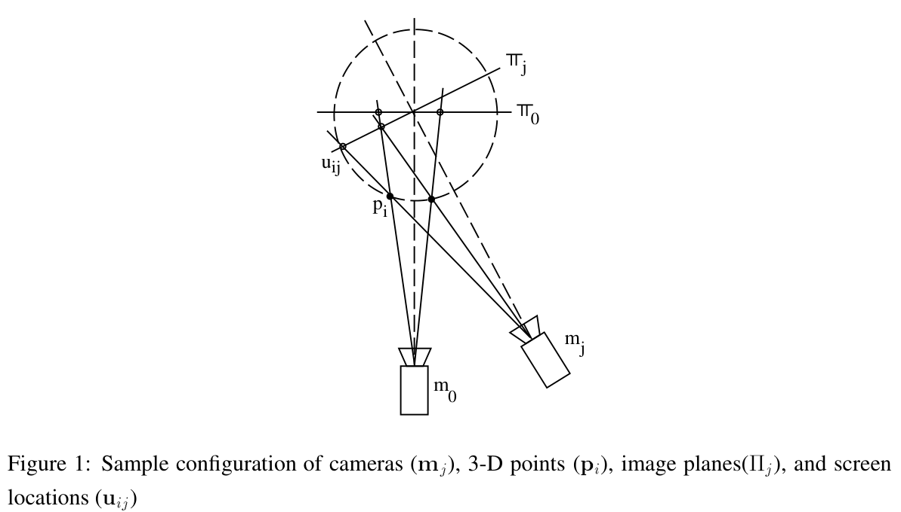
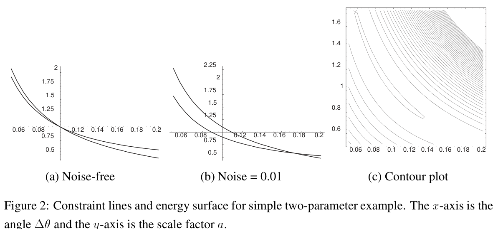
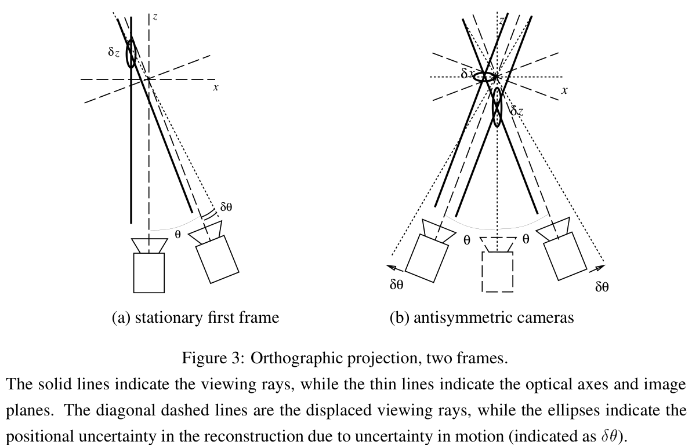
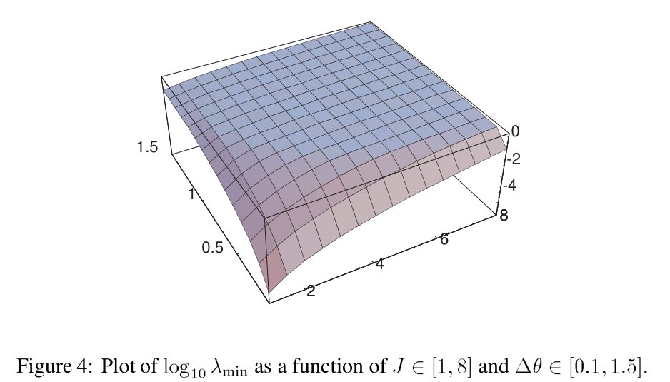
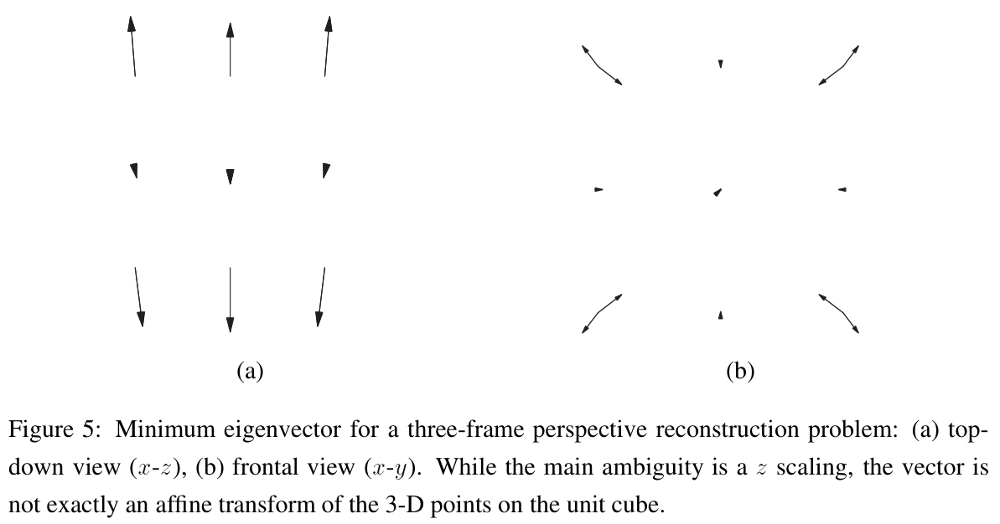
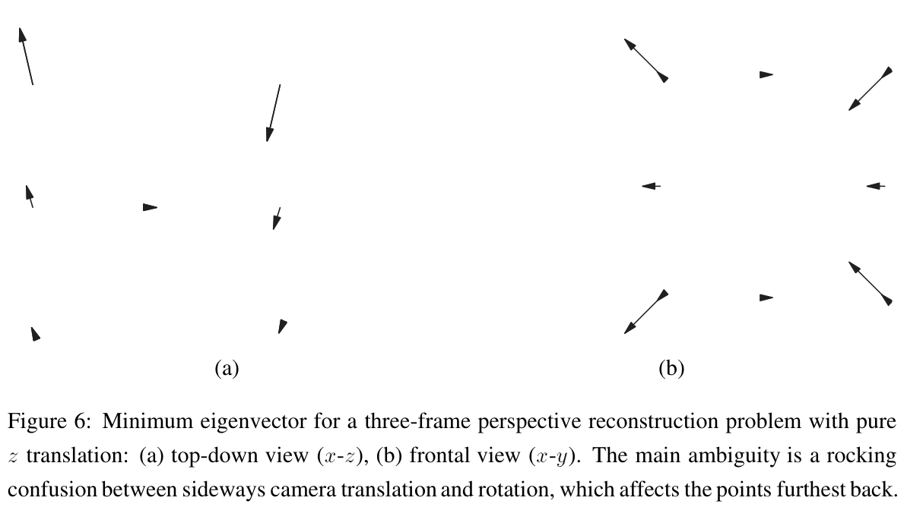

# 운동 기반 구조 복원의 형상 모호성 (Szeliski 1996)

- 원제: Shape Ambiguities in Structure from Motion
- 원문: 같은 폴더의 `Szeliski1996_DEC_CRL96-1_shape_ambiguities.pdf` (Richard Szeliski, Sing Bing Kang, Digital Equipment Corporation Cambridge Research Lab, 기술 보고서 CRL 96/1, 1996년 2월. 이후 IEEE TPAMI 19(5), 1997에 게재)
- 번역 범위: 전문 (초록, 1~11장, 부록 A, 각주, 그림·표 캡션, 표 전부). 표지 뒷면의 DEC 연구소 소개·저작권 안내문과 목차·그림 목록·표 목록은 생략. 참고문헌은 원문 그대로. 원문은 참고문헌 뒤에 부록 A가 오지만, 번역 형식에 맞춰 부록 A를 참고문헌 앞에 두었다.
- 그림: 원문 그림 6개를 `그림/`에 넣고 본문에서 처음 언급되는 곳에 삽입
- 쪽 번호: 본문 쪽수 = PDF 쪽수 − 8

## 초록 (Abstract)

이 기술 보고서는 운동으로부터 구조를 복원(structure from motion)하는 데 내재한 근본적인 모호성(ambiguity)과 불확도(uncertainty)를 살펴본다. 헤세 행렬(Hessian matrix)의 0 또는 작은 고유값에 연관된 고유벡터를 조사함으로써, 이 모호성의 정확한 성격을 정량화하고 그것이 복원된 형상의 정확도에 어떤 영향을 주는지 예측할 수 있다. 정사영(orthographic) 카메라에 대한 결과는 큰 회전량이 없는 한 영상이 많아도 부조(浮彫) 모호성(bas-relief ambiguity)이 상당함을 보여 준다. 원근(perspective) 카메라에 대한 비슷한 결과는 계량적으로(metrically) 정확한 복원을 위해서는 세 장 이상의 프레임과 큰 회전량이 필요함을 시사한다.

키워드: 운동 기반 구조 복원, 모호성, 불확도 분석. © Digital Equipment Corporation 1996. All rights reserved.

> 각주 1 (Szeliski): Microsoft Corporation, One Microsoft Way, Redmond, WA 98052-6399

## 1. 서론 (Introduction)

운동 기반 구조 복원은 컴퓨터 비전의 고전적인 문제 가운데 하나로, 지난 10년 동안 많은 관심을 받아 왔다. 로봇 차량 유도와 장애물 회피, 영상으로부터의 3차원 모델 복원 등 응용 범위가 넓다. 불행히도 이 접근으로 얻을 수 있는 결과의 품질은 여전히 실망스러운 경우가 많다. 더 정확히 말하면, 구조와 운동의 정성적 추정은 그럴듯해 보이지만 실제 정량적(계량적) 추정은 상당히 왜곡될 수 있다.

최근 운동 기반 구조 복원 과정에서 오차와 불안정성의 원인을 밝히는 데 많은 진전이 있었다. 닫힌 형태의 해를 유도하려고 결상 방정식을 임의로 대수 조작하면(예: [LH81]) 측정 오차가 있을 때 수치적으로 조건이 나쁘거나(ill-conditioned) 불안정한 알고리즘이 될 수 있다는 점은 이제 널리 이해되고 있다. 이를 극복하기 위해 구조와 운동을 추정하는 통계적으로 최적인 알고리즘이 개발되었다 [SA89; WAH89; Hor90; TK92b; SK94]. 또한 특징점과 영상을 더 많이 쓸수록 추정이 좋아지며, 특정한 점 배치는 (적어도 두 프레임의 경우) 병적(pathological)이어서 복원할 수 없다는 것도 알려져 있다.

매우 좋은 결과를 내는 알고리즘의 예로 Tomasi와 Kanade의 인수분해(factorization) 접근 [TK92b]이 있다. 이 알고리즘은 정사영을 가정하며 물체 중심(object-centered) 표현과 특이값 분해(SVD)로 구현된다. 많은 점과 프레임을 사용하고, 대부분의 시퀀스에서 큰 물체 회전량(보통 360°)을 사용한다. 그러나 시점(viewpoint)의 범위가 작을 때(예: [TK92b]의 "House" 시퀀스, 그림 7)에는 복원이 더 이상 계량적으로 보이지 않는다(집의 벽들이 수직이 아니다).

이 기술 보고서에서는 바로 이 마지막 요인, 즉 물체의 전체 회전량, 다시 말해 시점의 변화가 복원 품질을 결정적으로 좌우한다는 것을 보인다. 작은 시점 변화로 인한 물체 형상의 모호성은 흔히 유클리드 형상의 사영 변형(projective deformation)처럼 보이는데, 이는 흥미롭다. 최근 여러 연구자들이 이러한 사영 구조만을 복원하려는 시도를 지지했기 때문이다 [Fau92; HGC92; MQVB92; Sha93]. 사실 우리는 복원의 주된 모호성이 단순한 깊이 스케일 불확도, 즉 정사영 아래 두 프레임 운동 기반 구조 복원에 존재하는 고전적인 부조 모호성 [LH86]임을 보인다.¹

> 각주 1: 부조 모호성은 음영 기반 형상 복원(shape from shading)에서 훨씬 더 두드러지며, 고전적인 프리즈(frieze)와 부조 조각의 바탕이 된다.

결과를 유도하기 위해 우리는 구조·운동 추정치의 공분산 행렬에 대한 고유값 분석을 사용한다. 이는 최적에 가까운 해를 계산할 수 있고, 해의 오차가 작은 영상 잡음(특징점 위치 오차)에서 생기는 선형 섭동 때문이라고 가정한다. 이런 종류의 분석은 지금까지 운동 기반 구조 복원에 적용된 적이 없지만, 운동 기반 구조 복원 알고리즘의 궁극적인 성능을 예측하는 매우 강력한 방법이다.

우리의 결과는 두 가지 이유로 중요하다. 첫째, 복원에서 예상되는 모호성을 이론적으로 유도하는 방법을 보이고, 합리적인 결과를 기대할 수 있는 촬영 조건을 고르는 직관적 지침도 유도한다. 둘째, 주된 모호성이 소수의 모드(mode)로 매우 잘 특성화되므로, 이 정보를 이용해 더 나은 온라인(재귀) 추정 알고리즘을 만들 수 있다.

이 기술 보고서의 구성은 다음과 같다. 선행 연구를 검토한 뒤, 운동 기반 구조 복원 문제의 정식화를 제시하고, 정보(헤세) 행렬의 고유벡터 분석으로 모호성을 분석하는 기법을 전개한다. 이어서 일련의 카메라 모델, 즉 1차원·2차원 정사영 카메라와 1차원·2차원 원근 카메라에 대한 분석 결과를 제시한다. 마지막으로 오차와 모호성의 주된 원인, 그리고 가능한 향후 연구 방향을 논의한다.

## 2. 선행 연구 (Previous work)

운동 기반 구조 복원은 컴퓨터 비전에서 폭넓게 연구되어 왔다. 이 주제의 초기 논문들 [LH81; TH84]은 필수 파라미터(essential parameter) 접근을 사용해 두 프레임에서 매칭된 소수의 점으로부터 구조와 운동을 계산하는 알고리즘을 개발했다. 이 접근의 성능은 비선형 최소제곱(최적 추정) 기법으로 크게 개선할 수 있다 [WAH89; WAH93; SA89; Hor90; SA91].

최근 연구는 더 긴 영상 시퀀스로부터 형상과 운동을 추출하는 데 집중한다 [KTJ89; DA90; CWC90; TK92b; CT92]. Cui, Weng, Cohen [CWC90]은 각 프레임 쌍 사이에 최적 추정 기법(비선형 최소제곱)을 쓰고, 확장 칼만 필터(extended Kalman filter)로 시간에 걸쳐 정보를 누적한다([THO93; SPFP93]도 참고). Azarbayejani 등 [AHP93]도 칼만 필터 기반 접근으로 영상 측정 시퀀스로부터 강체(물체 중심) 깊이와 운동을 직접 복원한다. Tomasi와 Kanade [TK92b]는 카메라 중심 깊이를 계산하지 않고 영상 스트림에서 형상과 운동을 추출하는 인수분해 방법을 사용한다. 그들의 접근은 운동 기반 형상 복원 문제를 물체 중심 좌표로 정식화하고, 정사영을 가정하며, 모든 프레임을 동시에 처리한다. Chen과 Tsuji [CT92]는 영상 시퀀스를 시간적·공간적 부분으로 나누어 분석함으로써 정사영 가정을 완화한다. Taylor와 Kriegman [TKA91; TK92a]은 운동 기반 형상 복원 작업을, 영상 시퀀스에서 점의 추정 위치와 실제 위치 사이 유클리드 거리를 Levenberg-Marquardt 알고리즘으로 최소화하는 비선형 최소제곱 문제로 정식화한다. Szeliski와 Kang [SK94]은 이 접근을 일반 3차원 구조로, 그리고 사영 구조·운동 복원으로 확장한다. [역주: 원문 "extend this approach approaches"는 중복 오기]

다른 연구 갈래는 아핀(affine) [KvD91; SZB93] 또는 사영(projective) [Fau92; HGC92; HG93; MVQ93] 구조 추정치의 복원을 다루었다. 이 기법들 대부분은 영상 시퀀스에서 소수의 특징점을 식별·추적하고, 이 점들로 기하 기술의 기저 집합을 만들며, 기하를 복원하는 데 2개 프레임만 사용한다. 그러나 Mohr 등 [MVQ93]과 Szeliski와 Kang [SK94]은 가능한 한 많은 점과 프레임을 사용해 기하와 운동을 복원하여 더 신뢰할 수 있는 추정치를 만든다.

이 기술 보고서의 주된 초점인 구조·운동 오차의 성격도 이전에 연구된 바 있다. Weng 등은 두 프레임 필수 파라미터 접근에 대해 가장 초기의, 가장 상세한 오차 분석 일부를 수행했다 [WAH89; WAH93]. Adiv [Adi89]와 Young·Chellappa [YC92]는 크라메르-라오 하한(Cramer-Rao lower bound) 개념을 이용해 연속 시간(광류) 기반 알고리즘을 분석했다. Oliensis와 Thomas [OT91; THO93]는 운동 오차를 모델링하면 재귀 알고리즘의 성능을 크게 개선할 수 있음을 보였다.

이 기술 보고서에서는 공분산 행렬의 고유값 분석을 이용해 이러한 선행 결과를 확장한다. 이 분석은 운동 기반 구조 복원 모호성의 정확한 성격과 복원 오차의 가장 큰 원인을 정확히 짚어 낼 수 있다. 또한 그동안 깊이 연구되지 않은 다중 프레임 최적 운동 기반 구조 복원 알고리즘에 초점을 둔다.

## 3. 문제 정식화와 불확도 분석 (Problem formulation and uncertainty analysis)

운동 기반 구조 복원은 관측된 영상 특징 $\mathbf{u}_{ij}$의 집합으로부터 3차원 구조 파라미터 $\mathbf{p}_i$와 시간에 따라 변하는 운동 파라미터 $\mathbf{m}_j$의 집합을 복원하는 문제로 정식화할 수 있다. 이 절에서는 순방향 방정식, 즉 3차원 점을 2차원 영상 점으로 사상하는 강체 변환과 원근 변환을 제시한다. 또한 순방향 방정식의 야코비안(Jacobian)으로 복원할 파라미터의 역공분산 행렬을 추정하는 방법, 이를 이용해 예상 복원 오차를 정량화하는 방법, 그리고 우리의 결과가 고전적인 운동 기반 구조 복원 모호성과 어떻게 관련되는지를 보인다.

### 3.1 문제 정식화 (Problem formulation)

$i$번째 3차원 점 $\mathbf{p}_i$를 $j$번째 프레임의 위치 $\mathbf{u}_{ij}$로 투영하는 방정식은 다음과 같다.

$$
\mathbf{u}_{ij} = \mathcal{P}\left(T(\mathbf{p}_i, \mathbf{m}_j)\right). \qquad (1)
$$

원근 투영 $\mathcal{P}$(아래에 정의)는 다음 강체 변환에 적용된다.

$$
T(\mathbf{p}_i, \mathbf{m}_j) = \mathbf{R}_j\mathbf{p}_i + \mathbf{t}_j, \qquad (2)
$$

여기서 $\mathbf{R}_j$는 회전 행렬이고 $\mathbf{t}_j$는 회전 뒤에 적용되는 평행이동이다. 회전 행렬에는 여러 가지 대안 표현이 가능하다 [Aya91]. 이 기술 보고서에서는 주로 쿼터니언(quaternion) $\mathbf{q} = [w, (q_0, q_1, q_2)]$ 표현과 그에 대응하는 회전 행렬

$$
\mathbf{R}(\mathbf{q}) = \begin{pmatrix} 1 - 2q_1^2 - 2q_2^2 & 2q_0q_1 + 2wq_2 & 2q_0q_2 - 2wq_1 \\ 2q_0q_1 - 2wq_2 & 1 - 2q_0^2 - 2q_2^2 & 2q_1q_2 + 2wq_0 \\ 2q_0q_2 + 2wq_1 & 2q_1q_2 - 2wq_0 & 1 - 2q_0^2 - 2q_1^2 \end{pmatrix} \qquad (3)
$$

을 사용한다. 이 표현에는 특이점(singularity)이 없기 때문이다. 회전 파라미터 $q_0, q_1, q_2$는 (작은 값에서) $x$, $y$, $z$축 둘레 회전의 반각(half-angle)이라는 자연스러운 해석도 가진다. 1차원 예제에서는 수직축 둘레의 회전각을 사용한다.

컴퓨터 비전에서 쓰는 표준 원근 투영 방정식은

$$
\begin{pmatrix} u \\ v \end{pmatrix} = \mathcal{P}_1\begin{pmatrix} x \\ y \\ z \end{pmatrix} \equiv \begin{pmatrix} f\frac{x}{z} \\ f\frac{y}{z} \end{pmatrix}, \qquad (4)
$$

이며, 여기서 $f$는 카메라 초점 거리와 화소 스케일 인자의 곱이다(화소가 정사각형이라고 가정). 우리가 [SK94]에서 도입한 대안적인 물체 중심 정식화는 다음과 같다.

$$
\begin{pmatrix} u \\ v \end{pmatrix} = \mathcal{P}_2\begin{pmatrix} x \\ y \\ z \end{pmatrix} \equiv \begin{pmatrix} s\frac{x}{1+\eta z} \\ s\frac{y}{1+\eta z} \end{pmatrix}. \qquad (5)
$$

*그림 1 — 카메라($\mathbf{m}_j$), 3차원 점($\mathbf{p}_i$), 영상 평면($\Pi_j$), 화면 위치($\mathbf{u}_{ij}$)의 배치 예.*

여기서 투영 전의 $(x, y, z)$ 좌표는 광축을 따라 카메라에서 거리 $t_z$만큼 떨어진 기준 좌표계 $\Pi_j$에 대한 좌표이며, $s = f/t_z$, $\eta = 1/t_z$이다(그림 1). 투영 파라미터 $s$는 *스케일 인자(scale factor)*로, $\eta$는 *원근 왜곡 인자(perspective distortion factor)*로 해석할 수 있다. 이 대안적 원근 정식화를 쓰면 정사영 카메라와 원근 카메라를 같은 모델로 다룰 수 있다.

주어진 영상 측정 $\{\mathbf{u}_{ij}\}$로부터 미지수 $\{\mathbf{p}_i, \mathbf{m}_j\}$를 추정하는 데에는 여러 기법(2장에서 검토)을 쓸 수 있다. 이전 연구 [SK94]에서는 통계적으로 최적인 해를 주는 반복적 Levenberg-Marquardt 알고리즘을 사용했다 [WAH89; SA89; TK92a; SK94]. Levenberg-Marquardt 방법은 다음과 같은 평가 함수(merit function) 또는 목적 함수를 직접 최소화하는 표준 비선형 최소제곱 기법이다 [PFTV92].

$$
\mathcal{C}(\mathbf{a}) = \sum_i\sum_j c_{ij}\left|\tilde{\mathbf{u}}_{ij} - \mathbf{f}_{ij}(\mathbf{a})\right|^2, \qquad (6)
$$

여기서 $\tilde{\mathbf{u}}_{ij}$는 관측된 영상 측정값, $\mathbf{f}_{ij}(\mathbf{a}) = \mathbf{u}(\mathbf{p}_i, \mathbf{m}_j)$는 식 (1)로 주어지며, 벡터 $\mathbf{a}$는 3차원 점 $\mathbf{p}_i$, 운동 파라미터 $\mathbf{m}_j$, 그리고 추가적인 미지의 보정(캘리브레이션) 파라미터를 포함한 모든 미지 구조·운동 파라미터를 담는다. 식 (6)의 가중치 $c_{ij}$는 측정 $\mathbf{u}_{ij}$에 대한 신뢰도를 나타내며, 보통 역분산 $\sigma_{ij}^{-2}$로 둔다(누락된 측정에 대해서는 0으로 둘 수 있다).

### 3.2 불확도 분석 (Uncertainty analysis)

해법과 무관하게, 영상 측정이 작은 가우시안 잡음 오차로 오염되었다고 가정하면, 복원된 파라미터의 불확도는 역공분산 행렬, 즉 *정보(information)* 행렬 $\mathbf{A}$를 계산하여 결정할 수 있다 [Sor80]. 이 행렬은 측정 방정식의 *야코비안*의 외적을 계산하여 만든다.

$$
\mathbf{A} = \sum_i\sum_j c_{ij}\frac{\partial\mathbf{f}_{ij}^T}{\partial\mathbf{a}}\frac{\partial\mathbf{f}_{ij}}{\partial\mathbf{a}^T}. \qquad (7)
$$

표기를 간결히 하기 위해, 전체 야코비안 $\frac{\partial\mathbf{f}_{ij}^T}{\partial\mathbf{a}}$의 0이 아닌 부분을 다음 기호로 나타낸다.

$$
\mathbf{H}_{ij} = \begin{bmatrix} \frac{\partial\mathbf{f}_{ij}^T}{\partial\mathbf{p}_i} \ \frac{\partial\mathbf{f}_{ij}^T}{\partial\mathbf{m}_j} \end{bmatrix}
$$

구조 파라미터 $\{\mathbf{p}_i\}$를 먼저, 이어서 운동 파라미터 $\{\mathbf{m}_j\}$를 나열하면 $\mathbf{A}$ 행렬은 다음 구조를 가진다.

$$
\mathbf{A} = \left[\begin{array}{c|c} \mathbf{A}_\mathbf{p} & \mathbf{A}_\mathbf{pm} \ \hline \mathbf{A}_\mathbf{pm}^T & \mathbf{A}_\mathbf{m} \end{array}\right]. \qquad (8)
$$

행렬 $\mathbf{A}_\mathbf{p}$와 $\mathbf{A}_\mathbf{m}$은 블록 대각 행렬이며, 대각 원소는 각각 다음과 같다($c_{ij} = 1$로 가정).

$$
\mathbf{A}_{\mathbf{p}_i} = \sum_j\frac{\partial\mathbf{f}_{ij}^T}{\partial\mathbf{p}_i}\frac{\partial\mathbf{f}_{ij}}{\partial\mathbf{p}_i^T} \quad\text{and}\quad \mathbf{A}_{\mathbf{m}_j} = \sum_i\frac{\partial\mathbf{f}_{ij}^T}{\partial\mathbf{m}_j}\frac{\partial\mathbf{f}_{ij}}{\partial\mathbf{m}_j^T}, \qquad (9)
$$

한편 $\mathbf{A}_\mathbf{pm}$은 조밀(dense) 행렬이며 원소는 다음과 같다.

$$
\mathbf{A}_{\mathbf{p}_i\mathbf{m}_j} = \frac{\partial\mathbf{f}_{ij}^T}{\partial\mathbf{p}_i}\frac{\partial\mathbf{f}_{ij}}{\partial\mathbf{m}_j^T}. \qquad (10)
$$

정보 행렬은 이전에도 운동 기반 구조 복원 맥락에서, 대각 원소의 역수를 취해 파라미터 불확도의 *크라메르-라오 하한*을 결정하는 데 쓰였다 [Adi89; YC92]. 그러나 크라메르-라오 하한은 특히 $\mathbf{A}$가 특이(singular)하거나 특이에 가까울 때 임의로 약해질 수 있다. 이 기술 보고서에서는 $\mathbf{A}$의 고유벡터 분석을 사용해 불확도(공분산) 행렬의 지배적 방향과 그 크기를 찾는다. 이는 운동 기반 구조 복원 모호성의 정확한 성격에 대해 더 많은 통찰을 준다.

### 3.3 복원 오차의 추정 (Estimating reconstruction errors)

불확도 분석의 중요한 이점은 최적 운동 기반 구조 복원 알고리즘의 예상 복원(및 운동) 오차량을 쉽게 정량화할 수 있다는 것이다. 예를 들어 복원된 3차원 점 위치의 예상 제곱 오차 합은

$$
S_{pos}^2 \equiv \left\langle\sum_i\|\tilde{\mathbf{p}}_i - \mathbf{p}_i^*\|^2\right\rangle, \qquad (11)
$$

이며, 여기서 $\tilde{\mathbf{p}}_i$는 추정(복원)된 위치, $\mathbf{p}_i^*$는 참 위치이다. 위치 불확도 행렬 $\mathbf{C}_\mathbf{p}$는 $\mathbf{A}$를 역행렬로 만든 뒤 그 왼쪽 위 블록($\mathbf{p}_i$ 변수에 해당하는 블록)을 보면 계산할 수 있다.² $\mathbf{C}_\mathbf{p}$에 대해 고유값 분석을 수행하면

$$
\mathbf{C}_\mathbf{p} = \mathbf{E}_\mathbf{p}^T\boldsymbol{\Lambda}_\mathbf{p}\mathbf{E}_\mathbf{p}, \qquad (12)
$$

를 얻는다. 여기서 $\mathbf{E}_\mathbf{p}$는 고유벡터 행렬, $\boldsymbol{\Lambda}_\mathbf{p}$는 $\mathbf{C}_\mathbf{p}$의 고유값을 담은 대각 행렬이다. $S_{pos}^2$는 유클리드 노름이므로 그 값은 $\mathbf{E}_\mathbf{p}$ 같은 직교 좌표 변환의 영향을 받지 않는다. 따라서 $S_{pos}^2$의 값은 $\mathbf{C}_\mathbf{p}$의 대각합(trace)이나 $\boldsymbol{\Lambda}_\mathbf{p}$의 대각합, 즉 $\mathbf{C}_\mathbf{p}$의 고유값의 합으로 계산할 수 있다.

> 각주 2: 이는 단순히 $\mathbf{A}_\mathbf{p}$의 역행렬을 구하는 것과 같지 *않다*는 점에 유의하라.

실제로는 $\mathbf{C}_\mathbf{p}$를 계산할 필요가 없다. 대신 복원 오차와 운동 오차의 제곱합

$$
S_{all}^2 \equiv \left\langle\sum_i\|\tilde{\mathbf{p}}_i - \mathbf{p}_i^*\|^2 + \sum_j\|\tilde{\mathbf{m}}_j - \mathbf{m}_j^*\|^2\right\rangle, \qquad (13)
$$

은 정보 행렬 $\mathbf{A}$의 고유값의 *역수*를 더해 직접 계산할 수 있다. 추정할 파라미터의 스케일을 적절히 고르면(예: 위치는 $[-100\ldots100]$ 범위, 회전은 $[-\pi\ldots\pi]$ 범위로 스케일링), $S_{all}$의 평균을 $S_{pos}$의 평균에 가깝게 만들 수 있다. 일반적인 3차원 카메라 운동에서는 운동 추정치의 위치 오차가 3차원 복원 오차와 같은 규모를 가지며, (카메라의 절대 거리가 잘 결정되지 않으면) 때때로 지배적일 수 있다는 점에 유의하라.

고유값을 계산하는 것이 역행렬을 구하는 것만큼 비싸다면 이 접근의 이점은 무엇인가? 첫째, 처음 몇 개의 고유값은 역행렬보다 더 싸게(그리고 더 적은 메모리로) 계산할 수 있으며, 이들이 전체 복원 오차를 지배하는 경향이 있다. 둘째, 최소 고유값을 복원 오차의 주된 지표로 보는 이 기술 보고서의 접근을 정당화한다. 따라서 특정 모호성(부조 모호성 등)이 전체 복원 오차에 얼마나 기여하는지 연구할 수 있다. 또한 크라메르-라오 하한을 쓸 때보다 훨씬 더 엄밀한(tight) 복원 오차 하한을 얻을 수 있다.

### 3.4 운동 기반 구조 복원의 모호성 (Ambiguities in structure from motion)

운동 기반 구조 복원은 외부(사전) 지식 없이 세계의 구조와 카메라 운동을 모두 복원하려 하므로 특정한 모호성을 피할 수 없다. 이 가운데 가장 근본적인(그러나 가장 무해한) 것은 좌표계 모호성(자세 모호성 또는 유클리드 모호성이라고도 함)이다. 즉 좌표계 원점을 임의의 위치와 자세로 옮겨도 똑같이 유효한 해를 얻는다.

다음으로 흔한 모호성은 스케일 모호성(원근 카메라의 경우) 또는 깊이 모호성(정사영 카메라의 경우)이다. 이 모호성은 약간의 추가 지식, 예를 들어 카메라 위치 사이의 절대 거리로 제거할 수 있다.

세 번째 모호성이자 이 기술 보고서가 초점을 두는 것은 *부조 모호성(bas-relief ambiguity)*이다. 순수한 형태에서 이 모호성은 정사영 카메라의 두 프레임 문제에서 나타나며, 물체의 *상대 깊이(relative depth)*와 물체 회전량 사이의 혼동이다. 이 기술 보고서에서는 이 모호성의 *약한* 형태, 즉 두 프레임보다 많은 프레임 그리고/또는 원근 카메라를 쓰더라도 불완전한 측정에서 나타나는 매우 큰 *부조 불확도(bas-relief uncertainty)*에 초점을 둔다. 이 기술 보고서의 핵심 결과는 부조 모호성이 운동 기반 구조 복원에서 생기는 가장 큰 불확도를 포착한다는 것이다. 그러나 자세히 살펴보면 더 큰 부류의 변형(즉 사영 변형)이 운동 기반 구조 복원에서 생기는 오차를 더 완전하게 특성화하는 것으로 보인다.

이러한 모호성을 특성화하기 위해 3.2절에서 설명한 정보 행렬의 고유벡터 분석을 사용한다. 절대적 모호성은 (이를 제거할 추가 제약이나 지식을 넣지 않는 한) 0 고유값으로 나타나고, 약한 모호성은 작은 고유값으로 나타난다.

## 4. 두 파라미터 예제 (A two parameter example)

기본적인 부조 모호성을 직관적으로 이해하기 위해 간단한 두 파라미터 예제부터 시작한다. 2차원 점 $(x, z)$의 $x$ 성분을 측정하는 정사영 주사선(scanline) 카메라가 있다고 하자. 또한 형상은 깊이 방향 스케일 인자를 제외하고 이미 알고 있다고 하자.

$$
\mathbf{p}_i = (x_i, az_i)
$$

그리고 회전각은 균일하다고 하자.

$$
\theta_j = j\Delta\theta.
$$

그러면 투영 방정식은 다음과 같다.

$$
u_{ij} = c_jx_i - s_jaz_i \qquad (14)
$$

여기서 $c_j = \cos\theta_j$, $s_j = \sin\theta_j$이다.

잡음이 있는 측정 집합 $\{u_{ij}\}$로부터 스케일 인자 $a$와 각도 $\Delta\theta$를 추정하려 하면 어떻게 되는가? 먼저 가장 단순한 경우, 즉 예를 들어 $(x, z) = (1, 1)$에 있는 점 하나를 살펴보자. 새 영상 하나마다 다음 형태의 제약이 하나씩 생긴다.

$$
c_j - as_j = c_j^* - a^*s_j^* + n_j \qquad (15)
$$

여기서 $c_j^*$, $s_j^*$, $a^*$는 참값이고 $n_j$는 무작위 잡음이다. 그림 2a는 잡음이 없는 경우($a = 1$, $\Delta\theta = 0.1$ rad)에 $j = \pm1$에 대한 두 제약선을 보여 준다. 그림 2b는 $n_{-1} = n_1 = 0.01$일 때의 제약선을 보여 준다. 보다시피 $(\Delta\theta, a)$의 추정은 잡음에 매우 민감하다. 이는 식 (15)의 제약들을 합해 계산할 수 있는 에너지 곡면의 등고선도(그림 2c)에서도 볼 수 있다.

*그림 2 — 간단한 두 파라미터 예제의 제약선과 에너지 곡면. $x$축은 각도 $\Delta\theta$, $y$축은 스케일 인자 $a$이다. (a) 잡음 없음 (b) 잡음 = 0.01 (c) 등고선도.*

최소점 부근 오차 곡면의 형태를 특성화하기 위해 정보 행렬 $\mathbf{A}$를 계산한다. $(a, \Delta\theta)$에 대한 야코비안은 간단하다.

$$
\mathbf{H}_{ij} = \begin{bmatrix} \frac{\partial u_{ij}}{\partial a} \ \frac{\partial u_{ij}}{\partial\Delta\theta} \end{bmatrix} = \begin{bmatrix} -s_jz_i \ -j(ac_jz_i + s_jx_i) \end{bmatrix} \approx -j\begin{bmatrix} \Delta\theta z_i \ az_i + j\Delta\theta x_i \end{bmatrix} \qquad (16)
$$

여기서 작은 회전각 $|\theta_j| \ll 1$을 가정해 $s_j \approx j\Delta\theta$, $c_j \approx 1$로 두었다. 그러면 역공분산(정보) 행렬은

$$
\mathbf{A} \approx J_2Z\begin{bmatrix} \Delta\theta^2 & a\Delta\theta \ a\Delta\theta & a^2 + \Delta\theta^2\frac{J_4X}{J_2Z} \end{bmatrix} \qquad (17)
$$

이며, 여기서 $J_2 = \sum_j j^2$, $J_4 = \sum_j j^4$, $X = \sum_i x_i^2$, $Z = \sum_i z_i^2$이다($\sum_j j = 0$으로 가정). $\Delta\theta^2 \ll a^2$로 가정하면 $\mathbf{A}$의 근사 고유값을 다음과 같이 계산할 수 있다(부록 A).

$$
\lambda_{\min} \approx \Delta\theta^4J_4X/a^2 \quad\text{and}\quad \lambda_{\max} \approx J_2Za^2. \qquad (18)
$$

정보 행렬의 고유값은 오차 곡면(따라서 사후 확률 분포)에 대한 "타원형" 근사를 기술하며, 이 근사는 최적해 부근에서는 실제의 "바나나 모양" 곡면과 맞지만 멀리서는 맞지 않는다. 복원 과정의 추가적인 비선형성이 정보 행렬이 예측하는 것보다 전체 불확도를 낮추는지 높이는지 알려면 수치 시뮬레이션에 의존해야 할 것이다. 실제로는 이러한 이차적 효과가, 운동 기반 구조 복원에 연관된 불확도(모호성)의 대부분을 설명하는 고유값의 큰 변동보다 훨씬 작을 것으로 예상한다.

## 5. 정사영: 단일 주사선 (Orthography: single scanline)

이제 구조와 운동이 모두 미지인 진짜 운동 기반 구조 복원 문제로 넘어가자. 단순화를 위해 정사영 주사선 카메라를 먼저 분석한다. 미지수는 2차원 점 위치 $\mathbf{p}_i = (x_i, z_i)$와 회전각 $\theta_j$이다.³ 결상 방정식은

$$
u_{ij} = c_jx_i - s_jz_i \qquad (19)
$$

이고, $c_j = \cos\theta_j$, $s_j = \sin\theta_j$이다.

> 각주 3: 수평 평행이동은 영상 점들의 무게중심 운동으로 결정할 수 있으므로 추정하지 않는다 [TK92b].

1차원 정사영 카메라의 야코비안은

$$
\mathbf{H}_{ij} = \left[\begin{array}{cc|c} \frac{\partial u_{ij}}{\partial x_i} & \frac{\partial u_{ij}}{\partial z_i} & \frac{\partial u_{ij}}{\partial\theta_j} \end{array}\right]^T = \left[\begin{array}{cc|c} c_j & -s_j & -(c_jz_i + s_jx_i) \end{array}\right]^T, \qquad (20)
$$

이고, 정보 행렬의 원소는 다음과 같다.

$$
\begin{aligned}
\mathbf{A}_{\mathbf{p}_i} &= \begin{bmatrix} \sum_jc_j^2 & -\sum_jc_js_j \ -\sum_jc_js_j & \sum_js_j^2 \end{bmatrix} = \begin{bmatrix} C & -D \ -D & S \end{bmatrix}, & (21) \
\mathbf{A}_{\mathbf{p}_i\mathbf{m}_j} &= \begin{bmatrix} -c_j^2z_i - c_js_jx_i \ c_js_jz_i + s_j^2x_i \end{bmatrix}, & (22) \
\mathbf{A}_{\mathbf{m}_j} &= \left[\sum_i(c_jz_i + s_jx_i)^2\right] = \left[c_j^2Z + 2c_js_jW + s_j^2X\right], & (23)
\end{aligned}
$$

여기서 $C = \sum_jc_j^2$, $D = \sum_jc_js_j$, $S = \sum_js_j^2$, $Z = \sum_iz_i^2$, $W = \sum_iz_ix_i$, $X = \sum_iz_i^2$이다. [역주: 원문대로 옮겼다. 4장의 정의와 식 (23)의 형태로 보아 $X = \sum_ix_i^2$의 오기로 보인다.]

전체 정보 행렬을 분석하기 전에 두 부분 블록 $\mathbf{A}_\mathbf{p}$와 $\mathbf{A}_\mathbf{m}$을 보자. 운동을 알면 구조 불확도는 $\mathbf{A}_{\mathbf{p}_i}$로 결정되며 이는 단순히 삼각측량(triangulation) 오차, 즉 $\sigma_x^2 \propto C^{-1}$, $\sigma_z^2 \propto S^{-1}$이다(작은 회전에서는 일반적으로 $\sigma_x^2$가 $\sigma_z^2$보다 훨씬 작다는 점에 유의). 구조를 알면 운동 정확도는 $\mathbf{A}_{\mathbf{m}_j}$로 결정되며, 시선 방향 $(s_j, c_j)$을 따른 깊이의 분산에 반비례한다.

해의 모호성은 어떠한가? 정사영에서는 전통적인 스케일 모호성이 존재하지 않는다. 그러나 광축 방향의 평행이동은 추정할 수 없으며, 전체 자세(좌표계) 모호성은 여전히 존재한다. 추가 제약을 넣지 않는 한, 좌표계를 $\Delta\theta$만큼 회전시키고 같은 양을 $\{\theta_j\}$에 더할 수 있다. 이는 다음과 같은 영공간(0 고유값) 고유벡터로 나타난다.

$$
\mathbf{e}_0 = \left[\begin{array}{ccccc|ccc} z_0 & -x_0 & \cdots & z_N & -x_N & 1 & \cdots & 1 \end{array}\right]^T.
$$

### 5.1 두 프레임: 부조 모호성 (Two frames: the bas-relief ambiguity)

프레임이 두 장뿐이고 $\theta_0 = 0, c_0 = 1, s_0 = 0, \theta_1 = \theta, c_1 = c, s_1 = s$로 고정했다고 하자(그림 3). 그러면

$$
\begin{aligned}
\mathbf{A}_{\mathbf{p}_i} &= \begin{bmatrix} 1 + c^2 & -cs \ -cs & s^2 \end{bmatrix} & (24) \
\mathbf{A}_{\mathbf{p}_i\mathbf{m}} &= \begin{bmatrix} -c^2z_i - csx_i \ csz_i + s^2x_i \end{bmatrix} & (25) \
\mathbf{A}_\mathbf{m} &= \left[c^2Z + 2csW + s^2X\right]. & (26)
\end{aligned}
$$

*그림 3 — 정사영, 두 프레임. (a) 정지한 첫 프레임 (b) 반대칭 카메라. 실선은 시선(viewing ray)을, 가는 선은 광축과 영상 평면을 나타낸다. 대각선 파선은 변위된 시선이며, 타원은 운동의 불확도($\delta\theta$로 표시)로 인한 복원 위치 불확도를 나타낸다.*

부조 모호성은 다음과 같은 영공간 고유벡터로 나타난다.

$$
\mathbf{e}_0 = \left[\begin{array}{ccccc|c} 0 & cz_0 + sx_0 & 0 & \cdots & cz_N + sx_N & -s \end{array}\right]^T,
$$

이는 직접 확인할 수 있다. 이는 예상한 대로이다. 즉 구조의 주된 불확도는 전적으로 깊이($z$) 방향에 있으며, ($z$에 비례하는) 스케일 불확도이다. 그러나 그림 3a에서 볼 수 있듯이 이 불확도는 $z$가 아니라 $cz + sx$에 비례한다는 점에 유의하라.

두 프레임 문제의 대안적 파라미터화는 $\theta_0 = -\theta_1$로 두는 것이며(그림 3b), 이 경우

$$
\begin{aligned}
\mathbf{A}_{\mathbf{p}_i} &= \begin{bmatrix} 2c^2 & 0 \ 0 & 2s^2 \end{bmatrix} & (27) \
\mathbf{A}_{\mathbf{p}_i\mathbf{m}} &= \begin{bmatrix} -2csx_i \ 2csz_i \end{bmatrix} & (28) \
\mathbf{A}_\mathbf{m} &= \left[2c^2Z + 2s^2X\right]. & (29)
\end{aligned}
$$

이 경우 영공간 고유벡터는 다음과 같다.

$$
\mathbf{e}_0 = \left[\begin{array}{ccccc|c} s^2x_0 & -c^2z_i & \cdots & s^2x_N & -c^2z_N & cs \end{array}\right]^T. \qquad (30)
$$

[역주: 둘째 원소의 $z_i$는 원문 그대로이며 $z_0$의 오기로 보인다.]

이것도 매우 시사적이다. 부조 모호성의 주된 효과가, 운동이 조금 증가할 때 $z$ 값이 "찌그러지고(squashing)" $x$ 값은 그보다 훨씬 작게 "부풀어 오르는(bulging)" 것임을 보여 준다(적어도 프레임 간 회전이 작을 때).⁴ 이 찌그러짐과 부풂은 참 구조의 아핀 변형이다.

> 각주 4: 프레임 0을 고정했던 앞의 예와 비교하면, 전체 프레임 간 회전은 이제 $2\theta$이다.

### 5.2 두 장보다 많은 프레임, 등각 운동 제약 (More than two frames, equi-angular motion constraint)

분석을 단순화하기 위해, 당분간 등각(equi-angular) 영상 시퀀스임을 안다고 가정한다. 즉 회전각이 $\theta_j = j\Delta\theta$, $j \in \{-J, \ldots, J\}$, $J = \frac{F+1}{2}$로 주어지며, $F$는 전체 프레임 수이다(그림 3b에 카메라가 더 있다고 상상하라). [역주: 원문대로 옮겼다. 뒤에 나오는 $F = 2J + 1$과는 맞지 않는다.] 이 경우

$$
\begin{aligned}
\mathbf{H}_{ij}^T &= \left[\begin{array}{cc|c} c_j & -s_j & -j(c_jz_i + s_jx_i) \end{array}\right] & (31) \
\mathbf{A}_{\mathbf{p}_i} &= \begin{bmatrix} \sum_jc_j^2 & 0 \ 0 & \sum_js_j^2 \end{bmatrix} = \begin{bmatrix} C & 0 \ 0 & S \end{bmatrix}, & (32) \
\mathbf{A}_{\mathbf{p}_i\mathbf{m}} &= \begin{bmatrix} -\sum_jjc_js_jx_i \ \sum_jjc_js_jz_i \end{bmatrix} = \begin{bmatrix} -Ex_i \ Ez_i \end{bmatrix}, & (33) \
\mathbf{A}_\mathbf{m} &= \left[\sum_jj^2c_j^2Z + \sum_jj^2s_j^2X\right] = \left[C'Z + S'X\right], & (34)
\end{aligned}
$$

이며, $E = \sum_jjc_js_j$, $C' = \sum_jj^2c_j^2$, $S' = \sum_jj^2s_j^2$이고, $C, D, S, Z, W, X$는 식 (22–23)에서와 같이 정의된다. 이 경우 가장 작은 고유값의 고유벡터는 다음 형태를 가진다.

$$
\mathbf{e}_0 = \left[\begin{array}{ccccc|c} \alpha x_0 & -\beta z_0 & \cdots & \alpha x_N & -\beta z_N & 1 \end{array}\right]^T. \qquad (35)
$$

행렬 방정식 $\mathbf{A}\mathbf{e} = \lambda\mathbf{e}$, 즉

$$
\left[\begin{array}{c|c} \mathbf{A}_\mathbf{p} & \mathbf{A}_\mathbf{pm} \ \hline \mathbf{A}_\mathbf{pm}^T & \mathbf{A}_\mathbf{m} \end{array}\right]\begin{bmatrix} \alpha x_0 \ -\beta z_0 \ \vdots \ -\beta z_N \ \hline 1 \end{bmatrix} = \lambda\begin{bmatrix} \alpha x_0 \ -\beta z_0 \ \vdots \ -\beta z_N \ \hline 1 \end{bmatrix},
$$

를 만족시킬 수 있다면 이것은 고유벡터가 된다. 이는 다음 세 방정식으로 귀결된다.

$$
\begin{aligned}
\alpha C - E &= \alpha\lambda \
\beta S - E &= \beta\lambda \
(S' - \alpha E)X + (C' - \beta E)Z &= \lambda.
\end{aligned}
$$

$\alpha = \frac{E}{C-\lambda}$와 $\beta = \frac{E}{S-\lambda}$를 셋째 방정식에 대입하면 $\lambda$에 대한 3차식을 얻는다.

$$
(S - \lambda)(S'(C - \lambda) - E^2)X + (C - \lambda)(C'(S - \lambda) - E^2)Z - (S - \lambda)(C - \lambda)\lambda = 0, \qquad (36)
$$

이는 *Mathematica®* 같은 패키지로 해석적으로 풀 수 있다 [Wol91].

가장 작은 고유값이 매우 작다고 가정하면 근사 $\alpha \approx \frac{E}{C}$를 써서 $\lambda$에 대한 2차식을 얻을 수 있다.

$$
(S - \lambda)(S'C - E^2)X + C(C'(S - \lambda) - E^2)Z - (S - \lambda)C\lambda = 0. \qquad (37)
$$

나아가 작은 각 근사 $C \approx \sum_j1 \equiv J_0$, $S \approx \Delta\theta^2J_2$, $E \approx \Delta\theta J_2$, $C' \approx J_2$, $S' \approx \Delta\theta^2J_4$를 쓰면, 약간의 조작 뒤에 다음을 얻는다(부록 A).

$$
\lambda_{\min} \approx \frac{\Delta\theta^4XJ_2(J_0J_4 - J_2^2)}{J_0J_2Z + \Delta\theta^2[X(J_0J_4 - J_2^2) + J_0J_2]}. \qquad (38)
$$

최소 고유값이 $\Delta\theta$의 네제곱과 관련됨에 주목하라. 즉 프레임 간 회전을 두 배로 하면 RMS(제곱평균제곱근) 오차가 4배 줄어든다($Z \gg \Delta\theta^2$ 가정). $z_i$에 비해 $x_i$의 범위를 늘리면 최소 고유값이 직접 증가하며, 즉 구조 불확도가 감소한다. 이 결과는 다소 놀라우며, 더 납작한 물체가 더 잘 복원될 수 있음을 시사한다.

$J$와 $\Delta\theta$ 값의 범위에 대해 $\lambda$ 값을 수치적으로 계산할 수 있다(그림 4). 예를 들어 $J = 1$, $\Delta\theta = 0.1$ rad $\approx 6°$, $X = Z = 1$이면 $\lambda = \{0.0000664436, 1.98064, 3.0193\}$이다. 가장 작은 고유값 $\lambda = 0.0000664436$에 대해 대응하는 $\alpha = 0.0666676$, $\beta = 10.0001$이다.

*그림 4 — $J \in [1, 8]$과 $\Delta\theta \in [0.1, 1.5]$의 함수로 나타낸 $\log_{10}\lambda_{\min}$.*

가장 작은 고유값과 고유벡터를 계산하고 나면 몇 가지 추가 고유벡터를 쉽게 결정할 수 있다. 순수하게 $x_i$ 값이나 $z_i$ 값만으로 이루어지면서 $\mathbf{A}_\mathbf{pm}$과도 직교하는 벡터는 모두 고유벡터이다. 예를 들어

$$
\mathbf{e} = \left[\begin{array}{cccccc|c} x_1 & 0 & -x_0 & 0 & \cdots & 0 & 0 \end{array}\right].
$$

순수 $x$ 고유벡터에 대응하는 고유값은 $C$이고, $z$ 고유값은 $S$이다. 다시 말해, 전역 부조 불확도($z$의 찌그러짐과 $x$의 더 작은 부풂)를 고려하고 나면, $x$ 위치 추정치의 분산은 $C^{-1}$에, $z$ 위치의 분산은 $S^{-1}$에 비례한다. 즉 카메라 위치를 알 때 예상되는 삼각측량 오차와 정확히 같다.

$J = 1$(3개 프레임), $\Delta\theta = 0.1$ rad $\approx 6°$, $X = Z = 1$인 위의 예에서 $C$와 $S$의 값은 각각 $2.98$과 $0.0199$이다. 이로부터 운동 불확도로 인한 상관된 깊이 불확도가 개별 깊이 불확도보다 $0.0199/0.00006644 = 300$배 크다는 것을 알 수 있다. $F = 2J + 1$(프레임 수)과 $\theta_{\text{tot}} = (F - 1)\Delta\theta$(전체 회전각)의 함수로 나타낸 $\lambda_{\min}$의 전체 표를 표 1에 보였다.

**표 1 — 등각 운동을 아는 1차원 정사영의 최소 고유값**

| $\lambda_{\min}$ | $F=2$ | $F=3$ | $F=4$ | $F=5$ | $F=6$ | $F=7$ | $F=8$ |
|---|---|---|---|---|---|---|---|
| $\theta_{\text{tot}} = 11.5°$ | 0.000000 | 0.000067 | 0.000079 | 0.000088 | 0.000096 | 0.000104 | 0.000112 |
| $\theta_{\text{tot}} = 22.9°$ | 0.000000 | 0.001087 | 0.001283 | 0.001418 | 0.001547 | 0.001677 | 0.001810 |
| $\theta_{\text{tot}} = 34.4°$ | 0.000000 | 0.005618 | 0.006597 | 0.007277 | 0.007931 | 0.008594 | 0.009269 |
| $\theta_{\text{tot}} = 45°$ | 0.000000 | 0.016854 | 0.019688 | 0.021673 | 0.023596 | 0.025552 | 0.027547 |
| $\theta_{\text{tot}} = 60°$ | 0.000000 | 0.054679 | 0.063442 | 0.069678 | 0.075782 | 0.082017 | 0.088389 |
| $\theta_{\text{tot}} = 90°$ | 0.000000 | 0.272977 | 0.316453 | 0.348500 | 0.380039 | 0.412200 | 0.444997 |

**표 2 — 운동 제약이 없는 등각 운동 1차원 정사영의 최소 고유값**

| $\lambda_{\min}$ | $F=2$ | $F=3$ | $F=4$ | $F=5$ | $F=6$ | $F=7$ | $F=8$ |
|---|---|---|---|---|---|---|---|
| $\theta_{\text{tot}} = 11.5°$ | 0.000000 | 0.000067 | 0.000079 | 0.000087 | 0.000095 | 0.000103 | 0.000111 |
| $\theta_{\text{tot}} = 22.9°$ | 0.000000 | 0.001080 | 0.001263 | 0.001391 | 0.001513 | 0.001636 | 0.001762 |
| $\theta_{\text{tot}} = 34.4°$ | 0.000000 | 0.005537 | 0.006377 | 0.006971 | 0.007549 | 0.008136 | 0.008731 |
| $\theta_{\text{tot}} = 45°$ | 0.000000 | 0.016450 | 0.018596 | 0.020163 | 0.021721 | 0.023311 | 0.024924 |
| $\theta_{\text{tot}} = 60°$ | 0.000000 | 0.052521 | 0.057558 | 0.061612 | 0.065825 | 0.070179 | 0.074598 |
| $\theta_{\text{tot}} = 90°$ | 0.000000 | 0.254859 | 0.261589 | 0.273769 | 0.288362 | 0.303857 | 0.319541 |

### 5.3 두 장보다 많은 프레임, 운동 제약 없음 (More than two frames, without motion constraint)

위와 같은 데이터 집합을 쓰되 등각 단계라는 추가 지식을 없애면, 각 운동(각도) 추정치를 따로 풀게 된다. $\mathbf{A}_{\mathbf{p}_i}$, $\mathbf{A}_{\mathbf{p}_i\mathbf{m}_j}$, $\mathbf{A}_{\mathbf{m}_j}$에 대한 식은 $D = 0$으로 둔 식 (22–23)으로 주어진다. 부조 모호성 고유벡터가 다음 형태라고 추측해 보자.

$$
\mathbf{e}_0 = \left[\begin{array}{cccc|ccc} \alpha x_0 & -\beta z_0 & \cdots & -\beta z_N & -J & \cdots & J \end{array}\right]^T. \qquad (39)
$$

이것이 고유벡터가 되기 위한 조건은 앞서 유도한 것과 비슷하다.

$$
\begin{aligned}
\alpha C - E &= \alpha\lambda & (40) \
\beta S - E &= \beta\lambda & (41) \
c_j^2(jZ - \alpha W) + c_js_j(2jW - \alpha X - \beta Z) + s_j^2(jX - \beta W) &= \lambda j. & (42)
\end{aligned}
$$

이 경우 미지수 3개에 방정식이 $2J + 3$개이므로 닫힌 형태의 해가 없다. 그러나 작은 각 근사와 $W = 0$(즉 3차원 점구름이 가운데 프레임에 대해 회전 대칭)을 가정하면, 식 (42) 형태의 $2J + 1$개 방정식이 동등해지고 등각 운동 제약을 알 때와 같은 고유벡터를 얻는다.

이 거동은 수치적으로 확인할 수 있으며(표 2), 결과는 표 1에 보인 것과 꽤 비슷하다. 이 결과를 얻기 위해 단위 정사각형 위에서 표본 추출한 9개 점의 집합, 즉 $\{(x, z), x, z \in \{-1, 0, 1\}\}$을 써서 $\mathbf{A}$ 행렬을 명시적으로 계산한 뒤 고유값을 계산했다. 그러나 $W \neq 0$인 예, 즉 앞의 예에 $(2, 2)$의 점 하나를 추가하면, 식 (39)에서 가정한 형태가 아닌 고유벡터를 얻는다는 점에 유의하라. 다만 그 고유벡터는 $(x_i, z_i)$ 좌표의 아핀 변환이다.

**표 3 — 운동 제약이 없는 등각 운동 1차원 정사영의 $S_{all}$ 추정치, $X = Z = 100$, $\sigma = 1$**

| $S_{all}$ | $F=2$ | $F=3$ | $F=4$ | $F=5$ | $F=6$ | $F=7$ | $F=8$ |
|---|---|---|---|---|---|---|---|
| $\theta_{\text{tot}} = 11.5°$ | ∞ | 123.61 | 113.80 | 108.18 | 103.50 | 99.34 | 95.60 |
| $\theta_{\text{tot}} = 22.9°$ | ∞ | 31.81 | 29.46 | 28.02 | 26.80 | 25.71 | 24.73 |
| $\theta_{\text{tot}} = 34.4°$ | ∞ | 14.88 | 13.88 | 13.21 | 12.62 | 12.09 | 11.62 |
| $\theta_{\text{tot}} = 45°$ | ∞ | 9.32 | 8.74 | 8.30 | 7.92 | 7.58 | 7.27 |
| $\theta_{\text{tot}} = 60°$ | ∞ | 6.01 | 5.65 | 5.35 | 5.08 | 4.85 | 4.64 |
| $\theta_{\text{tot}} = 90°$ | ∞ | 3.94 | 3.62 | 3.37 | 3.16 | 2.99 | 2.84 |

고유값의 역수를 더해 예상 복원 오차 $S_{all}$을 추정할 수도 있다. 표 2와 같은 파라미터를 쓰되 구조 오차가 지배하도록 $X = Z = 100$으로 두면 표 3의 결과를 얻는다. 이 표는 부조 모호성이 복원 오차를 어떻게 지배하는지 보여 준다. 시야각이 작을 때 각도를 두 배로 하면 제곱 오차 합 $S_{all}$이 4분의 1로 줄어든다. 프레임을 더 추가하는 것은 시스템의 유효 기선(baseline)을 늘리는 것보다 훨씬 덜 효과적이다.

## 6. 정사영: 완전한 3차원 복원 (Orthography: full 3-D reconstruction)

일반 정사영 카메라(2차원 망막, 3차원 세계)의 상황은 주사선 카메라와 꽤 비슷하다. 이 경우 회전 행렬을 단위 쿼터니언으로 나타낸다.

$$
\begin{aligned}
u_{ij} &= r_{00j}x_i + r_{01j}y_i + r_{02j}z_i & (43) \\
v_{ij} &= r_{10j}x_i + r_{11j}y_i + r_{12j}z_i, & (44)
\end{aligned}
$$

여기서 회전 행렬의 원소 $r_{kl}$은 식 (3)으로 주어진다.

부조 모호성을 정성적으로 감잡기 위해, 고정 축(예: $y$-$z$ 평면 안의 축) 둘레로 작은 회전을 하는, 등각 운동을 아는 경우를 살펴보자.

$$
\mathbf{q}_j \approx [1, (0, jq_1, jq_2)], \qquad (45)
$$

여기서 $q_1$은 $y$축 둘레의 증분 회전, $q_2$는 $z$(광)축 둘레의 회전이다. 앞에서와 같이 정사영에서는 카메라 평행이동을 무시한다. 점 무게중심의 운동으로 복원할 수 있기 때문이다.

이제 야코비안 행렬은 다음과 같다.

$$
\begin{aligned}
\mathbf{H}_{ij}^T &= \left[\begin{array}{ccc|cc} \frac{\partial u_{ij}}{\partial x_i} & \frac{\partial u_{ij}}{\partial y_i} & \frac{\partial u_{ij}}{\partial z_i} & \frac{\partial u_{ij}}{\partial q_1} & \frac{\partial u_{ij}}{\partial q_2} \\ \frac{\partial v_{ij}}{\partial x_i} & \frac{\partial v_{ij}}{\partial y_i} & \frac{\partial v_{ij}}{\partial z_i} & \frac{\partial v_{ij}}{\partial q_1} & \frac{\partial v_{ij}}{\partial q_2} \end{array}\right] & (46) \\
&\approx \left[\begin{array}{ccc|cc} 1 & 2jq_2 & -2jq_1 & -4j^2q_1x_i - 2jz_i & -4j^2q_2x_i + 2jy_i \\ -2jq_2 & 1 & 2j^2q_1q_2 & 2j^2q_2z_i & -2jx_i - 4j^2q_2y_i + 2j^2q_1z_i \end{array}\right]. & (47)
\end{aligned}
$$

정보 행렬의 원소는 다음과 같다.

$$
\begin{aligned}
\mathbf{A}_{\mathbf{p}_i} &\approx \begin{bmatrix} J_0 & 0 & 0 \\ 0 & J_0 & -2J_2q_1q_2 \\ 0 & -2J_2q_1q_2 & 4J_2q_1^2 \end{bmatrix}, & (48) \\
\mathbf{A}_{\mathbf{p}_i\mathbf{m}_j} &\approx \begin{bmatrix} -4J_2q_1x_i & -2J_2q_2x_i \\ -2J_2q_2z_i & 2J_2q_1z_i \\ 4J_2q_1z_i & -4J_2q_1y_i \end{bmatrix}, & (49) \\
\mathbf{A}_{\mathbf{m}_j} &= \begin{bmatrix} 4J_2\sum_iz_i^2 & -4J_2\sum_iy_iz_i \\ -4J_2\sum_iy_iz_i & 4J_2\sum_i(x_i^2 + y_i^2) \end{bmatrix} = 4J_2\begin{bmatrix} Z & W' \\ W' & X + Y \end{bmatrix}, & (50)
\end{aligned}
$$

여기서 $Y = \sum_iy_i^2$, $W' = \sum_iy_iz_i$이고, 다른 항은 앞에서 정의한 것과 같다.

이 식들은 $C \approx J_0$, $S \approx J_2q_1^2$, $E \approx J_2q_1$, $C' \approx J_2$로 둔 정사영 주사선 카메라의 식 (22–23)과 비슷하다. 위치 불확도가 없으면 $q_1$과 $q_2$ 추정치의 정확도($\mathbf{A}_{\mathbf{m}_j}^{-1}$)는 예상대로 각각 $Z$와 $X + Y$에 반비례한다. 마찬가지로 운동을 알 때 삼각측량 오차($\mathbf{A}_{\mathbf{p}_i}^{-1}$)는 $x$와 $y$에 대해서는 프레임 수 $J_0$에 반비례하고, $z$에 대해서는 회전각 제곱 $J_2q_1^2$에 비례한다. [역주: 원문 "proportional"을 그대로 옮겼다. 식 (48)로 보면 $z$ 오차도 $J_2q_1^2$에 반비례한다.] 회전축의 0이 아닌 기울기($q_2 \neq 0$)는 $y$와 $z$ 위치 불확도의 일부를 뒤섞는다는 점에 유의하라.

고유값 문제의 해석적 해를 찾으려 하는 대신, $\lambda_{\min}$이 $q_1$과 $q_2$에 어떻게 의존하는지 보여 주는 간단한 예를 제시한다(표 4). 이 예에서는 단위 정육면체의 꼭짓점 8개, 정육면체 면 6개, 원점으로 이루어진 15점 데이터 집합을 사용했다. 기울기가 없는 경우($q_2 = 0$)의 고유값은 1차원 분석 결과(표 2)와 거의 같다. 기울어진 경우($q_2/q_1 = \tan30°$)의 고유값은 모양은 비슷하지만 $q_1$ 값의 전반적 감소 효과를 보여 준다. 고유벡터를 조사해 보면(여기에는 보이지 않음) *두* 경우 모두 최소 고유벡터에 $y$ 성분이 없음을 관찰할 수 있다.

**표 4 — 운동 제약이 없는 등각 운동 2차원 정사영의 최소 고유값, $y$축 둘레 회전 ($q_1 = \sin\frac{\Theta_j}{2}$, $q_2 = 0$)**

| $\lambda_{\min}$ | $F=2$ | $F=3$ | $F=4$ | $F=5$ | $F=6$ | $F=7$ | $F=8$ |
|---|---|---|---|---|---|---|---|
| $\theta_{\text{tot}} = 11.5°$ | 0.000000 | 0.000067 | 0.000079 | 0.000088 | 0.000096 | 0.000104 | 0.000112 |
| $\theta_{\text{tot}} = 22.9°$ | 0.000000 | 0.001092 | 0.001267 | 0.001410 | 0.001531 | 0.001665 | 0.001792 |
| $\theta_{\text{tot}} = 34.4°$ | 0.000000 | 0.005677 | 0.006405 | 0.007189 | 0.007747 | 0.008452 | 0.009065 |
| $\theta_{\text{tot}} = 45°$ | 0.000000 | 0.017153 | 0.018653 | 0.021226 | 0.022638 | 0.024838 | 0.026500 |
| $\theta_{\text{tot}} = 60°$ | 0.000000 | 0.056333 | 0.056757 | 0.067148 | 0.069948 | 0.078044 | 0.082245 |
| $\theta_{\text{tot}} = 90°$ | 0.000000 | 0.287619 | 0.203405 | 0.320241 | 0.268727 | 0.343410 | 0.318149 |

**표 5 — 운동 제약이 없는 등각 운동 2차원 정사영의 최소 고유값, 30° 기울어진 $y$축 둘레 회전 ($q_1 = \cos30°\sin\frac{\Theta_j}{2}$, $q_2 = \sin30°\sin\frac{\Theta_j}{2}$)**

| $\lambda_{\min}$ | $F=2$ | $F=3$ | $F=4$ | $F=5$ | $F=6$ | $F=7$ | $F=8$ |
|---|---|---|---|---|---|---|---|
| $\theta_{\text{tot}} = 11.5°$ | 0.000000 | 0.000046 | 0.000055 | 0.000061 | 0.000066 | 0.000072 | 0.000077 |
| $\theta_{\text{tot}} = 22.9°$ | 0.000000 | 0.000750 | 0.000873 | 0.000971 | 0.001056 | 0.001148 | 0.001236 |
| $\theta_{\text{tot}} = 34.4°$ | 0.000000 | 0.003857 | 0.004392 | 0.004919 | 0.005316 | 0.005795 | 0.006224 |
| $\theta_{\text{tot}} = 45°$ | 0.000000 | 0.011507 | 0.012731 | 0.014410 | 0.015451 | 0.016919 | 0.018101 |
| $\theta_{\text{tot}} = 60°$ | 0.000000 | 0.036927 | 0.038640 | 0.044940 | 0.047420 | 0.052530 | 0.055737 |
| $\theta_{\text{tot}} = 90°$ | 0.000000 | 0.170400 | 0.150632 | 0.200555 | 0.196403 | 0.233575 | 0.235277 |

## 7. 원근: 단일 주사선 (Perspective: single scanline)

3차원의 원근 카메라를 분석하기 전에 원근 주사선(1차원) 카메라를 간단히 살펴보자. 이 모델로 몇 가지 직관을 얻을 수는 있지만, 불행히도 이것으로 완전한 두 프레임 알고리즘의 성능을 예측할 수는 없다. 원근에서도 주사선 카메라에는 부조 모호성이 있기 때문이다. 이는 간단한 파라미터 수 세기 논증으로 보일 수 있다. 2차원 좌표 $\{(x_i, z_i)\}$에 대해 미지수가 $2N$개이고 운동에 대해 1개(이상)의 미지수가 있지만, 측정은 $2N$개뿐이다. 다시 말해 카메라를 임의로 배치할 수 있고, 광선들의 교점이 2차원 점의 위치를 결정한다. 이 논증은 분명 3차원으로 그대로 옮겨지지 않지만, 두 프레임 운동 기반 구조 복원이 왜 조건이 나쁠 수 있는지를 시사한다.

**표 6 — 등각 회전 1차원 원근 투영의 최소 고유값, $\eta = 0.2$**

| $\lambda_{\min}$ | $F=2$ | $F=3$ | $F=4$ | $F=5$ | $F=6$ | $F=7$ | $F=8$ |
|---|---|---|---|---|---|---|---|
| $\theta_{\text{tot}} = 11.5°$ | 0.000000 | 0.000080 | 0.000094 | 0.000104 | 0.000114 | 0.000124 | 0.000133 |
| $\theta_{\text{tot}} = 22.9°$ | 0.000000 | 0.001274 | 0.001498 | 0.001655 | 0.001807 | 0.001960 | 0.002116 |
| $\theta_{\text{tot}} = 34.4°$ | 0.000000 | 0.006421 | 0.007489 | 0.008257 | 0.009006 | 0.009768 | 0.010544 |
| $\theta_{\text{tot}} = 45°$ | 0.000000 | 0.018670 | 0.021580 | 0.023745 | 0.025885 | 0.028072 | 0.030305 |
| $\theta_{\text{tot}} = 60°$ | 0.000000 | 0.057351 | 0.065494 | 0.071906 | 0.078373 | 0.085026 | 0.091834 |
| $\theta_{\text{tot}} = 90°$ | 0.000000 | 0.255136 | 0.288877 | 0.317718 | 0.347360 | 0.377933 | 0.409211 |

(5)에서 도입한 새 투영 모델을 쓰면 주사선 카메라의 투영 방정식은

$$
u_{ij} = \frac{c_jx_i - s_jz_i + t_{xj}}{1 + \eta(s_jx_i + c_jz_i + t_{zj})} = \frac{N_{ij}}{D_{ij}}. \qquad (51)
$$

이고, 야코비안 행렬은 다음과 같다.

$$
\begin{aligned}
\mathbf{H}_{ij}^T &= \left[\begin{array}{cc|ccc} \frac{\partial u_{ij}}{\partial x_i} & \frac{\partial u_{ij}}{\partial z_i} & \frac{\partial u_{ij}}{\partial\theta_j} & \frac{\partial u_{ij}}{\partial t_{xj}} & \frac{\partial u_{ij}}{\partial t_{zj}} \end{array}\right] & (52) \\
&= \frac{1}{D_{ij}}\left[\begin{array}{cc|ccc} c_j - \eta s_j\tilde{u}_{ij} & -(s_j + \eta c_j\tilde{u}_{ij}) & -(s_jx_i + c_jz_i + \eta(c_jx_i - s_jz_i)\tilde{u}_{ij}) & 1 & -\eta\tilde{u}_{ij} \end{array}\right]
\end{aligned}
$$

여기서 $\tilde{u}_{ij}$는 식 (51)로 계산한 $u_{ij}$의 예측값이다. 통상의 좌표계 모호성 외에 스케일 모호성이 있다. 즉 $(x_i, z_i)$와 $t_{xj}$에 인자 $a$를 곱하고 $t_{zj}$를 $at_{zj} + (a-1)/\eta$로 두어도 해에 영향이 없다. 앞서 언급했듯이 2개 프레임에서는 완전한 부조 모호성도 존재한다.

헤세 행렬 $\mathbf{A}$를 구성하여 분석을 계속하는 대신, $\mathbf{H}_{ij}$의 형태만 간단히 보자. 정사영에서 이미 있던 항들(20)에 더해, $\eta$를 포함하는 추가 항들과 $t_{zj}$에 대한 편미분이 생긴다. 완전한 3차원에서 부조 모호성을 제거하여 두 프레임 문제를 풀 수 있게 하는 것이 바로 이 추가 항들이다.

정사영 카메라 대신 원근 카메라를 쓰는 효과를 보기 위해, 표 6에 전체 시야각과 프레임 수의 함수로 최소 고유값을 보였다. 표 2와 비교하면 $\lambda_{\min}$의 크기에 작지만 극적이지는 않은 개선이 있음을 알 수 있다.

**표 7 — $y$축 둘레 등각 회전 3차원 원근 투영의 최소 고유값, $\eta = 0.1$**

| $\lambda_{\min}$ | $F=2$ | $F=3$ | $F=4$ | $F=5$ | $F=6$ | $F=7$ | $F=8$ |
|---|---|---|---|---|---|---|---|
| $\theta_{\text{tot}} = 11.5°$ | 0.000175 | 0.000214 | 0.000239 | 0.000269 | 0.000299 | 0.000331 | 0.000364 |
| $\theta_{\text{tot}} = 22.9°$ | 0.000690 | 0.001289 | 0.001462 | 0.001633 | 0.001803 | 0.001981 | 0.002158 |
| $\theta_{\text{tot}} = 34.4°$ | 0.001512 | 0.004372 | 0.004972 | 0.005491 | 0.006009 | 0.006510 | 0.007024 |
| $\theta_{\text{tot}} = 45°$ | 0.002512 | 0.009905 | 0.011282 | 0.012020 | 0.012959 | 0.013460 | 0.014070 |
| $\theta_{\text{tot}} = 60°$ | 0.004234 | 0.020246 | 0.022853 | 0.021650 | 0.021870 | 0.020495 | 0.019727 |
| $\theta_{\text{tot}} = 90°$ | 0.008381 | 0.032074 | 0.032623 | 0.027976 | 0.026149 | 0.023367 | 0.021596 |

## 8. 3차원 원근 (Perspective in 3-D)

마지막으로 가장 흥미로운 경우, 즉 3차원 환경에서 동작하는 원근 카메라를 분석하자. 이 경우 두 프레임 문제에 해가 있다는 것은 알고 있지만, 더 단순한 카메라 모델에 대한 결과는 복원이 잡음에 특히 민감할 수 있음을 시사한다.

순방향 결상 방정식은 식 (1–3)과 (5)로 주어진다. 야코비안과 헤세 행렬은 복잡하고 특별히 유익하지도 않으므로 여기서 유도하지 않는다. 대신 $\lambda_{\min}$과 $RMS_{pos}$에 대한 몇 가지 수치 결과를 제시하고 그 의미를 논의한다. ($RMS_{pos} = S_{pos}/\sqrt{n}$이며 $n$은 점의 수이다.) 이 결과는 *Mathematica®* 패키지 [Wol91]로 순방향 투영 방정식을 해석적으로 미분한 뒤, 알려진 구조·운동 파라미터를 대입하여 얻었다. 그다음 수치 고유값 분석으로 결과를 얻었다. 이 예들에서는 6장에서 설명한 단위 정육면체 위에서 표본 추출한 15개 점을 사용했다.

두 가지 특수한 경우에 대한 결과를 제시한다. 순수한 물체 중심 회전(카메라 중심 좌표에서는 실제로 회전과 평행이동이 모두 있는 것)과 순수한 전진 평행이동이다. 망막을 가로지르는 운동의 효과를 무시하면, 이 두 경우가 운동 기반 구조 복원에 쓸 수 있는 기본적인 운동 단서를 포착한다.

### 8.1 순수한 물체 중심 회전 (Pure object-centered rotations)

최소 고유값 결과를 계산하기 위해 3차원 정사영 카메라(6장)와 같은 접근을 사용했다. 계산된 고유값을 표 7에 보였다. 정사영 경우(표 4)와 비교하면 몇 가지 두드러진 차이가 보인다. 첫째, 이제 두 프레임 문제가 (물론 스케일 모호성을 제외하고) 풀린다. 둘째, 시야각이 작을 때 다중 프레임에서도 뚜렷한 개선이 있다. 셋째, $\eta$가 작고 시야각이 클 때의 결과는 정사영 결과보다 상당히 나쁘다. 이는 정사영 경우에는 무시되는, 광축 방향 카메라 운동($t_z$)의 모호성 때문인 것으로 보인다.

**표 8 — $y$축 둘레 등각 회전 3차원 원근 투영의 최소 고유값, 두 프레임($F = 2$), $\eta$ 변화. $\phi$는 카메라 시야각(field of view)이다.**

| $\lambda_{\min}$ | $\eta = 0.025$ ($\phi = 3°$) | $\eta = 0.05$ ($\phi = 6°$) | $\eta = 0.1$ ($\phi = 12°$) | $\eta = 0.2$ ($\phi = 28°$) | $\eta = 0.3$ ($\phi = 46°$) | $\eta = 0.4$ ($\phi = 67°$) | $\eta = 0.5$ ($\phi = 90°$) |
|---|---|---|---|---|---|---|---|
| $\theta_{\text{tot}} = 11.5°$ | 0.000010 | 0.000041 | 0.000175 | 0.000899 | 0.002648 | 0.003899 | 0.002947 |
| $\theta_{\text{tot}} = 22.9°$ | 0.000040 | 0.000161 | 0.000690 | 0.003505 | 0.010216 | 0.015504 | 0.011702 |
| $\theta_{\text{tot}} = 34.4°$ | 0.000087 | 0.000354 | 0.001512 | 0.007578 | 0.021758 | 0.034461 | 0.025941 |
| $\theta_{\text{tot}} = 45°$ | 0.000145 | 0.000591 | 0.002512 | 0.012402 | 0.035035 | 0.057861 | 0.043377 |
| $\theta_{\text{tot}} = 60°$ | 0.000247 | 0.001002 | 0.004234 | 0.020494 | 0.056570 | 0.097234 | 0.072229 |
| $\theta_{\text{tot}} = 90°$ | 0.000492 | 0.001993 | 0.008381 | 0.039718 | 0.105540 | 0.144799 | 0.111384 |

이 표는 특정 $\eta$ 값에 대한 결과만 보여 준다. $\eta$에 대한 $\lambda_{\min}$의 의존성은 두 프레임과 세 프레임 문제에 대해 표 8과 표 9에 제시했다. 이 표에서 각 $\eta$에 해당하는 시야각은 단위 정육면체 위 데이터 점들의 수평 퍼짐과 카메라로부터 정육면체까지의 거리 $\eta^{-1}$로부터 공식 $\phi = 2\tan^{-1}\frac{\eta}{1-\eta}$를 써서 계산했다. 두 프레임 경우에서 볼 수 있듯이, 원근 왜곡 $\eta$의 양을 두 배로 하면 $\lambda_{\min}$이 4배 증가한다(따라서 RMS 오차는 절반이 된다). 세 프레임 경우에는 결과가 $\eta$에 덜 민감하다.

**표 9 — $y$축 둘레 등각 회전 3차원 원근 투영의 최소 고유값, 세 프레임($F = 3$), $\eta$ 변화. $\phi$는 카메라 시야각이다.**

| $\lambda_{\min}$ | $\eta = 0.025$ ($\phi = 3°$) | $\eta = 0.05$ ($\phi = 6°$) | $\eta = 0.1$ ($\phi = 12°$) | $\eta = 0.2$ ($\phi = 28°$) | $\eta = 0.3$ ($\phi = 46°$) | $\eta = 0.4$ ($\phi = 67°$) | $\eta = 0.5$ ($\phi = 90°$) |
|---|---|---|---|---|---|---|---|
| $\theta_{\text{tot}} = 11.5°$ | 0.000043 | 0.000075 | 0.000214 | 0.000956 | 0.002736 | 0.003908 | 0.002958 |
| $\theta_{\text{tot}} = 22.9°$ | 0.000502 | 0.000688 | 0.001289 | 0.004384 | 0.011565 | 0.015655 | 0.011874 |
| $\theta_{\text{tot}} = 34.4°$ | 0.001399 | 0.002606 | 0.004372 | 0.011820 | 0.028129 | 0.035277 | 0.026838 |
| $\theta_{\text{tot}} = 45°$ | 0.001825 | 0.005074 | 0.009905 | 0.023998 | 0.052204 | 0.060488 | 0.046154 |
| $\theta_{\text{tot}} = 60°$ | 0.002009 | 0.007177 | 0.020246 | 0.051574 | 0.103096 | 0.107273 | 0.082110 |
| $\theta_{\text{tot}} = 90°$ | 0.002098 | 0.008302 | 0.032074 | 0.121672 | 0.205362 | 0.215310 | 0.181425 |

전형적인 최소 고유벡터는 어떻게 생겼는가? 그림 5는 $\eta = 0.1$, $\theta_{tot} = 11.5°$인 세 프레임 문제에 대응하는 고유벡터를 보여 준다. 보다시피 모호성의 대부분은 실제로 깊이 스케일링이다. 그러나 주어진 행에서 벡터들의 끝점이 직선을 이루지 않으므로, 이 고유벡터는 3차원 좌표의 순수한 아핀 변환이 아니라는 점에 주목하라(이는 수치적으로도 확인했다). 우리의 추측은 최소 고유벡터가 3차원 점들의 *사영(projective)* 변환일 수 있다는 것, 즉 주된 모호성이 사영적이라는 것이지만, 아직 이 추측의 증명은 찾지 못했다.

*그림 5 — 세 프레임 원근 복원 문제의 최소 고유벡터: (a) 위에서 본 모습($x$-$z$), (b) 정면에서 본 모습($x$-$y$). 주된 모호성은 $z$ 스케일링이지만, 이 벡터는 단위 정육면체 위 3차원 점들의 정확한 아핀 변환이 아니다.*

3차원 (위치) 오차 $RMS_{pos}$는 프레임 수와 시야각에 따라 어떻게 변하는가? 전체 공분산 행렬을 계산하고($\mathbf{A}$의 역행렬) 위치 공분산 행렬 $\mathbf{C}_\mathbf{p}$의 대각합을 취하면(3.2절에서 설명한 대로), 표 10의 결과를 얻는다. [역주: 이 방법의 설명은 실제로는 3.3절에 있다.] 이 수치는 단위 망막과 단위 잡음에 대한 복원의 상대 오차를 나타낸다. 예를 들어 망막의 폭이 실제로 200화소이고(식 (5)에서 $s = 100$) 추적한 점의 위치 오차가 $\sigma = 0.1$이면, 3차원 복원 오차는 표 10에 주어진 값보다 1000배 작아진다. 이 오차는 (작은 시야각에서) 전체 시야각에 따라 선형으로 감소하고, 전체 프레임 수에 따라서는 조금만 변한다. 이는 표 4에서 $\lambda_{\min}$을 계산했을 때 얻은 결과와 비슷하다($RMS$ 오차는 고유값 역수의 제곱근에 비례해야 함을 기억하라).

**표 10 — $y$축 둘레 등각 회전 3차원 원근 투영의 $RMS_{pos}$, $\eta = 0.1$**

| $RMS_{pos}$ | $F=2$ | $F=3$ | $F=4$ | $F=5$ | $F=6$ | $F=7$ | $F=8$ |
|---|---|---|---|---|---|---|---|
| $\theta_{\text{tot}} = 11.5°$ | 20.78 | 19.08 | 18.04 | 17.02 | 16.12 | 15.32 | 14.62 |
| $\theta_{\text{tot}} = 22.9°$ | 10.51 | 8.09 | 7.61 | 7.19 | 6.83 | 6.51 | 6.23 |
| $\theta_{\text{tot}} = 34.4°$ | 7.13 | 4.64 | 4.38 | 4.13 | 3.94 | 3.75 | 3.60 |
| $\theta_{\text{tot}} = 45°$ | 5.57 | 3.24 | 3.06 | 2.89 | 2.76 | 2.63 | 2.53 |
| $\theta_{\text{tot}} = 60°$ | 4.35 | 2.32 | 2.19 | 2.07 | 1.98 | 1.89 | 1.82 |
| $\theta_{\text{tot}} = 90°$ | 3.25 | 1.70 | 1.59 | 1.49 | 1.43 | 1.37 | 1.32 |

### 8.2 다가옴(전진 운동) (Looming)

3차원 세계에서 카메라가 앞으로 움직이면 다른 종류의 시차가 생기며, 이것도 운동 기반 구조 복원에 활용할 수 있다. 이런 종류의 운동에서 모호성을 계산하기 위해, 회전 없이 순수 전진 운동($t_z \neq 0$)만 있다는 점을 제외하고 앞과 같은 접근을 사용했다.

평소의 15점 데이터 집합을 쓰면 예상치 못한 거동이 나타난다. 고유값 넷이 0이다. 광축 위에 있는 세 점의 $z$ 좌표는 확장 초점(focus of expansion) 위에 놓이므로 복원할 수 없기 때문이다. 이는 다가옴으로부터 구조를 복원하는 방식의 심각한 한계이다. 확장 초점 부근의 점은 극히 낮은 정확도로 복원된다. 이 절의 실험에서는 대신 12점 데이터 집합, 즉 15점 집합에서 $(x, y) = (0, 0)$인 세 점을 뺀 것을 사용한다.

표 11은 프레임 수 $F$와 전진 운동의 전체 범위 $t_z$(관측하는 물체는 좌표 $[-1, 1]^3$의 단위 정육면체)의 함수로 $\lambda_{\min}$을 보여 준다. 이 결과는 $\eta = 0.3$인 카메라, 즉 정육면체 원점에서 약 3.3 단위 떨어진 카메라에 대한 것이다. 보다시피 운동 범위가 같으면 두 프레임 결과도 세 프레임 결과와 거의 같은 수준으로 좋다. $\lambda_{\min}$ 값은 운동의 전체 범위에 2차로 의존하는 것으로 보인다. 그러나 전체적으로 이 결과는 물체 중심 회전으로 얻을 수 있는 결과보다 훨씬 나쁘다.

**표 11 — 순수 전진 평행이동 3차원 원근 투영의 최소 고유값, $\eta = 0.3$**

| $\lambda_{\min}$ | $F=2$ | $F=3$ | $F=4$ | $F=5$ | $F=6$ |
|---|---|---|---|---|---|
| $t_z = 0.1$ | 0.000007 | 0.000007 | 0.000007 | 0.000008 | 0.000009 |
| $t_z = 0.2$ | 0.000027 | 0.000027 | 0.000030 | 0.000033 | 0.000037 |
| $t_z = 0.3$ | 0.000060 | 0.000060 | 0.000067 | 0.000075 | 0.000084 |
| $t_z = 0.4$ | 0.000107 | 0.000107 | 0.000119 | 0.000134 | 0.000150 |
| $t_z = 0.5$ | 0.000168 | 0.000168 | 0.000187 | 0.000210 | 0.000235 |

표 12는 $\eta$, 즉 가운데 프레임에서 물체까지 거리의 함수로 $\lambda_{\min}$을 보여 준다. 적어도 $t_z$가 작을 때는 $\lambda_{\min}$이 $\eta$에 3차로 의존하는 것으로 보인다. 따라서 합리적인 추정치를 얻으려면 넓은 시야각과 장면 깊이에 비해 큰 운동량을 함께 사용해야 한다.

**표 12 — 순수 전진 평행이동 3차원 원근 투영의 최소 고유값, $F = 2$, $\eta$ 변화**

| $\lambda_{\min}$ | $\eta = 0.1$ ($\phi = 12°$) | $\eta = 0.2$ ($\phi = 28°$) | $\eta = 0.3$ ($\phi = 46°$) | $\eta = 0.4$ ($\phi = 67°$) | $\eta = 0.5$ ($\phi = 90°$) |
|---|---|---|---|---|---|
| $t_z = 0.1$ | 0.000000 | 0.000002 | 0.000007 | 0.000013 | 0.000020 |
| $t_z = 0.2$ | 0.000001 | 0.000009 | 0.000027 | 0.000051 | 0.000078 |
| $t_z = 0.3$ | 0.000002 | 0.000020 | 0.000060 | 0.000115 | 0.000176 |
| $t_z = 0.4$ | 0.000004 | 0.000036 | 0.000107 | 0.000205 | 0.000314 |
| $t_z = 0.5$ | 0.000006 | 0.000057 | 0.000168 | 0.000320 | 0.000490 |

그림 6은 특히 $\eta = 0.3$, $J = 1$($F = 3$), $\Delta t_z = 0.2$에 대한 최소 고유벡터의 구조 부분을 보여 준다. [역주: 원문 문장 "Figure 6. shows ... and $\Delta t_z = 0.2$. eigenvector whose 3-D structure is shown in Figure 6."은 편집 과정에서 문장이 겹친 것으로 보인다.] 전체 고유벡터(여기에는 보이지 않음)를 조사하면, 모호성이 $x$·$y$ 방향 요(yaw) 회전량과 $x$·$y$ 평행이동 사이에 있음을 알 수 있다. 즉 고전적인 부조 모호성이다.

*그림 6 — 순수 $z$ 평행이동을 하는 세 프레임 원근 복원 문제의 최소 고유벡터: (a) 위에서 본 모습($x$-$z$), (b) 정면에서 본 모습($x$-$y$). 주된 모호성은 카메라의 옆 방향 평행이동과 회전 사이의 흔들림(rocking) 혼동이며, 가장 뒤쪽의 점들에 영향을 준다.*

## 9. 실험 결과 (Experimental results)

분석으로 예측한 위치 오차가 실제로 관측되는 오차와 일치하는지 확인하기 위해, 24점 표본 데이터 집합 [SK94]에 대해 반복적 비선형 최소제곱 알고리즘을 실행했다. 24개 점은 단위 $[-1, +1]^3$ 정육면체의 여섯 면 각각에서 $(\pm0.4685, \pm0.4685)$에 있는 네 점이었다. 점들을 폭 200화소의 망막(식 (5)에서 $s = 100$)에 투영하고, 투영된 각 점에 $\sigma = 0.1$의 2차원 잡음을 더했다.⁵ 그런 다음 올바른 3차원 구조로 알고리즘을 초기화하고 수렴할 때까지 실행했다.

> 각주 5: 결과는 약 $\sigma = 1$까지는 $\sigma$에 선형으로 비례하며, 그 이후에는 준선형으로 증가한다(즉 $\sigma$를 두 배로 해도 두 배보다 적게 증가한다).

3차원 위치 오차를 표 13과 표 14에 보였다. 세 종류의 오차를 보인다. 복원된 3차원 데이터 집합과 참 3차원 데이터 집합을 가능한 최선의 닮음 변환(similarity transform, 강체 + 스케일링)으로 정합한 뒤의 유클리드 오차, (최선의 아핀 변환을 계산한) 아핀 오차, (최선의 $4 \times 4$ 호모그래피를 계산한) 사영 오차이다. 이 오차들은 "무차원"(즉 단위 망막, 단위 영상 잡음)이 되도록 1000배로 스케일링했다. 불확도 분석으로 예측한 RMS 오차(위치 공분산 행렬의 대각합)도 함께 보였다.

**표 13 — $y$축 둘레 등각 회전 3차원 원근 투영의 RMS 오차(예측값과 관측값), 두 프레임, 24점 데이터 집합**

| $RMS_{pos}$ ($F = 2$) | $\eta=0.1$ 예측(predicted) | $\eta=0.1$ 유클리드(Euclidean) | $\eta=0.1$ 아핀(affine) | $\eta=0.1$ 사영(projective) | $\eta=0.2$ 예측 | $\eta=0.2$ 유클리드 | $\eta=0.2$ 아핀 | $\eta=0.2$ 사영 |
|---|---|---|---|---|---|---|---|---|
| $\theta_{\text{tot}} = 8°$ | 35.02 | 58.98 | 20.41 | 19.02 | 19.68 | 34.43 | 21.68 | 20.48 |
| $\theta_{\text{tot}} = 16°$ | 18.21 | 35.70 | 10.27 | 9.39 | 9.93 | 16.63 | 10.39 | 9.75 |
| $\theta_{\text{tot}} = 32°$ | 9.28 | 15.70 | 5.10 | 4.78 | 5.13 | 9.15 | 5.34 | 4.98 |
| $\theta_{\text{tot}} = 60°$ | 5.24 | 8.47 | 2.89 | 2.72 | 3.02 | 4.69 | 3.01 | 2.82 |
| $\theta_{\text{tot}} = 90°$ | 3.85 | 5.36 | 2.03 | 1.93 | 2.37 | 3.32 | 2.15 | 2.04 |

**표 14 — $y$축 둘레 등각 회전 3차원 원근 투영의 RMS 오차(예측값과 관측값), 세 프레임, 24점 데이터 집합**

| $RMS_{pos}$ ($F = 3$) | $\eta=0.1$ 예측 | $\eta=0.1$ 유클리드 | $\eta=0.1$ 아핀 | $\eta=0.1$ 사영 | $\eta=0.2$ 예측 | $\eta=0.2$ 유클리드 | $\eta=0.2$ 아핀 | $\eta=0.2$ 사영 |
|---|---|---|---|---|---|---|---|---|
| $\theta_{\text{tot}} = 6°$ | 41.94 | 61.17 | 20.21 | 18.76 | 25.79 | 40.45 | 22.21 | 20.26 |
| $\theta_{\text{tot}} = 12°$ | 19.83 | 26.90 | 10.31 | 9.69 | 12.55 | 18.12 | 10.39 | 9.71 |
| $\theta_{\text{tot}} = 24°$ | 7.42 | 11.34 | 4.99 | 4.76 | 5.75 | 8.08 | 5.23 | 4.91 |
| $\theta_{\text{tot}} = 48°$ | 2.76 | 3.70 | 2.50 | 2.43 | 2.59 | 3.63 | 2.72 | 2.61 |
| $\theta_{\text{tot}} = 90°$ | 1.59 | 1.96 | 1.54 | 1.50 | 1.57 | 1.90 | 1.59 | 1.53 |

이 결과로부터 불확도 분석이 시야각, 원근 왜곡, 프레임 수에 따른 복원 오차의 전반적 변화를 예측함을 알 수 있다. 불행히도 예측한 수치와 측정한 오차 사이에는 작지만 꽤 일관된 차이가 남아 있으며, 우리는 그 원인을 찾아내지 못했다. 또한 아핀 오차가 유클리드 오차보다 약 2~3배 낮음을 알 수 있다(실제로 분석이 예측한 대로 이 배율은 시야각이 줄수록 커진다). 사영 오차는 아핀 오차보다 유의하게 낮지 *않으며*, 이는 오차 대부분이 부조 모호성에 있다는 우리의 가설을 더욱 뒷받침한다.⁶

> 각주 6: 오차 계산 전에 사용하는 사영 맞춤(fit)에는 자유도가 3개 더 있으므로(15 대 12), 사영 오차가 언제나 아핀 오차보다 작은 것은 놀랍지 않다. [역주: 원문 "suprrising"은 오기]

## 10. 논의 (Discussion)

이 기술 보고서에 제시한 결과는 운동 기반 구조 복원을 적용할 만한 많은 상황에서 해가 잡음에 극도로 민감함을 시사한다. 실제로 수십 가지 알고리즘이 개발되었음에도 설득력 있는 품질의 결과는 매우 드물다. 계량적으로 정확한 결과가 시연된 경우들은 거의 언제나 큰 회전량을 사용한다 [TK92b].

이는 분명한 질문을 제기한다. 컴퓨터 비전 커뮤니티에서 개발된 많은 운동 기반 구조 복원 알고리즘 가운데 실용적 의미가 있는 것이 있는가? 또는 영상으로부터 계량적으로 정확한 복원을 하고자 할 때, 위치를 아는 기준점(control point)을 사용하는 사진측량가(photogrammetrist)의 접근을 채택해야 하는가? 이는 본질적으로 운동 기반 구조 복원을 카메라 자세 추정(그리고 경우에 따라 보정)과 그 뒤의 스테레오 복원으로 축소하는 것이다. [역주: 원문 "should be adopt"는 "should we adopt"의 오기로 보인다.]

상황이 그렇게 나쁘지는 않을 수도 있다. 물체 회전이 크면 실제로 정확한 복원을 얻을 수 있다. 나아가 장면 복원에서는 시야각이 넓은 카메라, 서로 다른 방향으로 장착한 여러 카메라, 또는 파노라마 영상까지 사용하면 모호성 대부분을 제거할 수 있을 것이다. 어떤 경우든 실제로 방법을 적용하기 전에 운동 기반 구조 복원 문제(또는 다른 영상 기반 추정 작업)에서 예상되는 모호성과 불확도를 신중히 분석하는 것이 현명해 보인다.

이 기술 보고서에서 전개한 일반적인 접근, 즉 헤세(정보) 행렬의 고유값 분석은 운동 기반 구조 복원에서 알려진 모호성 대부분을 설명하는 것으로 보인다. 그러나 특정 모호성(예: 정사영에서의 깊이 반전, 점과 프레임이 적을 때 해의 다중성)은 파라미터 공간에서 비용 함수의 여러 국소 최소점에 해당하므로 이 분석으로는 검출되지 않는다. 또한 정보 행렬의 분석은 *작은* 영상 잡음에 대한 결과의 민감도만 예측할 수 있다. 우리 접근의 한계를 결정하려면 경험적 방법을 이용한 추가 연구가 필요하다.

최소 고유값으로 전체 복원 오차를 예측하는 것은 지배적 모호성이 운동 파라미터에 있을 때(예: 큰 운동의 원근에서 일어나는 것으로 보이는 경우) 실패할 수 있다. 이런 경우에는 공분산 행렬 $\mathbf{A}^{-1}$로부터 $RMS_{pos}$ 오차를 직접 계산하는 것이 더 유용하다.

### 10.1 향후 연구 (Future work)

향후 연구에서는 물체 중심 표현과 카메라 중심 표현(식 4–5)으로 얻을 수 있는 결과를 비교할 계획이다. 우리의 추측은 전자가 더 좋은 품질의 추정치를 낼 것이라는 것이다. 마찬가지로 초점 거리 같은 내부 보정 파라미터를 잘못 추정한 효과를 분석하고, 이를 복원 과정의 일부로 추정하는 것의 실현 가능성을 연구하고자 한다. 여기 제시한 결과는 당분간 특징점이 모든 영상에서 보인다고 가정했다. 우리 접근은 누락된 데이터 점으로 자연스럽게 일반화된다. 특히 수명이 비교적 짧은 특징 추적의 효과를 연구하고자 한다.

마지막으로, 불확도 행렬에서 상관된 부분은 소수의 모드로 설명할 수 있는 것으로 보인다. 이는 전체 공분산 행렬을 쓸 필요는 없으면서도 [THO93] 그러한 상관을 무시하는 알고리즘보다 훨씬 좋은 성능을 내는, 효율적인 재귀 운동 기반 구조 복원 알고리즘을 개발할 수 있음을 시사한다.

## 11. 결론 (Conclusions)

이 기술 보고서는 운동 기반 구조 복원에 내재한 근본적인 모호성과 불확도를 분석하는 새로운 기법을 전개했다. 우리의 접근은 이러한 모호성의 성격을 정량화하기 위해 헤세 행렬의 고유값과 고유벡터를 조사하는 데 기반한다. 고유값은 복원의 전체 정확도를 예측하는 데에도 쓸 수 있다.

정사영에서는 프레임 수가 많아도 부조 모호성이 복원 오차를 지배한다. 그러나 이 모호성은 물체 중심 회전이 크면 사라진다. 원근 카메라에서는 두 프레임 해가 가능하지만, 최선의 성능을 위해서는 여전히 큰 물체 회전량이 있어야 한다. 세 장 이상의 프레임을 쓰면 두 프레임 복원에 연관된 민감성의 일부를 피할 수 있다. [역주: 원문 "three of more"는 "three or more"의 오기] 물체를 향한 평행이동은 형상 정보의 대안적 원천이지만, 넓은 시야각과 큰 운동이 함께하지 않는 한 꽤 약한 것으로 보인다.

구조나 운동에 대한 사전 정보(예: 절대 거리, 수직 관계)가 있으면 복원 정확도를 높이는 데 쓸 수 있다. 주어진 응용에서 3차원 복원 오차(모델링용)와 운동 추정 오차(항법용) 중 어느 것이 가장 중요한지가 받아들일 만한 결과를 내는 조건을 결정한다. 어떤 경우든 운동 기반 구조 복원 알고리즘의 결과가 실제로 쓸 만큼 충분히 신뢰할 수 있도록 하려면 신중한 오차 분석이 필수적이다.

## 부록 A. 근사 최소 고유값 계산 (Approximate minimum eigenvalue computation)

다음 형태의 행렬

$$
\begin{bmatrix} a^2 & ab \\ ab & b^2 + c^2 \end{bmatrix}
$$

의 고유값은 다음 식의 해이다.

$$
\lambda^2 - \lambda(a^2 + b^2 + c^2) - a^2c^2 = 0,
$$

즉

$$
\lambda = \frac{1}{2}\left(a^2 + b^2 + c^2 \pm \sqrt{(a^2 + b^2 + c^2)^2 - 4a^2c^2}\right)
$$

이며, $c^2 \ll a^2 + b^2$이면

$$
\lambda_{\min} \approx \frac{a^2c^2}{a^2 + b^2}, \qquad \lambda_{\max} \approx a^2 + b^2
$$

이다. [역주: 둘째 식 $-a^2c^2$의 부호는 원문 그대로이다. 행렬식으로 보면 $+a^2c^2$이어야 아래 해와 맞는다.]

마찬가지로 $ac \ll b^2$인 다음 형태의 2차식

$$
a\lambda^2 - b\lambda + c = 0
$$

에 대해

$$
\lambda_{\min} = \frac{b - \sqrt{b^2 - 4ac}}{2a} \approx \frac{c}{b}. \qquad (53)
$$

등각 정사영 주사선 카메라의 근사 최소 고유값을 구하기 위해 $C \approx \sum_j1 \equiv J_0$, $S \approx \theta^2J_2$, $E \approx \theta J_2$, $C' \approx J_2$, $S' \approx \theta^2J_4$를 식 (37)에 대입하면

$$
\begin{aligned}
0 &= C\lambda^2 - (SC + (S'C - E^2)X + CC'Z)\lambda + S(S'C - E^2)X + C(C'S - E^2)Z \\
&\approx J_0\lambda^2 - (J_0J_2(\theta^2 + Z) + \theta^2(J_0J_4 - J_2^2)X)\lambda + \theta^4J_2(J_0J_4 - J_2^2)X + \theta^2J_0(J_2^2 - J_2^2)Z.
\end{aligned}
$$

을 얻는다. 식 (53)의 근사를 사용하면 다음을 얻는다.

$$
\lambda_{\min} \approx \frac{\theta^4XJ_2(J_0J_4 - J_2^2)}{J_0J_2Z + \theta^2[X(J_0J_4 - J_2^2) + J_0J_2]}. \qquad (54)
$$

## 참고문헌

- [Adi89] G. Adiv. Inherent ambiguities in recovering 3-D motion and structure from a noisy flow field. IEEE Transactions on Pattern Analysis and Machine Intelligence, 11(5):477–490, May 1989.
- [AHP93] A. Azarbayejani, B. Horowitz, and A. Pentland. Recursive estimation of structure and motion using relative orientation constraints. In IEEE Computer Society Conference on Computer Vision and Pattern Recognition (CVPR'93), pages 294–299, New York, New York, June 1993.
- [Aya91] N. Ayache. Artificial Vision for Mobile Robots: Stereo Vision and Multisensory Perception. MIT Press, Cambridge, Massachusetts, 1991.
- [CT92] Q. Chen and S. Tsuji. A hierarchical method that solves the shape and motion from an image sequence problem. In IEEE/RSJ Int'l Conference on Intelligent Robots and Systems, pages 2131–2138, July 1992.
- [CWC90] N. Cui, J. Weng, and P. Cohen. Extended structure and motion analysis from monocular image sequences. In Third International Conference on Computer Vision (ICCV'90), pages 222–229, Osaka, Japan, December 1990. IEEE Computer Society Press.
- [DA90] C. H. Debrunner and N. Ahuja. A direct data approximation based motion estimation algorithm. In 10th Int'l Conference on Pattern Recognition, pages 384–389, 1990.
- [Fau92] O. D. Faugeras. What can be seen in three dimensions with an uncalibrated stereo rig? In Second European Conference on Computer Vision (ECCV'92), pages 563–578, Santa Margherita Liguere, Italy, May 1992. Springer-Verlag.
- [HG93] R. Hartley and R. Gupta. Computing matched-epipolar projections. In IEEE Computer Society Conference on Computer Vision and Pattern Recognition (CVPR'93), pages 549–555, New York, New York, June 1993. IEEE Computer Society.
- [HGC92] R. Hartley, R. Gupta, and T. Chang. Stereo from uncalibrated cameras. In IEEE Computer Society Conference on Computer Vision and Pattern Recognition (CVPR'92), pages 761–764, Champaign, Illinois, June 1992. IEEE Computer Society Press.
- [Hor90] B. K. P. Horn. Relative orientation. International Journal of Computer Vision, 4(1):59–78, January 1990.
- [KTJ89] R. V. R. Kumar, A. Tirumalai, and R. C. Jain. A non-linear optimization algorithm for the estimation of structure and motion parameters. In IEEE Computer Society Conference on Computer Vision and Pattern Recognition (CVPR'89), pages 136–143, San Diego, California, June 1989. IEEE Computer Society Press.
- [KvD91] J. J. Koenderink and A. J. van Doorn. Affine structure from motion. Journal of the Optical Society of America A, 8:377–385538, 1991.
- [LH81] H. C. Longuet-Higgins. A computer algorithm for reconstructing a scene from two projections. Nature, 293:133–135, 1981.
- [LH86] H. C. Longuet-Higgins. Visual motion ambiguity. Vision Research, 26(1):181–183, 1986.
- [MQVB92] R. Mohr, L. Quan, F. Veillon, and B. Boufama. Relative 3D reconstruction using multiple uncalibrated images. Technical Report RT 84-IMAG-12, LIFIA — IRIMAG, Grenoble, France, June 1992.
- [MVQ93] R. Mohr, L. Veillon, and L. Quan. Relative 3D reconstruction using multiple uncalibrated images. In IEEE Computer Society Conference on Computer Vision and Pattern Recognition (CVPR'93), pages 543–548, New York, New York, June 1993.
- [OT91] J. Oliensis and J. I. Thomas. Incorporating motion error in multi-frame structure from motion. In IEEE Workshop on Visual Motion, pages 8–13, Princeton, New Jersey, October 1991. IEEE Computer Society Press.
- [PFTV92] W. H. Press, B. P. Flannery, S. A. Teukolsky, and W. T. Vetterling. Numerical Recipes in C: The Art of Scientific Computing. Cambridge University Press, Cambridge, England, second edition, 1992.
- [SA89] M. E. Spetsakis and J. Y. Aloimonos. Optimal motion estimation. In IEEE Workshop on Visual Motion, pages 229–237, Irvine, California, March 1989. IEEE Computer Society Press.
- [SA91] M. E. Spetsakis and J. Y. Aloimonos. A multiframe approach to visual motion perception. International Journal of Computer Vision, 6(3):245–255, August 1991.
- [Sha93] A. Shashua. Projective depth: A geometric invariant for 3D reconstruction from two perspective/orthographic views and for visual recognition. In Fourth International Conference on Computer Vision (ICCV'93), pages 583–590, Berlin, Germany, May 1993. IEEE Computer Society Press.
- [SK94] R. Szeliski and S. B. Kang. Recovering 3D shape and motion from image streams using nonlinear least squares. Journal of Visual Communication and Image Representation, 5(1):10–28, March 1994.
- [Sor80] H. W. Sorenson. Parameter Estimation, Principles and Problems. Marcel Dekker, New York, 1980.
- [SPFP93] S. Soatto, P. Perona, R. Frezza, and G. Picci. Recursive motion and structure estimation with complete error characterization. In IEEE Computer Society Conference on Computer Vision and Pattern Recognition (CVPR'93), pages 428–433, New York, New York, June 1993.
- [SZB93] L. S. Shapiro, A. Zisserman, and M. Brady. Motion from point matches using affine epipolar geometry. OUEL 1994/93, Oxford University Robotics Research Group, April 1993.
- [TH84] R. Y. Tsai and T. S. Huang. Uniqueness and estimation of three-dimensional motion parameters of rigid objects with curved surfaces. IEEE Transactions on Pattern Analysis and Machine Intelligence, PAMI-6(1):13–27, January 1984.
- [THO93] J. I. Thomas, A. Hanson, and J. Oliensis. Understanding noise: The critical role of motion error in scene reconstruction. In Fourth International Conference on Computer Vision (ICCV'93), pages 325–329, Berlin, Germany, May 1993. IEEE Computer Society Press.
- [TK92a] C. J. Taylor and D. J. Kriegman. Structure and motion from line segments in multiple images. In IEEE International Conference on Robotics and Automation, pages 1615–1621, Nice, France, May 1992. IEEE Computer Society Press.
- [TK92b] C. Tomasi and T. Kanade. Shape and motion from image streams under orthography: A factorization method. International Journal of Computer Vision, 9(2):137–154, November 1992.
- [TKA91] C. J. Taylor, D. J. Kriegman, and P. Anandan. Structure and motion in two dimensions from multiple images: A least squares approach. In IEEE Workshop on Visual Motion, pages 242–248, Princeton, New Jersey, October 1991. IEEE Computer Society Press.
- [WAH89] J. Weng, N. Ahuja, and T. S Huang. Optimal motion and structure information. In IEEE Computer Society Conference on Computer Vision and Pattern Recognition (CVPR'89), pages 144–152, San Diego, California, June 1989. IEEE Computer Society Press.
- [WAH93] J. Weng, N. Ahuja, and T. S. Huang. Optimal motion and structure estimation. IEEE Transactions on Pattern Analysis and Machine Intelligence, 15(9):864–884, September 1993.
- [Wol91] S. Wolfram. Mathematica™, A System for Doing Mathematics by Computer. Addison-Wesley, 1991.
- [YC92] G.-S. Y. Young and R. Chellappa. Statistical analysis of inherent ambiguities in recovering 3-d motion from a noisy flow field. IEEE Transactions on Pattern Analysis and Machine Intelligence, 14(10):995–1013, October 1992.
