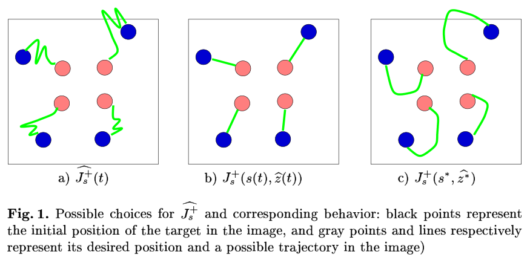
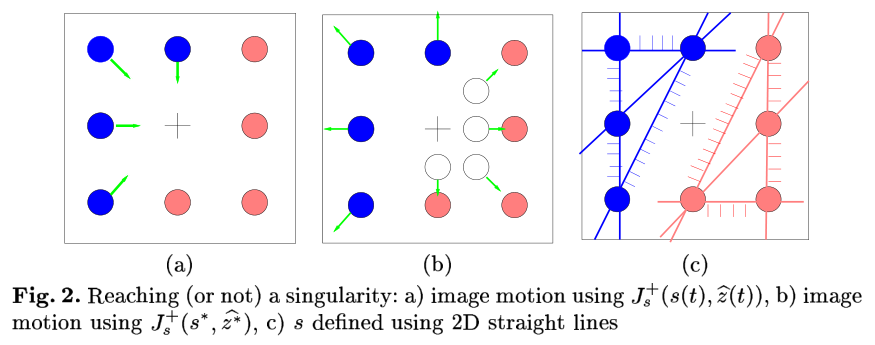
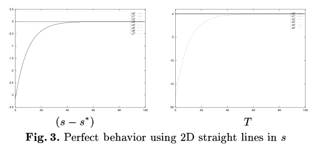
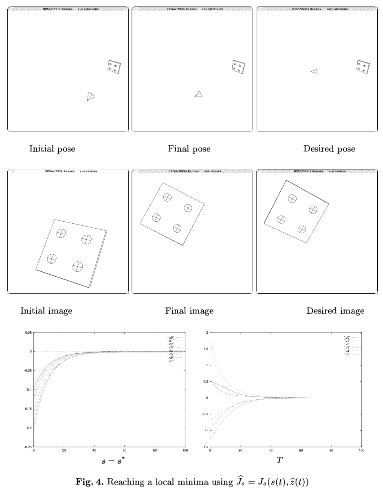
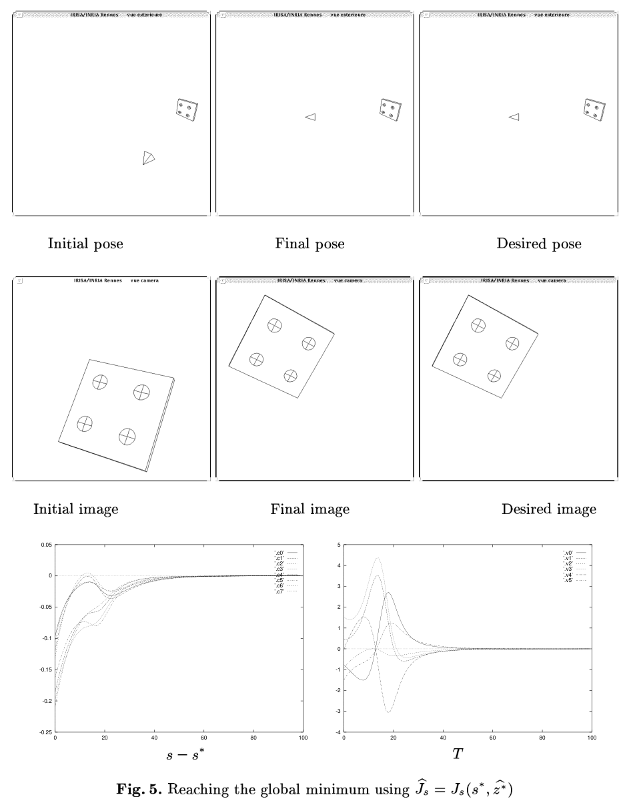
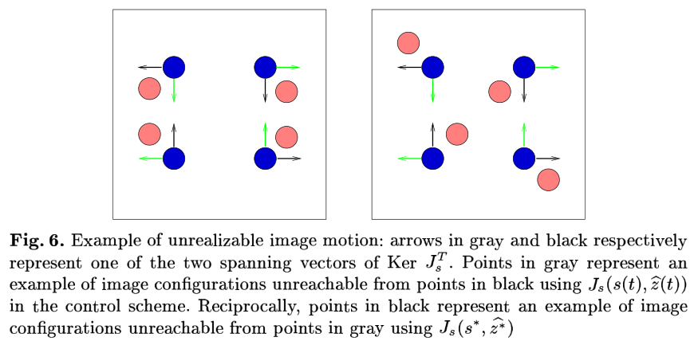

# 영상 기반·위치 기반 시각 서보에서 나타날 수 있는 안정성과 수렴 문제 (Chaumette 1998)

- 원제: Potential problems of stability and convergence in image-based and position-based visual servoing
- 원문: 같은 폴더의 `Chaumette1998_LNCIS.pdf` (HAL inria-00352553. 게재: D. Kriegman, G. Hager, A. S. Morse (eds.), *The Confluence of Vision and Control*, Lecture Notes in Control and Information Systems, Vol. 237, pp. 66-78, Springer-Verlag, 1998)
- 번역 범위: 전문 (HAL 표지 1쪽 제외, 본문 1~12쪽)
- 그림: 원문 그림 6개를 `그림/`에 넣고 본문에서 처음 언급되는 곳에 삽입
- 비고: 이 PDF는 글꼴 인코딩이 깨져 텍스트 추출이 되지 않으므로, 쪽을 이미지로 렌더링해 읽고 번역했다. 원문 캡션은 흑백 인쇄 기준으로 "검은 점/회색 점"이라 부르지만, HAL 판 그림은 컬러다. 그림 1·2·6에서 캡션의 "검은 점"은 파란 점, "회색 점"은 분홍 점, "회색 선·화살표"는 초록 선·화살표에 해당한다. [역주]

저자: François Chaumette — IRISA / INRIA Rennes, Campus de Beaulieu, 35 042 Rennes cedex, France

## 초록

영상 기반 제어(image-based control)나 위치 기반 제어(position-based control)를 쓰는 시각 서보(visual servoing)는 대체로 만족스러운 결과를 낸다. 그러나 어떤 경우에는 수렴과 안정성 문제가 생길 수 있다. 이 논문의 목적은, 핸드-아이(eye-in-hand) 시스템과 카메라의 6자유도를 모두 구속하는 정지 목표물 기준 위치결정 작업을 고려하여 이러한 문제를 부각하는 것이다.

## 1. 서론 (Introduction)

시각 서보의 고전적인 두 접근법(즉 영상 기반 제어와 위치 기반 제어)은 각 제어 방식에 쓰이는 입력의 성격이 다르다 [28,10,14]. 그 결과 나타나는 로봇 거동도 다르기는 하지만, 두 접근법은 일반적으로 만족스러운 결과를 낸다. 원하는 위치로 수렴하며, 제어 방식에 쓰인 폐루프 덕분에 시스템은 안정하고 카메라 보정(calibration) 오차, 로봇 보정 오차, 영상 측정 오차에 강건하다. 이는 특히 소수의 자유도만 시각으로 제어할 때(예를 들어 목표 추적을 위한 카메라의 팬(pan)과 틸트(tilt)) 더 그렇다. 그러나 어떤 경우에는 수렴과 안정성 문제가 생길 수 있다. 이 논문의 목적은 단순하고 구체적인 예로 이러한 문제를 부각하는 것이다. 이 논문에서는 핸드-아이 시스템과, 카메라의 6자유도를 모두 구속하는 정지 목표물 기준의 일반적인 위치결정 작업을 고려한다. 그러나 제시한 결과의 대부분은 다른 종류의 시스템, 예를 들어 목표물과 로봇 엔드이펙터를 동시에 관측하는 단안 또는 양안 비전 시스템 [1,9]으로 일반화할 수 있다.

## 2. 영상 기반 시각 서보 (Image-based visual servoing)

영상 기반 시각 서보는 영상에서 원하는 값 $s^*$에 도달해야 하는 시각 특징(visual feature)의 집합 $s$를 선택하는 데 기초한다. 보통 $s$는 대상 목표물에 속한 여러 점의 영상 좌표로 구성된다. 그러나 달성해야 할 시각 작업과 대상 물체의 성질에 따라 다른 기하학적 시각 특징(직선의 영상이나 구의 영상을 나타내는 파라미터 등)을 쓰는 것이 유리할 수도 있다 [6,3]. $s^*$는 오프라인 학습 단계(로봇을 목표물에 대한 원하는 위치로 옮기고 그때의 영상을 취득한다)에서 얻거나, 원하는 카메라 자세에 대해 목표물 3D 모델의 영상 투영을 계산하여 얻는다(후자는 카메라가 주어진 자세에 실제로 도달하려면 완벽한 카메라 보정과 완벽한 3D 목표물 모델 지식이 필요하다).

$s$에 관련된 영상 자코비안(image Jacobian) $J_s$, 즉 상호작용 행렬(interaction matrix)이 가능한 제어 법칙의 설계에서 결정적인 역할을 한다는 것은 잘 알려져 있다. $J_s$는 다음으로 정의된다.

$$\dot{s} = \left(\frac{\partial s}{\partial r}\right)\frac{dr}{dt} = J_s\,T \tag{1}$$

여기서 $T = \frac{dr}{dt} = (V^T, \Omega^T)^T$는 카메라 속도 스크류(velocity screw)이다($V$와 $\Omega$는 각각 평행이동 성분과 회전 성분을 나타낸다). 초점거리가 1인 고전적 원근 투영 모델을 쓰고 영상 점의 $X$, $Y$ 좌표를 $s$로 선택하면, $J_s$는 다음에서 바로 얻는다.

$$\begin{pmatrix}\dot{X}\\ \dot{Y}\end{pmatrix} = \begin{pmatrix} -1/z & 0 & X/z & XY & -(1+X^2) & Y \\ 0 & -1/z & Y/z & 1+Y^2 & -XY & -X \end{pmatrix} T \tag{2}$$

여기서 $z$는 카메라 좌표계에서 해당 점의 깊이이다.

기존의 모든 제어 방식은 로봇 제어기로 보내는 카메라 속도를(또는 관절 한계와 기구학적 특이점 회피가 필요하면 로봇 자코비안을 도입하여 로봇 관절 속도를 직접 [21,17]) 다음 형태로 계산한다([8,11,23] 등).

$$T = \widehat{J_s^+}\,\dot{s} \quad \text{또는} \quad T = f\!\left(\widehat{J_s^+}(s - s^*)\right) \tag{3}$$

여기서 함수 $f$는 비례 이득 [6]처럼 단순할 수도 있고, $s$를 $s^*$로 조절하는 데 쓰이는 더 복잡한 함수(최적 제어 [23], 비선형 제어 [11] 등)일 수도 있다. $\widehat{J_s^+}$는 $J_s$의 의사역행렬(pseudo-inverse)의 모델, 근사 또는 추정값이다. 실제로 카메라 보정 오차, 잡음이 섞인 영상 측정, 그리고 (2)에 들어 있는 미지의 깊이 $z$ 때문에 $J_s$의 참값은 알 수 없으므로 이러한 모델을 써야 한다.

시스템(이 시스템은 (2)에 $X$와 $Y$가 들어 있으므로 물론 비선형이다)의 전역 점근 안정성(global asymptotic stability)을 보장하는 잘 알려진 충분조건은 다음과 같다 [24].

$$\widehat{J_s^+}\,J_s(s(t), z(t)) > 0\,,\ \forall t \tag{4}$$

이 조건은 실제로 활용하기는 어렵지만, $\widehat{J_s^+}$의 가능한 선택지를 정하게 해 준다. 실제로 문헌에서는 세 가지 경우가 고려되었다.

- $\widehat{J_s^+} = \widehat{J_s^+}(t)$. 이 경우 영상 자코비안은 (2)의 해석적 형태를 고려하지 않고 카메라 운동 중에 수치적으로 추정된다 [13,15](신경망이 쓰인 적도 있다 [27]). 이 접근법은 카메라 및 로봇 모델이 무엇이든 쓸 수 있다면[역주: 원문 "if any camera and robot models are available"은 문맥상 "카메라·로봇 모델이 전혀 없어도"라는 뜻으로 보인다] 매우 흥미로워 보인다. 그러나 이 경우 조건 (4)가 언제 보장되는지 보이는 것은 불가능하다. 게다가 영상 자코비안의 초기 대략적 추정은 특히 서보 초기에 불안정한 결과를 낳을 수 있고, 일부 시각 특징이 카메라 시야 밖으로 나갈 수 있다(그림 1.a 참조).
- $\widehat{J_s^+} = J_s^+(s(t), \hat{z}(t))$. 이제 영상 자코비안은 제어 법칙의 매 반복에서, (2)에 시각 특징의 현재 측정값과 각 점 깊이의 추정값 $\hat{z}(t)$를 넣어 갱신된다. $\hat{z}(t)$는 물체의 3D 모델 지식 [4]에서 얻거나 카메라 운동의 측정 [26,2]에서 얻을 수 있다. 이상적으로는 $\widehat{J_s^+}J_s = \mathbb{I},\ \forall t$이므로, 이는 물론 조건 (4)를 만족하고 완벽히 분리된(decoupled) 시스템을 뜻한다. 따라서 이 경우가 최적으로 보인다. 각 영상 점은 직선을 따라 원하는 위치에 도달하도록 구속된다(그림 1.b 참조). 그러나 영상에서의 이러한 제어가 부적절한 카메라 운동을 낳아, 국소 최소점(local minima)과 작업 특이점(task singularity)에 접근하는 결과를 낳을 수 있음을 보게 될 것이다.
- $\widehat{J_s^+} = J_s^+(s^*, \hat{z}^*)$. 마지막 경우에 $\widehat{J_s^+}$는 상수이며, 시각 특징의 원하는 값과 원하는 카메라 자세에서의 점 깊이 근사값을 써서 오프라인 단계에서 결정된다. 이제 조건 (4)는 원하는 위치의 근방에서만 보장되며, 분리된 거동은 그보다 더 작은 근방에서만 달성된다. 관련된 기호 계산이 복잡하기 때문에 이 근방들의 한계를 해석적으로 결정하는 것은 손이 닿지 않는 일로 보인다. 영상에서 수행되는 궤적은 상당히 예측하기 어려울 수 있고, 특히 초기 카메라 위치가 원하는 위치에서 멀면 서보 중에 일부 시각 특징이 카메라 시야 밖으로 나갈 수 있다(이는 물론 서보 실패로 이어진다)(그림 1.c 참조).

*그림 1 — $\widehat{J_s^+}$의 가능한 선택과 그에 따른 거동: 검은 점은 영상에서 목표물의 초기 위치를 나타내고, 회색 점과 선은 각각 원하는 위치와 영상에서의 가능한 궤적을 나타낸다. (a) $\widehat{J_s^+}(t)$, (b) $J_s^+(s(t), \hat{z}(t))$, (c) $J_s^+(s^*, \hat{z}^*)$*

영상 기반 시각 서보는 카메라 또는 핸드-아이 보정 오차가 클 때에도 일반적으로 만족스러운 것으로 알려져 있다 [5]. 그러나 이제 다음과 같은 안정성과 수렴 문제가 생길 수 있음을 보인다.

- $\widehat{J}$, 또는 $J$ 자체가 서보 중에 특이(singular)해질 수 있으며, 이는 물론 불안정한 거동으로 이어진다.
- 실현 불가능한 영상 운동(unrealizable image motion)의 존재 때문에 국소 최소점에 도달할 수 있다.

### 2.1 작업 특이점에 도달하거나 접근함 (Reaching or nearing a task singularity)

$s$가 세 점의 영상으로 구성되고 그 세 점이 한 직선 위에 있거나 카메라 광학 중심을 포함하는 원기둥 위에 있으면 영상 자코비안이 특이하다는 것은 잘 알려져 있다 [3,19,22]. 세 점보다 많은 점을 쓰면 일반적으로 이러한 특이점을 피할 수 있다. 그러나 이제 구체적인 예로, **점의 개수와 배치가 어떠하든, 영상 점을 시각 특징으로 선택하면 시각 서보 중에 영상 자코비안이 특이해질 수 있음**을 보인다.

카메라의 초기 자세에서 원하는 자세까지의 운동이 광축(optical axis) 둘레의 180도 순수 회전이라고 하자. 이 3D 운동은 주점(principal point)에 대한 대칭에 해당하는 영상 운동을 낳는다. 제어 방식에 $J_s^+(s(t), \hat{z}(t))$를 쓰고 측정과 추정이 완벽하다고 가정하면, 초기 카메라 위치에서 $\widehat{J_s^+}J_s = \mathbb{I}$임을 알 수 있으므로 올바른 거동을 기대하게 된다. 그러나 얻어지는 각 점의 영상 궤적은 직선이며, 모든 점이 같은 순간에 주점에 놓이게 된다(그림 2.a 참조). 이는 광축을 따라 카메라가 순수하게 뒤로 평행이동하는 운동(그리고 불행히도 광축 둘레의 회전 운동은 0)에 해당하며, 카메라를 무한원으로 보낸다. 이 예상치 못한 위치에서 각 점 $i$의 영상 자코비안은 다음과 같다((2) 참조).

$$J_{s_i} = \begin{pmatrix} 0 & 0 & 0 & 0 & -1 & 0 \\ 0 & 0 & 0 & 1 & 0 & 0 \end{pmatrix} \tag{5}$$

이때 상호작용 행렬 $J_s$와 $\widehat{J_s^+}$의 계수(rank)는 6이 아니라 2이며, 이는 물론 작업 특이점에 해당하고 조건 (4)는 더 이상 보장되지 않는다. 이제 제어 방식에 $J_s^+(s^*, \hat{z}^*)$를 쓰는 경우를 보자. 이 선택은 제어 법칙이 마치 영상 오차가 가능한 한 작은 것처럼 거동함을 뜻한다. 그림 2.b(흰 점이 그러한 근접 위치에 해당한다)에서 분명히 보이듯, 얻어지는 카메라 운동은 이제 광축을 따라 앞으로 가는 순수 평행이동 운동이다(그리고 이번에도 광축 둘레의 회전 운동은 전혀 없다). 따라서 카메라는 목표물을 향해 곧장 움직이며(실제로는 시각 특징이 영상 밖으로 나가므로 충돌은 피한다), $J_s$의 특이점을 향해 간다. 실제로 $z = 0$이면 광학 중심 위에 있지 않은 모든 점에 대해 $J_{s_i}$는 다음과 같다.

$$J_{s_i} \rightarrow \begin{pmatrix} \infty & 0 & \infty & \infty & \infty & \infty \\ 0 & \infty & \infty & \infty & \infty & \infty \end{pmatrix} \tag{6}$$

흥미롭게도 이 경우 제어 방식에 쓰인 $J_s^+(s^*, \hat{z}^*)$는 특이하지 않다. 그러나 조건 (4)에 들어 있는 $J_s$의 특이성 때문에 문제가 생긴다.

앞의 두 경우에서, 카메라 회전이 덜 크면 특이점 도달은 피할 수 있다. 그러나 카메라의 평행이동 운동과 회전 운동의 결합(coupling)은 특이점에 접근했다가 (다시 멀어지면서) 정말로 불만족스러운 카메라 궤적을 낳는다. 게다가 고려한 초기 위치에서도, $s$에 점 대신 직선을 쓰면 특이점을 피할 수 있고 완벽한 카메라 궤적(즉 광축 둘레의 순수 회전 카메라 운동)을 얻을 수 있다(그림 2.c 참조). 실제로 영상에서 직선의 위치를 기술하는 $(\rho, \theta)$ 파라미터 [6]를 고려하면, 그림 3에 나타낸 결과를 얻는다. 제시한 시뮬레이션 결과에서는 네 점으로 정의할 수 있는 여섯 직선 중 네 개를 사용했다. 그래프에서 보듯 네 오차 $\rho_i - \rho_i^*$는 항상 0으로 유지되고, 네 오차 $\theta_i - \theta_i^*$는 광축 둘레의 순수 카메라 회전 운동이 계산되는 덕분에 -180도에서 0도로 동시에 수렴한다. 유사한 실험 결과를 얻을 수 있다는 점(보정 오차와 잡음 섞인 영상 측정은 물론 작은 교란을 일으킨다), 그리고 이 결과가 고려한 특징의 개수나 배치에 의존하지 않는다는 점을 밝혀 둔다.

*그림 2 — 특이점에 도달함(또는 도달하지 않음): (a) $J_s^+(s(t), \hat{z}(t))$를 쓴 영상 운동, (b) $J_s^+(s^*, \hat{z}^*)$를 쓴 영상 운동, (c) 2D 직선으로 정의한 $s$*

*그림 3 — $s$에 2D 직선을 쓴 완벽한 거동. 왼쪽: $(s - s^*)$, 오른쪽: $T$*

마지막으로, 여기서 보인 것은 직선을 쓰는 것이 점을 쓰는 것보다 **때로는** 더 유리하다는 것뿐이며, 그 이상은 아니라는 점을 분명히 해 둔다. 실제로 특정 배치에서는 직선에서도 어떤 특이점이 나타날 수 있고, 어떤 카메라 운동은 직선보다 점(또는 다른 무엇)을 써서 더 적절히 달성될 수도 있다.

### 2.2 국소 최소점에 도달함 (Reaching local minima)

이제 실제로 나타날 수 있는 또 다른 잠재적 문제에 초점을 맞춘다. 정의상 국소 최소점은 $T = 0$이고 $s \neq s^*$(또는 $\dot{s} \neq 0$)인 곳으로 정의된다. 이는 다음과 동치이다.

$$s - s^* \in \mathrm{Ker}\,\widehat{J_s^+} \quad \left(\text{또는 } \dot{s} \in \mathrm{Ker}\,\widehat{J_s^+}\right) \tag{7}$$

$s$가 세 영상 점으로 구성되면($J_s$가 완전 계수 6이 되도록), $\mathrm{Ker}\,\widehat{J_s^+} = 0$이므로 국소 최소점이 없다. 그러나 세 점의 같은 영상이 서로 다른 네 카메라 자세에서 보일 수 있다는 것은 잘 알려져 있다 [12]. 다시 말해 $s = s^*$(또는 $\dot{s} = 0$)인 카메라 자세가 넷(즉 전역 최소점이 넷) 존재한다. 이론적으로는 적어도 네 점을 쓰면 유일한 자세를 얻을 수 있다. 그러나 이 경우 $J_s$의 크기는 $8 \times 6$이므로 $\dim\,\mathrm{Ker}\,\widehat{J_s^+} = 2$가 된다. 이것이 국소 최소점이 항상 존재함을 보여 주지는 않는다. 실제로 $s - s^*$(또는 $\dot{s}$) $\in \mathrm{Ker}\,\widehat{J_s^+}$인 배치 $s$는 물리적으로 정합적이어야 한다(즉 대응하는 카메라 자세가 존재해야 한다). 관련된 기호 계산이 복잡하여 일반적인 결과를 결정하는 것은 불가능해 보인다. 그러나 특정 사례는 제시할 수 있다. 그림 4에는 네 점으로 구성된 평면 목표물에 대해 제어 방식에 $J_s(s(t), \hat{z}(t))$를 쓴 시뮬레이션 결과를 나타냈다. 보듯이 사용한 전략 때문에 시각 특징은 동시에 감소한다. 그러나 최종 카메라 위치가 원하는 위치에서 멀리 떨어져 있는데도 카메라 속도가 0이므로 국소 최소점에 도달한 것이다. 그 위치에서 영상의 오차 $s - s^*$는 완전히 사라지지 않는다(잔류 오차는 각 $X$, $Y$ 좌표에서 약 1화소이다). 영상 측정에 잡음을 넣어도 같은 결과가 나오며, 이는 실제 실험에서도 얻을 수 있다.

*그림 4 — $\widehat{J}_s = J_s(s(t), \hat{z}(t))$를 써서 국소 최소점에 도달함. 위: 초기 자세(Initial pose), 최종 자세(Final pose), 원하는 자세(Desired pose). 가운데: 초기 영상, 최종 영상, 원하는 영상. 아래: $s - s^*$와 $T$*

흥미롭게도 제어 방식에 $J_s(s^*, \hat{z}^*)$를 쓰면 같은 초기 카메라 위치에서 전역 최소점에 올바르게 도달한다(그림 5 참조). 이 경우 $s - s^*$에서 보듯 영상에서의 궤적과 계산된 제어 법칙은 상당히 의외의 모습이지만, 이 거동 덕분에 시스템은 국소 최소점을 피한다.

*그림 5 — $\widehat{J}_s = J_s(s^*, \hat{z}^*)$를 써서 전역 최소점에 도달함. 위: 초기 자세, 최종 자세, 원하는 자세. 가운데: 초기 영상, 최종 영상, 원하는 영상. 아래: $s - s^*$와 $T$*

사실 잠재적 국소 최소점은 실현 불가능한 영상 운동의 존재 때문에 생긴다. 이러한 운동 $\dot{s}^\perp$는 $\dot{s}^\perp \in \mathrm{Ker}\,J_s^T$로 정의된다. 실제로 이들은 $J_s$의 치역(range space)에 속하지 않는 운동이다. 다시 말해:

$$\dot{s}^\perp \notin \mathrm{Im}\,J_s \Rightarrow \dot{s}^\perp \in (\mathrm{Im}\,J_s)^\perp = \mathrm{Ker}\,J_s^T \tag{8}$$

이번에도 $s$가 네 점으로 구성되면 $\dim\,\mathrm{Ker}\,J_s^T = 2$이다. (2)에서 쉽게 얻을 수 있는 예시를, 영상 평면에 평행하고 정사각형을 이루는 동일 평면 위 네 점의 경우에 대해 그림 6에 나타냈다.

*그림 6 — 실현 불가능한 영상 운동의 예: 회색과 검은색 화살표는 각각 $\mathrm{Ker}\,J_s^T$를 생성하는 두 벡터 중 하나를 나타낸다. 회색 점은 제어 방식에 $J_s(s(t), \hat{z}(t))$를 쓸 때 검은 점에서 도달할 수 없는 영상 배치의 예를 나타낸다. 반대로 검은 점은 $J_s(s^*, \hat{z}^*)$를 쓸 때 회색 점에서 도달할 수 없는 영상 배치의 예를 나타낸다.*

항상 $\mathrm{Ker}\,J_s^T = \mathrm{Ker}\,J_s^+$이므로, 국소 최소점과 실현 불가능한 영상 운동 사이의 관련은 명백하다. 실제로 카메라가 $(s - s^*) \in \mathrm{Ker}\,J_s^T$인 위치에 도달하면, $J_s(s(t), \hat{z}(t))$를 쓰는 제어 법칙의 거동은 $\dot{s}$도 $\mathrm{Ker}\,J_s^T$에 속해야 함을 뜻한다. 정의상 이렇게 부과되었지만 실현 불가능한 영상 운동을 만들어 낼 수 있는 카메라 운동 $T$는 존재하지 않는다. 따라서 카메라는 국소 최소점에 놓인다. 이는 쉽게 보일 수 있는데, 측정과 추정이 완벽하다고 가정하면 여기서는 $\widehat{J_s^+} = J_s^+$이므로, $(s - s^*) \in \mathrm{Ker}\,J_s^T$이면 물론 $(s - s^*) \in \mathrm{Ker}\,\widehat{J_s^+}$이기 때문이다.

반면 $J_s(s^*, \hat{z}^*)$를 쓰면 일반적으로 $\mathrm{Ker}\,J_s^T \neq \mathrm{Ker}\,\widehat{J_s^+}$이므로, 시스템이 실현 불가능하지 않은 영상 운동을 계산한다면 국소 최소점을 피할 수 있다. 사실 $\mathrm{Ker}\,J_s^T \cap \mathrm{Ker}\,\widehat{J_s^+} = 0$임을, 더 정확히는 $\mathrm{Ker}\,J_s^T \cap \mathrm{Ker}\,\widehat{J_s^+}$에 속하는 영상 배치 $(s - s^*)$가 물리적으로 정합적이지 않음을 보여야 한다. 예를 들어 고려한 정사각형 물체에 대해 그림 6에 나타낸 회색 영상 배치를 얻을 수 있는 카메라 자세는 존재하지 않는 것으로 보인다.

이 소절에서 보인 것은 $J_s(s(t), \hat{z}(t))$ 대신 $J_s(s^*, \hat{z}^*)$를 쓰는 것이 **때로는** 더 유리하다는 것뿐이며, 그 이상은 아니라는 점을 분명히 해 둔다. 끝으로, 논문의 결론에서 영상 기반 시각 서보의 이러한 바람직하지 않은 거동을 피하기 위한 몇 가지 충분하고 단순한 조건을 보게 될 것이다.

## 3. 위치 기반 시각 서보 (Position-based visual servoing)

위치 기반 시각 서보에는 위에서 기술한 결점이 없다. 이제는 제어 법칙의 매 반복에서 카메라 자세 $r$의 추정값 $\hat{r}$을 계산한다 [12,4]. 따라서 제어 방식은 $\hat{r}$이 원하는 자세 $r^*$에 도달하도록 설계된다 [29,18]. 제어 방식이 데카르트 공간에서 표현된 입력에 기초하므로, 이 접근법은 매우 만족스러워 보인다. 실제로 이상적으로는 작업 자코비안(task Jacobian) $J_{\hat{r}} = \frac{\partial \hat{r}}{\partial r}$이 다음과 같다.

$$J_{\hat{r}} = \begin{pmatrix} -\mathbb{I}_3 & As(U) \\ 0 & -\mathbb{I}_3 \end{pmatrix} \tag{9}$$

여기서 $As(U)$는 목표물 좌표계와 카메라 좌표계의 원점으로 정의되는 벡터 $U$에 연관된 반대칭 행렬(antisymmetric matrix)이다. 따라서 이상적으로 $J_{\hat{r}}$은 상삼각 행렬(카메라 궤적의 완벽한 분리를 보장한다)이며, 항상 완전 계수 6이고 $\mathrm{Ker}\,J_{\hat{r}}^T = \mathrm{Ker}\,J_{\hat{r}}^+ = 0$이다. 그러나 (9)로 주어진 $J_{\hat{r}}$의 형태는 완벽한 카메라 보정, 완벽한 영상 측정, 물체의 완벽한 3D 모델, 완벽한 자세 추정 알고리즘이 있을 때에만 유효하다... 사실 작업 자코비안의 실제 형태는 다음과 같다.

$$J_{\hat{r}} = \left(\frac{\partial \hat{r}}{\partial s}\right)\left(\frac{\partial s}{\partial r}\right) \tag{10}$$

두 번째 항 $\left(\frac{\partial s}{\partial r}\right)$은 바로 $s$에 관련된 상호작용 행렬이다((1) 참조). 따라서 이 항은 해석적으로 알려져 있다. 반면 시각 특징의 변화에 따른 추정 자세의 변화를 나타내는 $\left(\frac{\partial \hat{r}}{\partial s}\right)$은 불행히도 알려져 있지 않으며, 사용한 시각 특징, 물체의 형상, 카메라 보정 파라미터, 그리고 사용한 자세 추정 알고리즘(일반적으로 반복 수치 방법에 기초한다 [4])에 의존한다. 따라서 위치 기반 시각 서보의 전역 점근 안정성을 이론적으로 보이는 것은 손이 닿지 않는 일로 보인다. 충분조건이 다음과 같기 때문이다((4) 참조).

$$\widehat{J_{\hat{r}}^+}\,J_{\hat{r}} > 0\,,\ \forall t \tag{11}$$

여기서 제어 방식에 쓰이는 $\widehat{J_{\hat{r}}^+}$는 (9)로 선택할 수 있지만(이것이 유일하게 가능한 만족스러운 근사로 보인다), $J_{\hat{r}}$은 앞서 말했듯 해석적으로 알려져 있지 않다.

게다가 영상에서의 제어가 더 이상 없으므로, 특히 보정 오차가 클 때 서보 중에 물체가 항상 카메라 시야 안에 남아 있음을 보장하는 것은 불가능하다. 또한 N점 원근(Perspective from N Points) 문제는 대부분의 역문제처럼 때때로 불량조건(ill-posed)이고 교란에 민감하다는 것(이는 $\left(\frac{\partial \hat{r}}{\partial s}\right)$의 나쁜 조건수를 뜻한다)이 잘 알려져 있다. 그림 4에서 볼 수 있듯이 특히 평면 목표물의 경우 영상 측정의 작은 오차가 매우 다른 결과로 이어질 수 있다. 이런 경우 제어 법칙은 완전히 불안정할 수 있다. 실제로는 동일 평면에 있지 않은 물체를 고려하면 만족스러운 결과를 얻는다 [29,18]. 그러나 자세 추정의 최적 거동을 얻는 데 필요한 특징의 개수, 성질, 배치를 결정하는 것은 매우 흥미로운 일일 것이다.

결론적으로 위치 기반 시각 서보에서는 대부분의 제어 문제가 자세 추정 알고리즘으로 넘겨진다. 그러나 그렇다고 해서 비전과 제어의 통합 문제 전체가 해결되는 것은 아니다.

## 4. 결론 (Conclusion)

이 논문에서 보였듯이, 어떤 시각 서보 방식이든 그 완전한 유효성을 이론적으로 보이는 데에는 많은 문제가 남아 있다. 영상 기반 시각 서보의 경우, 어떤 물체에 대해서도 그리고 어떤 초기 카메라 위치에서도 적합한 시각 특징의 보편적 표현을 결정하는 것이 흥미로운 과제이다. 영상 자코비안의 조건수(condition number)가 시스템의 거동에 중요한 역할을 한다는 것은 알려져 있다 [7](적절한 시각 특징을 선택하기 위해 유사한 척도를 제시한 [20,25]도 참조). 더 정확히는 $J_s$와 $\widehat{J_s^+}$의 조건수가 최소여야 한다. 이 논문에서 얻은 결과로부터, 영상 기반 작업의 올바른 모델링을 보장하기 위한 추가 충분조건은 가능한 전체 작업 공간에서 $\mathrm{Ker}\,\widehat{J_s^+} = \mathrm{Ker}\,J_s^T = 0$이라는 것이다(이는 작업 특이점의 존재도 배제한다). 직관적으로 물체 영상의 처음 여섯 관성 모멘트(inertial moment)가 흥미로운 후보로 보이지만, 그러한 표현으로(그리고 불행히도 어떤 표현으로든) 중심에 놓인 원을 관측하는 것은 특이한 경우로 알려져 있다 [6]. 최근 제안된 2D1/2 시각 서보 방식 [16]도 수렴과 안정성 문제를 피하는 흥미로운 접근법으로 보인다.

## 참고문헌

1. P. Allen, A. Timcenko, B. Yoshimi, and P. Michelman. Automated tracking and grasping of a moving object with a robotic hand-eye system. *IEEE Trans. on Robotics and Automation*, 9(2):152–165, April 1993.
2. F. Chaumette, S. Boukir, P. Bouthemy, and D. Juvin. Structure from controlled motion. *IEEE Trans. on Pattern Analysis and Machine Intelligence*, 18(5):492–504, May 1996.
3. F. Chaumette, P. Rives, and B. Espiau. Classification and realization of the different vision-based tasks. K. Hashimoto, editor, *Visual Servoing*, pages 199–228, World Scientific, Singapore, 1993.
4. D. Dementhon and L. Davis. Model-based object pose in 25 lines of code. *Int. Journal of Computer Vision*, 15(1/2):123–141, June 1995.
5. B. Espiau. Effect of camera calibration errors on visual servoing in robotics. In *Third Int. Symposium on Experimental Robotics*, Kyoto, Japan, October 1993.
6. B. Espiau, F. Chaumette, and P. Rives. A new approach to visual servoing in robotics. *IEEE Trans. on Robotics and Automation*, 8(3):313–326, June 1992.
7. J. Feddema, C. Lee, and O. Mitchell. Automatic selection of image features for visual servoing of a robot manipulator. In *IEEE Int. Conf. on Robotics and Automation*, volume 2, pages 832–837, Scottsdale, Arizona, May 1989.
8. J. Feddema and O. Mitchell. Vision-guided servoing with feature-based trajectory generation. *IEEE Trans. on Robotics and Automation*, 5(5):691–700, October 1989.
9. G. Hager. A modular system for robust positioning using feedback from stereo vision. *IEEE Trans. on Robotics and Automation*, 13(4):582–595, August 1997.
10. K. Hashimoto, editor. *Visual Servoing*. World Scientific Series in Robotics and Automated Systems, Vol 7, World Scientific Press, Singapore, 1993.
11. K. Hashimoto and H. Kimura. Dynamic visual servoing with nonlinear model-based control. In 12th *World Congress IFAC*, volume 9, pages 405–408, Sidney, Autralia, July 1993.
12. R. Horaud. New methods for matching 3d objects with single perspective view. *IEEE Trans. on Pattern Analysis and Machine Intelligence*, 9(3):401–412, May 1987.
13. K. Hosoda and M. Asada. Versatile visual servoing without knowledge of true jacobian. In *IEEE/RSJ Int. Conf on Intelligent Robots and Systems*, pages 186–193, Munchen, Germany, September 1994.
14. S. Hutchinson, G. Hager, and P. Corke. A tutorial on visual servo control. *IEEE Trans. on Robotics and Automation*, 12(5):651–670, October 1996.
15. M. Jagersand, O. Fuentes, and R. Nelson. Experimental evaluation of uncalibrated visual servoing for precision manipulation. In *IEEE Int. Conf. on Robotics and Automation*, volume 3, pages 2874–2880, Albuquerque, New Mexico, April 1997.
16. E. Malis, F. Chaumette, and S. Boudet. Positioning a coarse-calibrated camera with respect to an unknown object by 2d 1/2 visual servoing. In *IEEE Int. Conf. on Robotics and Automation*, Leuven, Belgium, May 1998. *(extended version available at ftp://ftp.irisa.fr/techreports/1998/PI-1166.ps.gz)*.
17. E. Marchand, F. Chaumette, and A. Rizzo. Using the task function approach to avoid robot joint limits and kinematic singularities in visual servoing. In *IEEE/RSJ Int. Conf. on Intelligent Robots and Systems*, volume 3, pages 1083–1090, Osaka, Japan, November 1996.
18. P. Martinet, N. Daucher, J. Gallice, and M. Dhome. Robot control using monocular pose estimation. In *Workshop on New Trends in Image-based Robot Servoing, IROS'97*, pages 1–12, Grenoble, France, September 1997.
19. H. Michel and P. Rives. Singularities in the determination of the situation of a robot effector from the perspective view of three points. Technical Report 1850, INRIA, February 1993.
20. B. Nelson and P. Khosla. The resolvability ellipsoid for visual servoing. In *IEEE Int. Conf. on Computer Vision and Pattern Recognition*, pages 829–832, Seattle, Washington, June 1994.
21. B. Nelson and P. Khosla. Strategies for increasing the tracking region of an eye-in-hand system by singularity and joint limits avoidance. *Int. Journal of Robotics Research*, 14(3):255–269, June 1995.
22. N. Papanikolopoulos. Selection of features and evaluation of visual measurements during robotic visual servoing tasks. *Journal of Intelligent and Robotics Systems*, 13:279–304, 1995.
23. N. Papanikolopoulos, P. Khosla, and T. Kanade. Visual tracking of a moving target by a camera mounted on a robot: A combination of control and vision. *IEEE Trans. on Robotics and Automation*, 9(1):14–35, February 1993.
24. C. Samson, M. Le Borgne, and B. Espiau. *Robot Control: the Task Function Approach*. Clarendon Press, Oxford, United Kingdom, 1991.
25. R. Sharma and S. Hutchinson. Optimizing hand/eye configuration for visual servo systems. In *IEEE Int. Conf. on Robotics and Automation*, pages 172–177, Nagoya, Japan, May 1995.
26. C. Smith and N. Papanikolopoulos. Computation of shape through controlled active exploration. In *IEEE Int. Conf. on Robotics and Automation*, volume 3, pages 2516–2521, San Diego, California, May 1994.
27. I. Suh. Visual servoing of robot manipulators by fuzzy membership function based neural networks. K. Hashimoto, editor, *Visual Servoing*, pages 285–315, World Scientific, Singapore, 1993.
28. L. Weiss, A. Sanderson, and C. Neuman. Dynamic sensor-based control of robots with visual feedback. *IEEE Journal of Robotics and Automation*, 3(5):404–417, October 1987.
29. W. Wilson, C. Hulls, and G. Bell. Relative end-effector control using cartesian position-based visual servoing. *IEEE Trans. on Robotics and Automation*, 12(5):684–696, October 1996.
