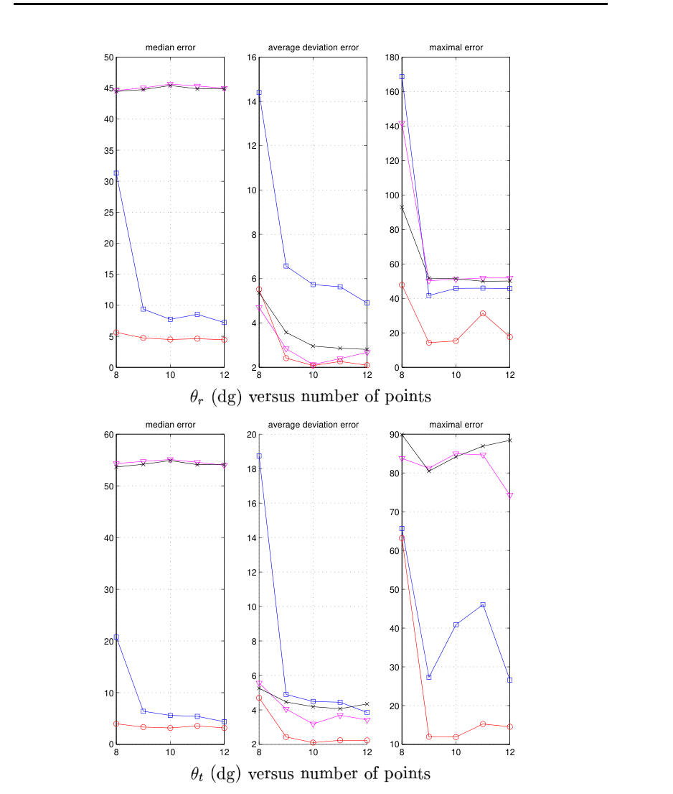
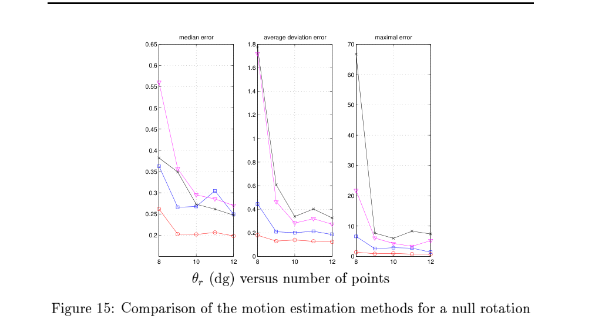
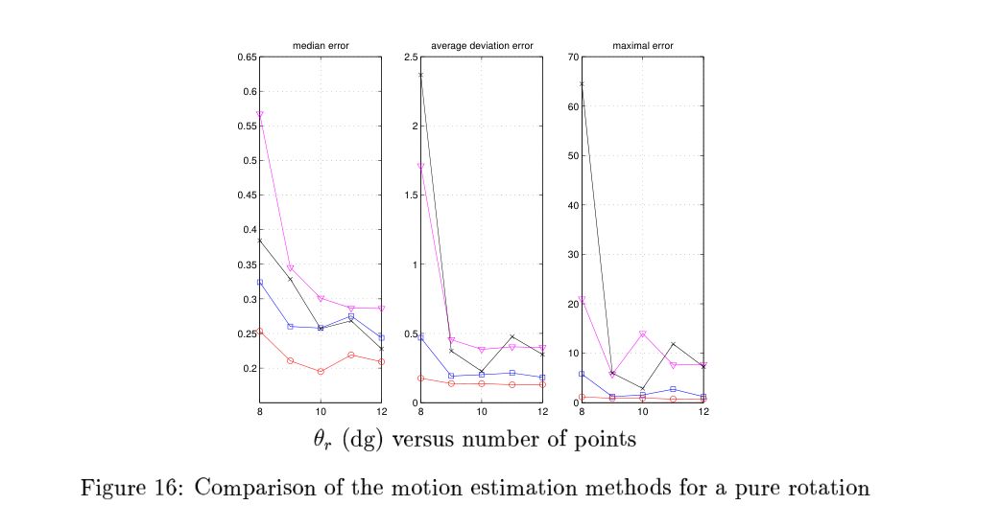
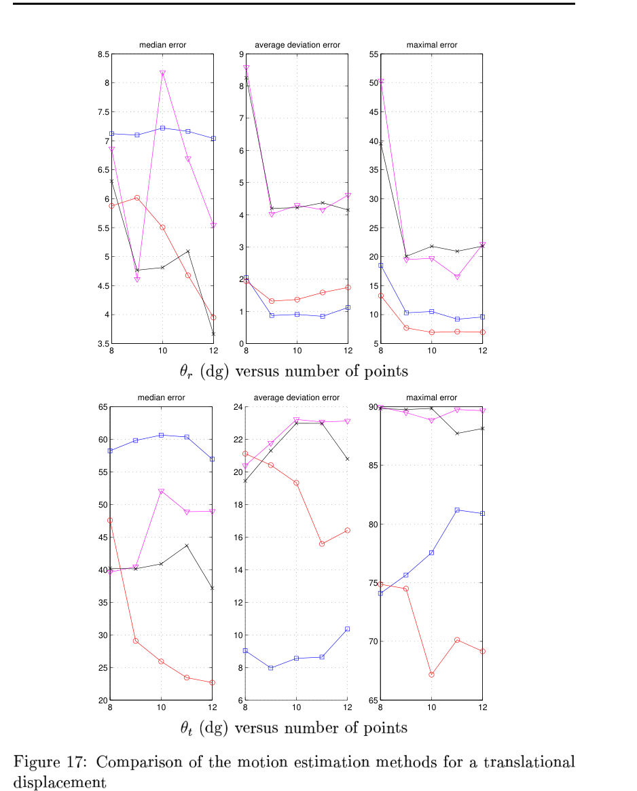
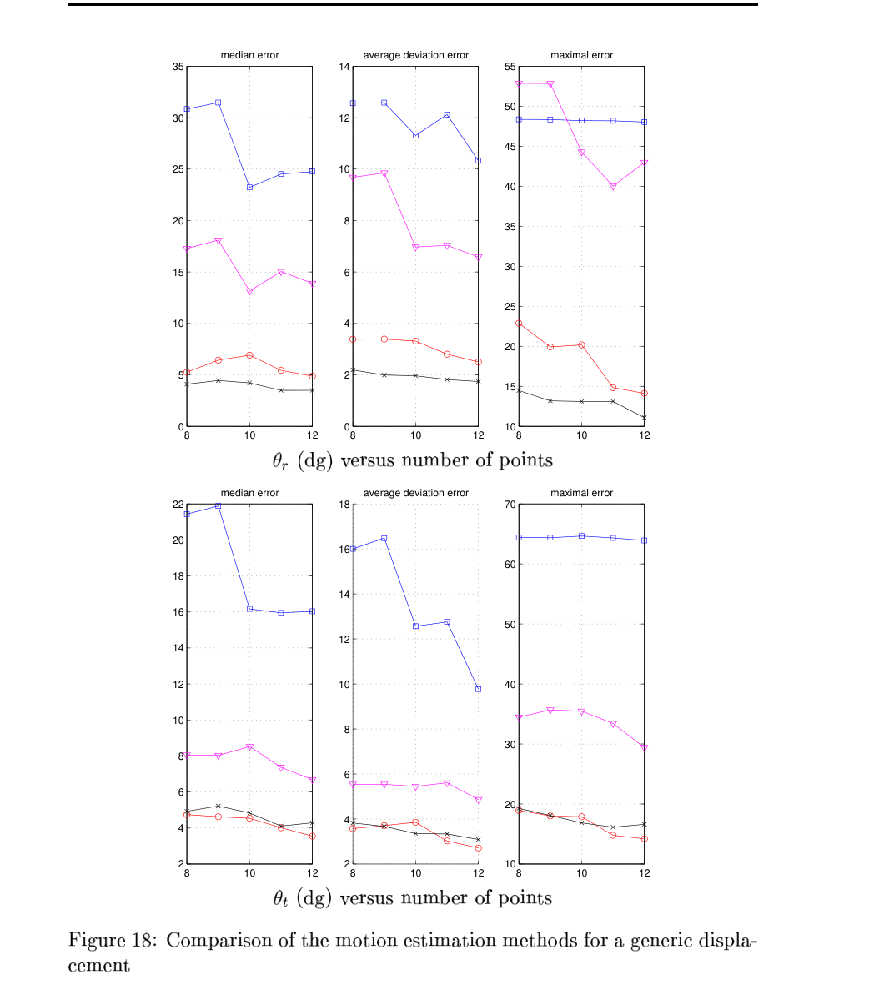
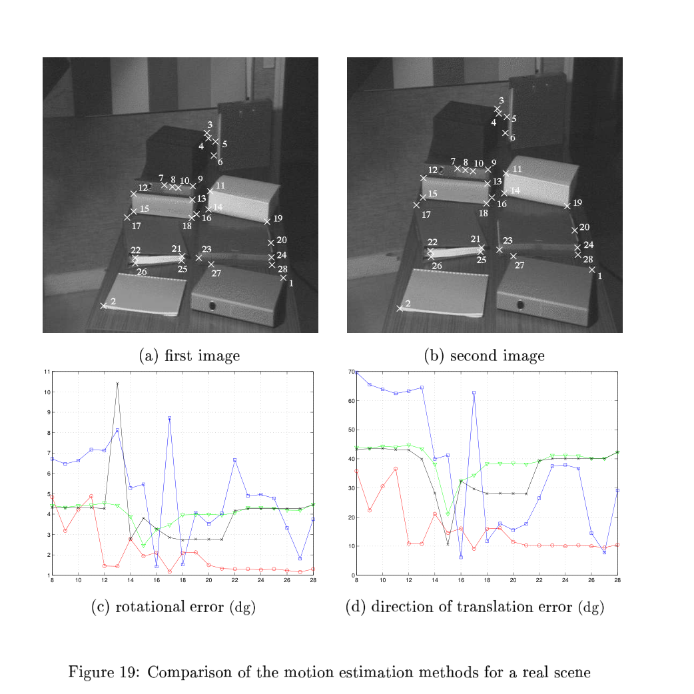

# 2½D 시각 서보 — INRIA 기술보고서 발췌 번역 (Malis 1998)

- 원제: 2D 1/2 Visual Servoing
- 저자: Ezio Malis, François Chaumette, Sylvie Boudet
- 원문: 같은 폴더의 `Malis1998_INRIA_RR-3387.pdf` (INRIA Research Report RR-3387, 1998년 3월, 71쪽, HAL inria-00073302). 아래 쪽수는 보고서 자체 쪽 번호이며 PDF 쪽수는 보고서 쪽수 + 3이다.
- 번역 범위: **발췌.** 이 기술보고서는 같은 저자들의 저널판(IEEE Trans. Robotics and Automation 15(2), 1999)과 내용이 많이 겹친다. **저널판 번역은 `03_Y_T_분리/논문/02_Malis1999_TRA_2.5D시각서보_회전평행이동분리/번역.md` 참조.** 여기서는 저널판에 없거나 저널판이 크게 줄인 부분만 옮겼다.
  - 옮긴 절: 2.2.4 에피폴과 호모그래피 행렬 추정, 2.2.5 사영 호모그래피 추정, 2.3 사영 재구성에서 척도화된 유클리드 재구성으로(2.3.1, 2.3.2), 5 시뮬레이션 결과(핵심), 6.1 실제 장면 실험, 부록(절 제목과 핵심 결과).
  - 옮기지 않은 절(저널판과 겹치거나 일반 교재 내용): 초록·1 서론, 2.1 사영 공간·카메라 모델, 2.2.1~2.2.3 두 투영의 관계·에피폴라 제약·기본 행렬 추정, 3 시각 기반 로봇 제어(3D/2D/2½D 시각 서보와 제어 법칙 — 저널판 II~IV절), 4 안정성 해석(저널판 V절), 6.2~6.4 로봇 실험과 비교(저널판 VI절), 7 결론.
  - 참고문헌은 원문 그대로 전부 옮겼다(보고서 68~71쪽, 쪽 이미지에서 전사).
- 텍스트: 원문 PDF의 텍스트 층이 깨져 있어(Type3 글꼴) 쪽 이미지를 직접 보고 번역했다.
- 그림: 발췌 범위의 원문 그림 6개(그림 14~19, 원문 번호 유지)를 `그림/`에 넣고 본문에서 처음 언급되는 곳에 삽입했다. 2.2.4~2.3절에는 그림이 없다.

## 2.2.4 에피폴과 호모그래피 행렬 추정 (Epipole and homography matrix estimation) (보고서 16~18쪽)

행렬 $\mathbf{F}$의 계산을 단순화하기 위해 Boufama 등 [3]은 각 영상에서 4개의 점을 써서 사영 좌표를 바꾼다. 이 점들은 영상에서 어느 셋도 한 직선 위에 있지 않도록 고른다. $\mathbf{M} = \mathbf{M}(\mathbf{m}_1, \mathbf{m}_2, \mathbf{m}_3, \mathbf{m}_4)$와 $\mathbf{M}^* = \mathbf{M}^*(\mathbf{m}_1^*, \mathbf{m}_2^*, \mathbf{m}_3^*, \mathbf{m}_4^*)$를 좌표 변환 행렬이라 하자. 새 좌표계에서의 영상 점 $\tilde{\mathbf{m}}_j = [\tilde{u}_j\ \tilde{v}_j\ \tilde{w}_j]^T$와 $\tilde{\mathbf{m}}_j^* = [\tilde{u}_j^*\ \tilde{v}_j^*\ \tilde{w}_j^*]^T$는 $\tilde{\mathbf{m}}_j = \mathbf{M}^{-1}\mathbf{m}_j$, $\tilde{\mathbf{m}}_j^* = \mathbf{M}^{*-1}\mathbf{m}_j^*$로 계산할 수 있다. 처음 세 점을 쓰면 좌표 변환 행렬은 다음과 같이 쓸 수 있다:

$$\mathbf{M} = \begin{bmatrix} \mathbf{m}_1 & \mathbf{m}_2 & \mathbf{m}_3 \end{bmatrix}\begin{bmatrix} \lambda_1 & 0 & 0 \\ 0 & \lambda_2 & 0 \\ 0 & 0 & \lambda_3 \end{bmatrix}, \qquad \mathbf{M}^* = \begin{bmatrix} \mathbf{m}_1^* & \mathbf{m}*_2 & \mathbf{m}_3^* \end{bmatrix}\begin{bmatrix} \lambda_1^* & 0 & 0 \\ 0 & \lambda_2^* & 0 \\ 0 & 0 & \lambda_3^* \end{bmatrix} \tag{21}$$

여기서 미지 스칼라 $\lambda_i$와 $\lambda_i^*$는 넷째 점을 써서 스칼라 인자를 제외하고 계산할 수 있다:

$$\begin{bmatrix} \lambda_1 \\ \lambda_2 \\ \lambda_3 \end{bmatrix} = \lambda_4\begin{bmatrix} \mathbf{m}_1 & \mathbf{m}_2 & \mathbf{m}_3 \end{bmatrix}^{-1}\mathbf{m}_4, \qquad \begin{bmatrix} \lambda_1^* \\ \lambda_2^* \\ \lambda_3^* \end{bmatrix} = \lambda_4^*\begin{bmatrix} \mathbf{m}_1^* & \mathbf{m}_2^* & \mathbf{m}_3^* \end{bmatrix}^{-1}\mathbf{m}_4^* \tag{22}$$

처음 세 점에 대해 $[\tilde{\mathbf{m}}_1\ \tilde{\mathbf{m}}_2\ \tilde{\mathbf{m}}_3] = [\tilde{\mathbf{m}}_1^*\ \tilde{\mathbf{m}}_2^*\ \tilde{\mathbf{m}}_3^*] = \mathbf{I}_3$로 고르면, 이 세 점이 정의하는 평면 $\pi$에 관계된 호모그래피 행렬 $\tilde{\mathbf{H}}_p$는 새 좌표계로 표현할 때 대각 행렬이 된다:

$$\tilde{\mathbf{H}}_p = \mathbf{M}^{-1}\mathbf{H}_p\mathbf{M}^* = diag(\tilde{h}_u, \tilde{h}_v, \tilde{h}_w) \tag{23}$$

그러면 기본 행렬(fundamental matrix)은 새 좌표계에서 다음과 같이 쓸 수 있다:

$$\tilde{\mathbf{F}} = [\tilde{\mathbf{e}}]_\times\tilde{\mathbf{H}}_p \tag{24}$$

여기서 $\tilde{\mathbf{e}} = \mathbf{M}^{-1}\mathbf{e}$는 새 좌표계에서의 에피폴이다. 식 (24)는 네 미지수(에피폴과 대각 호모그래피 행렬은 각각 축척 인자를 제외하고 정의되므로 각각 두 개의 미지수)에 대한 2차 다항식이다. 식 (24)는 다음과 같이 쓸 수 있다 [3]:

$$\mathbf{C}_{\tilde{f}}\,\tilde{\mathbf{f}} = 0 \tag{25}$$

여기서 $\tilde{\mathbf{f}} = [\tilde{e}_x\tilde{h}_w\ \ \tilde{e}_x\tilde{h}_v\ \ \tilde{e}_y\tilde{h}_u\ \ \tilde{e}_y\tilde{h}_w\ \ \tilde{e}_z\tilde{h}_v\ \ \tilde{e}_z\tilde{h}_u]^T$이다. 새 시스템은 6개 미지수의 선형 동차 시스템이다. 그러면 문제를 선형으로 풀기 위해 $\pi$에 속하지 않는 점이 적어도 다섯 개 필요하다. $m$ ($m \geq 5$)개의 점이 있으면 계수 행렬 $\mathbf{C}_{\tilde{f}}$는 $(m \times 6)$ 크기이다. 문제는 행렬 $\mathbf{C}_{\tilde{f}}^T\mathbf{C}_{\tilde{f}} = \mathbf{V}\mathbf{S}\mathbf{V}^T$ ($6 \times 6$)의 특이값 분해로 푼다. 다시, 시스템의 해 $\overline{\tilde{\mathbf{f}}}$는 $\mathbf{S}$의 최소 특이값(잡음이 없으면 0)에 대응하는 $\mathbf{V}$의 열이다. 벡터 $\tilde{\mathbf{f}}$를 얻은 뒤 원래 미지수를 추정할 수 있다. 불행히도 이 알고리즘으로 호모그래피 행렬을 추정할 수 없는 특이 경우가 세 가지 있다. 실제로 $\tilde{\mathbf{e}} = [1\ 0\ 0]^T$이면 $\tilde{h}_v/\tilde{h}_w$만 알려지고, $\tilde{\mathbf{e}} = [0\ 1\ 0]^T$이면 $\tilde{h}_u/\tilde{h}_w$만, $\tilde{\mathbf{e}} = [0\ 0\ 1]^T$이면 $\tilde{h}_u/\tilde{h}_v$만 알려진다. 이 경우들에서는 잡음이 없어도 이 알고리즘으로 호모그래피 행렬을 추정할 수 없다. 이런 특수한 경우를 검출할 수 있으면 다른 알고리즘을 쓸 수 있다. 그러나 잡음이 있으면 0 값의 추정은 수치 오차에 매우 민감하므로 추정이 정확하지 않을 것이다.

이 알고리즘의 주된 장점은, 특이 경우에 퇴화하더라도 기본 행렬과 달리 결코 정의되지 않는 일이 없는 호모그래피 행렬을 제공할 수 있다는 것이다. 끝으로 이 알고리즘에서는 호모그래피 행렬이 에피폴 추정에 의존하며 미지수의 수가 최소가 아니다. 이런 이유로 다음 절에서는 에피폴을 추정하지 않고 호모그래피 행렬을 직접 정하는 방법을 제안한다.

## 2.2.5 사영 호모그래피 추정 (Projective homography estimation) (보고서 18~21쪽)

우리의 접근법은 [5]에서 제안된 것과 비슷하게, 모든 에피폴라 선이 에피폴에서 만난다는 제약에 근거한다. 따라서 세 에피폴라 선 (16)의 각 집합에 대해 다음이 성립한다:

$$|\,\mathbf{l}_j\ \ \mathbf{l}_k\ \ \mathbf{l}_l\,| = |\,\mathbf{m}_j \wedge \mathbf{H}_p\mathbf{m}_j^*\ \ \mathbf{m}_k \wedge \mathbf{H}_p\mathbf{m}_k^*\ \ \mathbf{m}_l \wedge \mathbf{H}_p\mathbf{m}_l^*\,| = 0 \tag{26}$$

그러나 식 (26)은 사영 호모그래피 행렬의 원소에 대해 비선형이다. $\mathbf{H}_p$의 계산을 단순화하기 위해 사영 좌표 변환을 수행한다.

**비선형 제약을 강제하지 않는 선형 방법 (Linear method without enforcing the non-linear constraints)** Couapel [5]은 Boufama [3]처럼 각 영상에서 4개의 점을 써서 사영 좌표를 바꾼다. 그러나 넷째 점은 처음 세 점의 무게중심인데, 투영된 점들의 무게중심은 일반적으로 3차원 점들의 무게중심의 투영과 같지 않으므로 최적의 선택이 아니다. 다시 $[\tilde{\mathbf{m}}_1\ \tilde{\mathbf{m}}_2\ \tilde{\mathbf{m}}_3] = [\tilde{\mathbf{m}}_1^*\ \tilde{\mathbf{m}}_2^*\ \tilde{\mathbf{m}}_3^*] = \mathbf{I}_3$로 고르면 새 좌표계에서 호모그래피 행렬 $\tilde{\mathbf{H}}_p$는 대각 행렬이다: $\tilde{\mathbf{H}}_p = \mathbf{M}^{-1}\mathbf{H}_p\mathbf{M}^* = diag(\tilde{h}_u, \tilde{h}_v, \tilde{h}_w)$. 식 (26)은 새 좌표계에서 다음과 같이 쓸 수 있다:

$$|\,\tilde{\mathbf{m}}_j \wedge \tilde{\mathbf{H}}_p\tilde{\mathbf{m}}_j^*\ \ \tilde{\mathbf{m}}_k \wedge \tilde{\mathbf{H}}_p\tilde{\mathbf{m}}_k^*\ \ \tilde{\mathbf{m}}_l \wedge \tilde{\mathbf{H}}_p\tilde{\mathbf{m}}_l^*\,| = 0 \tag{27}$$

계산하면 (27)은 다음 꼴로 쓸 수 있다:

$$\mathbf{A}_{\tilde{h}}\,\mathbf{y} = \mathbf{b}_{\tilde{h}} \tag{28}$$

여기서 $\mathbf{A}_{\tilde{h}}$는 계수 행렬, $\mathbf{b}_{\tilde{h}}$는 벡터이며, $\tilde{h}_w = 1$로 두면:

$$\mathbf{y} = [\tilde{h}_u\ \ \tilde{h}_v\ \ \tilde{h}_u/\tilde{h}_v\ \ \tilde{h}_v/\tilde{h}_u\ \ 1/\tilde{h}_v\ \ 1/\tilde{h}_u]^T \tag{29}$$

선형 시스템의 해는 $\overline{\mathbf{y}} = \mathbf{A}_{\tilde{h}}^+\mathbf{b}_{\tilde{h}}$($\mathbf{A}_{\tilde{h}}^+$는 $\mathbf{A}_{\tilde{h}}$의 의사역행렬)로 구한다. 그다음 Couapel은 미지수 $\tilde{h}_u = \overline{y}_1$, $\tilde{h}_v = \overline{y}_2$와 해의 품질에 대한 다음 점검(*정합성 오차, errors of coherence*라 부름)을 얻는다: $\overline{y}_1\overline{y}_6 = \overline{y}_2\overline{y}_5 = \overline{y}_3\overline{y}_4 = 1$. 물론 잡음 있는 측정에서는 이 비선형 제약이 반드시 만족되지는 않는다.

**비선형 제약을 강제하는 선형 방법 (Linear method with enforcing the non-linear constraints)** Boufama [3]나 Couapel [5]과 달리, 좌표 변환 행렬 $\mathbf{M}$과 $\mathbf{M}^*$를 세 기준점만 써서 구성한다. 이 경우 변환 행렬은 $\mathbf{M} = [\mathbf{m}_1\ \mathbf{m}_2\ \mathbf{m}_3]$와 $\mathbf{M}^* = [\mathbf{m}_1^*\ \mathbf{m}_2^*\ \mathbf{m}_3^*]$이다(임의의 $(3 \times 3)$ 행렬을 $\mathbb{P}^2$의 좌표 변환에 쓸 수 있음을 상기하자). 다시 $[\tilde{\mathbf{m}}_1\ \tilde{\mathbf{m}}_2\ \tilde{\mathbf{m}}_3] = [\tilde{\mathbf{m}}_1^*\ \tilde{\mathbf{m}}_2^*\ \tilde{\mathbf{m}}_3^*] = \mathbf{I}_3$로 고르면 새 좌표계에서 호모그래피 행렬 $\tilde{\mathbf{H}}_p$는 대각이다: $\tilde{\mathbf{H}}_p = \mathbf{M}^{-1}\mathbf{H}_p\mathbf{M}^* = diag(\tilde{h}_u, \tilde{h}_v, \tilde{h}_w)$. 좌표 변환이 데이터를 정규화한다는 점에 주목하자. 이는 사영 영역에서 강건한 추정을 얻는 데 매우 중요하다 [14]. 식 (26)은 동차이며 3차 다항식이다. (24)와 달리 식 (27)은 에피폴에 의존하지 않고 미지수가 셋뿐이다. 계산하면 (27)은 다음 꼴로 쓸 수 있다:

$$\mathbf{C}_{\tilde{h}}\,\mathbf{x} = 0 \tag{30}$$

여기서 계수 행렬 $\mathbf{C}_{\tilde{h}}$의 원소는 부록 A에 주어져 있고,

$$\mathbf{x} = [\tilde{h}_u^2\tilde{h}_v\ \ \tilde{h}_v^2\tilde{h}_u\ \ \tilde{h}_u^2\tilde{h}_w\ \ \tilde{h}_v^2\tilde{h}_w\ \ \tilde{h}_w^2\tilde{h}_u\ \ \tilde{h}_w^2\tilde{h}_v\ \ \tilde{h}_u\tilde{h}_v\tilde{h}_w]^T \tag{31}$$

$n$개 에피폴라 선의 집합(영상의 각 점마다 선 하나)에서 서로 다른 세 에피폴라 선을 고르는 방법은 $n!/(6(n-3)!)$가지이다. 따라서 일곱 미지수에 대해 $m = n!/(6(n-3)!)$개의 방정식을 얻는다. 문제를 풀려면 앞의 알고리즘들과 똑같이 적어도 8개의 점(기준점 3개와 추가 점 5개)이 필요하다. 계수 행렬 $\mathbf{C}_{\tilde{h}}$는 $(m \times 7)$ 크기이다. 이제 문제는 행렬 $\mathbf{C}_{\tilde{h}}^T\mathbf{C}_{\tilde{h}} = \mathbf{V}\mathbf{S}\mathbf{V}^T$ ($7 \times 7$)의 특이값 분해로 푼다. 끝으로 원래 미지수는 다음 선형 동차 시스템을 풀어 계산할 수 있다:

$$\begin{bmatrix} -\overline{x}_2 & \overline{x}_5 & -\overline{x}_7 & \overline{x}_7 & -\overline{x}_4 & \overline{x}_4 & -\overline{x}_6 & \overline{x}_6 & 0 \\ \overline{x}_1 & 0 & \overline{x}_3 & 0 & \overline{x}_7 & 0 & \overline{x}_5 & 0 & -\overline{x}_6 \\ 0 & -\overline{x}_3 & 0 & -\overline{x}_1 & 0 & -\overline{x}_2 & 0 & -\overline{x}_7 & \overline{x}_3 \end{bmatrix}^T\begin{bmatrix} \tilde{h}_u \\ \tilde{h}_v \\ \tilde{h}_w \end{bmatrix} = 0 \tag{32}$$

앞 절에서 기술한 알고리즘과 달리, 문제의 차원이 줄어들기 때문에(에피폴 추정이 호모그래피 추정과 분리됨) 호모그래피 행렬을 더 정확히 추정할 수 있다. 5절과 6절에서 이 방법이 실제로 더 정확한 결과를 준다는 것을 보게 될 것이다.

또한 에피폴라 기하의 특이 경우가 기본 행렬의 경우와 같더라도 호모그래피 행렬은 항상 정의된다는 점을 강조해야 한다. 예를 들어 평면 타깃의 경우를 생각하자. 어떤 영상 점이든 에피폴로 고를 수 있다. 그러면 어떤 벡터 $\mathbf{f}$든 시스템 (19)의 해이다. 잡음이 없으면 이 특이 경우를 검출하고 다른 알고리즘을 쓸 수 있다. 그러나 잡음이 있으면 어떤 해든 올바른 해로 받아들여질 수 있다. 반면 물체가 평면이므로 선택한 세 기준점에 관계된 호모그래피 행렬은 오직 하나 존재한다. 따라서 얻은 해는 실제 호모그래피 행렬의 근사가 될 것이다. 관측 물체의 구조는 사전에 알 수 없으므로 이 점을 고려하는 것은 특히 중요하다.

이제 순수 회전의 경우를 생각하자. 시스템 (19)의 해는 $\mathbf{f} = 0$이다. 다시 잡음이 없으면 이 특이 경우를 검출하고 다른 알고리즘을 쓸 수 있다. 그러나 잡음이 있으면 $\mathbf{f}$가 정규직교 행렬의 열로 얻어지므로 기본 행렬은 제약 $\|\mathbf{f}\| = 1$을 부과해 추정된다. 특이성을 올바로 검출하지 못하면 올바른 해가 $\|\mathbf{f}\| = 0$이어야 하므로 매우 불안정한 결과로 이어질 수 있다. 한편 시스템 (30)과 (32)의 해는 항상 각각 제약 $\|\mathbf{x}\| = 1$과 $\|\tilde{\mathbf{h}}\| = 1$을 만족한다. 계수 행렬의 SVD를 수행할 때 부과하는 이 제약은 특이 경우에도 보장되어야 한다. 그러면 잡음이 있을 때 이러한 특이 배치 근처에서의 운동 추정은 기본 행렬보다 호모그래피 행렬로 수행할 때 더 정확할 것이다. 위치 결정 작업은 카메라 변위가 0, 즉 0인 순수 회전에 해당할 때 완료되므로, 이는 시각 서보에서 특히 중요하다.

## 2.3 사영 재구성에서 척도화된 유클리드 재구성으로 (From projective to scaled Euclidean reconstruction) (보고서 21~24쪽)

행렬 $\mathbf{F}$는 화소 영상 좌표를 써서 추정한다. 카메라가 보정되어 정규화 영상 좌표를 쓰면 두 영상은 본질 행렬(essential matrix) $\mathbf{E}$로 관계된다 [21]. 마찬가지로 보정된 영역에서 $\mathbf{H}_p$에 해당하는 행렬을 유클리드 호모그래피 행렬 $\mathbf{H}_e$라 부를 수 있다. [역주] fundamental matrix는 '기본 행렬', essential matrix는 '본질 행렬'로 구별해 옮겼다.

### 2.3.1 카메라 보정을 알 때 (Known camera calibration)

**본질 행렬 (The Essential matrix)** 본질 행렬은 보정 파라미터와 기본 행렬의 함수로 다음과 같이 쓴다:

$$\mathbf{E} = \mathbf{A}^T\mathbf{F}\mathbf{A} \tag{33}$$

여기서 $\mathbf{A}$는 (8)로 주어진다. $\mathbf{E}$는 Huang-Faugeras 제약 [17] $\sigma_1 = \sigma_2$, $\sigma_3 = 0$($\sigma_1, \sigma_2, \sigma_3$는 $\mathbf{E}$의 특이값)을 만족해야 하므로 본질 행렬 추정 문제는 비선형이다. 실제로 $\mathbf{E}$는 반대칭 행렬과 회전 행렬의 곱으로도 쓸 수 있다:

$$\mathbf{E} = [\mathbf{t}]_\times\mathbf{R} \tag{34}$$

이 제약들은 운동 파라미터를 재구성하는 Tsai와 Huang [30]의 알고리즘을 써서 사후에 부과할 수 있다. 실제로 본질 행렬은 특이값 분해로 $\mathbf{E} = \mathbf{U}\mathbf{S}\mathbf{V}^T$로 분해할 수 있으며, $\mathbf{U}$와 $\mathbf{V}$는 두 정규직교 행렬이고 $\mathbf{S} = diag(\sigma_1, \sigma_2, \sigma_3)$는 대각 행렬이다. Huang-Faugeras 제약을 부과하면 $\mathbf{S} = diag(\sigma, \sigma, 0)$이 되고, 이 행렬은 $\mathbf{S} = [\mathbf{t}']_\times\mathbf{R}'$로 분해할 수 있다. 여기서 $[\mathbf{t}']_\times$는 반대칭 행렬, $\mathbf{R}'$는 회전 행렬이다. 끝으로 본질 행렬은 $\mathbf{E} = (\mathbf{U}[\mathbf{t}']_\times\mathbf{U}^T)(\mathbf{U}\mathbf{R}'\mathbf{V}^T)$로 분해되며, $[\mathbf{t}]_\times = \mathbf{U}[\mathbf{t}']_\times\mathbf{U}^T$는 평행이동 벡터 $\mathbf{t}$에 연관된 반대칭 행렬, $\mathbf{R} = \mathbf{U}\mathbf{R}'\mathbf{V}^T$는 회전 행렬이다. 이 방법은 Hartley [13]에 의해 최적임이 증명되었다.

따라서 추정한 본질 행렬로부터 회전 행렬 $\mathbf{R}$과 평행이동 방향 $\mathbf{t}/\|\mathbf{t}\|$를 직접 계산할 수 있다. 그다음 (공간에서 기준 평면 $\pi$를 정의하는) 세 기준점을 쓰면 다음 외부 파라미터도 계산할 수 있다: 평행이동의 척도화된 노름 $\|\mathbf{t}\|/d^*$($d^*$는 $\mathbf{C}^*$와 $\pi$ 사이의 거리)와 $\pi$의 법선 벡터 $\mathbf{n}^*$. 이 파라미터들은 우리 제어 기법의 설계에 쓰이므로 중요하다.

**유클리드 호모그래피 행렬 (The Euclidean homography matrix)** 유클리드 호모그래피 행렬은 보정 파라미터와 사영 호모그래피 행렬의 함수로 다음과 같이 쓸 수 있다:

$$\mathbf{H}_e = \mathbf{A}^{-1}\mathbf{H}_p\mathbf{A} \tag{35}$$

또한 호모그래피 행렬은 운동 파라미터의 함수로(회전 행렬과 계수 1인 행렬의 합으로) 쓸 수 있다 [12]:

$$\mathbf{H}_e = \mathbf{R} + \frac{\mathbf{t}}{d^*}\mathbf{n}^{*T} \tag{36}$$

따라서 추정한 호모그래피 행렬로부터 $\mathbf{R}$, $\mathbf{t_d} = \mathbf{t}/d^*$, $\mathbf{n}^*$를 추가 추정 없이 직접 계산할 수 있다. 운동 파라미터를 재구성하려면 [12]나 [35]에서 제안한 알고리즘 중 하나를 쓸 수 있다. 불행히도 가장 일반적인 경우 두 개의 서로 다른 해가 있다. 타깃이 평면임을 알면, 추가 정보(예를 들어 기준 평면의 법선 벡터)가 있을 때 이 부정성을 없앨 수 있다. 타깃이 평면이 아니면 다른 기준 평면을 고려하고 두 쌍 사이의 공통 해를 골라 부정성을 없앤다 [12]. 시각 서보에서는 서보 동안 법선 벡터 $\mathbf{n}^*$가 바뀌지 않으므로 이 작업을 처음에 한 번만 하면 된다. 기준 평면의 구조는 호모그래피 행렬로부터 직접 재구성할 수 있다는 점에 주목하자. 예를 들어 다음 파라미터를 2½D 시각 서보 설계에 쓴다:

- 광학 중심 $C$와 $C^*$에서 $\pi$까지의 거리 $d$와 $d^*$의 비 $r$:

$$r = \frac{d}{d^*} = \det(\mathbf{H}_e) = 1 + \mathbf{n}^{*T}\mathbf{R}\frac{\mathbf{t}}{d^*} \tag{37}$$

- $\pi$ 위에 있는 3차원 기준점의 $Z$ 좌표와 $d^*$의 비 $\rho$:

$$\rho = \frac{Z}{d^*} = \frac{r}{\mathbf{n}^T\mathbf{p}} \tag{38}$$

물론 같은 파라미터를 본질 행렬로 추정한 외부 파라미터로도 재구성할 수 있다. 그러나 시뮬레이션과 실험 결과는 호모그래피 행렬로부터 더 강건한 추정을 얻음을 보여 준다. 다음 절에서는 척도화된 유클리드 재구성에서 추출한 데이터를 써서 특히 흥미로운 성질을 갖는 시각 서보 기법을 설계하는 방법을 보인다. 다음 소절에서는 대략 보정된 영역에서 추정 운동 파라미터의 해석적 꼴을 실제 운동 파라미터와 카메라 보정 오차의 함수로 얻는 것이 어떻게 가능한지 보인다.

### 2.3.2 대략적인 카메라 보정 (Coarse camera calibration)

**본질 행렬 (The Essential matrix)** 카메라가 완벽히 보정되지 않아 $\mathbf{A}$ 대신 $\widehat{\mathbf{A}}$를 쓰면 추정 본질 행렬은 다음과 같다:

$$\widehat{\mathbf{E}} = \widehat{\mathbf{A}}^T\mathbf{F}\widehat{\mathbf{A}} = \delta\mathbf{A}^T\mathbf{E}\,\delta\mathbf{A}^{-1} \tag{39}$$

여기서 $\delta\mathbf{A} = \widehat{\mathbf{A}}^{-1}\mathbf{A}$이다. 실제로 보정 오차가 있으면 측정 영상 점 $\widehat{\mathbf{p}}$는 실제 영상 점 $\mathbf{p} = \mathbf{A}^{-1}\mathbf{m}$의 함수로 다음과 같이 쓸 수 있다:

$$\widehat{\mathbf{p}} = \widehat{\mathbf{A}}^{-1}\mathbf{m} = \delta\mathbf{A}\,\mathbf{p} \tag{40}$$

**호모그래피 행렬 (The homography matrix)** 카메라가 완벽히 보정되지 않아 $\mathbf{A}$ 대신 $\widehat{\mathbf{A}}$를 쓰면 추정 호모그래피 행렬은 다음과 같다:

$$\widehat{\mathbf{H}}_e = \widehat{\mathbf{A}}^{-1}\mathbf{H}_p\widehat{\mathbf{A}} = \delta\mathbf{A}\,\mathbf{H}_e\,\delta\mathbf{A}^{-1} \tag{41}$$

추정 호모그래피 행렬은 회전 행렬과 닮은(similar) 행렬과 계수 1인 행렬의 합으로 분해할 수 있다:

$$\widehat{\mathbf{H}} = \widehat{\mathbf{H}}_\infty + \widehat{\mathbf{t}}_{d^*}\widehat{\mathbf{n}}^{*T} \tag{42}$$

여기서 $\widehat{\mathbf{H}}_\infty = \delta\mathbf{A}\mathbf{R}\delta\mathbf{A}^{-1}$, $\widehat{\mathbf{t}}_{d^*} = \|\mathbf{n}^{*T}\delta\mathbf{A}^{-1}\|\,\delta\mathbf{A}\mathbf{t}_{d^*}$, $\widehat{\mathbf{n}}^{*T} = \frac{\mathbf{n}^{*T}\delta\mathbf{A}^{-1}}{\|\mathbf{n}^{*T}\delta\mathbf{A}^{-1}\|}$이다. $\mathbf{R}$의 고유값은 회전각 $\theta$에 의존하고, 단위 고유값에 대응하는 고유벡터는 회전축 $\mathbf{u}$이다. 행렬 $\widehat{\mathbf{H}}_\infty$는 회전 행렬이 아니지만 $\mathbf{R}$과 닮았으며, 이는 두 행렬이 같은 고유값을 갖고 $\widehat{\mathbf{H}}_\infty$의 고유벡터가 $\mathbf{R}$의 고유벡터에 행렬 $\delta\mathbf{A}$를 곱한 것임을 뜻한다. $\widehat{\mathbf{H}}_\infty$에서 직접 추출한 추정 회전각 $\widehat{\theta}$와 추정 회전축 $\widehat{\mathbf{u}}$는 실제 파라미터와 보정 오차의 함수로 다음과 같이 쓸 수 있다:

$$\widehat{\theta} = \theta \quad \text{and} \quad \widehat{\mathbf{u}} = \frac{\delta\mathbf{A}\mathbf{u}}{\|\delta\mathbf{A}\mathbf{u}\|} \tag{43}$$

회전각 $\theta$와 마찬가지로 비 $r$도 오차 없이 계산된다는 점을 강조해야 한다:

$$\widehat{r} = \det(\widehat{\mathbf{H}}) = \det(\mathbf{H}) = r \tag{44}$$

따라서 $\widehat{\mathbf{n}} = \widehat{\mathbf{R}}^{-T}\widehat{\mathbf{n}}^* = \frac{\delta\mathbf{A}^{-T}\mathbf{n}}{\|\delta\mathbf{A}^{-T}\mathbf{n}^*\|}$이므로 $\widehat{\rho}$는 다음과 같다:

$$\widehat{\rho} = \frac{\widehat{r}}{\widehat{\mathbf{n}}^T\widehat{\mathbf{p}}} = \frac{r}{\mathbf{n}^T\mathbf{p}} = \|\delta\mathbf{A}^{-T}\mathbf{n}^*\|\,\rho \tag{45}$$

제안한 분해는 추정 파라미터를 실제 파라미터와 카메라 보정 오차의 함수로 해석적으로 계산하게 해 준다. 이로써 우리 시각 서보 기법의 안정성과 카메라 보정 오차에 대한 강건성에 관한 해석적 조건을 찾을 수 있다.

> [발췌 생략] 3절(시각 기반 로봇 제어)과 4절(2½D 시각 서보의 안정성 해석: 정리 1 국소 점근 안정성, 4.2 전역 점근 안정성과 그림 13의 안정 한계 예)은 저널판 II~V절에 해당하므로 옮기지 않았다.

## 5. 시뮬레이션 결과 (Simulations results) (보고서 43~49쪽)

이 절에서는 2절에서 제안한 운동 추정 방법을 고전적인 방법과 비교하는 시뮬레이션 결과를 제시한다. 타깃은 평면 위에 있거나 20 cm³ 부피 안에 있는 12개의 점으로 구성된다(후자의 경우 처음 4개 점은 동일 평면 위에 있다). 물론 운동 추정에서 물체 구조에 대한 지식은 전혀 쓰지 않는다. 각 카메라 변위마다 영상 좌표에 덧셈 잡음(표준편차 1 화소)을 더한 표본 100개를 생성했다. 다음 오차를 계산했다(모자 기호는 추정값을 뜻함):

- 회전 오차: 두 회전 $\mathbf{R}$과 $\widehat{\mathbf{R}}$ 사이의 거리로, $\mathbf{R}$에서 시작해 $\widehat{\mathbf{R}}$에서 끝나는 측지선의 최단 길이이다. 이 측지선의 최단 길이는 행렬 $\mathbf{R}\widehat{\mathbf{R}}^{-1}$의 회전각 $\theta_r$이다.
- 평행이동 오차: 정규화 벡터 $\mathbf{t}/\|\mathbf{t}\|$와 $\widehat{\mathbf{t}}/\|\widehat{\mathbf{t}}\|$ 사이의 각 $\theta_t$.

그다음 100개 표본의 중앙값과 평균 편차, 각 오차 절댓값의 최댓값을 계산했다. 결과는 각각 다음 기호로 그렸다:

- 삼각형: 정규화 데이터를 쓴 8점 알고리즘(EL)(2.2.3절 참조).
- 사각형: 가상 시차(virtual parallax) 알고리즘을 쓴 호모그래피 추정(VP)(2.2.4절 참조).
- 원: 선형 호모그래피 행렬 추정 알고리즘(HL)(2.2.5절 참조).
- x 표: [7]에 기술되고 EL 알고리즘 결과로 초기화한 비선형 알고리즘(NL).

EL과 NL 알고리즘은 Z. Zhang이 개발한 소프트웨어로 시험했다¹.

> 각주 1: Fmatrix 소프트웨어는 http://www.inria.fr/robotvis/personnel/zzhang/zzhang-eng.html 에서 구할 수 있다.

### 5.1 평면 타깃 (Planar target)

그림 14의 결과는 평면 타깃을 써서 얻었다. 카메라 변위는 $\mathbf{t} = [-38\ \ 38\ \ 45]^T$ cm, $\mathbf{u}\theta = [64\ \ -16\ \ 138]^T$ dg로 골랐다. 예상대로 평면 타깃은 에피폴이 정의되지 않으므로 기본 행렬 추정에 근거한 EL과 NL 알고리즘에 불리하다. 이 알고리즘들은 점의 수와 상관없이 큰 중앙값 오차(회전 오차 40 dg, 평행이동 오차 55 dg)를 낸다. 우리의 HL 알고리즘을 쓴 결과는 가장 정확하고 안정하므로 만족스럽다(중앙값 오차 5 dg).

*그림 14 — 평면 물체에 대한 운동 추정 방법의 비교(위: 점 개수에 따른 $\theta_r$ (dg), 아래: $\theta_t$ (dg); 왼쪽부터 중앙값 오차, 평균 편차 오차, 최대 오차).*

### 5.2 비평면 타깃 (Non-planar target)

이제 20 cm³ 부피 안의 12개 점으로 구성된 비평면 타깃을 쓴다.

#### 5.2.1 순수 회전 (Pure rotation)

여기서는 순수 회전에 대한 알고리즘들의 강건성을 시험한다. 0 회전 $\mathbf{u}\theta = [0\ \ 0\ \ 0]^T$ dg와 회전 $\mathbf{u}\theta = [6\ \ 6\ \ 6]^T$ dg에 대한 결과를 각각 그림 15와 그림 16에 보였다. 에피폴라 기하의 이 퇴화 경우에(에피폴이 영상에서 정의되지 않으므로), 호모그래피를 에피폴과 함께 추정하지 않기 때문에 HL 알고리즘이 VP 알고리즘보다 더 정확하고 강건한 결과를 낸다. 예상대로 EL과 NL 알고리즘은 HL과 VP 알고리즘보다 덜 강건하다. 이 결과는 특이 경우에 운동 파라미터를 얻는 데 호모그래피 행렬을 쓰는 것이 바람직함을 확인해 준다. 처음 4개 점이 평면 위에 있으므로 모든 알고리즘은 8개 점만 쓸 때 더 나쁜 결과를 낸다(이론적으로 $\pi$ 위에 있지 않은 점 5개가 필요하다). 이는 특히 EL과 NL 알고리즘에서 8점에서 9점으로 갈 때 오차 값이 크게 바뀌는 이유를 설명한다.

*그림 15 — 0 회전에 대한 운동 추정 방법의 비교.*

*그림 16 — 순수 회전에 대한 운동 추정 방법의 비교.*

#### 5.2.2 순수 평행이동 (Pure translation)

다음 시뮬레이션에서 변위는 순수 평행이동 $\mathbf{t} = [6\ \ 6\ \ 6]^T$ cm였다. 기본 행렬 추정이 순수 평행이동에 강건하지 않다는 것은 잘 알려져 있다 [23]. 실제로 그림 17에서 볼 수 있듯이 EL과 NL 알고리즘은 불안정해 최대 평행이동 오차 90 dg를 낼 수 있다. HL 알고리즘은 최대 평행이동 오차가 75 dg에 이를 수 있지만(만족스럽지 않음), 중앙값과 평균 편차 오차는 30 dg 미만이다. 회전 오차에 관해서는(그림 17 참조), 중앙값 오차는 모든 알고리즘에서 비슷하지만 평균 편차와 최대 오차는 HL과 VP 알고리즘을 쓰면 2분의 1로 줄어든다. 그러나 평행이동 오차와 회전 오차 모두에서 VP 알고리즘의 편향(bias)이 HL의 것보다 크다.

*그림 17 — 평행이동 변위에 대한 운동 추정 방법의 비교.*

#### 5.2.3 일반 변위 (Generic displacement)

끝으로 일반 변위($\mathbf{t} = [-38\ \ 38\ \ 45]^T$ cm, $\mathbf{u}\theta = [64\ \ -16\ \ 138]^T$ dg)로 얻은 결과를 그림 18에 그렸다. 이 경우 예상대로 NL 알고리즘이 가장 좋은 결과를 내지만, HL 알고리즘으로 얻은 결과도 EL 방법으로 얻은 결과에 비해 실로 만족스럽다는 점을 알 수 있다. 끝으로 VP 알고리즘은 에피폴과 호모그래피 행렬을 함께 추정하는 탓에 카메라 변위에 큰 오차가 생겨 여기서 가장 나쁜 결과를 낸다.

*그림 18 — 일반 변위에 대한 운동 추정 방법의 비교.*

## 6.1 실제 장면 실험 (Experiment with a real scene) (보고서 50~51쪽)

이제 실제 장면²(그림 19 참조)과 보정된 아이-인-핸드(eye-in-hand) 시스템을 생각한다. 보고한 실험에서 카메라 변위는 $\mathbf{t} = [14\ \ 6\ \ -18]^T$ cm, $\mathbf{u}\theta = [2.1\ \ -3.1\ \ -0.7]^T$ dg로 설정했다. 두 영상에서 (Image Matching 소프트웨어³로 대응시킨) 점들은 1부터 28까지 번호를 붙였다(그림 19a와 그림 19b 참조). 처음 세 점은 사영 좌표 변환의 기준점으로 손으로 골랐다.

점의 개수에 따른 오차 $\theta_r$과 $\theta_t$를 각각 그림 19c와 그림 19d에 그렸다. 전반적으로 NL 알고리즘이 EL 알고리즘보다 좋은 결과를 낸다(놀랍게도 13개 점일 때는 예외). 시뮬레이션 결과에 따르면 HL 알고리즘은 EL과 VP 알고리즘보다 더 정확한 결과를 낸다. 그러나 이 실험에서는 VP 알고리즘 결과가 EL 결과와 크게 다르지 않다. HL 방법이 NL 방법보다 더 정확한 결과를 준다는 것은 꽤 놀랍다. 이는 아마 장면의 크기에 비해 카메라 변위가 크지 않았기 때문일 것이다. 세 기준점의 선택도 HL 방법에 중요하지만, 대응하는 삼각형의 넓이를 최대화하는 세 점을 골라 자동으로 할 수 있다.

> 각주 2: 영상은 Syntim 프로젝트에서 제공했으며 INRIA의 http://www-syntim.inria.fr/syntim/analyse/paires-eng.html 에서 구할 수 있다.
> 각주 3: Image Matching 소프트웨어는 Zhengyou Zhang이 개발했으며 http://www.inria.fr/robotvis/personnel/zzhang/zzhang-eng.html 에서 구할 수 있다.

*그림 19 — 실제 장면에 대한 운동 추정 방법의 비교. (a) 첫째 영상, (b) 둘째 영상, (c) 회전 오차(dg), (d) 평행이동 방향 오차(dg).*

> [발췌 생략] 6.2 아이-인-핸드 로봇 시스템 실험, 6.3 시각 서보 기법 비교, 6.4 카메라·핸드-아이 보정이 대략적일 때의 강건성, 7 결론은 저널판 VI·VIII절에 해당하므로 옮기지 않았다.

## 부록 (Appendix A~C) — 절 제목과 핵심 결과만 발췌

- **부록 A** (보고서 61쪽): 2.2.5절 식 (30)의 계수 행렬 $\mathbf{C}_{\tilde{h}}$의 원소(세 에피폴라 선의 행렬식을 전개한 계수). (발췌: 식 생략)
- **부록 B — 정리 2의 증명 (Proof of theorem 2)** (보고서 62~65쪽): 조건 (69)가 만족된다고 가정한다. 시스템 (66)의 전역 점근 안정성의 충분조건은 행렬 $\mathbf{Q}$의 양성, 즉 그 대칭 부분 $\mathbf{S} = (\mathbf{Q} + \mathbf{Q}^T)/2$의 양성이다. $\mathcal{S}$의 원소를 $\mathbf{e} = [\mathbf{e}_1^T\ \mathbf{e}_2^T]^T$로 두면 $\mathbf{S}$가 양정치일 필요충분조건은

  $$\frac{1}{2}\mathbf{e}_1^T\mathbf{S}_{11}\mathbf{e}_1 + \frac{1}{2}\mathbf{e}_2^T\mathbf{S}_{22}\mathbf{e}_2 + \mathbf{e}_1^T\mathbf{S}_{12}\mathbf{e}_2 > 0, \quad \forall\mathbf{e} \neq 0 \tag{96}$$

  이며, 이로부터 본문 4.2절의 전역 안정성 충분조건 (74)-(77)·(79)-(81)을 얻는다. (발췌: 유도 생략)
- **부록 C — 따름정리의 증명 (Proof of corollary)** (보고서 66~67쪽): $\mu = \frac{1}{\|\delta\mathbf{A}\mathbf{u}\|}$의 상한을 구한다. $\|\delta\mathbf{A}\mathbf{u}\|^2 = \mathbf{u}^T\delta\mathbf{A}^T\delta\mathbf{A}\mathbf{u}$ (122)이고, $\sigma'$를 $\delta\mathbf{A}_{11}^T\delta\mathbf{A}_{11}$의 최소 고유값이라 하면 $\sigma'$는 내부 파라미터 비($\alpha_u/\widehat{\alpha}_u$, $\alpha_v/\widehat{\alpha}_v$, $\alpha_{uv}$ 항)의 닫힌 식 (123)으로 주어지며, 이로써 $\mu$의 상한이 보정 오차의 함수로 정해진다. (발췌: 유도 생략)

## 참고문헌 (References)

- [1] P. K. Allen, A. Timcenko, Yoshimi B., and P Michelman. Automated tracking and grasping of a moving object with a robotic hand-eye system. IEEE Trans. on Robotics and Automation, 9(2):152–165, April 1993.
- [2] F. Bensalah and F. Chaumette. Compensation of abrupt motion changes in target tracking by visual servoing. In IEEE/RSJ Int. Conf. on Intelligent Robots and Systems, IROS'95, volume 1, pages 181–187, Pittsburgh, Pennsylvania, August 1995.
- [3] B. Boufama and R. Mohr. Epipole and fundamental matrix estimation using the virtual parallax property. In IEEE International Conference on Computer Vision, pages 1030–1036, Cambridge, USA, 1995.
- [4] F. Chaumette. Potential problems of stability and convergence in image-based and position-based visual servoing. In Workshop on Vision and Control, Block Island, USA, June 1997.
- [5] B. Couapel and K. Bainian. Stereo vision with the use of a virtual plane in the space. Chinese Journal of Electronics, 4(2):32–39, April 1995.
- [6] D Dementhon and L. S. Davis. Model-based object pose in 25 lines of code. International Journal of Computer Vision, 15(1/2):123–141, June 1995.
- [7] R. Deriche, Z. Zhang, Q.-T. Luong, and O. Faugeras. Robust recovery of the epipolar geometry for an uncalibrated stereo rig. In European Conference on Computer Vision, Stockholm, Sweden, 1994.
- [8] E. Dombre and W. Khalil. Modélisation et commande des robots. Hermes, 1988.
- [9] B. Espiau. Effect of camera calibration errors on visual servoing in robotics. In 3rd International Symposium on Experimental Robotics, Kyoto, Japan, October 1993.
- [10] B. Espiau, F. Chaumette, and P. Rives. A new approach to visual servoing in robotics. IEEE Trans. on Robotics and Automation, 8(3):313–326, June 1992.
- [11] O. Faugeras. Three-dimensionnal computer vision: a geometric viewpoint. MIT Press, Cambridge, Massachusetts, 1993.
- [12] O. Faugeras and F. Lustman. Motion and structure from motion in a piecewise planar environment. International Journal of Pattern Recognition and Artificial Intelligence, 2(3):485–508, 1988.
- [13] R. I. Hartley. Estimation of relative camera positions for uncalibrated cameras. In G. Sandini, editor, Computer Vision - ECCV '92, volume 588 of Lecture Notes in Computer Science, pages 579–587, Santa Margherita Ligure, Italia, May 1992. Springer-Verlag.
- [14] R. I. Hartley. In defense of the eight-point algorithm. IEEE Trans. on PAMI, 19(6):580–593, June 1997.
- [15] K. Hashimoto, editor. Visual Servoing: Real Time Control of Robot manipulators based on visual sensory feedback, volume 7 of World Scientific Series in Robotics and Automated Systems. World Scientific Press, Singapore, 1993.
- [16] D. J. Heeger and A. D. Jepson. Subspace methods for recovering rigid motion i: Algorithm and implementation. International Journal of Computer Vision, 7(2):95–117, 1992.
- [17] T. S. Huang and O. Faugeras. Some properties of the E matrix in two-view motion estimation. IEEE Trans. on Pattern Analysis and Machine Intelligence, 11(12):1310–1312, December 1989.
- [18] S. Hutchinson, G. D. Hager, and P. I. Corke. A tutorial on visual servo control. IEEE Trans. on Robotics and Automation, 12(5):651–670, October 1996.
- [19] M. Irani and P. Anandan. Parallax geometry of pairs of points for 3d scene analysis. In European Conference on Computer Vision, pages 17–30, 1996.
- [20] C.P. Jerian and R. Jain. Structure from motion - A critical analysis of methods. IEEE Trans. on Systems, Man, and Cybernetics, 21(3):572–588, May/June 1991.
- [21] H. C. Longuet-Higgins. A computer algorithm for reconstructing a scene from two projections. Nature, 293:133–135, September 1981.
- [22] H.C. Longuet-Higgins. The reconstruction of a scene from two projections: configurations that defeat the 8-point algorithm. In Proceedings of the 1st Conference on Artificial intelligence applications, pages 395–397, Denver, 1984.
- [23] Q.-T. Luong. Matrice fondamentale et calibration visuelle sur l'environnement: vers une plus grande autonomie des systemes robotiques. PhD thesis, Univerisité de Paris-sud, centre d'Orsay, 1992.
- [24] Q.-T. Luong and O. Faugeras. The fundamental matrix: Theory, algorithms, and stability analysis. International Journal of Computer Vision, 17(1):43–75, January 1996.
- [25] E. Malis, F. Chaumette, and S. Boudet. Positioning a coarse-calibrated camera with respect to an unknown planar object by 2D 1/2 visual servoing. In 5th IFAC Symposium on Robot Control (SYROCO'97), volume 2, pages 517–523, Nantes, France, September 1997.
- [26] R. Mohr and B. Triggs. Projective geometry for image analysis. A tutorial given at the International Symposium of Photogrammetry and Remote Sensing, July 1996.
- [27] N. P. Papanikolopoulos, P. K. Kosla, and T. Kanade. Visual tracking of a moving target by a camera mounted on a robot: a combination of control and vision. IEEE Trans. on Robotics and Automation, 9(1):14–35, February 1993.
- [28] C. Samson, M. Le Borgne, and B. Espiau. Robot Control: the Task Function Approach, volume 22 of Oxford Engineering Science Series. Clarendon Press, Oxford, Royaume Uni, 1991.
- [29] A. Shashua and N. Navab. Relative affine structure: canonical model for 3d from 2d geometry and applications. IEEE Trans. on PAMI, 18(9):873–883, September 1996.
- [30] R. Y. Tsai and T. S. Huang. Uniqueness and estimation of three-dimensional motion parameters of rigid objects with curved surfaces. IEEE Trans. on PAMI, 6(1):13–27, January 1984.
- [31] T. Vieville, C. Zeller, and L. Robert. Using collineations to compute motion and structure in an uncalibrated image sequence. IJCV, 20(3):213–242, 1996.
- [32] L. E. Weiss, A. C. Sanderson, and C. P. Neuman. Dynamic sensor-based control of robots with visual feedback. IEEE Journal of Robotics and Automation, 3(5):404–417, October 1987.
- [33] C. Wiles and M. Brady. On the appropriateness of camera models. In Computer Vision - ECCV '96, volume 2, pages 228–237, April 1996.
- [34] W. J. Wilson, C. C. W. Hulls, and G. S. Bell. Relative end-effector control using cartesian position-based visual servoing. IEEE Trans. on Robotics and Automation, 12(5):684–696, October 1996.
- [35] Z. Zhang and A. R. Hanson. Scaled euclidean 3D reconstruction based on externally uncalibrated cameras. In IEEE Symposium on Computer Vision, Coral Gables, FL, 1995.
- [36] Z. Zhang and A. R. Hanson. 3D reconstruction based on homography mapping. In ARPA Image Understanding Workshop, Palm Springs, CA, 1996.
