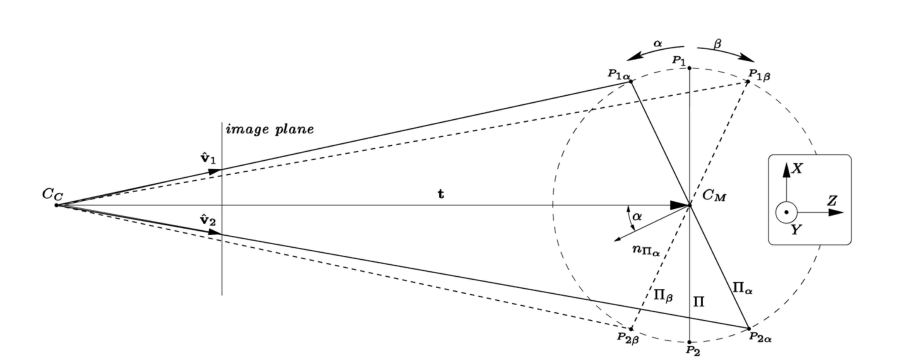
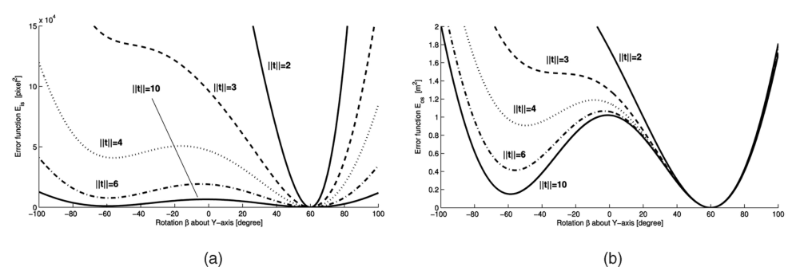
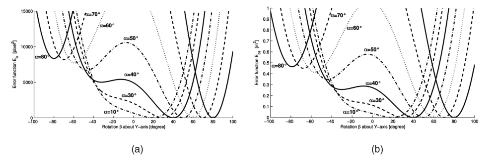
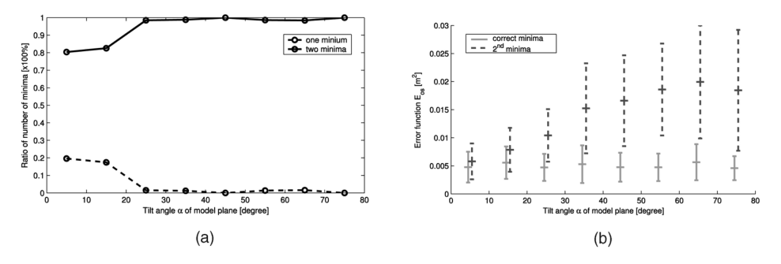
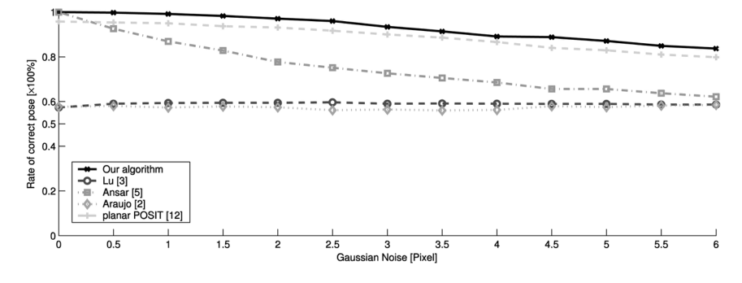
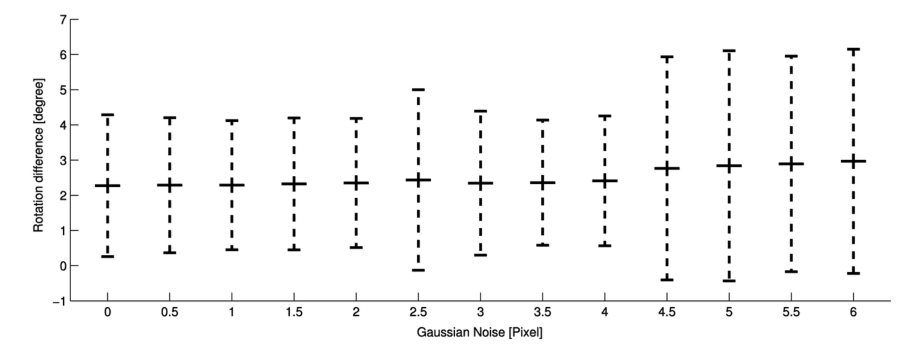
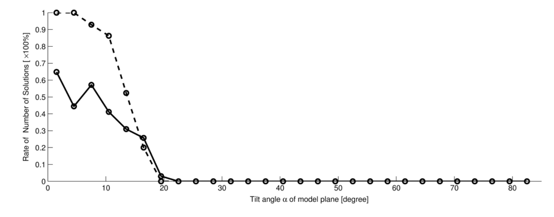
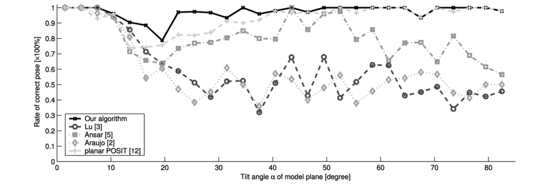

# 평면 타깃으로부터의 강건한 자세 추정 (Schweighofer 2006)

- 원제: Robust Pose Estimation from a Planar Target
- 원문: 같은 폴더의 `Schweighofer2006_PAMI_pose_ambiguity.pdf` (IEEE Trans. PAMI, vol. 28, no. 12, pp. 2024–2030, Dec. 2006, 사용자 제공)
- 저자: Gerald Schweighofer, Axel Pinz (Member, IEEE)
- 번역 범위: 전문 (부록 A·B, 각주, 감사의 글 포함)
- 그림: 원문 그림 8개를 `그림/`에 넣고 본문에서 처음 언급되는 곳에 삽입

## 초록

이론적으로, 보정된 카메라의 자세(pose)는 동일 평면 위에 있으나 한 직선 위에 있지 않은(coplanar but noncollinear) 최소 네 점으로부터 유일하게 결정될 수 있다. 실제로는 평면 타깃으로부터 카메라 자세를 추적하는 응용이 많고 이 작업을 실시간으로 수행하는 최근의 자세 추정 알고리즘도 여럿 있지만, 이 알고리즘들은 모두 자세 모호성(pose ambiguity)에 시달린다. 이 논문은 원근(perspective) 카메라로 본 평면 타깃의 자세 모호성을 조사한다. 자세 모호성 — 해당 오차 함수의 서로 다른 두 국소 최솟값 — 이 광각 렌즈와 근거리 타깃의 경우에도 존재함을 보인다. 두 최솟값에 대한 포괄적인 해석을 제시하고 둘째 최솟값의 위치를 찾는 해석적 해를 유도한다. 이 해에 기반해 평면 타깃으로부터 유일하고 강건한 자세 추정을 위한 새 알고리즘을 개발한다. 실험 평가에서 이 알고리즘은 네 가지 최신 자세 추정 알고리즘보다 우수한 성능을 보인다.

색인어 — 카메라 자세 모호성(camera pose ambiguity), 자세 추적(pose tracking).

## 1 서론 (Introduction)

알려진 장면 구조와의 알려진 대응으로부터 카메라 자세의 6 자유도를 계산해야 하는 자세 추정 응용은 많다. 이는 단일 영상 또는 영상 시퀀스로부터 할 수 있다. 사진측량(photogrammetry)에서는 이 문제를 공간 후방교회(space resectioning)라 하며, 흔히 번들 조정(bundle adjustment) 기법으로 오프라인에서 풀어 매우 높은 정밀도와 동시에 이상치(outlier)에 대한 높은 강건성을 얻는다. 일반적으로 많은 점을 쓸 수 있고 자세를 오프라인으로 계산할 수 있다면(예: 프레임 $n$의 자세 계산에 프레임 $n + k$의 정보를 고려) 이 문제를 푸는 방법은 여러 가지가 있다. 온라인 자세 추적은 매 프레임 카메라 자세를 실시간으로 계산해야 한다. 흔히 타깃에서 관심점(interest point)을 추출하고 장면 내 타깃 자세에 대한 상대적인 카메라 자세를 계산한다. 이론적으로, 카메라 내부 파라미터를 알면 동일 평면 위에 있으나 한 직선 위에 있지 않은 넷 이상의 점으로부터 자세를 계산할 수 있다. 보정되지 않은 카메라에서는 동일 평면 점이 많이 있더라도 이것이 임계 배치(critical configuration)로 남는다 [1].

컴퓨터 비전 문헌에는 자세 추정에 대한 여러 접근이 알려져 있다. 대부분은 임의의 3D 타깃 점 배치에 대해 동작하고 [2], [3], [4], 일부는 점과 선을 쓰도록 확장되었으며 [5], [6], 일부는 동일 평면 점에 대해서도 동작한다 [3], [4]. 온라인 구조 *및* 운동 추정에서도 최근 성공이 보고되었다 [7]. 여기서는 많은 관심점을 추출하므로 프레임 간 대응이 비교적 쉽고 장면 좌표계에 대한 사전 참조가 필요 없다(이 방향의 초기 연구는 [8] 참조).

증강현실(Augmented Reality, AR)은 평면 타깃에 기반한 비전 기반 추적 시스템의 주요 응용 분야이다. 이런 시스템의 예로는 널리 쓰이는 ARToolkit [9]과 Malik 등 [10]의 시스템이 있다(이들은 개선된 타깃 설계 덕분에 ARToolkit보다 정밀하다고 주장한다). Kawano 등 [11]은 AR용 평면 마커 여럿을 논하고 자신들의 부호화된 평면 타깃을 제시한다. 이런 시스템 사용자들은 비전 기반 자세가 그다지 정밀하지 않아 상당한 지터(jitter)가 생기고, 그다지 강건하지 않아 자세 점프(pose jump)와 큰 자세 이상치를 겪는다는 것을 관찰한다. 이 논문에서도 실험적 증거를 제시하는데, 여러 최신 자세 알고리즘을 비교해 일어나서는 안 될 심한 자세 점프를 관찰한다.

이 자세 모호성은 Oberkampf 등 [12]도 논의했다. 이들은 정사영(orthographic projection)의 경우에 대해 직접적인 해석을 제시하고, 각 반복 단계에서 스케일 정사영(scaled orthographic projection)을 쓰는 평면 타깃용 POSIT 알고리즘을 개발했다. POSIT는 정사영 아래의 두 최솟값에서 출발해 두 대안 해를 유지하고, 최종적으로 영상 공간의 재투영 오차로 계산한 거리 척도 $E$에 근거해 더 나은 쪽을 선택한다. 그러나 이 접근은 원근 상황을 분석하지 않고, 두 최솟값을 다루는 효율적인 휴리스틱을 제공할 뿐이다.

이 논문은 원근 투영의 일반적인 경우를 다룬다. 자세 모호성이 광각 렌즈와 근거리 타깃의 경우에도 존재함을 보인다. 이 모호성에 대한 포괄적인 해석을 제시하고, 평면 타깃으로부터의 자세 추정에 대해 유일하고 강건한 해를 주는 새 알고리즘을 개발한다. 먼저 자세 모호성의 간단한 기하학적 해석에서 출발해, 예시를 통해 해당 오차 함수의 두 국소 최솟값이 어떻게 생기는지 보인다(2절). 3절은 오차 함수를 수치적으로 분석해 주어진 실험 배치에 대한 실제 국소 최솟값 수를 알려 주는 알고리즘을 제시한다. 일반적으로 국소 최솟값이 두 개 있다는 실험적 증거에 근거해 4절에서 새로운 강건한 자세 추정 알고리즘을 개발한다. 5절은 실험 결과와 최신 자세 알고리즘과의 비교를 제시하고, 6절에서 결론을 맺는다.

## 2 자세 모호성/기하학적 해석 (Pose Ambiguity/Geometric Interpretation)

카메라 자세 추정을, 보정된 카메라(내부 파라미터를 앎)에 대해 카메라의 외부 파라미터 여섯 개 — 장면 좌표계에 대한 카메라의 방향(orientation) $R = f(\alpha, \beta, \gamma)$와 위치 $\mathbf{t} = [t_x, t_y, t_z]^T$ — 를 찾는 문제로 논의한다. 그림 1은 투영 중심 $C_C$(카메라 중심, 카메라 좌표계의 원점), 영상 평면, 평면 모델(평면 $\Pi$ 위의 모델 점 $P_i$)을 보여 준다. 일반성을 잃지 않고 모델 좌표계가 모델 중심 $C_M$에 있으며 장면 좌표계의 원점과 일치한다고 가정한다. 따라서 카메라 위치 $\mathbf{t}$는 $C_C$에서 $C_M$으로 가는 벡터로 나타나며, 카메라 방향은 모델 좌표계의 $y$축에 대한 회전 $\alpha$로 보인 것처럼 모델 평면의 회전으로 나타낼 수 있다.

*그림 1 — 원근 투영에서의 자세 모호성.*

장면 좌표에서 동일 평면 위의 모델 점 $n$개 $\mathbf{p}_i = [p_{i_x}\ p_{i_y}\ 0]^T$가 있고, 이들이 다음과 같이 카메라 좌표 $\mathbf{v}_i$로 변환된다고 가정한다.

$$\mathbf{v}_i \propto R\mathbf{p}_i + \mathbf{t}, \qquad (1)$$

여기서 $\propto$는 "정비례"를 뜻하는데, $\mathbf{v}_i$가 미지의 스케일 인자까지만 측정되기 때문이다. 이후 $\mathbf{v}_i$를 카메라 좌표의 점이라 하고, $\hat{\mathbf{v}}_i$를 영상에서의 그 측정값(역시 카메라 좌표이지만 잡음 때문에 부정확함)이라 한다. *자세 추정* 알고리즘은 오차 함수를 최소화하는 $\hat{R}$과 $\hat{t}$의 값을 찾아야 한다. 원리적으로 두 가지 선택이 있다. 하나는 *영상 공간 오차(image space error)* 로, 번들 조정과 [2], [12]에서 사용된다.

$$E_{is}(\hat{R}, \hat{\mathbf{t}}) = \sum_{i=1}^{n}\left[\left(\frac{\hat{v}_{ix}}{\hat{v}_{iz}} - \frac{R_x^t\mathbf{p}_i + t_x}{R_z^t\mathbf{p}_i + t_z}\right)^2 + \left(\frac{\hat{v}_{iy}}{\hat{v}_{iz}} - \frac{R_y^t\mathbf{p}_i + t_y}{R_z^t\mathbf{p}_i + t_z}\right)^2\right], \quad R = \begin{bmatrix} R_x^T \\ R_y^T \\ R_z^T \end{bmatrix} \qquad (2)$$

다른 하나는 [3], [6]에서 사용된 *물체 공간 오차(object-space error)* 이다.

$$E_{os}(\hat{R}, \hat{\mathbf{t}}) = \sum_{i=1}^{n}\left\|(I - \hat{V}_i)(\hat{R}\mathbf{p}_i + \hat{\mathbf{t}})\right\|^2 \quad \text{with} \quad \hat{V}_i = \frac{\hat{\mathbf{v}}_i\hat{\mathbf{v}}_i^t}{\hat{\mathbf{v}}_i^t\hat{\mathbf{v}}_i}. \qquad (3)$$

*자세 모호성*은 주어진 배치에 대해 $E_{is}$ 또는 $E_{os}$가 여러 국소 최솟값을 갖는 상황을 말한다. 이제 이해하기 쉬운 예로 자세 모호성을 보인다. 그림 1처럼 $y$축에 대한 특정 회전 $\alpha$를 가정하고, 해당 오차 함수 $E_{is}$ 또는 $E_{os}$의 국소 최솟값으로 이어지는 다른 둘째 각 $\beta$가 존재할 수 있음을 지적한다. 그런 최솟값의 존재는 (2) 또는 (3)의 모든 파라미터에 의존하므로, 이어서 특정 파라미터 배치를 가정하고 한 번에 하나의 파라미터($\|\mathbf{t}\|$ 또는 $\alpha$)만 변화시킨다.¹ 그림 2는 $\alpha = 60°$이고 잡음이 없을 때($\hat{\mathbf{v}}_i = \mathbf{v}_i$), 모델 중심 $C_M$과 카메라 중심 $C_C$ 사이의 거리 $\|\mathbf{t}\|$에 따라 오차 함수가 어떻게 변하는지 보여 준다. 모든 경우에 $\alpha = 60°$에서 $E_{is} = E_{os} = 0$인 절대 최솟값이 하나 있다. $\|\mathbf{t}\| = 4m, 6m, 10m$에 대해 $\beta = -49.6°$, $-56.0°$, $-58.6°$에서 점점 뚜렷해지는(감소하는 $E_{os}$) 국소 최솟값이 보인다. 모델과 카메라 사이의 거리 $\|\mathbf{t}\|$가 커질수록 원근 투영의 효과가 줄어든다. $\|\mathbf{t}\| = \infty$이면 *정사영*이 되어 $\beta = -60°$에서 $E_{is} = E_{os} = 0$인 둘째 최솟값이 생길 것이다. $\|\mathbf{t}\| < 3.06m$(타깃의 시야 약 $36.20°$)이면 오차 함수의 최솟값이 하나만 존재한다($\alpha = 60°$에서 $E_{is} = E_{os} = 0$). 그림 3은 $\|\mathbf{t}\| = 6m$로 고정하고 회전각 $\alpha$를 변화시킨 상황을 보여 준다. 다시 잡음이 없는 경우를 가정하며 각 $\alpha$에 대해 $E_{is} = E_{os} = 0$을 얻는다. $\alpha = 40°$, $50°$, $60°$, $70°$, $80°$에 대해 $\beta = -30.1°$, $-43.9°$, $-56.0°$, $-76.5°$, $-78.8°$에서 $E_{os}$의 둘째 국소 최솟값이 보인다. $\alpha < 34.8°$이면 $E_{os}$의 둘째 국소 최솟값이 존재하지 않는다.

*그림 2 — $\alpha = 60°$이고 거리 $\|\mathbf{t}\|$를 변화시킬 때의 (a) $E_{is}$와 (b) $E_{os}$.*

*그림 3 — 여러 회전각 $\alpha$에 대한 (a) $E_{is}$와 (b) $E_{os}$.*

이 아주 간단한 예만으로도, 정사영에서뿐 아니라 근거리 원근에서도, 특히 모델 평면이 상당히 기울어져 있을 때 자세 모호성이 *존재함*을 알 수 있다. 또한 두 오차 함수 $E_{is}$와 $E_{os}$에서 국소 최솟값의 크기와 위치가 매우 비슷하다는 점에 주목한다. 이 예에서는 둘째의 뚜렷한 최솟값이 생기는 것을 관찰할 수 있었고, 측정 잡음을 가정하지 않았으므로 오차 함수가 0인 올바른 최솟값을 항상 찾을 수 있었다. 일반적인 경우에는 측정 잡음이 있으며($\hat{\mathbf{v}}_i \neq \mathbf{v}_i$), 국소 최솟값의 수는 $E_{is}$ 또는 $E_{os}$의 *모든* 파라미터에 의존한다. 이 논문의 나머지에서는 [3], [6]에서도 사용되었고 $E_{is}$보다 파라미터화가 쉬운 $E_{os}$에 대해 결과를 유도한다. 일반적인 배치(모델 평면 위 점의 임의의 개수와 위치, 상당한 측정 잡음, 세 축에 대한 회전)에 대해, 먼저 3절에서 국소 최솟값 수를 추정하는 방법을 살피고, 4절에서 강건한 자세 추정 알고리즘 개발로 나아간다.

> 각주 1. 우리 모델은 $C_M$을 중심으로 한 정사각형으로 $p1 = [1\,1\,0]^T m$, $p2 = [1\ -1\,0]^T m$, $p3 = [-1\ -1\,0]^T m$, $p4 = [-1\,1\,0]^T m$이며, 카메라의 초점거리는 $800\,pixels$, $pixelsize = 8 \times 10^{-6} m$이다.

## 3 국소 최솟값 (Local Minima)

이 절에서는 $E_{os}$의 모든 최솟값을 찾는 수치 알고리즘을 개발한다. [3]으로부터 최적 평행이동은 다음과 같이 주어진다는 것을 안다.

$$\hat{\mathbf{t}}_{opt} = \frac{1}{n}\left(I - \frac{1}{n}\sum_j \hat{V}_j\right)^{-1}\sum_j(\hat{V}_j - I)\hat{R}\mathbf{p}_j = G\sum_j(\hat{V}_j - I)\hat{R}\mathbf{p}_j, \qquad (4)$$

이로부터 회전 $\hat{R}$에만 의존하는 오차 함수를 얻는다.

$$E_{os}(\hat{R}) = \sum_{i=1}^{n}\left\|(I - \hat{V}_i)\left(\hat{R}\mathbf{p}_i + G\sum_j(\hat{V}_j - I)\hat{R}\mathbf{p}_j\right)\right\|^2. \qquad (5)$$

회전 $\hat{R}$을 세 파라미터 $\alpha$, $\beta$, $\gamma$의 오일러 각으로 파라미터화한다.

$$\hat{R}(\alpha, \beta, \gamma) = R_x(\alpha)R_y(\beta)R_z(\gamma), \qquad (6)$$

여기서 $R_i(\phi)$는 축 $i$에 대한 $\phi$도의 회전을 나타낸다. 그리고 다음 치환을 사용하면,

$$\phi_t = \begin{cases} k_\phi\dfrac{\sqrt{1 - \cos(\phi)}}{1 + \cos(\phi)} & \text{if } 2k - \frac{\pi}{2} < \phi \leq 2k + \frac{\pi}{2} \\[2mm] k_\phi\dfrac{\sqrt{1 - \cos(\phi - \pi)}}{1 + \cos(\phi - \pi)} & \text{otherwise,} \end{cases} \qquad k_\phi = \begin{cases} +1 & \text{if } k < \phi \leq k + \frac{\pi}{2} \\ -1 & \text{otherwise,} \end{cases} \qquad (7)$$

($k = \ldots, -2\pi, -\pi, 0, \pi, 2\pi, \ldots$) 삼각함수를 $\phi_t$의 다항식의 분수로 쓸 수 있다. [역주: 원문 (7)의 근호 표기를 인쇄된 그대로 옮겼다.]

$$\cos(\phi) = s_\phi\frac{1 - \phi_t^2}{1 + \phi_t^2}, \quad \sin(\phi) = s_\phi\frac{2\phi_t}{1 + \phi_t^2} \quad \text{for } \phi = \alpha, \beta, \gamma \text{ and } s_\phi \in \{-1, 1\}. \qquad (8)$$

예를 들어 $\alpha \in [0, 2\pi]$인 $x$축에 대한 회전 $R_x(\alpha)$는 다음과 같이 쓸 수 있다.

$$R_x(\alpha) = \begin{bmatrix} 1 & 0 & 0 \\ 0 & \cos(\alpha) & -\sin(\alpha) \\ 0 & \sin(\alpha) & \cos(\alpha) \end{bmatrix} \rightsquigarrow R_{x,s_\alpha}(\alpha_t) = \frac{1}{1 + {\alpha_t}^2}\begin{bmatrix} 1 + {\alpha_t}^2 & 0 & 0 \\ 0 & s_\alpha(1 - \alpha_t^2) & s_\alpha(-2\alpha_t) \\ 0 & s_\alpha(2\alpha_t) & s_\alpha(1 - \alpha_t^2) \end{bmatrix}, \qquad (9)$$

구간 $\alpha_t \in [-\frac{\pi}{2}, \frac{\pi}{2}]$에서 서로 다른 두 함수($s_\alpha = -1$과 $s_\alpha = +1$) $R_{x,s_\alpha}(\alpha_t)$가 있다. $R_y(\beta) \rightsquigarrow R_{y,s_\beta}(\beta_t)$와 $R_z(\gamma) \rightsquigarrow R_{z,s_\gamma}(\gamma_t)$에 대해 이 과정을 반복하고 회전의 대칭성($\hat{R}(\alpha, \beta, \gamma) \equiv \hat{R}(\alpha + \pi, 3\pi - \beta, \gamma + \pi)$)을 고려하면, 회전 $\hat{R}(\alpha, \beta, \gamma) \rightsquigarrow \hat{R}_{s_\alpha,s_\beta}(\alpha_t, \beta_t, \gamma_t)$의 조각별 표현($s_\alpha$, $s_\beta$의 네 가지 조합과 상수 $s_\gamma = 1$)을 얻는다. 이 회전 파라미터화를 오차 함수 (5)에 넣으면 다음을 얻는다.

$$E_{s_\alpha,s_\beta}(\alpha_t, \beta_t, \gamma_t) = \frac{P_{s_\alpha,s_\beta}(\alpha_t, \beta_t, \gamma_t)}{(1 + \alpha_t^2)^2(1 + \beta_t^2)^2(1 + \gamma_t^2)^2}, \qquad (10)$$

여기서 $P_{s_\alpha,s_\beta}(\alpha_t, \beta_t, \gamma_t)$는 변수 $\alpha_t$, $\beta_t$, $\gamma_t$에 대한 5차 다변수 다항식이다. 계수는 주어진 모델 점 $\mathbf{p}_i$와 측정된 카메라 좌표 $\hat{\mathbf{v}}_i$로부터 추정할 수 있다. 즉, 삼각함수 항을 가진 원래 오차 함수 (5)를 다항식의 분수인 네 개의 서로 다른 함수 $E_{s_\alpha,s_\beta}$로 대체할 수 있다. 원래 문제 (5)가 변환된 문제 (10)과 동일하다는 점을 명시적으로 밝혀 둔다. 따라서 두 함수는 같은 수의 최솟값을 가지며, 이 최솟값들은 1계 도함수의 근으로 찾을 수 있다.

$$\frac{\partial E_{s_\alpha,s_\beta}(\alpha_t, \beta_t, \gamma_t)}{\partial \phi_t} = \frac{\frac{\partial P_{s_\alpha,s_\beta}(\alpha_t,\beta_t,\gamma_t)}{\partial \phi_t}(1 + \phi_t^2) - 4\phi_tP_{s_\alpha,s_\beta}(\alpha_t, \beta_t, \gamma_t)}{(1 + \phi_t^2)(1 + \alpha_t^2)^2(1 + \beta_t^2)^2(1 + \gamma_t^2)^2} = 0 \qquad (11)$$

$$\rightsquigarrow E_{\phi_t} = \frac{\partial P_{s_\alpha,s_\beta}(\alpha_t, \beta_t, \gamma_t)}{\partial \phi_t}(1 + \phi_t^2) - 4\phi_tP_{s_\alpha,s_\beta}(\alpha_t, \beta_t, \gamma_t) = 0 \quad \text{for } \phi_t = \alpha_t, \beta_t, \gamma_t. \qquad (12)$$

세 방정식의 해는 구간 기반 분할 접근(interval-based splitting approach) [13]으로 찾는다. 구간 $\alpha_t \in [-\frac{\pi}{2}, \frac{\pi}{2}]$, $\beta_t \in [-\frac{\pi}{2}, \frac{\pi}{2}]$, $\gamma_t \in [-\frac{\pi}{2}, \frac{\pi}{2}]$에서 출발해, 번스타인 전개(Bernstein expansion)로 세 도함수 $E_{\alpha_t}$, $E_{\beta_t}$, $E_{\gamma_t}$의 한계를 추정한다(자세한 내용은 [13] 참조). 세 함수의 하한이 모두 음수이고 상한이 모두 양수이면, 그 구간은 하나 이상의 정류점(stationary point)을 포함한다. 이 경우 구간을 두 부분 구간으로 나누고, 주어진 구간 크기에 이를 때까지 과정을 반복한다(각 변수에 대해 최대 분할 횟수를 20으로 선택해, 구간 크기는 $\frac{1}{2^{20}} \approx 2 \times 10^{-6} rad$).

이 과정이 끝나면 오차 함수가 최솟값을 가질 수 있는 좁은 구간들의 목록이 남는다. 정류점의 종류(최솟값, 최댓값, 안장점)를 확인하기 위해 각 구간에 대해 헤세 행렬(Hessian matrix)을 추정한다.

$$H_{\alpha_t,\beta_t,\gamma_t} = \begin{bmatrix} E_{\alpha_t,\alpha_t} & E_{\alpha_t,\beta_t} & E_{\alpha_t,\gamma_t} \\ E_{\beta_t,\alpha_t} & E_{\beta_t,\beta_t} & E_{\beta_t,\gamma_t} \\ E_{\gamma_t,\alpha_t} & E_{\gamma_t,\beta_t} & E_{\gamma_t,\gamma_t} \end{bmatrix} \qquad (13)$$

최솟값이 되려면 헤세 행렬의 세 고유값이 모두 양수여야 한다. 이 고유값을 추정하려면 특성 다항식 $\det(H\alpha_t, \beta_t, \gamma_t - \lambda I) = 0$의 근을 추정해야 한다. 좁은 구간에 대해 헤세 행렬 원소의 하한과 상한만 알고 있으므로, 고유값 추정은 구간 해석(interval analysis) [14]으로 수행한다. 세 고유값의 하한이 모두 양수일 때에만 이 구간 안의 정류점이 최솟값이다. 정류점의 종류를 특정할 수 없으면(어떤 고유값의 하한과 상한의 부호가 다른 경우), 분할 과정을 다시 시작해야 한다. 최종적으로 이 과정은 (10)의 최솟값을 포함하는 구간 목록을 내놓으며, 오차 함수 (5)의 모든 최솟값 목록을 얻으려면 (10)의 네 가지 서로 다른 함수($s_\alpha \in \{-1, 1\}$과 $s_\beta \in \{-1, 1\}$)의 모든 최솟값을 모아야 한다. 마지막 단계로, 물리적으로 타당한 해석을 갖는 최솟값, 즉 모든 모델 점 $\mathbf{p}_i$가 카메라 앞에 있는 해만 선택한다.

5.1절의 실험에서 보겠지만, 우리의 특수한 경우(원근 투영으로 본 카메라 앞의 동일 평면 점들)를 철저히 분석하면 대개 서로 다른 두 최솟값이 나온다. 때로는 (올바른) 최솟값이 하나만 있다. 그러나 $E_{os}$의 국소 최솟값이 둘보다 많은 경우는 단 하나도 찾지 못했다.

## 4 강건한 자세 추정 알고리즘 (Robust Pose Estimation Algorithm)

우리의 새 알고리즘은 다음 가정에 기반한다. 실제 배치($\hat{R}$, $\hat{\mathbf{t}}$, $\mathbf{p}_i$, $\hat{\mathbf{v}}_i$)에 따라 $E_{os}$의 (올바른) 최솟값이 하나이거나 국소 최솟값이 둘이다. 측정 잡음이 있는 실제 영상($\mathbf{v}_i \neq \hat{\mathbf{v}}_i$)에서 $E_{os}$는 일반적으로 0보다 크지만, 국소 최솟값이 둘인 경우 올바른 자세에서 오차가 더 낮아야 한다. 기존 자세 추정 알고리즘은 $E_{os}$의 최솟값을 탐색하며 종종 틀린 자세를 돌려준다(5절에서 보이듯 최대 50퍼센트의 경우).

알고리즘을 개발하기 위해 먼저 아무 자세 추정 알고리즘으로나 얻을 수 있는 알려진 자세($\hat{R}_1$, $\hat{\mathbf{t}}_1$)를 가정하고, 이 첫 자세 추측을 이용해 오차 함수 $E_{os}$를 마찬가지로 최소화하는 둘째 자세를 추정한다. 둘째 자세에 대한 해석적 해는 일반 변환 (1)을 수정해 최종적으로 $E_{os}$가 $y$축에 대한 회전 $R_y(\beta)$와 $\mathbf{t}$에만 의존하도록 해서 얻을 수 있다. 이후 일반식((14), (16), (19))의 표현과 초기 첫 자세 $(\hat{R}_1, \hat{\mathbf{t}}_1)$에 기반한 구체적 계산($R_x$와 $R_z$) 사이를 오간다.

영상에서 $\hat{\mathbf{v}}_i$로 측정되는 모델 점 $\mathbf{p}_i$를 가정하자((1) 참조).

$$\hat{\mathbf{v}}_i \approx \mathbf{v}_i \propto R\mathbf{p}_i + \mathbf{t}. \qquad (14)$$

일반성을 잃지 않고² (14)의 양변에 $R_t$를 곱해 변환된 시스템을 얻을 수 있다.

$$R_t\hat{\mathbf{v}}_i \approx R_t\mathbf{v}_i \propto R_tR\mathbf{p}_i + R_t\mathbf{t}, \qquad (15)$$

여기서 $R_t\hat{\mathbf{t}}_1 = [0\ 0\ \|\hat{\mathbf{t}}_1\|]^T$가 되도록 한다. 그 결과 모델 중심 $C_M$ ($[0\ 0\ 0]^T$)은 영상에 $[0\ 0\ \|\hat{\mathbf{t}}_1\|]^T$로 투영된다. 다음과 같이 두자.

$$\tilde{\mathbf{v}}_i = R_t\hat{\mathbf{v}}_i \quad \tilde{\mathbf{t}}_1 = R_t\hat{\mathbf{t}}_1 \quad \tilde{R}_1 = R_t\hat{R}_1. \qquad (16)$$

자세 $(\tilde{R}_1, \tilde{\mathbf{t}}_1)$은 다음을 최소화한다.

$$E_{os}(\tilde{R}, \tilde{\mathbf{t}}) = \sum_{i=1}^{n}\left\|(I - \tilde{V}_i)(\tilde{R}\mathbf{p}_i + \tilde{\mathbf{t}})\right\|^2. \qquad (17)$$

일반성을 잃지 않고 다음이 되도록 회전 행렬 $\tilde{R}_z$를 도입한다.

$$E_{os}(\tilde{R}, \tilde{\mathbf{t}}) = \sum_{i=1}^{n}\left\|(I - \tilde{V}_i)(\tilde{R}\underbrace{\tilde{R}_z\tilde{R}_z^{-1}}_{I}\mathbf{p}_i + \tilde{\mathbf{t}})\right\|^2. \qquad (18)$$

회전 $\tilde{R}_z^{-1}$은 모든 $p_{i_z} = 0$인 평면 모델 $\mathbf{p}_i$를 $z$축에 대해서만 회전시키므로, 회전된 모델 $\tilde{\mathbf{p}}_i = \tilde{R}_z^{-1}\mathbf{p}_i$도 $z = 0$인 평면 위에 있다. 회전 행렬 $\tilde{R}_1\tilde{R}_z$는 세 회전의 곱 $\tilde{R}_1\tilde{R}_z = R_z(\tilde{\gamma}_1)R_y(\tilde{\beta}_1)R_x(\tilde{\alpha}_1)$로 분해할 수 있다³. 여기서 $R_i(\phi)$는 축 $i$에 대한 $\phi$도의 회전을 나타낸다. $\tilde{\alpha}_1 = 0$이 되도록 $\tilde{R}_z$를 선택하면 또 다른 변환된 시스템을 얻는다.

$$\tilde{\mathbf{v}}_i \approx R_z(\tilde{\gamma})R_y(\tilde{\beta})\tilde{\mathbf{p}}_i + \tilde{\mathbf{t}} \qquad (19)$$

이에 대응하는 오차 함수는 다음과 같다.

$$E_{os}(\tilde{\gamma}, \tilde{\beta}, \tilde{\mathbf{t}}) = \sum_{i=1}^{n}\left\|(I - \tilde{V}_i)(R_z(\tilde{\gamma})R_y(\tilde{\beta})\tilde{\mathbf{p}}_i + \tilde{\mathbf{t}})\right\|^2. \qquad (20)$$

알려진 자세 $(\tilde{R}_1, \tilde{\mathbf{t}}_1)$ 또는 $(f(0, \tilde{\beta}_1, \tilde{\gamma}_1), \tilde{\mathbf{t}}_1)$을 쓰는 경우 식 (19)와 (20)은 (15), (17)과 같다.

2절로부터, 파라미터에 따라 한 축($y$축)에 대한 회전에 관해 오차 함수 $E_{os}$의 최솟값이 둘 있을 수 있음을 안다. 변환된 시스템 (19)에는 이 축($y$축)에 대한 회전과 $z$축에 대한 회전이 있다.

회전 $R_z(\tilde{\gamma})$의 효과를 논하자. 정규화 단계 (16)으로부터 $\tilde{\mathbf{t}}_1 = [0\,0\,\|\hat{\mathbf{t}}_1\|]^T$임을 안다. 이 경우 (19)를 다음과 같이 다시 쓸 수 있다.

$$\tilde{\mathbf{v}}_i \approx R_z(\tilde{\gamma})(R_y(\tilde{\beta})\tilde{\mathbf{p}}_i + \tilde{\mathbf{t}}_1) \qquad (21)$$

$R_z(\tilde{\gamma})\tilde{\mathbf{t}}_1 = \tilde{\mathbf{t}}_1$이기 때문이다. 따라서 $R_z(\tilde{\gamma})$는 카메라 광축에 대한 회전일 뿐이다. 이 회전은 영상 평면과 모델 평면 사이의 기하 관계를 바꾸지 않고 영상 좌표에만 영향을 준다. 따라서 $\beta$에 대해서만 $E_{os}$의 국소 최솟값을 탐색하면 된다.

이 $E_{os}$의 재파라미터화가 우리의 새로운 "*평면 타깃을 위한 강건한 자세 추정 알고리즘(Robust Pose Estimation Algorithm for Planar Targets)*"으로 이어진다.

1. 기존의 아무 반복 자세 추정 알고리즘이나 적용해 첫 자세 $\hat{P}_1 = (\hat{R}_1, \hat{\mathbf{t}}_1)$을 추정한다. 실험에서는 [3]이 제안한 반복 알고리즘을 사용했다. $\hat{P}_1$은 $E_{os}$의 한 국소 최솟값이다. 우리의 목표는, 둘째 국소 최솟값이 존재한다면 그 추정치를 해석적으로 유도하는 것이다.
2. (16)에 따라 좌표계를 변환해 $\tilde{P}_1 = (\tilde{R}_1, \tilde{\mathbf{t}}_1)$을 얻는다.
3. (18)과 (19)에서 설명한 대로 $\tilde{R}_z$를 추정해 변환된 시스템과 첫 자세의 파라미터($\tilde{\gamma}_1$과 $\tilde{\beta}_1$)를 얻는다.
4. $\tilde{\gamma} = \tilde{\gamma}_1$로 고정하고 파라미터 $\tilde{\beta}$와 $\tilde{\mathbf{t}}$에 대해 (20)의 모든 국소 최솟값을 추정한다. 자세한 내용은 아래 4.1절을 보라.
5. 모든 국소 최솟값에 대해 단계 1과 2의 변환을 되돌려 자세 $\hat{P}_i$를 얻는다.
6. 모든 자세 $\hat{P}_i$를 반복 자세 추정 알고리즘 [3]의 초깃값으로 써서 최종 자세 $P_i^\star$를 얻는다.
7. 오차 $E_{os}$가 가장 낮은 것을 최종의 올바른 자세로 결정한다.

> 각주 2. 이 변환은 오차 함수의 모양에 영향을 주지 않는다. 따라서 변환된 시스템의 최솟값은 원래 시스템의 최솟값이기도 하다. 자세한 내용은 부록 A 참조.
> 각주 3. $\tilde{R}_z$를 얻는 방법은 부록 B 참조.

### 4.1 국소 최솟값의 추정 (Estimation of the Local Minima)

여기서는 주어진 $\tilde{\mathbf{p}}_i$, $\tilde{\mathbf{v}}_i$, $R_z(\tilde{\gamma})$에 대해 (20)의 국소 최솟값을 추정하는 방법을 논한다. $E_{os}$의 최소화에 대한 최적 평행이동 $\tilde{\mathbf{t}}_{opt}$는 (20)을 미분해 다음과 같이 풀 수 있다 [3].

$$\frac{\partial E_{os}}{\partial \tilde{\mathbf{t}}} = 0 \ \Rightarrow\ \tilde{\mathbf{t}}_{opt}(\tilde{\beta}) = G\sum_j(\tilde{V}_j - I)R_z(\tilde{\gamma})R_y(\tilde{\beta})\tilde{\mathbf{p}}_j \qquad (22)$$

$$\text{with}\ \tilde{G} = \frac{1}{n}\left(I - \frac{1}{n}\sum_j\tilde{V}_j\right)^{-1}, \qquad (23)$$

여기서 $\tilde{G}$는 측정된 영상 위치 $\tilde{\mathbf{v}}_i$에만 의존하는 상수이다.

$\tilde{\mathbf{t}}_{opt}(R)$을 (20)에 대입하면 $\tilde{\beta}$($y$축에 대한 회전)에만 의존하는 오차 함수를 얻는다.

$$E_{os}(\tilde{\beta}) = \sum_{i=1}^{n}\|(I - \tilde{V}_i)(R_z(\tilde{\gamma})R_y(\tilde{\beta})\tilde{\mathbf{p}}_i + \tilde{G}\sum_{j=1}^{n}(\tilde{V}_j - I)R_z(\tilde{\gamma})R_y(\tilde{\beta})\tilde{\mathbf{p}}_j)\|^2. \qquad (24)$$

$(\tilde{\beta}_t = \tan\frac{1}{2\tilde{\beta}})$로 치환해 $R_y(\tilde{\beta})$를 단순화하면 다음을 얻는다. [역주: 원문 인쇄 그대로이며, 의도는 $\tilde{\beta}_t = \tan\frac{\tilde{\beta}}{2}$로 보인다.]

$$R_y(\tilde{\beta}) = \begin{bmatrix} \cos(\tilde{\beta}) & 0 & \sin(\tilde{\beta}) \\ 0 & 1 & 0 \\ -\sin(\tilde{\beta}) & 0 & \cos(\tilde{\beta}) \end{bmatrix}; \quad R_y(\tilde{\beta}_t) = \frac{1}{1 + \tilde{\beta}_t^2}\begin{bmatrix} 1 - \tilde{\beta}_t^2 & 0 & 2\tilde{\beta}_t \\ 0 & 1 + \tilde{\beta}_t^2 & 0 \\ -2\tilde{\beta}_t & 0 & 1 - \tilde{\beta}_t^2 \end{bmatrix}. \qquad (25)$$

이를 (24)에 대입하면 이제 $\tilde{\beta}_t$에만 의존하는 함수 $E_{os}(\tilde{\beta}_t)$를 얻는다. 이 함수의 모든 정류점을 얻으려면 다음을 풀어야 한다.

$$\frac{\partial E_{os}(\tilde{\beta}_t)}{\partial \tilde{\beta}_t} = 0, \qquad (26)$$

이는 4차 다항식이므로 쉽게 풀 수 있다. 일반적으로 네 개의 해를 얻으며, 이는 $E_{os}$가 극값을 갖는 $y$축에 대한 회전들을 나타낸다. 최솟값은 최대 두 개이며, $\frac{\partial^2 E_{os}(\tilde{\beta}_t)}{\tilde{\beta}_t} > 0$인 정류점들로 선택한다.

해의 수(하나 또는 둘)는 카메라의 자세($R$과 $\mathbf{t}$)와 모델 점($\mathbf{p}_i$)에 의존한다는 것을 명시적으로 밝혀 둔다. 카메라 자세가 같더라도 모델이 다르면 4차 다항식 (26)의 계수가 달라진다.

## 5 실험 결과 (Experimental Results)

모든 실험에 다음 설정을 사용했다.

1. 각 시험마다 범위 $x_i = [-1, 1]$, $y_i = [-1, 1]$, 그리고 평면이 되도록 $z_i = 0$인 10개의 점 $p_i = [x_i\ y_i\ z_i]^T$로 이루어진 무작위 모델을 생성했다.
2. 각 시험마다 자세의 무작위 회전 $R$을 생성했다.
3. 자세의 평행이동 벡터 $\mathbf{t}$는 측정 영상점 $\mathbf{v}_i$가 영상 안의 무작위 위치에 놓이고 페렛 박스(Feret box)의 최대 크기가 200 화소가 되도록 선택했다.⁴
4. 각 영상점 $\mathbf{v}_i$에 가우스 잡음을 더해 $\hat{\mathbf{v}}_i$를 얻었다.

> 각주 4. 내부 파라미터: $f_x = f_y = 800$, $x_0 = 320$, $y_0 = 240$. 영상 크기: $640 \times 480$.

### 5.1 $E_{os}$의 최솟값 수 추정 (Estimation of the Number of Minima of $E_{os}$)

3절에서 제시한 알고리즘으로 600가지 서로 다른 실험(2화소 가우스 잡음)에 대해 최솟값 수를 추정했다. 그림 4a는 이 시뮬레이션에서 찾은 최솟값의 비율을 모델 평면의 기울기 각 $\alpha$(그림 1 참조)에 대해 그린 것이다. 기울기 각별 비율은 평균한 값이다($\alpha = 5$와 $15$의 값은 각각 [0, 9.99], [10, 19.99] 등의 모든 각에 대한 비율의 평균). 먼저, 어떤 실험에서도 최솟값이 둘보다 많이 나오지 않았음을 밝혀 둔다. 또한 두 최솟값이 나타나는 비율은 $\alpha$가 작을수록 줄어들지만, 평균적으로 최소 80퍼센트의 경우에 두 최솟값이 있음을 볼 수 있다. 이는 우리의 기하학적 해석(그림 3 참조)과 비슷하다. 그림 4b는 이 두 최솟값의 평균 오차 값(평균과 표준편차)을 보여 준다. $E_{os}$는 항상 올바른 최솟값에서 더 낮지만, 기울기 각 $\alpha$가 작으면 둘이 매우 비슷하다. 최종 최솟값 목록을 얻기 위해 조사해야 했던 구간 수는 평균 약 60,000개였고, 이에 따라 표준 2.4GHz PC에서 실험당 약 1시간의 계산 시간이 필요했다.

*그림 4 — $E_{os}$의 최솟값 수에 대한 시뮬레이션 결과. (a) 찾은 최솟값의 비율. (b) 올바른 최솟값과 둘째 최솟값의 평균과 표준편차.*

### 5.2 강건한 자세 추정 알고리즘 (Robust Pose Estimation Algorithm)

제안한 강건한 자세 추정 알고리즘(4절)을 시험하기 위해, 0에서 6화소에 이르는 13가지 잡음 수준에 대해 1,000가지 서로 다른 모델과 자세를 생성했다. 그림 5에서 우리 알고리즘의 결과를 네 가지 최신 알고리즘과 비교했다. 실선은 우리 알고리즘의 결과로, 잡음이 없는 경우($\text{Gaussian noise} = 0\ pixels$) 올바른 자세를 찾는 비율 100퍼센트를 달성한다. 잡음이 커지면 비율이 떨어져 6 *pixels* 가우스 잡음에서 83.7퍼센트가 된다. 기존의 일반적인 반복 자세 추정 알고리즘([2], [3])의 결과도 함께 제시했다. 대부분의 경우 오차 함수의 국소 최솟값이 둘 있으므로, 이 알고리즘들이 올바른 해를 찾는 비율은 50퍼센트를 겨우 넘는다. 동일 평면 특징점용 POSIT 알고리즘 [12]만이 반복 중에 두 해를 유지하며 우리 알고리즘과 비슷한 성능을 보인다. POSIT의 약간 덜 강건한 결과는 두 가지로 설명할 수 있다. POSIT가 초기화 단계에서 최솟값을 하나만 찾는 경우가 있거나, 스케일 정사영이 실제 원근 경우를 근사하므로 오차 함수가 매우 비슷한 경우 틀린 최솟값이 선택되는 것이다. Ansar와 Daniilidis [5]의 알고리즘은 직접 해를 계산하므로 잡음이 없을 때 100퍼센트에서 시작하지만, 그 성능도 잡음 수준이 커짐에 따라 크게 떨어진다.

*그림 5 — 올바른 자세를 선택하는 비율 (실선: 우리 알고리즘).*

우리 알고리즘의 단계 6에서는 모든 자세 $\hat{P}_i$를 Lu 등 [3]의 반복 알고리즘의 초깃값으로 사용한다. 그림 6은 자세 $\hat{P}_i$에서 정제된 자세 $P_i^\star$로의 회전 측면의 평균 개선량을 보여 준다. 이는 (26)을 풀어 얻은 우리 직접 해의 평균 오차 척도로도 해석할 수 있다. 그래프는 모든 잡음 수준에 대한 평균과 표준편차를 보여 준다. 평균 오차는 항상 3도 미만이며 잡음 수준이 커지면 증가한다. 2절로부터 오차 함수의 최솟값 수가 모델 평면의 기울기 각 $\alpha$가 커질수록 늘어남을 안다. 우리 실험도 같은 거동을 보인다. 그림 7의 점선은 잡음이 없는 경우 최솟값이 하나뿐일 비율을 나타낸다. 실선은 2화소 가우스 잡음의 경우 이 비율을 보여 준다. 최솟값은 하나이거나 정확히 둘이다. 잡음이 없으면 영상 평면이 모델 평면에 거의 평행할 때($\alpha \leq 15°$) 유일한 해를 하나 찾지만, 2화소 가우스 잡음에서는 여전히 35퍼센트 이상이 두 해를 갖는다. $\alpha > 20°$이면 거의 항상 두 해가 있다.

*그림 6 — $\hat{P}_i - P_i^\star$의 평균 오차와 표준편차.*

*그림 7 — 각 $\alpha$에 대해 해가 하나일 비율 (점선: 잡음 없는 경우. 실선: $noise = 2\ pixels$).*

그림 8은 우리 알고리즘(실선)과 다른 일반적인 자세 추정 알고리즘([2], [3], [5], [12])이 올바른 해를 선택하는 비율을 각 $\alpha$에 대해 비교한다. 여기서는 가우스 잡음이 2 *pixels*인 시험만 사용했다. 그림 7에서 이미 알 수 있듯이 $\alpha$가 작으면 해가 하나뿐이므로 모든 알고리즘에서 올바른 해를 선택하는 비율이 1이다. 두 해가 생기는 경우 다른 알고리즘의 성능은 올바른 해를 찾는 비율이 50퍼센트까지 떨어진다. 우리 알고리즘은 10도에서 20도 범위를 제외한 모든 각 $\alpha$에서 올바른 해를 추정하는 비율이 95퍼센트를 넘는다. 이 효과는 최솟값 하나에서 둘로 넘어가는 이 전이 범위에서 결과에 영향을 주는 잡음 때문이다(그림 7에서 실선과 점선이 겹치는 영역 참조). 따라서 우리 알고리즘은 POSIT [12]보다 약간 낫고, 다른 모든 알고리즘 [2], [3], [5]보다 상당히 우수하다.

*그림 8 — $noise = 2\ pixels$에서 각 $\alpha$에 대한 올바른 자세의 비율 (실선: 우리 알고리즘).*

## 6 결론 (Conclusions)

Oberkampf 등 [12]의 연구를 제외하면, 평면 타깃으로부터의 자세 추정에서 모호성은 문헌에서 간과되어 왔다. 우리는 원근 경우를 철저히 분석해, 일반적으로 해당 오차 함수의 국소 최솟값이 두 개 존재함을 보일 수 있었다. 이 두 최솟값이 많은 자세 추적 응용에서 자세 점프가 관찰되는 이유이다. 이 발견에 근거해, 두 최솟값을 고려해 강건한 자세를 주는 새로운 "평면 타깃을 위한 강건한 자세 추정 알고리즘"을 제시했다. 우리 알고리즘은 둘째 최솟값의 위치를 찾는 해석적 해에 기반하며, 이로써 이전의 모든 자세 추정 알고리즘보다 자세 점프에 더 강건하다. 이 새 알고리즘은 AR과 항법의 많은 응용에 유용할 것이다.⁵

> 각주 5. 우리의 Matlab 코드는 http://www.emt.tugraz.at/~pinz/code/ 에서 받을 수 있다. C++ 구현은 ARToolkitPlus [15]에 있다.

## 부록 A (Appendix A)

오차 함수 (3)이 회전에 대해 불변임을 보인다. (1)의 양변에 회전 $\mathcal{R}$을 곱하면 $\mathcal{R}\mathbf{v}_i \propto \mathcal{R}R\mathbf{p}_i + \mathcal{R}\mathbf{t}$를 얻는다. 대응하는 오차 함수는 다음과 같다.

$$\begin{aligned}
&\sum_{i=1}^{n}\left\|\left(I - \frac{\mathcal{R}\hat{\mathbf{v}}_i\hat{\mathbf{v}}_i^t\mathcal{R}^t}{\hat{\mathbf{v}}_i^t\mathcal{R}^t\mathcal{R}\hat{\mathbf{v}}_i}\right)(\mathcal{R}\hat{R}\mathbf{p}_i + \mathcal{R}\hat{\mathbf{t}})\right\|^2 \\
&= \sum_{i=1}^{n}\left\|\left(\mathcal{R} - \mathcal{R}\frac{\hat{\mathbf{v}}_i\hat{\mathbf{v}}_i^t}{\hat{\mathbf{v}}_i^t\hat{\mathbf{v}}_i}\right)\mathcal{R}^t(\mathcal{R}\hat{R}\mathbf{p}_i + \mathcal{R}\hat{\mathbf{t}})\right\|^2 \\
&= \sum_{i=1}^{n}\left\|\mathcal{R}\left(I - \frac{\hat{\mathbf{v}}_i\hat{\mathbf{v}}_i^t}{\hat{\mathbf{v}}_i^t\hat{\mathbf{v}}_i}\right)\mathcal{R}^t(\mathcal{R}\hat{R}\mathbf{p}_i + \mathcal{R}\hat{\mathbf{t}})\right\|^2 \\
&= \sum_{i=1}^{n}\left\|\mathcal{R}\left[\left(I - \frac{\hat{\mathbf{v}}_i\hat{\mathbf{v}}_i^t}{\hat{\mathbf{v}}_i^t\hat{\mathbf{v}}_i}\right)(\hat{R}\mathbf{p}_i + \hat{\mathbf{t}})\right]\right\|^2.
\end{aligned} \qquad (27)$$

$\|\mathcal{R}\mathbf{a}\| = \|\mathbf{a}\|$이므로, 회전된 시스템의 오차 함수는 원래 시스템 (1)의 오차 함수와 같다.

## 부록 B (Appendix B)

$RR_z(\phi)$를 세 회전의 곱으로 분해해 쓰면,

$$RR_z(\phi) = R_z(\gamma)R_y(\beta)R_x(\alpha = 0) = \begin{bmatrix} \cos(\gamma)\cos(\beta) & -\sin(\gamma) & \cos(\gamma)\sin(\beta) \\ \sin(\gamma)\cos(\beta) & \cos(\gamma) & \sin(\gamma)\sin(\beta) \\ -\sin(\beta) & 0 & \cos(\beta) \end{bmatrix}, \qquad (28)$$

$\alpha = 0$인 분해를 얻으려면 합성 행렬의 셋째 행 둘째 원소 $(RR_z(\phi))_{32}$가 0이 되어야 함을 알 수 있다. 이로써 제약이 생기고, 따라서 회전각 $\phi$에 대한 유일한 해가 나온다.

$$R_{32}\cos(\phi) - R_{31}\sin(\phi) = 0 \Longrightarrow \phi = \arctan\left(\frac{R_{32}}{R_{31}}\right). \qquad (29)$$

## 감사의 글 (Acknowledgments)

이 연구는 오스트리아 과학기금(Austrian Science Fund, FWF, 과제 S9103-N04 및 P15748)의 지원을 받았다.

## 저자 정보 (원문 첫 쪽 각주)

- 저자들은 Institute of Electrical Measurement and Measurement Signal Processing, Graz University of Technology, Kopernikusgasse 24/IV, 8010 Graz, Austria 소속이다. E-mail: {gerald.schweighofer, axel.pinz}@tugraz.at.
- 원고 접수 2005년 5월 13일, 수정 2006년 6월 1일, 채택 2006년 6월 5일, 온라인 게재 2006년 10월 12일. 게재 추천: M. Pollefeys. 별쇄 문의: tpami@computer.org, IEEECS Log Number TPAMI-0247-0505.

## 참고문헌

- [1] B. Wrobel, "Minimum Solutions for Orientation," Calibration and Orientation of Cameras in Computer Vision, A. Gruen and T. Huang, eds., chapter 2, Springer-Verlag, 2001.
- [2] H. Araújo, R. Carceroni, and C. Brown, "A Fully Projective Formulation to Improve the Accuracy of Lowe's Pose-Estimation Algorithm," Computer Vision and Image Understanding, vol. 71, no. 2, pp. 227-238, 1998.
- [3] C. Lu, G. Hager, and E. Mjolsness, "Fast and Globally Convergent Pose Estimation from Video Images," IEEE Trans. Pattern Analysis and Machine Intelligence, vol. 22, no. 6, pp. 610-622, June 2000.
- [4] M. Fischler and R. Bolles, "The Random Sample Consensus Set: A Paradigm for Model Fitting with Applications to Image Analysis and Automated Cartography," Comm. ACM, vol. 24, no. 6, pp. 381-395, 1981.
- [5] A. Ansar and K. Daniilidis, "Linear Pose Estimation from Points or Lines," Proc. European Conf. Computer Vision, vol. 4, pp. 282-296, May 2002.
- [6] P. Wunsch and G. Hirzinger, "Registration of CAD-Models to Images by Iterative Inverse Perspective Matching," Proc. 13th Int'l Conf. Pattern Recognition, vol. 1, pp. 78-83, Aug. 1996.
- [7] D. Nister, O. Naroditsky, and J. Bergen, "Visual Odometry," Proc. IEEE Conf. Computer Vision and Pattern Recognition, vol. 1, pp. 652-659, 2004.
- [8] C. Harris, "Geometry from Visual Motion," Active Vision, A. Blake and A. Yuille, eds., chapter 16, MIT Press, 1992.
- [9] H. Kato and M. Billinghurst, "Marker Tracking and HMD Calibration for a Video-Based Augmented Reality Conferencing System," Proc. Second IEEE and ACM Int'l Workshop Augmented Reality, pp. 85-94, 1999.
- [10] S. Malik, G. Roth, and C. McDonald, "Robust 2D Tracking for Real-Time Augmented Reality," Proc. Conf. Vision Interface, 2002.
- [11] T. Kawano, Y. Ban, and K. Uehara, "A Coded Visual Marker for Video Tracking System Based on Structured Image Analysis," Proc. Second IEEE and ACM Int'l Symp. Mixed and Augmented Reality, 2003.
- [12] D. Oberkampf, D.F. DeMenthon, and L.S. Davis, "Iterative Pose Estimation Using Coplanar Feature Points," Computer Vision and Image Understanding, vol. 63, no. 3, pp. 495-511, May 1996.
- [13] J. Garloff and M. Zettler, "Robustness Analysis of Polynomials with Polynomial Parameter Dependency Using Bernstein Expansion," IEEE Trans. Automatic Control, vol. 43, no. 3, pp. 425-431, 1998.
- [14] R. Moore, Interval Analysis. Prentice-Hall, 1966.
- [15] ARToolKit Plus, http://studierstube.icg.tu-graz.ac.at/handheld_ar/artoolkitplus.php, 2006.
