# 동일 평면 특징점을 이용한 반복 자세 추정 (Oberkampf 1996)

- 원제: Iterative Pose Estimation Using Coplanar Feature Points
- 원문: 같은 폴더의 `Oberkampf1996_CVIU_coplanar_pose.pdf` (D. Oberkampf, D. F. DeMenthon, L. S. Davis, Computer Vision and Image Understanding, Vol. 63, No. 3, pp. 495–511, May 1996, Article No. 0037)
- 번역 범위: 전문 (본문, 기호표, 각주, 그림 캡션, 부록, 감사의 글 포함. 참고문헌은 원문 그대로)
- 그림: 원문 그림 16개를 `그림/`에 넣고 본문에서 처음 언급되는 곳에 삽입

저자 소속: Computer Vision Laboratory, Center for Automation Research, University of Maryland, College Park, Maryland 20742. 1994년 3월 23일 접수, 1995년 2월 24일 게재 승인.

## 초록

이 논문은 네 개 이상의 동일 평면(coplanar) 특징점을 써서, 알려진 물체에 대한 카메라의 위치와 방향을 계산하는 새 방법을 제시한다. 약원근 투영(scaled orthographic projection) 근사에서 출발하여, 이 방법은 최대 두 개의 서로 다른 자세(pose) 추정치를 반복적으로 정밀화하고, 각 자세에 대한 품질 척도를 함께 제공한다. 카메라 거리가 물체 깊이에 비해 크거나, 영상 잡음 때문에 특징점 추출의 정확도가 낮으면, 두 자세의 품질 척도가 비슷하며 두 자세 추정치는 모두 가용 정보에 대한 그럴듯한 해석이다. 이와 대조적으로, 네 개의 동일 평면 점에 대한 닫힌 형식(closed form) 자세 해를 쓰는 기존 방법들은 두 가능한 자세 중 하나만 제공하고 틀린 자세를 고를 수 있으므로, 영상 잡음이 있을 때 먼 물체에 대해 강건하지 않다. © 1996 Academic Press, Inc.

## 1. 서론 (Introduction)

알려진 물체에 대해 단일 영상으로부터 카메라의 위치와 방향을 계산하는 것(자세 추정, pose estimation)은 카메라 보정(캘리브레이션), 물체 인식, 항공 영상 사진측량(photogrammetry)에 중요한 응용이 있다. $n$개 특징점의 상대 기하를 쓸 때, 이 문제를 원근 $n$점 문제(Perspective-n-Point problem, PnP)라 한다[3, 12, 7].

이 논문은 점들이 동일 평면에 있는 퇴화(degenerate) 경우에 초점을 둔다. 실제로는 이 퇴화 경우를 풀 수 있는 것이 중요하다. 예를 들어 항공 영상에서는 특징점의 퍼짐이 점들의 고도에 비해 클 수 있다. 지도에서 지면이 평면이 아니거나 특징점을 건물 꼭대기와 지면 높이 모두에서 취할 수 있음을 보이더라도, 특징점의 기하를 기술하는 행렬을 계수(rank) 3이 아니라 2로 볼 수 있으면 이 특징점들은 동일 평면으로 간주해야 한다. 이 판단은 특잇값 분해(singular value decomposition)에서 행렬의 특잇값들의 크기를 비교하여 내릴 수 있다[9]. 이 특징점들이 동일 평면이 아니라고 가정하고 이 경우가 퇴화임을 감지하지 못하는 일반 알고리즘은 아마 부정확한 카메라 자세 추정치를 낼 것이다.

> \* 현 주소: Thomson-CSF Division Electronique de Missiles, 92240 Malakoff, France.
> † 모든 연락은 이 저자에게. E-mail: daniel@cfar.umd.edu.

동일 평면 특징점의 경우, 연구자들은 특징점 세 개와 네 개의 배치에 대한 닫힌 형식 해를 정식화했다. (세 점이 한 직선 위에 있지 않은) P3P 문제는 해를 네 개까지 가질 수 있다[6, 4, 11]. 반면 P4P 문제는 동일 평면 점들이 일반적인 배치(어느 세 장면 점도 한 직선 위에 있지 않고, 영상 점들이 한 직선 위에 있지 않음)에 있을 때 이론적으로 단 하나의 해를 갖는다[3, 12, 1, 5].

분명히, 네 개의 동일 평면 점에 대해 단일 해를 주장하는 닫힌 형식 계산에는 문제가 있다. 이 문제는 다음 추론으로 알아낼 수 있다.

- 약원근 투영에서는 항상 두 개의 허용 가능한 해가 있다. 두 자세는 영상 평면에 평행한 평면에 대해 서로 거울상이다.
- 카메라까지 물체의 거리가 광축 방향의 물체 깊이에 비해 큰 배치에서는, 약원근 투영이 실제 원근 투영의 좋은 근사로 알려져 있다.
- 따라서 이런 배치에서는 닫힌 형식 계산도 두 해를 내야 한다.

동일 평면 점에 대한 P4P 문제의 단일 닫힌 형식 해는 두 자세 중 하나를 고르기 위해 원근 영상의 단축(foreshortening) 정보에 의존한다. 그러나 물체 깊이에 대한 카메라 거리의 비가 크면 이 단축은 잡음 수준보다 작을 수 있다. 영상에 무작위 오차가 조금만 더해져도 단일 정확 해석 해는 어느 자세로든 뒤집힐 것이고, 틀린 자세로 끝날 가능성이 상당하다. 따라서 이런 배치에서는 동일 평면 점에 대해 단일 자세를 주는 해석적 방법은 신뢰할 수 없으며 아마 피해야 할 것이다.

이 논문은 근거리와 원거리 영상 모두에서 똑같이 잘 동작하는 반복 알고리즘을 제시한다. 이는 우리의 이전 연구[2]를 동일 평면 점의 경우에 적용한 것이다. 약원근 투영 근사로 계산을 시작하여, 이 과정은 물체 깊이에 대한 카메라 거리의 비가 클 때 둘 다 허용 가능한 두 해를 찾을 수 있다. 이 경우 원근 투영 모델을 만족하는 해로 수렴하는 데 (약원근 투영 근사의 효과를 보정하는) 반복이 몇 번만 필요하다.

반면 카메라가 관측 물체에 가까우면 영상에 원근이 강하게 나타나며, 알고리즘은 하나의 가능한 해로 수렴하는 데 반복이 몇 번 더 필요하다.

같은 확률의 두 자세를 주는 알고리즘이, 두 자세 중 하나를 골라 50%의 경우 틀리는 알고리즘보다 나을 것이 없다고 반론할 수 있다. 그러나 조종사의 항공모함 착륙을 돕도록 설계된 가상의 컴퓨터 비전 시스템을 생각해 보자. 항공모함에서 멀리 떨어져 있으면, 활주로 영상에는 활주로에 대한 항공기 자세에 대해 확정적인 답을 줄 만큼 정보가 충분하지 않을 수 있다. 우리는 두 가능한 자세를 주는 알고리즘이 50%의 경우 틀리는 알고리즘보다 더 유용하다고 주장한다. 두 가능한 자세를 줌으로써 첫째 알고리즘은 모호성을 해소하려면, 예컨대 항공기의 관성 센서로부터, 더 많은 정보가 필요하다고 시스템에 사실상 경고한다. 이 추가 정보로 자세 중 하나를 기각할 수 있고, 그러면 시스템은 다른 자세를 착륙 계획에 반영할 수 있다. 단일 자세를 주는 알고리즘에서는 자세가 틀렸을 수 있다는 경고가 없다. 추가 정보로 자세를 여전히 검사할 수는 있지만, 자세가 기각되면 시스템에는 착륙 계획을 위한 자세 정보가 남지 않는다.

## 2. 표기 (Notation)

그림 1에 고전적인 핀홀 카메라 모델을 보인다. 투영 중심 $O$, $O$로부터 거리 $f$(초점 거리)에 있는 영상 평면 $G$, 카메라 센서의 행과 열을 따르는 축 $Ox$와 $Oy$, 그리고 광축을 따르는 셋째 축 $Oz$가 있다. 이 세 축의 단위 벡터를 $\mathbf i$, $\mathbf j$, $\mathbf k$라 한다. 이 논문에서는 초점 거리와, 광축과 영상 평면의 교점(영상 중심 $C$)을 안다고 가정한다.

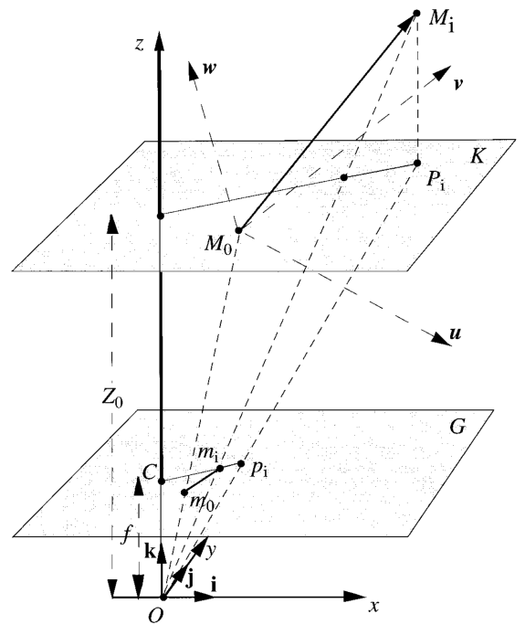
*그림 1 — 물체 점 $M_i$와 기준점 $M_0$에 대한 원근 투영($m_i$)과 약원근 투영($p_i$).*

특징점 $M_0, M_1, \ldots, M_i, \ldots, M_n$을 가진 물체가 카메라 시야 안에 있다. 물체 기준 좌표계는 $(M_0\mathbf u, M_0\mathbf v, M_0\mathbf w)$이다. $M_0$를 물체의 기준점(reference point)이라 부른다. 물체 기준 좌표계에서 점 $M_i$의 좌표 $(U_i, V_i, W_i)$는 알려져 있다. 점 $M_i$의 영상을 $m_i$라 하며, 그 영상 좌표 $(x_i, y_i)$는 알려져 있다. 카메라 좌표계에서 점 $M_i$의 좌표 $(X_i, Y_i, Z_i)$는 알려져 있지 않은데, 카메라 좌표계에서 물체의 자세를 모르기 때문이다.

이하에서는 점 $M_i$의 좌표 $(X_i, Y_i, Z_i)$를 명시적으로 풀지 않고 물체의 회전 행렬과 평행이동 벡터를 직접 찾는 방법을 보인다. 이 접근은 점 $M_i$의 약원근 투영 $p_i$를 암묵적으로 쓴다. $p_i$를 만들기 위해, $M_0$를 지나고 영상 평면 $G$에 평행한 평면 $K$를 그린다. 이 평면은 투영 중심 $O$로부터 거리 $Z_0$에 있다. 점 $M_i$를 정사영(orthographic projection)으로 $K$ 위의 $P_i$에 투영한다. 그다음 점 $P_i$를 원근 투영으로 영상 평면 $G$ 위의 $p_i$에 투영한다. 물체를 평면 $K$로 납작하게 눌렀어도 같은 결과를 얻었을 것이다. 원근 투영을 약원근 투영으로 근사하는 것은, 카메라 좌표 $(X_i, Y_i, Z_i)$를 갖는 물체의 여러 점 $M_i$의 깊이 $Z_i$가 서로 크게 다르지 않아 모두 물체 기준점 $M_0$의 깊이 $Z_0$로 둘 수 있다고 가정하는 것과 같다.

### 기호표 (Nomenclature)

| 기호 | 의미 |
|---|---|
| $O$ | 카메라의 투영 중심 |
| $G$ | 카메라의 영상 평면 |
| $f$ | 카메라의 초점 거리 |
| $C$ | 영상 중심 |
| $Ox$, $Oy$ | 카메라 센서에 평행한 카메라 좌표계의 축 |
| $Oz$ | 광축을 따르는 카메라 좌표계의 축 |
| $\mathbf i$, $\mathbf j$, $\mathbf k$ | 카메라 좌표계의 단위 벡터 |
| $M_0$ | 물체의 기준점 |
| $(M_0\mathbf u, M_0\mathbf v, M_0\mathbf w)$ | 물체 기준 좌표계 |
| $M_i$ | 물체의 특징점 |
| $(U_i, V_i, W_i)$ | 물체 기준 좌표계에서 점 $M_i$의 좌표 |
| $(X_i, Y_i, Z_i)$ | 카메라 좌표계에서 점 $M_i$의 좌표 |
| $m_i$ | 원근 투영에 의한 점 $M_i$의 영상 |
| $(x_i', y_i')$ [역주: 원문 그대로. 본문에서는 $m_i$의 좌표를 $(x_i, y_i)$로 쓴다] | 영상에서 점 $m_i$의 좌표 |
| $p_i$ | 약원근 투영에 의한 물체 점 $M_i$의 영상 |
| $x_i'$, $y_i'$ | 영상에서 점 $p_i$의 좌표 |
| $\mathbf R$ | 물체의 회전 행렬 |
| $\mathbf T$ | 물체의 평행이동 벡터 |
| $\varepsilon_i$ | 원근 투영과 약원근 투영 사이의 보정 인자 |
| $K$ | $M_0$를 지나고 영상 평면 $G$에 평행한 평면 |
| $P_i$ | 평면 $K$ 위로의 $M_i$의 정사영 |
| $\mathbf I$, $\mathbf J$ | $\mathbf i$와 $\mathbf j$에 비례하는 벡터 |
| $\mathbf A$ | 물체 점 $M_i$의 좌표 $(U_i, V_i, W_i)$로 이루어진 행렬 |
| $\mathbf x'$ | $i$번째 좌표가 $x_i(1 + \varepsilon_i) - x_0$인 벡터 |
| $\mathbf y'$ | $i$번째 좌표가 $y_i(1 + \varepsilon_i) - y_0$인 벡터 |
| $\mathbf B$ | 행렬 $\mathbf A$의 의사역행렬 |
| $D$ | 평면 물체의 평면 |
| $H_{xi}$ | $\mathbf I$의 머리를 $M_0M_i$ 위로 투영한 점 |
| $Q$ | 연립방정식의 의사역행렬 해에 대응하는 점 |
| $\mathbf I_0$, $\mathbf J_0$ | 의사역행렬 벡터 해 |
| $\mathbf u$ | 물체 평면 $\mathbf D$에 수직인 단위 벡터 |
| $\lambda$ | $\mathbf u$를 따른 $\mathbf I$ 머리의 좌표 |
| $\mu$ | $\mathbf u$를 따른 $\mathbf J$ 머리의 좌표 |
| $C$ | $\lambda + i\mu$와 같은 복소수 |
| $[\rho, \theta]$ | $C$의 극형식 표현 |
| $[R, \Theta]$ | $C^2$의 극형식 표현 |
| $\alpha$ | 카메라의 앙각(elevation angle) |
| $\beta$ | 카메라의 방위각(azimuth angle) |
| $U$, $V$, $W$ | 세계 좌표에서의 카메라 위치 |
| $\Delta U$, $\Delta V$, $\Delta W$ | 카메라 위치의 절대 오차 |
| $E_1$, $E_2$, $E$ | 상대 오차 척도 |
| $\mathbf i'$, $\mathbf j'$, $\mathbf k'$ | 두 번째 위치에 있는 카메라 좌표계의 단위 벡터 |

## 3. 문제 정의 (Problem Definition)

목표는 물체의 회전 행렬 $\mathbf R$과 평행이동 벡터 $\mathbf T$를 계산하는 것이다. 물체의 회전 행렬 $\mathbf R$은, 행이 물체 좌표계 $(M_0u, M_0v, M_0w)$로 표현한 카메라 좌표계 단위 벡터 $\mathbf i$, $\mathbf j$, $\mathbf k$의 좌표인 행렬이다. 회전 행렬은 다음과 같이 쓸 수 있다.

$$\mathbf R = \begin{bmatrix} i_u & i_v & i_w\\ j_u & j_v & j_w\\ k_u & k_v & k_w \end{bmatrix} = \begin{bmatrix}\mathbf i^{\rm T}\\ \mathbf j^{\rm T}\\ \mathbf k^{\rm T}\end{bmatrix}$$

회전을 계산하려면 물체 좌표계에서 $\mathbf i$와 $\mathbf j$만 계산하면 된다. 그러면 벡터 $\mathbf k$는 외적 $\mathbf i \times \mathbf j$로 얻는다.

평행이동 벡터 $\mathbf T$는 투영 중심 $O$와 물체 기준 좌표계의 원점인 기준점 $M_0$ 사이의 벡터 $\mathbf{OM}_0$이다. 그 카메라 좌표는 $X_0$, $Y_0$, $Z_0$이다. $M_0$의 영상은 알려진 영상 점 $m_0$이므로, 이 평행이동 벡터 $\mathbf T$는 벡터 $\mathbf{Om}_0$와 정렬되어 있고 $(Z_0/f)\mathbf{Om}_0$와 같다. 따라서 물체 평행이동을 계산하려면 그 $z$ 좌표 $Z_0$만 계산하면 된다. 그러므로 물체 자세는 $\mathbf i$, $\mathbf j$, $x_0$, $y_0$, $Z_0$로 완전히 정의된다.

카메라 좌표계와 물체 좌표계에서 특징점 $M_i$의 좌표 사이의 관계는 다음과 같이 나타낼 수 있다.

$$\begin{bmatrix}X_i\\ Y_i\\ Z_i\end{bmatrix} = \begin{bmatrix}\mathbf i^{\rm T}\\ \mathbf j^{\rm T}\\ \mathbf k^{\rm T}\end{bmatrix}\begin{bmatrix}U_i\\ V_i\\ W_i\end{bmatrix} + \begin{bmatrix}X_0\\ Y_0\\ Z_0\end{bmatrix}. \tag{1}$$

## 4. 기본 방정식 (Fundamental Equations)

정확한 자세(exact pose)를 물체 점 $M_i$가 영상 점 $m_i$의 시선(line of sight) 위에 놓이는 물체 자세로 정의한다. 이 조건은 다음 등식으로 나타낼 수 있다.

$$x_0 = f\frac{X_0}{Z_0}, \quad x_i = f\frac{X_i}{Z_i}$$

그리고 $y$ 좌표에 대해서도 비슷한 등식이 있다. 둘째 등식은 식 (1)을 써서 다음과 같이 전개할 수 있다.

$$x_i = f\frac{\mathbf M_0\mathbf M_i\cdot\mathbf i + X_0}{\mathbf M_0\mathbf M_i\cdot\mathbf k + Z_0}.$$

분수의 분자와 분모를 모두 $Z_0$로 나누면 다음에 이른다.

$$x_i = \left(\mathbf M_0\mathbf M_i\cdot\frac{f}{Z_0}\mathbf i + x_0\right)\Big/\left(\frac{1}{Z_0}\mathbf M_0\mathbf M_i\cdot\mathbf k + 1\right).$$

따라서 $\mathbf i$, $\mathbf j$, $x_0$, $y_0$, $Z_0$($x_0$와 $y_0$는 물체 원점의 영상 위치를 정의함)로 정의되는 자세가 정확한 자세이기 위한 필요충분조건은, 이 양들이 모든 점 $M_i$에 대해 다음 방정식을 만족하는 것이다.

$$\mathbf M_0\mathbf M_i\cdot\mathbf I = x_i(1 + \varepsilon_i) - x_0, \tag{2}$$
$$\mathbf M_0\mathbf M_i\cdot\mathbf J = y_i(1 + \varepsilon_i) - y_0 \tag{3}$$

여기서

$$\mathbf I = \frac{f}{Z_0}\mathbf i, \quad \mathbf J = \frac{f}{Z_0}\mathbf j, \qquad \varepsilon_i = \frac{1}{Z_0}\mathbf M_0\mathbf M_i\cdot\mathbf k \tag{4}$$

이고 $\mathbf k = \mathbf i \times \mathbf j$이다.

## 5. POSIT 알고리즘 (POSIT Algorithm)

먼저 기본 방정식의 우변에서 항 $x_i(1 + \varepsilon_i)$와 $y_i(1 + \varepsilon_i)$는 실제로 특징점 $M_i$의 약원근 투영인 점 $p_i$의 좌표 $x_i'$와 $y_i'$임에 주목한다(그림 1). 실제로 $\varepsilon_i$의 식에서 내적 $\mathbf M_0\mathbf M_i\cdot\mathbf k$는 $\mathbf M_0\mathbf M_i$의 $z$ 좌표 $Z_i - Z_0$이다. 따라서

$$(1 + \varepsilon_i) = \frac{Z_i - Z_0}{Z_0} + 1 = Z_i/Z_0.$$

또한 원근 투영에서 $x_i = fX_i/Z_i$이다. 따라서

$$x_i(1 + \varepsilon_i) = fX_i/Z_0.$$

점 $p_i$는 점 $P_i$의 원근 투영이며, $P_i$는 $M_i$와 같은 $x$ 좌표 $X_i$를 갖고 $z$ 좌표는 $Z_0$와 같다. 따라서 $p_i$의 $x$ 좌표 $x_i'$은 정확히

$$x_i' = fX_i/Z_0.$$

제안 방법의 기본 착상은, $\varepsilon_i$에 값을 주면 식 (2)와 (3)이 각각 $\mathbf I$와 $\mathbf J$의 좌표만을 미지수로 하는 선형 연립방정식이 된다는 것이다. $\mathbf I$와 $\mathbf J$를 계산하면 $\mathbf I$와 $\mathbf J$를 정규화하여 $\mathbf i$와 $\mathbf j$를 찾고, $\mathbf I$나 $\mathbf J$의 노름으로부터 $Z_0$를 얻는다. 선형 연립방정식을 풀어 근사 자세를 찾는 이 알고리즘을 POS(Pose from Orthography and Scaling, 정사영과 스케일링으로부터의 자세)라 부른다. 실제로 방금 보았듯이, 식 (2)와 (3)에서 고정된 $\varepsilon_i$ 값을 써서 물체의 자세를 찾는 것은, 점 $M_i$의 약원근 투영이 좌표 $x_i(1 + \varepsilon_i)$와 $y_i(1 + \varepsilon_i)$를 갖는 영상 점 $p_i$가 되는 자세를 찾는 것과 같다.

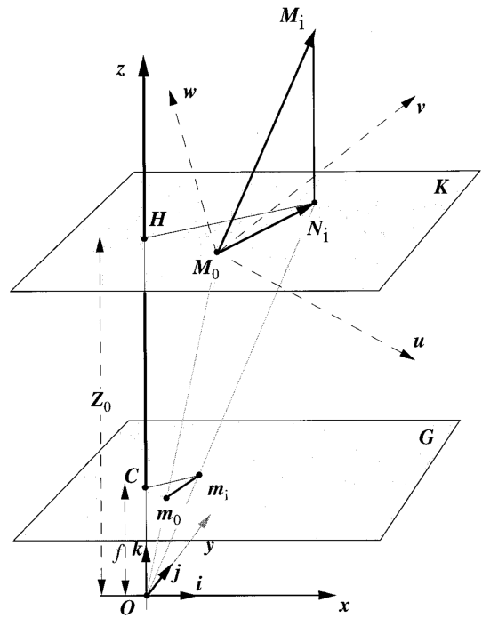
*그림 2 — POSIT의 첫 루프는 점 $m_i$가 물체 점 $M_i$의 약원근 투영이 되는 물체 자세를 찾는다.*

$\varepsilon_i$에 준 값이 정확하지 않으면 POS 알고리즘의 해는 근사일 뿐이다. 그러나 미지수 $\mathbf i$와 $\mathbf j$를 계산하고 나면, 식 (4)를 써서 $\varepsilon_i$의 더 정확한 값을 계산할 수 있고, 이 더 나은 값으로 방정식을 다시 풀 수 있다. 처음에는 $\varepsilon_i = 0$으로 둔다. $\varepsilon_i$를 0으로 가정하는 것은 $x_i' = x_i$, $y_i' = y_i$를 뜻하며, $p_i$와 $m_i$가 일치한다고, 즉 영상 점이 물체 점의 약원근 투영이라고 가정하는 것과 같다. 그림 2가 이 배치를 기술한다. 이 반복 알고리즘을 POSIT(POS with Iterations, 반복을 더한 POS)라 부른다. 이 알고리즘은 보통 몇 번의 반복 안에 $\mathbf i$, $\mathbf j$, $Z_0$의 값을 올바른 자세에 대응하는 값으로 수렴시킨다.

반복 자세 알고리즘은 다음 의사코드로 기술할 수 있다.

1. $\varepsilon_{i(0)} = 0$, $n = 1$
2. 루프 시작.
   식 (2)와 (3)을 써서 $\mathbf i$, $\mathbf j$, $Z_0$를 푼다(다음 절 참조).
   물체 점들이 동일 평면이면 추가 등식 $\mathbf i\cdot\mathbf j = 0$을 써야 하며, 두 개의 근사 자세를 찾는다.
3. $\varepsilon_{i(n)} = (1/Z_0)\mathbf M_0\mathbf M_i\cdot\mathbf k$를 계산한다. 여기서 $\mathbf k = \mathbf i \times \mathbf j$. 물체 점들이 동일 평면이면 부호가 반대인 두 벌의 $\varepsilon_i$를 찾는다(8절 참조).
4. $|\varepsilon_{i(n)} - \varepsilon_{i(n-1)}| \le$ Threshold이면 종료. 아니면 $n = n + 1$. 단계 2로 간다.
5. 정확한 자세(들) = 마지막 근사 자세(들).

이 반복 알고리즘의 기하학적 해석은 [2]를 보라.

## 6. 연립방정식 풀기 (POS 알고리즘) (Solving the Systems of Equations (POS Algorithm))

앞 절에서 기술한 반복 알고리즘 안에서 다음 방정식을 풀어야 한다.

$$\mathbf M_0\mathbf M_i\cdot\mathbf I = x_i(1 + \varepsilon_i) - x_0, \qquad \mathbf M_0\mathbf M_i\cdot\mathbf J = y_i(1 + \varepsilon_i) - y_0,$$

여기서

$$\mathbf I = \frac{f}{Z_0}\mathbf i, \quad \mathbf J = \frac{f}{Z_0}\mathbf j,$$

이고 항 $\varepsilon_i$는 각 반복에서 알려진 값을 갖는다. 이 방정식들의 내적을 *물체 기준 좌표계에서의* 벡터 좌표로 표현한다.

$$\begin{aligned}[U_i\ V_i\ W_i][I_u\ I_v\ I_w]^{\rm T} &= x_i(1 + \varepsilon_i) - x_0,\\ [U_i\ V_i\ W_i][J_u\ J_v\ J_w]^{\rm T} &= y_i(1 + \varepsilon_i) - y_0.\end{aligned} \tag{5}$$

이는 벡터 $\mathbf I$와 벡터 $\mathbf J$의 좌표를 미지수로 하는 선형 방정식이다. 다른 파라미터는 알려져 있다. $x_i$, $y_i$, $x_0$, $y_0$는 카메라 좌표계에서 $m_i$와 $m_0$($M_i$와 $M_0$의 영상)의 알려진 좌표이고, $U_i$, $V_i$, $W_i$는 물체 기준 좌표계에서 점 $M_i$의 알려진 좌표이다.

$n$개의 물체 점 $M_1, M_2, M_i, \ldots, M_n$과 그 영상에 대해 식 (5)를 쓰면, 미지 벡터 $\mathbf I$와 $\mathbf J$의 좌표에 대한 선형 연립방정식을 만든다.

$$\mathbf{AI} = \mathbf x', \quad \mathbf{AJ} = \mathbf y', \tag{6}$$

여기서 $\mathbf A$는 물체 기준 좌표계에서 물체 점 $M_i$의 좌표로 이루어진 행렬이고, $\mathbf x'$은 $i$번째 좌표가 $x_i(1 + \varepsilon_i) - x_0$인 벡터, $\mathbf y'$은 $i$번째 좌표가 $y_i(1 + \varepsilon_i) - y_0$인 벡터이다. $M_0$ 외에 보이는 점이 적어도 세 개 있고 이 점들이 모두 *동일 평면이 아니면*, 행렬 $\mathbf A$는 계수 3을 가지며 선형 연립방정식의 최소제곱 해는 다음으로 주어진다.

$$\mathbf I = \mathbf{Bx}', \quad \mathbf J = \mathbf{By}', \tag{7}$$

여기서 $\mathbf B$는 행렬 $\mathbf A$의 의사역행렬(pseudoinverse)이다.

$\mathbf B$를 *물체 행렬(object matrix)*이라 부른다. 동일 평면이 아닌 점의 경우에 대한 자세한 내용은 [2]를 보라. 이 논문에서는 물체 점이 *동일 평면*으로 알려진 경우에 집중한다. 이 경우 행렬 $\mathbf A$는 계수 2를 가지며, 과결정(overdetermined) 방정식 집합이라도 방정식 집합은 부정(ill-determined)이다. 그러면 추가 제약이 필요하다. 이 퇴화 상황을 기하학적 해석으로 살펴본다.

## 7. 기하학적 관점 (A Geometric Point of View)

$\mathbf I$에 대해 다음 방정식을 얻었다.

$$\mathbf M_0\mathbf M_i\cdot\mathbf I = x_i',$$

여기서 $x_i' = x_i(1 + \varepsilon_i) - x_0$이다. 기하학적으로 이 식은, $\mathbf I$의 꼬리를 $\mathbf M_0$에 두면 $\mathbf I$의 머리가 $\mathbf M_0\mathbf M_i$ 위의 점 $H_{xi}$로 투영된다는 것을 말한다. $H_{xi}$는 다음 대수적 크기로 정의된다.

$$\overline{M_0H_{xi}} = \frac{x_i'}{|\mathbf M_0\mathbf M_i|}.$$

다시 말해 $\mathbf I$의 머리는 $H_{xi}$에서 $\mathbf M_0\mathbf M_i$에 수직인 평면에 속해야 한다(그림 3). 물체가 동일 평면이 아닌 네 특징점 $M_0$, $M_1$, $M_2$, $M_3$를 가졌다면, $\mathbf I$는 꼬리가 $M_0$에 있고 머리가 각각 $H_{x1}$, $H_{x2}$, $H_{x3}$에서 $\mathbf M_0\mathbf M_1$, $\mathbf M_0\mathbf M_2$, $\mathbf M_0\mathbf M_3$에 수직인 세 평면의 교점에 있는 벡터로 완전히 정의될 것이다. 해석적으로는 세 방정식의 연립방정식을 풀게 되며, 연립방정식의 행렬은 계수 3을 가질 것이다.

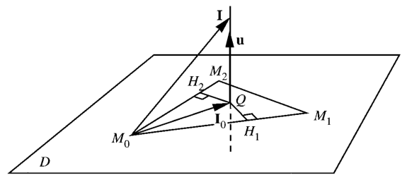
*그림 3 — 머리가 평면 $D$ 위의 $Q$로 투영되는 모든 벡터 $\mathbf I$는 $\mathbf M_0\mathbf M_1$ 위의 $H_{x1}$과 $\mathbf M_0\mathbf M_2$ 위의 $H_2$로 투영된다.*

그러나 특징점들이 같은 평면 $D$에 속하면(그러나 한 직선 위에 있지 않으면), 벡터 $\mathbf M_0\mathbf M_1$, $\mathbf M_0\mathbf M_2$ 등은 동일 평면에 있고, $H_{x1}$, $H_{x2}$ 등(위에서 정의함)에서 그것들에 수직인 평면들은 모두 평면 $D$에 수직인 한 직선이나 가까운 평행선들에서 만난다. 행렬 $\mathbf A$의 계수는 2뿐이다. 그런 배치 중 가장 간단한 것은 특징점 삼각형 $M_0M_1M_2$만 쓰는 경우이다. 연립방정식의 의사역행렬 해 (7)은 역시 평면 $D$ 안에 있으면서 평면들까지의 거리를 최소화하는 점 $Q$이며, 대응 벡터 해를 $\mathbf I_0$라 부른다(그림 3). 분명히 연립방정식의 이 해는 유일하지 않다. 머리가 $Q$에서 평면 $D$로 투영되는 모든 벡터 $\mathbf I$가 여전히 $\mathbf M_0\mathbf M_1$ 위의 $H_{x1}$, $\mathbf M_0\mathbf M_2$ 위의 $H_{x2}$ 등으로 투영되기 때문이다. 다시 말해 꼬리가 $\mathbf M_0$에 있고 머리가 $Q$에서 평면 $D$에 수직인 직선 위에 있는 어떤 벡터 $\mathbf I$도 해이다(그림 3).

## 8. 동일 평면 점에 대한 연립방정식 해 (System Solutions for Coplanar Points)

그런 해는 다음과 같이 쓸 수 있다.

$$\mathbf I = \mathbf I_0 + \lambda\mathbf u, \tag{8}$$

여기서 $\mathbf u$는 $D$에 수직인 단위 벡터이고 $\lambda$는 $\mathbf u$를 따른 $\mathbf I$ 머리의 좌표이다. 마찬가지로

$$\mathbf J = \mathbf J_0 + \mu\mathbf u \tag{9}$$

이고 $\lambda$와 $\mu$는 미지수이다. 벡터 $\mathbf u$는 물체의 평면 $D$에 수직이므로 $\mathbf M_0\mathbf M_i\cdot\mathbf u = 0$이다. 따라서 벡터 $\mathbf u$는 행렬 $\mathbf A$의 영공간(null space)의 단위 벡터이다. 이는 $\mathbf A$의 특잇값 분해가 주는 둘째 정규직교 행렬에서 가장 작은 특잇값에 대응하는 열벡터로 얻을 수 있다[9]. $\mathbf u$를 이렇게 계산하면 평균 방향을 얻으며, 이는 물체 점들이 정확히 동일 평면에 있지 않은 경우에 유용해 보인다. 이 계산은 주어진 점 분포에 대해 물체 행렬 $\mathbf B$의 계산과 함께 한 번만 수행된다.

동일 평면이 아닌 특징점의 일반적인 경우[2]와 달리, 이제 미지수 $\lambda$와 $\mu$를 계산하기 위해 $\mathbf I$와 $\mathbf J$가 (1) 서로 수직이고 (2) 길이가 같아야 한다는 추가 사실을 써야 한다. 첫째 조건은 다음을 낸다.

$$\lambda\mu = -\mathbf I_0\cdot\mathbf J_0,$$

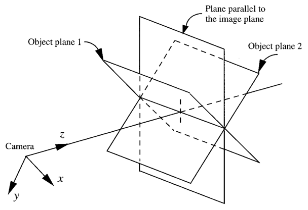
*그림 4 — SOP(약원근 투영) 근사 아래에서 같은 영상을 주는 두 물체 자세. (그림 안 표기: Object plane 1/2 — 물체 평면 1/2, Plane parallel to the image plane — 영상 평면에 평행한 평면, Camera — 카메라)*

그리고 둘째 조건은 다음을 낸다.

$$\lambda^2 - \mu^2 = \mathbf J_0^2 - \mathbf I_0^2.$$

Huttenlocher[8]는 세 물체 점이라는 제한된 경우에 대해 완전히 다른 접근으로 같은 두 방정식을 찾았으며, 첫째 방정식을 제곱하고 두 조건 사이에서 미지수 하나를 소거하여 풀었다. 방정식을 제곱하면 새로운 해가 생기므로, 모든 해를 원래 방정식에 대해 검사해야 한다. 우리는 첫째 방정식을 제곱할 필요가 없는 대안 방법을 제안한다.

복소수 $C = \lambda + i\mu$의 제곱은 $C^2 = \lambda^2 - \mu^2 + 2i\lambda\mu$, 즉

$$C^2 = \mathbf J_0^2 - \mathbf I_0^2 - 2i\mathbf I_0\cdot\mathbf J_0$$

임에 주목한다. 따라서 $\lambda$와 $\mu$를 복소수 $C^2$의 제곱근의 실수부와 허수부로 찾을 수 있다. 제곱근을 찾으려면 $C^2$를 극형식으로 써야 한다.

$$\begin{aligned}&C^2 = [R, \Theta], \text{ with}\\ &R = ((\mathbf J_0^2 - \mathbf I_0^2)^2 + 4(\mathbf I_0\cdot\mathbf J_0)^2)^{1/2}, \text{ and}\\ &\Theta = \mathrm{Arctan}\left(\frac{-2\mathbf I_0\cdot\mathbf J_0}{\mathbf J_0^2 - \mathbf I_0^2}\right), \text{ if } \mathbf J_0^2 - \mathbf I_0^2 > 0, \text{ and}\\ &\Theta = \mathrm{Arctan}\left(\frac{-2\mathbf I_0\cdot\mathbf J_0}{\mathbf J_0^2 - \mathbf I_0^2}\right) + \pi, \text{ if } \mathbf J_0^2 - \mathbf I_0^2 < 0\\ &\left(\text{if } \mathbf J_0^2 - \mathbf I_0^2 = 0, \text{ we have } \theta = -\mathrm{Sign}(\mathbf I_0\cdot\mathbf J_0)\frac{\pi}{2}, \text{ and } R = |2\mathbf I_0\cdot\mathbf J_0|\right).\end{aligned}$$

[역주: 괄호 안의 $\theta$는 원문 그대로이며, 문맥상 $\Theta$이다.]

이 수에는 두 근 $C$가 있다. $C = [\rho, \theta]$와 $C = [\rho, \theta + \pi]$이며, 여기서

$$\rho = \sqrt R, \quad\text{and}\quad \theta = \frac{\Theta}{2}.$$

$\lambda$와 $\mu$는 이 수들의 실수부와 허수부이다.

$$\lambda = \rho\cos\theta,\ \ \mu = \rho\sin\theta, \quad\text{or}\quad \lambda = -\rho\cos\theta,\ \ \mu = -\rho\sin\theta.$$

이 값들은 $\mathbf I$와 $\mathbf J$에 대한 두 해를 낸다.

$$\mathbf I = \mathbf I_0 + \rho(\cos\theta)\mathbf u, \quad \mathbf J = \mathbf J_0 + \rho(\sin\theta)\mathbf u, \quad\text{and}$$
$$\mathbf I = \mathbf I_0 - \rho(\cos\theta)\mathbf u, \quad \mathbf J = \mathbf J_0 - \rho(\sin\theta)\mathbf u$$

$\mathbf u$가 물체 평면에 수직이므로, 위 해들은 첫째 해의 쌍 $(\mathbf I, \mathbf J)$가 둘째 해의 쌍 $(\mathbf I, \mathbf J)$와 대칭임을 보여 준다. 시점을 카메라에 고정하면, 이는 물체 평면의 자세에 대한 두 해가 평면 $(\mathbf I, \mathbf J)$에 평행한 평면, 다시 말해 영상 평면에 평행한 평면에 대해 대칭이라는 관찰과 같다(그림 4 참조).

## 9. 연립방정식 해에서 근사 자세 해로 (From System Solutions to Approximate Pose Solutions)

다음으로 $\mathbf I$와 $\mathbf J$에 대한 이 두 해를 써서 대응 회전 행렬과 평행이동 벡터를 찾는다. 먼저 초점 거리를 $\mathbf I$나 $\mathbf J$의 노름으로 나누어 기준점 $M_0$의 깊이 $Z_0$를 찾는다. 조건 $|\mathbf I| = |\mathbf J|$를 부과했으므로 $\mathbf I$와 $\mathbf J$의 해는 모두 같은 노름을 갖는다는 점에 유의하라. 따라서 $Z_0$의 해는 유일하다. 그다음 $X_0 = (Z_0/f)x_0$, $Y_0 = (Z_0/f)y_0$를 얻는다. 따라서 평행이동 해는 하나뿐이다. 그러나 $\mathbf I$와 $\mathbf J$의 두 해에 대응하는 두 회전 행렬이 있다(각 쌍에 대해 $\mathbf I$와 $\mathbf J$를 정규화하면 회전 행렬의 처음 두 행이 되고, 마지막 행은 처음 두 행의 외적으로 얻는다). 이 두 해는, 같은 영상을 낳는, 영상 평면에 평행한 평면에 대해 대칭인 물체 점 평면의 두 위치에 대응한다(그림 4 참조). 그러나 둘 다 실현 가능(feasible)하지 않을 수 있다. 각 자세에 대해 모든 물체 점이 카메라 앞에 있는지(모든 $Z_i > 0$) 확인해야 한다. 그렇지 않으면 그 자세는 버려야 한다.

## 10. 근사 자세에서 정확한 자세로의 반복 (Iterating from Approximate Pose to Exact Pose)

동일 평면 장면 점에 대해 POS 알고리즘은 POSIT 알고리즘의 각 반복에서 두 자세를 낸다. 따라서 처음에는 자세의 트리를 탐색해야 하고 $n$번 반복 후 $2^n$개의 자세로 끝날 것처럼 보일 수 있다(이 트리의 예시는 그림 5와 6을 보라). 그러나 실제로는 한두 가지만 따라가면 되며, 한두 개의 실현 가능한 해로 끝난다. 두 가지 상황이 생긴다.

- 첫째 상황(그림 5 참조)에서는 첫 반복 단계에서 두 자세를 계산하지만, 그 자세에서 일부 장면 점이 카메라 뒤에 놓이므로 자세 중 하나가 실현 불가능하여 버려야 함을 알게 된다. 이 상황은 이후 모든 단계에서 일어나는 것으로 확인된다. 따라서 따라갈 경로가 하나만 남고 하나의 실현 가능한 자세로 수렴한다.

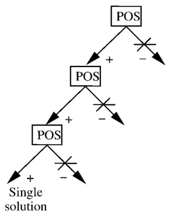
*그림 5 — 경우 1: POS는 과정의 각 단계에서 하나의 실현 가능한 자세를 낸다(+: 실현 가능한 자세, −: 실현 불가능한 자세).*

- 둘째 상황(그림 6 참조)에서는 첫 반복 단계의 두 자세가 모두 실현 가능하며, 두 가지 모두에 대해 반복을 진행한다. 둘째 단계에서 각 가지는 여전히 두 실현 가능한 자세를 주지만, 각 가지에서 *더 나은 자세만 유지한다*. 이 전략은 품질이 낮은 가지를 탐색해도 성과가 없다는 사실로 정당화된다. 실험에 따르면, 이 전략이 낼 두 자세 중 하나로 (훨씬 느린 수렴 속도로) 끝나거나, 과정이 발산하여 반복을 멈춰야 한다. 품질이 낮은 가지의 탐색은 그림 6의 곡선 화살표로 나타나 있다.

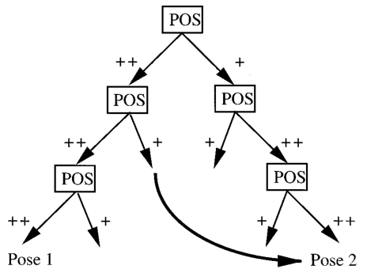
*그림 6 — 경우 2: POS는 과정의 각 단계에서 두 개의 실현 가능한 자세를 낸다(++: 최고 품질 자세, +: 낮은 품질 자세).*

더 나은 자세를 고르는 데 쓰는 품질 척도는 거리 척도 $E$, 즉 실제 영상 점과 계산된 자세로부터 투영된 점 사이의 평균 거리이다.

동일 평면 장면 점에 대한 POSIT 알고리즘의 흐름도를 그림 7에 보인다. 이는 첫 반복 단계에서 생기는 두 가지를 보여 준다. 대응 자세에서 일부 장면 점의 $z$ 성분이 음수이면(카메라 뒤의 점) 한 가지는 버려야 할 수 있다. 둘째 이후 반복 단계에서 각 가지의 과정은 비슷하며, 그림의 앞쪽에는 왼쪽 가지의 과정만 보인다. 이 과정에는 각 반복에서 두 자세 중 더 나은 것을 고르고, 거리 척도 $E$가 영상의 추정 잡음과 관련하여 미리 정한 문턱값 아래로 떨어졌는지 검사하는 것이 포함된다. 그렇다면 그 가지의 자세를 최종 거리 척도 $E$와 함께 출력한다. 그렇지 않으면 그 자세를 다음 반복 루프에서 $\varepsilon_i$를 다시 계산하는 데 쓴다. 두 자세가 모두 허용 가능한 배치에서 네 개의 동일 평면 점으로 계산한 예는 부록에 있다.

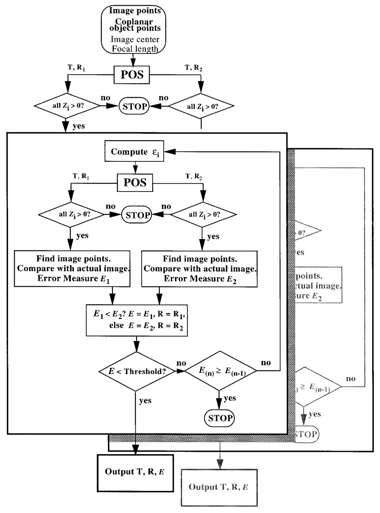
*그림 7 — 동일 평면 장면 점에 대한 POSIT 알고리즘. (그림 안 표기: Image points / Coplanar object points / Image center / Focal length — 영상 점, 동일 평면 물체 점, 영상 중심, 초점 거리; all $Z_i > 0$? — 모든 $Z_i > 0$인가?; Compute $\varepsilon_i$ — $\varepsilon_i$ 계산; Find image points. Compare with actual image. Error Measure $E_1$ ($E_2$) — 영상 점을 구해 실제 영상과 비교, 오차 척도 $E_1$ ($E_2$); $E_1 < E_2$? $E = E_1$, $R = R_1$, else $E = E_2$, $R = R_2$; $E <$ Threshold? — $E$가 문턱값보다 작은가?; $E_{(n)} \ge E_{(n-1)}$; Output T, R, E — T, R, E 출력; STOP — 정지)*

## 11. 성능 특성화 (Performance Characterization)

이 절에서는 평면 물체 또는 장면에 대한 POSIT 알고리즘의 방향 오차와 위치 오차를 평가한다. 사진측량 응용에서 물체는 카메라 앞의 장면이다. 동일 평면 특징점을 가진 두 물체를 카메라로부터 네 가지 거리 비(distance ratio)에서 고려한다. 거리 비는 카메라에서 물체까지의 거리를 물체 크기로 나눈 비로 정의한다. 각 물체에 대해 카메라의 여러 방위각과 앙각, 그리고 세 가지 영상 잡음 수준을 써서 합성 영상을 얻는다. 이 영상으로부터 POSIT으로 카메라 자세를 계산하여 실제 카메라 자세와 비교하고, 광축을 따른 카메라–물체 거리를 여러 가지로 두어 위치와 방향의 오차를 카메라 앙각에 대해 그린다. 또한 각 배치에 대해 알고리즘이 찾는 해의 개수, 영상 중심 위치 오차의 영향, 그리고 실제로는 평면이 아닌 물체를 평면이라고 가정하는 것의 영향도 연구한다.

### 11.1. 물체 (Objects)

첫째 물체는 동일 평면 점 4개로 이루어진다. 두 점은 100 m 정사각형의 대각선 반대편 모서리에 있고, 나머지 두 점은 정사각형 안의 임의 위치에 있다. 둘째 물체는 동일 평면 점 10개를 가지며 대부분의 시험에 쓰인다. 이 물체에서도 2개의 점은 100 m 정사각형의 대각선 반대편 모서리에 있고, 8개의 점은 정사각형 안에 무작위로 놓인다. 따라서 두 물체 모두 거리 비를 계산하는 데 쓰는 크기는 100 m이다. 물체 좌표계 $(O\mathbf u, O\mathbf v, O\mathbf w)$의 원점 $O$는 정사각형의 중심에 있고, 평면 $W = 0$이 정사각형의 평면이다(그림 8 참조).

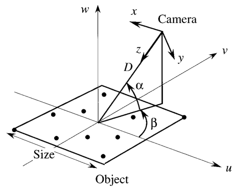
*그림 8 — 실험에서 카메라의 앙각 $\alpha$와 방위각 $\beta$.*

### 11.2. 영상 생성 (Image Generation)

초점 거리 760 화소의 원근 투영으로 합성 영상을 얻는다. 영상의 무작위 잡음 수준을 세 가지로 지정한다. 잡음 수준 1에서는 원근 투영 좌표로 계산한 실수를 정수 화소 위치로 반올림한다. 잡음 수준 2에서는 이 정수 위치를 수직·수평으로 1 화소 교란한다. 교란은 균일 난수 발생기로 만든다. 잡음 수준 3에서는 교란의 진폭이 2 화소이다. 카메라가 물체로부터 거리 비 20, 앙각 10°에 있으면, 물체의 영상은 수평으로 30 화소, 수직으로 6 화소밖에 차지하지 않는다는 점에 유의하라. 영상의 각 변에 대한 2 화소의 교란은 투영된 물체의 크기에 비해 상대적으로 크다.

### 11.3. 카메라 자세 (Camera Poses)

카메라는 항상 물체 좌표계의 원점을 향한다. 카메라는 원점으로부터 네 가지 거리 비 2, 5, 10, 20에 차례로 놓인다.

각 거리 비에 대해 10°에서 90°까지 17개의 앙각을 고려한다. 이 카메라 앙각은 그림 8에서 $\alpha$로 나타낸다. 마지막 앙각에서 카메라는 천저(nadir)에 있다. 모든 자세 오차는 이 앙각들에 대해 그린다.

그림 8은 $\beta$로 나타낸 카메라 방위각도 보여 준다. 대부분의 시험에서 목표는 카메라 방위각과 물체 점 분포보다는 방법 자체의 성능을 반영하는 결과를 얻는 것이다. 따라서 5° 간격의 72개 카메라 방위각 $\beta$에 대해 얻은 자세 오차의 평균을 취한다. 이 평균 오차와 표준편차 막대를 세 잡음 수준과 네 카메라 거리 비에 대해 17개 앙각에 대해 표시한다.

또한 네 카메라 거리 비와 세 잡음 수준에 대해, 카메라 앙각의 함수로서 이중 해(double solution)의 발생을 연구한다. 이 시험에서는 0과 같은 단일 카메라 방위각을 택하고, 72개의 잡음 영상에서 얻은 이중 해의 비율을 조사하여 각 앙각에 대해 이중 자세 해를 얻을 확률을 그린다.

### 11.4. 허용 가능한 자세의 수 (Number of Acceptable Poses)

이제 알고리즘이 찾는 "허용 가능한(acceptable)" 자세의 수를 살펴본다. 이 실험에서 카메라는 단일 방위각에서 여러 앙각으로 물체를 향하지만, 각 앙각에 대해 72개의 무작위 영상 잡음 배치를 만든다. 자세는 다음 정의에 따라 *허용 가능*하다고 한다. 영상 점과 투영된 물체 점 사이의 어긋남을 고려하며, 이 어긋남이 모두 영상 잡음의 진폭(수준 2에서는 $x$와 $y$를 따라 1.5 화소, 수준 3에서는 2.5 화소)보다 작으면 그 자세는 허용 가능하다[역주: 원문의 "is all"은 "if all"의 오기로 보고 옮겼다]. 이는 단지, 실제로는 영상 점과 계산된 자세에 대한 특징점 투영 사이의 어긋남이 영상 잡음에 의해 이동한 실제 영상 점 때문인지 나쁜 자세에 의해 이동한 투영 특징점 때문인지 알 수 없으며, 어긋남이 영상 잡음 수준 이내이면 자세 계산에 유리하게 해석해 주어야 한다는 사실을 인정하는 것이다.

그림 9와 10의 도표는 10°에서 90°까지의 앙각에 대해 이중 자세 해의 백분율 형태로 결과를 보여 준다. 각 데이터는 11.2절에서 기술한 절차에 따라 얻은 72개의 잡음 영상에 대해 두 자세 해가 발생한 백분율이다. 이 결과는 단일 자세 대신 두 허용 가능한 자세를 찾을 확률로 해석할 수 있다. 이 도표에는 잡음 수준 2와 잡음 수준 3만 보인다. 잡음 수준 1은 결정론적 양자화 잡음이어서 덜 흥미로우므로 보이지 않았다. 이런 종류의 잡음에서는 백분율 계산에 쓰는 72개의 잡음 영상이 동일하고 모두 같은 자세를 주므로, 발생 백분율은 두 허용 가능한 자세를 찾으면 100%, 아니면 0%이다.

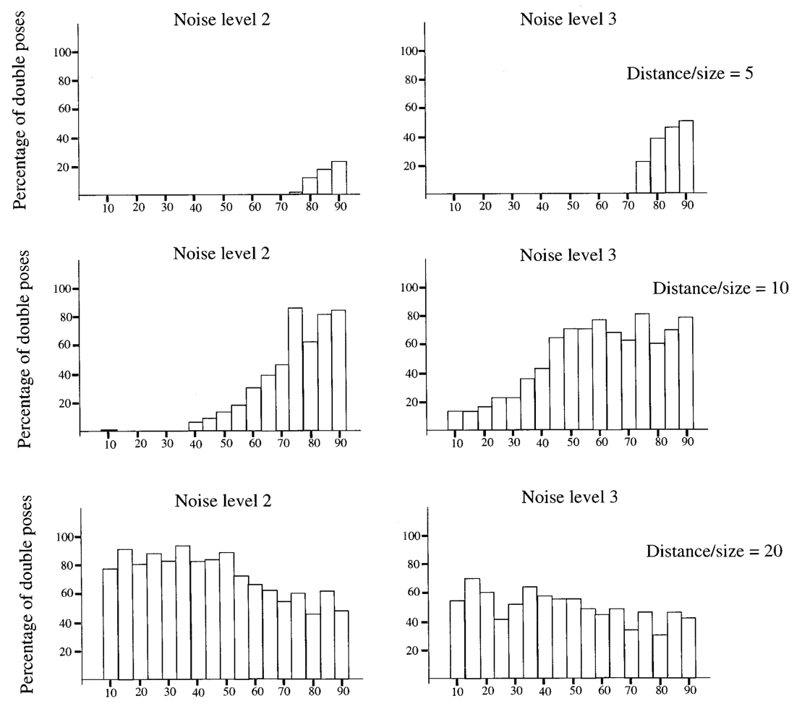
*그림 9 — 동일 평면 점 4개에 대해, 앙각 $\alpha$에 따라 그린 두 허용 가능한 자세를 얻을 확률.*

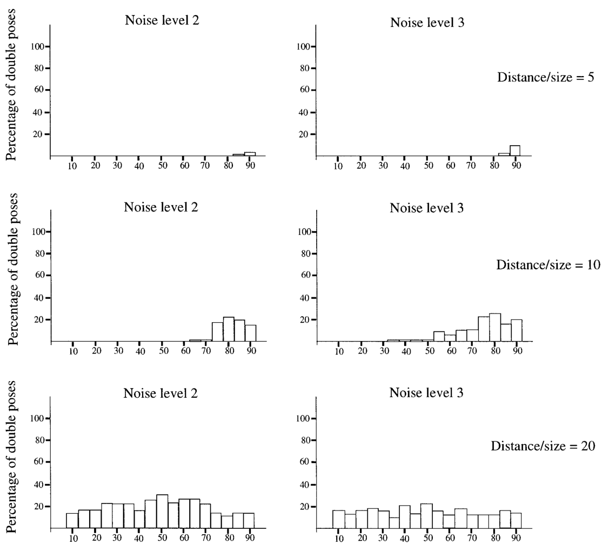
*그림 10 — 동일 평면 점 10개에 대해, 앙각 $\alpha$에 따라 그린 두 허용 가능한 자세를 얻을 확률.*

이 도표에서 광축 방향 물체 깊이에 대한 카메라 거리의 비가 클 때 두 자세를 찾을 가능성이 더 높음을 알 수 있다. 실제로 이 조건이 성립하면 약원근이 원근의 좋은 근사이며, 이 근사에서는 동일 평면 특징점에 대해 항상 두 해가 있음을 안다. 이 조건은 물체가 카메라에서 멀 때, 카메라가 물체를 정면으로 마주볼 때(그러면 광축 방향 치수가 0이고 비가 무한대이다), 또는 적당한 거리와 스치지 않는(nongrazing) 입사각의 조합일 때 성립한다. 가장 짧은 거리 비에서는 카메라가 물체를 거의 정면으로 마주볼 때만 두 자세를 찾는다. 중간 거리 비에서는 중간 각도에서 두 자세를 찾기 시작한다. 가장 큰 거리 비에서는 두 자세를 찾을 확률이 카메라 각도와 사실상 무관하다.

이중 해의 발생이 반드시 영상 잡음 수준에 따라 증가하지는 않는다는 점에 유의하라. 반대 효과를 갖는 두 메커니즘이 작용하기 때문일 수 있다. 한편으로 잡음이 클수록 자세가 허용 가능하기 쉽다(이 절 처음의 허용 가능한 자세 정의 참조). 다른 한편으로 잡음이 클수록 영상이 더 왜곡될 수 있고 자세가 더 어긋날 수 있다.

4점과 10점의 백분율 도표를 비교하면, 두 허용 가능한 자세를 얻을 확률이 10점보다 4점에서 극적으로 높음을 알 수 있다. 이 차이에 대한 설득력 있는 설명은 찾지 못했다. 합성 데이터로 많은 실험(이 두 도표에만 14,000회 이상의 실험)을 수행하는 것의 이점 중 하나는, 해석적으로 예측하거나 실제 데이터로 몇 번의 실험을 해서는 발견하기 어려웠을 성질을 드러낸다는 것이다.

### 11.5. 자세 오차의 계산 (Computation of Pose Errors)

알고리즘이 추정한 각 자세에 대해, 물체에 대한 카메라의 위치와 방향을 영상을 얻는 데 쓴 실제 위치와 방향과 비교한다. 실제 방향의 물체 좌표계를, 카메라 좌표계에 대해 POSIT으로 계산한 방향의 물체 좌표계와 정렬하는 회전축을 계산한다. 방향 오차는 이 정렬을 이루는 데 필요한 이 축에 대한 회전각(도 단위)으로 정의한다. 위치 오차는 물체 좌표계 원점의 실제 위치와 계산된 위치를 정렬하는 데 필요한 평행이동 벡터의 노름으로 정의한다. 이 거리는 카메라 좌표계 원점과 물체 좌표계 원점 사이의 거리로 정규화한다. 따라서 위치 오차는 상대 오차이고, 방향 오차는 도 단위의 척도이다.

### 11.6. 10점 물체에 대한 평균 자세 오차 (Average Pose Errors for the Ten-Point Object)

그림 11과 그림 12의 그래프는 10점 물체 주위의 72개 방위각에 대한 데이터를 평균하여 얻은 카메라의 방향 오차와 위치 오차를 보여 준다.

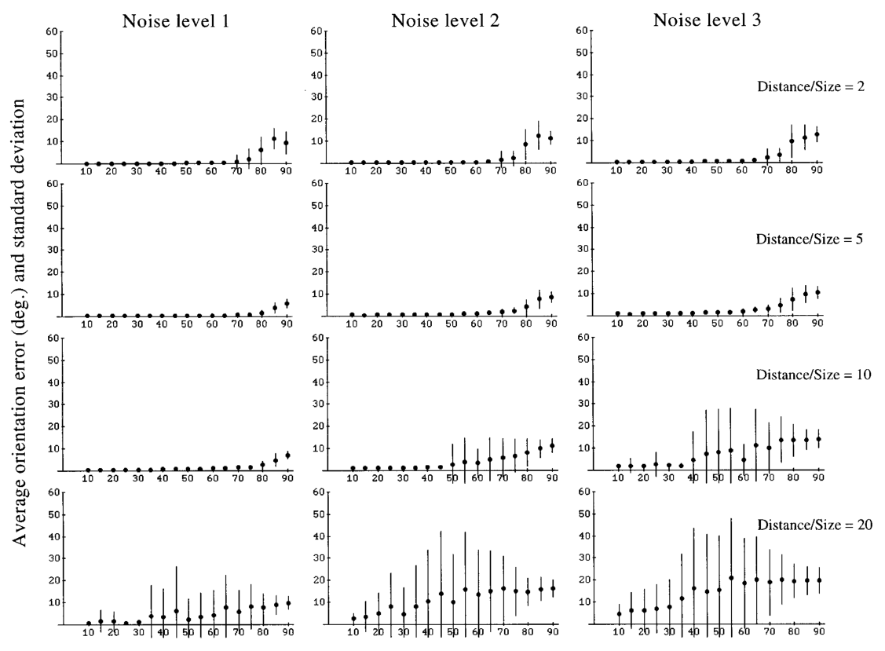
*그림 11 — 동일 평면 특징점 10개에 대해, 앙각 $\alpha$에 따른 평균 방향 오차와 표준편차. 이 결과는 72개의 방위각 $\beta$로부터 얻었다.*

카메라 거리 비 10까지, 앙각 35°까지는 가장 큰 영상 잡음에서도 방향 오차가 보통 3° 미만이다. 가장 큰 방향 오차는 가장 큰 영상 잡음 수준에서 앙각이 천저에 가까울 때 생긴다. 그때 방향 계산은 영상 잡음에 매우 민감하다. 실제로 천저에서는 물체 평면 안의 축에 대한 모든 회전이 특징점을 시선 방향에 가까운 방향으로 옮기며, 영상에 변화를 거의 일으키지 않으므로 검출하기 어렵다. 광축에 평행한 축에 대한 회전만 검출하기 쉽다. 회전 오차 그래프의 점들은 72개 영상으로부터의 오차 해석의 평균을 반영하며, 영상 점의 작은 이동이 자세 각도의 큰 이동으로 해석될 가능성이 크다. 이는 물체를 스치듯 보는(grazing) 경우에는 일어나지 않는데, 이때는 대부분의 회전이 특징점을 시선에 수직인 방향으로 옮긴다.

그림 12는 위치 결과가 천저에서 방향 결과보다 영상 잡음에 덜 민감함을 보여 주며, 가장 큰 영상 잡음 수준에서 거리 비 20의 천저에서도 위치 오차는 항상 6% 미만이다. 이는 이 자세에서 영상으로부터 검출하기 어려운 것이 광축 방향의 평행이동뿐이라는 사실로 설명할 수 있다. 그러면 영상 점의 작은 이동이 자세 각도[역주: 원문 그대로. 문맥상 위치]의 큰 이동으로 해석될 가능성은 작다.

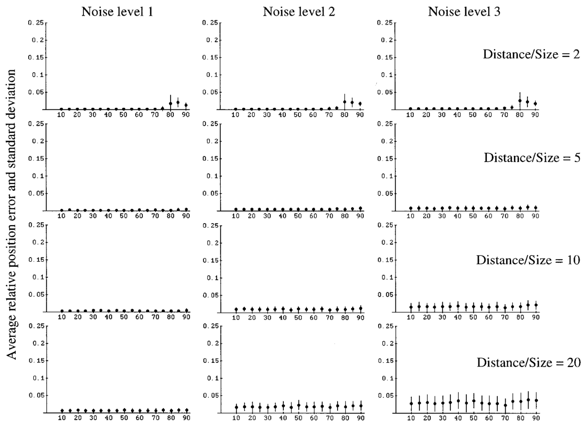
*그림 12 — 동일 평면 특징점 10개에 대해, 앙각 $\alpha$에 따른 평균 위치 오차와 표준편차. 이 결과는 72개의 방위각 $\beta$로부터 얻었다.*

### 11.7. 기타 모의실험 (Other Simulations)

모델로 쓰는 지도는 흔히 고도 정보를 제공하지 않는다. 그러면 실제 기하가 평면이 아닐 수 있는데도 특징점을 동일 평면으로 모델링할 수 있다. 또한 항공 영상에서는 특징점의 퍼짐이 점들의 고도에 비해 클 수 있다. 지도에서 지면이 평면이 아님을 보이더라도, 특징점의 기하를 기술하는 행렬을 계수 3이 아니라 2로 볼 수 있으면 이 특징점들은 동일 평면으로 간주해야 한다. 이런 종류의 모델링 근사의 영향을 추정하기 위해 실험을 수행했다.

평균 위치 오차와 방향 오차 모두 평면성 결함에 따라 약간 증가하지만, 모의실험은 알고리즘이 이런 종류의 입력 오차에 그다지 민감하지 않음을 보여 준다. 예를 들어 장면 점의 실제 고도가 15 m(집 지붕)까지인 100 × 100 m 장면을 고려하면, 고도 표시가 없는 거리 지도를 쓰면 카메라가 장면에서 500 m 떨어져 있을 때 보통 10 m의 위치 오차(상대 오차 2%)가 생긴다.

영상 중심 위치의 불확도(uncertainty)의 영향도 연구했다. 실제로 이 위치를 항상 얻을 수 있는 것은 아니다. 인쇄된 영상은 원본 사진의 주변부일 수 있다. 모의실험은 카메라 방향의 계산이 이 이동에 거의 둔감함을 보여 준다. 카메라 위치에 대해서는, 영상 중심을 (20, 20) 화소 옮기면 평균 상대 카메라 위치 오차가 4%(즉, 500 m에서 본 100 m 장면에 대해 20 m) 생긴다. 측방향 영상 평행이동은 물체의 작은 측방향 평행이동으로 해석된다. 이 모의실험의 세부 내용과 도표는 [10]에 있다.

## 12. 실제 영상 실험 (Experiments on Real Images)

그림 13에 보인 항공 사진을 쓴 결과를 제시한다. 이 사진은 워싱턴 기념탑 꼭대기에서 찍은 워싱턴 D.C.의 내셔널 몰(the Mall) 풍경이다. 자세 결과를 검증하기 위해, 기념탑 위치는 축척을 아는 지형도(그림 14)에서 얻을 수 있다. 가정한 지역 평면에 대한 카메라 고도는 기념탑의 알려진 높이와 그 위치의 지면 고도로부터 추정했다. 우리가 고른 장면 좌표계 $(O, u, v, w)$에 대해 카메라 위치는 다음과 같았다.

$$U = -2276\ \mathrm m;\quad V = -31\ \mathrm m;\quad W = 159\ \mathrm m.$$

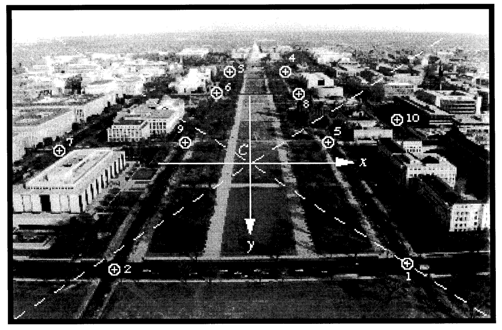
*그림 13 — 워싱턴 기념탑 꼭대기에서 본 워싱턴 D.C.의 내셔널 몰. 특징점과 영상 좌표계 표시.*

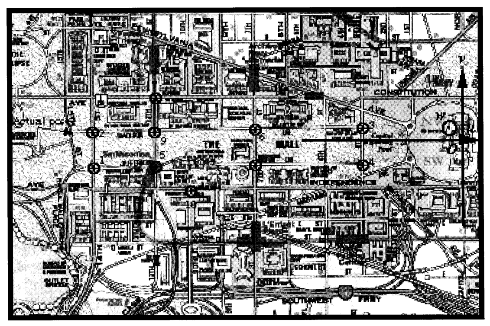
*그림 14 — 이 지역의 지형도. 특징점과 물체 좌표계 표시.*

이 위치는 지도의 낮은 정밀도와 고도의 불확도 때문에 근사적이라는 점에 유의하라. 영상 중심은 사진의 중심으로 가정했다. $(C, x, y)$는 이 추정 영상 중심을 중심으로 하는 영상 좌표계이다. 카메라의 방향 파라미터는 촬영 중에 기록되지 않았지만, 광축과 가정한 지면 평면의 교점 위치를 관찰하여 계산할 수 있다.

그림 13에서 1부터 10까지 번호를 매긴 10개의 특징점을 영상에서 고르고 지도에서 위치를 찾았다. 그 좌표를 두 좌표계 모두에서 측정했다. 수렴 시험(그림 7 참조)의 문턱값은 가능한 한 정밀한 단일 자세 추정치를 얻도록 각 실험마다 조정했다.

알고리즘을 처음 네 점에 적용하면 오차 척도 $E_1 = 0.13\%$로 단일 해를 냈다. 이는 추정 자세에 대해 재구성한 영상 점이 그림 13에 보인 실제 영상 점으로부터 평균 0.2 mm 거리에 있다는 뜻이다. 원본 영상에서 특징점 위치의 불확도를 고려하면 이는 꽤 좋다. 대응하는 계산된 카메라 위치는 다음과 같다.

$$U = -2279\ \mathrm m;\quad V = -27\ \mathrm m;\quad W = 161\ \mathrm m.$$

이 계산된 위치를 지도와 기념탑 높이로부터 추정한 위치와 비교하면 다음을 얻는다.

$$\Delta U = 3\ \mathrm m;\quad \Delta V = 4\ \mathrm m;\quad \Delta W = 2\ \mathrm m$$

지도의 낮은 정밀도를 고려하면 놀랍도록 좋다.

그러나 기준점(control point)들은 유리한 배치(장면의 큰 부분을 덮음)로 골랐다는 점에 유의하라. 예를 들어 점 3, 4, 6, 8을 쓰면 결과가 나빠진다. $E_1 = 0.14\%$와 다음을 얻는다.

$$U = -2277\ \mathrm m,\ \Delta U = 1\ \mathrm m;\quad V = 9\ \mathrm m,\ \Delta V = 40\ \mathrm m;\quad W = 163\ \mathrm m,\ \Delta W = 4\ \mathrm m.$$

흥미롭게도 (카메라에서 더 먼) 점 3, 4, 6, 8로는 둘째 해를 얻을 수 있다. 그러나 이 해의 대응 오차 척도는 꽤 높다. $E_2 = 2.31\%$. 게다가 이 자세에서는 물체 점 1과 2가 카메라 뒤에 있게 되므로 이 자세는 기각해야 한다.

이 알고리즘의 이점은 네 개보다 많은 기준점을 다룰 수 있다는 것이다. 10개 점을 모두 쓰면 $E(=E_1) = 0.58\%$와 다음을 얻는다.

$$U = -2266\ \mathrm m,\ \Delta U = 10\ \mathrm m;\quad V = -24\ \mathrm m,\ \Delta V = 7\ \mathrm m;\quad W = 152\ \mathrm m,\ \Delta W = 7\ \mathrm m.$$

최소 요구 수(네 점)보다 많은 점을 쓰면 가용 정보 전체에 기반한 자세의 최소제곱 추정치를 얻는다.

## 13. 결론 (Conclusion)

물체에 대한 카메라의 자세를 계산하는 반복 방법을 제시했다. 이 방법은 네 개 이상의 동일 평면 특징점으로 쓸 수 있다는 의미에서 유연하다. 네 개의 동일 평면 점에 대한 닫힌 형식 해에 기반한 기법과 달리, 이 방법은 품질 척도와 함께 두 자세를 결정할 수 있다. 응용은 항공 영상 해석에서 로봇 항법까지 걸쳐 있다.

알고리즘이 쓸 수 있는 점의 수에 상한은 없지만 하한은 있다. 가능한 자세가 분명히 네 개인 영상들로 특징점 세 개만 써서 실험했다. 이를 위해 Fischler와 Bolles[3]가 제시한 정삼각형 예를 썼다. 그러나 우리 알고리즘은 항상 삼각형이 영상 평면에 평행한 자세로 수렴했다. 이런 이유로 특징점이 세 개보다 많을 때만 이 알고리즘을 쓸 것을 권한다.

## 부록: 동일 평면 점 네 개로 계산한 예 (Appendix: Example of Calculation with Four Coplanar Points)

- *유효 초점 거리* = 760 화소.
- *물체 점*: $(-15, 0, 0)$, $(15, 0, 0)$, $(15, 500, 0)$, $(-15, 500, 0)$ (m) (그림 15). 물체 기준 좌표계 $F_{\rm o} = (M_0, u, v, w)$.
- 카메라 기준 좌표계 $F_{\rm c} = (O, x, y, z)$에 대한 $F_{\rm o}$의 *위치와 방향*:

$$\mathbf T = \begin{bmatrix}250\\ 100\\ 2000\end{bmatrix}(\mathrm m) \quad\text{and}\quad \mathbf R = \begin{bmatrix}0.5 & -0.866 & 0\\ -0.557 & -0.321 & -0.766\\ 0.663 & 0.383 & -0.643\end{bmatrix} \Leftrightarrow \begin{bmatrix}\Theta_x = 130°\\ \Theta_y = 0°\\ \Theta_z = 60°\end{bmatrix}.$$

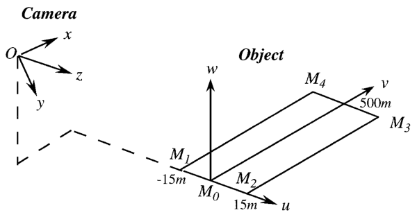
*그림 15 — 부록에서 정의한 물체와 카메라.*

이 물체와 이 자세에 대한 합성 원근 영상은 그림 16의 위쪽에 나타나 있다. 영상 점의 좌표는 다음과 같다.

$$(92.6, 41.38),\ (97.37, 34.65),\ (-60.59, -23.84),\ (-66.37, -18.24)$$

계산과 결과의 도식은 그림 16에 있다.

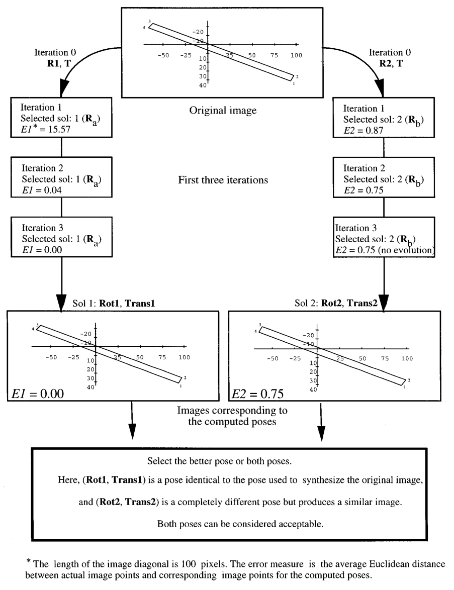
*그림 16 — 부록 예의 계산과 결과 도식. (그림 안 내용: 원본 영상에서 출발하여 반복 0에서 R1, T와 R2, T 두 가지로 나뉜다. 왼쪽 가지: 반복 1 — 선택 해 1 ($\mathbf R_a$), $E1^* = 15.57$; 반복 2 — $E1 = 0.04$; 반복 3 — $E1 = 0.00$ → 해 1: Rot1, Trans1. 오른쪽 가지: 반복 1 — 선택 해 2 ($\mathbf R_b$), $E2 = 0.87$; 반복 2 — $E2 = 0.75$; 반복 3 — $E2 = 0.75$ (변화 없음) → 해 2: Rot2, Trans2. 계산된 자세에 대응하는 영상은 $E1 = 0.00$, $E2 = 0.75$. 아래 상자: "더 나은 자세 또는 두 자세를 모두 고른다. 여기서 (Rot1, Trans1)은 원본 영상을 합성하는 데 쓴 자세와 동일한 자세이고, (Rot2, Trans2)는 완전히 다른 자세이지만 비슷한 영상을 만든다. 두 자세 모두 허용 가능한 것으로 볼 수 있다." 각주 *: 영상 대각선의 길이는 100 화소이다. 오차 척도는 실제 영상 점과 계산된 자세에 대한 대응 영상 점 사이의 평균 유클리드 거리이다.)*

## 감사의 글 (Acknowledgments)

제1저자를 지원한 Thomson-CSF사와, 모든 저자를 지원한 미국 국방고등연구계획국(ARPA Order No. 8459) 및 미 육군 지형공학센터(Contract DACA76-92-C-0009)에 감사한다. 통찰력 있는 지도를 해 준 R. de Peufeilhoux에게도 감사한다.

## 참고문헌

1. M. A. Abidi and T. Chandra, A New Efficient and Direct Solution for Pose Estimation Using Quadrangular Targets: Algorithm and Evaluation, Department of Electrical and Computer Engineering, The University of Tennessee, July 1991, to be published in IEEE Trans. Pattern Anal. Mach. Intelligence.
2. D. F. DeMenthon and L. S. Davis, Model-based object pose in 25 lines of code, in Second European Conf. Computer Vision, May 1992 (G. Sandini, Ed.), Lecture Notes in Computer Science, Springer-Verlag, Berlin/New York; extended version, Int. J. Comput. Vision 15 (1995), 123–141.
3. M. A. Fischler and R. C. Bolles, Random sample consensus: A paradigm for model fitting with applications to image analysis and automated cartography, Comm. ACM, 24 (1981), 381–395.
4. R. M. Haralick, C. Lee, K. Ottenberg, and M. Nölle, Analysis and solutions of the three point perspective pose estimation problem, in Proceedings of the IEEE Computer Society Conference on Computer Vision and Pattern Recognition (CVPR), Maui, HI, June 1991, pp. 592–598.
5. R. M. Haralick, Determining camera parameters from the perspective projection of a rectangle, Pattern Recognition 22 (1989), 225–230.
6. R. J. Holt and A. N. Netravali, Camera calibration: Some new results, CVGIP: Image Understanding 54 (1991), 368–383.
7. R. Horaud, B. Conio, O. Leboulleux, and B. Lacolle, An analytic solution for the perspective 4-point problem, Computer Vision, Graphics, Image Process. 47 (1989), 33–44.
8. D. Huttenlocher and S. Ullman, Recognizing Solid Objects by Alignment, in Proc. DARPA Image Understanding Workshop, 1988, pp. 1114–1122.
9. W. H. Press, B. P. Flannery, S. A. Teukolsky, and W. T. Verterling, Numerical Recipes in C, Cambridge Univ. Press, Cambridge, U.K. 1988.
10. D. Oberkampf, D. F. DeMenthon, and L. S. Davis, Iterative Pose Estimation Using Coplanar Feature Points, Center for Automation Research Technical Report CAR-TR-677, University of Maryland, July 1993.
11. W. J. Wolfe, D. Mathis, C. W. Sklair, and M. Magee, The perspective view of three points, IEEE Trans. Pattern Anal. Mach. Intelligence 13 (1991), 66–73.
12. J. S. C. Yuan, A general photogrammetric method for determining object position and orientation, IEEE Trans. Robot. Automation 5 (1989), 129–142.
