# 무한소 평면 기반 자세 추정 (Collins 2014)

- 원제: Infinitesimal Plane-Based Pose Estimation
- 원문: 같은 폴더의 `Collins2014_IJCV_IPPE.pdf` (Toby Collins, Adrien Bartoli. International Journal of Computer Vision 109(3), pp. 252–286, 2014. DOI 10.1007/s11263-014-0725-5)
- 번역 범위: 전문(본문, 표, 그림 캡션, 부록 1–4). 참고문헌은 원문 그대로 옮겼다.
- 그림: 원문 그림 14개를 `그림/`에 넣고 본문에서 처음 언급되는 곳에 삽입했다. 그림 안의 축 이름·범례는 원문 그대로다.
- 수식은 원문 기호를 그대로 LaTeX로 옮겼다. $\hat{\cdot}$는 잡음이 섞인 측정값, $\tilde{\mathbf q}$는 정규화 좌표다.

## 초록 (Abstract)

점 대응(point correspondence) 집합이 주어졌을 때 평면의 자세(pose)를 추정하는 일은 컴퓨터 비전의 핵심 문제이며, 증강현실(Augmented Reality, AR), 카메라 보정(캘리브레이션), 3차원 장면 복원·해석 등 많은 응용이 있다. 최근 몇 년 사이 많은 진전이 있었지만, 특히 실행 시간 예산이 결정적인 모바일 응용에서는 더 효율적이고 더 정확한 해법이 여전히 필요하다. 우리는 이 문제에 대한 새로운 해석적(analytic) 해법을 제시한다. 이 해법은 n개 점으로부터의 자세 추정(Pose from n Points, PnP)을 푸는 기존 방법보다 훨씬 빠르고, 대부분의 경우 더 정확하다. 우리의 접근은 호모그래피(homography) 계수의 중복성(redundancy)을 활용하는 새로운 방식을 포함한다. 이는 호모그래피에 잡음이 있을 때, 호모그래피가 모델 평면과 영상 사이의 참 변환을 평면 위 어떤 영역에서는 다른 영역보다 더 잘 추정한다는 사실을 이용한다. 우리 방법은 변환이 가장 잘 추정되는 한 점을 찾고, 그 점에서의 국소 변환만을 써서 자세를 구속하는 데 기반한다. 이는 국소적이고 중복 없는 1차 편미분방정식(PDE)으로 자세를 푸는 것이다. 우리는 이 체계를 무한소 평면 기반 자세 추정(Infinitesimal Plane-based Pose Estimation, IPPE)이라 부른다. 표면 위의 무한히 작은 영역 근방의 변환을 써서 자세를 푸는 것으로 생각할 수 있기 때문이다. 우리는 IPPE가 매우 정확한 자세 추정값을 준다는 것을 실험으로 보인다. IPPE는 해석적이므로 극도로 빠르며, 퇴화(degeneracy), 반환되는 해의 개수, 그 해들 사이의 기하학적 관계라는 측면에서 방법을 완전히 특성화할 수 있다. 이러한 특성화는 최신 PnP 방법으로는 불가능하다.

**키워드** 평면 · 자세 · SfM · PnP · 호모그래피

## 1. 서론 (1 Introduction)

평면 기반 자세 추정(Plane-based Pose Estimation, PPE)은 컴퓨터 비전의 기본 문제이며 많은 중요한 응용의 기반이다. PPE의 핵심은 모델 평면을 찍은 한 장의 영상으로부터, 카메라의 3차원 좌표계에 대한 그 평면의 상대 자세를 복원하는 것이다. 응용으로는 영상에 보이는 질감 있는 평면 표면의 자세 추정, 평면 마커를 이용한 AR(Kato and Billinghurst 1999; Munoz-Salinas)이 있다. 또 다른 중요한 응용은 평면 보정 타깃의 영상을 이용한 카메라 보정이다(Barreto et al. 2009; Zhang 2000; Sturm 2000; Geiger et al. 2012). 고전적인 파이프라인에서는 먼저 카메라 내부 파라미터(intrinsics)를 추정하고, PPE로 카메라 외부 파라미터(extrinsics)를 구한 뒤, 내부·외부 파라미터를 함께 정밀화한다. PPE의 다른 중요한 응용으로는 카메라/프로젝터 보정(Brown et al. 2005)과 질감으로부터의 형상 복원(Shape-from-Texture)(Collins et al. 2010; Hilsmann et al. 2011; Lobay and Forsyth 2004, 2006)이 있다.

PPE를 푸는 방법은 이미 많다. 이들은 크게 두 범주로 나뉜다. 첫째 범주는 평면-뷰 호모그래피를 분해하여 PPE를 푼다(Zhang 2000; Sturm 2000; Collins et al. 2010; Oberkampf et al. 1996). 이 방법들을 호모그래피 분해(Homography Decomposition, HD) 방법이라 한다. 둘째 범주는 PPE를 점 대응으로부터의 일반 강체 자세 추정 문제의 특수한 경우로 다룬다. 카메라가 원근(perspective) 카메라일 때 이를 PnP 문제라 하며, n은 대응의 개수를 뜻한다. 우리는 평면을 특수한 경우로 다룰 수 있는 일반 PnP 방법을 가리켜 Planar-PnP라는 용어를 쓴다. HD는 평면의 원근 투영 또는 아핀(affine) 투영이 만드는 변환이 호모그래피라는 사실을 이용한다. 호모그래피를 추정하고 나면 이를 매우 효율적으로 분해하여 자세 추정값을 얻을 수 있다. HD의 해법은 원근 카메라(Zhang 2000; Sturm 2000)와 약원근(weak-perspective) 카메라(Collins et al. 2010; Oberkampf et al. 1996)에 대해 존재한다. 이를 각각 PHD 방법, WPHD 방법이라 부른다. PnP 방법은 대응 전이 오차(correspondence transfer error)와 관련된 비용 함수로 자세를 최적화한다. 이것은 점 대응의 예측 위치와 측정 위치 사이의 오차다. PnP 연구는 n = 3, n = 4라는 특수한 경우(Dhome et al. 1989; Fischler and Bolles 1981; Gao et al. 2003a; Quan and Lan 1999; Haralick et al. 1991, 1994; Hung et al. 1984)나 임의의 n에 대해 문제를 푸는 것(Quan and Lan 1999; Fiore 2001; Ansar and Daniilidis 2003; Li et al. 2012; Lepetit et al. 2009; Lu et al. 2000; Oberkampf et al. 1996; Horaud et al. 1997; Schweighofer and Pinz 2006; Hesch and Roumeliotis 2011)에 집중해 왔다.

PHD와 Planar-PnP 사이에는 두 가지 주된 차이가 있다. 첫째, 최신 Planar-PnP 방법은 잡음에 대해 PHD 방법보다 훨씬 뛰어나다. 둘째, PHD 방법은 해를 하나만 반환한다. 이 때문에 특정 촬영 조건에서는 크게 실패할 수 있다. 예를 들어 호모그래피가 아핀일 때 PPE는 유일하게 풀리지 않는다(Schweighofer and Pinz 2006). 약원근 조건에서는 카메라 z축에 대한 평면의 알 수 없는 반사(reflection)에 해당하는 회전 모호성이 존재한다(Oberkampf et al. 1996). 이는 작은 평면을 찍거나, 카메라 초점 거리보다 훨씬 먼 거리의 평면을 찍을 때 일어날 수 있다. 이런 조건에서는 두 해의 재투영 오차가 모두 잡음으로 설명될 수 있으므로, 하나뿐인 PHD 해는 약 50%의 확률로 참 해에서 멀리 떨어질 수 있다. 반면 최근의 Planar-PnP 방법 대부분은 각자의 비용 함수의 극소점인 여러 해를 반환할 수 있다. 이상적으로는 그중 하나가 참 해에 해당한다.

### 1.1 접근 방법, 동기, 개요 (Approach, Motivation and Overview)

고정확도 PPE를 얻는 현재의 방법은 먼저 비반복적인 PHD나 Planar-PnP 방법으로 초기 추정값을 구하고, 재투영 오차를 최적화하여 반복적으로 정밀화하는 것이다. 정밀화된 해는 대응에 가우시안 IID 잡음 모델을 가정할 때의 최대우도(Maximum Likelihood, ML) 추정값이다. 초기화 방법이 (어떤 비용 함수의 극소점에 해당하는) 여러 해를 반환하면, 각각을 정밀화하고 재투영 오차가 가장 작은 것을 보통 자세 추정값으로 쓴다. 더 효율적인 초기화 방법을 개발하려는 수요는 계속되고 있다. 이상적으로는 해를 적게 반환하고, 궁극적으로는 정밀화가 아예 필요 없을 만큼 정확한 방법이다. 이는 실행 비용을 줄이는 것이 필수인 모바일이나 임베디드 응용에서 특히 중요하다. PHD가 Planar-PnP 방법보다 훨씬 빠르므로, 우리는 PHD만큼 빠르면서 정확도는 Planar-PnP 방법과 비슷하거나 더 나은 해법을 찾는 것을 목표로 한다.

PHD는 자유도 8의 호모그래피 행렬로 자유도 6의 자세를 추정한다. 따라서 이 문제에는 중복된 구속 조건이 있다. PHD는 대수적 최소제곱 비용으로 가장 잘 맞는 자세를 구하는 방식으로 이 중복을 다룬다. 이는 호모그래피의 잡음이 IID 가우시안이라고 가정하는데, 이는 대개 좋은 근사가 아니다(Chen and Suter 2009). 우리는 호모그래피 계수의 중복성을 이용하여 훨씬 나은 자세 추정값을 주는 대안 방법을 제안한다. 우리 방법은 호모그래피가 잡음 섞인 대응으로부터 추정되었을 때 이 변환의 정확도가 공간적으로 변한다는 사실에 기반한다. 즉, 호모그래피는 모델 평면 위 어떤 점에서는 다른 점보다 변환을 더 잘 예측한다. 우리 방법은 변환이 가장 잘 예측되는 모델 평면 위의 점을 찾고, 그 점에서의 운동 정보만을 써서 중복 없는 국소 시스템으로 자세를 푼다. 이 점을 찾기 위해 1차 오차 전파를 쓰며, 이 점은 모델 평면 위 점들의 무게중심(centroid)으로 잘 근사된다는 것이 드러난다.

우리의 주된 이론적 기여는 모델 평면 위 한 점에서의 0차·1차 변환 정보를 이용하는 PDE로 자세를 정확히 풀 수 있음을 보인 것이다. 우리는 이 접근을 무한소 평면 기반 자세 추정(IPPE)이라 부른다. 모델 평면 위 한 점 근방의 무한히 작은 영역 안의 변환 정보를 써서 자세를 푸는 것으로 생각할 수 있기 때문이다. IPPE를 풀기 위해 우리는 PPE 문제를 두 함수를 같게 놓는 변분(variational) 문제로 쓸 수 있다는 사실을 이용한다. 첫째 함수는 3차원 강체 매장(rigid embedding)과 카메라 투영의 합성이다. 둘째 함수는 호모그래피로 추정한, 평면에서 카메라 영상으로의 변환이다. 두 함수는 잡음을 제외하면 같아야 한다. 우리가 쓰는 기법은 두 함수의 테일러 급수 표현을 같게 놓아 두 함수를 같게 놓는 것이다. 테일러 급수를 1차에서 자르면 자세에 대해 6개의 구속을 주는 국소 1차 PDE가 된다. 우리는 이 구속들이 일변수 이차방정식으로 귀결되며, 그 해가 2 × 2 행렬의 최대 특이값을 구하는 것과 같음을 보인다. 중요한 점은 IPPE가 테일러 근사로 투영 방정식을 선형화하여 PPE를 푸는 것(원근 카메라를 아핀 근사로 대체할 때 하는 것처럼, Oberkampf et al. 1996; Horaud et al. 1997)과 같지 않다는 것이다. 즉 IPPE는 PDE를 통해 투영 방정식의 정확한 표현을 쓰므로 어떤 선형화도 포함하지 않는다.

IPPE와 P3P 문제 사이에도 중요한 연결이 있다. 구체적으로, IPPE는 세 점이 한 직선 위에 있지 않고(non-colinear) 서로의 간격이 무한히 작아질 때의 P3P 문제의 해다. 무한소 간격의 점들에 대한 P3P의 정식 연구는 문헌에 제시된 적이 없으므로, 우리의 IPPE 분석은 P3P의 이해에도 기여한다.

IPPE는 호모그래피의 계수를 입력으로 받으므로 최소 4개의 점 대응이 필요하다. PHD와 달리 IPPE는 호모그래피가 아핀이어도 무너지지 않는다. 우리는 광범위한 시뮬레이션과 실제 실험으로 IPPE가 매우 잘 동작함을 실증적으로 보인다. IPPE는 일관되게 PHD보다 좋고, 대부분의 경우 경쟁력 있는 Planar-PnP 방법보다 뛰어나며, 자세를 해석적으로 풀기 때문에 훨씬 빠르다. 나아가 그 해석적 해는 방법을 완전히 특성화할 수 있게 한다. 구체적으로 다음 핵심 질문들에 답한다.

- Q1 *어떤 입력에 대해 IPPE는 물리적으로 타당한 해를 적어도 하나 반환함을 보장하는가?* 답: 계수(rank)가 1보다 큰 모든 호모그래피 행렬(아핀 행렬 포함).
- Q2 *IPPE는 물리적으로 타당한 해를 몇 개 반환하는가?* 답: 하나 또는 둘.
- Q3 *IPPE가 반환하는 해들 사이의 기하학적 관계는 무엇인가?* 답: 시선(viewing ray)에 대한 평면의 반사에 해당한다.
- Q4 *어떤 입력에 대해 IPPE는 평행이동(translation)을 유일하게 추정하는가?* 답: 계수가 1보다 큰 모든 호모그래피.
- Q5 *어떤 입력에 대해 IPPE는 회전(rotation)을 유일하게 추정하는가?* 답: 평면이 카메라 투영 중심을 중심으로 하는 3차원 구에 접할 때.
- Q6 *IPPE는 인위적 퇴화(artificial degeneracy)를 만드는가?* 답: 만들지 않는다.

어떤 방법이 인위적 퇴화를 만드는지 이해하는 것은 중요하다. 특정 방법으로 PPE를 풀 때 두 종류의 퇴화가 생길 수 있다. 첫째 종류는 *일반적(generic)* 퇴화라 한다. 이는 카메라, 평면, 점 대응의 기하학적 배치가 PPE를 유일하게 풀 수 없게 되어 있을 때 일어난다. 이런 경우에는 어떤 방법도 평면의 자세를 추정할 수 없다. 둘째 종류는 *인위적(artificial)* 퇴화라 한다. 이는 PPE 문제가 잘 정립(well-posed)되어 있는데도 방법이 기하학적 배치 때문에 올바른 해를 반환하지 못할 때 일어난다. 예를 들어 PHD는 적어도 하나의 인위적 퇴화를 만드는데, 호모그래피의 원근 항이 무시할 만할 때다. 경쟁력 있는 Planar-PnP 방법은 자세를 해석적으로 풀지 않으므로, 위 여섯 핵심 질문에 완전한 답을 얻는 것은 사실상 불가능하다. 이들은 대개 질문 1에 대해 상한을 줄 수 있지만 질문 2–6은 답하지 못한 채 남는다. 예를 들어 Li et al. (2012)와 Lepetit et al. (2009)는 해들이 기하학적으로 타당하다는 이론적 보장 없이 0개에서 4개 사이의 해를 줄 수 있다.

### 1.2 논문 구성 (Paper Structure)

2절에서는 현재의 최신 PPE 방법을 검토한다. 3절에서는 IPPE와 그 해, 그리고 위 여섯 핵심 질문의 증명을 제시한다. 4절에서는 광범위한 시뮬레이션 실험으로 IPPE를 최신 방법들과 비교 평가한다. 5절에서는 세 가지 일반적인 응용에서 IPPE를 평가한다. 키포인트 대응으로부터 질감 있는 평면 표면의 자세 추정, 평면 체커보드 타깃의 자세 추정, 네 모서리 대응으로부터 평면 AR 마커의 자세 추정이다. 마지막으로 6절에서 결론과 향후 연구 방향을 제시한다.

### 1.3 배경과 표기 (Background and Notation)

벡터는 굵은 소문자로, 행렬은 굵은 대문자로 쓴다. 스칼라는 보통 이탤릭으로 쓴다. 2차원 행렬 $\mathbf M$에 대해 $M_{ij}$는 $\mathbf M$의 $i$행 $j$열 원소를 뜻한다. $\mathbf M_{ij}$는 $i \times j$ 왼쪽 위 부분행렬을 뜻한다. 벡터 $\mathbf v$에 대해 $v_i$는 $i$번째 원소를 뜻한다. $\mathbf M_{ij}$는 $\mathbf M$의 왼쪽 위 $i \times j$ 부분행렬을 뜻한다. $SS_{2\times2}$는 $SO_3$ 안의 $2 \times 2$ 부분 슈티펠(sub-Stiefel) 다양체를 뜻한다(즉 $\mathbf M$이 어떤 $3\times3$ 회전 행렬의 $2\times2$ 부분행렬이면 $\mathbf M \in SS_{2\times2}$). $\|\mathbf M\|_F$는 행렬의 프로베니우스 노름, $\|\mathbf v\|_2$는 벡터의 $\mathcal L_2$ 노름이다. $\mathbf I_k$는 $k\times k$ 단위행렬이다. $\hat{\mathbf M}$은 $\mathbf M$의 잡음 섞인 측정값을 뜻한다. 모델 평면은 세계 좌표의 평면 $z = 0$ 위에 정의한다. 세계 좌표의 점을 카메라 좌표계로 옮기는 강체 변환을 회전 $\mathbf R \in SO_3$와 평행이동 $\mathbf t \in \mathbb R^3$으로 나타낸다. $\mathbf s_i^\top$는 $\mathbf R$의 $i$번째 행, $\mathbf r_i$는 $\mathbf R$의 $i$번째 열이다. 카메라는 보정되어 있고, 왜곡 효과는 전처리 단계에서 제거되었다고 가정한다. 원근 카메라에서 카메라 좌표계의 점이 영상으로 투영되는 것은 카메라의 내부 보정 행렬 $\mathbf K$로 정해진다.

$$\mathbf K = \begin{bmatrix} f_x & s & c_x \\ 0 & f_y & c_y \\ 0 & 0 & 1 \end{bmatrix}, \tag{1}$$

여기서 $f_x$, $f_y$는 $x$, $y$축 방향의 카메라 유효 초점 거리(화소 단위), $\mathbf c = [c_x, c_y]^\top$는 카메라 주점(principal point), $s$는 카메라 기울기(skew)다. 동차 3차원 좌표의 점 $[x, y, z]^\top$를 비동차 2차원 좌표로 바꾸는 함수로 $\pi([x, y, z]^\top) = z^{-1}[x, y]^\top$를 쓴다. 따라서 카메라 좌표의 3차원 점 $\mathbf x$의 원근 투영은 $\pi(\mathbf{Kx})$다. 카메라 영상의 점 $\mathbf q$에 대해 정규화 좌표에서의 위치를 $\tilde{\mathbf q}$로 쓴다.

$$\tilde{\mathbf q} = \mathbf K_{22}^{-1}(\mathbf q - \mathbf c). \tag{2}$$

$\{\mathbf q_i\}$, $i \in \{1, 2, \ldots, n\}$을 $n$개 대응의 집합으로 정의한다. 여기서 $\mathbf u_i \in \mathbb R^2$는 모델 평면 위 점의 위치이고 $\mathbf q_i \in \mathbb R^2$는 영상에서의 위치다. 일반성을 잃지 않고 $\{\mathbf u_i\}$의 중심이 0이라고 가정한다: $\sum_{i=1}^n \mathbf u_i = \mathbf 0$. 호모그래피 행렬 $\mathbf H$에 대해, $\mathbf H$에 의해 무한원 직선(line at infinity)으로 가지 않는 $\mathbb R^2$의 부분공간을 $\Omega_{\mathbf H} \subset \mathbb R^2$로 정의한다: $\mathbf u \in \Omega_{\mathbf H}$ iff $[H_{31}\ H_{32}\ H_{33}]\,[\mathbf u^\top\ 1]^\top \neq 0$.

## 2. 관련 연구 (2 Related Work)

### 2.1 호모그래피 분해 (Homography Decomposition, HD)

PPE에 대한 첫 번째 주된 접근은 모델-영상 변환에 해당하는 호모그래피를 추정하는 것이다. 그 뒤 HD가 자세의 해석적 해를 준다(Zhang 2000; Sturm 2000; Collins et al. 2010).

#### 2.1.1 원근 호모그래피 분해 (Perspective Homography Decomposition, PHD)

모델 평면 위의 점 $\mathbf u \in \mathbb R^2$에서 원근 카메라 영상으로의 변환은 다음 동차 시스템으로 기술된다.

$$\begin{bmatrix}\tilde{\mathbf q}\\1\end{bmatrix} \propto [\mathbf I_3\ \mathbf 0]\begin{bmatrix}\mathbf R & \mathbf t\\ \mathbf 0^\top & 1\end{bmatrix}\begin{bmatrix}\mathbf u\\0\\1\end{bmatrix} \propto \mathbf H\begin{bmatrix}\mathbf u\\1\end{bmatrix}. \tag{3}$$

점 $\tilde{\mathbf q}$와 $\mathbf u$는 *모델-뷰 호모그래피(model-to-view homography)*라 불리는 $3\times3$ 행렬 $\mathbf H$로 연결된다. 이는 어떤 $\lambda \in \mathbb R$에 대해 $\lambda\mathbf H = [\mathbf r_1\ \mathbf r_2\ \mathbf t]$로 주어진다. $\mathbf H$가 잡음을 포함해 추정되었다고 가정한다.

$$\hat{\mathbf H} \overset{\text{def}}{=} \mathbf H + \varepsilon_H = \lambda^{-1}[\mathbf r_1\ \mathbf r_2\ \mathbf t] + \varepsilon_H, \tag{4}$$

여기서 $\varepsilon_H$는 $3\times3$ 측정 잡음 행렬이다. 잡음이 없으면 $\hat{\mathbf H}$의 열들이 $\mathbf r_1$, $\mathbf r_2$, $\mathbf t$를 유일하게 준다. $\hat{\mathbf h}_j$를 $\hat{\mathbf H}$의 $j$번째 열이라 하면 $\lambda$는 자명하게 $\hat\lambda = \|\hat{\mathbf h}_1\|_2^{-1} = \|\hat{\mathbf h}_2\|_2^{-1}$로 주어진다. 그러면 $\mathbf r_1$, $\mathbf r_2$, $\mathbf t$는 $\hat\lambda\hat{\mathbf H}$의 열로 주어진다. $\mathbf r_1$과 $\mathbf r_2$로부터 전체 회전 행렬은 $\mathbf R = [\mathbf r_1\ \mathbf r_2\ \mathbf r_1 \times \mathbf r_2]$로 복원된다. 잡음이 있으면 Zhang (2000)과 Sturm (2000)이 제안한 것처럼 최소제곱 의미에서 자세를 추정할 수 있다. Zhang의 방법은 먼저 $\mathbf r_1$과 $\mathbf r_2$ 사이의 정규직교성을 완화한다. 이렇게 하면 추정값 $\hat{\mathbf r}_j = \hat\lambda_j\hat{\mathbf h}_j$, $j \in \{1, 2\}$, $\hat\lambda_j = \|\hat{\mathbf h}_j\|_2^{-1}$을 얻는다. $\lambda$와 $\mathbf t$는 $\hat\lambda = (\hat\lambda_1 + \hat\lambda_2)/2$, $\hat{\mathbf t} = \hat\lambda\hat{\mathbf h}_3$으로 추정한다. 그다음 $\mathbf r_3$을 $\hat{\mathbf r}_3 = \hat{\mathbf r}_1 \times \hat{\mathbf r}_2$로 추정한다. 이어서 행렬 $[\hat{\mathbf r}_1, \hat{\mathbf r}_2, \hat{\mathbf r}_3]$를 특이값 분해(Singular Value Decomposition, SVD)로 (프로베니우스 의미에서) 가장 가까운 $SO_3$의 원소에 사영하여 타당한 회전 행렬을 얻는다.

Sturm의 방법은 먼저 정규직교성을 완화하지 않는다는 점이 다르다. 대신 $\varepsilon_H$가 IID 가우시안이라고 가정하고 다음 최소제곱 문제를 풀어 ML 해를 찾는다.

$$\min_{\lambda,\mathbf r_1,\mathbf r_2,\mathbf t} \left\|\lambda\hat{\mathbf H} - [\mathbf r_1\ \mathbf r_2\ \mathbf t]\right\|_2^2 \quad \text{s.t.}\ [\mathbf r_1\ \mathbf r_2]^\top[\mathbf r_1\ \mathbf r_2] = \mathbf I_2. \tag{5}$$

이는 $\hat{\mathbf H}$의 왼쪽 $3\times2$ 부분행렬의 SVD를 취하여 매우 효율적으로 풀 수 있다. Zhang과 Sturm의 방법은 실험적으로 비슷한 성능을 보이며 매우 빠른 것으로 알려져 있다.

#### 2.1.2 약원근 호모그래피 분해 (Weak-Perspective Homography Decomposition, WPHD)

HD는 약원근 카메라로 자세를 추정하는 데에도 적용되었다(Collins et al. 2010; Oberkampf et al. 1996). 약원근 투영은 카메라 광축 위의 한 점 근방에서 원근 투영을 선형화하여 얻는 선형 투영이다(Faugeras et al. 2001; Horaud et al. 1997). 모델 평면 위의 점 $\mathbf u \in \mathbb R^2$에서 약원근 카메라 영상으로의 변환은 다음 동차 시스템으로 기술된다.

$$\begin{aligned}
\tilde{\mathbf q} &= \alpha\,[\mathbf I_2|\mathbf 0]\left(\mathbf R\begin{bmatrix}\mathbf u\\0\end{bmatrix} + \mathbf t\right) + \varepsilon_{wp} \quad\Leftrightarrow\\
\begin{bmatrix}\tilde{\mathbf q}\\1\end{bmatrix} &= \mathbf A_{wp}\begin{bmatrix}\mathbf u\\1\end{bmatrix} + \begin{bmatrix}\varepsilon_{wp}\\1\end{bmatrix}\\
\mathbf A_{wp} &\overset{\text{def}}{=} \alpha\begin{bmatrix}\mathbf R_{22} & \begin{bmatrix}t_1\\t_2\end{bmatrix}\\ \mathbf 0^\top & 1\end{bmatrix}
\end{aligned} \tag{6}$$

$\varepsilon_{wp} \in \mathbb R^2$는 원근 투영을 약원근 투영으로 근사하여 생기는 모델링 오차를 나타낸다. $\varepsilon_{wp}$는 모델의 깊이 변화가 평균 깊이에 비해 작을 때(즉 평면이 작거나 기울기 각이 작을 때), 그리고 모델이 카메라 주점 가까이에 투영될 때 작아진다(Horaud et al. 1997). $\alpha$는 광축을 따른 평면의 역깊이(inverse depth)다. $\mathbf A_{wp}$의 추정값이 주어지고 $\varepsilon_{wp}$를 무시하면 $\alpha$에 대한 유일한 추정값과 $\mathbf R$에 대한 두 추정값을 얻는다. 이 둘은 2중 해 모호성(two-fold solution ambiguity)에 해당하며, 카메라 좌표에서 모델을 평면 $z = 0$에 대해 반사한 것과 같다(Oberkampf et al. 1996). $\mathbf R$의 어느 추정값에 대해서도 $\mathbf t$는 유일하게 계산할 수 있다. 카메라 내부 파라미터를 초점 거리만 모르는 상태로 알고 있으면 $\mathbf R$의 두 해는 계산할 수 있지만 $\mathbf t$는 계산할 수 없다(Collins et al. 2010).

#### 2.1.3 원근 호모그래피 분해와 약원근 호모그래피 분해의 비교 (Comparing Perspective and Weak-Perspective Homography Decomposition)

PHD와 WPHD는 세 가지 주된 점에서 다르다. 첫째, WPHD에서는 시스템이 중복되지 않는다. $\mathbf A_{wp}$는 자세에 대해 6개의 방정식을 주는 반면 $\mathbf H$는 8개의 방정식을 준다. 따라서 WPHD에서는 잘 정립된 문제를 얻으려면 잡음을 *반드시* 무시해야 한다(정확한 시스템이므로). 둘째, WPHD에서 $\mathbf R$의 해는 평면이 카메라에 정면 평행(fronto-parallel)인 특수한 경우를 제외하면 *항상 2중으로 모호하다*(Oberkampf et al. 1996). PHD에서는 항상 유일하다. 그러나 PHD는 잡음이 조금 있고 $\mathbf H$가 아핀에 가까워지면 실패한다(Schweighofer and Pinz 2006). 셋째, WPHD는 원근 투영을 선형화하여 생기는 모델링 오차 때문에 $\mathbf H$가 아핀이 아닐 때 더 나쁜 해를 내는 경향이 있다.

### 2.2 n개 점 대응으로부터의 자세 추정 (Pose Estimation from n Point Correspondences, PnP)

PPE에 대한 두 번째 주된 접근은 점 대응으로부터 $\mathbf R$과 $\mathbf t$를 직접 푸는 것이다. 이들은 PnP 문제를 풀며 평면 모델을 특수한 경우로 다룬다. PnP 방법은 크게 작고 고정된 $n$에 대해 푸는 것과 일반적인 경우를 다루는 것으로 나눌 수 있다. P3P 문제는 폭넓게 연구되었고(Dhome et al. 1989; Fischler and Bolles 1981; Gao et al. 2003a; Haralick et al. 1991, 1994; Quan and Lan 1999), 점들이 한 직선 위에 있지 않을 때 최대 4개의 해를 낸다. 따라서 일반적으로 자세를 유일하게 풀려면 점이 더 필요하다(Fischler and Bolles 1981; Zhang and Hu 2005). 평면의 경우, 어떤 세 점도 한 직선 위에 있지 않으면 P4P는 유일한 해를 갖는다(Hung et al. 1984). 일반 PnP 문제를 푸는 방법들은 더 많은 대응의 중복성을 활용하여 더 높은 정확도를 얻는 것을 목표로 한다. 일반 PnP 방법은 크게 비반복적인 것(Quan and Lan 1999; Fiore 2001; Ansar and Daniilidis 2003; Li et al. 2012; Lepetit et al. 2009)과 반복적인 것(Lu et al. 2000; Oberkampf et al. 1996; Horaud et al. 1997; Schweighofer and Pinz 2006)으로 나눌 수 있다. 초기의 비반복 PnP 방법은 계산 비용이 크고 큰 $n$으로 잘 확장되지 않거나(Quan and Lan 1999; Ansar and Daniilidis 2003), 저렴하지만 잡음에 꽤 민감했다(Fiore 2001).

$n$이 클 때 PnP에 대한 최초의 실용적 해법은 약원근 카메라(Oberkampf et al. 1996)나 준원근(para-perspective) 카메라(Horaud et al. 1997)를 써서 원근 투영을 아핀 카메라로 반복적으로 근사하는 것이었다. Oberkampf et al. (1996)과 Horaud et al. (1997)은 비슷한 방식으로 문제를 풀었다. 먼저 아핀 카메라로 자세를 계산했다. 다음으로 아핀 카메라 근사가 만든 오차를 추정하고, 이 오차를 시스템에 되먹여 자세에 대한 구속을 조정했다. 그다음 조정된 시스템으로 자세를 다시 계산했다. 이 과정은 아핀 근사 오차 추정, 자세 구속 조정, 자세 추정을 반복했다. 평면 모델에서는 매 반복의 자세 추정값이 2중으로 모호하다. 반복마다 해 공간이 두 배로 폭증하는 것을 막기 위해 Oberkampf et al. (1996)과 Horaud et al. (1997)은 해를 가지치기했다. Oberkampf et al. (1996)에서는 두 해를 유지하되, 한쪽의 원근 재투영 오차가 다른 쪽보다 크면 제거했다. Horaud et al. (1997)에서는 첫 반복에서 두 해를 모두 유지했다. 이들이 두 탐색 가지를 초기화했고, 각 가지에서는 매 반복마다 (재투영 오차가 가장 작은) 해 하나만 골랐다. 마지막으로 재투영 오차가 가장 작은 해 하나를 선택했다. 이 방법들의 주된 한계는 꽤 느리고 수렴도 최적성도 보장할 수 없다는 것이다. 또한 잡음이 크거나 원근 근사의 오차가 클 때 올바른 자세를 구별하기 어려워진다. 여기서 Oberkampf et al. (1996)과 Horaud et al. (1997)이 한 가지 의미에서 우리가 제안하는 체계와 관련이 있음을 밝혀 둔다. 준원근 카메라와 약원근 카메라로 구현한 IPPE는 각각 Oberkampf et al. (1996)과 Horaud et al. (1997)의 첫 반복과 같은 해를 준다. [역주: 원문은 "준원근–Oberkampf, 약원근–Horaud" 순으로 대응시켰으나, 본문 앞부분에서는 Oberkampf가 약원근, Horaud가 준원근을 썼다고 했다. 원문 그대로 옮긴다.] IPPE가 다른 점은 원근 카메라를 정확하고 비반복적으로 제대로 다룰 수 있다는 것이다.

Lu et al. (2000)은 아핀 카메라 근사를 하지 않는 RPP라는 정확한 반복 PnP 방법을 제안했다. 이 방법은 수렴이 증명되어 있고, 현재까지도 가장 성능이 좋은 PnP 방법 중 하나다. 이후 Schweighofer and Pinz (2006)가 이를 평면의 모호한 경우를 다루도록 확장했다. Schweighofer and Pinz (2006)에서는 먼저 Lu et al. (2000)으로 자세를 추정한 뒤, 1자유도 회전에 대한 재투영 오차의 국소 극소점에 해당하는 둘째 해를 찾는다. 따라서 두 해가 반환되며, 두 해의 재투영 오차가 비슷하면 모호한 배치임을 나타낸다. 이 방법을 RPP-SP라 한다. RPP-SP의 단점은 다음과 같다. 첫째, Lu et al. (2000)이 준 해가 나쁘면 좋은 둘째 해를 찾을 가능성이 낮다. 둘째, 첫 자세 추정을 Lu et al. (2000)에 의존하므로 상대적으로 느리다. 셋째, 둘째 해가 4차 다항식의 근(그중 둘은 반드시 허수)으로부터 구해지므로 자세 모호성을 기하학적으로 특성화하기가 매우 어렵다.

더 최근에는 반복 방법보다 훨씬 빠른 효율적인 비반복 PnP 방법들이 제안되었다. EPnP(Lepetit et al. 2009)는 3차원 점들을 네 개의 가상 제어점의 가중합으로 다시 표현하여 $O(n)$으로 문제를 수치적으로 푼다. 이는 문제 크기가 $n$에 따라 커지지 않음을 뜻하므로 수백 개의 점에도 잘 확장된다. Hesch and Roumeliotis (2011)에서는 직접 최소제곱(Direct Least Squares, DLS) 방법이 제시되었다. 아주 최근에는 RPnP가 제안되었다(Li et al. 2012). 이는 점들을 세 개씩의 부분집합으로 묶어 PnP를 푸는 또 다른 비반복 $O(n)$ 해법이다. 각 부분집합은 4차 다항식으로 풀 수 있는 P3P 문제에 해당한다. 이 다항식들을 최소제곱 방식으로 결합하여 7차 다항식을 만들고, 그 근 각각이 자세의 해를 준다. RPnP의 정확도는 Lu et al. (2000)에 필적하지만 계산은 훨씬 빠르다. 그러나 RPnP는 반환하는 해의 개수를 보장하지 않는다. 나아가 그 해들을 기하학적으로 특성화하는 것은 불가능하다.

## 3. 무한소 평면 기반 자세 추정 (3 Infinitesimal Plane-Based Pose Estimation (IPPE))

이제 IPPE를 제시한다. 먼저 $\hat{\mathbf H}$가 주어지면 국소 1차 PDE로 자세를 구속할 수 있음을 보인다. 이 PDE는 모델 평면 위 *한* 점에서의 모델-영상 변환 함수의 0차·1차 항의 추정값을 포함한다. 이 항들은 $\hat{\mathbf H}$로부터 해석적으로 계산된다. $\hat{\mathbf H}$에 오차가 있으면 PDE는 변수 내 오차(error-in-variables)를 갖게 된다. 이 PDE가 국소적이라는 것의 장점은 모델 평면 위 어디에나 자유롭게 적용할 수 있다는 것이다. 따라서 변환의 국소 추정값이 *가장 좋을* 것으로 기대되는 점에 적용할 수 있다. 이는 PDE의 변수 내 오차를 줄이고, 더 정확한 자세 추정으로 이어진다.

### 3.1 1차 PDE를 이용한 자세의 국소 구속 (Local Constraints on Pose with a 1st-order PDE)

모델 평면의 강체 매장과 원근 투영을 기술하는 변분 시스템은 단순하다. 세계 좌표에서 카메라 좌표로의 참(그러나 알 수 없는) 매장을 $s(\mathbf u) = \mathbf R[\mathbf u^\top, 0]^\top + \mathbf t : \mathbb R^2 \to \mathbb R^3$로 쓴다. 그다음 $s$를 투영 함수 $\pi$와 합성하여 *평면-영상 변환(plane-to-image transform)* $w$를 얻는다.

$$w(\mathbf u) \overset{\text{def}}{=} \pi\left(\mathbf H\left([\mathbf u^\top, 1]^\top\right)\right) = (\pi \circ s)(\mathbf u). \tag{7}$$

$\mathbf H$는 모델 평면을 정규화 영상 좌표로 옮기는 잡음 없는 호모그래피다. $\mathbf H$에 의해 무한원 직선으로 가지 않는 한 점 $\mathbf u_0 \in \Omega_{\mathbf H}$를 생각하자. 식 (7)은 $s$에 대해 두 개의 0차 구속을 준다.

$$w(\mathbf u_0) = \pi\left(\mathbf H\left([\mathbf u_0^\top, 1]^\top\right)\right) = (\pi\circ s)(\mathbf u_0), \quad w(\mathbf u_0) \in \mathbb R^2. \tag{8}$$

$\pi$가 매끄럽고 $s$가 선형 변환이므로 $w$도 매끄럽다. 따라서 식 (7)을 미분하면 곱의 법칙(product rule)에 의해 $s$에 대한 네 개의 1차 구속을 얻을 수 있다.

$$J_w(\mathbf u_0) = (J_\pi \circ s)(\mathbf u_0)\,J_s(\mathbf u_0), \quad J_w(\mathbf u_0) \in \mathbb R^{2\times2}, \tag{9}$$

여기서 $J_f$는 $f$의 야코비 행렬을 계산하는 함수를 뜻한다. $s$가 강체 변환이므로 $J_s(\mathbf u_0) = \mathbf R_{32}$이고, 따라서

$$J_s(\mathbf u_0)^\top J_s(\mathbf u_0) = \mathbf I_2. \tag{10}$$

우리의 목표는 식 (8), (9), (10)을 이용한 1차 PDE를 풀어 먼저 $s(\mathbf u_0)$와 $J_s(\mathbf u_0)$를 추정함으로써 $\mathbf t$와 $\mathbf R$을 추정하는 것이다. 식 (8)과 (9)가 6개의 구속(자세를 추정하는 데 필요한 최소 구속 수)을 주므로, 이 PDE는 점별로(*pointwise*) 풀 수 있다. 즉 주어진 $\mathbf u_0$에 대해 $s(\mathbf u_0)$와 $J_s(\mathbf u_0)$를 추정하고, 이로부터 $\mathbf t$와 $\mathbf R$을 복원할 수 있다.

이 문제를 미지 벡터 $\mathbf x = s(\mathbf u_0) \in \mathbb R^3$(카메라 3차원 좌표계에서 $\mathbf u_0$의 3차원 위치)와 미지 행렬 $\mathbf R_{32} = J_s(\mathbf u_0)$로 쓴다. 이를 식 (8), (9), (10)에 대입하면 우리가 *IPPE 문제*라 부르는 것을 얻는다. 이는 다음과 같다.

$$\text{find } \mathbf x, \mathbf R \ \text{ s.t. } \begin{cases} \pi(\mathbf x) = w(\mathbf u_0) & (a)\\ J_\pi(\mathbf x)\mathbf R_{32} = J_w(\mathbf u_0) & (b)\\ \mathbf R_{32}^\top\mathbf R_{32} = \mathbf I_2 & (c)\\ x_3 > 0 & (d)\end{cases} \tag{11}$$

추가 구속 식 (11d)는 $\mathbf u_0$가 영상에 보이려면 카메라 앞에 있어야 함을 강제한다. 문제 (11)의 구속들은 $\mathbf R_{32}$만 포함한다. $\mathbf R_{32}$의 해가 주어지면 $\mathbf R$의 셋째 열은 $\mathbf R_{32}$의 두 열의 외적으로 유일하게 복원된다. $\mathbf x$와 $\mathbf R$로부터 $\mathbf t$를 복원하려면 $\mathbf x$의 정의 $\mathbf x = s(\mathbf u_0) = \mathbf R[\mathbf u_0\ 0]^\top + \mathbf t$를 쓴다. 따라서 문제 (11)의 해가 주어지면 자세는 다음으로 주어진다.

$$\begin{aligned}\mathbf R &= \left[\mathbf R_{32}\ \Big|\ \mathbf R_{32}\begin{bmatrix}1\\0\end{bmatrix} \times \mathbf R_{32}\begin{bmatrix}0\\1\end{bmatrix}\right]\\ \mathbf t &= \mathbf x - \mathbf R\begin{bmatrix}\mathbf u_0\\0\end{bmatrix}\end{aligned} \tag{12}$$

실제로는 잡음 없는 호모그래피 $\mathbf H$에 접근할 수 없다. 대신 점 대응 $\{\mathbf u_i\}$와 $\{\tilde{\mathbf q}_i\}$로부터 계산한 잡음 섞인 추정값 $\hat{\mathbf H}$에 접근할 수 있다. 그러므로 $w(\mathbf u_0)$와 $J_w(\mathbf u_0)$의 잡음 섞인 추정값으로 작업해야 하며, 이를 각각 $\mathbf v \in \mathbb R^2$와 $\mathbf J \in \mathbb R^{2\times2}$로 쓴다. $\hat H_{33} = 1$이라고 가정하면($\hat{\mathbf H}$의 척도를 바꾸어 보장할 수 있다) $\mathbf v$와 $\mathbf J$는 다음과 같다.

$$\begin{aligned}
\mathbf v &\overset{\text{def}}{=} \pi(\hat{\mathbf H}[\mathbf u_0^\top\ 1]^\top) \approx w(\mathbf u_0) && (13)\\
\mathbf J &\overset{\text{def}}{=} (1 + u_x\hat H_{31} + u_y\hat H_{32})^{-2}\begin{bmatrix}J_{11} & J_{12}\\ J_{21} & J_{22}\end{bmatrix} \approx J_w(\mathbf u_0)\\
[u_x, u_y]^\top &\overset{\text{def}}{=} \mathbf u_0\\
J_{11} &\overset{\text{def}}{=} \hat H_{11} - \hat H_{31}\hat H_{13} + u_x(\hat H_{11}\hat H_{32} - \hat H_{31}\hat H_{12})\\
J_{12} &\overset{\text{def}}{=} \hat H_{12} - \hat H_{32}\hat H_{13} + u_y(\hat H_{12}\hat H_{31} - \hat H_{32}\hat H_{11})\\
J_{21} &\overset{\text{def}}{=} \hat H_{21} - \hat H_{31}\hat H_{23} + u_x(\hat H_{21}\hat H_{32} - \hat H_{31}\hat H_{22})\\
J_{22} &\overset{\text{def}}{=} \hat H_{22} - \hat H_{32}\hat H_{23} + u_y(\hat H_{22}\hat H_{31} - \hat H_{32}\hat H_{21}) && (14)
\end{aligned}$$

$\mathbf v$와 $\mathbf J$는 임의의 $\mathbf u_0 \in \Omega_{\hat{\mathbf H}}$에 대해 정의될 수 있다.

식 (11a)는 $x_1$과 $x_2$의 추정값을 $x_3$으로 나타내 준다: $[x_1, x_2]^\top = x_3\mathbf v$. 이를 $J_\pi(\mathbf x)$에 대입하면 다음을 얻는다.

$$J_\pi(\mathbf x) \approx J_\pi(x_3[\mathbf v^\top 1]^\top) = x_3^{-1}\left[\mathbf I_2\ |\ -\mathbf v\right] \tag{15}$$

따라서 문제 (11)은 $x_3$과 $\mathbf R$에 대한 문제로 줄어든다. 더 단순화하기 위해 변수를 $\gamma \overset{\text{def}}{=} x_3^{-1}$로 바꾸어 문제 (11)을 $\gamma$와 $\mathbf R$로 쓴다.

$$\text{find } \gamma, \mathbf R \ \text{ s.t. } \begin{cases}\gamma\,[\mathbf I_2|-\mathbf v]\,\mathbf R_{32} = \mathbf J & (a)\\ \mathbf R_{32}^\top\mathbf R_{32} = \mathbf I_2 & (b)\\ \gamma > 0 & (c)\end{cases} \tag{16}$$

문제 (16)의 해가 주어지면 평면의 자세는 $\mathbf x = \gamma^{-1}[\mathbf v^\top 1]^\top$을 써서 식 (12)로 주어진다.

PPE 문제는 다른 카메라 투영 모델로도 구성할 수 있다. 부록 1에서 약원근 또는 준원근 모델을 쓰면 문제 (16)과 정확히 같은 형태의 문제를 얻음을 보인다. 차이는 이 카메라들이 하는 아핀 근사 때문에 $\mathbf v$와 $\mathbf J$의 값이 달라진다는 것이다. 그러므로 문제 (16)의 해는 원근, 준원근, 약원근 카메라를 특수한 경우로 다루므로 일반적이다.

### 3.2 IPPE의 통계적 동기와 $\mathbf u_0$의 선택 (Statistical Motivation for IPPE and Choosing u0)

문제 (16)의 해는 다음 절로 미룬다. 먼저 두 가지 중요한 질문을 생각한다.

- Q1 *대응에 잡음이 있을 때(따라서 $\hat{\mathbf H}$, $\mathbf v$, $\mathbf J$에 잡음이 있을 때), $\mathbf u_0$를 바꾸면 문제 (16)은 어떻게 영향을 받는가?*
- Q2 *문제 (16)이 대응의 잡음에 가장 적게 영향받도록 $\mathbf u_0$를 어떻게 고를 수 있는가?*

우리는 대응의 오차가 $\hat{\mathbf H}$를 거쳐 $\mathbf v$와 $\mathbf J$로 어떻게 전파되는지에 대한 통계적 분석에 근거하여 이 질문들을 연구했다. 그다음 이 전파된 오차가 $\mathbf u_0$의 함수로 어떻게 변하는지 보인다. 위 두 질문에 대해 찾은 답은 애초에 IPPE가 PPE에 대한 매우 합리적인 접근인 이유에 대한 통계적 동기를 준다. 이는 *$\mathbf v$와 $\mathbf J$의 오차가 모두 $\mathbf u_0$의 함수로 변하고, 그 오차가 $\{\mathbf u_i\}$의 무게중심에서 근사적으로 최소이기 때문이다*. $\mathbf v$와 $\mathbf J$의 오차가 가장 작은 점에 $\mathbf u_0$를 두면, IPPE는 변수 내 오차가 가장 작은 방정식계로 자세를 푼다. $\hat{\mathbf H}$에 잡음이 없으면 모든 $\mathbf u_0$에 대해 $\mathbf v$와 $\mathbf J$의 오차 없는 추정값을 가진다는 점에 유의하라. 그 경우에는 어떤 $\mathbf u_0$에 대해서도 $\gamma$와 $\mathbf R$이 오차 없이 추정되므로 $\mathbf u_0$를 어디에 두든 차이가 없다.

IPPE는 모델 평면 위의 ($\mathbf u_0$를 중심으로 하는) 무한히 작은 영역의 운동에서 나온 구속으로 PPE를 푸는 것으로 생각할 수 있음을 상기하라. 자세 추정을 떠올릴 때 무한히 작은 영역을 쓰면 불안정해질 것이라고 상상할 수 있으므로 IPPE는 직관에 반하는 것처럼 보일 수 있다. *실제로는 그 반대다.* 만약 $\{\mathbf u_i\}$ 자체가 무한히 가까이 붙어 있다면 약간의 잡음만으로도 PPE 문제 자체가 완전히 불안정해질 것이라는 점에 유의하라. 그러나 IPPE에서 $\mathbf u_0$ 근방의 무한소 영역의 운동은 공간적으로 *떨어져 있는* 점들을 통해 $\hat{\mathbf H}$로부터 계산된다.

영상의 대응 $\{\tilde{\mathbf q}_i\}$가 참 위치에서 평균 0의 가우시안 IID 잡음으로 섭동되었다고 가정한다. 이 모델은 실제로 좋은 근사임이 여러 번 보여졌다(Hartley and Zisserman 2004). $\{\tilde{\mathbf q}_i\}$를 하나의 열벡터로 담은 벡터를 $\hat{\mathbf q} \in \mathbb R^{2n}$으로 쓴다. $\hat{\mathbf q}$의 불확도(uncertainty) 공분산 행렬을 $\Sigma_{\hat{\mathbf q}} = \sigma^2\mathbf I_{2n}$으로 쓰며, $\sigma^2$은 대응 잡음 분산이다.

#### 3.2.1 $\mathbf v$의 불확도 (Uncertainty in v)

먼저 잡음 섞인 대응이 주어졌을 때 $\mathbf v$의 불확도를 생각하고, 이것이 $\mathbf u_0$의 함수로 어떻게 변하는지 보인다. 이를 위해 $\hat{\mathbf q}$의 오차가 $\hat{\mathbf H}$를 거쳐 $\mathbf v$로 전파되는 1차 효과를 모델링한다. $\{\mathbf u_i\}$는 중심이 0이어서 무게중심이 원점에 있음을 상기하라. $\mathbf v$의 $2\times2$ 불확도 공분산 행렬을 $\mathbf u_0$의 함수로 $\Sigma_{\mathbf v}(\mathbf u_0) : \mathbb R^2 \to \mathcal S(2)$로 쓴다. 여기서 $\mathcal S(2)$는 $2\times2$ 공분산 행렬의 공간이다. $\Sigma_{\mathbf v}(\mathbf u_0) \succeq \mathbf 0$이므로, $\Sigma_{\mathbf v}(\mathbf u_0)$의 대각합(trace)을 최소화하는 $\mathbf u_0$를 찾아 $\mathbf v$의 불확도를 최소화할 수 있다.

**정리 1(Theorem 1)** *trace$(\Sigma_{\mathbf v}(\mathbf u_0))$ ($\mathbf v$의 불확도)를 최소화하는 점은 1차까지 $\{\mathbf u_i\}$의 무게중심으로 주어진다.*

*증명* $\hat{\mathbf H}$의 최적 1차 근사는 ML 아핀 변환 $\hat{\mathbf H} \approx \begin{bmatrix}\hat{\mathbf A}_{ML} & \hat{\mathbf t}_{ML}\\ \mathbf 0^\top & 1\end{bmatrix}$로 주어지며, 이는 $\{\mathbf u_i\}$를 $\{\tilde{\mathbf q}_i\}$로 옮기는 최소제곱 아핀 변환이다. 1차 근사 $\mathbf v \approx \hat{\mathbf A}_{ML}\mathbf u + \hat{\mathbf t}_{ML}$를 쓰면 $\Sigma_{\mathbf v}(\mathbf u_0)$는 다음과 같다.

$$[\Sigma_{\mathbf v}(\mathbf u_0)]_{ij} \approx \begin{cases}\frac{\sigma}{n} + (\mathbf u_0 - \mathbf 0)^\top(\bar{\mathbf U}^\top\bar{\mathbf U})^{-1}(\mathbf u_0 - \mathbf 0) & i = j\\ 0 & i \neq j\end{cases} \tag{17}$$

$\bar{\mathbf U}$는 $\{\mathbf u_i\}$를 담은 $2\times n$ 행렬이다. $\bar{\mathbf U}^\top\bar{\mathbf U} \succ \mathbf 0$은 $\{\mathbf u_i\}$의 공분산 행렬이다. 식 (17)은 1차 불확도 전파로 쉽게 증명되며, 짧은 유도를 부록 2에 넣었다. 식 (17)은 1차까지 $\{\tilde{\mathbf q}_i\}$의 잡음이 일으키는 $\mathbf v$의 불확도가 등방 분산을 갖고 원점을 중심으로 하는 가우시안 분포를 따른다는 것을 말해 준다. 따라서 $\mathbf v$의 분산은 $\mathbf u_0$가 원점에서 떨어진 거리에 대해 이차적으로 증가한다. $\mathbf v$의 불확도를 최소화하는 값 $\hat{\mathbf u}_0 \in \mathbb R^2$는 trace$(\Sigma_{\mathbf v}(\mathbf u_0))$를 최소화하는 값이다. 이는 유일하며 $\hat{\mathbf u}_0 = \mathbf 0$(즉 $\{\mathbf u_i\}$의 무게중심)으로 주어진다. □

결과적으로 $\mathbf v$의 불확도를 줄이는 좋은 전략은 $\mathbf u_0$를 $\{\mathbf u_i\}$의 무게중심에 두는 것이다.

#### 3.2.2 $\mathbf J$의 불확도 (Uncertainty in J)

$\mathbf u_0$가 $\mathbf J$의 불확도도 줄이기를 원한다. 이는 $\hat{\mathbf H}$의 2차 성질(즉 $\mathbf u_0$에 대한 야코비안의 변화)을 연구해야 하므로 $\mathbf v$의 불확도보다 덜 단순하다. $\mathbf J$는 $\mathbf u_0$와 $\hat{\mathbf H}$ 둘 다의 함수이고, $\hat{\mathbf H}$는 $\hat{\mathbf q}$의 함수임을 상기하라. 먼저 $\hat{\mathbf q}$를 생각하자. $\hat{\mathbf q}$ 근방에서 vec$(\mathbf J)$의 테일러 전개는 다음과 같다.

$$\text{vec}(\mathbf J) = \text{vec}(\mathbf J(\hat{\mathbf q})) + \frac{\partial}{\partial\hat{\mathbf q}}\text{vec}(\mathbf J)\,\triangle\hat{\mathbf q} + \mathcal O^2. \tag{18}$$

vec$(\mathbf J)$의 $4\times4$ 공분산 행렬을 $\Sigma_{\mathbf J}$로 쓴다. $\Sigma_{\hat{\mathbf q}} = \sigma^2\mathbf I_{2n}$이므로 1차까지 다음과 같다.

$$\Sigma_{\mathbf J} \approx \sigma^2\frac{\partial}{\partial\hat{\mathbf q}}\text{vec}(\mathbf J)\frac{\partial}{\partial\hat{\mathbf q}}\text{vec}(\mathbf J)^\top. \tag{19}$$

$\Sigma_{\mathbf J}$의 $\mathbf u_0$ 의존성을 명시하기 위해 $\Sigma_{\mathbf J}(\mathbf u_0)$로 쓴다. 우리의 목표는 trace$(\Sigma_{\mathbf J}(\mathbf u_0))$(즉 $\mathbf J$의 불확도)를 최소화하는 $\mathbf u_0$를 찾는 것이다. 이는 $\frac{\partial}{\partial\hat{\mathbf q}}\text{vec}(\mathbf J)$의 분석을 수반하며, 이는 $\hat{\mathbf q}$로부터 $\hat{\mathbf H}$(따라서 $\mathbf J$)를 계산하는 데 쓰인 알고리즘에 의존한다. 우리는 가장 잘 확립된 알고리즘인 정규화 직접 선형 변환(Direct Linear Transform, DLT) 알고리즘(Hartley and Zisserman 2004)을 분석한다. 정규화란 $\{\mathbf u_i\}$와 $\{\tilde{\mathbf q}_i\}$를 수정하여 점 집합의 중심이 0이 되고 각 점 집합에서 원점까지의 평균 거리가 $\sqrt2$가 되게 하는 것임을 상기하라. 정규화된 점 집합을 $\{\mathbf u_i'\}$와 $\{\tilde{\mathbf q}_i'\}$로 쓰고, DLT 알고리즘으로 $\{\mathbf u_i'\}$를 $\{\tilde{\mathbf q}_i'\}$로 옮기는 호모그래피를 $\hat{\mathbf H}'$로 쓴다.

**정리 2(Theorem 2)** *$\hat{\mathbf H}'$의 원근 항(즉 $\hat H'_{31}$과 $\hat H'_{32}$)이 무시할 만할 때, trace$(\Sigma_{\mathbf J}(\mathbf u_0))$ ($\mathbf J$의 불확도)를 최소화하는 점은 $\{\mathbf u_i\}$의 무게중심이다.*

정리 2는 다음 보조정리들에 의존한다.

**보조정리 1(Lemma 1)** *trace$(\Sigma_{\mathbf J}(\mathbf u_0))$를 최소화하는 점은 1차까지, $\{\tilde{\mathbf q}_i\}$의 변화가 $\mathbf J$에 가장 작은 변화를 일으키는 점으로 주어진다.*

**보조정리 2(Lemma 2)** *$\hat{\mathbf H}'$의 원근 항(즉 $\hat H'_{31}$과 $\hat H'_{32}$)이 작을 때, trace$(\Sigma_{\mathbf J}(\mathbf u_0))$의 최소화는 볼록 이차 문제다.*

정리 2와 이 보조정리들의 증명은 $\hat{\mathbf q}$의 오차가 $\hat{\mathbf H}'$로 어떻게 전파되는지를 보인 Chen and Suter (2009)에 기반한다. 증명은 부록 3에 둔다.

$\hat{\mathbf H}'$의 원근 항이 작지만 무시할 수 없을 때, 보조정리 2가 이것이 볼록 이차 문제임을 말해 주므로 $\arg\min_{\mathbf u_0}[\text{trace}(\Sigma_{\mathbf J}(\mathbf u_0))]$의 최적해를 쉽게 찾을 수 있다. $\hat{\mathbf H}'$의 원근 항이 무시할 수 없을 때 최적해가 정확히 $\{\mathbf u_i\}$의 무게중심에 있다는 보장은 없다. 그러나 정리 1과 보조정리 2는 $\hat{\mathbf H}'$의 원근 항이 작아질수록 최적해가 $\{\mathbf u_i\}$의 무게중심으로 향한다는 것을 말해 준다. 실제 촬영 조건에서는 보통 $\hat{\mathbf H}'$의 원근 항이 작으며, 우리는 $\{\mathbf u_i\}$의 무게중심이 최적해에 매우 가깝다는 것을 확인했다. 따라서 실제로는 이를 trace$(\Sigma_{\mathbf J}(\mathbf u_0))$의 근사 최소점으로 쓸 수 있다.

*요약* 이 절 첫머리의 두 질문에 대해, 점 대응의 불확도가 $\hat{\mathbf H}$를 거쳐 $\mathbf v$와 $\mathbf J$로 어떻게 전파되는지에 대한 통계적 분석으로 답했다. 불확도는 $\mathbf u_0$의 함수다. $\mathbf v$의 불확도는 $\mathbf u_0$를 $\{\mathbf u_i\}$의 무게중심으로 두면 1차까지 최소화된다. 정규화 호모그래피 $\hat{\mathbf H}'$의 원근 항이 작다고 가정하면(일반적인 촬영 조건에서는 대개 그렇다), $\mathbf J$의 불확도는 볼록 이차 문제를 풀어 최소화된다. 이 역시 $\mathbf u_0$를 $\{\mathbf u_i\}$의 무게중심으로 두면 근사적으로 최소화된다. $\mathbf u_0$는 $\Omega_{\hat{\mathbf H}}$ 안에 있어야 함을 상기하라. $\{\mathbf u_i\}$의 무게중심은 원점에 있고 원점은 결코 무한원 직선으로 가지 않으므로 이 조건은 항상 만족된다: $\left[\hat H_{31}\ \hat H_{32}\ 1\right]\left[\mathbf 0^\top\ 1\right]^\top = 1 \neq 0$.

### 3.3 IPPE 풀기 (Solving IPPE)

문제 (16)에 대한 우리의 해는 $\mathbf u_0$가 $\{\mathbf u_i\}$의 무게중심에 놓일 것을 요구하지 않는다. 실제로는 변수 내 오차를 줄이기 위해 그곳에 둔다. 이 절의 주된 결과는 문제 (16)의 해석적 해와 다음 정리들의 증명이다.

**정리 3(Theorem 3)** (γ에서 해의 존재와 유일성) *$\mathbf u_0 \in \Omega_{\hat{\mathbf H}}$, $\mathbf J \neq \mathbf 0$일 때 문제 (16)에서 $\gamma$의 해는 항상 존재하며 유일하다.*

**정리 4(Theorem 4)** ($\mathbf R$의 2중 모호성) *$\mathbf u_0 \in \Omega_{\hat{\mathbf H}}$, $\mathbf J \neq \mathbf 0$일 때 문제 (16)에서 $\mathbf R$의 해는 항상 존재하며, $\mathbf R$의 해는 많아야 둘이다. 이 둘은 카메라 좌표에서 모델 평면을, 법선이 시선 $[\mathbf v^\top 1]^\top$을 향하는 평면에 대해 반사한 것에 해당한다. 카메라 좌표에서 모델 평면이 카메라 원점을 중심으로 하는 구에 접하는 경우, 그리고 그 경우에만 $\mathbf R$은 유일한 해를 갖는다.*

#### 3.3.1 입력 범위 (Input Bounds)

문제 (16)은 임의의 $\mathbf u_0 \in \Omega_{\hat{\mathbf H}}$로 구성할 수 있다($\mathbf u_0 \notin \Omega_{\hat{\mathbf H}}$이면 $\mathbf J$가 정의되지 않기 때문이다).

**정리 5(Theorem 5)** (일반적 퇴화) *$\mathbf J = \mathbf 0$이 되는 $\mathbf u_0 \in \Omega_{\hat{\mathbf H}}$가 존재하면 $\hat{\mathbf H}$의 계수는 1이며, 어떤 알고리즘도 $\hat{\mathbf H}$로부터 자세를 풀 수 없다.*

*증명* 식 (14)로부터 $\mathbf J = \mathbf 0 \Leftrightarrow \hat{\mathbf H} = \left[\hat H_{13}\ \hat H_{23}\ 1\right]^\top\left[\hat H_{31}\ \hat H_{32}\ 1\right]$임을 쉽게 보일 수 있다. 따라서 $\mathbf J = \mathbf 0 \Rightarrow \text{rank}(\hat{\mathbf H}) = 1$이고, 모델 평면 위의 모든 점이 영상에서 한 점(즉 $[\hat H_{13}\ \hat H_{13}]^\top$)으로 간다. [역주: 원문 표기 그대로이며, $[\hat H_{13}\ \hat H_{23}]^\top$의 오기로 보인다.] 이는 모델 평면이 카메라에서 무한히 멀리 있을 때 일어나는 퇴화 배치다. 이 경우 어떤 알고리즘도 자세를 복원할 수 없다. □

그러므로 식 (16)을 푸는 것을 $\mathbf u_0 \in \Omega_{\hat{\mathbf H}}$이고 $\mathbf J \neq \mathbf 0$인 경우로 제한한다. 이제 제시하는 해는 이 모든 입력에 대해 물리적으로 타당한 해를 준다. 이는 우리 해가 어떤 인위적 퇴화도 만들지 않음을 뜻한다.

#### 3.3.2 단순화 (Simplification)

식 (16a)의 좌변을 다음과 같이 다시 쓴다.

$$\gamma\,[\mathbf I_2|-\mathbf v]\,\mathbf R_{32} = \gamma\,[\mathbf I_2|-\mathbf v]\,\mathbf R_v\mathbf R_v^\top\mathbf R_{32}. \tag{20}$$

$\mathbf R_v \in SO_3$를 어떤 $\mathbf B \in \mathbb R^{2\times2}$에 대해 $[\mathbf I_2|-\mathbf v]\,\mathbf R_v = [\mathbf B|\mathbf 0]$이 되도록 $[\mathbf I_2|-\mathbf v]$를 회전시키는 회전으로 정의한다. $[\mathbf I_2|-\mathbf v]$와 $\mathbf R_v$의 계수가 각각 2와 3이므로 $\mathbf B$는 최대 계수(full rank)다. 문제 (16)을 회전 행렬 $\tilde{\mathbf R} \overset{\text{def}}{=} \mathbf R_v^\top\mathbf R$로 푼 다음 $\mathbf R = \mathbf R_v\tilde{\mathbf R}$로 $\mathbf R$을 복원한다. 식 (16a)는 다음이 된다.

$$\begin{aligned}\gamma\,[\mathbf I_2|-\mathbf v]\,\mathbf R_{32} = \mathbf J \quad&\Leftrightarrow\\ \gamma\,[\mathbf B|\mathbf 0]\,\tilde{\mathbf R}_{32} = \mathbf J \quad&\Leftrightarrow\\ \gamma\tilde{\mathbf R}_{22} = \mathbf A, \quad \mathbf A \overset{\text{def}}{=} \mathbf B^{-1}\mathbf J&\end{aligned} \tag{21}$$

$\mathbf J$의 계수가 적어도 1이고 $\mathbf B$가 최대 계수이므로 $\mathbf A$의 계수는 적어도 1이다. 따라서 문제 (16)을 (계수가 적어도 1인) $2\times2$ 행렬 $\mathbf A$를 양의 척도 항 $\gamma$와 $2\times2$ 부분 슈티펠 행렬 $\tilde{\mathbf R}_{22}$로 분해하는 문제로 줄였다. 분해하고 나면 $\tilde{\mathbf R}_{22}$로부터 원래 회전 행렬 $\mathbf R$을 재구성한다.

#### 3.3.3 문제 (16)의 해석적 해 (Analytic Solution to Problem (16))

$\gamma$의 해는 다음과 같다.

$$\begin{aligned}\gamma = \sigma_1^A &= \sqrt{\tfrac12\left(a_u + a_w + \sqrt{(a_u - a_w)^2 + 4a_v^2}\right)}\\ \begin{bmatrix}a_u & a_v\\ a_v & a_w\end{bmatrix} &\overset{\text{def}}{=} \mathbf{AA}^\top\end{aligned} \tag{22}$$

여기서 $\sigma_1^A$는 $\mathbf A$의 최대 특이값이다. $\mathbf R_v$의 셋째 열을 $\mathbf r_{v3}$로 쓴다. $[\mathbf I_2|-\mathbf v]\,\mathbf R_v = [\mathbf B|\mathbf 0]$이므로 $[\mathbf I_2|-\mathbf v]\,\mathbf r_{v3} = \mathbf 0$이고, 정리하면 $\mathbf r_{v3} \propto [\mathbf v^\top 1]^\top$이다. 따라서 $\mathbf R_v$는 $z$축을 $[\mathbf v^\top 1]^\top$에 정렬하는 임의의 회전이다. 우리는 $z$축을 $[\mathbf v^\top 1]^\top$에 정렬하는 가장 작은 회전을 써서 $\mathbf R_v$를 유일하게 정의한다. 이는 로드리게스 공식(Rodrigues' formula)으로 주어진다.

$$\begin{aligned}\mathbf R_v &= \mathbf I_3 + \sin\theta[\mathbf k]_\times + (1 - \cos\theta)[\mathbf k]_\times^2\\ t &\overset{\text{def}}{=} \|\mathbf v\|_2\\ s &\overset{\text{def}}{=} \left\|[\mathbf v^\top \mathbf 1]^\top\right\|_2\\ \cos\theta &\overset{\text{def}}{=} 1/s\\ \sin\theta &\overset{\text{def}}{=} \sqrt{1 - 1/s^2}\\ [\mathbf k]_\times &\overset{\text{def}}{=} 1/t\begin{bmatrix}\mathbf 0 & \mathbf v\\ -\mathbf v^\top & 0\end{bmatrix}\end{aligned} \tag{23}$$

$\mathbf R$은 두 해를 가지며, 이를 $\mathbf R_1, \mathbf R_2 \in SO_3$로 쓴다. 이들은 다음과 같다.

$$\begin{aligned}
\mathbf R_1 &= \mathbf R_v\tilde{\mathbf R}_1, \quad \mathbf R_2 = \mathbf R_v\tilde{\mathbf R}_2\\
\tilde{\mathbf R}_1 &\overset{\text{def}}{=} \begin{bmatrix}\tilde{\mathbf R}_{22} & +\mathbf c\\ +\mathbf b^\top & a\end{bmatrix}, \quad
\tilde{\mathbf R}_2 \overset{\text{def}}{=} \begin{bmatrix}\tilde{\mathbf R}_{22} & -\mathbf c\\ -\mathbf b^\top & a\end{bmatrix}\\
\tilde{\mathbf R}_{22} &= \gamma^{-1}\mathbf A\\
\mathbf b &= \text{rank}_1\left(\mathbf I_2 - \tilde{\mathbf R}_{22}^\top\tilde{\mathbf R}_{22}\right) = \left[\sqrt{r_u}\ \ \text{sign}(r_v)\sqrt{r_w}\right]^\top\\
\begin{bmatrix}r_u & r_v\\ r_v & r_w\end{bmatrix} &\overset{\text{def}}{=} \mathbf I_2 - \tilde{\mathbf R}_{22}^\top\tilde{\mathbf R}_{22}\\
\begin{bmatrix}\mathbf c\\ a\end{bmatrix} &= \begin{bmatrix}\tilde{\mathbf R}_{22}\\ \mathbf b^\top\end{bmatrix}\begin{bmatrix}1\\0\end{bmatrix} \times \begin{bmatrix}\tilde{\mathbf R}_{22}\\ \mathbf b^\top\end{bmatrix}\begin{bmatrix}0\\1\end{bmatrix}
\end{aligned} \tag{24}$$

#### 3.3.4 정리 3의 증명 (Proof of Theorem 3)

$SS_{2\times2}$에 속하는 행렬의 최대 특이값은 1이므로, 분해 $\gamma\tilde{\mathbf R}_{22} = \mathbf A$는 $\gamma$에 대해 간단한 해를 갖는다.

$$\tilde{\mathbf R}_{22} \in SS_{2\times2} \Leftrightarrow \exists\,\mathbf U, \mathbf V, \sigma \ \text{ s.t. } \begin{cases}\mathbf U\begin{bmatrix}1 & 0\\ 0 & \sigma\end{bmatrix}\mathbf V^\top = \tilde{\mathbf R}_{22}\\ \mathbf U^\top\mathbf U = \mathbf V^\top\mathbf V = \mathbf I_2, \quad 0 \le \sigma \le 1\end{cases} \tag{25}$$

$\mathbf A$의 SVD를 $\mathbf A = \mathbf U_A\left[\text{diag}(\sigma_1^A, \sigma_2^A)\right]\mathbf V_A^\top$로 쓰며, $\sigma_1^A > 0$, $\sigma_1^A \ge \sigma_2^A$, $\mathbf U_A^\top\mathbf U_A = \mathbf V_A^\top\mathbf V_A = \mathbf I_2$이다. 특이값을 크기순으로 정렬하면 특이값 행렬은 유일하므로 $\gamma$의 해는 유일하다.

$$\begin{aligned}\gamma\tilde{\mathbf R}_{22} = \mathbf A \quad&\Leftrightarrow\\ \gamma\,\mathbf U\begin{bmatrix}1 & 0\\ 0 & \sigma\end{bmatrix}\mathbf V^\top = \mathbf U_A\begin{bmatrix}\sigma_1^A & 0\\ 0 & \sigma_2^A\end{bmatrix}\mathbf V_A^\top \quad&\Rightarrow\\ \gamma = \sigma_1^A&\end{aligned} \tag{26}$$

$\sigma_1^A > 0$이므로 식 (16c)는 $\gamma = \sigma_1^A$로 만족된다. 따라서 $\mathbf J \neq \mathbf 0$일 때 문제 (16)에서 $\gamma$의 해는 항상 존재하며 유일하다. □

#### 3.3.5 정리 4의 증명 (Proof of Theorem 4)

$\mathbf J \neq \mathbf 0$일 때 $\gamma$가 유일한 해를 가지므로 $\tilde{\mathbf R}_{22} = \gamma^{-1}\mathbf A$는 $\tilde{\mathbf R}_{22}$의 유일한 해다. 그다음 정규직교 구속을 써서 슈티펠 행렬 $\tilde{\mathbf R}_{32}$를 완성한다. $\mathbf b^\top$를 $\tilde{\mathbf R}_{32}$의 셋째 행이라 하자. $\tilde{\mathbf R}_{32}^\top\tilde{\mathbf R}_{32} = \mathbf I_2 \Leftrightarrow \mathbf I_2 - \tilde{\mathbf R}_{22}^\top\tilde{\mathbf R}_{22} = \mathbf b^\top\mathbf b$ [역주: 원문 표기 그대로. 차원상 $\mathbf b\mathbf b^\top$의 뜻이다]이므로 $\mathbf b$는 $(\mathbf I_2 - \tilde{\mathbf R}_{22}^\top\tilde{\mathbf R}_{22})$의 계수 1 분해로 주어진다. $\sigma_d > 0$을 $(\mathbf I_2 - \tilde{\mathbf R}_{22}^\top\tilde{\mathbf R}_{22})$의 0이 아닌 특이값, $\mathbf d$를 $\sigma_d$에 대한 특이벡터라 하자. $\mathbf b$의 해는 $\pm\sqrt{\sigma_d}\,\mathbf d$의 두 개가 있다. 따라서 어느 쪽 $\mathbf b$를 셋째 행으로 쓰느냐에 따라 $\tilde{\mathbf R}_{32}$의 해가 두 개 존재한다. 그다음 어느 $\tilde{\mathbf R}_{32}$에서든 $\tilde{\mathbf R}_{32}$의 두 열의 외적으로 셋째 열을 만들어 $\tilde{\mathbf R}$을 유일하게 완성한다. 따라서 $\tilde{\mathbf R}$의 해는 두 개 존재하고, $\mathbf R = \mathbf R_v\tilde{\mathbf R}$이므로 $\mathbf R$의 해도 두 개 존재한다.

$\mathbf v$는 영상에서 $\mathbf u_0$가 위치한 2차원 점(정규화 좌표)임을 상기하라. 따라서 $[\mathbf v^\top 1]^\top$은 카메라 광학 중심에서 출발하여 $\mathbf v$를 지나는 시선이다. 식 (24)는 $\mathbf R$의 두 해를 두 회전으로 인수분해한다. 먼저 회전 $\tilde{\mathbf R}$($\tilde{\mathbf R}_1$ 또는 $\tilde{\mathbf R}_2$)이 적용되고, 그다음 회전 $\mathbf R_v$가 적용된다. 식 (24)로부터, 모델 평면 위의 3차원 점 $[\mathbf u^\top 0]^\top$을 $\tilde{\mathbf R}_1$ 또는 $\tilde{\mathbf R}_2$로 회전한 결과는 다음 관계를 갖는다.

$$\tilde{\mathbf R}_2[\mathbf u^\top 0]^\top = \begin{bmatrix}1 & 0 & 0\\ 0 & 1 & 0\\ 0 & 0 & -1\end{bmatrix}\tilde{\mathbf R}_1[\mathbf u^\top 0]^\top \tag{27}$$

따라서 점을 $\tilde{\mathbf R}_1$으로 회전하는 것과 $\tilde{\mathbf R}_2$로 회전하는 것의 차이는 그 점을 모델 평면의 $z$축에 대해 반사하는 것에 해당한다.

$\mathbf R$의 두 해는 먼저 모델 평면을 $\tilde{\mathbf R}_1$ 또는 $\tilde{\mathbf R}_2$로 회전하여 만들어진다. 이 회전들은 모델의 $z$축에 대한 반사를 제외하면 같다. 그다음 모델 평면의 $z$축을 시선 $[\mathbf v^\top 1]^\top$에 정렬하는 둘째 회전 $\mathbf R_v$가 뒤따른다. 결합된 효과는 (카메라 좌표에서) 법선이 $[\mathbf v^\top 1]^\top$을 향하는 평면에 대해 모델 평면을 반사하는 것에 해당하는 2중 해다.

$\mathbf R$은 $\tilde{\mathbf R}_1 = \tilde{\mathbf R}_2$일 때, 그리고 그때에만 단일 해를 갖는다. 식 (24)로부터 $\tilde{\mathbf R}_1 = \tilde{\mathbf R}_2 \Leftrightarrow \mathbf c = -\mathbf c \Leftrightarrow \mathbf c = \mathbf 0 \Leftrightarrow \mathbf b = \mathbf 0 \Leftrightarrow a = 1$이다. 따라서 $\tilde{\mathbf R}_1$(따라서 $\tilde{\mathbf R}_2$)은 모델 평면의 법선을 바꾸지 않는 평면 내 회전이어야 한다. 그러면 평면의 법선은 그것을 시선 $[\mathbf v^\top 1]^\top$ 방향으로 돌리는 $\mathbf R_v$에 의해서만 바뀐다. 이는 카메라 좌표에서 모델 평면이 카메라 원점을 중심으로 하는 구에 접할 때, 그리고 그때에만 $\mathbf R$이 유일한 해를 갖는다고 말하는 것과 같다.

### 3.4 모호성 해소 (Disambiguation)

식 (12)를 쓰면 평면 자세의 두 해는 다음과 같다.

$$\begin{aligned}\left(\mathbf R_1, \mathbf t_1 = \gamma^{-1}\begin{bmatrix}\mathbf v\\1\end{bmatrix} - \mathbf R_1\begin{bmatrix}\mathbf u_0\\0\end{bmatrix}\right)\\ \left(\mathbf R_2, \mathbf t_2 = \gamma^{-1}\begin{bmatrix}\mathbf v\\1\end{bmatrix} - \mathbf R_2\begin{bmatrix}\mathbf u_0\\0\end{bmatrix}\right).\end{aligned} \tag{28}$$

이 해들 중 어느 것이 올바른지는 재투영 오차를 살펴 가릴 수 있다. 대응 가운데에는 한 직선 위에 있지 않은 세 대응이 반드시 존재한다는 사실을 이용한다(그렇지 않으면 호모그래피를 유일하게 계산할 수 없었을 것이다, Hartley and Zisserman 2004). 일반성을 잃지 않고 이를 $\{\mathbf u_1, \mathbf u_2, \mathbf u_3\}$라 하자.

**보조정리 3(Lemma 3)** (모호성 해소) *모델 평면 위의 한 직선 위에 있지 않은 세 점 $\mathbf u_1, \mathbf u_2, \mathbf u_3 \in \mathbb R^2$가 주어지면, 임의의 $\mathbf u_0 \in \Omega_{\hat{\mathbf H}}$에 대해 식 (28)의 두 자세 해는 서로 다르다면 $\mathbf u_1$, $\mathbf u_2$, $\mathbf u_3$ 중 적어도 하나를 서로 다른 두 영상점으로 투영한다.*

보조정리 3은 부록 4에서 귀류법으로 쉽게 증명된다.

보조정리 3은 잡음이 없을 때 $\mathbf R_1 \neq \mathbf R_2$이면 $\{\mathbf u_1, \mathbf u_2, \mathbf u_3\}$의 재투영 오차가 올바른 자세에서만 모두 0이 됨을 말해 준다. 잡음이 있으면 모든 점 대응을 써서 재투영 오차를 살펴 강건하게 자세 모호성을 해소할 수 있다. 각 자세의 재투영 오차는 다음과 같다.

$$e(\mathbf R_j, \mathbf t_j) = \sum_{i=1}^n\left\|\pi\left(\mathbf R_j\begin{bmatrix}\mathbf u_i\\0\end{bmatrix} + \mathbf t_j\right) - \tilde{\mathbf q}_i\right\|_2^2, \quad j \in \{1, 2\} \tag{29}$$

$e$가 가장 작은 자세 해를 $(\mathbf R^*, \mathbf t^*)$로 쓴다. 그다음 둘째 자세를 대립 가설로 받아들일지 기각할지 판단해야 한다. $e_1$과 $e_2$가 비슷하면, 구체적으로 어느 자세의 재투영 오차든 잡음과 구별되지 않으면 자세는 모호하다. 우도비 검정(likelihood ratio test)으로 결정할 수 있지만, 이는 응용에 따라 달라지는 신뢰 한계를 정해야 한다. 그래서 우리는 두 해를 각각의 재투영 오차와 함께 반환하고, 대립 가설을 기각할지는 최종 응용이 고르도록 남겨 둔다.

### 3.5 정면 구속 (The Front-Facing Constraint)

문제 (16)은 표면이 촬영되려면 카메라 앞에 있어야 한다는 물리적 가정(즉 $\gamma > 0$)을 강제한다. 그러나 평면 표면을 어느 *쪽*에서 볼 수 있는지는 강제하지 않는다. 모델이 반투명하면 대응은 평면의 어느 쪽에서든 올 수 있다. 모델이 불투명하면 대응은 평면의 앞면에서만 올 수 있으므로 $\mathbf R$에 대한 추가 구속이 생긴다. 일반성을 잃지 않고 모델 평면의 법선이 $z$축에서 멀어지는 방향을 향한다고 하자. *정면 구속(front-facing constraint)*은 $[\mathbf v^\top 1]\mathbf r_3 \ge 0$이다(즉 카메라 좌표에서의 표면 법선과 시선 $[\mathbf v^\top 1]^\top$ 사이 각의 코사인이 음이 아니어야 한다). 정면 구속을 넣은 IPPE 문제는 다음과 같다.

$$\text{find } \gamma, \mathbf R \ \text{ s.t. } \begin{cases}\gamma\,[\mathbf I_2|-\mathbf v]\,\mathbf R_{32} = \mathbf J & (a)\\ \mathbf R_{32}^\top\mathbf R_{32} = \mathbf I_2 & (b)\\ \gamma > 0 & (c)\\ [\mathbf v^\top 1]\left(\mathbf R_{32}[1\,0]^\top \times \mathbf R_{32}[0\,1]^\top\right) \ge 0 & (d)\end{cases} \tag{30}$$

여기에는 $\mathbf R_{32}$로 쓴 정면 구속(식 (30d))이 들어 있다.

**보조정리 4(Lemma 4)** *$\det(\mathbf J) < 0$이면 문제 (30)은 해가 없다.*

*증명* 정리하면 다음을 쉽게 보일 수 있다.

$$[\mathbf v^\top 1]\left(\mathbf R_{32}[1\,0]^\top \times \mathbf R_{32}[0\,1]^\top\right) = \det\left([\mathbf I_2|-\mathbf v]\,\mathbf R_{32}\right). \tag{31}$$

식 (30a)로부터 $\det([\mathbf I_2|-\mathbf v]\,\mathbf R_{32}) = \det(\gamma^{-1}\mathbf J)$이므로, 식 (30d) $\Leftrightarrow \det(\gamma^{-1}\mathbf J) \ge 0 \Leftrightarrow \gamma^{-2}\det(\mathbf J) \ge 0$이다. $\gamma > 0$이므로 식 (30d) $\Leftrightarrow \det(\mathbf J) \ge 0$이며, 이는 $\det(\mathbf J) < 0$과 모순된다. 따라서 $\det(\mathbf J) < 0$이면 문제 (30)은 해가 없다. □

반대로 $\det(\mathbf J) > 0$이면 식 (30d)는 중복이다. 식 (30c)와 $\det(\mathbf J) > 0$이 식 (30d)를 함의하기 때문이다. 그러므로 $\det(\mathbf J) > 0$이면 정면 구속은 문제에 아무것도 더하지 않는다. 요약하면, $\det(\mathbf J) < 0$이면 (보조정리 4에 의해) 평면 자세에 대한 정면 해가 없고, $\det(\mathbf J) \ge 0$이면 두 자세 해가 모두 정면을 향한다. 따라서 정면 구속은 올바른 자세를 가려내는 데 쓸 수 없다.

### 3.6 IPPE와 P3P의 연결 (The Connection between IPPE and P3P)

IPPE 분석을 마무리하기 위해 이제 IPPE와 P3P의 연결을 제시한다. 이 연결은 $\mathbf J$를 두 가지 동등한 방식으로 나타낼 수 있다는 사실에서 나온다. 첫째는 IPPE에서 한 것처럼 $\hat{\mathbf H}$를 미분하여 계산하는 것이다. 둘째는 $\hat{\mathbf H}$에 따라 변환되지만 무한소 거리만큼 떨어진, 한 직선 위에 있지 않은 세 *가상* 점의 운동으로부터 계산하는 것이다. 모델 평면 위 점들의 위치에 대해 P3P 방정식을 선형화하면, 점들이 같은 점으로 다가가는 극한에서 식 (11)의 IPPE 방정식에 도달한다. 이 연결이 중요한 이유는 정리 3과 4가 점들의 간격이 0으로 갈 때 P3P에서 무슨 일이 일어나는지를 완전히 특성화해 주기 때문이다.

P3P에는 한 직선 위에 있지 않은 세 모델 점 $\{\mathbf u_0, \mathbf u_1, \mathbf u_2\}$, $\mathbf u_i \in \mathbb R^2$가 있고, 정규화 좌표에서의 그 영상 위치 추정값 $\{\tilde{\mathbf q}_0, \tilde{\mathbf q}_1, \tilde{\mathbf q}_2\}$, $\tilde{\mathbf q}_i \in \mathbb R^2$가 있다. 일반성을 잃지 않고 $\mathbf u_0 = \mathbf 0$이라 하자. 여섯 개의 P3P 방정식은 다음과 같다.

$$\begin{aligned}\frac{1}{t_3}\begin{bmatrix}t_1\\t_2\end{bmatrix} &= \tilde{\mathbf q}_0 & (a)\\ \frac{1}{t_3 + [R_{31}\ R_{32}]\mathbf u_1}\begin{bmatrix}t_1 + [R_{11}\ R_{12}]\mathbf u_1\\ t_2 + [R_{21}\ R_{22}]\mathbf u_1\end{bmatrix} &= \tilde{\mathbf q}_1 & (b)\\ \frac{1}{t_3 + [R_{31}\ R_{32}]\mathbf u_2}\begin{bmatrix}t_1 + [R_{11}\ R_{12}]\mathbf u_2\\ t_2 + [R_{21}\ R_{22}]\mathbf u_2\end{bmatrix} &= \tilde{\mathbf q}_2 & (c)\end{aligned} \tag{32}$$

**정리 6(Theorem 6)** (IPPE와 P3P의 관계) *P3P에서 세 점의 간격이 0으로 가는 극한에서 P3P 문제는 IPPE 문제가 된다.*

*정리 6의 증명* $\{\mathbf u_0, \mathbf u_1, \mathbf u_2\}$의 간격이 작으면 식 (32b, c)는 좌변을 모델 평면 원점 근방에서 $\mathbf u_1$, $\mathbf u_2$에 대해 테일러 전개하여 1차까지 근사할 수 있다. 약간 정리하면 여섯 방정식은 다음이 된다.

$$\begin{aligned}\frac{1}{t3}\begin{bmatrix}t_1\\t_2\end{bmatrix} &= \tilde{\mathbf q}_0 & (a)\\ \frac{1}{t_3}\left[\mathbf I_2\ \ -\frac{1}{t_3}\begin{bmatrix}t_1\\t_2\end{bmatrix}\right]\mathbf R_{32}\mathbf U + \mathcal O^2 &= \mathbf Q & (b)\end{aligned} \tag{33}$$

여기서

$$\begin{aligned}\mathbf Q &\overset{\text{def}}{=} [\tilde{\mathbf q}_1\ \tilde{\mathbf q}_2] & (a)\\ \mathbf U &\overset{\text{def}}{=} [\mathbf u_1\ \mathbf u_2] & (b)\end{aligned} \tag{34}$$

이고 $\mathcal O^2$는 1차를 넘는 항을 뜻한다. [역주: 식 (33b)의 $\mathbf Q$는 원문 그대로 옮겼다. 1차 전개로 따지면 $\mathbf Q - \tilde{\mathbf q}_0[1\ 1]$이 되어야 맞는 것으로 보인다.] $\mathcal O^2$를 무시하면 식 (33)은 P3P 방정식을 근사하며, 이 근사는 $\mathbf u_1$과 $\mathbf u_2$가 원점에 다가갈수록 좋아진다. 식 (33a)와 (33b)를 결합하여 우리가 *무한소 P3P 문제(Infinitesimal P3P Problem)*라 부르는 것을 얻는다.

$$\text{find } t_3, \mathbf R \ \text{ s.t. } \begin{cases}\frac{1}{t_3}\left[\mathbf I_2\ \ -\tilde{\mathbf q}_0\right]\mathbf R_{32} = \mathbf{QU}^{-1} + \mathcal O^2 & (a)\\ \mathbf R_{32}^\top\mathbf R_{32} = \mathbf I_2 & (b)\\ t_3 > 0 & (c)\end{cases} \tag{35}$$

$\{\mathbf u_0, \mathbf u_1, \mathbf u_2\}$가 한 직선 위에 있지 않으므로 $\mathbf U$의 계수는 2이고 따라서 가역이다. 문제 (16)과 문제 (35)는 분명히 같은 구조를 갖는다.

식 (16a)와 식 (35a)의 좌변은 변수 이름을 맞추면 같다. $1/t_3$은 카메라 좌표에서 점 $\mathbf u_0$의 역깊이이므로 $\gamma$와 같다. $\tilde{\mathbf q}_0$는 카메라 영상에서 $\mathbf u_0$의 위치이므로 $\mathbf v$와 같다. 이는 식 (16a)와 식 (35a)의 우변이 같음을 뜻하며, 곧 $\mathbf J = \mathbf{QU}^{-1} + \mathcal O^2$를 뜻한다. 따라서 $\{\mathbf u_0, \mathbf u_1, \mathbf u_2\}$가 무한소 간격으로 떨어진 극한에서 $\mathcal O^2 = \mathbf 0$이고 $\mathbf J = \mathbf{QU}^{-1}$이므로 P3P 문제는 IPPE 문제가 된다. □

그러므로 정리 3과 4는 점들의 간격이 0으로 갈 때 P3P에서 무슨 일이 일어나는지를 완전히 특성화한다. 그 특성은 다음과 같다.

- 세 점의 간격이 0으로 가는 극한에서 평행이동의 해는 유일해진다.
- 세 점의 간격이 0으로 가는 극한에서 회전의 해는 2중으로 모호해진다.
- 이 회전 모호성은 법선이 점들을 지나는 시선을 향하는 평면에 대해 점들을 반사하는 것에 해당한다.
- 세 점이 시선을 지나는 구에 접하게 되면 회전 모호성은 없다.

그러므로 IPPE는 $\mathbf u_0$를 중심으로 무한소 간격의 가상점 세 개를 만들고 $\hat{\mathbf H}$로부터 얻은 그 영상 위치로 자세를 복원하는 것으로 생각할 수 있다. IPPE와 P3P 사이의 이 관계를 보면, 모델 평면 위 아무 곳에나 가상점 세 개를 만들어 P3P로 자세를 풀 수도 있는데 왜 이렇게 하는지 물을 수 있다. 답은 $\hat{\mathbf H}$에 잡음이 있으므로 가상 대응을 서로 다른 위치에 두면 P3P가 서로 다른 결과와 서로 다른 개수의 결과(0개에서 4개 사이)를 반환한다는 것이다. 그러면 정확하고 물리적으로 타당한 해를 얻으려면 점을 어디에 두는 것이 가장 좋은가라는 질문이 남는다. 이 질문은 흥미롭지만 이전 문헌에서 연구된 적이 없다. IPPE는 이 질문에 답을 준다. 즉 점들은 무한소 간격으로, 실제 대응의 무게중심에 놓여야 한다. 이는 3.2절의 통계적 분석에서 나온다. 4.6절에서 IPPE가 다른 위치에 놓은 가상 대응으로 푼 P3P보다 훨씬 좋은 성능을 보임을 보일 것이다.

### 3.7 IPPE 알고리즘과 요약 (IPPE Algorithm and Summary)

이제 IPPE를 의사코드로 요약한다. 두 구성 요소로 나눈다. 첫째 구성 요소는 문제 (16)의 해다. 이는 $\mathbf v$와 $\mathbf J$를 입력으로 받아 $\gamma$, $\mathbf R_1$, $\mathbf R_2$를 반환한다. 이를 알고리즘 1에 제시한다. 모든 단계가 단순한 부동소수점 연산만 포함한다는 점에 유의하라. 따라서 극도로 빠르고, 완전히 해석적이며, 추가 수치 라이브러리(예: 대부분의 PnP 접근에서 필요한 고유값 분해나 근 찾기, Li et al. 2012; Lepetit et al. 2009; Gao et al. 2003a; Quan and Lan 1999; Fischler and Bolles 1981; Dhome et al. 1989; Haralick et al. 1991; Triggs 1999; Ansar and Daniilidis 2003)가 필요 없다. 우리는 알고리즘 1이 어떤 인위적 퇴화도 만들지 않음을 증명했다. 즉 모든 $\mathbf v \in \mathbb R^2$와 $\mathbf J \neq \mathbf 0$에 대해 양의 척도 인자 $\gamma$와 두 회전 행렬 $\mathbf R_1$, $\mathbf R_2$가 반환됨을 보장한다. 이는 평면을 비스듬히 보는 경우(즉 법선이 시선에 직교하여 $\mathbf J$의 계수가 1인 경우)도 다룰 수 있음을 뜻한다. 이런 상황은 실제로는 일어나기 어렵지만(그런 상황에서는 대응을 계산하기 어려울 것이므로), 알고리즘 1이 자세를 추정하는 방식 때문에 불안정을 유발하지는 않는다는 것을 말해 준다. PHD와 달리 알고리즘 1은 호모그래피가 아핀 변환일 때도 쓸 수 있다(필요한 것은 $\mathbf J \neq \mathbf 0$뿐이므로). 따라서 PHD와 달리 호모그래피의 원근 왜곡이 작을 때 불안정에 부딪히지 않는다.

**알고리즘 1** IPPE: 문제 (16)의 해

```
Require: v ∈ R^2 and J ∈ R^{2×2}, J ≠ 0
1: function IPPE(v, J)
2:   Compute R_v from v                                   ▷ (Eq. (23))
3:   [B|0] ← [I_2 | −v] R_v
4:   A ← B^{-1} J
5:   γ ← σ_1^A                  ▷ the largest singular value of A (Eq. (22))
6:   R̃_22 ← γ^{-1} A
7:   b ← rank_1( I_2 − R̃_22^T R̃_22 )                      ▷ (Eq. (24))
8:   [c; a] ← [R̃_22; b^T][1; 0] × [R̃_22; b^T][0; 1]
9:   R_1 ← R_v [R̃_22, +c; +b^T, a],  R_2 ← R_v [R̃_22, −c; −b^T, a]
10:  return γ, R_1, R_2
```

둘째 구성 요소는 점 대응 집합과 카메라 내부 파라미터를 입력으로 받아 $\mathbf v$와 $\mathbf J$를 구성하고, 알고리즘 1을 호출하여 두 자세 추정값을 반환하는 것이다. 이를 알고리즘 2에 제시한다. 잡음이 없으면 식 (28)로 평행이동을 오차 없이 추정할 수 있다. 잡음이 있으면 $\mathbf R$의 해를 이용하여 선형 최소제곱 의미에서 $\mathbf t$를 추정하는 편이 약간 더 정확하다는 것을 확인했다. 우리가 쓰는 비용 함수는 다음과 같다.

$$c(\mathbf t; \mathbf R, \{\mathbf u_i\}, \{\tilde{\mathbf q}_i\}) \overset{\text{def}}{=} \sum_{i=1}^n\left\|\mathbf R_{22}\mathbf u_i + \begin{bmatrix}t_1\\t_2\end{bmatrix} - (\mathbf s_3[\mathbf u_i^\top 0]^\top + t_3)\tilde{\mathbf q}_i\right\|_2^2 \tag{36}$$

여기서 $\mathbf s_3$는 $\mathbf R$의 셋째 행이다. 식 (36)은 최대우도 비용에서 유도되었지만, 2차원 영상 공간이 아니라 3차원 카메라 공간에서 오차를 최소화하므로 볼록이다. 식 (36)을 푸는 것은 매우 효율적이며, $\|\mathbf W_j\mathbf t_j - \mathbf b_j\|_2^2$ 형태의 선형 최소제곱 시스템의 해다. $\mathbf W_j$는 $2n\times3$ 행렬, $\mathbf b_j$는 $2n\times1$ 벡터다. 식 (36)은 $\mathbf t_j = (\mathbf W_j^\top\mathbf W_j)^{-1}\mathbf W_j\mathbf b_j$로 풀린다. [역주: 원문 그대로. $\mathbf W_j^\top\mathbf b_j$의 뜻이다.] $\mathbf W$의 계수가 3이어야 함은 쉽게 보일 수 있으므로 $\mathbf t_j$의 해는 유일한 전역 최소다. $\mathbf W_j^\top\mathbf W_j$는 $3\times3$ 행렬이므로(역행렬 계산이 매우 빠르다) 이런 방식으로 $\mathbf t_j$를 계산하는 추가 비용은 매우 작다.

**알고리즘 2** 원근 카메라를 위한 대응 기반 IPPE

```
Require: {u_1, u_2, ..., u_n}, u_i ∈ R^2   ▷ A set of n points on the model plane. These are zero centred: Σ_i u_i = 0
         {q_1, q_2, ..., q_n}, q_i ∈ R^2   ▷ The correspondences of each point in the camera's image
         K                                 ▷ The camera intrinsics matrix
1: function IPPE({u_i}, {q_i}, K)
2:   [q̃_i^T 1]^T ← K^{-1}[q_i^T, 1]^T      ▷ q̃_i is q_i in normalised coordinates
3:   H ← homog({u_i}, {q̃_i})              ▷ Best fitting homography between {u_i} and {q̃_i}, H_33 = 1
4:   J ← [J11 J12; J21 J22]                ▷ J is the Jacobian of π(H[u_0 1]^T) at u_0 = 0
5:   J11 ← H11 − H31 H13
6:   J12 ← H12 − H32 H13
7:   J21 ← H21 − H31 H23
8:   J22 ← H22 − H32 H23
9:   v ← [H13, H23]^T                      ▷ v is π(H[u_0 1]^T) at u_0 = 0
10:  (γ, R_1, R_2) ← IPPE(v, J)
11:  t_1 ← (W_1^T W_1)^{-1} W_1 b_1,  t_2 ← (W_2^T W_2)^{-1} W_2 b_2   ▷ Solution to (36)
12:  return {R_1, t_1}, {R_2, t_2}
```

(의사코드 주석 번역: 2행 — $\tilde{\mathbf q}_i$는 정규화 좌표의 $\mathbf q_i$, 3행 — $\{\mathbf u_i\}$와 $\{\tilde{\mathbf q}_i\}$ 사이에 가장 잘 맞는 호모그래피, 4행 — $\mathbf J$는 $\mathbf u_0 = \mathbf 0$에서 $\pi(\mathbf H[\mathbf u_0\ 1]^\top)$의 야코비안, 9행 — $\mathbf v$는 $\mathbf u_0 = \mathbf 0$에서의 $\pi(\mathbf H[\mathbf u_0\ 1]^\top)$, 11행 — 식 (36)의 해.)

## 4. 시뮬레이션 데이터를 이용한 실험 평가 (4 Experimental Evaluation with Simulated Data)

이 절에서는 시뮬레이션 실험으로 IPPE의 성능을 자세히 비교한다. 이 절은 세 부분으로 나뉜다. 첫째 부분은 호모그래피를 추정하는 다섯 가지 방법을 써서 IPPE를 PHD와 비교한다. 우리는 IPPE를 Harker and O'Leary의 방법(Harker and O'Leary 2005)과 결합했을 때 가장 좋은 성능을 보인다는 것을 확인했다. 이는 DLT를 쓸 때보다 약간 좋고, ML 추정값을 쓸 때와 거의 같다. 이 조합을 IPPE + HO라 부른다.

둘째 부분에서는 IPPE + HO를 경쟁력 있는 최신 PnP 방법들과 비교한다. 이 비교를 두 축으로 자세히 나누어 제시한다. 첫째 축은 대응 개수 $n$으로, 작은 $n$(4에서 10 사이)과 중간에서 큰 $n$(8에서 50 사이)으로 나눈다. 둘째 축은 PPE 문제가 모호하지 않은 시뮬레이션과 모호한 시뮬레이션으로 나눈다. 시뮬레이션이 모호하다는 것은 영상 데이터를 합리적으로 설명할 수 있는 자세 해가 여러 개 있다는 뜻이다. 이런 경우에는 방법들이 해를 하나만 반환하도록 강제하지 않고 여러 해를 반환할 수 있게 한다. 이 해들 가운데 참값(ground truth)에 대해 가장 좋은 것을 써서 방법의 정확도를 측정한다. 반면 모호하지 않은 경우에는 방법들이 재투영 오차가 가장 작은 해 하나만 반환하도록 강제하며, 이 해만 평가한다.

셋째 부분에서는 호모그래피로부터 추정한 세 가상 대응을 써서 P3P로 자세를 푸는 것과 IPPE를 비교한다. 이 평가의 목적은 IPPE가 가상 대응을 배치하는 다른 전략들보다 더 나은 성능을 보이는지 검증하는 것이다.

### 4.1 시뮬레이션 설정 (Simulation Setup)

Lepetit et al. (2009) 및 Li et al. (2012)와 비슷한 시험 체계를 쓴다. 원근 카메라를 설정하고, 평면 모델을 매장하여 카메라 영상으로 투영한다. 모델은 평면 $z = 0$ 위의 중심이 0인 정사각형 영역이며 폭 $w$는 가변이다. 카메라는 폭 640, 높이 480 화소이며 내부 행렬은 다음과 같다.

$$\mathbf K = \begin{bmatrix}f & 0 & 320\\ 0 & f & 240\\ 0 & 0 & 1\end{bmatrix} \tag{37}$$

$f$는 초점 거리이며 기본값은 $f = 800$ 화소다. 그다음 강체 매장의 공간에서 다음과 같이 무작위로 표본을 뽑는다. 영상에서 점 $\hat{\mathbf p}$를 균일하게 뽑아 광선 $\mathbf w = [\hat{\mathbf p}^\top 1]^\top$을 만든다. 이 광선을 무작위 깊이 $d$까지 뻗는다. $d$는 구간 $d \sim U(f/2, 2f)$에서 균일하게 뽑는다. 그다음 평행이동 성분을 $\mathbf t = d\mathbf w$로 계산한다. 회전 $\mathbf R$은 Lepetit et al. (2009)과 같은 방식으로 정한다. 그다음 $n$개의 점 대응을 합성한다. 모델 평면에서의 위치는 $\{[u_i, v_i]^\top\}$이며 $u_i, v_i \sim U(-w/2, +w/2)$다. 이 점들을 $\{\mathbf K, \mathbf R, \mathbf t\}$로 영상에 투영하여 대응 영상 위치 $\{[x_i, y_i]^\top\}$를 얻는다. 알고리즘의 영상 잡음 민감도를 측정하기 위해 각 점 $(x_i, y_i)$에 표준편차 $\sigma_I$의 평균 0 가산 가우시안 잡음을 섞는다. 모델 쪽 잡음 민감도도 시험하기 위해 각 점 $(u_i, v_i)$에 표준편차 $\sigma_M$의 가우시안 잡음을 섞는다. 모든 점 대응이 카메라 앞에 있고 영상 안으로 투영되는 매장만 남긴다. $k$번째 시험 표본의 데이터를 튜플 $(\{u_i, v_i\}_k, \{x_i, y_i\}_k, \mathbf R_k, \mathbf t_k)$로 쓴다.

### 4.2 잘 정립된 조건과 잘못 정립된 조건 (Well-Posed and Ill-Posed Conditions)

$\sigma_I = \sigma_M = 0$인 특수한 경우에는 평면 자세를 유일하게 복원할 수 있다. $\sigma_I > 0$이거나 $\sigma_M > 0$이면 자세 추정이 모호한 경우가 있을 수 있다. 즉 점 집합 $\{u_i, v_i\}$를 $\{x_i, y_i\}$ 가까이로 투영하는 대안 강체 가설 $P_2$가 존재한다. 모호한 경우와 모호하지 않은 경우를 분리하는 것이 중요하다. 모호한 경우 해를 하나만 반환하는 방법은 $P_2$와 비슷한 잘못된 자세를 고를 수 있다. 이 경우 그 오차는 알고리즘의 탓이 아니라 문제의 정립성(posedness) 탓이다. 그래서 각 알고리즘의 성능을 두 모드로 측정한다.

*모드 1*은 각 알고리즘이 해를 하나 반환하는 경우다. HD 방법은 항상 해를 하나 반환한다. IPPE와 대부분의 PnP 방법은 여러 해를 반환할 수 있다. 모드 1에서는 이 알고리즘들이 재투영 오차가 가장 작은 해를 반환하도록 강제한다. 의미 있는 통계를 얻으려면 모드 1의 시험 표본이 충분히 모호하지 않도록 해야 한다. 시험 표본 $(\{u_i, v_i\}_k, \{x_i, y_i\}_k, \mathbf R_k, \mathbf t_k)$가 모호한지 판단하기 위해, 데이터가 아핀 호모그래피 $\mathbf H_a$보다 원근 호모그래피 $\mathbf H_p$로 몇 배나 더 잘 예측되는지 측정한다. $\mathbf H_p$는 참 변환 $(\mathbf R, \mathbf t)$로 계산하고 가우스-뉴턴 반복으로 정밀화한다. $\mathbf H_a$는 대응의 최소제곱 맞춤(아핀 투영에 대한 ML 추정값이기도 하다)으로 계산한다. 그다음 로그 우도비를 측정한다.

$$D = l\left(\{x_i, y_i\}_k; \{u_i, v_i\}_k, \sigma_I, \mathbf H_p\right) - l\left(\{x_i, y_i\}_k; \{u_i, v_i\}_k, \sigma_I, \mathbf H_a\right). \tag{38}$$

$l(\cdot; \cdot, \cdot\mathbf H)$는 변환 $\mathbf H$가 주어졌을 때의 데이터 로그 우도를 뜻한다. $D < \tau_a$이면 표본을 모호하다고 판단한다. 모드 1에서 알고리즘을 시험하는 데에는 모호하지 않은 표본만 고른다. $\tau_a$가 작으면 더 많은 표본이 모호하다고 기각되고, 크면 더 적게 기각된다. $\tau_a$를 정밀하게 조정하는 것은 중요하지 않다. 우리는 모드 1에서 시험하는 알고리즘이 조건이 좋은 경우에서 시험되도록, 명백히 모호한 경우를 없애는 값을 고르려는 것뿐이다. 모드 1에서는 $\tau_a = 5$를 쓴다.

*모드 2*는 모든 표본을 남기고 알고리즘이 여러 해를 반환할 수 있게 하는 경우다.

### 4.3 실험 파라미터와 오차 지표 요약 (Summary of Experimental Parameters and Error Metrics)

표 1에 합성 실험의 자유 파라미터를 요약한다. 주어진 $(\{u_i, v_i\}_k, \{x_i, y_i\}_k, \mathbf R_k, \mathbf t_k)$에 대해 어떤 알고리즘이 추정한 회전과 평행이동을 $\{\hat{\mathbf R}_k, \hat{\mathbf t}_k\}$로 쓴다. 이전 연구들(Lepetit et al. 2009; Li et al. 2012)과 비슷하게 두 지표로 오차를 측정한다.

1. $RE(\hat{\mathbf R})$. 회전 오차(도 단위). $\hat{\mathbf R}$을 $\mathbf R$에 정렬하는 데 필요한 최소 회전의 각이다. $\hat{\mathbf R}^\top\mathbf R$의 축/각 표현의 각으로 주어진다.
2. $TE(\hat{\mathbf t})$. 평행이동 오차(%). 평행이동의 상대 오차이며 $TE(\hat{\mathbf t}, \mathbf t) = \|\hat{\mathbf t} - \mathbf t\|_2/\|\mathbf t\|_2$로 주어진다.

각 오차 지표에 대해 세 통계량, 즉 표준편차, 평균, 중앙값을 측정한다.

**표 1** 합성 실험의 자유 파라미터

| 파라미터 | 의미 |
|---|---|
| $f$ | 초점 거리 |
| $w$ | 모델 평면 폭 |
| $n$ | 대응 개수 |
| $\sigma_I$ | 대응 잡음(영상) |
| $\sigma_M$ | 대응 잡음(모델) |
| Mode | 모드 1 또는 모드 2(4.2절) |

**표 2** 합성 실험 E1–E5의 촬영 조건 변화

| | E1 | E2 | E3 | E4 | E5 |
|---|---|---|---|---|---|
| $f$ | 800 | 800 | 800 | 800 | 800 |
| $w$ | 200 | 300 | 200→400 | 250 | 350 |
| $n$ | 10 | 5→40 | 12 | 15 | 8 |
| $\sigma_I$ | 0→6 | 2 | 3 | 3.5 | 3.5 |
| $\sigma_M$ | 0 | 0 | 0 | 0→7 | 0→5 |
| Mode | 1 | 1 | 1 | 1 | 1 |

### 4.4 IPPE 대 원근 호모그래피 분해 (IPPE versus Perspective Homography Decomposition)

먼저 IPPE를 기존의 두 PHD 방법, 즉 HDSt(Sturm 2000)와 HDZh(Zhang 2000)와 비교한다. 이들은 해를 하나만 반환하므로 시험은 모드 1(즉 모호하지 않은 경우)에서 한다. 다섯 가지 호모그래피 추정(Homography Estimation, HE) 방법에 걸쳐 비교한다. 이는 (i) HE 방법 선택에 대한 알고리즘의 민감도를 평가하고, (ii) 어떤 HE 방법이 가장 좋은 자세 추정값으로 이어지는지 정하기 위해서다. 시험하는 HE 방법은 다음과 같다.

1. DLT(비반복). 직접 선형 변환(Hartley and Zisserman 2004).
2. TAUB(비반복). Taubin 추정값(Taubin 1991).
3. HO(비반복). 균형화(equilibration)를 쓴 전최소제곱(Total Least Squares, TLS)에 기반한 Harker and O'Leary (2005).
4. MLGN(반복). 가우스-뉴턴 반복을 쓰는 ML 최소화기. MLGN은 1, 2, 3 중 가장 좋은 비반복 해로 초기화한다.
5. STGN(반복). 가우스-뉴턴 반복을 쓰는 대칭 전이 오차(symmetric transfer error) 최소화기. STGN은 1, 2, 3 중 가장 좋은 비반복 해로 초기화한다. $\sigma_M > 0$일 때는 MLGN 대신 STGN을 쓴다.

다양한 촬영 조건을 다루도록 표 1의 파라미터를 바꾸어 5개의 실험(E1–E5)을 수행했다. $f$와 $w$의 척도를 함께 바꾸는 것에는 중복이 있으므로 $f$는 일정하게 두고 $w$만 바꾼다. 각 실험의 파라미터 값은 표 2에 있다. 5,000개의 시뮬레이션 자세에 대한 요약 통계를 표 3, 4, 5, 6, 7에 제시한다. 각 HE 방법에 대해 평균 오차가 가장 작은 자세 추정 방법을 굵게 표시했다. TAUB는 HDZh, HDSt, IPPE 모두에서 일관되게 가장 나쁜 성능을 보인다. DLT를 쓰면 HDZh와 HDSt의 오차가 가장 작다. IPPE에 가장 좋은 HE 방법은 HO이며, DLT가 아주 근소한 차이로 뒤따른다. HO는 또한 가장 빠른 방법으로, 계산이 DLT보다 5–6배 빠르다(Harker and O'Leary 2005). 또한 IPPE가 모든 HE 방법에서 일관되게 HDZh와 HDSt보다 뛰어남을 볼 수 있다. 방법들의 시각적 비교를 그림 1의 그래프에 제시한다. 다섯 행은 다섯 실험에 해당하고, 열은 회전과 평행이동의 평균·중앙값 오차를 보여 준다. 복잡함을 줄이기 위해 HDZh와 HDSt는 가장 성능이 좋은 HE 방법(DLT)의 결과만 그렸다. 모든 실험, 모든 오차 통계에서 IPPE의 성능이 뚜렷이 향상됨을 볼 수 있다. 또한 IPPE가 HD 방법의 선택에 꽤 둔감하다는 것도 보여 준다.

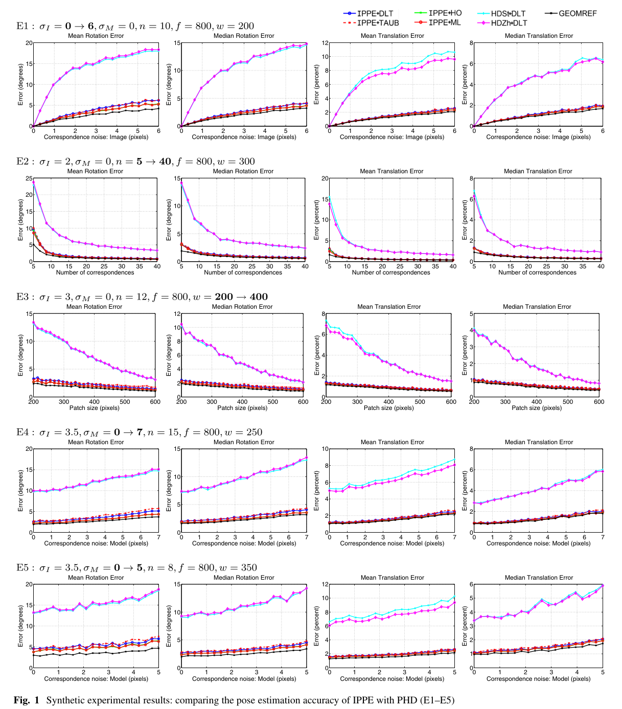
*그림 1 — 합성 실험 결과: IPPE와 PHD의 자세 추정 정확도 비교(E1–E5)*

표 3–7의 값은 "평균 ± 표준편차"다. 첫 열 머리글은 원문에서 모두 $\sigma_I$로 표기되어 있으나, 실제로는 각 실험에서 변화시킨 파라미터(E1: $\sigma_I$, E2: $n$, E3: $w$, E4: $\sigma_M$, E5: $\sigma_M$)의 값이다(표 2 참조). 원문의 굵은 글씨 표시는 옮기지 않았다(각 HE 방법 안에서 IPPE가 평균 오차 최소).

**표 3** IPPE 대 원근 호모그래피 분해: 실험 E1

**E1:RE (회전 오차, °)**

| σI | TAUB IPPE | TAUB HDSt | TAUB HDZh | DLT IPPE | DLT HDSt | DLT HDZh | HO IPPE | HO HDSt | HO HDZh | ML IPPE | ML HDSt | ML HDZh |
|---|---|---|---|---|---|---|---|---|---|---|---|---|
| 0 | 0±0 | 0±0 | 0±0 | 0±0 | 0±0 | 0±0 | 0±0 | 0±0 | 0±0 | 0±0 | 0±0 | 0±0 |
| 0.632 | 1.06±2.44 | 6.76±6.68 | 6.87±6.8 | 1.11±2.89 | 6.83±6.92 | 6.93±7.07 | 0.949±2.09 | 6.43±6.57 | 6.53±6.68 | 0.948±2.09 | 6.43±6.55 | 6.53±6.67 |
| 1.58 | 2.52±5.69 | 12.5±10.8 | 12.6±11 | 2.63±6.8 | 12.7±11.6 | 12.8±11.8 | 2.23±5.2 | 11.9±10.6 | 12±10.7 | 2.23±5.2 | 11.9±10.5 | 12±10.7 |
| 2.21 | 3.28±8.03 | 14.2±12.6 | 14.4±12.9 | 3.22±7.79 | 13.7±12.4 | 13.9±12.7 | 2.99±7.82 | 13±11.9 | 13.2±12.2 | 2.93±7.48 | 13±11.8 | 13.2±12.1 |
| 3.16 | 4.05±7.6 | 15.8±13.2 | 16.1±13.7 | 4.33±9.18 | 15.2±13.4 | 15.6±14.1 | 3.66±7.66 | 14.3±12.4 | 14.7±13.1 | 3.79±8.39 | 14.1±12.1 | 14.5±12.7 |
| 3.79 | 4.7±8.85 | 16.3±12.7 | 16.6±12.9 | 4.84±10.3 | 15.9±13.3 | 16.2±13.7 | 4.07±8.73 | 14.9±12.2 | 15.2±12.4 | 4.07±8.73 | 14.9±12.1 | 15.1±12.3 |

**E1:TE (평행이동 오차, %)**

| σI | TAUB IPPE | TAUB HDSt | TAUB HDZh | DLT IPPE | DLT HDSt | DLT HDZh | HO IPPE | HO HDSt | HO HDZh | ML IPPE | ML HDSt | ML HDZh |
|---|---|---|---|---|---|---|---|---|---|---|---|---|
| 0 | 0±0 | 0±0 | 0±0 | 0±0 | 0±0 | 0±0 | 0±0 | 0±0 | 0±0 | 0±0 | 0±0 | 0±0 |
| 0.632 | 0.42±0.401 | 3.34±4.48 | 3.26±4.21 | 0.437±0.41 | 3.37±4.48 | 3.29±4.24 | 0.403±0.377 | 3.19±4.37 | 3.12±4.13 | 0.403±0.377 | 3.18±4.36 | 3.11±4.13 |
| 1.58 | 0.95±0.873 | 6.87±8.75 | 6.43±7.72 | 0.965±0.884 | 6.85±8.9 | 6.41±7.81 | 0.91±0.83 | 6.48±8.41 | 6.1±7.43 | 0.908±0.834 | 6.45±8.38 | 6.08±7.41 |
| 2.21 | 1.2±1.12 | 7.98±9.87 | 7.32±8.53 | 1.2±1.17 | 7.98±10.2 | 7.29±8.77 | 1.13±1.07 | 7.45±9.61 | 6.86±8.33 | 1.12±1.06 | 7.41±9.55 | 6.83±8.25 |
| 3.16 | 1.6±1.46 | 8.84±10.3 | 8.12±8.89 | 1.59±1.37 | 8.37±10.1 | 7.71±8.72 | 1.49±1.32 | 8.01±9.56 | 7.4±8.28 | 1.48±1.32 | 7.91±9.34 | 7.33±8.09 |
| 3.79 | 1.83±1.6 | 9.31±10.1 | 8.48±8.64 | 1.84±1.61 | 9.01±10.2 | 8.15±8.66 | 1.7±1.45 | 8.51±9.58 | 7.75±8.2 | 1.7±1.46 | 8.46±9.47 | 7.71±8.13 |

**표 4** IPPE 대 원근 호모그래피 분해: 실험 E2

**E2:RE (회전 오차, °)**

| σI | TAUB IPPE | TAUB HDSt | TAUB HDZh | DLT IPPE | DLT HDSt | DLT HDZh | HO IPPE | HO HDSt | HO HDZh | ML IPPE | ML HDSt | ML HDZh |
|---|---|---|---|---|---|---|---|---|---|---|---|---|
| 5 | 10.1±22.1 | 23.4±25.7 | 24.2±26.8 | 9.46±21 | 22.9±25 | 23.8±26.3 | 9.33±21.3 | 22.3±24.6 | 23.1±25.7 | 8.59±19.2 | 22±24.1 | 22.7±25.2 |
| 8.68 | 3.14±7.28 | 11.4±11.3 | 11.6±11.3 | 2.98±6.59 | 11.4±11.6 | 11.5±11.6 | 2.79±6.95 | 10.7±10.8 | 10.7±10.7 | 2.75±6.78 | 10.6±10.7 | 10.7±10.7 |
| 14.2 | 1.75±2.01 | 7.55±6.79 | 7.67±6.88 | 1.79±3.41 | 7.05±6.74 | 7.14±6.79 | 1.51±2.84 | 6.7±6.32 | 6.78±6.38 | 1.55±3.19 | 6.66±6.34 | 6.74±6.4 |
| 17.9 | 1.52±1.31 | 6.11±5.37 | 6.23±5.61 | 1.51±1.2 | 5.71±5.23 | 5.8±5.33 | 1.29±0.985 | 5.28±4.81 | 5.37±4.93 | 1.29±0.986 | 5.28±4.8 | 5.36±4.93 |
| 23.4 | 1.25±1.11 | 4.95±4.11 | 5.05±4.2 | 1.21±0.944 | 4.57±4.03 | 4.64±4.09 | 1.01±0.779 | 4.32±3.81 | 4.39±3.88 | 1.01±0.78 | 4.31±3.8 | 4.38±3.87 |
| 27.1 | 1.2±1.17 | 4.73±4.07 | 4.8±4.14 | 1.15±0.921 | 4.32±3.86 | 4.39±3.91 | 0.96±0.732 | 4.08±3.62 | 4.14±3.68 | 0.959±0.733 | 4.08±3.61 | 4.13±3.67 |

**E2:TE (평행이동 오차, %)**

| σI | TAUB IPPE | TAUB HDSt | TAUB HDZh | DLT IPPE | DLT HDSt | DLT HDZh | HO IPPE | HO HDSt | HO HDZh | ML IPPE | ML HDSt | ML HDZh |
|---|---|---|---|---|---|---|---|---|---|---|---|---|
| 5 | 3.23±10.4 | 16.1±21.1 | 14.4±19.1 | 3.01±10.1 | 15.5±20.5 | 13.8±18.5 | 2.91±9.18 | 15.2±20.2 | 13.6±18.2 | 2.49±6.62 | 14.6±19.2 | 13±17.1 |
| 8.68 | 1.14±1.25 | 7.85±9.83 | 7.22±9.01 | 1.15±1.22 | 6.07±8.63 | 5.65±7.49 | 1.07±1.13 | 5.67±8.23 | 5.26±7.14 | 1.07±1.14 | 5.62±8.07 | 5.23±7 |
| 14.2 | 0.785±0.688 | 3.64±4.54 | 3.56±4.26 | 0.765±0.674 | 3.56±4.61 | 3.47±4.3 | 0.72±0.61 | 3.34±4.27 | 3.26±4.03 | 0.719±0.611 | 3.31±4.24 | 3.24±4.01 |
| 17.9 | 0.669±0.581 | 3.05±3.73 | 2.99±3.51 | 0.663±0.601 | 2.83±3.48 | 2.77±3.28 | 0.61±0.541 | 2.66±3.3 | 2.62±3.13 | 0.61±0.54 | 2.64±3.3 | 2.6±3.12 |
| 23.4 | 0.533±0.458 | 2.45±2.81 | 2.42±2.71 | 0.518±0.466 | 2.19±2.67 | 2.18±2.6 | 0.488±0.43 | 2.11±2.57 | 2.1±2.5 | 0.487±0.43 | 2.1±2.55 | 2.08±2.48 |
| 27.1 | 0.515±0.438 | 2.28±2.69 | 2.26±2.62 | 0.512±0.437 | 2.19±2.57 | 2.18±2.53 | 0.469±0.397 | 2.06±2.43 | 2.06±2.39 | 0.468±0.397 | 2.05±2.43 | 2.04±2.39 |

**표 5** IPPE 대 원근 호모그래피 분해: 실험 E3

**E3:RE (회전 오차, °)**

| σI | TAUB IPPE | TAUB HDSt | TAUB HDZh | DLT IPPE | DLT HDSt | DLT HDZh | HO IPPE | HO HDSt | HO HDZh | ML IPPE | ML HDSt | ML HDZh |
|---|---|---|---|---|---|---|---|---|---|---|---|---|
| 200 | 3.07±4.36 | 13.5±10.5 | 13.7±10.8 | 3.27±5.9 | 13.1±10.5 | 13.4±11 | 2.7±4.19 | 12.3±9.92 | 12.5±10.2 | 2.7±4.18 | 12.2±9.84 | 12.5±10.2 |
| 228 | 3.12±5.19 | 12.5±10.5 | 12.8±10.9 | 2.96±4.06 | 11.9±10.1 | 12.2±10.5 | 2.61±4.12 | 11.2±9.83 | 11.5±10.2 | 2.6±4.11 | 11.2±9.67 | 11.5±10.1 |
| 269 | 2.94±4.11 | 11.2±9.66 | 11.5±10 | 2.91±5.7 | 10.8±10 | 11±10.2 | 2.51±4.05 | 10.1±9.2 | 10.3±9.49 | 2.51±4.05 | 10±9.02 | 10.2±9.3 |
| 297 | 2.77±4.72 | 10.6±9.33 | 10.8±9.44 | 2.75±5.33 | 10.1±9.28 | 10.2±9.4 | 2.33±4.59 | 9.5±8.71 | 9.63±8.79 | 2.32±4.59 | 9.49±8.81 | 9.64±8.9 |
| 338 | 2.73±4.01 | 9.22±8.51 | 9.36±8.67 | 2.61±4.34 | 8.52±8.39 | 8.6±8.47 | 2.28±3.62 | 8.1±7.82 | 8.2±7.94 | 2.28±3.62 | 8.13±7.94 | 8.22±8.06 |
| 366 | 2.39±3.08 | 8.38±7.54 | 8.52±7.57 | 2.26±3.24 | 7.88±7.47 | 8.01±7.59 | 1.95±2.6 | 7.3±6.77 | 7.42±6.84 | 1.95±2.61 | 7.29±6.8 | 7.4±6.85 |

**E3:TE (평행이동 오차, %)**

| σI | TAUB IPPE | TAUB HDSt | TAUB HDZh | DLT IPPE | DLT HDSt | DLT HDZh | HO IPPE | HO HDSt | HO HDZh | ML IPPE | ML HDSt | ML HDZh |
|---|---|---|---|---|---|---|---|---|---|---|---|---|
| 200 | 1.35±1.2 | 7.66±9.23 | 7.09±8.03 | 1.41±1.29 | 7.33±8.9 | 6.84±7.77 | 1.28±1.17 | 7.02±8.59 | 6.54±7.51 | 1.28±1.16 | 6.97±8.53 | 6.49±7.45 |
| 228 | 1.33±1.12 | 6.88±8.45 | 6.42±7.46 | 1.34±1.21 | 6.65±8.29 | 6.2±7.29 | 1.23±1.05 | 6.23±7.93 | 5.81±7.05 | 1.23±1.05 | 6.16±7.86 | 5.76±7 |
| 269 | 1.22±1.05 | 6.21±7.92 | 5.76±6.91 | 1.2±1.04 | 5.98±7.7 | 5.56±6.73 | 1.1±0.946 | 5.61±7.31 | 5.24±6.42 | 1.1±0.946 | 5.56±7.18 | 5.2±6.29 |
| 297 | 1.12±1.03 | 5.85±7.12 | 5.48±6.27 | 1.12±1.02 | 5.39±6.75 | 5.08±5.99 | 1.04±0.945 | 5.15±6.43 | 4.87±5.72 | 1.04±0.943 | 5.08±6.34 | 4.81±5.67 |
| 338 | 1.13±1.02 | 4.58±5.77 | 4.41±5.3 | 1.08±1 | 4.17±5.28 | 4.02±4.85 | 1.02±0.933 | 4.03±5.09 | 3.9±4.72 | 1.02±0.935 | 4±5.02 | 3.87±4.68 |
| 366 | 0.993±0.869 | 4.04±4.73 | 3.9±4.37 | 0.985±0.868 | 3.91±4.9 | 3.82±4.59 | 0.906±0.803 | 3.67±4.47 | 3.59±4.22 | 0.905±0.8 | 3.65±4.45 | 3.57±4.21 |

**표 6** IPPE 대 원근 호모그래피 분해: 실험 E4

**E4:RE (회전 오차, °)**

| σI | TAUB IPPE | TAUB HDSt | TAUB HDZh | DLT IPPE | DLT HDSt | DLT HDZh | HO IPPE | HO HDSt | HO HDZh | ML IPPE | ML HDSt | ML HDZh |
|---|---|---|---|---|---|---|---|---|---|---|---|---|
| 0 | 2.67±3.53 | 10.3±7.91 | 10.6±8.19 | 2.53±3.94 | 9.71±8.19 | 9.98±8.48 | 2.23±3.29 | 9.11±7.43 | 9.38±7.71 | 2.18±2.77 | 9.06±7.4 | 9.33±7.68 |
| 0.737 | 2.82±3.81 | 10.7±8.23 | 10.9±8.52 | 2.66±3.27 | 9.7±8.21 | 9.91±8.44 | 2.44±5.09 | 9.23±7.55 | 9.4±7.76 | 2.44±5.1 | 9.16±7.43 | 9.33±7.62 |
| 1.84 | 3±3.09 | 11.8±9.3 | 12±9.48 | 2.95±4.5 | 10.7±8.95 | 10.8±9.04 | 2.45±2.59 | 10.2±8.39 | 10.3±8.5 | 2.46±2.66 | 10.1±8.36 | 10.3±8.46 |
| 2.58 | 3.37±4.15 | 12.3±9.42 | 12.6±9.67 | 3.24±3.92 | 11.2±8.99 | 11.5±9.22 | 2.8±3.38 | 10.6±8.36 | 10.8±8.55 | 2.79±3.38 | 10.5±8.29 | 10.8±8.47 |
| 3.68 | 3.97±6.09 | 13.4±9.42 | 13.7±9.52 | 3.57±5.17 | 12.1±9.38 | 12.2±9.49 | 3.13±5.06 | 11.5±8.66 | 11.7±8.75 | 3.06±4.5 | 11.4±8.52 | 11.6±8.62 |
| 4.42 | 4.16±4.08 | 14.7±9.75 | 15±9.98 | 3.9±4.36 | 13±8.92 | 13.1±9.06 | 3.28±2.67 | 12.3±8.38 | 12.5±8.52 | 3.28±2.66 | 12.2±8.37 | 12.4±8.52 |

**E4:TE (평행이동 오차, %)**

| σI | TAUB IPPE | TAUB HDSt | TAUB HDZh | DLT IPPE | DLT HDSt | DLT HDZh | HO IPPE | HO HDSt | HO HDZh | ML IPPE | ML HDSt | ML HDZh |
|---|---|---|---|---|---|---|---|---|---|---|---|---|
| 0 | 1.22±1.06 | 5.85±6.91 | 5.54±6.16 | 1.19±1.06 | 5.26±6.47 | 5±5.85 | 1.11±0.954 | 5.01±6.19 | 4.79±5.63 | 1.11±0.948 | 5±6.14 | 4.78±5.57 |
| 0.737 | 1.21±1.09 | 5.69±7.06 | 5.39±6.36 | 1.19±1.03 | 5.22±6.38 | 4.94±5.71 | 1.1±0.942 | 4.99±6.21 | 4.75±5.6 | 1.1±0.943 | 4.96±6.12 | 4.73±5.52 |
| 1.84 | 1.38±1.12 | 6.28±7.32 | 5.94±6.56 | 1.38±1.17 | 5.63±6.51 | 5.37±5.82 | 1.26±1.05 | 5.35±6.24 | 5.09±5.61 | 1.26±1.05 | 5.32±6.14 | 5.05±5.54 |
| 2.58 | 1.47±1.19 | 6.81±7.65 | 6.38±6.75 | 1.47±1.21 | 6.22±7.33 | 5.85±6.43 | 1.37±1.08 | 5.88±6.9 | 5.54±6.1 | 1.37±1.08 | 5.83±6.83 | 5.5±6.05 |
| 3.68 | 1.75±1.71 | 7.52±8.22 | 7.03±7.29 | 1.66±1.33 | 6.56±7.29 | 6.2±6.46 | 1.55±1.23 | 6.4±7.14 | 6.05±6.38 | 1.55±1.25 | 6.31±7.02 | 5.98±6.28 |
| 4.42 | 1.9±1.52 | 8.07±8.66 | 7.46±7.59 | 1.82±1.49 | 7.24±8.13 | 6.73±7.1 | 1.69±1.32 | 6.88±7.76 | 6.41±6.8 | 1.69±1.32 | 6.74±7.63 | 6.3±6.7 |

**표 7** IPPE 대 원근 호모그래피 분해: 실험 E5

**E5:RE (회전 오차, °)**

| σI | TAUB IPPE | TAUB HDSt | TAUB HDZh | DLT IPPE | DLT HDSt | DLT HDZh | HO IPPE | HO HDSt | HO HDZh | ML IPPE | ML HDSt | ML HDZh |
|---|---|---|---|---|---|---|---|---|---|---|---|---|
| 0 | 4.49±9.32 | 13.8±13.4 | 14.1±13.8 | 4.54±10.4 | 13±13.4 | 13.2±13.7 | 3.83±8.71 | 12.4±12.6 | 12.6±13 | 3.79±8.54 | 12.3±12.5 | 12.5±12.8 |
| 0.526 | 4.73±9 | 14.5±13.7 | 14.7±14 | 4.78±9.8 | 13.8±13.2 | 14±13.5 | 4.41±9.69 | 13.3±13 | 13.4±13.2 | 4.36±9.57 | 13.1±13 | 13.3±13.2 |
| 1.32 | 4.86±9.02 | 14.2±13.3 | 14.4±13.5 | 4.81±10.2 | 13.7±13.4 | 13.9±13.6 | 4.47±9.79 | 13±12.8 | 13.1±13 | 4.47±9.81 | 12.9±12.5 | 13.1±12.7 |
| 1.84 | 5.26±10.1 | 15.7±14.6 | 15.9±14.8 | 5.4±11.5 | 15.1±15.6 | 15.3±15.9 | 4.68±9.86 | 14.3±14.4 | 14.4±14.6 | 4.72±10.3 | 14.2±14.4 | 14.4±14.6 |
| 2.63 | 5.59±10.9 | 15.6±13.2 | 15.9±13.6 | 5.57±11.6 | 14.9±12.8 | 15.2±13.2 | 4.78±9.91 | 14.3±12.7 | 14.6±13.2 | 4.93±10.6 | 14.1±12.4 | 14.4±13 |
| 3.16 | 5.85±10.8 | 16.3±13.8 | 16.7±14.3 | 5.89±12.1 | 15.5±14.2 | 15.9±14.8 | 5.08±10.3 | 14.8±13.4 | 15.2±14.1 | 5.26±11.1 | 14.8±13.4 | 15.2±14 |

**E5:TE (평행이동 오차, %)**

| σI | TAUB IPPE | TAUB HDSt | TAUB HDZh | DLT IPPE | DLT HDSt | DLT HDZh | HO IPPE | HO HDSt | HO HDZh | ML IPPE | ML HDSt | ML HDZh |
|---|---|---|---|---|---|---|---|---|---|---|---|---|
| 0 | 1.6±1.55 | 7.23±9.51 | 6.61±8.21 | 1.58±1.54 | 6.61±8.74 | 6.07±7.55 | 1.45±1.39 | 6.41±8.61 | 5.91±7.46 | 1.46±1.39 | 6.35±8.46 | 5.87±7.34 |
| 0.526 | 1.7±1.6 | 7.49±9.76 | 6.98±8.51 | 1.66±1.58 | 7.14±9.47 | 6.62±8.25 | 1.58±1.49 | 6.84±9.15 | 6.39±8 | 1.57±1.48 | 6.72±8.95 | 6.29±7.79 |
| 1.32 | 1.81±1.74 | 7.49±9.43 | 6.93±8.13 | 1.75±1.67 | 7.14±9.36 | 6.67±8.15 | 1.62±1.5 | 6.86±9.25 | 6.43±8.02 | 1.63±1.49 | 6.82±9.06 | 6.38±7.87 |
| 1.84 | 1.91±1.78 | 8.36±10.9 | 7.68±9.36 | 1.87±1.76 | 7.82±10.3 | 7.23±8.88 | 1.74±1.6 | 7.45±9.93 | 6.94±8.6 | 1.75±1.6 | 7.31±9.63 | 6.82±8.35 |
| 2.63 | 1.95±1.82 | 8.83±10.6 | 8.11±9.19 | 1.9±1.83 | 8.28±9.99 | 7.65±8.74 | 1.8±1.59 | 7.98±9.89 | 7.39±8.57 | 1.8±1.56 | 7.84±9.62 | 7.26±8.3 |
| 3.16 | 2.15±1.96 | 8.83±10.4 | 8.15±9.05 | 2.06±1.87 | 8.35±10.3 | 7.75±8.98 | 1.92±1.7 | 8±9.86 | 7.46±8.62 | 1.91±1.69 | 7.85±9.59 | 7.35±8.43 |

### 4.5 IPPE 대 PnP 방법 (IPPE versus PnP Methods)

이제 IPPE를 최신 PnP 방법들과 비교한다. 대응 사이의 호모그래피 추정에는 HO를 쓴다. 비교 방법에는 다음 이름을 쓴다.

- IPPE + HO(비반복): Harker and O'Leary (2005)로 추정한 호모그래피를 쓰는 제안 방법.
- RPP-SP(반복): Schweighofer and Pinz (2006). 모호성을 다루도록 Lu et al. (2000)을 확장한 것.
- EPnP(비반복): Moreno-Noguer et al. (Schweighofer and Pinz 2006). [역주: 원문의 인용 표기 그대로다. EPnP는 Lepetit et al. (2009)이다.]
- RPnP(비반복): Li et al. (2012).
- HDZh + DLT(비반복): 가장 성능이 좋은 HD 방법.
- GEOMREF(반복): 기하학적 기준을 쓰는 반복 정밀화(아래 참조).

GEOMREF는 기준(gold standard)으로 쓴다. 이는 비교 방법들 가운데 잔차가 가장 작은 해를 준 방법으로 초기화하고, 가우스-뉴턴 반복으로 정밀화한다. $\sigma_M = 0$이면 ML 오차를 기하학적 비용으로 쓴다. $\sigma_M > 0$이면 대칭 전이 오차를 쓴다.

먼저 모드 1 실험들부터 수행한다. 이를 두 부분으로 나누었다. 첫째 부분은 대응 개수가 중간에서 큰 경우($n = 8 \to 50$)의 성능을 측정한다. 둘째 부분은 대응 개수가 작은 경우($n = 4 \to 10$)의 성능을 측정한다. 방법들이 큰 $n$에서 훨씬 좋은 성능을 보이므로 결과를 시각화하기 쉽게 이렇게 나눈다. 이 구분은 또한 두 성질, 즉 대응 수가 적을 때 알고리즘의 정확도와 알고리즘이 대응 중복성을 얼마나 잘 활용하는지를 연구하는 데에도 도움이 된다. 모두 12개의 실험(E6–E17)을 수행한다. $n = 4 \to 10$에 대해 6개(E6–E11), $n = 8 \to 50$에 대해 6개(E12–E17)다. [역주: 원문 그대로. 표 8과 4.5.1–4.5.2절에 따르면 E6–E11이 $n = 8 \to 50$, E12–E17이 $n = 4 \to 10$이다.] 실험 파라미터는 표 8에 있다.

**표 8** 합성 실험 E6–E17의 촬영 조건 변화

| | E6 | E7 | E8 | E9 | E10 | E11 |
|---|---|---|---|---|---|---|
| $f$ | 800 | 800 | 800 | 800 | 800 | 800 |
| $w$ | 300 | 300 | 300 | 300 | 300 | 300 |
| $n$ | 8→50 | 8→50 | 8→50 | 8→50 | 8→50 | 8→50 |
| $\sigma_I$ | 0.5 | 3 | 8 | 2 | 2 | 2 |
| $\sigma_M$ | 0 | 0 | 0 | 0.5 | 3 | 8 |
| Mode | 1 | 1 | 1 | 1 | 1 | 1 |

| | E12 | E13 | E14 | E15 | E16 | E17 |
|---|---|---|---|---|---|---|
| $f$ | 800 | 800 | 800 | 800 | 800 | 800 |
| $w$ | 300 | 300 | 300 | 300 | 300 | 300 |
| $n$ | 4→10 | 4→10 | 4→10 | 4→10 | 4→10 | 4→10 |
| $\sigma_I$ | 0.5 | 3 | 8 | 2 | 2 | 2 |
| $\sigma_M$ | 0 | 0 | 0 | 0.5 | 3 | 8 |
| Mode | 1 | 1 | 1 | 1 | 1 | 1 |

#### 4.5.1 중간에서 큰 $n$ (Medium to Large n)

실험 E6–E11의 결과를 그림 2에 보인다. 회전에 대해서는 모든 조건에서 IPPE + HO가 일관되게 가장 성능이 좋은 방법임을 볼 수 있다(GEOMREF 정밀화는 제외). 그다음으로 좋은 비반복 방법(RPnP)에 비해 성능이 뚜렷이 향상된다. RPP-SP의 평균 오차는 IPPE + HO보다 계속 크다. 중앙값 오차에서는 RPP-SP가 $n$이 커지면 IPPE + HO에 다가가지만 결코 넘어서지 못한다. $n$이 15를 넘으면 IPPE + HO의 성능은 GEOMREF에 매우 가깝다. 평행이동 오차로 넘어가면 비슷한 방법 순위를 볼 수 있다. IPPE + HO와 RPP-SP의 차이는 회전 오차에서보다 작다. 실험 E9–E11(모델 잡음이 커지는 경우)에서는 IPPE + HO와 RPP-SP의 평행이동 성능 차이가 무시할 만하다. 그다음으로 좋은 비반복 방법(RPnP)은 모든 실험에서 평행이동 오차에 대해 IPPE + HO와 RPP-SP보다 뒤처진다.

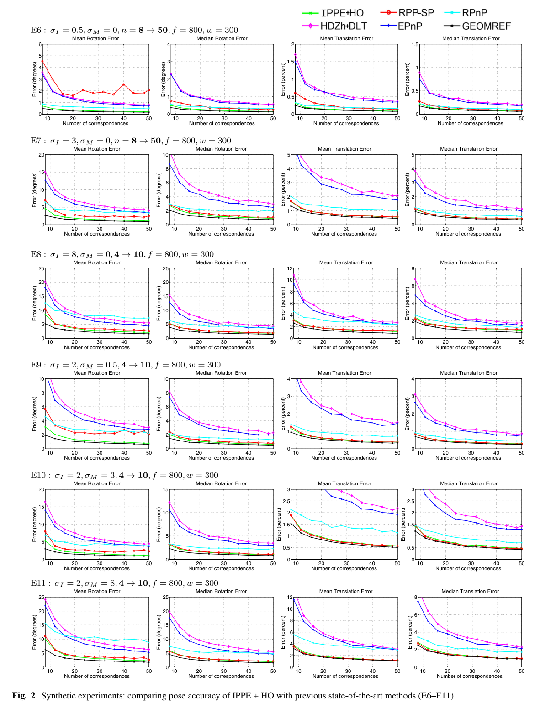
*그림 2 — 합성 실험: IPPE + HO와 기존 최신 방법들의 자세 정확도 비교(E6–E11)*

IPPE + HO가 $n = 8 \to 50$ 범위에서 가장 성능이 좋은 비반복 방법임을 볼 수 있다. 또한 $n = 15$를 넘으면 모든 실험에서 IPPE + HO 해를 GEOMREF로 정밀화해서 얻는 성능 향상이 매우 작다. 이는 대응 잡음이 영상에 있든, 모델에 있든, 둘 다에 있든 마찬가지다. 다른 방법들은 모든 실험에서 그렇다고 말할 수 없다. 이는 속도가 중요한 우선순위일 때 반복 정밀화를 생략하고 IPPE + HO 해를 쓸 수 있음을 시사하므로 중요한 실용적 의미를 갖는다. 경험칙으로는 $n > 15$일 때다.

#### 4.5.2 작은 $n$ (Small n)

이제 $n = 4 \to 10$에서의 성능 평가로 넘어간다. 결과를 그림 3에 보인다. 여기서 $n \ge 6$이면 IPPE + HO가 모든 조건에서 회전에 대해 가장 성능이 좋은 방법(GEOMREF 제외)임을 볼 수 있다. $n \ge 6$이면 IPPE + HO는 평행이동에 대해 그다음으로 좋은 방법(RPP-SP)과 같거나 더 좋은 성능을 보인다. $n = 4$에서는 IPPE + HO가 RPnP와 RPP-SP에 뒤진다. RPnP는 $n = 4$에서 잘 동작하지만 RPnP와 GEOMREF 사이에는 뚜렷한 성능 격차가 있다. 이 격차는 $\sigma_M$이 클수록 커지며, RPnP가 모델의 잡음에 어려움을 겪는다는 것을 나타낸다. IPPE + HO의 성능은 $n = 4$에서 $n = 5$보다 훨씬 나쁘다. 이유는 두 가지다. 첫째, 호모그래피가 4개의 점 대응으로 계산되므로 중복성이 없어 호모그래피가 과적합된다. $n > 4$이면 중복성이 생겨 오차가 상당히 낮아진다. 둘째, 모델에서 대응의 배치가 호모그래피 추정의 잡음 민감도에 영향을 준다. 대응을 모델 평면 위에서 균일하게 뽑으므로 어떤 배치는 호모그래피 추정 문제의 조건(conditioning)을 나쁘게 만들 수 있다. 1차 섭동 이론으로 호모그래피 추정의 안정성을 자세히 분석한 Chen and Suter (2009)를 참고하라.

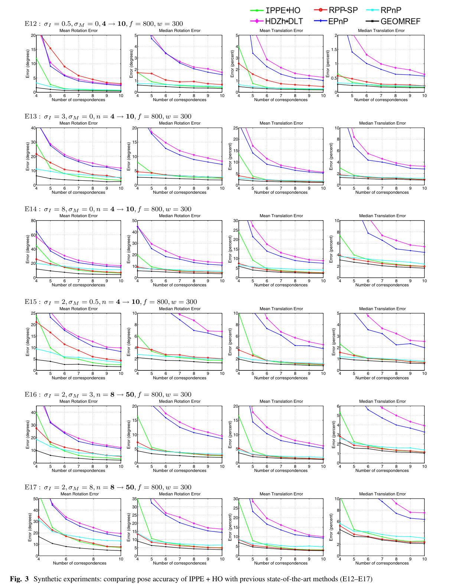
*그림 3 — 합성 실험: IPPE + HO와 기존 최신 방법들의 자세 정확도 비교(E12–E17)*

실험 E12–E17은 $n < 6$일 때는 RPnP로 더 좋은 결과를 얻을 것이므로 IPPE + HO를 쓰지 말아야 함을 시사한다. 그러나 실제 응용에서는 항상 그렇지는 않다. 이제 모델 점들을 평면 위에서 무작위로 뽑지 않고, 넷을 정사각형 영역의 모서리에 두는 경우를 연구한다: $(u, v)_1 = 1/2(w, w)$, $(u, v)_2 = 1/2(w, -w)$, $(u, v)_3 = 1/2(-w, -w)$, $(u, v)_4 = 1/2(-w, w)$. 이는 AR 기반 평면 자세 추정에서 전형적인 경우다. 나머지 $n - 4$개 점은 영역 안에 균일한 확률로 배치한다. 그다음 이런 배치에서 알고리즘들의 성능을 연구했다. 이 새 표본 추출 방식으로 6개의 실험(E18–E23)을 수행했다. 실험 파라미터는 표 9에 있다. 이는 실험 E6–E11과 같지만 평면 크기를 300에서 100으로 줄였다. 새 표본 추출 방식에서는 대응이 모델의 더 넓은 영역에 걸치므로 잡음의 영향이 줄어들기 때문이다.

**표 9** 합성 실험 E18–E23의 촬영 조건 변화. 대응 가운데 넷은 평면의 모서리에 놓이도록 선택했다.

| | E18 | E19 | E20 | E21 | E22 | E23 |
|---|---|---|---|---|---|---|
| $f$ | 800 | 800 | 800 | 800 | 800 | 800 |
| $w$ | 100 | 100 | 100 | 100 | 100 | 100 |
| $n$ | 4→10 | 4→10 | 4→10 | 4→10 | 4→10 | 4→10 |
| $\sigma_I$ | 0.5 | 2 | 5 | 2 | 2 | 2 |
| $\sigma_M$ | 0 | 0 | 0 | 0.5 | 1 | 3 |
| Mode | 1 | 1 | 1 | 1 | 1 | 1 |

이 실험들의 결과를 그림 4에 보인다. 이제 IPPE + HO가 모든 $n$에서 회전과 평행이동 모두 RPnP보다 훨씬 뛰어남을 볼 수 있다. 이는 점들이 모델 위에 무작위로 놓였을 때(그림 3)와 대조적이다. 그다음으로 좋은 방법은 RPP-SP다. 회전에 대해서는 RPP-SP가 일관되게 IPPE + HO에 뒤진다. 평행이동에 대해서는 IPPE + HO가 RPP-SP와 적어도 같거나 더 좋은 성능을 보인다.

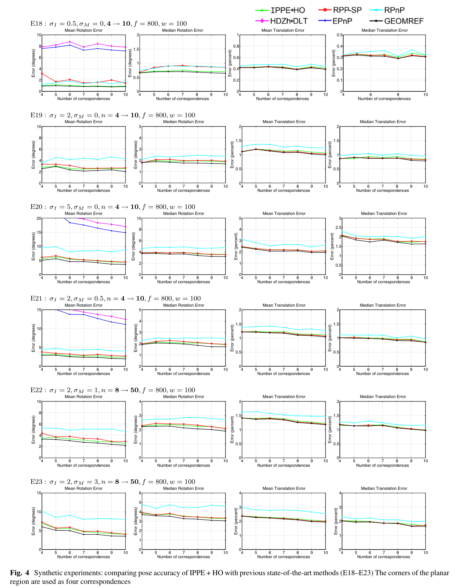
*그림 4 — 합성 실험: IPPE + HO와 기존 최신 방법들의 자세 정확도 비교(E18–E23). 평면 영역의 모서리를 네 대응으로 썼다.*

#### 4.5.3 모호한 경우 (Ambiguous Cases)

마지막 합성 실험 묶음에서는 모드 2(모호한 경우를 제외하지 않음)에서의 알고리즘 성능을 조사한다. 여기서 알고리즘은 여러 해를 반환할 수 있고, 참값에 가장 가까운 해에 대해 오차를 계산한다. 모호한 경우는 원근 왜곡의 양이 작을 때 생기며, 이는 평면의 크기를 줄여 조절할 수 있다. 실험 파라미터를 표 10에 제시하며, E18–E23과 같은 선택 방법으로 적어도 네 대응을 평면 모서리에 둔다. 여기서는 평면 크기를 50으로 줄였는데, 이 때문에 많은 모호한 경우가 포함되었다. 성능 그래프를 그림 5에 보인다. 여기서 E18–E23과 비슷한 성능 경향을 볼 수 있다. IPPE + HO는 일관되게 매우 좋은 성능을 보인다. 모든 조건에서 회전에 대해 가장 성능이 좋은 방법(GEOMREF 제외)이며, IPPE + HO와 GEOMREF 사이의 격차는 매우 작다. 작은 $n$에서의 성능 격차는 더 작아지고, $n = 4$에서는 사실상 구별되지 않는다. IPPE + HO는 평행이동에서 RPP-SP와 같거나 더 좋은 성능을 보인다. HDZh와 EPnP는 IPPE + HO, RPnP, RPP-SP보다 꽤 나쁘며, 그 오차는 축 범위를 벗어난다.

**표 10** 합성 실험 E24–E29의 촬영 조건 변화. 이 실험들은 모드 2에서 알고리즘 성능을 시험했다.

| | E24 | E25 | E26 | E27 | E28 | E29 |
|---|---|---|---|---|---|---|
| $f$ | 800 | 800 | 800 | 800 | 800 | 800 |
| $w$ | 50 | 50 | 50 | 50 | 50 | 50 |
| $n$ | 4→10 | 4→10 | 8→40 | 8→10 | 4→10 | 4→10 |
| $\sigma_I$ | 0.5 | 1 | 2 | 1 | 1 | 1 |
| $\sigma_M$ | 0 | 0 | 0 | 0.5 | 1 | 2 |
| Mode | 2 | 2 | 2 | 2 | 2 | 2 |

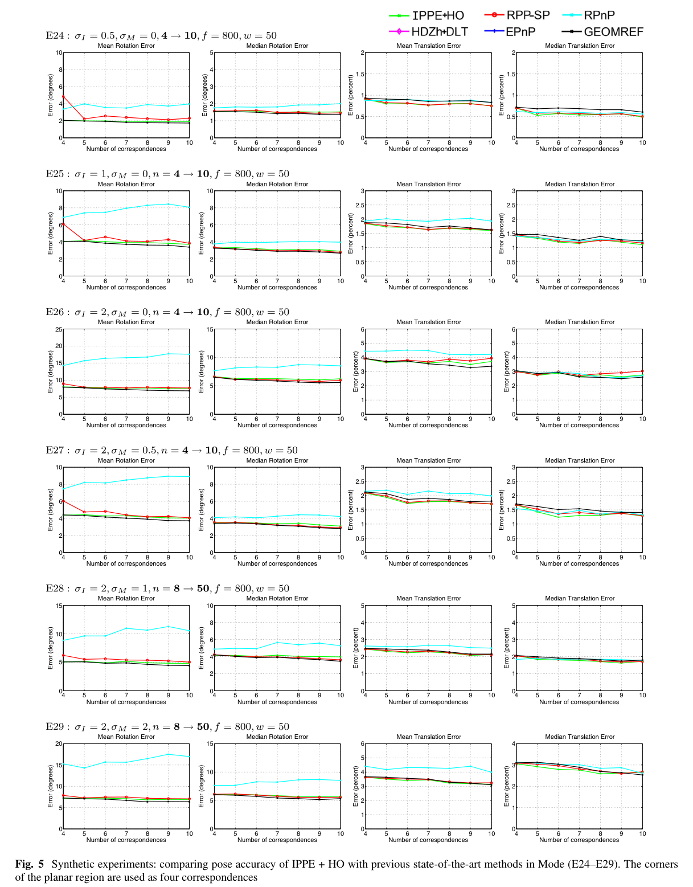
*그림 5 — 합성 실험: 모드 [2]에서 IPPE + HO와 기존 최신 방법들의 자세 정확도 비교(E24–E29). 평면 영역의 모서리를 네 대응으로 썼다.*

### 4.6 IPPE 대 가상 대응을 이용한 P3P (IPPE Versus P3P with Virtual Correspondences)

시뮬레이션 실험의 마지막 부분에서는 IPPE를 가상 점 대응을 이용한 P3P와 비교한다. 구체적으로, $\mathbf H$의 추정값과 모델 평면 위에 놓인 가상점 $\mathbf u_j'$가 주어지면 그 영상 대응을 $\mathbf q_j' = h(\mathbf H[\mathbf u_j'^\top, 1]^\top)$로 계산한다. $\mathbf u_j'$를 배치하는 세 가지 선택을 시험했다. 다음과 같다.

- *P3P-Random*: $\{\mathbf u_i\}$의 경계 상자를 계산하고 그 안에 세 점을 무작위로 배치한다.
- *P3P-Regular*: $\{\mathbf u_i\}$의 경계 상자를 계산하고 이 상자의 왼쪽 아래, 왼쪽 위, 오른쪽 위 모서리에 세 점을 배치한다.
- *RPnP-Virtual*: 원래의 점 집합을 쓴다.

P3P-Random과 P3P-Regular의 자세는 Gao et al. (2003b)의 방법으로 푼다. RPnP-Virtual의 자세는 RPnP(점들을 여러 P3P 문제로 나눈다)로 풀되, 측정된 대응이 아니라 $\mathbf H$로 예측한 영상 위치를 쓴다. P3P-Random은 해를 0개 반환할 수 있다는 문제가 있다. 우리는 실제로 잡음에 따라 3–4%의 경우에 이런 일이 일어남을 확인했다. 비교를 단순하게 하기 위해 P3P-Random의 성능 통계는 해를 적어도 하나 반환한 경우만으로 계산한다. 반면 P3P-Regular에서는 점들이 직각을 이루므로 적어도 하나, 많아야 두 개의 해를 반환함이 보장된다(Gao et al. 2003b).

공정한 비교를 위해 P3P-Random, P3P-Regular, RPnP-Virtual을 HO로 추정한 호모그래피를 써서 비교했다. 이 절 앞부분의 실험 전반에서 IPPE + HO가 P3P-Random, P3P-Regular, RPnP-Virtual보다 일관되게 좋은 성능을 보임을 확인했다. 간결함을 위해 이 방법들에 대해서는 실험 E6–E8과 E18–E20의 결과만 제시한다. 이를 그림 6에 보인다.

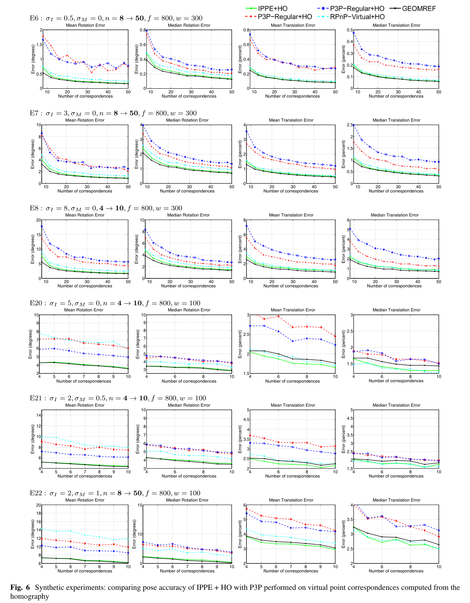
*그림 6 — 합성 실험: IPPE + HO와, 호모그래피로 계산한 가상 점 대응에 대해 수행한 P3P의 자세 정확도 비교*

## 5. 실제 데이터를 이용한 실험 평가 (5 Experimental Evaluation with Real Data)

이 절에서는 실제 영상을 다루는 세 응용에서 알고리즘들을 평가한다. 첫째는 키포인트 매칭으로부터 평면 타깃의 자세를 추정하는 것이다. 둘째는 평면 체커보드 타깃의 자세를 추정하는 것이다. 셋째는 작은 평면 AR 마커의 자세를 추정하는 것이다.

### 5.1 키포인트 매칭으로부터의 평면 자세 추정 (Planar Pose Estimation from Keypoint Matches)

이 실험에서는 120×90 mm 평면 시험 표면을 일반 실내 조명 조건에서 연속 촬영했다. 연속 영상은 28장이며, 그중 세 장을 그림 7에 보인다. 사용한 카메라는 영상 해상도 2,304 × 1,536 화소의 Nikon D3100 DSLR이다. 카메라는 Bouguet의 보정 도구상자(Bouguet)로 보정했으며 초점 거리는 $f_x$ = 3,204 화소, $f_y$ = 3,220 화소다. 이 영상들 중 첫 장의 왜곡을 제거하고 평행화(rectify)하여 정면 평행 모델 영상을 만들었다. 표준 자동 방법으로 모델 뷰와 모든 입력 영상 사이의 대응을 계산했다. 구체적으로 VLFeat의 SIFT 구현(Vedaldi and Fulkerson)을 썼고, Lowe의 비율 검정(Lowe 2004)으로 후보 매칭을 계산했으며, RANSAC으로 인라이어 대응을 찾았다(인라이어 문턱값 5 화소). 그 결과 영상마다 250–400개의 대응을 찾았다. 그다음 가우스-뉴턴 반복으로 대칭 전이 오차를 최소화하여, 모든 인라이어 대응을 쓴 영상별 기준(gold standard) 자세 추정값을 계산했다. 대응 수가 많으므로 시험한 모든 방법이 꽤 잘 동작한다. 28장 전체에 대해 오차 통계를 계산한다. 표 11에 기준값에 대한 정확도를 나열한다. 여기서 IPPE + HO가 가장 정확한 방법이고 RPP-SP가 둘째다.

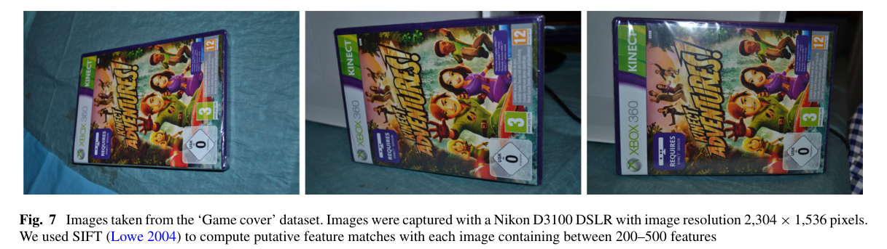
*그림 7 — 'Game cover' 데이터셋의 영상들. 영상은 해상도 2,304 × 1,536 화소의 Nikon D3100 DSLR로 촬영했다. SIFT(Lowe 2004)로 후보 특징 매칭을 계산했으며, 영상마다 200–500개의 특징이 있다.*

**표 11** 모든 대응을 쓴 'Game cover' 데이터셋에서 알고리즘들의 정확도

| | $\mathbf R$ 오차(도) | $\mathbf t$ 오차(%) |
|---|---|---|
| IPPE + HO | 0.1249 | 0.0375 |
| HDZh + DLT | 2.8650 | 0.2691 |
| RPP-SP | 1.4951 | 1.0877 |
| EPnP | 1.9347 | 1.0496 |
| RPnP | 0.1850 | 0.2132 |

정확도는 GEOMREF로 결합한 기준 자세에 대해 계산했다.

이 데이터셋으로 조건이 더 어려워질 때 알고리즘들의 정확도를 연구했다. 구체적으로, 모델의 부분 영역에서 뽑은 더 적은 수의 대응을 쓰는 경우다. 영역이 작아질수록 조건이 어려워지는 이유는 (i) 대응이 적어지고 (ii) 호모그래피가 아핀이 되어 문제가 모호해지기 때문이다. 각 영상은 다음과 같이 처리한다. 각 대응에 대해, 반지름 $r$ mm의 원형 창 안에 있는 모든 대응을 모은다. 이웃 대응이 3개 미만이면 그 창은 버린다. 그렇지 않으면 자세를 계산하고 (표면 전체로 계산한) 기준 자세에 대한 오차를 측정한다. $r$은 [5.22 … 50] mm 범위에서 바꾸었다. 결과를 그림 8에 보인다. 첫째와 둘째 행은 $r$이 5.22에서 20.9 mm로 변할 때의 회전과 평행이동 오차를 각각 보여 준다. 각 부분 창 안의 평균 대응 개수 $\bar n$도 함께 제시한다. 이는 $\bar n$ = 4.64에서 $\bar n$ = 23.8까지 변한다. 셋째와 넷째 행은 더 큰 창, 즉 $r$이 26.1에서 41.1 mm로 변할 때의 회전과 평행이동 오차를 보여 준다. 각 그래프에는 누적 오차 분포를 그렸다. 성능이 좋은 방법의 분포는 축의 왼쪽 위로 쏠린다. 가장 작은 창 크기 $r$ = 5.22 mm에서는 GEOMREF를 포함해 모든 방법이 나쁜 성능을 보인다. 이 작은 척도에서는 문제의 조건이 극도로 나쁘기 때문이다. $r$이 커지면 모든 방법의 성능이 좋아진다. $r$ = 5.22 mm($\bar n$ = 4.64)에서 IPPE + HO는 RPP-SP보다 약간 나쁘다. 그러나 $r$ = 10.4 mm를 넘으면 IPPE + HO는 일관되게 GEOMREF에 매우 가까운 성능을 보이고, 그다음으로 좋은 방법(RPP-SP)과 일관되게 같거나 더 좋은 성능을 보인다. 이는 무작위로 배치된 대응에 대해 IPPE + HO가 $n \ge 8$에서 다른 방법들을 앞서기 시작한 합성 실험과 일치한다. $r$ = 20.9 mm를 넘으면 IPPE + HO와 GEOMREF가 거의 항상 올바른 해를 찾는 것을 볼 수 있다. 표본의 99.6%가 10% 미만의 회전 오차를 갖는다. [역주: 원문에 회전 오차 단위가 "%"로 되어 있다.]

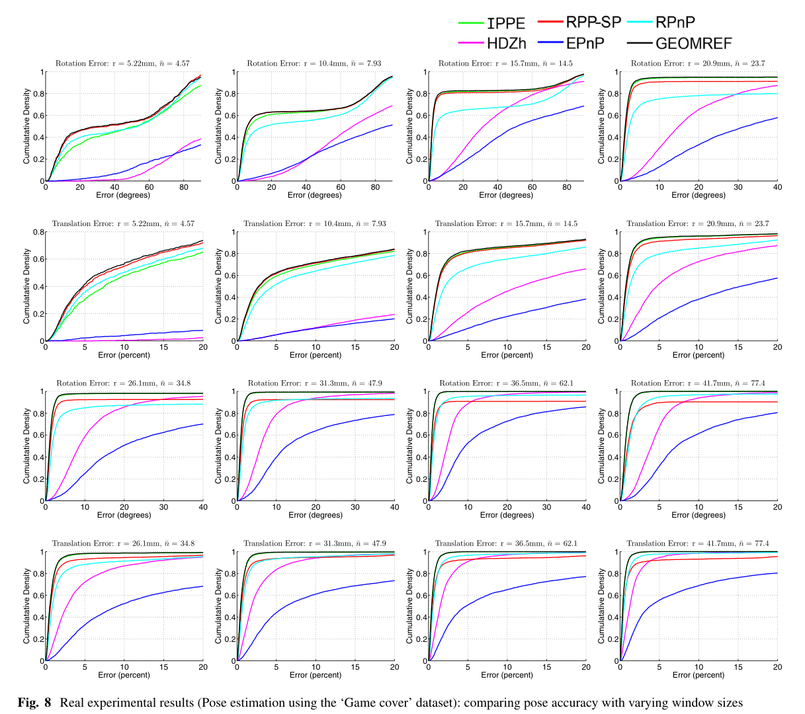
*그림 8 — 실제 실험 결과('Game cover' 데이터셋을 이용한 자세 추정): 창 크기를 바꾸어 가며 자세 정확도 비교*

### 5.2 평면 체커 패턴의 자세 추정 (Pose Estimation of a Planar Checker Pattern)

둘째 실제 실험 묶음은 평면 체커보드 패턴의 자세 추정이다. 두 데이터셋으로 실험했다. 첫째는 일반 720p 스마트폰 카메라로 일반 실내 조명 조건에서 촬영한 영상 20장이다. 크기 9.22 mm의 정사각형 21 × 30개로 된 체커 표면을 썼다. 그림 9는 이 데이터셋의 예시 영상 세 장을 보여 준다. 둘째 데이터셋은 Matlab 보정 도구상자(Bouguet)에서 공개된 것이다. 이는 정사각형 크기 30 mm의 12 × 12 체커보드 영상 20장으로 이루어져 있다.

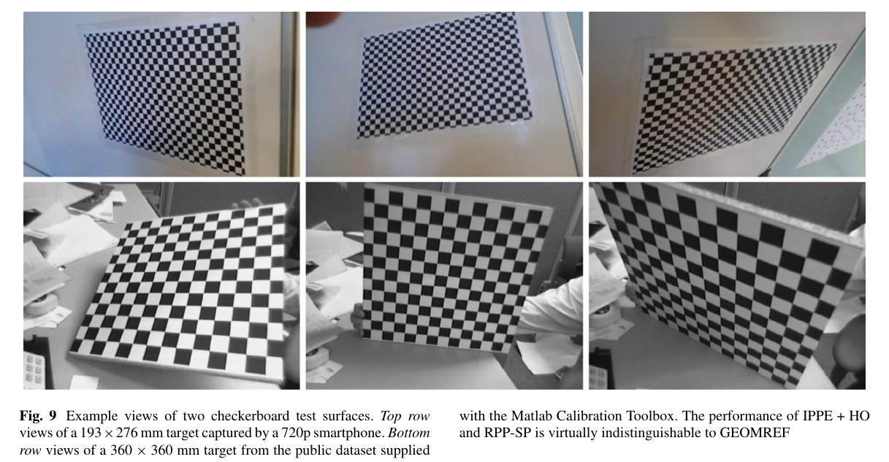
*그림 9 — 두 체커보드 시험 표면의 예시 뷰. 위 행: 720p 스마트폰으로 촬영한 193×276 mm 타깃의 뷰. 아래 행: Matlab 보정 도구상자와 함께 제공되는 공개 데이터셋의 360 × 360 mm 타깃의 뷰. IPPE + HO와 RPP-SP의 성능은 GEOMREF와 사실상 구별되지 않는다.*

모델-영상 대응은 Matlab 보정 도구상자로 계산한다. 이는 영상에서 모델의 네 모서리를 손으로 클릭하는 과정을 포함하며, 그에 대응하는 호모그래피로 모든 체커 모서리를 초기화한다. 그다음 경사 하강법으로 이들을 부화소(sub-pixel) 정확도로 정밀화한다. 첫째 데이터셋에서는 영상당 628개의 대응이 있다. 이만한 데이터를 쓰면 모든 방법이 잘 동작한다. 방법들을 구별하기 위해 5.1절과 비슷한 실험을 수행하여 더 작은 체커보드에서 얼마나 잘 동작하는지 본다. 각 영상에서 모든 $m \times m$ 체커 부분 패턴을 뽑는데, $m$은 2부터 체커보드의 폭까지 바꾸었다. 그다음 각 부분 영역에 대해 자세를 계산하고 기준값과 비교한다. 그림 10은 첫째 데이터셋의 결과를 보여 준다. 여기서 IPPE + HO와 RPP-SP는 GEOMREF와 사실상 구별되지 않는다. 그러나 표 12에서 보이겠지만 IPPE + HO는 RPP-SP보다 50–70배 빠르다. HDZh와 EPnP는 훨씬 나쁜 성능을 보인다. Matlab 보정 도구상자의 데이터셋에서도 그림 11에서 비슷한 경향을 볼 수 있다.

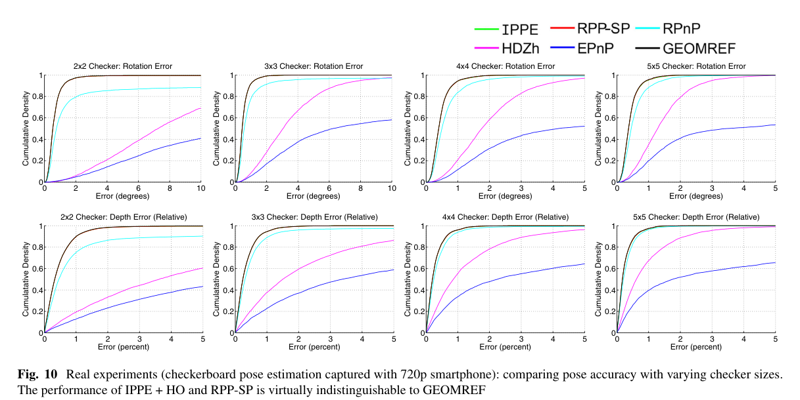
*그림 10 — 실제 실험(720p 스마트폰으로 촬영한 체커보드 자세 추정): 체커 크기를 바꾸어 가며 자세 정확도 비교. IPPE + HO와 RPP-SP의 성능은 GEOMREF와 사실상 구별되지 않는다.*

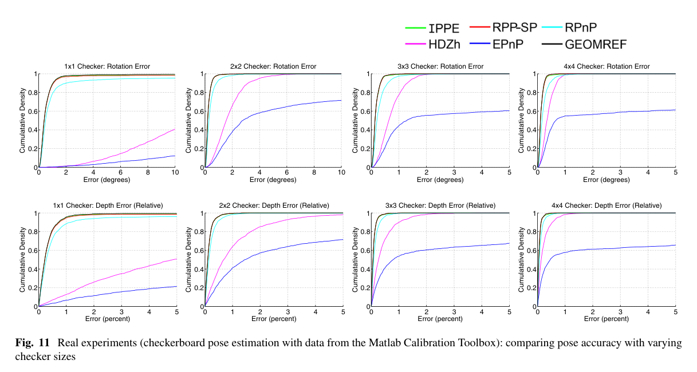
*그림 11 — 실제 실험(Matlab 보정 도구상자의 데이터를 쓴 체커보드 자세 추정): 체커 크기를 바꾸어 가며 자세 정확도 비교*

### 5.3 증강현실 마커의 자세 추정 (Pose Estimation of Augmented Reality Markers)

마지막 실험 묶음에서는 AR 마커의 자세 추정 성능을 평가한다. 이 작업은 보통 다음 처리 파이프라인을 포함한다. (i) 입력 영상에서 마커의 위치를 대략 검출한다. 이는 마커의 특징적 패턴과 일치하는 영상 영역을 찾는 것을 포함한다. (ii) 네 모서리 위치를 부화소 정확도로 정밀화한다. (iii) 모서리를 써서 3차원 자세를 추정한다. (iv) (선택) 자세 정밀화. 여기서는 (iii)을 푸는 데 있어 IPPE의 정확도를 기존 방법들과 비교한다. $n = 4$이므로 호모그래피는 점 대응으로부터 정확히 계산된다(즉 대응이 호모그래피에 8개의 구속을 주므로 중복성이 없다). $n = 4$이면 호모그래피는 해석적 해로 매우 효율적으로 풀 수 있다.

다음 실험 설정을 쓴다. ArUco(Munoz-Salinas)로 각각 폭 7.90 mm인, 고유하게 식별 가능한 마커 300개를 생성한다. 마커들은 무작위 각도로 회전시켜 A4 용지 9장에 고르게 분포시켰다. 이 용지들은 고정밀 레이저 프린터로 인쇄했으며, 프린터의 비등방 척도를 보정했다. 그다음 용지들을 3 × 3 격자로 이어 붙여 큰 평면 배경 표면에 고정했다. 평면 기반 번들 조정(bundle adjustment)을 수행하여 배경 위 각 용지의 상대 위치를 정확히 정했다. 이로써 300개 AR 마커 전체에 대한 복합 평면 모델을 얻을 수 있었다.

그다음 720p 스마트폰 카메라로 비디오 시퀀스 두 개를 촬영했다. 첫째는 마커를 근거리에서 보았으며, 센서와 평면 사이의 평균 거리는 52.1 cm였다. 둘째는 중거리로 평균 거리 102.2 cm였다. ArUco의 마커 검출기를 돌려 마커가 10개 미만 검출된 비디오 프레임은 버렸다(대개 심한 움직임 흐림이 있을 때 일어난다). 남은 프레임에서 두 비디오 각각 30장씩을 무작위로 골라 두 시험 세트를 구성했다. 근거리 세트와 중거리 세트의 예시 프레임을 그림 12의 위 행과 아래 행에 각각 보인다. 그다음 이 데이터셋들에 대해 알고리즘들의 성능을 시험했다. 데이터셋의 각 영상에 대해, 검출된 *모든* AR 마커의 위치를 써서 경사 기반 정밀화로 기준 자세를 계산했다. 알고리즘의 성능은 *한 개의* AR 마커만 써서 추정한 자세가 기준값에 얼마나 가까운지로 측정했다. 결과를 그림 13에 그렸다. 회전 오차와 AR 마커 중심의 추정 깊이 오차(mm)를 계산한다. 여기서 IPPE, RPnP, RPP-SP가 가장 성능이 좋은 방법이며 GEOMREF에 매우 가깝게 동작함을 볼 수 있다. RPnP는 회전에서 IPPE와 RPP-SP보다 아주 약간 나쁘다. GEOMREF의 회전 오차에는 눈에 띄는 꼬리가 있다. 마커의 약 5%가 10도보다 큰 오차를 갖는다. 이 이상치의 원인은 추적 오차다. 아주 가끔 경사 기반 정밀화가 잘못된 국소 극소점에 갇히면 모서리 예측이 참 위치에서 멀리(예: 5 화소 초과) 떨어진다. HDZh와 EPnP는 이 문제를 푸는 데 훨씬 나쁘며, 중거리 데이터셋에서 성능이 크게 떨어진다. IPPE, RPnP, RPP-SP의 정확도는 꽤 비슷하지만 IPPE는 계산이 훨씬 빠르다. 호모그래피가 해석적으로 계산되므로, 이 문제에서 IPPE는 단순한 부동소수점 연산만으로 자세를 완전히 해석적으로 계산한다. 이는 반복적인 RPP-SP, 7차 다항식의 수치적 근 찾기를 포함하는 RPnP와 대조된다.

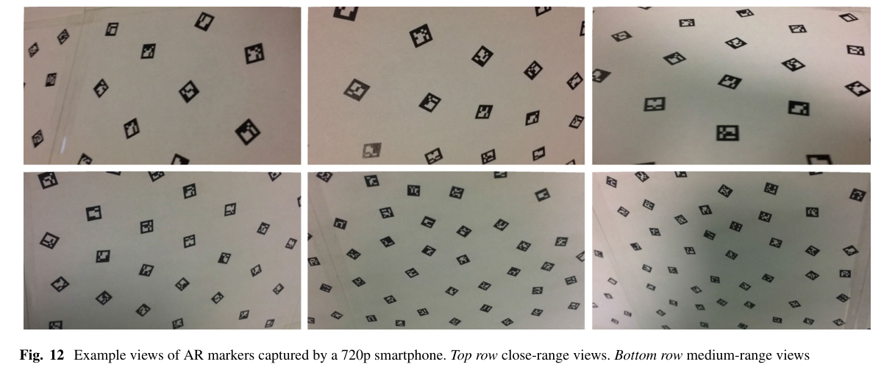
*그림 12 — 720p 스마트폰으로 촬영한 AR 마커의 예시 뷰. 위 행: 근거리 뷰. 아래 행: 중거리 뷰.*

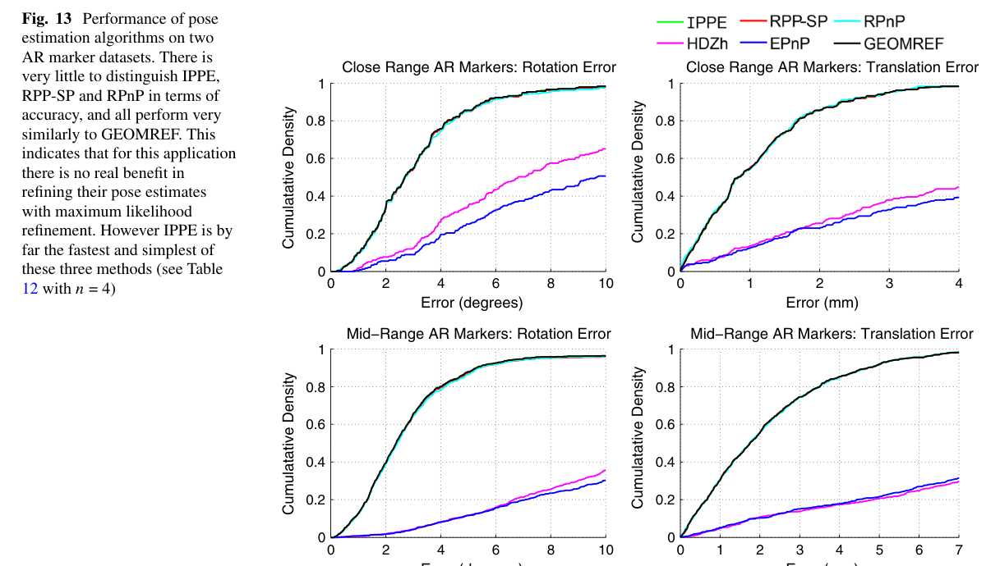
*그림 13 — 두 AR 마커 데이터셋에서 자세 추정 알고리즘들의 성능. 정확도 면에서 IPPE, RPP-SP, RPnP를 구별할 것이 거의 없으며, 모두 GEOMREF와 매우 비슷하게 동작한다. 이는 이 응용에서는 이들의 자세 추정값을 최대우도 정밀화로 다듬어도 실질적 이득이 없음을 나타낸다. 그러나 IPPE가 세 방법 가운데 단연 가장 빠르고 단순하다($n = 4$인 표 12 참조).*

#### 5.3.1 계산 시간 정보 (Timing Information)

비교한 각 방법을 수행하는 데 걸리는 시간을 $n$의 함수로 계산했다. 이는 64비트 Matlab 2012a를 돌리는 일반 Intel i7-3820 데스크톱 PC에서 수행했다. 비교한 모든 알고리즘에 대해 저자들이 제공한 코드를 썼다. IPPE는 우리의 Matlab 구현을 썼다. 이것들이 가장 빠른 구현은 아니며, 예를 들어 C 구현으로 속도를 높일 수 있다는 점에 유의하라. 그러나 모든 방법을 Matlab으로 벤치마크하면 공정한 비교가 되고, 계산 시간이 $n$에 따라 어떻게 늘어나는지 드러난다. 주어진 $n$마다 4.1절의 시뮬레이션 설정으로 무작위 배치 500개를 시뮬레이션했다. 그림 14와 표 12는 $n$이 4에서 650까지 변할 때의 처리 시간을 보여 준다. $n = 4$인 IPPE와 HDZh에는 호모그래피를 추정하는 해석적 공식을 쓴다. 이는 약 50번의 부동소수점 연산이 필요하며, DLT나 HO로 푸는 것보다 빠르면서 같은 결과를 낸다. RPP-SP가 단연 가장 느린 방법이다. IPPE + HO가 가장 빠른 방법이다. HDZh + DLT보다 근소하게 빠르지만 EPnP, RPnP, RPP-SP보다는 상당히 빠르다. 표 12에서 $n = 4$일 때 IPPE는 EPnP보다 약 6.7배, RPnP보다 약 6.2배 빠르다. IPPE는 RPP-SP보다 약 75배 빠르다. EPnP, RPnP, IPPE는 모두 $O(n)$ 방법이다. 그림 14에서 IPPE의 그래프 기울기가 EPnP와 RPnP보다 상당히 낮음을 볼 수 있다. 이는 IPPE의 시간이 호모그래피 계산 비용에 의해 제한되고, 호모그래피 계산 자체가 큰 $n$에서도 매우 빠르기 때문이다. $n = 500$에서 IPPE는 $n = 6$일 때보다 약 1.5배 느릴 뿐이다. 반면 EPnP와 RPnP는 $n = 500$에서 $n = 6$일 때보다 각각 약 4.3배, 9.6배 느리다.

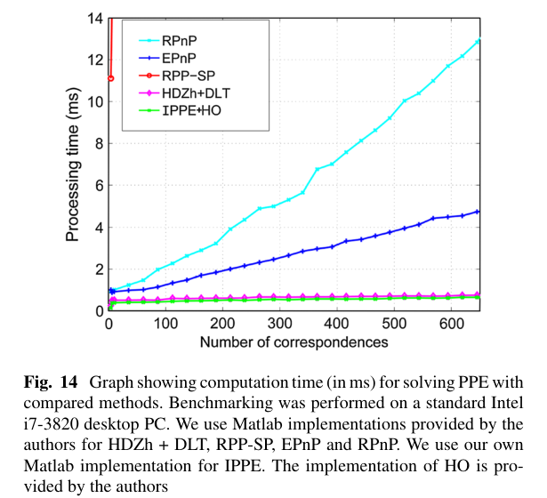
*그림 14 — 비교한 방법들로 PPE를 푸는 데 걸린 계산 시간(ms) 그래프. 벤치마크는 일반 Intel i7-3820 데스크톱 PC에서 수행했다. HDZh + DLT, RPP-SP, EPnP, RPnP는 저자들이 제공한 Matlab 구현을 썼다. IPPE는 우리의 Matlab 구현을 썼다. HO의 구현은 저자들이 제공한 것이다.*

**표 12** 비교한 방법들로 PPE를 푸는 데 걸린 계산 시간(ms)

| $n$ | IPPE + HO | HDZh + DLT | RPP-SP | EPnP | RPnP |
|---|---|---|---|---|---|
| 4 | 0.150 | 0.261 | 11.101 | 1.012 | 0.940 |
| 6 | 0.387 | 0.497 | 14.211 | 0.883 | 0.965 |
| 10 | 0.398 | 0.517 | 22.444 | 0.929 | 1.011 |
| 60 | 0.420 | 0.527 | 51.260 | 1.024 | 1.475 |
| 160 | 0.494 | 0.605 | 138.508 | 1.705 | 2.908 |
| 340 | 0.555 | 0.669 | 258.100 | 2.853 | 5.659 |
| 500 | 0.602 | 0.715 | 408.362 | 3.760 | 9.205 |
| 700 | 0.657 | 0.771 | 483.992 | 4.849 | 13.905 |

## 6. 결론 (6 Conclusion)

우리는 무한소 평면 기반 자세 추정(IPPE) 알고리즘을 제시했다. IPPE의 핵심 아이디어는 잡음 섞인 호모그래피가 모델 평면과 영상 사이의 변환 $w$를 어떤 위치에서는 다른 위치보다 더 잘 예측한다는 사실을 이용하는 것이다. 우리의 전제는 호모그래피의 중복성을 활용하는 좋은 방법이 변환 $w$가 가장 잘 추정되는 점을 찾고, 그 점에서 $w$의 국소 1차 정보로 자세를 정확히 푸는 것이라는 것이다. 우리는 이 접근에 대한 통계적 정당화를 제시했다. 호모그래피가 잡음 섞인 점 대응으로 추정될 때, 오차 전파를 이용하여 $w$와 $J_w$의 추정이 모델 점들의 무게중심 근처에서 가장 높은 확실성으로 이루어짐을 보였다. 같은 말을 달리 하면, 무게중심은 대응의 작은 섭동이 $w$와 $J_w$에 가장 작은 변화를 일으키는 점이다.

그다음 특정 점 $\mathbf u_0$에서 $w$와 $J_w$의 추정값이 주어지면 중복 없는 1차 PDE로 자세를 풀 수 있음을 보였다. 이 PDE는 정확하며 투영 과정에 대해 어떤 1차 근사도 하지 않는다. IPPE의 해는 몇 가지 매력적인 성질을 가진다. 물리적 해의 개수에 대한 보장(많아야 둘이며 결코 하나보다 적지 않다), 인위적 퇴화를 결코 만들지 않는다는 사실, 그리고 이 해들이 기하학적으로 어떻게 관련되는지 명확히 이해할 수 있게 한다는 점이다. 원근 호모그래피 분해와 달리 IPPE는 원근 호모그래피와 아핀 호모그래피를 투명하게 다루며 원근 왜곡이 작을 때도 무너지지 않는다. 아핀 호모그래피 분해와 달리 IPPE는 원근 투영을 선형 변환으로 근사하여 생기는 모델링 오차를 만들지 않는다.

우리는 IPPE에 대한 철저한 실증 평가를 수행했고, 실제로 매우 잘 동작함을 보였다. IPPE는 호모그래피 분해보다 상당히 뛰어나고, 대부분의 경우 현대 PnP 방법보다 뛰어나다(그러면서 훨씬 빠르다). 점 대응이 AR 마커, 카메라 보정 타깃, 또는 SIFT 같은 많은 수의 2차원 키포인트에서 올 때, IPPE 대신 다른 방법을 쓸 타당한 이유는 사실상 없다.

IPPE와 P3P 문제 사이에도 깊은 연결이 있다. 즉 $\mathbf u_0$를 중심으로 무한소 간격의 가상 대응 세 개를 만들고 호모그래피로 그 영상 위치를 추정하면, P3P의 해는 IPPE의 해로 수렴한다. 그러면 이 가상 대응을 배치하는 데 IPPE보다 나은 전략이 있는가라고 물을 수 있다. 오차 전파 분석에 따르면 답은 '아니오'로 보인다. 세 점이 무게중심에서 멀어질수록 호모그래피로 예측한 위치의 불확도가 이차적으로 커지기 때문이다. 이는 우리의 실험에서 실증적으로 확인되었다.

앞으로 우리는 IPPE를 현재 고전적 호모그래피 분해로 풀고 있는 관련 문제들, 예를 들어 내부 보정을 포함한 평면 기반 자세 추정과 평면 기반 SfM(Structure-from-Motion)에 적용하고자 한다. 더 넓게 보면 IPPE는 변수 내 오차를 갖는 중복된 구속 집합으로 변환을 추정하는 문제에 대한 해법이다. 불확도 전파로 변환의 정의역에서 변수 내 오차가 가장 작은 점을 찾고, 그 점에서 정확한 국소 시스템으로 변환을 푸는 방식으로 중복성을 활용한다. 우리는 이 전략이 변수 내 오차가 매끄럽게 변하는 상황에서 변환을 추정하는 다른 비전 문제들에도 쓸모 있기를 바란다.

**감사의 글(Acknowledgments)** 이 연구는 EU FP7 ERC 연구 과제 307483 FLEXABLE의 지원을 받았다. 코드는 http://www.tobycollins.net/research/IPPE 에서 얻을 수 있다.

## 부록 1: 준원근 카메라와 약원근 카메라를 이용한 IPPE (Appendix 1: IPPE Using the Para-Perspective and Weak-Perspective Cameras)

준원근 투영은 카메라 좌표의 어떤 3차원 점 $\mathbf x_c = [x_c, y_c, z_c]^\top$ 근방에서 $\pi$를 선형화하여 원근 투영을 근사한다. 이를 $\pi_{pp}(\mathbf x) : \mathbb R^3 \to \mathbb R^2$로 쓴다. 근사 오차를 줄이기 위해 $\mathbf x_c$는 모델 점들의 무게중심으로 고른다(Ohta et al. 1981; Poelman and Kanade 1993). $\mathbf x_c$는 정규화 좌표의 2차원 점 $\tilde{\mathbf q}_c$에 깊이 $z_c$를 곱한 것으로 매개화할 수 있다: $\mathbf x_c = z_c[\tilde{\mathbf q}_c^\top, 1]^\top$. 그러면 $\pi_{pp}$는 다음과 같다.

$$\pi_{pp}(\mathbf x) = \tilde{\mathbf q}_c + z_c^{-1}\left[\mathbf I_2\ |-\tilde{\mathbf q}_c\right]\mathbf x. \tag{39}$$

준원근 투영은 아핀 변환이므로 $\mathbf H$도 아핀 변환이며, $\{\mathbf u_i\}$를 $\{\tilde{\mathbf q}_i\}$로 옮기는 가장 잘 맞는 아핀 변환으로 계산된다. 따라서 모델-영상 변환 $w$의 야코비안은 상수이며, 이를 $\mathbf J_a \in \mathbb R^{2\times2}$로 쓴다. 그러면 $\pi$를 $\pi_{pp}$로 바꾸어 IPPE로 $z_c$(즉 카메라 좌표에서 대응들의 무게중심의 깊이)를 추정하고 평면의 회전을 추정할 수 있다. 이는 $\mathbf J \leftarrow \mathbf J_a$, $\mathbf v \leftarrow \tilde{\mathbf q}_c$, $\gamma \leftarrow z_c^{-1}$로 치환한 문제 (16)의 한 경우가 된다.

약원근 카메라도 준원근 카메라와 비슷하게 다룰 수 있다. 차이는 약원근 투영에서는 카메라 광축을 지나는 3차원 점에서 선형화한다는 것이다. 약원근 투영 함수 $\pi_{wp}(\mathbf x) : \mathbb R^3 \to \mathbb R^2$는 다음과 같다.

$$\pi_{wp}(\mathbf x) = \tilde{\mathbf q}_c + z_0^{-1}\left[\mathbf I_2\ |\mathbf 0\right]\mathbf x, \tag{40}$$

여기서 $z_0$는 카메라 광축을 따른 평면의 깊이를 근사한다. $\pi$를 $\pi_{wp}$로 바꾸어 IPPE로 $z_0$를 추정하고 평면의 회전을 추정할 수 있다. 이는 $\mathbf J \leftarrow \mathbf J_a$, $\mathbf v \leftarrow \mathbf 0$, $\gamma \leftarrow z_0^{-1}$로 치환한 문제 (16)의 한 경우가 된다.

## 부록 2: 식 (17)의 증명 (Appendix 2: Proof of Eq. (17))

$d$차원 공간의 점 대응을 쓰는 일반 형태로 식 (17)을 증명한다. $\mathbf U \in \mathbb R^{d\times n}$은 정의역 공간의 점 집합이며, $n$은 점의 개수다. $\mathbf Q \in \mathbb R^{d\times n}$은 (같은 차원 $d$의) 목표 공간에서 대응하는 점 집합이다. $\bar{\mathbf U}$는 $\mathbf U$를 평균 0으로 만든 것이다($\bar{\mathbf U}$의 행 합이 0이 되도록). $\hat{\mathbf M} = \begin{bmatrix}\hat{\mathbf A} & \hat{\mathbf t}\\ \mathbf 0^\top & 1\end{bmatrix}$을 $\bar{\mathbf U}$를 $\mathbf Q$로 옮기는 최대우도 동차 아핀 변환이라 하자. $\hat{\mathbf A} \in \mathbb R^{d\times d}$, $\hat{\mathbf t} \in \mathbb R^d$이다. $\hat{\mathbf M}$은 다음으로 주어진다.

$$\begin{aligned}\hat{\mathbf t} &= \mathbf Q\mathbf 1\\ \hat{\mathbf A} &= (\mathbf B^\top\mathbf B)^{-1}\mathbf B^\top\mathbf q, \quad \mathbf B \overset{\text{def}}{=} \mathbf I_d \otimes \bar{\mathbf U}^\top,\end{aligned} \tag{41}$$

여기서 $\mathbf 1$은 모든 원소가 1인 $n\times1$ 벡터이고 $\mathbf q \in \mathbb R^{dn\times1}$은 $\mathbf Q$를 한 열벡터로 쌓은 것이다. 정의역의 점 $\mathbf u \in \mathbb R^d$를 $\hat{\mathbf M}$으로 변환한 것은 $f(\mathbf u) = \mathbf V\hat{\mathbf M}$으로 주어지며, $\mathbf V \overset{\text{def}}{=} \mathbf I_d \otimes \mathbf u^\top$이다. $\mathbf Q$가 분산 $\sigma$의 평균 0 IID 가우시안 잡음으로 오염되었다고 하자. $\mathbf q$의 불확도 공분산 행렬은 $\Sigma_{\mathbf q} = \sigma\mathbf I_2$이며, 불확도 전파를 쓰면 $\hat{\mathbf M}$으로 변환한 $\mathbf u$의 위치의 불확도는 $n\times n$ 공분산 행렬 $\Sigma_{f(\mathbf u)}$로 주어진다.

$$\begin{aligned}\Sigma_{f(\mathbf u)} &= \Sigma_{\hat{\mathbf t}} + \Sigma_{\hat{\mathbf A}} & (a)\\ \Sigma_{\hat{\mathbf t}} &= \frac{\sigma}{n}\mathbf I_n & (b)\\ \Sigma_{\hat{\mathbf A}} &= \sigma\mathbf V^\top\hat{\mathbf M}\hat{\mathbf M}^\top\mathbf V = \mathbf V^\top(\mathbf B^\top\mathbf B)^{-1}\mathbf V & (c)\\ \Leftrightarrow\ \left[\Sigma_{\hat{\mathbf A}}\right]_{ij} &= \begin{cases}\mathbf u^\top(\bar{\mathbf U}^\top\bar{\mathbf U})^{-1}\mathbf u & i = j\\ 0 & i \neq j\end{cases} & (d)\end{aligned} \tag{42}$$

식 (42c)에서 식 (42d)로의 단계는 $(\mathbf B^\top\mathbf B)^{-1}$의 블록 대각 구조 때문에 성립한다. [역주: 차원 표기($n\times n$, $\mathbf I_n$, $\mathbf I_2$ 등)는 원문 그대로 옮겼다.]

## 부록 3: 정리 2의 증명 (Appendix 3: Proof of Theorem 2)

*보조정리 1의 증명* 보조정리 1은 식 (19)에서 바로 나온다. 1차까지 다음이 성립한다.

$$\arg\min_{\mathbf u_0}\text{trace}(\Sigma_{\mathbf J}(\mathbf u_0)) = \arg\min_{\mathbf u_0}\left\|\frac{\partial}{\partial\hat{\mathbf q}}\text{vec}(\mathbf J)\right\|_F^2 \tag{43}$$

식 (43)은 $\mathbf J$의 불확도를 최소화하려면 영상에서 대응의 작은 변화가 $\mathbf J$를 가장 적게 바꾸는 $\mathbf u_0$를 찾아야 함을 말해 준다. □

*보조정리 2의 증명* $\mathbf J'$을 $\mathbf H'$의 야코비안이라 하고, 어떤 $s_q \in \mathbb R^+$, $\mathbf t_q \in \mathbb R^2$에 대해 $\tilde{\mathbf q}_i' = s_q\tilde{\mathbf q}_i + \mathbf t_q$라 하자. $\{\mathbf u_i\}$의 무게중심은 이미 원점에 있으므로 어떤 $s_u \in \mathbb R^+$에 대해 $\mathbf u_i' = s_u\mathbf u_i$임을 상기하라. $\{\tilde{\mathbf q}_i'\}$를 담은 길이 $2n$의 벡터를 $\hat{\mathbf q}'$로 쓴다. 곱의 법칙으로 $\frac{\partial\text{vec}(\mathbf J)}{\partial\hat{\mathbf q}'} = s_q\frac{\partial\text{vec}(\mathbf J)}{\partial\hat{\mathbf q}}$를 얻는다. $s_q \in \mathbb R^+$이므로 다음이 성립한다.

$$\begin{aligned}\arg\min_{\mathbf u_0}\text{trace}(\Sigma_{\mathbf J}(\mathbf u_0)) &= \arg\min_{\mathbf u_0}\left\|\frac{\partial}{\partial\hat{\mathbf q}}\text{vec}(\mathbf J)\right\|_F^2\\ &= \arg\min_{\mathbf u_0}\left\|\frac{\partial}{\partial\hat{\mathbf q}'}\text{vec}(\mathbf J)\right\|_F^2\end{aligned} \tag{44}$$

따라서 $\{\tilde{\mathbf q}_i\}$를 정규화해도 해는 영향을 받지 않는다. 그다음 좌표 변환 $\mathbf u \leftarrow s_u\mathbf u$를 하고, $\{\mathbf u_i\}$ 대신 $\{\mathbf u_i'\}$, $\mathbf J$ 대신 $\mathbf J'$을 써서 문제 (44)를 푼다. 그 해가 $\hat{\mathbf u}_0'$로 주어진다고 하자. 좌표 변환을 되돌리면 원래 문제의 해는 $s_u^{-1}\hat{\mathbf u}_0'$로 주어진다.

$\mathbf H'$의 원근 항($H'_{31}$과 $H'_{32}$)이 작을 때, $H'_{31} = H'_{32} = 0$ 근방에서 $H'_{31}$과 $H'_{32}$에 대해 선형화하여 $\mathbf J'$을 잘 근사할 수 있다. 이 선형화는 다음을 준다.

$$\begin{aligned}
w(\mathbf u_0) \approx&\begin{bmatrix}-H'_{31}H'_{11}u_x^2 + (-H'_{13}H'_{12} - H'_{32}H'_{11})u_xu_y\\ -H'_{31}H'_{21}u_x^2 + (-H'_{13}H'_{22} - H'_{32}H'_{21})u_xu_y\end{bmatrix} + \begin{bmatrix}H'_{11}u_x - H'_{32}H'_{12}u_y^2 + H'_{12}u_y\\ H'_{21}u_x - H'_{32}H'_{22}u_y^2 + H'_{22}u_y\end{bmatrix} && (a)\\
\text{vec}(\mathbf J') =&\ \text{vec}\left(\frac{\partial w}{\partial\mathbf u}(\mathbf u_0)\right) \approx \begin{bmatrix}H'_{11} - H'_{31}(2H'_{11}u_x + H'_{12}u_y) - H'_{32}H'_{11}u_x\\ H'_{21} - H'_{31}(2H'_{21}u_x + H'_{22}u_y) - H'_{32}H'_{21}u_x\\ H'_{12} - H'_{32}(H'_{11}u_x + 2H'_{12}u_y) - H'_{31}H'_{12}u_x\\ H'_{22} - H'_{32}(H'_{21}u_x + 2H'_{22}u_y) - H'_{31}H'_{22}u_x\end{bmatrix} && (b)
\end{aligned} \tag{45}$$

[역주: 식 (45a)는 원문의 작은 활자를 판독하여 옮겼다. 정확한 항은 원문 PDF로 확인할 것.]

식 (45b)의 vec$(\mathbf J')$ 근사는 $\mathbf u_0$에 대해 선형이므로 $\frac{\partial}{\partial\hat{\mathbf q}'}\text{vec}(\mathbf J')$도 $\mathbf u_0$에 대해 선형이다. 이는 $\left\|\frac{\partial}{\partial\hat{\mathbf q}'}\text{vec}(\mathbf J')\right\|_F^2$가 다음 형태임을 뜻한다.

$$\left\|\frac{\partial}{\partial\hat{\mathbf q}'}\text{vec}(\mathbf J')\right\|_F^2 \approx \mathbf u_0^\top\mathbf Q\mathbf u_0 + \mathbf b^\top\mathbf u_0 + c \tag{46}$$

여기서 $\mathbf Q$는 어떤 $2\times2$ 행렬(양의 정부호 또는 양의 준정부호), $\mathbf b$는 $2\times1$ 벡터, $c$는 상수 스칼라다.

곱의 법칙을 쓰면 다음을 얻는다.

$$\begin{aligned}\left\|\frac{\partial}{\partial\hat{\mathbf q}'}\text{vec}(\mathbf J')\right\|_F^2 &= \left\|\frac{\partial}{\partial\mathbf h'}\text{vec}(\mathbf J')\frac{\partial\mathbf h'}{\partial\hat{\mathbf q}'}\right\|_F^2\\ &= \text{trace}\left(\frac{\partial}{\partial\mathbf h'}\text{vec}(\mathbf J')\,\mathbf C\,\frac{\partial}{\partial\mathbf h'}\text{vec}(\mathbf J')^\top\right)\\ \mathbf h' &\overset{\text{def}}{=} \text{vec}(\mathbf H'), \quad \mathbf C \overset{\text{def}}{=} \frac{\partial}{\partial\hat{\mathbf q}'}\mathbf h'\frac{\partial}{\partial\hat{\mathbf q}'}\mathbf h'^\top, \quad \mathbf C \succ \mathbf 0,\end{aligned} \tag{47}$$

$\mathbf C$는 Chen and Suter (2009)에서 연구된 $8\times8$ 양의 정부호 행렬이다. $\mathbf H'$이 근사적으로 아핀이면 원근 항 $H'_{31}$, $H'_{32}$와 평행이동 항 $H'_{13}$, $H'_{23}$은 무시할 만하다. $H'_{31} = H'_{32} = H'_{13} = H'_{23} = 0$일 때 $\frac{\partial}{\partial\mathbf h'}\text{vec}(\mathbf J')$은 다음과 같다.

$$\begin{bmatrix}
1 & 0 & 0 & 0 & 0 & 0 & -2H'_{11}u_x - H'_{12}u_y & -H'_{11}u_y & 0\\
0 & 0 & 0 & 1 & 0 & 0 & -2H'_{21}u_x - H'_{22}u_y & -H'_{21}u_y & 0\\
0 & 1 & 0 & 0 & 0 & 0 & -H'_{12}u_x & -2H'_{12}u_y - H'_{11}u_x & 0\\
0 & 0 & 0 & 0 & 1 & 0 & -H'_{22}u_x & -2H'_{22}u_y - H'_{21}u_x & 0
\end{bmatrix} \tag{48}$$

정규화 단계가 $\frac{\partial}{\partial\hat{\mathbf q}'}\mathbf h'$을 직교화한다는 것이 보여졌다(Chen and Suter 2009). 이는 $\mathbf C$가 근사적으로 대각 행렬임을 뜻하므로 다음이 성립한다.

$$\begin{aligned}\left\|\frac{\partial}{\partial\hat{\mathbf q}'}\text{vec}(\mathbf J')\right\|_F^2 &= \text{trace}\left(\frac{\partial}{\partial\hat{\mathbf q}}\text{vec}(\mathbf J')\frac{\partial}{\partial\hat{\mathbf q}}\text{vec}(\mathbf J')^\top\right)\\ &= \text{trace}\left(\frac{\partial}{\partial\mathbf h'}\text{vec}(\mathbf J')\,\mathbf C\,\frac{\partial}{\partial\mathbf h'}\text{vec}(\mathbf J')^\top\right)\\ &\approx \sum_{ij}\left[\frac{\partial}{\partial\mathbf h'}\text{vec}(\mathbf J')\right]_{ij}^2\mathbf C_{jj}.\end{aligned} \tag{49}$$

이는 $\frac{\partial}{\partial\mathbf h'}\text{vec}(\mathbf J')$의 원소들의 (제곱의) 가중합이다. 가중치는 $\mathbf C_{jj}$이며, $\mathbf C$가 양의 정부호이므로 음이 아니다. 따라서 $\mathbf H'$의 원근 항이 무시할 만하면 trace$(\Sigma_{\mathbf J'}(\mathbf u_0))$는 $\mathbf u_0 = \mathbf 0$에서 최소화되고, 따라서 trace$(\Sigma_{\mathbf J}(\mathbf u_0))$는 $\mathbf u_0 = s_u^{-1}\mathbf 0 = \mathbf 0$(즉 $\{\mathbf u_i\}$의 무게중심)에서 최소화된다. □

## 부록 4: 보조정리 3의 증명 (Appendix 4: Proof of Lemma 3)

단순화를 위해 모델 좌표계의 중심을 $\mathbf u_0$에 두어 $\mathbf u_i \leftarrow (\mathbf u_i - \mathbf u_0)$, $\mathbf u_0 \leftarrow \mathbf 0$으로 한다. $\{\mathbf u_1, \mathbf u_2, \mathbf u_3\}$가 한 직선 위에 있지 않으므로 그중 적어도 둘은 $\mathbf 0$일 수 없다. 일반성을 잃지 않고 이를 $\mathbf u_1$과 $\mathbf u_2$라 하자.

$\mathbf v_i \overset{\text{def}}{=} w(\mathbf u_i)$, $i \in \{1, 2, 3\}$을 영상에서 세 점의 위치(정규화 좌표)라 하자. 식 (28)로부터 $\mathbf u_i$를 카메라 좌표로 매장하는 두 방식은 다음과 같다.

$$\begin{aligned}s_1(\mathbf u_i) &= \mathbf R_1\begin{bmatrix}\mathbf u_i\\0\end{bmatrix} + \gamma^{-1}\begin{bmatrix}\mathbf v_0\\1\end{bmatrix}\\ s_2(\mathbf u_i) &= \mathbf R_2\begin{bmatrix}\mathbf u_i\\0\end{bmatrix} + \gamma^{-1}\begin{bmatrix}\mathbf v_0\\1\end{bmatrix}.\end{aligned} \tag{50}$$

$s_1(\mathbf u_i)$와 $s_2(\mathbf u_i)$가 $\mathbf u_i$를 같은 영상점으로 투영하면(즉 같은 시선 위에 있으면) $\mathbf u_i$의 재투영 오차로는 자세의 모호성을 해소할 수 없다. $\mathbf u_0$에 대해서는 $\mathbf u_0 = \mathbf 0 \Rightarrow s_1(\mathbf u_0) = s_2(\mathbf u_0) = \gamma^{-1}[\mathbf v_0^\top 1]^\top$이므로 이것이 참이다. $\mathbf u_i$, $i \neq 0$에 대해서는 다음일 때, 그리고 그때에만 재투영 오차로 자세 모호성을 해소할 수 없다.

$$\forall i \in \{1, 2, 3\}\ \exists s_i \in \mathbb R^+ \text{ s.t. } \mathbf R_1\begin{bmatrix}\mathbf u_i\\0\end{bmatrix} + \gamma^{-1}\begin{bmatrix}\mathbf v_0\\1\end{bmatrix} = s_i\left(\mathbf R_2\begin{bmatrix}\mathbf u_i\\0\end{bmatrix} + \gamma^{-1}\begin{bmatrix}\mathbf v_0\\1\end{bmatrix}\right). \tag{51}$$

식 (24)의 $\mathbf R_1$과 $\mathbf R_2$의 분해를 써서 식 (51)의 양변에 왼쪽에서 $\mathbf R_v^\top$를 곱하면 다음을 얻는다.

$$\begin{aligned}&\forall i \in \{1, 2, 3\}\ \exists s_i \in \mathbb R^+ \text{ s.t. }\\ &\begin{bmatrix}\gamma^{-1}\mathbf A\\ +\mathbf b^\top\end{bmatrix}\mathbf u_i + \tilde{\mathbf t} = s_i\left(\begin{bmatrix}\gamma^{-1}\mathbf A\\ -\mathbf b^\top\end{bmatrix}\mathbf u_i + \tilde{\mathbf t}\right)\\ &\tilde{\mathbf t} \overset{\text{def}}{=} \gamma^{-1}\mathbf R_v^\top\begin{bmatrix}\mathbf v_0\\1\end{bmatrix}\end{aligned} \tag{52}$$

식 (52)를 세 경우로 나눈다. 첫째 경우는 $\mathbf b = \mathbf 0$일 때다. 이 경우에는 식 (24)로부터 $\mathbf b = \mathbf 0 \Leftrightarrow \tilde{\mathbf R}_1 = \tilde{\mathbf R}_2 \Leftrightarrow \mathbf R_1 = \mathbf R_2$이므로 모호성이 없다. 둘째 경우는 $\mathbf b \neq \mathbf 0$이고 식 (52) 좌변의 위 두 행이 0이 아닐 때, 즉 $\gamma^{-1}\mathbf A\mathbf u_i + \tilde{\mathbf t}_{12} \neq \mathbf 0$일 때다. 이는 $\sigma_i = 1$을 함의한다. [역주: 원문 그대로. 앞의 $s_i$를 가리킨다.] 그러면 식 (52)의 셋째 행은 $\mathbf b^\top\mathbf u_i = -\mathbf b^\top\mathbf u_i$를 함의한다. $\mathbf b \neq \mathbf 0$이고 $i \in \{1, 2\}$에 대해 $\mathbf u_i \neq \mathbf 0$이므로 $\mathbf b$는 $\mathbf u_1$과 $\mathbf u_2$에 직교해야 한다. 이는 $\mathbf u_1$과 $\mathbf u_2$가 한 직선 위에 있음을 함의하며, 이는 모순이다.

셋째 경우는 $\mathbf b \neq \mathbf 0$이고 식 (52) 좌변의 위 두 행이 0일 때, 즉 $\gamma^{-1}\mathbf A\mathbf u_i + \tilde{\mathbf t}_{12} = \mathbf 0$일 때다. $\tilde{\mathbf t}_{12}$를 소거하고 $\gamma$를 약분하면 $\mathbf A(\mathbf u_2 - \mathbf u_1) = \mathbf 0$과 $\mathbf A(\mathbf u_3 - \mathbf u_1) = \mathbf 0$을 얻는다. $\mathbf u_2 \neq \mathbf u_1$이므로 이는 $\mathbf A$가 영공간(nullspace)을 가짐을 함의한다. rank$(\mathbf A) \ge 1$이므로 rank$(\mathbf A) = 1$이고, 따라서 어떤 $\lambda \neq 0$에 대해 $(\mathbf u_2 - \mathbf u_1) = \lambda(\mathbf u_3 - \mathbf u_1)$이다. 이는 $\{\mathbf u_1, \mathbf u_2, \mathbf u_3\}$가 한 직선 위에 있음을 함의하며, 이는 모순이다.

요약하면, $\mathbf b = \mathbf 0$이면 두 자세 해가 같으므로 모호성이 없고, $\mathbf b \neq \mathbf 0$이면 식 (52)가 거짓이며 따라서 식 (51)도 거짓이다. 그러므로 $\mathbf b \neq \mathbf 0$이면 식 (28)은 $\mathbf u_1$, $\mathbf u_2$, $\mathbf u_3$ 중 적어도 하나를 서로 다른 두 영상점으로 투영한다. □

## 참고문헌 (References)

- Ansar, A., & Daniilidis, K. (2003). Linear pose estimation from points or lines. Pattern Analysis and Machine Intelligence (PAMI), 25, 282–296.
- Barreto, J., Roquette, J., Sturm, P., & Fonseca, F. (2009). Automatic camera calibration applied to medical endoscopy. In: British machine vision conference (BMVC).
- Bouguet, J. Y. A camera calibration toolbox for matlab. http://www.vision.caltech.edu/bouguetj/calib_doc/. Accessed May 2013.
- Brown, M., Majumder, A., & Yang, R. (2005). Camera-based calibration techniques for seamless multiprojector displays. Visualization and Computer Graphics, 11, 193–206.
- Chen, P., & Suter, D. (2009). Error analysis in homography estimation by first order approximation tools: A general technique. Journal of Mathematical Imaging and Vision, 33, 281–295.
- Collins, T., Durou, J. D., Gurdjos, P., & Bartoli, A. (2010). Single-view perspective shape-from-texture with focal length estimation: A piecewise affine approach. In 3D data processing visualization and transmission (3DPVT10).
- Dhome, M., Richetin, M., & Lapreste, J. T. (1989). Determination of the attitude of 3D objects from a single perspective view. Pattern Analysis and Machine Intelligence (PAMI), 11, 1265–1278.
- Faugeras, O., Luong, Q. T., & Papadopoulou, T. (2001). The geometry of multiple images: The laws that govern the formation of images of a scene and some of their applications. Cambridge, MA: MIT Press.
- Fiore, P. D. (2001). Efficient linear solution of exterior orientation. Pattern Analysis and Machine Intelligence (PAMI), 23, 140–148.
- Fischler, M. A., & Bolles, R. C. (1981). Random sample consensus: A paradigm for model fitting with applications to image analysis and automated cartography. Communications of the ACM, 24, 381–395.
- Gao, X. S., Hou, X., Tang, J., & Cheng, H. F. (2003). Complete solution classification for the perspective-three-point problem. Pattern Analysis and Machine Intelligence (PAMI), 25, 930–943.
- Gao, X. S., Hou, X. R., Tang, J., & Cheng, H. F. (2003). Complete solution classification for the perspective-three-point problem. Pattern Analysis and Machine Intelligence (PAMI), 25(8), 930–943.
- Geiger, A., Moosmann, F., Car, M., & Schuster, B. (2012). A toolbox for automatic calibration of range and camera sensors using a single shot. In International conference on robotics and automation (ICRA).
- Haralick, R. M., Lee, C. N., Ottenberg, K., & Nölle, M. (1994). Review and analysis of solutions of the three point perspective pose estimation problem. International Journal of Computer Vision (IJCV), 13, 331–356.
- Haralick, R. M., Lee, D., Ottenburg, K., & Nölle, M. (1991). Analysis and solutions of the three point perspective pose estimation problem. In Computer vision and pattern recognition (CVPR).
- Harker, M., & O'Leary, P. (2005). Computation of homographies. In British computer vision conference (BMVC).
- Hartley, R., & Zisserman, A. (2004). Multiple view geometry in computer vision. Cambridge: Cambridge University Press.
- Hesch, J. A., & Roumeliotis, S. I. (2011). A direct least-squares (DLS) method for PnP. In International conference on computer vision (ICCV).
- Hilsmann, A., Schneider, D., & Eisert, P. (2011). Template-free shape from texture with perspective cameras. In British machine vision conference (BMVC).
- Horaud, R., Dornaika, F., Lamiroy, B., & Christy, S. (1997). Object pose: The link between weak perspective, paraperspective and full perspective. International Journal of Computer Vision (IJCV), 22, 173–189.
- Hung, Y., Harwood, D., & Yeh, P.-S., (1984). Passive ranging to known planar point sets. Technical Report. College Park, MD: University of Maryland.
- Kato, H., & Billinghurst, M. (1999). Marker tracking and HMD calibration for a video-based augmented reality conferencing system. In International workshop on augmented reality (IWAR).
- Lepetit, V., Moreno-Noguer, F., & Fua, P. (2009). EPnP: An accurate O(n) solution to the pnp problem. International Journal of Computer Vision (IJCV), 81, 155–166.
- Li, S., Xu, C., & Xie, M. (2012). A robust O(n) solution to the perspective-n-point problem. Pattern Analysis and Machine Intelligence (PAMI).
- Lobay, A., & Forsyth, D. A. (2004). Recovering shape and irradiance maps from rich dense texton fields. In Computer vision and pattern recognition (CVPR).
- Lobay, A., & Forsyth, D. A. (2006). Shape from texture without boundaries. International Journal of Computer Vision (IJCV), 67, 71–91.
- Lowe, D. G. (2004). Distinctive image features from scale-invariant keypoints. International Journal of Computer Vision (IJCV), 60, 91–110.
- Lu, C. P., Hager, G. D., & Mjolsness, E. (2000). Fast and globally convergent pose estimation from video images. Pattern Analysis and Machine Intelligence (PAMI), 22, 610–622.
- Munoz-Salinas, R. ArUco: Augmented reality library from the university of cordoba. http://www.uco.es/investiga/grupos/ava/node/26. Accessed May 2013.
- Oberkampf, D., DeMenthon, D., & Davis, L. S. (1996). Iterative pose estimation using coplanar feature points. Computer Vision and Image Understanding (CVIU), 63, 495–511.
- Ohta, Y., Maenobu, K., & Sakai, T. (1981). Obtaining surface orientation from texels under perspective projection. In International joint conferences on artificial intelligence (IJCAI).
- Poelman, C., & Kanade, T. (1993). A paraperspective factorization method for shape and motion recovery. Technical Report.
- Quan, L., & Lan, Z. (1999). Linear n-point camera pose determination. In Pattern analysis and machine intelligence (PAMI).
- Schweighofer, G., & Pinz, A. (2006). Robust pose estimation from a planar target. Pattern Analysis and Machine Intelligence (PAMI), 28, 2024–2030.
- Sturm, P. (2000). Algorithms for plane-based pose estimation. In Computer vision and pattern recognition (CVPR).
- Taubin, G. (1991). Estimation of planar curves, surfaces, and nonplanar space curves defined by implicit equations with applications to edge and range image segmentation. Pattern Analysis and Machine Intelligence (PAMI), 13, 1115–1138.
- Triggs, B. (1999). Camera pose and calibration from 4 or 5 known 3D points. In International conference on computer vision (ICCV).
- Vedaldi, A., & Fulkerson, B. VLFeat: An open and portable library of computer vision algorithms. http://www.vlfeat.org/. Accessed May 2013.
- Zhang, C. X., & Hu, Z. Y. (2005). A general sufficient condition of four positive solutions of the p3p problem. Journal of Computer Science and Technology, 20, 836–842.
- Zhang, Z. (2000). A flexible new technique for camera calibration. Pattern Analysis and Machine Intelligence (PAMI), 22, 1330–1334.
