# 비직교 2축 회전대와 장착 카메라 사이의 공간 변환 보정 방법 (Chai 2023)

- 원제: Calibration method of spatial transformations between the non-orthogonal two-axis turntable and its mounted camera
- 원문: 같은 폴더의 `Chai2023_OE.pdf` (Optics Express 31(10), 16952–16973, 2023, https://doi.org/10.1364/OE.486816, Optica 오픈 액세스)
- 저자: Binhu Chai, Zhenzhong Wei, Yang Gao (Beihang University 정밀광기전기술 교육부 중점실험실, 계측·광전자공학원)
- 번역 범위: 전문 (초록, 1~5절, 연구비·감사의 글·이해상충·데이터 공개 문구, 참고문헌은 원문 그대로)
- 그림: 원문 그림 26개를 `그림/`에 넣고 본문에서 처음 언급되는 곳에 삽입

## 초록

시야(field of view)와 측정 범위를 넓히기 위해 카메라를 2축 회전대(two-axis turntable)에 장착하여 다양한 시각 작업을 수행하는 경우가 많다. 장착된 카메라와 2축 회전대 사이의 위치·자세 관계를 보정(캘리브레이션, calibration)하는 것은 시각 측정의 전제 조건이다. 기존 방법에서는 회전대를 이상적인 직교 2축 회전대로 간주한다. 그러나 실제 2축 회전대의 회전축은 수직이지도 교차하지도 않을 수 있으며, 직교 2축 회전대라 하더라도 장착 카메라의 광학 중심이 항상 회전대의 회전 중심에 놓이는 것은 아니다. 실제 2축 회전대의 물리 모델과 이상 모델 사이의 상당한 차이는 큰 오차를 일으킬 수 있다. 따라서 우리가 새롭다고 믿는, 비직교 2축 회전대와 장착 카메라 사이의 위치·자세 보정 방법을 제안한다. 이 방법은 회전대의 방위축(azimuth axis)과 피치축(pitch axis) 사이의 공간 꼬인 직선(spatial hetero-planar lines) 관계를 정확히 기술한다. 운동 중인 장착 카메라의 기하학적 불변 특성을 이용하여 회전대의 축을 복원하고 베이스 좌표계를 수립하며, 카메라의 위치와 자세를 보정한다. 시뮬레이션과 실험으로 제안 방법의 정확성과 유효성을 검증한다.

© 2023 Optica Publishing Group, Optica 오픈 액세스 출판 계약 조건에 따름

## 1. 서론 (Introduction)

영상을 통한 시각 측정(visual measurement) [1–13]과 3차원 복원(3D reconstruction) [14–23]은 컴퓨터 비전과 사진측량학의 핵심 문제 중 하나이다. 대규모 시각 측정 작업은 항공우주 [24–28]와 산업 [29–34]에서 널리 쓰인다. 시야가 제한되어 있으므로 고정된 카메라 하나로는 대규모 관측 요구를 충족하기 어려운 경우가 많다. 여러 대의 카메라를 배치하여 카메라 네트워크를 구성하면 카메라의 측정 범위를 넓힐 수 있다 [35–39]. 그러나 여러 카메라를 보정해야 하고 경제적 비용도 크다. 다른 방법은 2축 회전대와 강체로 장착된 카메라로 능동 비전 시스템(active vision system)을 구성하는 것이다. 회전대는 방위축과 피치축을 중심으로 회전할 수 있어 카메라가 더 넓은 관측 범위를 얻을 수 있다. 여기에 특징 검출·추적 기술을 결합하면 다양한 시각 작업에 유연하게 적용할 수 있다. 2축 회전대의 회전축 사이 공간 관계의 보정, 그리고 회전대와 카메라 사이 위치·자세 관계의 보정은 시각 작업의 전제 조건이다.

2축 회전대의 기구학 모델은 직교 2축 회전대와 비직교 2축 회전대로 나뉜다. 직교 2축 회전대에서는 방위축과 피치축이 교차하고 서로 수직이며, 회전대의 운동은 순수 회전(pure rotation)이다. 카메라는 카메라의 광학 중심이 회전대의 회전 중심과 일치하도록 장착된다. 회전대와 카메라의 공간 관계에는 두 경우가 있다. 첫째는 회전대 좌표축이 카메라 좌표축과 공선(collinear)인 경우, 즉 카메라의 광축이 회전대의 두 회전축과 직교하고 카메라 좌표계의 나머지 두 축이 회전대의 두 회전축과 공선인 경우이다. 그림 1(a)와 같이 회전대의 방위축 $a_{azi}$는 회전대 베이스 좌표계의 $y_w$축 및 카메라의 $y_c$축과 공선이다. 회전대의 피치축 $a_{pit}$는 회전대 베이스 좌표계의 $x_w$축 및 카메라의 $x_c$축과 공선이다. 이 이상 모델에서는 보정이 필요 없고 바로 측정할 수 있다.

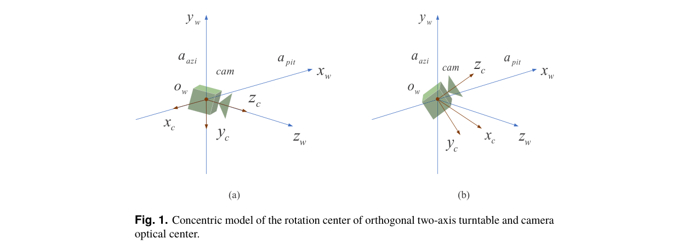
*그림 1 — 직교 2축 회전대의 회전 중심과 카메라 광학 중심이 일치하는(동심) 모델.*

다른 경우는 회전대의 회전 중심이 카메라의 광학 중심과 일치하지만, 그림 1(b)와 같이 회전대의 좌표축이 카메라의 좌표축과 공선이 아닌 경우이다. 이 경우 회전대의 베이스 좌표계와 카메라 좌표계 사이에는 회전 관계만 존재한다. 위 두 상황을 실현하려면 정밀한 설치와 조정이 필요하며, 이는 회전대 자체의 정밀도와 카메라 설치 정밀도에 극히 높은 요구를 부과한다. Yuan Yun 등은 카메라와 회전대 사이의 평행이동(translation)을 무시하는 이 근사 모델에 대해 카메라와 2축 회전대 사이 회전 관계의 보정 방법을 제안했다 [40].

그 밖의 경우에는 설치·조정 조건의 제약 때문에 카메라가 위 설치 요구를 충족할 수 없다(그림 2). 이 경우 카메라와 회전대 사이에는 고정된 강체 변환 관계가 존재한다. Gu Guohua 등은 한 쌍의 좌표계 변환과 역변환을 통해 카메라의 회전·평행이동 변환 관계를 2축 회전대의 순수 회전 관계로 바꾸었다. 그다음 회전대의 판독값과 카메라에서 회전대로의 고정 변환 관계를 이용하여 회전대와 카메라 사이의 공간 변환 관계를 보정했다 [41].

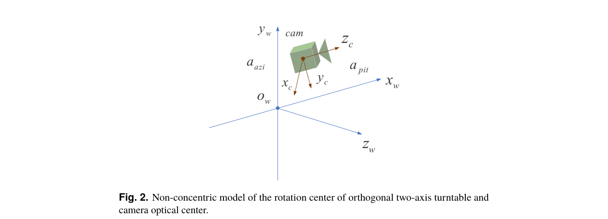
*그림 2 — 직교 2축 회전대의 회전 중심과 카메라 광학 중심이 일치하지 않는(비동심) 모델.*

직교 2축 회전대는 조립이 어렵고 비싸다. 생산과 사용 과정에서 반복적인 검사와 조정이 자주 필요하여 장비의 생산·유지보수 비용이 불가피하게 늘어난다. 또한 출고 시 직교 2축 회전대의 직교 상태는 운송과 장기 사용 과정에서 변할 수 있다. 회전대 정밀도를 보장하려면 주기적으로 조정해야 하므로 유지보수 비용이 늘어난다. 비직교 2축 회전대에서는 회전대의 방위축과 피치축이 교차하거나 수직일 필요가 없다. 회전대의 설계 요구, 제작 난이도, 제작·유지보수 비용이 모두 크게 줄어든다. 그러나 회전대의 기구학 파라미터가 완전히 정해져 있지 않으므로, 기존 핸드-아이 보정(hand-eye calibration) 방법 [42–48]을 회전대 베이스 좌표계에서 카메라의 위치와 자세를 구하는 데 직접 쓸 수 없다. Wu Bin 등은 보정에 제3의 보조 장비가 필요한 비직교 2축 회전대 보정 방법을 제안했는데, 이는 변환 오차를 키운다 [49–51].

본 논문은 단일 축 운동에서 카메라의 기하학적 불변량에 근거하여, 비직교 2축 회전대의 회전축 사이 공간 관계와 카메라의 위치·자세 관계를 보정하는 방법을 제안한다. 직교 2축 회전대는 비직교 2축 회전대의 특수한 경우로 간주되므로 이 방법은 직교 2축 회전대에도 적용할 수 있다.

## 2. 카메라를 장착한 비직교 2축 회전대의 모델 (Model of the non-orthogonal two-axis turntable with a mounted camera)

비직교 2축 회전대란 회전대의 방위축과 피치축이 3차원 공간에서 꼬인 직선(spatial hetero-plane lines)이어서 서로 수직이거나 한 점에서 교차할 필요가 없는 회전대이다. 이런 회전대는 직교성 요구가 없으므로 가공과 조정이 편리하다. 비직교 축들의 3차원 상대 위치·자세 관계를 보정하여 그 기구학 모델을 수립한다. 그다음 카메라를 비직교 축 회전대에 고정 장착한다. 비직교 축 회전대와 카메라 사이의 위치·자세를 보정하고 나면 시각 작업을 수행할 수 있다. 그림 3과 같이 방위축 $a_{azi}$와 피치축 $a_{pit}$는 꼬인 직선이다. 3차원 공간에서 $a_{azi}$와 $a_{pit}$에는 유일한 공통 수선(common vertical line) $l_{o-T_{off}}$가 존재한다. $l_{o-T_{off}}$와 $a_{azi}$의 교점은 $o_w$이고, $l_{o-T_{off}}$와 $a_{pit}$의 교점은 $T_{off}$이다.

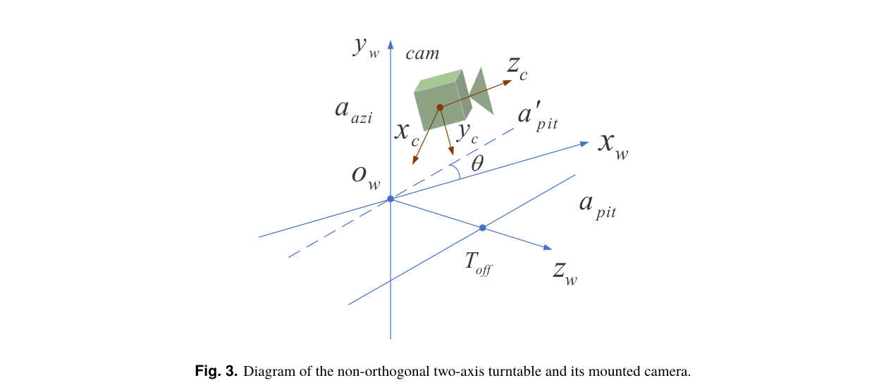
*그림 3 — 비직교 2축 회전대와 장착 카메라의 개략도.*

방위축 $a_{azi}$를 중심으로 회전하면 방위각 $\alpha$가 변하고, 카메라와 피치축 $a_{pit}$가 함께 방위축 $a_{azi}$를 중심으로 회전한다. 피치축 $a_{pit}$를 중심으로 회전하면 피치각 $\beta$만 변하고, 카메라가 방위축 $a_{pit}$를 중심으로 회전한다[역주: 원문 그대로. 문맥상 "피치축 $a_{pit}$"].

초기 회전대 좌표계 $s_{w0}$ - $x_{w0}y_{w0}z_{w0}$는 회전대의 초기 자세(방위각 0, 피치각 0)에서 정의한다. 원점은 점 $o_{w0}$이고, 방위축 $a_{azi}$의 위쪽이 $y_{w0}$축이며, 공통 수선이 $z_{w0}$축과 공선이고, $z_{w0}$축의 방향은 점 $o$에서 점 $T_{off}$로 향한다. $x_{w0}$축은 오른손 법칙으로 정한다. 이렇게 정의한 초기 회전대 좌표계 $s_{w0}$에서 방위축과 피치축의 3차원 공간 관계를 정확히 기술할 수 있다. 방위축 $a_{azi}$와 피치축 $a_{pit}$ 사이의 평행이동은 $T_{off}$이며, 초기 회전대 좌표계에서 $T_{off}$의 좌표는 $(0\ 0\ d)^T$이다. 원점 $o_{w0}$를 지나고 피치축 $a_{pit}$에 평행한 직선 $a'_{pit}$를 정의하고, 직선 $a'_{pit}$와 직선 $a_{pit}$ 사이의 각을 $\theta$라 한다[역주: 그림 3에서 $\theta$는 $a'_{pit}$와 $x_w$축 사이의 각으로 표시됨]. 즉 방위축 $a_{azi}$와 피치축 $a_{pit}$ 사이의 각이 $\theta$이다[역주: 원문 그대로. 3.3절에서는 두 축 사이 각을 $\pi/2-\theta$로 씀].

피치 $\beta$가 0이고 방위 $\alpha$가 변할 때, 회전대의 초기 좌표계 $s_{w0}$를 능동 회전(active rotation)시켜 회전대의 실제 좌표계 $s_w$를 얻으며, 방위축 $a_{azi}$는 $y_w$축과 일치한다. 피치 $\beta$가 0이 아닐 때는 초기 좌표계 $s_{w0}$의 피치축 $a_{pit}$를 중심으로 능동 회전하여 실제 좌표계 $s_w$를 얻는다. 이때 방위축 $a_{azi}$와 $y_w$축은 더 이상 일치하지 않는다.

카메라 좌표계 $s_{cam}$과 회전대의 초기 좌표계 $s_{w0}$ 사이에는 고정된 위치·자세 관계가 있다.

$$
\begin{bmatrix} x_c\\ y_c\\ z_c\\ 1\end{bmatrix}
=\begin{bmatrix} R_{cw0} & T_{cw0}\\ 0^T & 1\end{bmatrix}
\begin{bmatrix} x_{w0}\\ y_{w0}\\ z_{w0}\\ 1\end{bmatrix}
\tag{1}
$$

여기서 $R_{cw0}$는 회전대의 초기 좌표계 $s_{w0}$에서 카메라 좌표계 $s_{cam}$으로의 3차원 회전 행렬이고, $T_{cw0}$는 카메라 좌표계 $s_{cam}$에서 본 회전대 초기 좌표계의 원점 $o_{w0}$이다.

핀홀 결상 원리에 따라 대응하는 영상점은 다음과 같이 얻는다.

$$
s\begin{bmatrix} X\\ Y\\ 1\end{bmatrix}
=\begin{bmatrix} K & 0\end{bmatrix}
\begin{bmatrix} x_c\\ y_c\\ z_c\\ 1\end{bmatrix}
\tag{2}
$$

여기서 $K$는 카메라의 내부 파라미터 행렬이고 $(X\ Y\ 1)^T$는 영상점의 동차 좌표이다.

방위가 $\alpha$, 피치가 $\beta$일 때, 회전대 초기 좌표계 $s_{w0}$의 점 $P_{w0}=(x_{w0}\ y_{w0}\ z_{w0}\ 1)^T$는 회전대 실제 좌표계의 점 $P_w=(x_w\ y_w\ z_w\ 1)^T$로 변환된다. 방위 $\alpha$는 좌표축 $a_y$를 중심으로 한 회전이며, $y_{w0}$축을 중심으로 방위 $\alpha$만큼 회전함을 나타내는 3차원 회전 행렬 $R_{azi}$로 바로 표현할 수 있다. 피치 $\beta$는 회전대 초기 좌표계 $s_{w0}$에서 좌표축이 아닌 직선 $a_{pit}$를 중심으로 한 회전이며, 피치 $\beta$가 나타내는 기구학은 다음과 같이 표현된다.

$$
\begin{bmatrix} I & T_{off}\\ 0^T & 1\end{bmatrix}
\begin{bmatrix} R_{pit} & 0\\ 0^T & 1\end{bmatrix}
\begin{bmatrix} I & -T_{off}\\ 0^T & 1\end{bmatrix}
=\begin{bmatrix} R_{pit} & (I-R_{pit})T_{off}\\ 0^T & 1\end{bmatrix}
\tag{3}
$$

여기서 $R_{pit}$는 피치축 $a_{pit}$를 중심으로 한 3차원 회전 행렬이다. 이는 피치각 $\beta$, 그리고 피치축 $a_{pit}$와 좌표축 $x_w$ 사이의 각 $\theta$와 관련되며 다음과 같이 표현된다.

$$
R_{pit}=\mathrm{rotz}(-\theta)\,\mathrm{rotx}(-\beta)\,\mathrm{rotz}(\theta) \tag{4}
$$

여기서 $\mathrm{rotz}(\theta)$는 $z$축을 중심으로 $\theta$만큼 회전하는 회전 행렬, $\mathrm{rotx}(-\beta)$는 $x$축을 중심으로 $-\beta$만큼 회전하는 회전 행렬이다.

방위 $\alpha$와 피치 $\beta$로 인한 회전대 내 특징점의 강체 변환은 다음과 같다.

$$
\begin{bmatrix} x_w\\ y_w\\ z_w\\ 1\end{bmatrix}
=\begin{bmatrix} R_{pit} & (I-R_{pit})T_{off}\\ 0^T & 1\end{bmatrix}
\begin{bmatrix} R_{azi} & 0\\ 0^T & 1\end{bmatrix}
\begin{bmatrix} x_{w0}\\ y_{w0}\\ z_{w0}\\ 1\end{bmatrix}
\tag{5}
$$

그리고 비직교 2축 회전대의 결상 모델은 다음과 같다.

$$
s\begin{bmatrix} X\\ Y\\ 1\end{bmatrix}
=\begin{bmatrix} K & 0\end{bmatrix}
\begin{bmatrix} R_{cw0} & T_{cw0}\\ 0^T & 1\end{bmatrix}
\begin{bmatrix} R_{pit} & (I-R_{pit})T_{off}\\ 0^T & 1\end{bmatrix}
\begin{bmatrix} R_{azi} & 0\\ 0^T & 1\end{bmatrix}
\begin{bmatrix} x_{w0}\\ y_{w0}\\ z_{w0}\\ 1\end{bmatrix}
\tag{6}
$$

이 중 내부 파라미터 $K$는 미리 보정되어 알려져 있다. $R_{azi}$는 방위 $\alpha$에 따라, $R_{pit}$는 피치 $\beta$에 따라 변한다. $T_{off}$, $\theta$, $R_{cw0}$, $T_{cw0}$가 추정해야 할 파라미터이다.

## 3. 보정 알고리즘 (Calibration algorithm)

보정 알고리즘은 먼저 회전대가 영점 위치(방위 $\alpha$ 0, 피치 $\beta$ 0)에 있을 때 단일 축 회전의 고유한 기하학적 구속 아래에서 방위축과 피치축을 각각 복원한다. 그다음 비직교 회전대의 베이스 좌표계를 수립한다. 셋째로 회전대의 구조 파라미터와 회전대-카메라 사이 공간 변환 관계를 계산하고, 마지막으로 비선형 최적화로 정밀화한다. 알고리즘 흐름도는 그림 4와 같다.

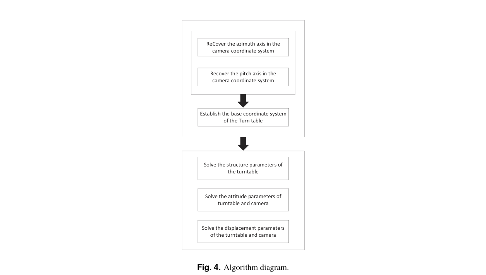
*그림 4 — 알고리즘 흐름도. (카메라 좌표계에서 방위축 복원 → 카메라 좌표계에서 피치축 복원 → 회전대 베이스 좌표계 수립 → 회전대 구조 파라미터 계산 → 회전대·카메라 자세 파라미터 계산 → 회전대·카메라 변위 파라미터 계산)*

### 3.1. 단일 축 운동 분해 (Single axis motion decomposition)

임의의 3차원 유클리드 변환 행렬은 나사축(screw axis)을 중심으로 한 회전과 그 나사축을 따른 평행이동의 합과 등가이다(그림 5).

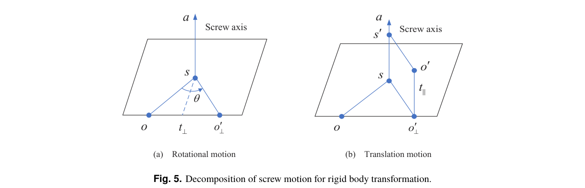
*그림 5 — 강체 변환의 나사 운동 분해. (a) 회전 운동 (b) 평행이동 운동.*

그림 5(a)는 회전축 $a$를 중심으로 한 회전을, 그림 5(b)는 회전축 $a$ 방향을 따른 평행이동 $t_\parallel$을 나타낸다. 여기서 $a$는 회전축의 단위 3차원 방향 벡터이며, 즉 $Ra=a$이다. $t$는 회전축 방향에 평행한 벡터와 수직인 벡터의 합 $t=t_\parallel+t_\perp$로 분해할 수 있다. $o$와 $s$를 잇는 직선의 방향은 방향 $a$에 수직이다. 따라서 $s$는 회전축 위에서 $o$에 가장 가까운 점이다. 마찬가지로 $s'$는 회전축 위에서 $o'$에 가장 가까운 점이다.

특히 단일 축 운동으로 생기는 임의의 유클리드 변환에 대해서는 다음 관계가 성립한다.

$$
\{R,\ t\mid a\perp t\} \tag{7}
$$

이때 $t=t_\perp$, $t_\parallel=0$이므로 $a\perp t$이다. $4\times4$ 유클리드 변환 행렬을 고유값 분해하면 고유값은 두 개의 켤레 복소 고유값과 두 개의 같은 실수 고유값으로 이루어진다. 두 실수 고유값에 대응하는 고유벡터는 서로 다르다. 그리고 실수 고유값에 대응하는 두 실 고유벡터는 두 고정점을 가진 직선을 정의하며, 이것이 회전축이다.

### 3.2. 카메라 좌표계에서 회전대 축의 복원 (Recover axes of the turntable in the camera coordinate system)

회전대가 초기 위치, 즉 방위각 0, 피치각 0일 때 평면 타깃의 첫 영상을 기준 영상 $I_{azi-0}$로 촬영한다. 타깃 위의 점은 $p_{tar}$이고 대응 영상점은 $P_{azi\_0}$이다. 회전대의 방위각이 $\alpha$이고 피치각이 0일 때 평면 타깃의 둘째 영상 $I_{azi-1}$을 촬영하며, 대응 영상점은 $P_{azi\_1}$이다. 그러면 다음 관계가 성립한다.

$$
\begin{cases}
P_{azi\_0}=K[R_{azi\_0}\mid t_{azi\_0}]\,p_{tar}=KH_{azi\_0}\,p_{tar}\\
P_{azi\_1}=K[R_{azi\_1}\mid t_{azi\_1}]\,p_{tar}=KH_{azi\_1}\,p_{tar}
\end{cases}
\tag{8}
$$

첫 영상 $I_{azi-0}$를 찍은 카메라 위치와 둘째 영상 $I_{azi-1}$을 찍은 카메라 위치 사이의 강체 변환 관계는 다음과 같다.

$$
H_{azi\_1\_0}=\begin{bmatrix} R_{azi\_1\_0} & T_{azi\_1\_0}\\ 0^T & 1\end{bmatrix}=H_{azi\_1}*\mathrm{inv}(H_{azi\_0}) \tag{9}
$$

강체 변환 행렬 $H_{azi\_1\_0}$는 방위축을 중심으로 한 단일 축 운동을 기술한다. 이 행렬 $H_{azi\_1\_0}$를 고유값 분해한다. 같은 실수 고유값에 대응하는 두 고유벡터 $v_{azi\_1}$, $v_{azi\_2}$가 있으며, 이들은 방위축 위의 두 점이다. 하나는 유한점 $v_{azi\_non\_inf}$이고 다른 하나는 무한원점 $v_{azi\_inf}$이다. 그리고 회전 행렬 $R_{azi\_1\_0}$의 고유값 분해에서 고유값 1에 대응하는 고유벡터가 방위축 $a_{azi}$의 방향이다.

마찬가지로 회전대가 초기 위치, 즉 방위각 0, 피치각 0일 때 평면 타깃의 첫 영상을 기준 영상 $I_{pit-0}$로 촬영한다. 타깃 위의 점은 $p_{tar}$이고 대응 영상점은 $P_{pit\_0}$이다. 회전대의 방위각이 0이고 피치각이 $\beta$일 때 평면 타깃의 둘째 영상 $I_{pit-1}$을 촬영하며, 대응 영상점은 $P_{pit\_1}$이다.

다음 관계가 성립한다.

$$
\begin{cases}
P_{pit\_0}=K[R_{pit\_0}\mid t_{pit\_0}]\,p_{tar}=KH_{pit\_0}\,p_{tar}\\
P_{pit\_1}=K[R_{pit\_1}\mid t_{pit\_1}]\,p_{tar}=KH_{pit\_1}\,p_{tar}
\end{cases}
\tag{10}
$$

첫 영상 $I_{azi-0}$를 찍은 카메라 위치와 둘째 영상 $I_{azi-1}$을 찍은 카메라 위치[역주: 원문 그대로. 문맥상 $I_{pit-0}$, $I_{pit-1}$] 사이의 강체 변환 관계는 다음과 같다.

$$
H_{pit\_1\_0}=\begin{bmatrix} R_{pit\_1\_0} & T_{pit\_1\_0}\\ 0^T & 1\end{bmatrix}=H_{pit\_1}*\mathrm{inv}(H_{pit\_0}) \tag{11}
$$

강체 변환 행렬 $H_{pit\_1\_0}$는 피치축을 중심으로 한 단일 축 운동을 기술한다. 이 행렬 $H_{pit\_1\_0}$를 고유값 분해한다. 같은 실수 고유값에 대응하는 두 고유벡터 $v_{pit\_1}$, $v_{pit\_2}$가 있으며, 이들은 피치축 위의 두 점이다. 하나는 유한점 $v_{pit\_non\_inf}$이고 다른 하나는 무한원점 $v_{pit\_inf}$이다. 그리고 회전 행렬 $R_{pit\_1\_0}$의 고유값 분해에서 고유값 1에 대응하는 고유벡터가 방위축 $a_{pit}$[역주: 원문 그대로. 문맥상 "피치축"]의 방향이다.

### 3.3. 회전대와 카메라의 자세 파라미터 계산 (Solve the attitude parameters of the turntable and camera)

방위축 $a_{azi}$를 중심으로 회전할 때 초기 회전대 좌표계 $s_{w0}$에서 방위축 $a_{azi}$의 방향은 변하지 않으며, 카메라 좌표계에서의 방향은 다음과 같다.

$$
P_{I-azi}=\begin{bmatrix} a_{azi}\\ 0\end{bmatrix}
=\begin{bmatrix} r_1 & r_2 & r_3 & T_{cw0}\\ & 0^T & & 1\end{bmatrix}
\begin{bmatrix} 0\\ 1\\ 0\\ 0\end{bmatrix}
=\begin{bmatrix} r_2\\ 0\end{bmatrix}
\tag{12}
$$

여기서 $[r_1\ r_2\ r_3]=R_{cw0}$이고, $P_{I-azi}$는 카메라 좌표계에서 방위축 방향에 대응하는 무한원점의 동차 좌표이며, 이로부터 $r_2=a_{azi}$를 얻는다.

마찬가지로 피치축 $a_{pit}$를 중심으로 단일 축 회전을 할 때, 회전대의 초기 좌표계 $s_{w0}$에서 피치축은 변하지 않고, 피치축 $a_{pit}$는 평면 $o_w-x_wy_w$에 평행하며, 피치축 $a_{pit}$와 좌표축 $x_{w0}$ 사이의 각은 $\theta$이다. 그 방향은 $(\cos\theta\ \sin\theta\ 0\ 0)^T$로 표현된다. 카메라 좌표계 $s_{cam}$에서의 방향은 다음과 같다.

$$
p_{I-pit}=\begin{bmatrix} a_{pit}\\ 0\end{bmatrix}
=\begin{bmatrix} r_1 & r_2 & r_3 & T_{cw0}\\ & 0^T & & 1\end{bmatrix}
\begin{bmatrix} \cos\theta\\ \sin\theta\\ 0\\ 0\end{bmatrix}
=\begin{bmatrix} \cos\theta\, r_1+\sin\theta\, r_2\\ 0\end{bmatrix}
\tag{13}
$$

여기서 $[r_1\ r_2\ r_3]=R_{cw0}$이고, $p_{I-pit}$는 카메라 좌표계에서 피치축 방향에 대응하는 무한원점의 동차 좌표이며, 이로부터 다음을 얻는다.

$$
r_1\cos\theta+r_2\sin\theta=a_{pit} \tag{14}
$$

방위축 $a_{azi}$와 피치축 $a_{pit}$ 사이의 각은 $\frac{\pi}{2}-\theta$이다. 따라서 다음을 얻는다.

$$
a_{azi}^T a_{pit}=\cos\!\left(\frac{\pi}{2}-\theta\right)=\sin(\theta) \tag{15}
$$

그러므로 다음이 성립한다.

$$
\theta=\arcsin(a_{azi}^T a_{pit}) \tag{16}
$$

식 (14)에 대입하면 다음을 얻는다.

$$
r_1=\frac{a_{pit}-r_2\sin\theta}{\cos\theta} \tag{17}
$$

회전 행렬의 직교성에 의해 $r_3=r_1\times r_2$이다. 그러면 $R_{cw0}=[r_1\ r_2\ r_3]$이다.

### 3.4. 회전대와 카메라의 평행이동 파라미터 계산 (Solve the translation parameters of the turntable and camera)

카메라 좌표계에서 방위축과 피치축이 놓인 직선은 매개변수 방정식으로 나타낼 수 있다.

$$
\begin{cases}
x_{axis\_azi}=a_{azi}(1)*t_1+v_{azi\_non\_inf}(1)\\
y_{axis\_azi}=a_{azi}(2)*t_1+v_{azi\_non\_inf}(2)\\
z_{axis\_azi}=a_{azi}(3)*t_1+v_{azi\_non\_inf}(3)
\end{cases}
\tag{18}
$$

여기서 $p_{azi\_ver}=[x_{axis\_azi},\ y_{axis\_azi},\ z_{axis\_azi}]^T$는 방위축 위의 임의의 점이다.

$$
\begin{cases}
x_{axis\_pit}=a_{pit}(1)*t_2+v_{azi\_non\_inf}(1)\\
y_{axis\_pit}=a_{pit}(2)*t_2+v_{azi\_non\_inf}(2)\\
z_{axis\_pit}=a_{pit}(3)*t_2+v_{azi\_non\_inf}(3)
\end{cases}
\tag{19}
$$

[역주: 원문 그대로. 문맥상 식 (19)의 상수항은 $v_{pit\_non\_inf}$여야 함.]

여기서 $p_{pit\_ver}=[x_{axis\_pit},\ y_{axis\_pit},\ z_{axis\_pit}]^T$는 피치축 위의 임의의 점이다.

식 (18), (19)로 연립방정식을 세워, 두 꼬인 직선의 방위축 위 공통 수선의 발 $p_{azi\_ver}$와 피치축 위 공통 수선의 발 $p_{pit\_ver}$를 구한다.

방위축과 피치축은 꼬인 직선이며, 회전대 초기 좌표계 $s_{w0}$의 정의에 따라 방위축과 피치축의 공통 수선의 발 사이의 거리가 $T_{off}$이다. 즉,

$$
T_{off}=\lVert p_{azi\_ver}-p_{pit\_ver}\rVert_2 \tag{20}
$$

회전대 초기 좌표계와 카메라 좌표계의 정의에 따라, 방위축 위 공통 수선의 발 $p_{azi\_ver}$가 카메라 좌표계에서 본 회전대 초기 좌표계의 평행이동 파라미터이다. 즉,

$$
T_{cw0}=p_{azi\_ver} \tag{21}
$$

### 3.5. 비선형 최적화 (Nonlinear optimization)

회전대 회전축 사이의 공간 관계와, 회전대 베이스 좌표계와 카메라 좌표계 사이의 위치·자세를 보정한 뒤 비선형 최적화로 정밀화한다. 식 (6)으로부터, 회전대 초기 위치에 있는 카메라와 회전대 방위 $\alpha$·피치 $\beta$ 위치에 있는 카메라 사이의 강체 변환 관계는 다음과 같다.

$$
R_{10}=R_{10}(\alpha,\beta,\theta,T_{off},R_{cw0},T_{cw0})=R_{cw0}R_{pit}R_{azi}R_{cw0}^T \tag{22}
$$

$$
T_{10}=T_{10}(\alpha,\beta,\theta,T_{off},R_{cw0},T_{cw0})=-R_{10}T_{cw0}+R_{cw0}(I-R_{pit})T_{off}+T_{cw0} \tag{23}
$$

회전대 초기 위치와 방위 $\alpha$·피치 $\beta$ 위치 사이의 역투영 오차(back projection error)를 다음과 같이 정의한다.

$$
F_{min}=\sum_{i=1}^{n}\sum_{j=1}^{m}\lVert p_{0,ij}-\hat p_{0,ij}(R_i,T_i,P_{w,j})\rVert^2+\lVert p_{1,ij}-\hat p_{1,ij}(R_i,T_i,R_{10,i},T_{10,i},P_{w,j})\rVert^2 \tag{24}
$$

$R_i$는 $i$번째 영상의 타깃 좌표계에서 카메라 좌표계로의 회전 행렬이고, $T_i$는 $i$번째 영상의 타깃 좌표계에서 카메라 좌표계로의 평행이동 벡터이다. $P_{w,j}$는 타깃 좌표계에서 $j$번째 점의 좌표이다. $\hat p_{0,ij}(R_i,T_i,P_{w,j})$는 회전대가 초기 위치에 있을 때 $i$번째 타깃 영상의 $j$번째 역투영점이다. 우변 첫째 항은 대응 타깃점의 역투영 오차이다. $\hat p_{1,ij}(R_i,T_i,R_{10,i},T_{10,i},P_{w,j})$는 방위와 피치가 바뀌었을 때의 역투영점이다. $R_{10,i}$, $T_{10,i}$는 $i$번째 타깃 영상에서 카메라 초기 위치와 방위·피치가 바뀐 카메라 위치 사이의 강체 변환 관계이다. 우변 둘째 항은 대응 타깃점의 역투영 오차이다.

## 4. 시뮬레이션과 실험 (Simulation and experiment)

### 4.1. 시뮬레이션 실험 (Simulation experiments)

#### 4.1.1. 직교 2축 회전대 시뮬레이션 (Orthogonal two-axis turntable simulation)

직교 2축 회전대와 카메라 사이의 위치·자세 보정 방법을 시뮬레이션한다. 카메라 파라미터는 $f_x=f_y=2000$, $u_0=v_0=1000$, 비틀림 계수(skew factor) 0으로 설정한다. 회전대에 대한 카메라의 회전 벡터는 $[-0.0167,\ 0.0290,\ -2.6177]^T$, 평행이동 벡터는 $[30,\ 20,\ 10]^T$ mm로 설정한다. 2축 회전대는 직교 모델로 설정한다. 즉 2축 회전대의 모델 파라미터는 방위축과 피치축 사이의 각 $\theta=0°$, 방위축과 피치축 사이의 거리 $d=0$ cm이다. 영상에 평균 0, 분산이 다른 가우시안 잡음을 더한다. 잡음 수준마다 100회 결과의 평균을 추정 결과로 쓴다. 참값과 비교한 회전대 구조 파라미터 추정의 시뮬레이션 결과는 그림 6, 그림 7과 같다.

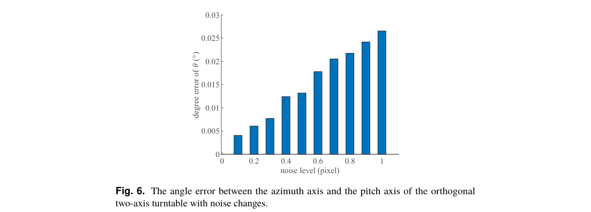
*그림 6 — 잡음 변화에 따른 직교 2축 회전대의 방위축-피치축 사이 각 오차.*

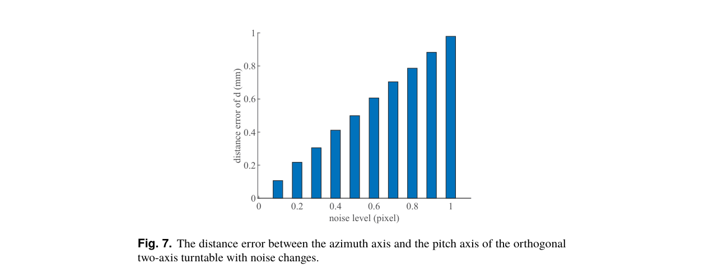
*그림 7 — 잡음 변화에 따른 직교 2축 회전대의 방위축-피치축 사이 거리 오차.*

그림 6과 그림 7에서 보듯, 방위축과 피치축 사이의 각과 거리 같은 회전대 구조 파라미터의 오차는 잡음 수준에 따라 대체로 선형으로 증가한다. 이 방법은 직교 2축 회전대의 구조 파라미터에 대해 좋은 추정 결과를 낸다.

회전대 베이스 좌표계에서 카메라의 위치·자세 파라미터 추정 결과는 그림 8, 9와 같다. 자세 추정 정확도는 두 가지로 평가한다. 하나는 회전 행렬을 $x$, $y$, $z$축 회전 순서로 분해한 오일러 각의 평균 오차이다. 다른 하나는 회전 행렬을 축-각(axis-angle) 표현으로 바꾸어, 추정한 회전축 방향과 참 회전축 방향 사이의 각 오차, 그리고 추정한 회전축 둘레 회전각과 참 회전각 사이의 오차를 계산하는 것이다. 카메라 변위 파라미터 오차는 추정한 변위 파라미터와 참값 사이의 유클리드 거리로 평가한다.

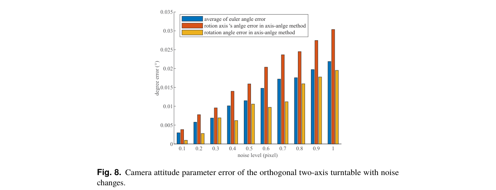
*그림 8 — 잡음 변화에 따른 직교 2축 회전대의 카메라 자세 파라미터 오차. (범례: 오일러 각 오차 평균 / 축-각 방법의 회전축 각 오차 / 축-각 방법의 회전각 오차)*

그림 8에서 보듯 잡음이 커질수록 카메라 자세 파라미터의 평가 지표가 커진다. 마찬가지로 그림 9에서 보듯 잡음이 커질수록 카메라 변위 파라미터 오차가 커진다. 이 방법은 직교 2축 회전대의 카메라 위치·자세에 대해 좋은 추정 결과를 낸다.

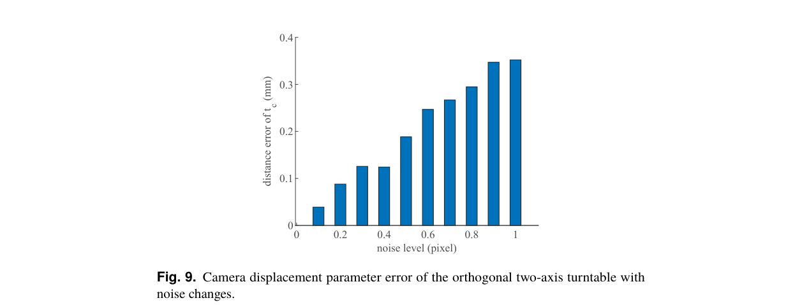
*그림 9 — 잡음 변화에 따른 직교 2축 회전대의 카메라 변위 파라미터 오차.*

#### 4.1.2. 비직교 2축 회전대 시뮬레이션 (Non-orthogonal two-axis turntable simulation)

비직교 회전대와 카메라의 위치·자세 보정 방법을 시뮬레이션한다. 카메라 파라미터는 $f_x=f_y=2000$, $u_0=v_0=1000$, 비틀림 계수 0으로 설정한다. 회전대에 대한 카메라의 회전 벡터는 $[-0.0167,\ 0.0290,\ -2.6177]^T$, 평행이동 벡터는 $[30,\ 20,\ 10]^T$ mm로 설정한다. 2축 회전대의 비직교 모델 파라미터는 방위축과 피치축 사이의 각 $\theta=5°$, 방위축과 피치축 사이의 거리 $d=1$ cm로 설정한다. 영상에 평균 0, 분산이 다른 가우시안 잡음을 더한다. 잡음 수준마다 100회 결과의 평균을 추정 결과로 쓴다. 참값과 비교한 회전대 구조 파라미터 추정의 시뮬레이션 결과는 그림 10, 11과 같다.

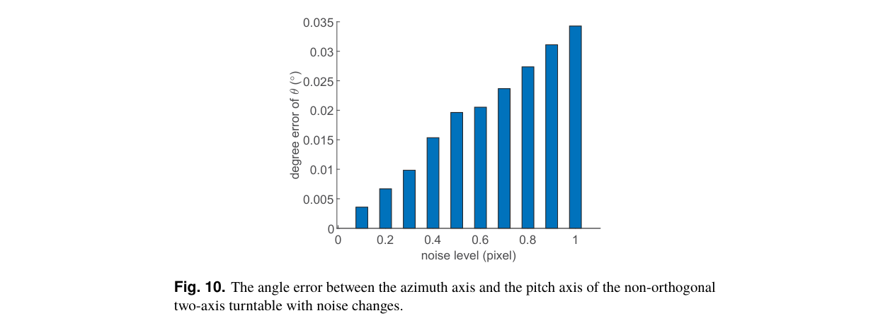
*그림 10 — 잡음 변화에 따른 비직교 2축 회전대의 방위축-피치축 사이 각 오차.*

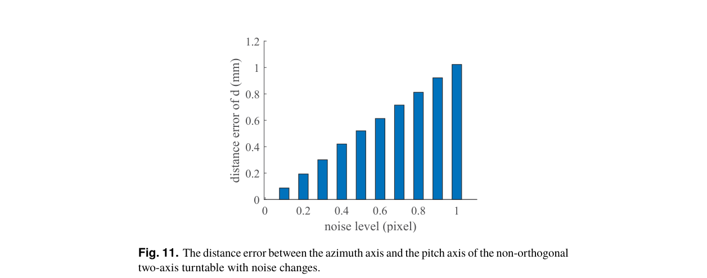
*그림 11 — 잡음 변화에 따른 비직교 2축 회전대의 방위축-피치축 사이 거리 오차.*

그림 10과 그림 11에서 보듯, 회전축 사이의 각과 거리 같은 회전대 구조 파라미터의 오차는 잡음 수준에 따라 대체로 선형으로 증가한다. 이 방법은 비직교 2축 회전대의 구조 파라미터에 대해 좋은 추정 결과를 낸다.

회전대 베이스 좌표계에서 카메라 자세 파라미터의 추정 결과는 그림 12, 그림 13과 같다. 자세 추정 정확도는 두 가지로 평가한다. 하나는 회전 행렬을 $x$, $y$, $z$축 회전 순서로 분해한 오일러 각의 평균 오차이다. 다른 하나는 회전 행렬을 축-각 표현으로 바꾸어, 추정한 회전축 방향과 참 회전축 방향 사이의 각 오차, 그리고 추정한 회전축 둘레 회전각과 참 회전각 사이의 오차를 계산하는 것이다. 카메라 변위 파라미터 오차는 추정한 변위 파라미터와 참값 사이의 유클리드 거리로 평가한다.

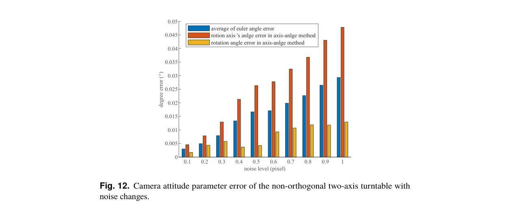
*그림 12 — 잡음 변화에 따른 비직교 2축 회전대의 카메라 자세 파라미터 오차. (범례: 오일러 각 오차 평균 / 축-각 방법의 회전축 각 오차 / 축-각 방법의 회전각 오차)*

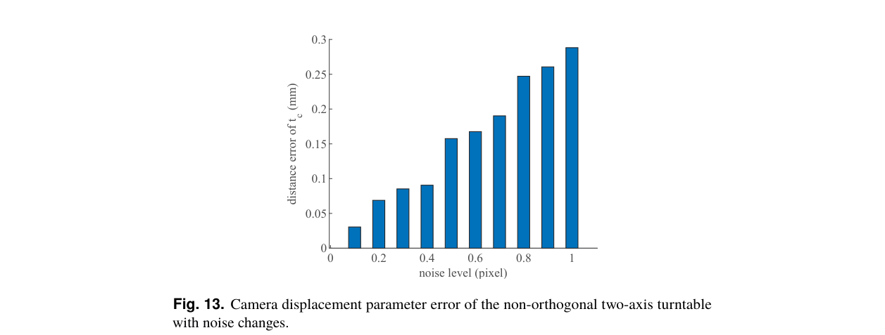
*그림 13 — 잡음 변화에 따른 비직교 2축 회전대의 카메라 변위 파라미터 오차.*

그림 12에서 보듯 잡음이 커질수록 카메라 자세 파라미터의 오차 평가 지표가 커진다. 마찬가지로 그림 13에서 보듯 잡음이 커질수록 카메라 변위 파라미터 오차가 커진다. 이 방법은 비직교 2축 회전대의 카메라 자세 파라미터에 대해 좋은 추정 결과를 낸다.

4.1.1절과 4.1.2절을 비교하면, 회전대의 구조 파라미터가 다른 것($\theta=0°$, $d=0$ cm 대 $\theta=5°$, $d=1$ mm[역주: 원문 그대로. 4.1.2절 설정은 $d=1$ cm])을 빼면 카메라 내부 파라미터와 카메라-회전대 사이 공간 변환 관계는 완전히 같다. 그림 6과 그림 10, 그림 7과 그림 11, 그림 8과 그림 12, 그림 9와 그림 13을 비교하면, 비직교 회전대 모델을 직교 회전대 모델로 간주하여 계산하면 상당한 오차가 생길 수 있음을 알 수 있다.

### 4.2. 실제 실험 (Real experiments)

#### 4.2.1. 실험 1 (Experiment 1)

실험에 쓴 2축 회전대는 FLIR D48E이며 방위 분해능은 0.003°, 피치 분해능은 0.006°이다. 카메라는 Daheng mer-1070-4u3이며 해상도는 3840 × 2748이다. 실험 구성과 평면 타깃은 그림 14와 같다. 평면 타깃 영상 30장을 찍어 카메라 내부 파라미터를 보정했다. 결과는 표 1과 같다.

*그림 14 — 실험 구성과 평면 타깃.*

표 1. 카메라 내부 파라미터

| $f_x$ | $f_y$ | $u_0$ | $v_0$ | $k_1$ | $k_2$ |
|---|---|---|---|---|---|
| 4999.6 | 5.001.2 [역주: 원문 그대로] | 1897.3 | 1379.8 | -0.09307 | 0.16738 |

**(1) 방위축 계산**

회전대 초기 위치에서 영상을 찍은 다음, 피치는 그대로 두고 방위를 바꾸어 다른 영상을 찍는다. 평면 타깃의 위치를 바꾸며 이 과정을 반복하여 영상 다섯 쌍을 찍는다. 타깃 영상은 그림 15와 같다. 첫째 줄 영상은 회전대 초기 위치에서, 둘째 줄 영상은 방위 -16.0725°, 피치각 0°에서 찍은 것이다.

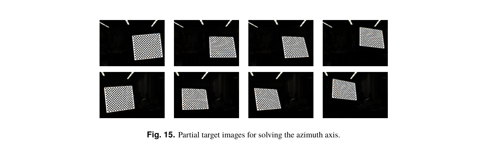
*그림 15 — 방위축 계산용 타깃 영상 일부.*

카메라 좌표계에서 방위축을 구하면 매개변수 방정식은 다음과 같다.

$$
\begin{cases}
x_{axis\_azi}=-0.0038*t_1-1.0709\\
y_{axis\_azi}=-t_1-17.4100\\
z_{axis\_azi}=0.0087*t_1-76.7037
\end{cases}
$$

**(2) 피치축 계산**

회전대 초기 위치에서 영상을 찍은 다음, 방위는 바꾸지 않고 피치를 바꾸어 다른 영상을 찍는다. 평면 타깃의 위치를 바꾸며 이 과정을 반복하여 영상 다섯 쌍을 찍는다. 타깃 영상은 그림 16과 같다. 첫째 줄 영상은 회전대 초기 위치에서, 둘째 줄 영상은 방위 0°, 피치 -19.2840°에서 찍은 것이다.

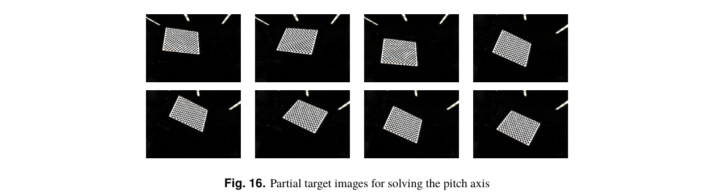
*그림 16 — 피치축 계산용 타깃 영상 일부.*

카메라 좌표계에서 피치축의 매개변수 방정식은 다음과 같다.

$$
\begin{cases}
x_{axis\_pit}=0.0276*t_2+2.2326\\
y_{axis\_pit}=0.0086*t_2+70.4032\\
z_{axis\_pit}=0.9996*t_2-0.8621
\end{cases}
$$

**(3) 방위각과 피치각을 모두 바꾼 영상 촬영**

회전대 초기 위치에서 영상을 찍은 다음, 방위 -12.8580°, 피치 -16.0700°에서 다른 영상을 찍는다. 평면 타깃의 위치를 바꾸며 이 과정을 반복하여 영상 다섯 쌍을 찍는다. 타깃 영상은 그림 17과 같다. 첫째 줄 영상은 회전대 초기 위치에서, 둘째 줄 영상은 방위 -12.8580°, 피치 -19.2840°[역주: 원문 그대로. 앞 문장은 -16.0700°]에서 찍은 것이다.

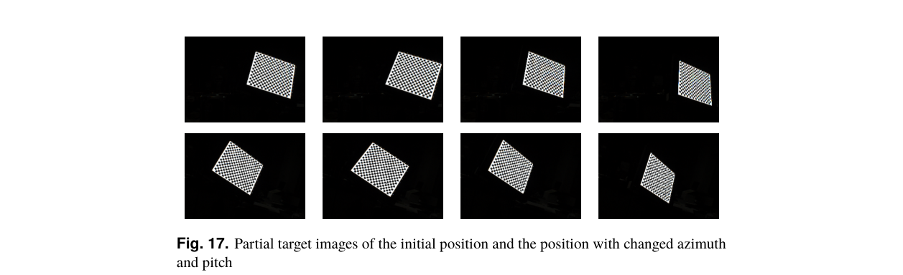
*그림 17 — 초기 위치와 방위·피치를 바꾼 위치의 타깃 영상 일부.*

**(4) 보정 결과**

회전대의 구조 파라미터와 회전대 베이스 좌표계에서 카메라의 위치·자세를 구한 뒤 최적화를 수행한다. 회전대의 구조 파라미터는 방위축과 피치축 사이의 각 $\theta=0.045°$, 방위축과 피치축 사이의 거리 0.84 mm로 구해졌다. 회전대 베이스 좌표계에서 카메라 좌표계의 회전 행렬에 대응하는 회전 벡터는 $[-1.5696,\ -0.0159,\ 0.0214]^T$이고, 회전대 베이스 좌표계에서 카메라 좌표계의 평행이동 벡터는 $[-0.8732,\ 76.5020,\ 70.3228]^T$ (mm)이다. 역투영 오차의 히스토그램은 그림 18과 같다. 가로축은 역투영 오차의 범위, 세로축은 어떤 역투영 오차 범위에 드는 화소 수이다. 역투영 오차의 평균은 0.22 화소이다.

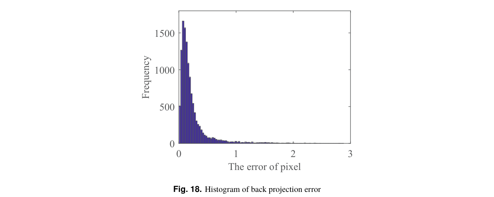
*그림 18 — 역투영 오차 히스토그램.*

보정한 파라미터로 타깃을 3차원 복원하면 그림 19와 같다. 타깃의 인접 코너점 사이 거리는 7 mm이며, 복원한 타깃점 사이 거리와 참값 사이의 RMS 오차는 0.068 mm이다. 이로써 보정 결과의 정확도를 검증했다.

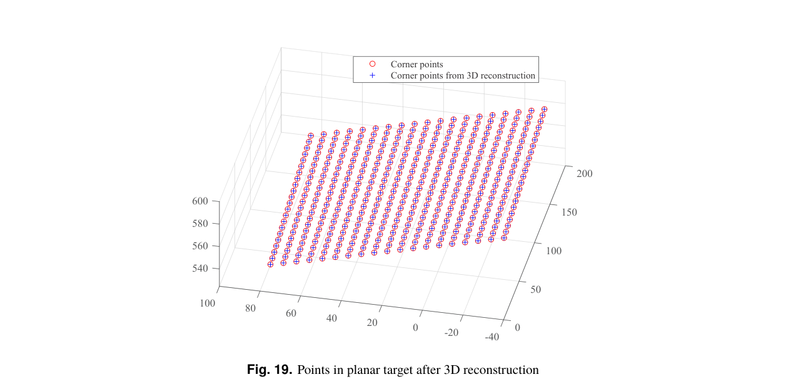
*그림 19 — 3차원 복원 후 평면 타깃의 점들. (범례: 코너점 / 3차원 복원으로 얻은 코너점)*

#### 4.2.2. 실험 2 (Experiment 2)

실험에는 중국계량과학연구원(China Institute of Metrology)의 2축 회전대를 썼으며, 방위와 피치의 분해능은 0.0006°, 방위축과 피치축 사이의 각은 0.001° 미만이다. 카메라는 AVT GT1920으로 해상도는 1936 × 1456이다. 2축 회전대와 카메라는 그림 20, 평면 타깃은 그림 21과 같다. 평면 타깃 영상 30장을 찍어 카메라 내부 파라미터를 보정했다. 결과는 표 2와 같다.

*그림 20 — 카메라와 회전대.*

*그림 21 — 평면 보드 타깃.*

표 2. 카메라 내부 파라미터

| $f_x$ | $f_y$ | $u_0$ | $v_0$ | $k_1$ | $k_2$ |
|---|---|---|---|---|---|
| 1817.7 | 1817.4 | 986.9 | 727.5 | -0.1224 | 0.1501 |

**(1) 방위축 계산**

회전대 초기 위치에서 영상을 찍은 다음, 피치는 그대로 두고 방위를 바꾸어 다른 영상을 찍는다. 평면 타깃의 위치를 바꾸며 위 과정을 반복하여 영상 다섯 쌍을 찍는다. 일부 타깃 영상은 그림 22와 같다. 첫째 줄 영상은 회전대 초기 위치에서 찍은 타깃 영상이고, 둘째 줄 영상은 방위 18°, 피치 0°에서 찍은 영상이다.

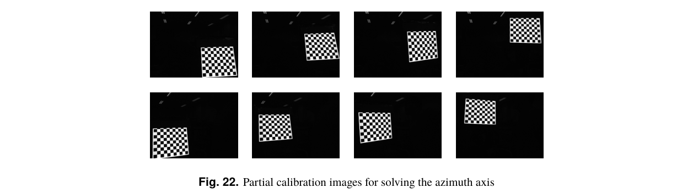
*그림 22 — 방위축 계산용 보정 영상 일부.*

카메라 좌표계에서 방위축의 매개변수 방정식은 다음과 같이 구해졌다.

$$
\begin{cases}
x_{axis\_azi}=-0.0033*t_1-34.1057\\
y_{axis\_azi}=-0.9997t_1-1171.7555\\
z_{axis\_azi}=0.0244*t_1-471.9729
\end{cases}
$$

**(2) 피치축 계산**

회전대 초기 위치에서 영상을 찍은 다음, 방위는 그대로 두고 피치를 바꾸어 다른 영상을 찍는다. 평면 타깃의 위치를 바꾸며 위 과정을 반복하여 영상 다섯 쌍을 찍는다. 일부 타깃 영상은 그림 23과 같다. 첫째 줄 영상은 회전대 초기 위치에서 찍은 타깃 영상이고, 둘째 줄 영상은 방위 0°, 피치 -13°에서 찍은 영상이다.

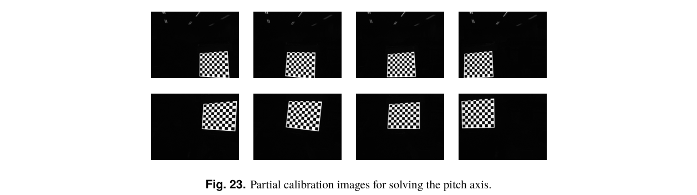
*그림 23 — 피치축 계산용 보정 영상 일부.*

카메라 좌표계에서 피치축의 매개변수 방정식은 다음과 같이 구해졌다.

$$
\begin{cases}
x_{axis\_pit}=-0.9715*t_2+100.6998\\
y_{axis\_pit}=0.0031*t_2+375.9723\\
z_{axis\_pit}=0.2372*t_2-419.2588
\end{cases}
$$

**(3) 방위각과 피치각을 모두 바꾼 영상 촬영**

회전대 초기 위치에서 영상을 찍은 다음, 방위 16°, 피치 1°에서 다른 영상을 찍는다. 평면 타깃의 위치를 바꾸며 위 과정을 반복하여 영상 다섯 쌍을 찍는다. 일부 타깃 영상은 그림 24와 같다. 첫째 줄 영상은 회전대 초기 위치에서 찍은 타깃 영상이고, 둘째 줄 영상은 회전대 방위 16°, 피치 11°[역주: 원문 그대로. 앞 문장은 피치 1°]에서 찍은 영상이다.

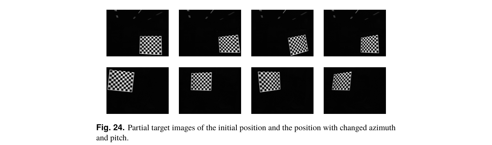
*그림 24 — 초기 위치와 방위·피치를 바꾼 위치의 타깃 영상 일부.*

**(4) 보정 결과**

회전대의 구조 파라미터와 회전대 베이스 좌표계에서 카메라의 초기 자세를 구한 뒤 최적화·정밀화를 수행한다. 회전대의 구조 파라미터는 방위축과 피치축 사이의 각 $\theta=0.033°$, 방위축과 피치축 사이의 거리 $d=0.024$ mm이다. 회전대 베이스 좌표계에서 카메라 좌표계의 회전 행렬에 대응하는 회전 벡터는 $[-36.7670,\ -375.5378,\ -452.5768]^T$이고, 회전대 베이스 좌표계에서 카메라 좌표계의 평행이동 벡터는 $[-0.873,\ 76.502,\ 70.323]^T$ (mm)이다[역주: 원문 그대로. 회전 벡터 값은 앞의 방위축 상수항과 비슷한 크기이고, 평행이동 벡터는 실험 1의 값과 같다. 원문 기재 오류로 보임]. 역투영 오차의 히스토그램은 그림 25와 같다. 가로축은 역투영 오차의 범위, 세로축은 어떤 역투영 오차 범위에 드는 화소 수이다. 평균 역투영 오차는 0.04 화소이다.

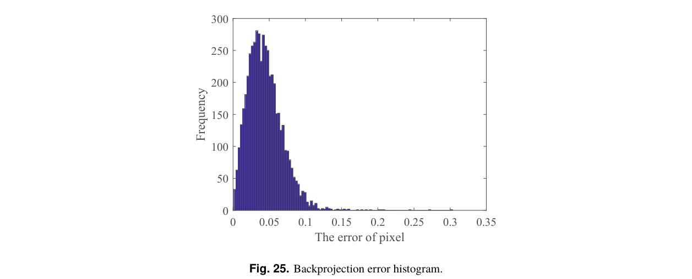
*그림 25 — 역투영 오차 히스토그램.*

보정한 파라미터로 타깃을 3차원 복원하면 그림 26과 같다. 타깃의 인접 코너점 사이 거리는 20 mm이며, 복원한 타깃점 사이 거리와 참값 사이의 RMS 오차는 0.19 mm로, 보정 결과의 정확도를 검증했다.

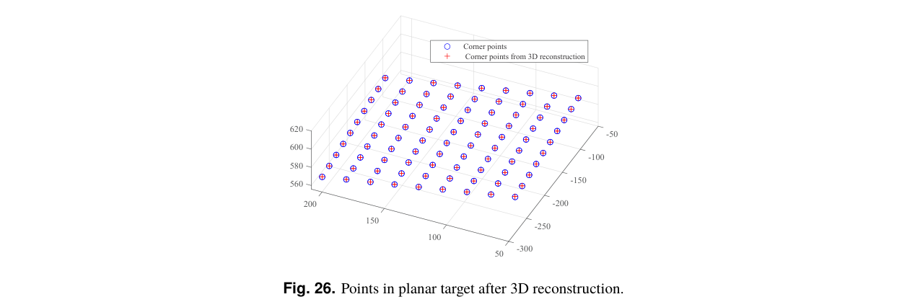
*그림 26 — 3차원 복원 후 평면 타깃의 점들. (범례: 코너점 / 3차원 복원으로 얻은 코너점)*

## 5. 결론 (Conclusion)

넓은 시야가 필요한 시각 작업에서는 고정 단안 카메라가 요구를 충족하지 못하는 경우가 많고, 고정 카메라에는 시야와 공간 분해능 사이의 상충도 있다. 카메라를 2축 회전대에 장착하면 이 문제를 잘 해결할 수 있다. 이상적인 2축 회전대-카메라 모델에서는 2축 회전대의 두 회전축이 서로 직교한다. 더 엄격하게는 카메라의 광학 중심이 회전대의 회전 중심과 일치해야 한다. 이는 회전대 자체의 조립·조정과 카메라의 장착·조정에 높은 요구를 부과한다. 본 논문은 비직교 2축 회전대와 카메라의 위치·자세 보정 방법을 제안했다. 이 방법은 회전대의 구조 파라미터를 미리 알 필요가 없으며, 회전대의 로봇 보정(robot calibration)과 핸드-아이 보정을 한 번에 완료할 수 있다. 시뮬레이션과 실험으로 제안 방법의 정확성과 유효성을 검증했다.

**연구비(Funding).** 중국 국가자연과학기금(National Natural Science Foundation of China) (52127809, 52005028, 51625501).

**감사의 글(Acknowledgments).** 이 논문은 중국 Beihang University 정밀광기전기술 교육부 중점실험실(Key Laboratory of Precision Opto-mechatronics Technology, Ministry of Education)의 지원을 받았다.

**이해상충(Disclosures).** 저자들은 이해상충이 없음을 밝힌다.

**데이터 공개(Data availability).** 이 논문의 결과에 쓰인 데이터는 현재 공개되어 있지 않으나, 합리적인 요청이 있으면 저자에게서 얻을 수 있다.

## 참고문헌

1. G. Cioffi, T. Cieslewski, and D. Scaramuzza, "Continuous-time vs. discrete-time vision-based SLAM: A comparative study," IEEE Robot. Autom. Lett. 7(2), 2399–2406 (2022).
2. Y. Cui, F. Zhou, Y. Wang, L. Liu, and H. Gao, "Precise calibration of binocular vision system used for vision measurement," Opt. Express 22(8), 9134–9149 (2014).
3. G. Du and P. Zhang, "Online robot calibration based on vision measurement," Robotics and Computer-Integrated Manufacturing 29(6), 484–492 (2013).
4. R. L. Greene, M.-L. Lu, M. S. Barim, X. Wang, M. Hayden, Y. H. Hu, and R. G. Radwin, "Estimating trunk angle kinematics during lifting using a computationally efficient computer vision method," Human Factors 64(3), 482–498 (2022).
5. J. Huang, W. Xu, W. Zhao, and H. Yuan, "An improved method for swing measurement based on monocular vision to the payload of overhead crane," Transactions of the Institute of Measurement and Control 44(1), 50–59 (2022).
6. Z. Jia, J. Yang, W. Liu, F. Wang, Y. Liu, L. Wang, C. Fan, and K. Zhao, "Improved camera calibration method based on perpendicularity compensation for binocular stereo vision measurement system," Opt. Express 23(12), 15205–15223 (2015).
7. T. Jin, H. Jia, J. Li, H. Xiang, D. Zhang, J. Chen, and S. Zhuang, "Full-aperture diopter distribution measurement method for single vision and progressive addition lenses," Opt. Lasers Eng. 151, 106883 (2022).
8. G. Lee, S. Kim, S. Ahn, H.-K. Kim, and H. Yoon, "Vision-based cable displacement measurement using side view video," Sensors 22(3), 962 (2022).
9. L. M. Song, M. P. Wang, L. Lu, and H. J. Huan, "High precision camera calibration in vision measurement," Opt. Laser Technol. 39(7), 1413–1420 (2007).
10. B. F. Spencer Jr, V. Hoskere, and Y. Narazaki, "Advances in computer vision-based civil infrastructure inspection and monitoring," Engineering 5(2), 199–222 (2019).
11. L. Wu, Y. Su, Z. Chen, S. Chen, S. Cheng, and P. Lin, "Six-degree-of-freedom generalized displacements measurement based on binocular vision," Struct Control Health Monit 27(2), e2458 (2020).
12. L. Xing, W. Dai, and Y. Zhang, "Improving displacement measurement accuracy by compensating for camera motion and thermal effect on camera sensor," Mechanical Systems and Signal Processing 167, 108525 (2022).
13. Y. Xu and J. M. Brownjohn, "Review of machine-vision based methodologies for displacement measurement in civil structures," J Civil Struct Health Monit 8(1), 91–110 (2018).
14. L. Barazzetti, "Parametric as-built model generation of complex shapes from point clouds," Advanced Engineering Informatics 30(3), 298–311 (2016).
15. T. Czerniawski and F. Leite, "Automated digital modeling of existing buildings: A review of visual object recognition methods," Automation in Construction 113, 103131 (2020).
16. H. Ham, J. Wesley, and H. Hendra, "Computer vision based 3D reconstruction: A review," Int. J. Elect. Comput. Eng. 9, 2394 (2019).
17. M. Huang, J. Ninić, and Q. Zhang, "BIM, machine learning and computer vision techniques in underground construction: Current status and future perspectives," Tunnelling and Underground Space Technology 108, 103677 (2021).
18. L. Li, J. Chen, X. Su, and A. Nawaz, "Advanced-Technological UAVs-Based Enhanced Reconstruction of Edges for Building Models," Buildings 12(8), 1248 (2022).
19. Q. Lu, L. Chen, S. Li, and M. Pitt, "Semi-automatic geometric digital twinning for existing buildings based on images and CAD drawings," Automation in Construction 115, 103183 (2020).
20. G. Pintore, C. Mura, F. Ganovelli, L. Fuentes-Perez, R. Pajarola, and E. Gobbetti, "State-of-the-art in Automatic 3D Reconstruction of Structured Indoor Environments," in Computer Graphics Forum (Wiley Online Library, 2020), pp. 667–699.
21. Z. Pučko, N. Šuman, and D. Rebolj, "Automated continuous construction progress monitoring using multiple workplace real time 3D scans," Advanced Engineering Informatics 38, 27–40 (2018).
22. X. Tian, R. Liu, Z. Wang, and J. Ma, "High quality 3D reconstruction based on fusion of polarization imaging and binocular stereo vision," Information Fusion 77, 19–28 (2022).
23. W. Yifan, C. Doersch, R. Arandjelović, J. Carreira, and A. Zisserman, "Input-level Inductive Biases for 3D Reconstruction," in Proceedings of the IEEE/CVF Conference on Computer Vision and Pattern Recognition (2022), pp. 6176–6186.
24. T. Jiang, H. Cui, and X. Cheng, "A calibration strategy for vision-guided robot assembly system of large cabin," Measurement 163, 107991 (2020).
25. T. Phisannupawong, P. Kamsing, P. Torteeka, S. Channumsin, U. Sawangwit, W. Hematulin, T. Jarawan, T. Somjit, S. Yooyen, and D. Delahaye, "Vision-based spacecraft pose estimation via a deep convolutional neural network for noncooperative docking operations," Aerospace 7(9), 126 (2020).
26. A. R. Vetrella, G. Fasano, and D. Accardo, "Attitude estimation for cooperating UAVs based on tight integration of GNSS and vision measurements," Aerosp. Sci. Technol. 84, 966–979 (2019).
27. Y. Wang, X. Wang, Y. Shan, and N. Cui, "Quantized genetic resampling particle filtering for vision-based ground moving target tracking," Aerosp. Sci. Technol. 103, 105925 (2020).
28. Z. Zhang, Y. Cao, M. Ding, L. Zhuang, and J. Tao, "Monocular vision based obstacle avoidance trajectory planning for Unmanned Aerial Vehicle," Aerosp. Sci. Technol. 106, 106199 (2020).
29. A. Ahmed and H. Abdalla, "The role of innovation process in crafting the vision of the future," Comput. Industrial Eng. 37(1-2), 421–424 (1999).
30. H. Alzarok, S. Fletcher, and A. P. Longstaff, "Survey of the current practices and challenges for vision systems in industrial robotic grasping and assembly applications," Adv. Industrial Eng. Management 9, 19–30 (2020).
31. E. Asoudegi and Z. Pan, "Computer vision for quality control in automated manufacturing systems," Comput. Industrial Eng. 21(1-4), 141–145 (1991).
32. M. MassirisFernández, JÁ Fernández, J. M. Bajo, and C. A. Delrieux, "Ergonomic risk assessment based on computer vision and machine learning," Comput. Industrial Eng. 149, 106816 (2020).
33. S. Mehta, R. A. Singh, Y. Mohata, and M. Kiran, "Measurement and analysis of tool wear using vision system," in 2019 IEEE 6th International Conference on Industrial Engineering and Applications (ICIEA) (IEEE, 2019), pp. 45–49.
34. L. Xinmin, L. Zhongqin, and Z. Ziping, "A study of a reverse engineering system based on vision sensor for free-form surfaces," Comput. Industrial Eng. 40(3), 215–227 (2001).
35. Z.-C. Chao, Q.-F. Yu, S.-H. Fu, and G.-W. Jiang, "Adjustment-based data fusion method in the pose relay videometric using camera network," in International Symposium on Photoelectronic Detection and Imaging 2011: Advances in Imaging Detectors and Applications (SPIE, 2011), pp. 91–98.
36. G. Jiang, S. Fu, Z. Chao, and Q. Yu, "Pose-relay videometrics based ship deformation measurement system and sea trials," Chin. Sci. Bull. 56(1), 113–118 (2011).
37. Q. Yu, G. Jiang, Z. Chao, S. Fu, Y. Shang, and X. Yang, "Deformation monitoring system of tunnel rocks with innovative broken-ray videometrics," in ICEM 2008: International Conference on Experimental Mechanics 2008 (SPIE, 2009), pp. 572–577.
38. Q. Yu, G. Jiang, S. Fu, Z. Chao, Y. Shang, and X. Sun, "Fold-ray videometrics method for the deformation measurement of nonintervisible large structures," Appl. Opt. 48(24), 4683–4687 (2009).
39. Q. Yu, G. Jiang, S. Fu, Y. Shang, Y. Liang, and L. Lib, "Broken-ray videometric method and system for measuring the three-dimensional position and pose of the non-intervisible object," The Int. Arch. Photogrammetry, Remote Sensing and Spatial Inform. Sci. 37, 145–148 (2008).
40. Y. Yuan, Z. Zhu, and X. Zhang, "Imaging model and high-precision calibration of quasi-concentric general theodolite-camera," Acta Opt. Sin. 32(7), 0715003 (2012).
41. W. J. Gugh, Q. Chen, and W. Qian, "Camera parameter calibration based on two-dimensional rotating platform," J. Opt. Precision Eng. 25, 1890–1899 (2017).
42. K. Daniilidis, "Hand-eye calibration using dual quaternions," The International Journal of Robotics Research 18(3), 286–298 (1999).
43. R. Horaud and F. Dornaika, "Hand-eye calibration," The international journal of robotics research 14(3), 195–210 (1995).
44. J. Jiang, X. Luo, Q. Luo, L. Qiao, and M. Li, "An overview of hand-eye calibration," Int. J. Adv. Manuf. Technol. 119(1-2), 77–97 (2022).
45. W. Lin, P. Liang, G. Luo, Z. Zhao, and C. Zhang, "Research of Online Hand–Eye Calibration Method Based on ChArUco Board," Sensors 22(10), 3805 (2022).
46. K. H. Strobl and G. Hirzinger, "Optimal hand-eye calibration," in 2006 IEEE/RSJ international conference on intelligent robots and systems (IEEE, 2006), pp. 4647–4653.
47. R. Y. Tsai and R. K. Lenz, "A new technique for fully autonomous and efficient 3 d robotics hand/eye calibration," IEEE Trans. Robot. Automat. 5(3), 345–358 (1989).
48. W. Wang, Y. Liu, H. Song, and Z. Du, "A novel singular-free solution based on principle of transfer theory for the hand-eye calibration problem," Mechanism and Machine Theory 170, 104723 (2022).
49. W. Bin, Z. Yu, W. Zhansheng, P. Congcong, and H. Rongfang, "Coordinate Measurement Technology of Laser Total Station with Non-Orthogonal Shafting,".
50. B. Wu, F. Yang, W. Ding, and T. Xue, "A novel calibration method for non-orthogonal shaft laser theodolite measurement system," Rev. Sci. Instrum. 87(3), 035102 (2016).
51. F. Yang, B. Wu, T. Xue, M. F. Ahmed, and J. Huang, "A cost-effective non-orthogonal 3D measurement system," Measurement 128, 264–270 (2018).
