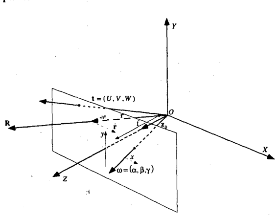
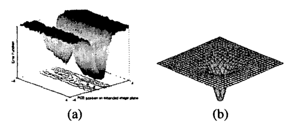
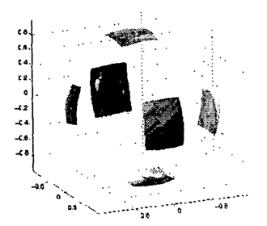
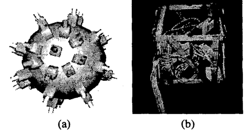
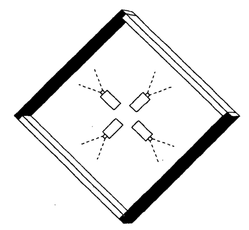
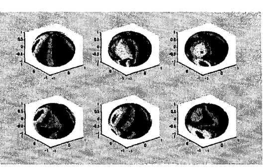
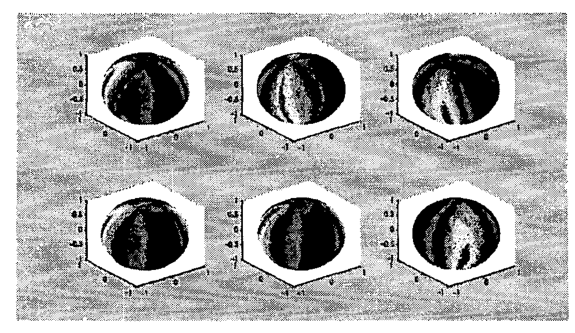
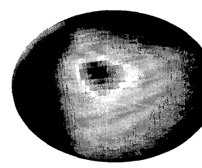

# 여러 카메라로 만든 구형 눈 (세계의 더 나은 모델을 만든다) (Baker 2001)

- 원제: A Spherical Eye from Multiple Cameras (Makes Better Models of the World)
- 원문: 같은 폴더의 `Baker2001_CVPR_wide_fov_ambiguity.pdf` (Proc. IEEE CVPR 2001, vol. 1, pp. I-576–I-583, 사용자 제공)
- 저자: Patrick Baker, Cornelia Fermüller, Yiannis Aloimonos (Computer Vision Laboratory, University of Maryland, College Park, MD 20742-3275, USA), Robert Pless (Department of Computer Science, Washington University, St. Louis, MO, 63130)
- 번역 범위: 전문
- 그림: 원문 그림 1–6, 8과 번호 없는 그림 1개(집합 시야)를 `그림/`에 넣고 본문에서 처음 언급되는 곳에 삽입. 원문의 "Figure 7"과 "Figure 9"는 표이므로 마크다운 표로 옮겼다.

## 초록

이 논문은 비디오로부터 자기 운동(egomotion)과 구조를 복원할 목적으로 특별히 설계한 영상 시스템을 기술한다. 시스템은 시각 구(visual sphere)의 서로 다른 부분을 표본화하도록 배치된 여섯 대의 카메라 네트워크로 이루어진다. 이 기하 배치는 시스템 자신의 운동 추정, 그리고 결과적으로 개별 카메라로부터의 형상 모델 추정에서 좁은 시야(field of view) 카메라에 비해 증명 가능한 이점을 갖는다. 그 이유는 평행이동(translation)과 회전(rotation) 사이의 혼동이라는 내재적 모호성이 사라지기 때문이다. 시스템의 보정(캘리브레이션)과 3D 운동 추정을 위한 알고리즘을 제시한다. 보정은 공간에서 평행한 직선들의 영상을 카메라 간 회전에 관련짓는 새로운 기하 제약에 기반한다. 3D 운동 추정은 구조를 영상 기울기(gradient)에 직접 관련짓는 제약을 사용한다.

## 1. 서론 (Introduction)

기술의 발전으로 비디오 카메라를 어떤 배치로 장착하고, 고속 네트워크로 연결하고, 동기화된 비디오를 수집할 수 있게 되었다. 이런 발전은 많은 분야에서 새로운 길을 열어, 감시와 모니터링, 그래픽스와 시각화, 로보틱스와 증강현실의 다양한 응용을 처음으로 다룰 수 있게 한다. 그러나 응용의 필요는 커지는데, 특정 문제를 풀기 위해 많은 카메라를 어떻게 조합해야 하는지에 대한 명확한 생각은 아직 없다. 즉, 다중 시점 비전의 수학은 카메라 네트워크의 배치를 고려 중인 과제와 관련짓는 방식으로는 아직 이해되지 않았다. 기존 접근은 거의 모든 문제를 다중 스테레오 문제로 다루므로, 다중 비디오에 숨어 있는 중요한 정보를 놓친다. 이 논문의 목표는 위에서 기술한 공백을 메우는 첫걸음을 제공하는 것이다. 우리는 다중 카메라 네트워크를 새로운 눈으로 본다. 공간의 모델을 복원할 목적으로, 시각 구의 일부를 표본화하는 카메라들로 이루어진 그런 눈을 하나 연구하고 만들었다. 이 눈의 동기는 시야가 운동 추정의 정확도, 그리고 그에 따라 형상 복원의 정확도에 미치는 영향을 분석한 이론 연구 [5]에서 나왔다. 이하에서는 먼저 일반 비디오 카메라로 형상 모델을 만드는 문제를 기술하고 내재적 어려움을 지적한다.

일반적으로 장면을 두 위치에서 볼 때 관심 있는 개념은 두 가지이다.

(a) 두 시점을 관련짓는 3D 변환. 이는 평행이동과 회전으로 이루어진 강체 운동 변환이다(6 자유도). 시점이 서로 가까우면 이 변환은 눈(또는 카메라)의 3D 평행이동 속도와 각속도로 모델링된다.

(b) 두 영상의 화소를 관련짓는 2D 변환, 즉 첫 영상의 한 점이 주어지면 그것을 둘째 영상의 대응점으로 사상하는 변환(즉, 이 두 점은 같은 장면 점의 투영이다). 시점이 서로 가까우면 이 변환은 각 화소의 속도를 나타내는 벡터장, 즉 영상 운동장(image motion field)에 해당한다.

위에서 기술한 두 변환을 완벽히 알면 공간 모델을 완벽히 알게 된다. 두 시점과 두 영상이 정확히 어떻게 관련되는지 알면 공간에서 각 장면 점의 정확한 위치를 얻기 때문이다. 따라서 공간 모델을 만드는 기본 문제의 열쇠는 이 두 변환의 복원이다. 그런 모델을 만드는 데 따르는 어떤 어려움도 이 두 변환을 추정하는 어려움으로 거슬러 올라갈 수 있다. 이 논문은 과제 (a)의 어려움을 제거하는 데 관심을 둔다. 이 과제를 달성하는 데 어떤 한계가 있는가?

## 2. 내재적 한계 (Inherent limitations)

표준 핀홀 카메라에서 영상은 평면 위로의 중심 투영(central projection)으로 형성된다(그림 1). 초점거리는 $f$이고 좌표계 $OXYZ$는 카메라에 붙어 있으며, $Z$가 영상 평면에 수직인 광축이다.

*그림 1 — 평면 위의 영상 형성. 시스템은 평행이동 속도 $\mathbf{t}$와 회전 속도 $\boldsymbol{\omega}$의 강체 운동으로 움직인다. 장면 점 $\mathbf{R}$은 영상점 $\mathbf{r}$로 투영되고, 장면 점의 3D 속도 $\dot{\mathbf{R}}$은 영상에서 영상 속도 $\dot{\mathbf{r}}$로 관측된다.*

장면 점 $\mathbf{R}$은 영상점 $\mathbf{r}$로 투영된다. 카메라가 정지한 환경에서 순간 평행이동 $\mathbf{t}$와 순간 회전 $\boldsymbol{\omega}$로 움직인다고 하자. 영상 운동장은 다음 식으로 기술된다.

$$\dot{\mathbf{r}} = -\frac{1}{(\mathbf{R} \cdot \hat{\mathbf{z}})}(\hat{\mathbf{z}} \times (\mathbf{t} \times \mathbf{r})) + \frac{1}{f}\hat{\mathbf{z}} \times (\mathbf{r} \times (\boldsymbol{\omega} \times \mathbf{r}))$$

여기서 $\hat{\mathbf{z}}$는 $Z$축 방향의 단위벡터이다.

비디오 시퀀스로부터 3D 운동을 찾는 기법은 그야말로 풍부하다. 대부분의 기법은 에피폴라 제약(epipolar constraint)으로부터의 편차를 최소화하는 데 기반하며, 이 제약은 연속적 경우 $(\mathbf{t} \times \mathbf{r}) \cdot (\dot{\mathbf{r}} + \boldsymbol{\omega} \times \mathbf{r}) = 0$ [3]의 형태를, 이산적 경우 $x_2^T(\mathbf{t} \times R\mathbf{x}_1) = 0$의 형태를 취한다. 여기서 $\mathbf{x}_1$과 $\mathbf{x}_2$는 대응하는 영상점이고 $R$은 회전 행렬이다. 그 밖에 사용되는 제약으로는 음의 깊이(negative depth)의 최소화, 또는 최근 도입된 깊이 변동성 제약(depth variability constraint)의 최소화 [1]가 있다. 이 두 제약은 모두 영상 도함수를 3D 운동에 직접 관련짓는데, 이는 광류의 중간 계산이나 대응 추정이 필요한 에피폴라 제약과 대조된다.

어떤 제약이든, 수학적으로는 선택한 제약으로부터의 편차를 나타내며 3D 운동 파라미터, 영상 좌표와 그 도함수로 표현되는 함수를 세운다. 운동 추정은 선택한 함수를 최소화하는 평행이동 $\hat{\mathbf{t}}$와 회전 $\hat{\boldsymbol{\omega}}$를 찾는 것이다.

3D 운동 파라미터를 정확히 푸는 것은 매우 어려운 문제임이 드러났다. 주된 이유는 영상 변위에서 평행이동과 회전 사이의 겉보기 혼동과 관련이 있다. 이는 직관적 수준에서 이해하기 쉽다. 얕은(shallow) 장면을 정면으로 바라볼 때, 우리가 수직축에 대해 회전하든 장면에 평행하게 평행이동하든 영상 중심의 운동장이나 대응은 두 경우에 매우 비슷하다. 따라서 예를 들어 $x$축을 따르는 평행이동은 $y$축에 대한 회전과 혼동된다. 이는 실로 기하학적 문제이며, 시점 사이의 기선(baseline)이 작은 경우와 큰 경우 모두, 즉 연속 운동의 경우와 카메라의 이산 변위의 경우 모두에 존재한다. 이 혼동의 기본적 이해에 관심을 둔 연구자는 수년간 소수였다 [2, 3, 6, 9].

우리 연구는 이 혼동을 분석한 최근 결과에서 동기를 얻었다. 이전 연구 [5]에서 우리는 이 문제를 기하학적으로 분석했다. 운동 추정에 쓰이는 여러 함수의 기댓값을 운동 파라미터의 5차원 함수($\mathbf{t}/|\mathbf{t}|$에 2차원, $\boldsymbol{\omega}$에 3차원)로 정식화했다. 특정 추정기와 무관하게, 이 함수들이 정의하는 곡면의 지형 구조가 3D 운동 추정의 거동을 설명한다. 직관적으로 말하면, 이 함수들의 최솟값은 골짜기(valley) 안에 놓인다는 것이 드러난다. 실제 상황에서는 그 골짜기나 평탄한 영역의 어떤 점도 최솟값이 될 수 있어 계산에 오차를 들여오므로, 이는 내재적 불안정성의 원인이 된다(그림 2a 참조).

특히 얻은 결과는 다음과 같다. 다섯 개의 미지 운동 파라미터를 $(x_0, y_0)$(평행이동 방향)와 $(\alpha, \beta, \gamma)$(회전)로 나타내자. 그러면 카메라의 시야가 제한되어 있으면, *운동장으로부터 3D 운동을 어떻게 추정하든*, 기대되는 해는 다음 두 제약을 만족하는 오차 $(x_{0_\epsilon}, y_{0_\epsilon})$, $(\alpha_\epsilon, \beta_\epsilon, \gamma_\epsilon)$를 포함한다.

(a) 직교성 제약(orthogonality constraint): $\dfrac{x_{0_\epsilon}}{y_{0_\epsilon}} = -\dfrac{\beta_\epsilon}{\alpha_\epsilon}$

(b) 직선 제약(line constraint): $\dfrac{x_0}{y_0} = \dfrac{x_{0_\epsilon}}{y_{0_\epsilon}}$

또한 $\gamma_\epsilon = 0$이다. 이 결과는 해가 서로 뒤섞여 회전과 평행이동 사이에 해소할 수 없는 혼동을 만드는 오차를 포함한다는 것을 말하며, 광축에 대한 회전($\gamma$)만 예외이다. 오차는 작을 수도 클 수도 있지만, 그 기댓값은 항상 위 조건을 만족한다. 위에서 기술한 3D 운동 추정 접근은 다양한 항법 과제에는 충분한 답을 줄 수 있으나, 계산된 깊이 $Z$가 왜곡되므로 물체 모델을 유도하는 데는 쓸 수 없다.

기술한 증명들은 통계적 성격의 것이다. 그럼에도 우리가 다룬 모든 실내·실외 시퀀스에서, 최소화한 함수에 골짜기가 있음을 실험적으로 확인했다. 골짜기가 꽤 넓은 경우가 많았지만, 많은 경우 그 위치가 예측된 위치와 가까웠다.

*그림 2 — 평행이동 방향 공간에서 오차 함수의 개략도. (a) 시야가 제한된 평면에 대한 골짜기. (b) 구형 시야에 대한 명확히 정의된 최솟값.*

그러나 오차 함수는 시야가 바뀌면 달라진다. 우리 이론 연구의 놀라운 발견은 시야가 360°가 되면 모호성이 사라진다는 것이다. 이는 더 이상 골짜기가 없고, 그림 2b처럼 잘 정의된 최솟값이 있다는 뜻이다. 이것이 우리 접근의 기반이다.

우리의 관심은 비디오 데이터가 주어지면 촬영된 장면의 형상 모델을 내는 기법을 개발하는 것이다. 일반 비디오 카메라에는 내재적 문제가 있으므로, 아마도 다른 눈을 활용해야 할 것이다. 예를 들어 시야 360°의 센서가 있다면 3D 운동과 그에 이어 형상을 정확히 복원할 수 있을 것이다. 반사굴절(catadioptric) 센서는 그런 시야를 제공할 수 있지만 해상도가 낮아 형상 모델 복원이 어렵다. 그래서 우리는 바깥쪽을 향한 여섯 대의 카메라로 이루어진 구조물인 아르고스 눈(Argus eye)을 만들었다(그림 3). 분명히 구의 일부만 촬영된다. 집합 시야(collective field of view)는 그림 2에서 볼 수 있다. [역주: 원문은 "figure 2"라고 썼으나, 집합 시야를 보여 주는 것은 3쪽 오른쪽 위에 번호 없이 실린 그림으로 보인다. 아래에 그 그림을 넣었다.] 이 구조물을 공간에서 임의로 움직이면, 여섯 카메라 모두의 데이터를 써서 3D 운동을 매우 정확히 복원할 수 있고, 이를 다시 개별 비디오에서 형상 복원에 쓸 수 있다. 다음 절은 아르고스 눈을 어떻게 보정했는지 보이고, 그다음 절은 3D 운동을 어떻게 추정했는지 기술한다.

*번호 없는 그림 — 여섯 카메라의 집합 시야(원문 3쪽 오른쪽 위, 캡션 없음).*

*그림 3 — (a) 일반 비디오 카메라로 구성한 겹눈 같은 눈, 그리고 아르고스 눈의 개략도. (b) 실제 아르고스 눈. 카메라들은 나무 막대로 만든 다면체의 대각선에 붙어 있다.*

## 3. 보정 (Calibration)

아르고스 눈을 보정하는 데 일반적인 스테레오 보정 방법은 쓸 수 없다. 시야가 겹치지 않기 때문이다. 기계적 보정은 어렵고 비싸므로 영상 기반 방법을 쓰고자 한다. 영상 기반 보정에는 아래와 같은 몇 가지 가능성이 있다.

**격자 보정(Grid Calibration)** 아르고스 눈을 둘러싸는 정밀 측정 보정 격자를 만들고, 이로부터 표준 보정 방법([10] 또는 [4] 같은)을 사용한다. 이 방법은 어렵고 비싸다.

**자기 보정(Self Calibration)** 자기 보정 알고리즘으로 보정 파라미터를 얻는다. 여러 카메라의 회전축을 맞춤으로써 이 방법은 카메라 간 회전을 얻을 수 있어야 한다. 이 방법의 정확도는 우리가 원하는 만큼 높지 않다.

**다중 카메라 보정(Many Camera Calibration)** 추가 카메라들을 아르고스 눈 주위에 안쪽을 향하게 배치해 카메라들의 시야 원뿔이 서로, 그리고 아르고스 눈의 시야 원뿔과 교차하게 하면, 적절히 보정된 이 카메라들을 LED를 대응점으로 써서 보정에 사용할 수 있다. 우리는 평행이동 보정에 이 방법을 쓰지만, 회전 보정에는 새로운 방법을 쓴다.

**직선 보정(Line Calibration)** 점 대신 직선을 보정 물체로 쓸 수 있다면, 시야가 교차하지 않는 것은 문제가 되지 않는다. 직선은 여러 시야를 가로지를 만큼 뻗어 있기 때문이다.

### 3.1. 방법 개요 (Method overview)

직선은 지금까지 카메라 보정에 널리 쓰이지 않았는데, 컴퓨터 비전에서 자주 쓰이는 수학 도구가 점에 기반하기 때문이다. 우리는 직선이 겹치지 않는 시야에 걸쳐 뻗어 있어 아르고스 눈에 쓸 수 있는 단순한 물체이기 때문에 직선을 쓰고자 한다. 다른 물체에 비해 직선의 추가 이점은 부화소(sub-pixel) 정확도로 위치를 찾기 쉬워, 구나 LED에 기반한 방법보다 훨씬 정확한 보정이 가능하다는 것이다. 대응하는 직선에 기반해 세 카메라의 회전만을 제약하는 식이 있으며, 우리는 다중 카메라를 가지고 있으므로 이 식은 우리 목적에 안성맞춤이다. 컴퓨터 비전 문헌에 이 식이 처음 등장한 것 중 하나는 1986년의 [7]이지만, 비전 시스템에 쓰이지는 않았다. 다음 절에서 수학을 제시하고, 이어서 알고리즘을 더 자세히 기술한다.

### 3.2. 수학 (Mathematics)

정규화된 세 카메라와 세계 직선 $L$이 주어질 때, 여기서 회전 행렬에 대한 제약을 유도한다. 우리 카메라의 투영 행렬은 다음과 같다.

$$P_i = R_i^T[I_3 \quad -c_i] \qquad (1)$$

여기서 $c_i$는 아르고스 눈의 중심에 붙은 좌표계에 대한 카메라의 위치이고 $R_i$는 그 좌표계에 대한 카메라의 회전이다.

직선 $L$이 각 카메라에 촬영되고, $\hat{\pi}_i$와 $\hat{\sigma}_i$를 각 카메라 $i$의 영상 직선 위의 단위화된 두 점이라 하자. 여섯 점 $\Pi_i$와 $\Sigma_i$(모두 $L$ 위)가 이 카메라 점들을 만든다면 다음을 안다.

$$\hat{\pi}_i = \frac{1}{\lambda_i}R_i^T(\Pi_i - c_i) \qquad \hat{\sigma}_i = \frac{1}{\delta_i}R_i^T(\Sigma_i - c_i) \qquad (2)$$

$$\lambda_iR_i\hat{\pi}_i = \Pi_i - c_i \qquad \delta_iR_i\hat{\sigma}_i = \Sigma_i - c_i \qquad (3)$$

여기서 $\lambda_i$와 $\delta_i$는 $\hat{\pi}_i$와 $\hat{\sigma}_i$를 단위화하도록 선택한 스케일 인자이다.

$R_i$가 정규직교이므로, 약간의 대수 후 다음과 같이 쓸 수 있다.

$$\lambda_i\delta_iR_i(\hat{\sigma}_i \times \hat{\pi}_i) = \Sigma_i \times \Pi_i + (\Pi_i - \Sigma_i) \times c_i \qquad (4)$$

각 $i$에 대해 $\Pi_i$와 $\Sigma_i$가 모두 같은 직선 위에 있으므로, 위 식의 우변은 모든 $i$에 대해 직선 $L$의 방향에 수직이어야 함을 알 수 있다. 카메라가 셋이면 $R_i(\hat{\sigma}_i \times \hat{\pi}_i)$가 한 평면 안에 있어야 함을 안다(스케일 인자는 무시해도 된다). 따라서 다음 삼중곱 제약을 얻는다.

$$|R_1(\hat{\sigma}_1 \times \hat{\pi}_1) \quad R_2(\hat{\sigma}_2 \times \hat{\pi}_2) \quad R_3(\hat{\sigma}_3 \times \hat{\pi}_3)| = 0 \qquad (5)$$

중요한 점은, 제약이 세계 직선의 *방향*에 대한 수직성에만 의존하므로 세 카메라 각각이 촬영한 세계 직선이 동일할 필요는 없고 평행하기만 하면 된다는 것이다.

물론 같은 작업을 삼중선형 제약(trilinear constraint)으로 수행할 수도 있지만, 위 제약은 평행성이라는 이점을 갖는다. *동일한* 직선을 대응시킬 필요 없이 평행한 직선만 대응시키면 된다. 이는 보정 물체에 대한 풍부한 가능성을 연다. 첫째, 원기둥의 가림 경계(occlusion boundary)를 쓸 수 있다. 원기둥의 모든 가림 경계는 평행하기 때문이다. 둘째, 정사각형의 마주 보는 변에 원기둥 두 개를 놓으면(그림 4처럼), 이 물체를 아르고스 눈 *주위에* 놓아 모든 카메라를 함께 회전 보정할 수 있어 정확도가 높아진다. 따라서 세 카메라가 함께 보는 세계 직선이 없도록 카메라가 배치되어 있더라도, 세 카메라에 보이는 평행 직선이 있으면 여전히 회전 보정을 할 수 있다.

*그림 4 — 시야가 교차하지 않는 카메라들을 회전 보정하기 위한 보정 프레임.*

평행이동 보정을 얻기 위해서는 비슷한 방법을 쓸 수 있는데, 삼중선형 제약을 써서 카메라 1에 대한 카메라 중심들의 위치를 제약한다. 이를 $T_{1,k}$라 하자. 마찬가지로 임의의 두 카메라 사이의 평행이동을 $T_{j,k}$로 정의할 수 있다. 내부 보정과 회전은 이미 가지고 있으므로, 여러 카메라의 대응 직선에 대해 크게 단순화된 삼중선형 제약을 쓸 수 있다. 우리 표기법에서 삼중선형 제약은 다음과 같이 된다.

$$\ell_3^{T\prime}\hat{\pi}_1'T_{1,2}^T\ell_2' = \ell_2^{T\prime}\hat{\pi}_1'T_{1,3}^T\ell_3' \qquad (6)$$

여기서 $i \in \{2, 3\}$에 대해 $\ell_i = \hat{\pi}_i \times \hat{\sigma}_i$이고, 프라임은 영상점 또는 직선이 공통 좌표계로 역회전(derotate)되었음을 나타낸다. 즉 다음과 같다.

$$\ell_i' = \widehat{R_i\ell_i} \qquad (7)$$
$$\hat{\pi}_i' = \widehat{R_i\hat{\pi}_i} \qquad (8)$$

여러 프레임에 걸친 $\hat{\pi}_i$와 $\hat{\sigma}_i$를 써서 $T_{j,k}$를 푸는 선형 시스템으로 평행이동 보정을 얻을 수 있다. 이 절차가 정확한 평행이동 보정을 낸다는 것을 확인했다.

### 3.3. 보정 절차 (Calibration Procedure)

이제 최종 보정 절차와 알고리즘을 구성할 결과를 갖추었다. 먼저 Zhengyou Zhang [11]의 알고리즘 같은 잘 알려진 알고리즘으로 카메라를 내부 보정한다. 둘째, 위 알고리즘과, 그림 4처럼 평행하도록 측정한 검은 막대 두 개가 달린 정사각형 프레임을 써서 카메라를 회전 보정한다. 이 단계는 회전 행렬의 동차 로드리게스(homogeneous Rodrigues) 파라미터에 대한 대규모 비선형 최적화로 수행할 수 있다. 이 방법이 잘 수렴함을 확인했다.

카메라 여섯 대만으로는 최종 보정 단계에 단일 직선을 쓸 만큼 시야 범위가 충분하지 않으므로, 대신 아르고스 카메라들과 주위를 둘러싸고 안쪽을 향한 몇 대의 추가 카메라로 보정한다. 외부 카메라가 있으면 세 카메라가 직선을 보는 것을 보장할 수 있어 삼중선형 제약을 쓸 수 있다. 이는 카메라를 여섯 대만 썼기 때문에 필요한 것일 뿐임에 유의하라. 더 많은 카메라를 가진 아르고스 눈을 쓴다면 추가 카메라는 필요 없을 것이다.

## 4. 아르고스 눈으로부터의 3D 운동 (3D motion from the Argus eye)

### 4.1. 문제 (The Problem)

보정된 아르고스 눈이 공간에서 제약 없이 움직이며 각 비디오 카메라로부터 동기화된 비디오를 수집한다고 하자. 우리는 전체 시스템의 3D 운동을 찾고자 한다. 그 운동과 보정이 주어지면 각 개별 카메라의 운동을 결정할 수 있어 형상을 복원할 수 있다. 알고리즘의 세부로 들어가기 전에 우리 카메라 시스템의 동기를 그림으로 보이자.

좁은 시야에서의 운동 추정 모호성에 관한 결과의 중요한 측면은 그것이 알고리즘에 무관하다는 것이다. 간단히 말해, 어떤 목적 함수를 최소화하든 최솟값은 골짜기를 따라 놓인다. 데이터가 그 이상 모호성을 해소하기에 충분하지 않다. 이 모호성의 그림을 보자. 우리는 카메라 여섯 대의 아르고스 눈을 만들고 여섯 시퀀스 각각에서 3D 운동을 독립적으로 추정했다. 구체적으로 Lucas-Kanade [8] 알고리즘으로 광류를 추정했다. 그런 다음 각 평행이동 방향에 대해 에피폴라 제약으로부터의 편차를 최소화하는 최선의 회전을 찾는다. 그림 5는 (가능한 평행이동의 구 위에) 잔차를 색으로 부호화해 보여 준다. 빨간 영역이 최솟값으로부터 작은 퍼센트 이내의 모든 점이라는 것을 감안하면, 증명에서 이론적으로 보인 모호성을 분명히 보여 주는 골짜기를 볼 수 있다. 우리의 평행이동은 빨간 영역의 어디에든 있을 수 있다. 이렇게 강한 모호성이 있으면 정확한 형상 모델을 만들기 어렵다는 것은 분명하다.

*그림 5 — 개별 카메라로부터의 운동 추정에서 에피폴라 제약으로부터의 편차.*

이런 어려움은 완전한 시야를 가진 카메라에서는 사라진다. 반사굴절 카메라는 그런 시야를 얻을 수 있지만 표본화 특성이 바람직하지 않다. 우리 아르고스 눈은 표본화 특성이 더 좋지만, 현재 알고리즘으로 시스템의 6D 운동을 어떻게 계산할지는 분명하지 않다. 6D 탐색은 바람직하지 않으므로, 이하에서는 알려진 알고리즘들을 조합해 6D 경사 하강(gradient descent)을 위한 정확한 출발점을 얻는 방법을 보인다.

### 4.2. 개별 카메라 추정치의 결합 (Combining the Estimates from Individual Cameras)

모든 카메라 $i$는 이미 보정되었으므로 그 투영 행렬이 (1)로 주어진다고 하자. 아르고스 눈 좌표계의 강체 운동 $\mathbf{t}$, $\boldsymbol{\omega}$는 개별 카메라 좌표계에서 다음 평행이동

$$\mathbf{t}_i = R_i(\mathbf{t} + \boldsymbol{\omega} \times \mathbf{c}_i) \qquad (9)$$

과 다음 회전에 대응한다.

$$\boldsymbol{\omega}_i = R_i\boldsymbol{\omega} \qquad (10)$$

여러 카메라의 평행이동 성분이 회전에 의존하는 것은 평행이동 운동 추정을 복잡하게 한다. 그러나 모든 카메라에 대해 회전 $\boldsymbol{\omega} = R_i^T\boldsymbol{\omega}_i$를 같게 둘 수 있다. 평행이동을 알면, 시야가 제한된 카메라에서도 회전을 추정하기는 쉽다. 이 사실을 알고리즘에서 활용하며, 알고리즘은 다음과 같이 동작한다. 모든 카메라에 대해 개별적으로 강체 운동을 추정하고, 최선의 후보 평행이동을 가진 골짜기들을 고려한다. 각 평행이동에는 최선의 회전이 대응하며, 모든 골짜기에 대응하는 이 회전들의 교집합이 시스템의 회전을 준다. 그다음 회전 성분을 빼서 각 카메라에서 평행이동 후보를 찾는다. 그 교집합이 시스템의 평행이동을 준다.

더 자세히는, 시공간 도함수를 3D 운동과 구조에 관련짓는 깊이 변동성 제약 [1]을 사용한다. 알고리즘은 평행이동 방향 공간에서의 탐색으로 설계된다. 보이는 장면이 조각별로 매끄럽다(patchwise smooth)고 가정한다. 영상을 영역으로 분할하고 모든 영역 $\mathcal{R}$에 대해 다음 척도를 정의한다.

$$\Theta_0(\hat{\mathbf{t}}, \hat{\boldsymbol{\omega}}, \mathcal{R}) = \sum_i W_i\left[\dot{\mathbf{r}}_i \cdot \mathbf{n}_i - \frac{1}{f}\hat{\mathbf{z}} \times (\mathbf{r}_i \times (\hat{\boldsymbol{\omega}} \times \mathbf{r})) \cdot \mathbf{n}_i - 1/\hat{Z}\,(\hat{\mathbf{z}} \times (\hat{\mathbf{t}} \times \mathbf{r}_i)) \cdot \mathbf{n}_i\right]^2 \qquad (11)$$

여기서 $\dot{\mathbf{r}}_i$와 $\mathbf{n}_i$는 점 $i$에서의 흐름과 기울기 방향이고 $W_i$는 가중치이다.

$\Theta_0$을 $1/\hat{Z}$(최선의 장면 구조)에 대해 최소화하면 다음을 얻는다.

$$\frac{1}{\hat{Z}} = \frac{\sum_i W_i\left[\dot{\mathbf{r}}_i \cdot \mathbf{n}_i - \frac{1}{f}\hat{\mathbf{z}} \times (\mathbf{r}_i \times (\boldsymbol{\omega} \times \mathbf{r})) \cdot \mathbf{n}_i\right]\left[(\hat{\mathbf{z}} \times (\hat{\mathbf{t}} \times \mathbf{r}_i)) \cdot \mathbf{n}_i\right]}{\sum_i W_i\left[(\hat{\mathbf{z}} \times (\hat{\mathbf{t}} \times \mathbf{r}_i)) \cdot \mathbf{n}_i\right]^2} \qquad (12)$$

(12)를 (11)에 대입하면 $\Theta_1(\hat{\mathbf{t}}, \hat{\boldsymbol{\omega}}, \mathcal{R})$을 얻는다. 그다음 모든 국소 $\Theta_1$을 더해 전역 함수를 얻는다.

$$\Theta_2(\hat{\mathbf{t}}, \hat{\boldsymbol{\omega}}) = \sum_{\mathcal{R}}\Theta_1(\hat{\mathbf{t}}, \hat{\boldsymbol{\omega}}, \mathcal{R}) \qquad (13)$$

이를 최소화하면 모든 평행이동 후보 $\hat{\mathbf{t}}$에 대한 최선의 회전 $\hat{\boldsymbol{\omega}}$의 닫힌 형태 해와, $\hat{\mathbf{t}}$에 대응하는 깊이 변동의 척도를 얻는다. 가장 작은 $\Theta_2(\hat{\mathbf{t}}, \hat{\boldsymbol{\omega}})$ 값들이 최선의 운동 후보에 대응한다.

각 카메라 $i$에 대해 오차가 최솟값에 가까운 평행이동 집합 $\{\mathbf{t}_{i,j}\}$를 생각하자. 평행이동 추정치 $\mathbf{t}_{i,j}$가 주어지면 회전 $\boldsymbol{\omega}_{i,j}$를 추정했다. 평행이동 집합에서 회전 집합으로 가는 함수를 $f : \mathbf{T} \rightarrow \boldsymbol{\Omega}$라 하자. 이 함수 $f$는 미분동형사상(diffeomorphism)이므로, 후보 평행이동(오차가 낮은 것들)의 2D 다양체가 주어지면 후보 회전의 2D 다양체를 얻고, 이를 $R_i^T$로 역회전해 기준(fiducial) 좌표계에서의 회전 추정치의 2D 다양체를 얻을 수 있다. 중요한 점은 *회전이 3D 공간에 존재하므로*, 여섯 카메라로부터 가능한 회전의 3D 공간 안에 후보 회전의 2D 다양체 여섯 개를 얻는다는 것이다. 그러면 그 교집합을 찾을 수 있으며, 이는 일반적으로 한 점이어야 한다. 첨부한 비디오는 골짜기 안의 회전 후보를 오차가 증가하는 순서로 추가함에 따라 이 다양체들이 자라고 교차하는 모습을 보여 준다.

이 비디오는 이 논문의 두 가지 기본 원칙을 확인해 준다. 첫째, 개별 카메라에서 오차가 가장 낮은 운동 추정치가 올바른 운동이 *아님*을 보여 준다. 만약 그렇다면 오차가 가장 낮은 점들이 회전 공간에서 일치할 것이기 때문이다. 따라서 최신 알고리즘을 쓰더라도, 증명에서 보였듯이 시야가 제한된 단일 카메라로부터 올바른 운동을 추출하는 것은 불가능하다. 둘째, 비디오는 오차가 낮은 *모든* 운동 후보를 보면 올바른 운동이 그 집합 안에 있음을 여섯 다양체가 한 점에서 교차하는 것으로 보여 준다.

다양체들이 그토록 가깝게 교차한다는 것은 회전을 잘 찾을 수 있음을 보여 준다. 다음으로 각 카메라에서 평행이동이 어떠한지 보자. 이 정확한 회전이 주어지면 각 카메라의 평행이동 모호성은 그림 6처럼 매우 얇은 골짜기로 한정된다. 일부 카메라에서 평행이동이 완전히 특정되지 않는 것은 그 카메라들이 매우 먼 장면을 보고 데이터가 희소하기(예: 하늘) 때문이다. 다음으로 완전한 3D 평행이동을 찾기 위해 이 골짜기들이 나타내는 평행이동들을 교차시켜야 한다.

*그림 6 — 시스템의 회전을 추정한 후 개별 카메라에서의 오차 척도.*

개별 카메라의 평행이동 $\mathbf{t}_i$는 (9)에 의해 전체 평행이동 $\mathbf{t}$와 관련된다. 운동으로는 평행이동의 방향만 추정할 수 있으므로 다음을 얻는다.

$$\lambda\mathbf{t}_{i_o} = R_i\mathbf{t} + R_i\boldsymbol{\omega} \times \mathbf{c}_i \qquad (14)$$

여기서 $\lambda$는 상수이고 $\mathbf{t}_{i_o}$는 단위벡터이며, 이로부터 공통 평행이동에 대한 다음 형태의 제약을 얻는다.

$$\mathbf{t} = \lambda R_i^T\mathbf{t}_{i_o} - R_i\boldsymbol{\omega} \times \mathbf{c}_i \qquad (15)$$

이 제약은 모든 후보 평행이동 $\mathbf{t}_{i_o}$에 대해 한 직선을 정의한다. 여섯 카메라의 후보 평행이동에 대한 모든 제약의 교집합이 시스템의 3D 평행이동을 준다.

### 4.3. 출발점의 개선 (Improving on the Starting Point)

이 시점에서 운동은 아직 최적이 아니다. 질감(texture)을 거의 보지 못하는 카메라가 질감이 많은 카메라와 같은 양만큼 운동 결정에 기여했을 것이기 때문이다. 그러나 좋은 출발점이 있으므로, 깊이 변동성 오차 (13)을 오차 함수로 하여 6D 회전·평행이동 공간에서 경사 하강 알고리즘을 사용한다. 보정을 이용해 회전과 평행이동을 적절한 좌표계로 옮긴 다음, 각 개별 카메라에서 얻은 오차를 더한다. 이 경사 하강은 회전과 평행이동 방향에서 잘 정의된 최솟값에 도달한다. 평행이동 벡터의 크기는 정확하지 않은데, 장면의 깊이에 비해 카메라들이 너무 가까이 붙어 있기 때문이다. 그러나 평행이동 스케일의 추정치는 얻으며, 계산된 미터 단위 깊이는 10 m 거리에서 1 m 이내이다.

그림 8에서 3D 평행이동 공간의 구형 단면에서 오차가 낮은 평행이동의 위치를 볼 수 있다. 잘 정의된 최솟값(빨간색)에 주목하라. 이는 얻은 평행이동 방향이 모호하지 않음을 나타낸다. 우리는 최솟값에서 오차 함수의 헤세 행렬(Hessian)에 대해 경험적 시험을 했다. 이는 아르고스 눈이 어떤 단일 카메라보다 훨씬 잘 정의된 최솟값을 줌을 보여 주며, 자기 운동 복원을 어렵게 하는 모호성을 제거했음을 보여 준다. 표 7에서, 시퀀스의 네 프레임에 대해 각 개별 카메라와 카메라 시스템 전체의 둘째로 작은 특이값(가장 작은 것은 스케일 모호성 때문에 0)의 비를 보인다. [역주: 원문 본문은 "Table 7"이라 부르지만 캡션은 "Figure 7"이며, 실제 표에는 프레임 200과 215 두 개만 실려 있다.] 이 비는 모든 카메라를 사용한 모든 프레임에서 최소 $\frac{1}{100}$이고, 카메라 하나만 사용한 경우에는 결코 $\frac{1}{600}$을 넘지 않는다(보통 훨씬 나쁘다). 따라서 한 카메라의 골짜기는 꽤 평탄하고, 모든 카메라를 함께 쓰면 훨씬 잘 정의된 최솟값이 있음을 알 수 있다.

*그림 8 — 전체 시스템에 대한 평행이동 추정.*

그림 7 — 오차 함수 헤세 행렬에서 가장 큰 특이값에 대한 둘째로 작은 특이값의 비 (원문 표를 옮김)

| 카메라 (Camera) | 프레임 200 | 프레임 215 |
|---|---|---|
| 1 | $4.6038 \times 10^{-4}$ | $4.1906 \times 10^{-4}$ |
| 2 | $9.7312 \times 10^{-5}$ | $3.9176 \times 10^{-4}$ |
| 3 | $1.0381 \times 10^{-5}$ | $4.2621 \times 10^{-4}$ |
| 4 | $4.9273 \times 10^{-5}$ | $2.7382 \times 10^{-3}$ |
| 5 | $6.0546 \times 10^{-4}$ | $1.5422 \times 10^{-3}$ |
| 6 | $2.9612 \times 10^{-5}$ | $7.9458 \times 10^{-5}$ |
| all | $1.1782 \times 10^{-2}$ | $6.9629 \times 10^{-2}$ |

프레임 215에서 각 카메라 개별, 그리고 모든 카메라를 함께 쓴 경우 오차 함수 헤세 행렬의 전체 고유값 구조도 보자(그림 9). 각 카메라 개별로는 운동에 대한 좋은 제약을 주지 못하지만, 아르고스 눈으로 함께 묶으면 매우 잘 정의된 최솟값을 얻는다는 것을 헤세 행렬의 (여섯째를 제외한) 모든 고유값이 크다는 사실로 알 수 있다. 개별 카메라 중 *어느 것도* 다섯째로 작은 고유값이 $5 \times 10^{-2}$를 넘지 않는 반면, 모든 카메라를 함께 쓴 경우 다섯째로 큰 고유값은 $3.5 \times 10^0$임에 유의하라. 분명히 훨씬 잘 거동하는 최솟값을 얻는다. 모호성은 카메라마다 다른 방향에 있으며, 이들이 서로를 보완해 전체 공간에서 확정적인 최솟값을 만든다.

그림 9 — 개별 카메라와 모든 카메라를 함께 쓴 경우의 헤세 행렬 고유값 (원문 표를 옮김)

| Cam. | 정렬된 고유값 (가장 작은 3개) | | |
|---|---|---|---|
| 1 | $8.8 \times 10^{-4}$ | $1.4 \times 10^{-2}$ | $3.0 \times 10^{-2}$ |
| 2 | $4.1 \times 10^{-4}$ | $4.9 \times 10^{-3}$ | $3.0 \times 10^{-2}$ |
| 3 | $9.4 \times 10^{-3}$ | $1.3 \times 10^{-2}$ | $4.9 \times 10^{-2}$ |
| 4 | $2.7 \times 10^{-2}$ | $4.6 \times 10^{-2}$ | $6.6 \times 10^{-2}$ |
| 5 | $1.3 \times 10^{-2}$ | $2.1 \times 10^{-2}$ | $1.4 \times 10^{-1}$ |
| 6 | $1.2 \times 10^{-5}$ | $4.2 \times 10^{-5}$ | $8.7 \times 10^{-3}$ |
| all | $9.8 \times 10^{-2}$ | $3.5 \times 10^{0}$ | $1.3 \times 10^{1}$ |

| Cam. | 정렬된 고유값 (가장 큰 3개) — 열 머리 "200" | 열 머리 "215" | (열 머리 없음) |
|---|---|---|---|
| 1 | $3.0 \times 10^{-1}$ | $4.0 \times 10^{-1}$ | $3.3 \times 10^{1}$ |
| 2 | $1.4 \times 10^{-1}$ | $2.8 \times 10^{-1}$ | $1.2 \times 10^{1}$ |
| 3 | $4.4 \times 10^{-1}$ | $3.6 \times 10^{0}$ | $3.1 \times 10^{1}$ |
| 4 | $2.5 \times 10^{-1}$ | $3.4 \times 10^{0}$ | $1.7 \times 10^{1}$ |
| 5 | $2.8 \times 10^{-1}$ | $1.1 \times 10^{0}$ | $1.4 \times 10^{1}$ |
| 6 | $2.1 \times 10^{-2}$ | $2.2 \times 10^{-2}$ | $5.4 \times 10^{-1}$ |
| all | $1.6 \times 10^{1}$ | $3.5 \times 10^{1}$ | $5.0 \times 10^{1}$ |

[역주: 원문 둘째 표의 열 머리에 "200", "215"가 인쇄되어 있으나, 본문 설명(프레임 215의 고유값)과 표 제목("Largest 3")으로 보아 이는 프레임 번호가 아니라 첫째 표 머리의 잔재로 보인다. 인쇄된 그대로 옮겼다.]

여섯 카메라가 같은 마디점(nodal point)을 갖지 않는다는 사실은 3D 운동 추정을 복잡하게 하지만 이점도 준다. 평행이동의 세 파라미터를 모두 추정할 수 있게 해 준다. 보정으로부터 미터 단위 정보를 가지므로, 평행이동이 회전보다 그리 크지 않고 카메라 사이 거리가 상당한 경우에는 절대 평행이동을 계산할 수 있다. 따라서 투영 중심을 일치시키도록 강제하는 카메라 구성 기법은 알고리즘은 더 단순할 수 있으나 데이터가 그만큼 풍부하지 않다. 여기서는 스테레오 기법을 쓰지 않고도 미터 단위 깊이를 얻을 수 있다.

## 5. 결론 (Conclusions)

우리 연구는 3D 운동 추정의 강건성을 시야의 함수로 확립한 문헌의 최근 이론 결과에 기반한다. 플렌옵틱 함수(plenoptic function)의 일부를 표본화하는 고해상도 카메라 여섯 대로 이루어진 아르고스 눈이라는 새로운 영상 시스템을 만들었다. 시스템을 보정하고, 동기화된 모든 비디오를 처리해 시스템의 3D 운동을 복원하는 알고리즘을 개발했다. 우리 해법은 다양한 응용에서 비디오로부터 모델을 만드는 데 쓸 수 있는 놀랍도록 정확한 결과를 준다.

## 참고문헌

- [1] T. Brodský, C. Fermüller, and Y. Aloimonos. Structure from motion: Beyond the epipolar constraint. International Journal of Computer Vision, 37:231–258, 2000.
- [2] K. Daniilidis. On the Error Sensitivity in the Recovery of Object Descriptions. PhD thesis, Department of Informatics, University of Karlsruhe, Germany, 1992. In German.
- [3] K. Daniilidis and M. E. Spetsakis. Understanding noise sensitivity in structure from motion. In Y. Aloimonos, editor, Visual Navigation: From Biological Systems to Unmanned Ground Vehicles, Advances in Computer Vision, chapter 4. Lawrence Erlbaum Associates, Mahwah, NJ, 1997.
- [4] O. Faugeras and G. Toscani. The calibration problem for stereo. In Proc. IEEE Conference on Computer Vision and Pattern Recognition, pages 364–374, Miami Beach, FL, 1986.
- [5] C. Fermüller and Y. Aloimonos. Observability of 3d motion. International Journal of Computer Vision, 37(1):43–62, June 2000.
- [6] A. D. Jepson and D. J. Heeger. Subspace methods for recovering rigid motion II: Theory. Technical Report RBCV-TR-90-36, University of Toronto, 1990.
- [7] Y. Liu and T. S. Huang. Estimation of rigid body motion using straight line correspondences: Further results. In Proc. International Conference on Pattern Recognition, 1986.
- [8] B. Lucas and T. Kanade. An iterative image registration technique with an application to stereo vision. In Proc. DARPA Image Understanding Workshop, pages 121–130, 1981.
- [9] S. J. Maybank. Algorithm for analysing optical flow based on the least-squares method. Image and Vision Computing, 4:38–42, 1986.
- [10] R. Y. Tsai. An efficient and accurate camera calibration technique for 3D machine vision. In Proc. IEEE Conference on Computer Vision and Pattern Recognition, pages 364–374, Miami Beach, FL, 1986.
- [11] Z. Zhang. A flexible new technique for camera calibration. Technical Report MSR-TR-98-71, Microsoft Research, 1998.
