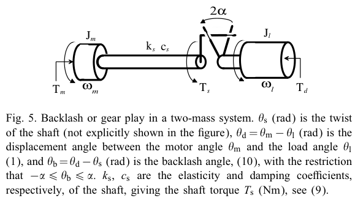
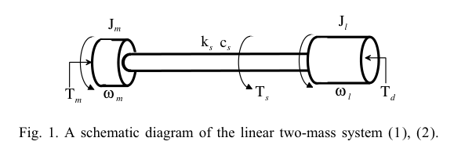
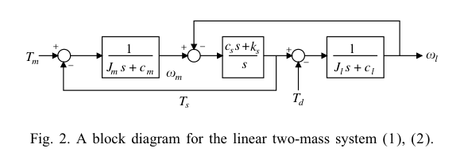
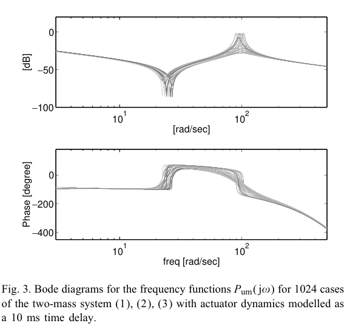
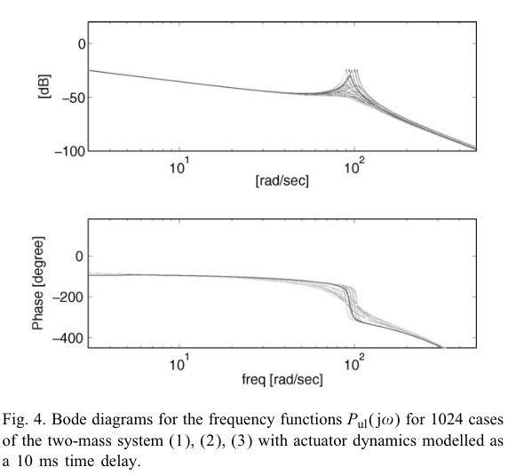
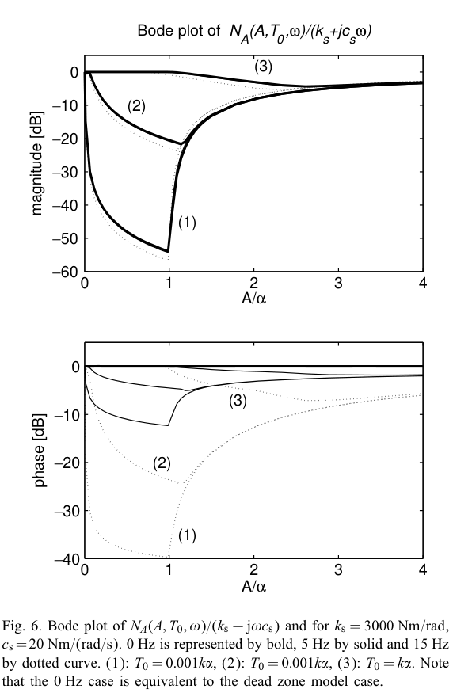
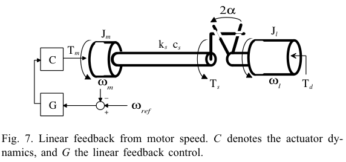
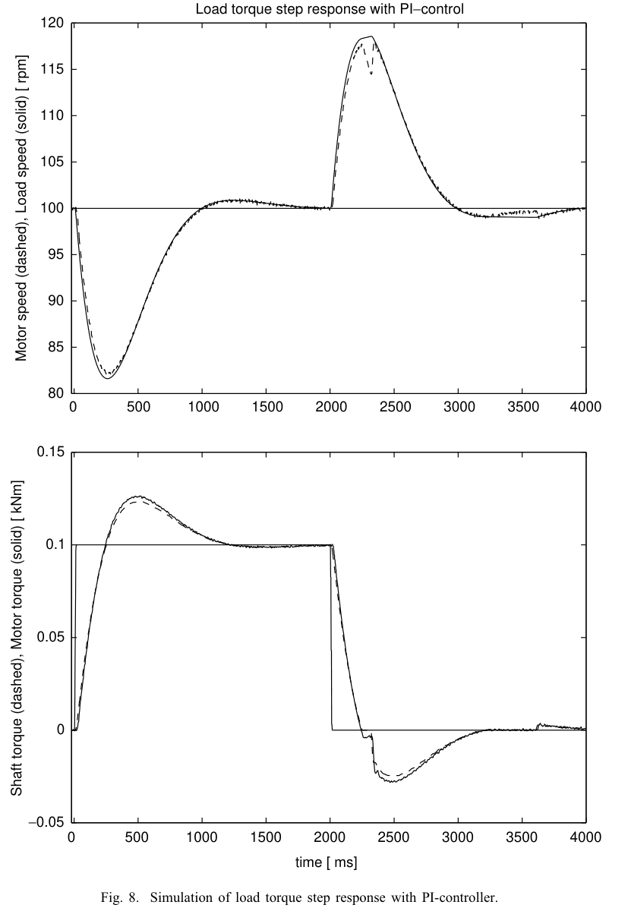
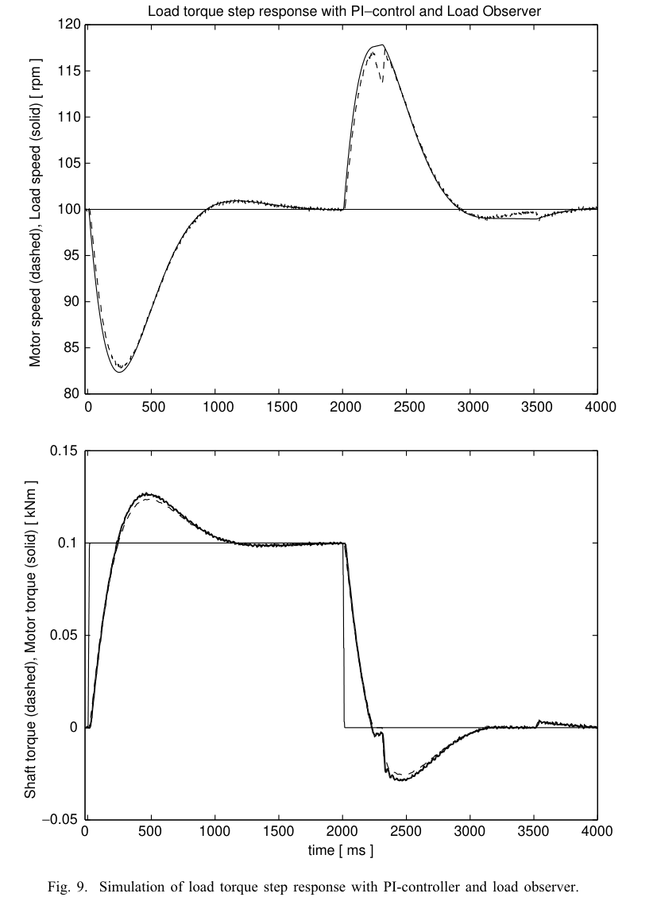
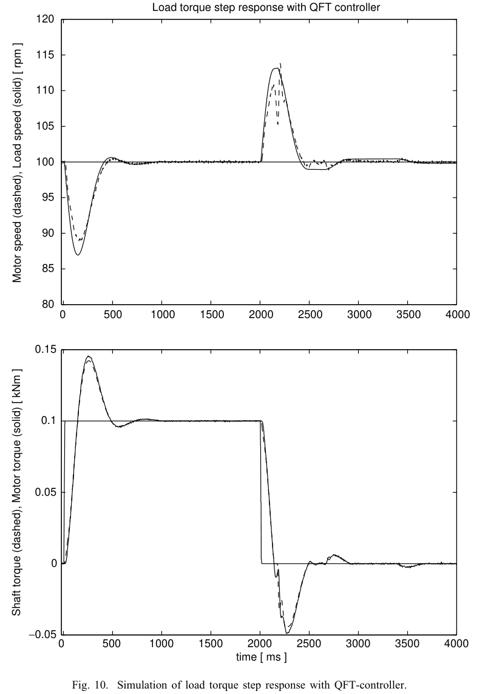

# 백래시가 있는 기계 시스템의 제어 — 조사 논문 (Nordin 2002)

- 원제: Controlling mechanical systems with backlash—a survey
- 원문: 같은 폴더의 `Nordin2002_Automatica_backlash_survey.pdf` (Mattias Nordin, Per-Olof Gutman. Automatica 38(10), pp. 1633–1649, 2002. DOI 10.1016/S0005-1098(02)00047-X)
- 번역 범위: 전문(본문, 그림 캡션, 각주, 저자 소개). 참고문헌은 원문 그대로 옮겼다.
- 그림: 원문 그림 10개를 `그림/`에 넣고 본문에서 처음 언급되는 곳에 삽입했다. 그림 안의 축 이름·범례는 원문 그대로다. 저자 사진은 넣지 않았다.
- 원문 절 번호는 0절(서론)부터 시작한다. 그대로 따랐다.

## 초록 (Abstract)

백래시(backlash)는 산업, 로봇, 자동차, 자동화 및 기타 응용에서 속도 제어와 위치 제어의 성능을 제한하는 가장 중요한 비선형성 중 하나다. 백래시가 있는 시스템의 제어는 1940년대부터 연구 대상이었다. 이 조사는 백래시가 있는 시스템에 기술 함수(describing function) 해석을 도입한 초기의 선구적 논문들 이후로 놀라울 만큼 적은 제어 혁신만이 제시되었음을 보여 준다. 그러나 적응 제어와 비선형 제어 전략을 이용한 유망한 발전이 이루어지고 있다. © 2002 Elsevier Science Ltd. All rights reserved.

**키워드**: 백래시 보상(Backlash compensation); 기계 시스템(Mechanical systems); 모터 제어(Motor control); 기술 함수(Describing functions); 비선형 제어(Non-linear control)

## 0. 서론 (0. Introduction)

이 조사 논문에 해당하는 백래시의 정의는 "(일련의 기어에서처럼) 인접한 가동 부품 사이의 유격(play)"이며, Webster 사전에 실려 있다. 백래시의 간단한 그림은 그림 5에 있다. 백래시는 구동 부재(모터)가 피동 부재(부하)에 직접 연결되지 않은 모든 기계 시스템에 존재한다. 구동되는 기계 시스템의 대부분은 아니더라도 많은 경우가 그러하며, 특히 기어가 있는 시스템, 예를 들어 자동차의 구동계, 압연기(rolling mill), 인쇄기, 산업용 로봇이 그렇다.

*그림 5 — 2관성 시스템의 백래시 또는 기어 유격. $\theta_s$ (rad)는 축의 비틀림(그림에 명시적으로 표시하지 않음), $\theta_d = \theta_m - \theta_l$ (rad)은 모터 각 $\theta_m$과 부하 각 $\theta_l$ 사이의 변위각(1), $\theta_b = \theta_d - \theta_s$ (rad)는 백래시 각(10)이며 $-\alpha \le \theta_b \le \alpha$라는 제약이 있다. $k_s$, $c_s$는 각각 축의 탄성 계수와 감쇠 계수이며, 이것이 축 토크 $T_s$ (Nm)를 준다. 식 (9) 참조.*

백래시 뒤에 있는 부하를 제어하는 것이 복잡하다는 것은, 특히 높은 정밀도가 요구되면, 곧바로 분명하다. 백래시 틈(gap)이 벌어져 모터가 부하와의 접촉을 잃는 때가 있다. 이는 부하에 외란이 작용할 때, 또는 모터가 부하가 현재 움직이고 있거나 놓여 있는 방향의 반대 방향으로 수정 동작을 해야 할 때 일어날 수 있다. 백래시 틈이 벌어져 있으면 부하의 운동은 자율적이 되고, 게다가 모터가 만드는 힘이나 모멘트는 부하가 아니라 모터 자신(과 백래시 앞쪽의 전동 부품)만을 구동한다. 그런 때에는 부하가 "제어 불가능"하며 제어되는 동역학이 달라진다고 주장할 수도 있다. 백래시가 있는 제어 시스템은 흔히 정상상태 오차를 보이거나, 더 나쁘게는 리밋 사이클(limit cycle)을 보인다. 리밋 사이클에서는 시스템이 흔히 불규칙하게 진동하며, 그 첨두-첨두(peak–peak) 진폭이 백래시 틈 전체 크기를 넘을 수도 있다.

백래시가 있는 시스템의 제어는 1940년대부터 연구 대상이었다. P, PI, PID 제어기, 고차 선형 제어기, 상태 피드백 제어기, 관측기(observer) 기반 제어기를 포함한 선형 제어기들이 연구되었다. 백래시를 기술하는 주된 해석 도구는 기술 함수 기법이었다. 프리로드(preload), 즉 백래시의 근사 역함수가 비적응·적응 설정 모두에서 백래시 대책으로 흔히 제안되었다. 퍼지 제어기와 전환(switched) 선형 제어기를 포함한 다른 비선형 제어기들도 제안되었다.

이 조사는 광범위한 컴퓨터 검색의 결과이며 96개의 참고문헌을 담고 있다. 물론 이보다 더 많은 문헌이 있겠지만, 본질적으로 다른 아이디어를 제시하는 문헌을 놓치지 않았기를 바란다.

논문의 구성은 다음과 같다. 1절에서는 백래시가 없는 탄성 시스템, 즉 모터와 부하가 백래시 없는 축(shaft)이나 차축으로 연결된 시스템의 제어를 간략히 기술한다. 이 조사의 주된 초점은 아니지만, 그런 시스템에 대한 잘 알려진 제어 알고리즘 몇 가지를 비판적으로 검토한다. 이들이 백래시 보상이 세워지는 기반을 이루기 때문이다. 2절에서는 백래시 모델을 검토하고 제어 설계 목적에서의 유용성을 논의한다. 내부 백래시(internal backlash)는 3절과 4절에서 다루며, 각각 속도 제어와 위치 제어를 다룬다. 입력과 출력에 백래시가 있는 시스템은 5절에서 다룬다. 적절한 경우 3절과 4절은 피드백 신호를 어디에서 측정하는지(모터 쪽, 부하 쪽, 또는 둘 다)와 어떤 종류의 제어기를 쓰는지(선형 또는 비선형)에 따라 소절로 나뉜다. 산업적으로 흥미로운 경우인 모터 쪽 선형 속도 피드백에 대해서는 3.2.1절에 몇 가지 시뮬레이션 설계 예를 넣었다. 다른 구성에 대해서는 조사한 논문들의 시뮬레이션과 실험을 참고하라. 6절의 짧은 결론이 조사를 요약한다.

(각주) 이 논문은 IFAC 회의에서 발표되지 않았다. 이 논문은 편집자 Manfred Morari의 추천으로 수정본 형태로 게재되었다. 교신 저자: Tel.: +46-21-340527; fax: +46-21-181724. 전자우편: mattias.c.nordin@se.abb.com (M. Nordin), peo@tx.technion.ac.il (P.-O. Gutman). 소속: a Rolling Mills Department, ABB Process Industries, 721 67 Västerås, Sweden; b Faculty of Agricultural Engineering, Technion—Israel Institute of Technology, Haifa 32000, Israel. 접수 2000년 2월 23일, 수정본 접수 2002년 1월 29일, 게재 승인 2002년 3월 4일.

## 1. 탄성 시스템의 제어 (1. Control of elastic systems)

실용적으로 관심 있는 많은 운동 제어 시스템은 질량들이 유연한 축이나 스프링으로 연결된 다질량(multimass) 시스템으로 모델링할 수 있다(예: Hori, Iseki, and Sigiura (1994)). 많은 경우 모델링을 더 단순화하여 2질량 시스템을 생각하는데, 첫째 질량은 모터, 둘째 질량은 부하를 나타내며, 축은 질량이나 관성이 없다고 본다. 이런 시스템은 예를 들어 로봇 팔(Åström & Wittenmark, 1989; Brandenburg, Hertle, & Zeiselmair, 1987; Ahmad, 1985)이나 압연기 구동부(Pollman, Tosetto, & Brea, 1991; Dhaouadi, Kubo, & Tobise, 1993)의 모델 역할을 한다. 일부 파라미터가 불확실하다고 가정하면 2질량 모델의 현실성을 높일 수 있다.

그래서 우리는 불확실한 2질량 시스템의 다음 선형 모델을 이 논문의 표준 플랜트(plant)로 선택한다. 단순화를 위해 기어비는 1이라고 가정한다. 아래 2절에서 이 선형 모델에 백래시를 더하며, 비선형 마찰은 이 논문의 주제에 속하지 않으므로 일반적으로 무시한다. 조사한 제어 법칙들은 이 표준 플랜트와 관련지어 논의한다. 모델의 변형은 예를 들어 Oldak, Baril, and Gutman (1994)이나 Nordin and Gutman (1995)에서 찾을 수 있다.

$$\begin{aligned}J_m\dot\omega_m &= -c_m\omega_m - T_s + T_m,\\ J_l\dot\omega_l &= -c_l\omega_l + T_s - T_d,\\ \omega_d &= \omega_m - \omega_l\end{aligned} \tag{1}$$

여기서

$$\dot\theta_m = \omega_m, \quad \dot\theta_l = \omega_l, \quad \dot\theta_d = \omega_d$$

이고

$$T_s = k_s\theta_d + c_s\omega_d, \tag{2}$$

이다. $J_m$ (kg m²)은 모터 관성 모멘트, $c_m$ (Nm/(rad/s))은 모터 점성 마찰, $T_s$ (Nm)는 전달되는 축 토크, $T_m$ (Nm)은 모터 토크, $J_l$ (kg m²)은 부하 관성 모멘트, $c_l$ (Nm/(rad/s))은 부하 점성 마찰, $T_d$ (Nm)는 부하 토크 외란, $k_s$ (Nm/rad)는 축 탄성, $c_s$ (Nm/(rad/s))는 축의 내부 감쇠 계수다. 일반적으로 $\omega_d \ne \omega_l \ne \omega_m$이므로 축 감쇠를 모터나 부하의 점성 마찰에 합칠 수 없다는 점에 유의하라. 각 $\theta_m$, $\theta_l$, $\theta_d$는 각각 모터 각, 부하 각, 차이 각(rad)이며, $\omega_m$, $\omega_l$, $\omega_d$는 각각의 시간 미분, 즉 모터 각속도, 부하 각속도, 차이 각속도(rad/s)다. 선형 시스템 (1), (2)에서는 차이 각이 축 각과 같다는 점에 주목하라. 아래 몇몇 예에서는 다음 수치 값을 쓴다.

$$\begin{aligned}J_m &= 0.4\ \text{kg m}^2,\\ c_m &\in [0, 0.1]\ \text{Nm/(rad/s)},\\ J_l &\in [5.5, 6.0]\ \text{kg m}^2,\\ c_l &\in [0, 1]\ \text{Nm/(rad/s)},\\ k_s &\in [3000, 4000]\ \text{Nm/rad},\\ c_s &\in [1, 20]\ \text{Nm/(rad/s)}.\end{aligned} \tag{3}$$

공칭(nominal) 경우는 파라미터 조합 $c_m = 0.1$, $J_l = 5.6$, $c_l = 1$, $k_s = 3300$, $c_s = 1$로 정의한다.

시스템 (1), (2)의 개략도는 그림 1에 있다. 블록선도는 그림 2에 있다.

*그림 1 — 선형 2질량 시스템 (1), (2)의 개략도.*

*그림 2 — 선형 2질량 시스템 (1), (2)의 블록선도.*

플랜트 (1), (2)에 대해, $P_{um}(s)$를 $T_m$에서 $\omega_m$으로의 보상되지 않은 개루프 전달함수, $P_{ul}(s)$를 $T_m$에서 $\omega_l$로의 전달함수, $P_{dm}(s)$를 $T_d$에서 $\omega_m$으로의 전달함수, $P_{dl}(s)$를 $T_d$에서 $\omega_l$로의 전달함수라 하자. 식 (1)로부터 다음을 얻는다.

$$\begin{aligned}P_{um}(s) &= \frac{J_ls^2 + (c_l + c_s)s + k_s}{d(s)},\\ P_{ul}(s) &= \frac{c_ss + k_s}{d(s)},\\ P_{dm}(s) &= -\frac{c_ss + k_s}{d(s)},\\ P_{dl}(s) &= -\frac{J_ms^2 + (c_m + c_s)s + k_s}{d(s)}\end{aligned}$$

여기서

$$d(s) = J_mJ_ls^3 + (J_l(c_m + c_s) + J_m(c_m + c_s))s^2 + ((J_l + J_m)k_s + c_mc_l + c_mc_s + c_lc_s)s + (c_m + c_l)k_s$$

이다.

(1)–(3)의 각 불확실 파라미터 구간을 등간격으로 세 소구간으로 나누고 모든 파라미터 조합을 선택하면 1024개의 플랜트 경우가 정의된다. 이 1024개 플랜트 경우에 대한 주파수 함수 $P_{um}(j\omega)$ ($\omega$ (rad/s)는 주파수 변수)를 그림 3의 보드 선도(Bode diagram)에 나타냈다. 같은 경우들에 대한 $P_{ul}(s)$의 보드 선도는 그림 4에 있다. 보드 선도는 $P_{um}(j\omega)$와 $P_{ul}(j\omega)$가 다음에서 공통의 공진 피크를 가짐을 보여 준다.

$$\omega_1 = \sqrt{\frac{k_s(J_m + J_l)}{J_mJ_l}}\ \text{(rad/s)}, \tag{4}$$

반면 더 낮은 주파수에서의 $P_{um}(j\omega)$의 반공진(anti-resonance)

$$\omega_2 = \sqrt{\frac{k_s}{J_l}}\ \text{(rad/s)} \tag{5}$$

은 $P_{ul}(j\omega)$에는 대응하는 것이 없다. 이 사실은 고대역폭 폐루프 시스템의 제어 설계가 위치나 속도 센서가 모터 쪽에 있는지 부하 쪽에 있는지에 따라 달라진다는 것을 뜻한다(Brandenburg and Kaiser (1995), Pettersson (1997) 참조).

*그림 3 — 구동기 동역학을 10 ms 시간 지연으로 모델링한 2질량 시스템 (1), (2), (3)의 1024개 경우에 대한 주파수 함수 $P_{um}(j\omega)$의 보드 선도.*

*그림 4 — 구동기 동역학을 10 ms 시간 지연으로 모델링한 2질량 시스템 (1), (2), (3)의 1024개 경우에 대한 주파수 함수 $P_{ul}(j\omega)$의 보드 선도.*

또 다른 중요한 문제는 구동기(actuator) 동역학, 즉 모터 토크가 어떻게 만들어지는가이다. 일반성을 잃지 않고 토크 구동기의 대역폭이 $1/\tau_e$로 제한된다고 가정한다. 여기서 $\tau_e$ (s)는 그 시정수다. 또한 지연, 포화 등 때문에 역 조절기 동역학으로 구동기 동역학을 완전히 상쇄하는 것은 불가능하여, 임의의 개루프 교차 주파수(cross-over frequency)를 얻을 수는 없다고 가정한다. 아래의 설계와 시뮬레이션에서는 이 가정과 일치하도록 구동기 동역학을 $e^{-s\tau_e\pi/2}/(1 + s\tau_e)$로 둔다. 이렇게 해서 비현실적인 제어 해법을 피한다. 1.1절의 논의도 참조하라.

### 1.1. PI 제어 (1.1. PI-control)

탄성 시스템, 특히 2질량 시스템에 가장 흔한 제어기는 연속시간 또는 샘플링 PI 조절기나 그 변형이다(예: Koyama and Yano (1991), Brandenburg and Schäfer (1989), Ji and Sul (1995), Joos and Sicard (1992), de Santis (1994), Pollman et al. (1991)). PI 제어는 심각한 성능 한계를 겪는다. Brandenburg and Schäfer (1990), Schäfer and Brandenburg (1991), Shäfer (1993)에서는 토크 구동기(이 경우 전류 제어 루프)의 시정수 $\tau_e$ (s)가 길어서 $\tau_e > 1.5/\omega_1$이고, 따라서 구동기가 너무 느려 공진 (4)의 극을 감쇠가 훨씬 좋은 위치로 옮길 수 없는 이른바 "강성(stiff)" 시스템에서는 불완전 상태 피드백이나 PI 조절기(Brandenburg, 1986)가 만족스러운 감쇠를 얻는다고 한다. 구동기가 공진을 감쇠시킬 만큼 빠른($\tau_e < 1.5/\omega_1$) "연성(soft)" 시스템에서는 완전 상태 피드백 제어가 바람직하다고 한다.

$\omega_m$으로부터 피드백하는 경우를 생각하면, Koyama and Yano (1991)는 부하 관성 모멘트와 모터 관성 모멘트의 비 $J_l/J_m$이 크면 PI 조절기로 만족스러운 폐루프 대역폭을 얻기 어렵다는 것을 발견했다. 반대쪽 끝에서 Hori et al. (1994)는 $J_l/J_m$이 매우 *작을* 때 제어 문제가 매우 어렵다고 주장한다. 따라서 제어 문제는 $J_m \approx J_l$일 때 가장 쉽다.

후자의 결과는 Baril and Galic (1994)에서 뒷받침된다. $J_l/J_m \ll 1$이면 $\omega_m$만 측정할 때 선형 속도 제어기로 잘 감쇠된 응답을 얻기가 매우 어렵거나 불가능하기까지 하다. 부하가 큰 진폭으로 진동하는데도 측정되는 모터 속도의 진동 진폭은 매우 작을 수 있다는 점에 유의하라. 대신 부하 속도로부터 추가 피드백 신호를 받는 다단(cascaded) 제어기가 진동을 감쇠시킬 수 있음이 보여졌다.

보고서(Baril & Galic, 1994)는 또한 관성비 $J_l/J_m$과 양 $\tau_d\omega_1$의 공동 영향을 조사하여 모터 속도 제어에 대한 위 결과를 확장한다. 여기서 $\tau_d$ (s)는 전류 제어, 속도 센서, 샘플링이 만드는 지연을 나타내며, 따라서 Schäfer and Brandenburg (1991)의 $\tau_e$에 해당한다. $\tau_d\omega_1 \ll 1$이면 PI 조절기가 만족스러운 성능을 주며, 고차 제어기로 얻을 수 있는 개선은 미미하다. $\tau_d\omega_1$이 커지면(여전히 $\tau_d\omega_1 < 1$이라도) 안정 여유가 받아들일 수 없게 되기 시작하고 고차 제어기를 써야 한다. PI와 고차 제어기 사이의 전환점은 관성비 $J_l/J_m$에 의존하여, 관성비가 크면 고차 제어기가 필수이고 관성비가 작으면 PI로도 여전히 받아들일 만할 수 있다. 따라서 Baril and Galic (1994), Schäfer and Brandenburg (1991), Brandenburg (1986)의 결과는 서로 일치한다.

Brandenburg et al. (1987)에서는 대칭 최적(symmetric optimum)이 탄성 2질량 시스템의 PI 조절기를 조정하는 데 적합한 방법으로 언급된다. 시간 지연이 있는 불확실한 탄성 2질량 시스템의 모터 속도 제어를 위한 PI 제어의 분석이 Galardini, Nordin, and Gutman (1997)에서 수행되었으며, 결과는 다음과 같다. (i) 감쇠되지 않는 진동을 피하려면 얻을 수 있는 교차 주파수는 대략 $\omega_2/2$이다. (ii) PI 조절기 $k_P + k_I/s$의 이득은 $k_I \le k_s(J_m + J_l)/(4J_l)$이고 $J_m\omega_1 < k_P \le 2\sqrt{k_I(J_m + J_l)}$이 되도록 조정해야 한다. 즉 PI 조절기가 플랜트 파라미터의 함수로 주어진다. 부하 속도를 측정하는 경우에는 PI 제어로 교차 주파수가 $\approx\omega_1/2$로 제한됨도 보일 수 있다.

마찬가지로 Brandenburg and Kaiser (1995)에서는 PI 속도 제어를 쓰면서 $\omega_m$과 $\omega_l$을 각각 피드백할 때 $J_l/J_m$의 영향을 조사한다. 추가로 공진 피크를 보상하기 위한 노치 필터(notch filter)도 고려한다. $J_l \gg J_m$일 때도 $\omega_m$ 피드백이 $\omega_l$ 피드백보다 빠른 제어를 가능하게 한다는 것이 발견되었다. 다만 그 경우 반공진이 매우 낮은 주파수로 이동하여 개방 속도 제어 루프의 도달 가능한 교차 주파수를 제한한다. $J_l \ll J_m$인 경우에는 PI 제어기를 적용하면 모터와 부하 질량 모두에 약하게 감쇠된 진동이 생긴다. 상태 피드백 제어기는 이 경우를 다룰 수 있음이 발견되었다. 산업 플랜트에서 흔히 적용되는 노치 필터는 모터 속도의 명령 계단 응답을 개선하는 데는 적합하지만 부하 속도에는 그렇지 않다. 노치 필터는 외란 계단 응답을 상당히 악화시킨다. 극 상쇄 때문에 시스템의 고유 진동수가 제어 불가능해지기 때문이다.

### 1.2. 고차 선형 제어 (1.2. Higher order linear control)

많은 저자들이 모터 속도 피드백을 쓰는 PI 제어의 한계를 극복하기 위한 여러 해법을 제안했다. Brandenburg (1986)와 Brandenburg의 후속 연구들(Brandenburg, Unger, & Wagenpfeil, 1986; Brandenburg et al., 1987; Brandenburg & Schäfer, 1987; Brandenburg & Schäfer, 1989; Schäfer & Brandenburg, 1990; Schäfer & Brandenburg, 1991)에서는 축을 통해 전달되는 토크, 즉 (2)의 $T_s$를 추정하는 외란 또는 부하 토크 관측기가 제안되었다. $\hat c_m$을 (1)의 $c_m$에 대한 사전 추정값, $T_m$을 알려진 또는 추정된 모터 토크라 하자. 전기 DC 모터에서는 $T_m = k_ii$이며, $k_i$ (Nm/A)는 알려진 또는 추정된 모터 토크 상수, $i$ (A)는 모터 전류다. 그러면 추정값 $\hat T_s$ (Nm)를 주는 루엔버거(Luenberger) 관측기는 다음 형태를 갖는다.

$$\begin{aligned}\hat J_m\dot{\hat\omega}_m &= -\hat c_m\hat\omega_m - \hat T_s + T_m,\\ \hat T_s &= k_o(\omega_m - \hat\omega_m),\end{aligned} \tag{6}$$

여기서 $k_o$는 적절한 관측기 대역폭을 얻도록 고르는 관측기 이득이다. $T_c$를 "보통의" 피드백 조절기(예: PI)가 만드는 제어 토크라 할 때, 토크 구동기에 대한 토크 기준으로서 모터에 가하는 전체 토크를 $T_m = T_c + k_1\hat T_s$로 고른다. 상수 $k_1$이 1이면 축 토크가 완전히 보상되어 모터가 부하로부터 완전히 분리되고 공진 피크가 나타나지 않을 것이다. 그러나 그러면 부하 진동이 모터 속도 제어의 영향을 받지 않을 것이다. 이 때문에 $T_s$의 부분 보상만이 성공적이다. 예를 들어 Brandenburg et al. (1986)에서는 $k_1 = 0.3$을 제안하며, 이는 축 토크 보상이 없는 PI 조절기에 비해 기준 계단 응답의 정착 시간을 20% 줄인다.

(6)과 동일한 "미분형(differential)" 축 토크 추정기도 Brandenburg et al. (1986)에서 Brandenburg가 제안했다. 축 토크 추정을 제안한 다른 연구자들로는, 많은 경우 Brandenburg와 비슷하거나 동일하게, Baril and Galic (1994), Cohen and Cohen (1994), Dhaouadi, Kubo, and Tobise (1994), Ji and Sul (1995), Koyama and Yano (1991), Ohishi, Ohnishi, and Miyachi (1983)의 저자들이 있으며, 이들 대부분은 축 토크를 완전히 보상하면 부하를 모터로부터 관측할 수 없게 된다고 지적한다. 축 토크 보상은 백래시와 다른 비선형성이 있을 때에도 유용하다.

분명히 PI 조절과 축 토크 추정·보상의 결합은 더 많은 측정 또는 추정 상태로부터의 피드백을 포함하도록 확장할 수 있다. Brandenburg and Schäfer (1989), Koyama and Yano (1991)에서는 축 토크 보상을 쓰는 PI 제어를 고정 파라미터 선형 모델 기준 제어기로 확장한다. 2질량 또는 3질량 모델 관측기의 상태로부터의 상태 피드백이 Schäfer and Brandenburg (1991), Dhaouadi et al. (1993), Hori et al. (1994)에서 제안된다. 축 토크 보상은 Ohishi, Myooi, Ohnishi, and Miyaji (1986), Ohishi et al. (1983)에서는 선형 이차 최적 제어로 계산한 상태 피드백으로, Cohen and Cohen (1994)에서는 디오판토스(Diophantine) 방정식으로 계산한 극 배치로 보완된다. 다중 모델 극 배치는 Grundmann (1995)에서 제안된다. LQG/LTR 제어는 Pettersson (1997)과 Gurian (1998)에서 제안된다. $H_\infty$ 설계는 Nordin (1992)에서 제안된다.

주파수 영역 통과대역 루프 성형(passband loop shaping)은 Chang, Ji, Shimanovich, and Caudill (1996)에서 제안된다. 정량적 피드백 이론(quantitative feedback theory, QFT)(Horowitz, 1992)에 의한 완전 2자유도 루프 성형으로 강건한 고정 파라미터 선형 제어기를 얻는 방법이 Boneh and Yaniv (1999), Yaniv and Horowitz (1990), Nordin and Gutman (1996), Kidron and Yaniv (1996)에서 쓰인다. 예를 들어 Yaniv and Horowitz (1990), Nordin and Gutman (1996)에서는 비최소 위상(non-minimum phase) 제어기가 필요한 강건성을 준다는 것이 입증된다.

1995년 로마에서 열린 제3회 유럽 제어 학회(ECC 95)에서는 I.D. Landau가 조직한 "강건 디지털 제어기 설계 — 유연 전동 벤치마크(Design of Robust Digital Controllers—A Flexible Transmission Benchmark)" 세션이 열렸으며, 스프링으로 연결된 불확실한 3질량 시스템의 부하 위치를 경쟁하는 설계들로 제어하는 것이었다. 결과는 European Journal of Control 1996년 2호에 보고되었다(Landau, Rey, Karimi, Voda, and Franco (1996) 참조). 우승작(Nordin & Gutman, 1996)과 준우승작(Kidron & Yaniv, 1996) 모두 QFT를 썼다. Oustaloup, Mathieu, and Lanusse (1996)도 루프 성형을 썼고, Landau, Karimi, Voda, and Franco (1996)는 극 배치와 감도 함수 성형을 결합했다. $H_\infty$ 제어는 Jones and Limebeer (1996)가 제안했다. 선형 설계를 쓴 다른 출품작으로는 Hjalmarsson, Gunnarsson, and Gevers (1996), Decker, Ehrlinger, Boucher, and Dumur (1996)가 있다.

### 1.3. 백래시 보상을 향하여: 비선형 제어와 적응 제어 (1.3. Towards backlash compensation: non-linear and adaptive control)

여러 저자들이 백래시가 없는 경우에도 (1), (2)와 비슷한 탄성 플랜트의 비선형 제어나 적응 제어를 제안했다. Pan and Furuta (1996)에서는 위에서 언급한 ECC 95 벤치마크 문제에 대해 가변 구조(variable structure) 제어 법칙을 제안한다. 가변 구조 제어는 Harashima, Ueshiba, and Hashimoto (1987)에서도 다관절 매니퓰레이터 제어에 쓰였고, 적응 가변 구조 제어는 Dumitrache, Dumitriu, and Monteano (1987)에서 DC 모터의 속도 제어용으로 제안되었다. Yeh, Fu, and Yang (1996)에서는 포탑(gun-turret) 시스템을 위한 적응 계산 토크(computed torque) 제어를 제안한다.

단연 가장 흔한 비선형 대안은 Hahn and Unbehauen (1987), Schönfeld (1987)에서 제안된 적응 모델 기준 제어다. Recker et al. (1991), Tao and Kokotovic (1993), Tao and Kokotovic (1996)에서도 백래시가 없는 경우의 모델 기준 적응 제어가 백래시가 있을 때의 제어 알고리즘의 기반을 이룬다. 적응 극 배치는 Åström and Wittenmark (1989), Han and de la Sen (1996), Ji and Sul (1995)에서 제안된다. Ma and Tao (1999), Tao (2000)도 참조하라.

Åström and Wittenmark (1989, p. 278)에는 (1), (2)와 비슷한 시스템에 대한 적응 극 배치 제어와, 이 논문의 둘째 저자가 QFT로 설계한 선형 강건 제어 사이의 비교가 있다. 적응 제어는 적응 중에는 나쁜 과도 응답을 내는 것으로 보이고, 적응 후에는 적응 시스템의 이득, 따라서 대역폭이 강건 선형 시스템의 이득보다 낮다고 결론 내릴 수 있다. 그러면 적응 제어와 강건 선형 제어 사이의 선택은 불확실성의 크기와, 과도 거동과 정상상태 운전 중 잡음 민감도 중 어느 쪽에 비중을 두느냐에 달려 있을 것이다.

백래시가 있으면 저울은 적응을 포함하는 쪽으로 기운다. 이는 선형의 관점에서 백래시가 플랜트의 선형화 모델에 더 많은 불확실성을 들여온다는 사실로 이해할 수 있다. 같은 성능을 얻으려면 불확실성이 클수록 더 높은 피드백 이득이 필요한데, 이는 안정성 제약 때문에 달성할 수 없을 수 있고, 그렇지 않으면 적응 제어나 다른 비선형 제어가 필요하다(Horowitz (1992), Horowitz (1963) 참조).

## 2. 백래시 모델 (2. Backlash models)

백래시 또는 기어 유격은 기계 시스템에서 흔한 비선형성이다. 백래시를 둘러싼 기계적 환경과 운전 조건에 따라 거동을 모델링하는 데 서로 다른 수학적 모델을 써야 한다. 이 절에서는 그림 5에 그린 기계 모델에 집중한다. 이는 1절에서 기술한 2질량 모델에서 축을 백래시를 포함한 축으로 바꾼 것이다(그림 5 참조). 최대 백래시 각은 $\alpha$ (rad)로 나타낸다.

식 (1)은 그대로이지만, 축 토크를 $\theta_d$와 $\omega_d$의 함수로 모델링하는 식 (2)는 수정해야 한다. 2.1절에서는 축 감쇠 $c_s$가 0일 때만 유효한, 흔히 쓰이는 사대역(dead zone) 모델을 제시한다. 2.2절에서는 축에 대한 동적 방정식이 필요한, 축 감쇠가 0이 아닐 때 유효한 모델들을 제시한다. 2.3절에서는 위 모델들의 기술 함수를 계산한다. 이 모델들에 대한 더 자세한 설명은 Nordin, Galic, and Gutman (1997), Nordin (2000)에 있다. Taylor and Lu (1995)의 백래시 모델은 Nordin et al. (1997)의 관성 없는 강성 축 백래시 모델과 같다.

2.4절에서는 완결성을 위해 히스테리시스(hysteresis) 모델을 제시한다. 여기서는 축이 강성이라고 가정하며, 백래시 모델의 입력은 모터 위치 $\theta_m$, 출력은 부하 위치 $\theta_l$이다.

### 2.1. 사대역 모델 (2.1. The dead zone models)

백래시가 있는 탄성 축의 해석과 시뮬레이션을 위해 자주 제안되며, 거의 모든 기초 제어 과목에서 볼 수 있는 모델은 고전적인 사대역 모델이다(예: Tustin (1947), Liversidge (1952), Gelb and Vander Velde (1968), Cosgriff (1958), Chestnut and Mayer (1995)). 여기서 축 비틀림 $\theta_s$ (rad)에 비례하는 축 토크는 다음과 같다.

$$T_s = k_s\theta_s = k_sD_\alpha(\theta_d). \tag{7}$$

사대역 함수

$$D_\alpha(x) = \begin{cases}x - \alpha & x > \alpha,\\ 0 & |x| < \alpha,\\ x + \alpha & x < -\alpha\end{cases} \tag{8}$$

는 $\theta_s$를 변위 $\theta_d$의 정적 함수로 직접 준다. 백래시가 없으면 $\theta_s = \theta_d$임에 유의하라. 이 사대역 모델이 유효하려면 축 감쇠 $c_s$가 0, 즉 축을 순수한 스프링으로 모델링하는 것이 필수다. 사대역 모델은 정적인 스칼라 비선형 함수이므로 비교적 해석하기 쉽다. 그런 해석이 시뮬레이션 목적의 몇 가지 단순화와 함께 Goodman (1963)에 있다.

### 2.2. 정확한 모델 (2.2. Exact models)

축에 감쇠가 있을 때, 즉 $c_s \ne 0$일 때 축 토크는 다음과 같다.

$$T_s = k_s\theta_s + c_s\omega_s \tag{9}$$

여기서 $\omega_s = \dot\theta_s$다(Nordin (1995), Nordin et al. (1997) 참조). Nordin (1995), Nordin et al. (1997)에서는 널리 쓰이는 사대역 모델 (7), (8)이 $c_s \ne 0$인 경우에는 틀렸음을 보인다. 백래시 각을

$$\theta_b = \theta_d - \theta_s \tag{10}$$

로 정의하면 다음 동적 방정식을 얻을 수 있다(Nordin, 1995; Nordin et al., 1997).

$$\dot\theta_b = \begin{cases}\max\left(0, \dot\theta_d + \frac{k_s}{c_s}(\theta_d - \theta_b)\right) & \text{if } \theta_b = -\alpha\ (T_s \le 0)\\ \dot\theta_d + \frac{k_s}{c_s}(\theta_d - \theta_b) & \text{if } |\theta_b| < \alpha\ (T_s = 0)\\ \min\left(0, \dot\theta_d + \frac{k_s}{c_s}(\theta_d - \theta_b)\right) & \text{if } \theta_b = \alpha\ (T_s \ge 0).\end{cases} \tag{11}$$

[역주: 원문 식 (11)의 좌변은 $\theta_b$로 인쇄되어 있으나, 뒤 문장에서 "시간 미분이 …인 제한 적분기"로 설명하므로 $\dot\theta_b$로 옮겼다.]

이 상태 방정식은 시간 미분이 $\dot\theta_d + k/c(\theta_d - \theta_b)$이고 한계가 $\alpha$인 제한 적분기(limited integrator)로 해석할 수 있다.

(11)로부터 $\theta_b$와 $\dot\theta_b$를 알고 $\theta_d(t)$, $\dot\theta_d(t)$가 주어지면 토크 $T_s$는 (9, 10)으로 구한다. 이제 우리는 주어진 $\theta_d$와 $\dot\theta_d$로 토크 $T_s$를 주는 정적 함수가 아니라 비선형 동적 시스템을 갖게 된다. 이 동적 모델을 $\theta_d$와 $\omega_d$의 정적 함수로 근사할 수 있으며, 이는 해석과 시뮬레이션을 크게 단순화한다(Nordin, 1995; Nordin et al., 1997). 같은 논문들에서 틈이 고무로 일부 채워진 커플링의 모델도 소개된다.

### 2.3. 기술 함수 (2.3. Describing functions)

비선형 시스템의 해석과 합성에 흔히 쓰이는 방법은 기술 함수 방법이다(예: Chestnut (1954), Gelb and Vander Velde (1968), Atherton (1975), Atherton (1981)). 백래시 사대역 모델의 기술 함수 모델은 이미 Thomas (1954)에 있다. Brandenburg가 예를 들어 Brandenburg et al. (1986), Brandenburg and Schäfer (1987), Brandenburg and Schäfer (1989)에서 지적했듯이, 여기서 $T_0$로 나타내는 일정한 *출력* 토크가 백래시가 있는 축의 동작점을 가장 잘 기술한다. 이 아이디어를 써서, 먼저 *2입력 기술 함수(dual-input describing function)* DIDF를 계산한다. 입력은 일정한 오프셋 $B$를 가진 사인파이며 다음과 같다.

$$\theta_d(t) = B + A\sin(\omega t) \tag{12}$$

출력은 일정한 오프셋 $N_BB$와 1차 고조파로 근사한다(이론적 배경은 Gelb & Vander Velde, 1968 참조).

$$T_s(t) = T_s(\theta_d, \dot\theta_d) \approx N_BB + AN_p\sin(\omega t) + AN_q\cos(\omega t) \tag{13}$$

이로부터 DIDF $N_A(A, B, \omega) = N_p(A, B, \omega) + iN_q(A, B, \omega)$와 $N_B(A, B, \omega)$를 계산한다. 그다음 $B$를 독립 변수로 하는 방정식

$$T_0 = BN_B(A, B, \omega) \tag{14}$$

를 생각한다. (14)에 대해 유일한 해 $B^*(A, T_0, \omega)$가 존재하므로, 이제 동작점 $T_0$ 근방의 시스템은 DIDF 설정에서 $B^*(A, T_0, \omega)$와 $N_A(A, B^*(A, T_0, \omega), \omega)$로 기술할 수 있다. $T_0 = 0$이면 이는 표준 사인 입력 기술 함수(sinusoidal input DF, SIDF)로 줄어든다는 점에 유의하라. 이 절차를 사대역 모델과 정확한 모델에 적용하면 그림 6의 곡선을 얻는다. 곡선은 선형 경우에 대한 차이를 보이기 위해, 백래시가 있는 축의 기술 함수를 백래시가 없는 축의 전달함수로 나눈 것을 보여 준다. 여기서 특히 비선형성이 만드는 추가 위상 지연과, 이것이 사대역 모델로는 제대로 모델링되지 않는다는 사실에 주목하라. 따라서 사대역 모델은 축 감쇠가 무시할 만할 때에만 제어 시스템 설계에 써야 한다.

*그림 6 — $k_s$ = 3000 Nm/rad, $c_s$ = 20 Nm/(rad/s)에 대한 $N_A(A, T_0, \omega)/(k_s + j\omega c_s)$의 보드 선도. 0 Hz는 굵은 선, 5 Hz는 실선, 15 Hz는 점선 곡선으로 나타냈다. (1): $T_0 = 0.001k\alpha$, (2): $T_0 = 0.001k\alpha$, (3): $T_0 = k\alpha$. 0 Hz 경우는 사대역 모델 경우와 같다는 점에 유의하라. [역주: (1)과 (2)의 값이 원문에서 같게 인쇄되어 있다. 원문 그대로 옮긴다. 아래 위상 그래프의 축 단위 "[dB]"도 원문 그대로다.]*

### 2.4. 히스테리시스 모델 (2.4. The hysteresis model)

예를 들어 Tao and Kokotovic (1996)에 기술된 것처럼, 히스테리시스 모델은 강성 축이라는 가정 아래 백래시의 출력 각 $\theta_l$을 입력 각 $\theta_m$과 관련짓는다. 부하 토크 외란이 0이라는 가정 아래 히스테리시스 모델은 다음과 같다.

$$\dot\theta_l(t) = \begin{cases}\dot\theta_m(t) & \text{if } \dot\theta_m(t) > 0 \text{ and } \theta_l(t) = \theta_m - \alpha,\\ \dot\theta_m(t) & \text{if } \dot\theta_m(t) < 0 \text{ and } \theta_l(t) = \theta_m + \alpha,\\ 0 & \text{otherwise},\end{cases} \tag{15}$$

여기서는 이 논문의 다른 모든 곳에서처럼 기어비가 1이라고 가정했다. 식 (15)는 백래시에 대한 이른바 *마찰 구동(friction driven)* 히스테리시스 모델을 나타낸다. 즉 백래시 틈이 닫혀 있지 않을 때 피동 부재가 강한 마찰로 붙잡혀 있는 것처럼 제자리를 유지한다. 대안은 *관성 구동(inertia driven)* 히스테리시스 모델로, 백래시 틈의 마찰을 0으로 가정하며 피동 부재가 일정한 속도로 계속 움직인다.

$$\begin{aligned}\dot\theta_l(t) &= \dot\theta_m(t) && \text{if } \dot\theta_m(t) > 0 \text{ and } \theta_l(t) = \theta_m - \alpha,\\ \dot\theta_l(t) &= \dot\theta_m(t) && \text{if } \dot\theta_m(t) < 0 \text{ and } \theta_l(t) = \theta_m + \alpha,\\ \ddot\theta_l(t) &= 0 && \text{otherwise}.\end{aligned} \tag{16}$$

관성 구동 및 마찰 구동 히스테리시스 모델은 예를 들어 Cosgriff (1958), Gelb and Vander Velde (1968)에 기술되어 있다. 그 기술 함수는 Gelb and Vander Velde (1968)에 있다. Kreer (1956)에서는 (15)를 써서, 백래시를 수정된 강제 함수(forcing function)로 대체하는 방식으로 피드백 경로에 백래시 요소가 있는 폐루프 시스템의 과도 응답을 해석한다.

히스테리시스 모델은 사대역 모델처럼 축의 감쇠를 고려하지 않을 뿐 아니라, 축이 완전히 강성, 즉 $k_s = \infty$라고 가정한다. 마찰 구동 히스테리시스 모델에서는 마찰 자체에 대한 지식이 필요 없다. 히스테리시스 모델은 백래시가 없는 경우 (1)의 자연스러운 확장이 아니므로, 백래시가 플랜트 입력이나 출력에 있을 때(5절 참조)나 설계가 기술 함수 방법에 기반할 때(Gelb and Vander Velde (1968) 참조)를 제외하면 제어 설계에 덜 쓰였다.

## 3. 내부 백래시가 있는 탄성 시스템의 속도 제어 (3. Speed control of elastic systems with internal backlash)

속도 제어에 관해 우리가 찾은 논문은 거의 모두 모터 쪽에서만 피드백한다고 가정한다. 환경이 가혹한 부하 쪽의 속도를 측정하는 것은 흔히 불가능하거나 매우 비싸므로, 이것이 산업적 관점에서 가장 관련성 높은 경우다. 고정밀 속도 제어가 필수인 그런 시스템의 예로는 압연기와 제지기가 있다. 그러나 속도 제어 시스템에서 부하 쪽으로부터의 피드백이 문헌에서 매우 드물게 다루어지는 것으로 보인다는 점은 다소 놀랍다(Brandenburg, Geissenberger, Kink, Schall, & Schramm, 1999가 예외다). 많은 중요한 시스템에는 부하 쪽에 센서가 있기 때문이다. 트럭과 자동차에서는 바퀴 속도를 측정하며, 로봇의 말단 장치(end effector)에는 여러 센서가 있을 수 있다. 관심이 부족한 것은 고정밀 *속도* 제어가 이런 시스템 다수에 중요하지 않기 때문일 수도 있지만, (Brandenburg & Kaiser, 1995; Shäfer, 1993)에 따르면 백래시가 있는 탄성 시스템을 부하 쪽에서 속도 제어하는 데 근본적인 어려움이 있기 때문이기도 하다.

1절에서 보고한 설계들, 특히 선형 설계들 가운데 다수, 예를 들어 Brandenburg와 공저자들의 설계는 플랜트에 백래시가 있을 때에도 쓰도록 제안된다. 때로는 비선형성을 수용하도록 설계를 재조정하거나 수정하라고 제안된다.

### 3.1. 기술 함수에 기반한 제어 (3.1. Control based on describing functions)

비선형 요소를 선형 제어 설계 문제에 통합하는 가장 흔한 방법은 비선형성을 그 기술 함수 $N$(2.3절 참조)으로 기술한 다음, 개루프의 선형 부분을 그 주파수 함수가 나이퀴스트(Nyquist) 선도나 니콜스(Nichols) 선도에서 $-1/N$과 교차하지 않도록 설계하는 것이다(예: Gelb and Vander Velde (1968), Slotine and Li (1991)). 기술 함수 방법은 기껏해야 리밋 사이클 회피를 위한 근사 조건을 줄 뿐이다.

비선형성은 흔히 기술 함수의 집합으로 기술된다. 예를 들어 기술 함수가 동작점에 의존할 때, 또는 Brandenburg (1986)에서처럼 미지의 부하 토크 외란, 즉 (1)의 $T_d$에 의존할 때, 또는 비선형성 자체가 불확실할 때다. 여러 기술 함수가 쓰이는 또 다른 경우는 비선형 요소가 2.2절의 정확한 백래시 모델처럼 동역학을 포함할 때다. 그러면 기술 함수는 주파수에 의존하게 된다(예: Chestnut (1954), Slotine and Li (1991)). 설계 방법은 같다. 개루프의 선형 부분은 어느 기술 함수의 음의 역수와도 교차해서는 안 된다.

Oldak et al. (1994)처럼 주파수 의존 값 집합(value set)으로 기술된 불확실한 플랜트를 다루거나 Taylor의 방법(Taylor & Lu, 1995)을 쓸 때는 기술 함수(또는 기술 함수 집합)를 값 집합에 통합하여 확대된 개루프 값 집합을 만들 수 있다(예: Yang (1992), Oldak et al. (1994)). 그러면 안정성을 위한 필요 설계 기준은 값 집합의 열이 나이퀴스트 기준에 따라 −1을 감싸는 것이다.

기술 함수 대신 원(circle) 기준이나 포포프(Popov) 기준을 쓰면 점근 안정성의 충분조건을 얻는다(Slotine & Li, 1991). 이 대안들은 흔히 보수적인 설계를 낳는다(Brandenburg & Schäfer, 1987).

### 3.2. 모터 쪽에서의 선형 피드백 (3.2. Linear feedback from the motor side)

측정된 모터 속도로부터의 선형 피드백(그림 7 참조)은 가장 흔한 제어 구성이다. $C$는 구동기 동역학, $G$는 선형 피드백 제어를 나타낸다.

*그림 7 — 모터 속도로부터의 선형 피드백. $C$는 구동기 동역학, $G$는 선형 피드백 제어를 나타낸다.*

Brandenburg (1986), Brandenburg et al. (1986)에서는 사대역 백래시 모델의 기술 함수를 써서, 백래시가 있는 (1)의 PI 제어가 부하 토크 외란 $T_d$의 크기에 따라 진폭이 달라지는 리밋 사이클을 일으킬 수 있음을 확인한다. 부분 토크 보상을 하는 보조 축 토크 관측기 (6)은 폐루프 시스템을 점근 안정하게 만들 수 있으며, 과도 응답은 선형 시스템의 것과 비슷하다.

Dhaouadi et al. (1994)에서는 모터, 기어, 부하로 된 3질량 시스템을 고려하며, 모터와 기어 사이에 백래시가 있다. 백래시는 사대역으로 모델링한다. 제어기는 적분항, 기어 토크 관측기 (6)으로부터의 부분 피드백, 그리고 둘째 축 토크, 부하 토크 외란, 부하 각속도를 추정하는 2질량 모델 축소 차수 관측기로부터의 상태 피드백을 포함한다. 축소 차수 관측기와 상태 피드백 이득은 극 배치로 조정한다. 백래시는 불확실한 이득 $0 \le N \le 1$로 대체되는데, 이는 순수한 스프링으로 모델링한 축의 기술 함수를 개루프 선형 부분의 주파수 함수에 통합하여 쓰는 것과 같다(Nordin et al. (1997) 참조). 폐루프 안정성은 $N$에 대한 폐루프 극의 근궤적을 그리고, 여러 $N$ 값에 대해 보상된 개루프의 보드 선도를 그려 조사한다. 실험에 따르면 기어 토크 관측기로부터의 피드백은 그렇지 않으면 나타나는 고주파 리밋 사이클을 억제하지만, 그 대가로 부하 쪽 계단 응답의 오버슈트가 커지고 정착 시간이 길어진다.

Nordin (2000)에서는 2.2절에서 언급한 $\theta_d$와 $\omega_d$의 정적 함수로 기술된, 백래시가 있는 불확실한 시스템에 QFT를 쓰는 방법을 보인다.

Hori et al. (1994)에서는 시뮬레이션 연구로, 질량들 사이의 각 백래시를 사대역으로 모델링한 2질량 또는 3질량 시스템의 PI 제어에 부하 쪽 리밋 사이클이 동반됨을 보인다. PI를 관측된 상태로부터의 피드백으로 보완하면 리밋 사이클이 제거된다.

시뮬레이션 연구(Cohen & Cohen, 1994)에서는 백래시 요소 대신 웜 기어(worm gear)를 고려하며, (1)의 첫째 식의 $T_s$에 운동 방향에 따라 달라지는 기어비를 곱하는 방식으로 모델링한다. 제어기는 축 토크 보상기 (6)과 함께 디오판토스 방정식을 이용한 극 배치 설계(Åström & Wittenmark, 1984)를 포함한다.

#### 3.2.1. 설계 예 (3.2.1. Design examples)

여기서는 1절과 2절에서 기술한 2질량 시스템(그림 7 참조)에 백래시 틈 $\alpha$가 1°일 때 세 가지 선형 설계를 비교한다. 구동기 동역학은 현실적인 대역폭 제한을 두기 위해 4 ms의 시간 지연과 시정수 6 ms의 저역통과 필터를 포함한다(따라서 비최소 위상이다). 모든 설계는 기술 함수 안정성에 기반하며, 모든 플랜트 경우에 대해 적어도 6 dB의 같은 이득 여유를 갖도록 조정했다. 부하 토크 외란 계단에 대한 속도 오버슈트는 비슷하며, QFT 설계가 약간 낮은 값을 보인다. 후자는 QFT의 더 큰 루프 성형 설계 자유도 덕분이다. 세 설계는 다음과 같다.

1. *PI 제어기.* 그림 8에 PI 설계의 시뮬레이션을 보인다. $G = K_p(1 + 1/sT_i)$, $K_p = 38$, $T_i = 0.35$ s를 쓰면 이득 여유는 6 dB다. 적분부는 1 rpm의 오버슈트를 갖도록 조정했다.
2. *부하 관측기를 쓰는 PI 제어기.* 그림 9에 PI 제어기와 결합한 Brandenburg 관측기 설계(식 (6) 참조)의 시뮬레이션을 보인다. 설계한 파라미터 값은 $k_p = 28$, $T_i = 0.18$ s, $k_0 = 40$, $k_1 = 0.25$다.
3. *QFT 설계.* 그림 10에 QFT 설계의 시뮬레이션을 보인다. $G = K_p(1 + 1/sT_i)(1/\omega_0^2 + 2\zeta_0/\omega_0 + 1)/(1/\omega_p^2 + 2\zeta_p/\omega_p + 1)$을 쓰며 $K_p = 84$, $T_i = 0.228$ s, $\omega_0 = 2\pi 11.7$, $\zeta_0 = 0.44$, $\omega_p = 2\pi 8.06$, $\zeta_p = 1$이다. [역주: 원문 식에는 $s$가 빠져 있다. 문맥상 $(s^2/\omega_0^2 + 2\zeta_0s/\omega_0 + 1)/(s^2/\omega_p^2 + 2\zeta_ps/\omega_p + 1)$의 뜻으로 보인다.]

*그림 8 — PI 제어기를 쓴 부하 토크 계단 응답 시뮬레이션.*

*그림 9 — PI 제어기와 부하 관측기를 쓴 부하 토크 계단 응답 시뮬레이션.*

*그림 10 — QFT 제어기를 쓴 부하 토크 계단 응답 시뮬레이션.*

그림에서 보듯이, 우리 예에서 부하 관측기는 가장 흔히 제안되는 해법 중 하나임에도(성공적인 적용 예는 Brandenburg et al. (1999) 참조) 표준 PI 제어기에 비해 성능에 작은 차이만 주는 것으로 보인다. 우리 예에서 QFT 설계는 회복 시간과 최대 속도 편차 면에서 우수한 성능을 보인다. 시뮬레이션은 공칭 플랜트 경우를 보여 주지만, 모든 플랜트 경우에 걸친 변동은 작으며, 이는 세 설계 방법 모두의 강건성을 나타낸다.

### 3.3. 적응 제어와 비선형 제어 (3.3. Adaptive and non-linear control)

Brandenburg and Schäfer (1989)에서 Brandenburg는 백래시와 마찰이 있는 시스템을 고려하여 이전 연구를 보완하며, 외란 모델을 적응시키는 모델 기준 적응 제어가 속도 제어와 위치 제어 모두에 큰 이득이 된다고 주장한다. 외란이 생길 때만 작동하는 PI 외란 제어기가 모터 쪽의 정상상태 속도 오차와 위치 오차를 보상하므로, PI형이 아니라 P형 선형 속도 제어기로 충분하고, 그 결과 폐루프 시스템의 차수가 줄고 응답이 빨라진다. Nordin (2000)에서는 Johansson and Rantzer (1997), Johansson and Rantzer (1998), Johansson (1999), Indri and Tornambè (1997)와 비슷한 아이디어를 써서, 사대역 백래시 모델과 전환 고차 제어기를 쓰고 점성 마찰, 축 감쇠, 구동기 동역학이 있을 때 집합 수렴(set convergence)을 증명한다. 백래시가 없는 시스템에 최적으로 조정한 제어기와 백래시가 있는 시스템에 강건 성능을 갖도록 조정한 제어기, 두 선형 제어기 사이를 영리하게 전환하면 백래시가 없는 시스템과 거의 같은 성능을 얻을 수 있다(Nordin, 2000; Nordin & Gutman, 2000). 비슷한 해법이 Shäfer (1993)에서 제안되는데, 백래시가 열린 시스템과 닫힌 시스템에 각각 선형 관측기 두 개를 쓰고 백래시 요소의 상태에 따라 전환한다. Shäfer (1993)에서는 두 가지 비선형 방식도 제안된다. 모터 센서만 있으면 제어기 안에 간단한 히스테리시스 요소를 써서 백래시로 인한 정상상태 오차를 보상할 것을 권한다. 부하 쪽에 둘째 센서가 있으면, 백래시가 열리는 순간 백래시가 매끄럽게 닫히도록 보장하는 궤적을 예측하여 리밋 사이클 없는 운전을 얻는 해법을 제안한다. 백래시로 인한 동적 오차가 줄어든다. 이 방법은 백래시 각이 작으면 극도로 빠른 계산과 높은 샘플링 주파수를 요구한다(Schäfer & Brandenburg, 1991).

## 4. 내부 백래시가 있는 탄성 시스템의 위치 제어 (4. Position control of elastic systems with internal backlash)

고정밀 위치 제어 시스템에서 백래시 문제에 대한 기계적 해법은 이른바 안티백래시 기어(anti-backlash gear)로, 모터 쪽에 강성 스프링으로 연결된 두 톱니바퀴를 두어 백래시 틈이 항상 닫혀 있게 한다. 이 해법의 대가는 얻을 수 있는 폐루프 대역폭을 제한하는 추가 공진의 출현이다.

기계적 안티백래시 기어를 대체하는 매우 유용한 아이디어가 Choi, Nakamura and Kobayashi (1996)에 제시되어 있다. 기어를 서로 반대 부호의 프리로드를 가진 두 모터로 구동하여 백래시 틈이 닫히게 하는 것이다. 이 해법의 대가는 정상상태에서의 에너지 사용 증가다. 실험에 따르면 리밋 사이클이 사라지고 정상상태 위치 오차가 0이 된다.

### 4.1. 선형 제어 (4.1. Linear control)

#### 4.1.1. 모터 쪽에서의 피드백 (4.1.1. Feedback from the motor side)

기술 함수 기법을 쓴 가장 초기의 논문 중 하나는 (Chestnut, 1954)다. 백래시의 사대역 모델에 대한 일반화 기술 함수를, 모터나 부하로부터 위치 피드백을 받는 2질량 시스템의 방정식과 함께 쓴다. 리밋 사이클의 조건이 명확하게 해석된다.

Brandenburg (1986), Brandenburg et al. (1986)에서 다룬 속도 제어 시스템과 비슷하게, Brandenburg and Schäfer (1987)는 부하 관측기 (6)과, 내부 모터 속도 P 제어를 갖는 다단 모터 위치 PI 또는 P 제어를 (1)에 각각 함께 쓰면 고주파 리밋 사이클을 피할 수 있음을 보인다. 사대역 모델 (7)을 쓴 기술 함수 해석은 부하 외란이 없는 경우 $T_d = 0$에서는 여전히 저주파 저진폭 리밋 사이클이 나타날 수 있음을 드러낸다. 그러나 이는 시뮬레이션에서도 실험에서도 발견되지 않았으며, 어떤 경우든 실제 시스템에 항상 존재하는 0이 아닌 부하 외란(예: 마찰로 인한)에 의해 "파괴"될 것이다. Brandenburg and Schäfer (1987)에서는 리밋 사이클 회피의 충분조건으로서 원 기준이 기술 함수 해석보다 훨씬 큰 부하 외란을 요구한다는 것도 보인다.

논문(Oldak et al., 1994)은 백래시가 있는 불확실한 시스템을 위한 QFT를 개발한다. 이 경우 사대역으로 모델링한 백래시의 기술 함수가 플랜트 값 집합을 확대한다. 나아가 백래시의 선형 함수로부터의 편차를 외란으로 보아 외란 제거 사양을 세운다. 시뮬레이션 예는 리밋 사이클이 없는 폐루프 시스템을 보여 준다.

Ahmad (1985)에서는 모터 위치 PID 제어기에 대한 기준 신호에 프리로드라 불리는 오프셋을 더해 백래시 틈을 보상하여, 정상상태에서 부하 위치가 아마도 올바르게 되도록 한다. 동적 효과는 고려하지 않는다. 부하 위치로부터의 피드백이 없으므로 백래시 보상은 개루프로 이루어진다. 모터 루프가 빠르다는 가정 아래, 이 백래시 보상은 Tao and Kokotovic (1996)에서 제안된 플랜트 입력 백래시의 역 보상(inverse compensation)과 비슷하다.

$c_m = c_l = c_s = T_d = 0$인 모델 (1), (7)에 대해, 기준 각 $\theta_{ref} = 0$이고 이상적인 PD 제어 $T_m = -k_P\theta_m - k_V\omega_m$(즉 구동기 동역학 무시)일 때, Indri and Tornambè (1997)는 에너지 함수 $V = J_m\omega_m^2 + J_l\omega_l^2 + k_sD_\alpha(\theta_d)^2 + k_P\theta_m^2$을 리아푸노프(Lyapunov) 함수 후보로 써서 $\theta_m$이 0으로 수렴하고 점근적으로 $|\theta_l| \le \alpha$임을 증명한다. 안정성 해석에서 PD 위치 제어는 PI 속도 제어와 등가임을 보일 수 있다. 속도 제어 경우의 안정성을 다룬 Nordin (2000)을 참조하라.

#### 4.1.2. 부하 쪽에서의 피드백 (4.1.2. Feedback from the load side)

Azenha and Tenreiro Machado (1996)에서는 부하 쪽 위치 피드백으로 1차 및 2차 가변 구조 제어기(VSS)를 시험한다. 이 경우 가변 구조 제어기는 포화가 있는 1차 및 2차 제어기가 된다. 논문에서 이들은 비진성(non-proper)으로 제시되며, 어떻게 시뮬레이션했는지 분명하지 않다. 이 제어기들과 백래시의 관성 구동 히스테리시스 모델에 대한 VSS의 기술 함수 해석으로 리밋 사이클의 존재가 시사되며, 이 발견은 시뮬레이션으로 뒷받침된다. 부하 쪽으로부터의 선형 피드백은 제어기에 적분기가 있으면 리밋 사이클이나 정상상태 오차를 낳는다는 것이 알려져 있으므로(Thomas, 1954; Oldak et al., 1994), 이는 놀랍지 않다.

#### 4.1.3. 모터 쪽과 부하 쪽에서의 피드백, 또는 상태 피드백 (4.1.3. Feedback from the motor and load side, or state feedback)

Freeman (1959)에서 Freeman은 일반화 기술 함수 방법(Slotine & Li, 1991)을 써서, 2차 시스템으로 모델링한 선형 마찰이 있고 강성 축과 (사대역으로 모델링한) 백래시를 가지며 부하 위치 그리고/또는 모터 위치나 속도로부터 피드백하는 2질량 시스템을 해석한다. 해석은 아날로그 컴퓨터 시뮬레이션과 비교된다. 선택한 모델에서는 부하 위치를 측정한 모든 경우에 리밋 사이클이 발견되었다. Freeman (1957)에서 Freeman은 비선형 마찰도 고려하여 그의 시스템의 과도 현상을 해석한다. Freeman (1960)에서는 이어서 모터 위치와 부하 위치를 모두 측정하고, 백래시가 분리될 때마다 백래시 틈을 닫기 위해 추가 계단 신호 형태의 프리로드를 가할 것을 제안한다. 아날로그 컴퓨터 연구는 프리로드가 백래시 틈보다 작으면 리밋 사이클이 줄어든다는 것을 보여 준다.

Boneh and Yaniv (1999)에서는 내부의 고대역폭 모터 위치 루프와 외부의 부하 위치 루프를 갖는 다단 제어기를 제안한다. 모터와 부하 위치를 모두 측정하므로, 백래시 틈을 알고 있으면 백래시가 작동 중인지 아닌지 알 수 있다. Freeman (1960)과 Tao and Kokotovic (1996)과 비슷하게 백래시에 대한 역 보상을 제안한다. 시뮬레이션에서 백래시 틈을 과소 추정할 때에도 리밋 사이클 진폭이 줄어듦을 보인다.

### 4.2. 적응 제어와 비선형 제어 (4.2. Adaptive and non-linear control)

모터 쪽에서만 피드백하는 적응 또는 비선형 위치 제어에 관한 연구는 찾지 못했다.

#### 4.2.1. 부하 쪽에서의 피드백 (4.2.1. Feedback from the load side)

Lin, Yu and Xu (1996)에서는 부하 위치 오차와 그 미분으로부터의 피드백으로 퍼지 제어를 제안한다. [역주: 참고문헌에는 Lin, Yu, & Feng (1996)으로 되어 있다. 원문 그대로 옮긴다.] 백래시는 사대역으로, 플랜트의 선형 부분은 2차 시스템으로 모델링하지만, 퍼지 제어 규칙을 세울 때 모델을 명시적으로 쓰지는 않는다. 결과는 포화가 있는 약간 비선형인 이산시간 PD 제어기다. 제어기는 샘플링 주기 5 ms로 실험실 시험대에 구현되었다. 제시된 그림으로 보면 출력 위치가 거의 오차 없이, 리밋 사이클 없이 기준으로 수렴하는 것처럼 보인다. 후자는 제어기에 적분기가 있으면 부하 쪽으로부터의 선형 피드백은 항상 리밋 사이클을 일으킨다는 Thomas (1954), Shäfer (1993), Brandenburg and Schäfer (1987), Oldak et al. (1994)의 위 관찰과 상충하는 것처럼 보인다. 그러나 Lin et al. (1996)의 실험에 포함된 비선형 마찰이 리밋 사이클을 없애는 것으로 보인다. 저자들은 제어 시스템에서 마찰과 백래시 사이의 상충 관계(tradeoff)를 논의한다. Brandenburg의 연구, 예를 들어 Brandenburg and Schäfer (1988a), Brandenburg and Schäfer (1988b)의 일반적 결과는, 마찰 토크-속도 특성이 감소하지 않는 쿨롱 마찰은 백래시가 있는 시스템을 안정화하는 반면, 백래시는 마찰이 있는(또는 없는) 시스템을 불안정하게 한다는 것이다.

Taylor and Lu (1995)에서 저자들은 Taylor의 SIDF 합성 방법을 백래시가 있는 시스템에 적용한다. 포탑 시험대의 시뮬레이션 모델의 구동 부분계는 정확한 백래시 모델(2.2절 참조)을 포함한다. 비선형 구동 부분계의 입력은 모터 토크 $T_m$이고 출력 $\theta_l$은 백래시 뒤 피동 기어의 위치이며, $c_m = c_l = 0$이고 $T_d$가 비선형 마찰을 나타내는 (1), (9), (10), (11)과 같다. 추가로 부하 쪽에 비선형 마찰이 작용한다. 등가 선형 주파수 함수의 집합, 즉 일반화 사인 입력 기술 함수(SIDF)(Slotine & Li, 1991) $P_i(j\omega)$를, 다양한 진폭의 사인 입력을 넣고 푸리에 적분 방법으로 주파수 함수 값을 계산하여 경험적으로 식별한다. 피드백 제어기는 비선형 PID 제어기로 선택한다.

$$T_m(t) = f_P(\theta_{lref}(t)) + \int_0^t f_I(\theta_{lref}(t))\,dt + \frac{df_D(\theta_{lref}(t))}{dt} \tag{17}$$

여기서 $\theta_{lref}(t)$는 부하 기준 위치 신호이고, $f_P$, $f_I$, $f_D$는 비선형 함수다. 이들은 보상된 개루프의 주파수 함수를 원하는 개루프 주파수 함수와 근사적으로 같게 만들 때 각 플랜트 경우 $P_i$에 대해 찾은 일정한 PID 이득을 보간하도록 구간별 선형으로 선택한다. 이 절차를 SIDF 역변환(SIDF inversion)이라 한다. 결과 PID 제어기는 P항과 I항이 포화되는 거의 선형인 제어기다. 시뮬레이션 결과는 리밋 사이클 없이 잘 감쇠된 기준 계단 응답을 보여 주는데, 우리는 위의 Lin et al. (1996)에서처럼 마찰이 리밋 사이클을 없앤다고 믿는다.

#### 4.2.2. 모터 쪽과 부하 쪽에서의 피드백, 또는 상태 피드백 (4.2.2. Feedback from the motor and load side, or state feedback)

Friedland (Friedland, 1997)는 백래시 틈 안에 매우 연한 스프링이 있는 사대역과 강성 축으로 모델링한 백래시가 있는 2질량 시스템을 SDARE, 즉 상태 의존 대수 리카티 방정식(state dependent algebraic Riccati equation)으로 제어할 것을 제안한다. 이는 전환이 있는 2이득 상태 피드백 제어 법칙으로 이어진다.

$$u = \begin{cases}-g_{soft}x, & \theta_d \le \alpha,\\ -g_{hard}x, & \theta_d > \alpha,\end{cases} \tag{18}$$

여기서 $x = [\theta_l\ \dot\theta_l\ \theta_d\ \dot\theta_d]^T$다. $\theta_l$과 $\dot\theta_l$만 측정할 수 있을 때, Friedland는 백래시 틈과 관성 모멘트 같은 플랜트 파라미터를 잘 안다는 가정 아래 $\theta_d$와 $\dot\theta_d$를 추정하는 축소 차수 관측기를 제안한다. 시뮬레이션은 정상상태에서 리밋 사이클이 사라짐을 보여 준다.

이득 $g_{soft}$와 $g_{hard}$가 백래시가 작동 중일 때 $\theta_d$와 $\dot\theta_d$로부터의 피드백이 상당히 작아지도록 되어 있다는 점에 주목하는 것이 중요하다. 이는 백래시가 작동 중일 때 제어 동작이 커지는 Tao and Kokotovic (1996)의 역 보상이나 Boneh and Yaniv (1999)에서 제안된 고대역폭 백래시 닫힘 내부 루프와 대조된다.

## 5. 플랜트 입력 또는 출력에 백래시가 있는 시스템의 제어 (5. Control of systems with backlash at the plant input or output)

Recker et al. (1991), Tao and Kokotovic (1993), 저서 Tao and Kokotovic (1996), 그리고 같은 저자들의 다른 논문들의 중심 아이디어는 플랜트 입력 또는 출력의 비선형성에 대한 역 보상이다. 즉 비선형성의 역을 구현하는 직렬 제어 요소로 비선형성을 보상하여, 순 효과가 이상적으로는 순수한 이득이 되게 한다. 이 아이디어는 *프리로드*라는 이름으로 오랫동안 있어 왔다(예: Gelb and Vander Velde (1968)). Recker et al. (1991), Tao and Kokotovic (1993), Tao and Kokotovic (1996)의 새로운 점은, 비선형성의 종류는 알지만 그 파라미터(예: 백래시 틈의 크기와 히스테리시스 또는 사대역 모델의 기울기)를 모르거나, 그리고/또는 플랜트 선형 부분의 파라미터 일부 또는 전부를 모를 때, 선형 플랜트에 대한 모델 기준 적응 제어에 기반하여 적응 역 제어(adaptive inverse control)를 개발했다는 것이다. 따라서 이 연구들은 프리로드 아이디어를 동적 백래시와 히스테리시스의 경우로 확장한다. Tao and Kokotovic (1996)에 대한 더 폭넓은 서평은 Gutman (1998)에 있다.

플랜트 입력의 백래시에 대해 역 보상은 백래시 틈을 순간적으로 가로질러야 함을 뜻한다. 이는 3.2.1절의 예에서처럼 백래시가 모터와 부하 사이에 끼어 있을(sandwiched) 때는 불가능하다. 끼어 있는 구성에 엄밀히 적용되지는 않지만 많은 실제 시스템에 여전히 흥미로운 것으로, Tao and Kokotovic (1996)에서 제안된 유형의 백래시 역변환기(backlash inverter)가 Dean, Surgenor, and Iordanou (1995)에서 실험적으로 평가되었다. 선택한 백래시 역변환기를 포함한 제어기는 백래시 틈을 정확히 추정하든 과대 추정하든 선형 제어기 단독보다 성능이 나빴으며, 그 이유는 측정 잡음이 역변환기에 채터링(chattering)을 일으켰기 때문이다. 선형 제어기 단독(백래시 틈을 과소 추정한 백래시 역변환기라고 말할 수 있다)도 백래시 틈 안에서는 (부하가 아니라) 모터 관성 모멘트만 구동되므로 백래시 틈을 빠르게 가로지른다는 점이 지적되었다. Recker et al. (1991), Tao and Kokotovic (1993), Tao and Kokotovic (1996)의 결과는 Kokotović, Ezal, and Tao (1997), Ling and Tao (1999), Tao and Ma (1999)에서 끼어 있는 경우로 확장되었으며, 역 보상 접근을 어떻게 유리하게 만들지에 대한 연구가 더 진행 중이다.

Han and de la Sen (1996)에서는 (이산시간 히스테리시스 모델로 모델링한, Tao & Kokotovic, 1996 참조) 플랜트 입력에 백래시가 있는 MIMO 플랜트를, 초기값이 백래시 틈을 과대 추정하는 프리로드의 적응을 포함한 적응 제어기로 제어할 것을 제안한다. 몇 가지 가정 아래 시스템이 전역적으로 안정함을 보인다. SISO 시스템의 시뮬레이션이 제시되지만, 그것으로 리밋 사이클이 어느 정도 회피되는지 판단하기는 어렵다.

디더(dither)는 피드백 제어기의 출력에 더하는 고주파 신호로, 특정 비선형 요소를 효과적으로 선형화한다. 플랜트 입력의 백래시에 대해 히스테리시스 모델을 쓰는 (Desoer & Sharuz, 1986)는 위치 제어 폐루프 시스템을 안정화하는 디더 주파수와 진폭의 조건을 제시한다.

## 6. 결론 (6. Conclusions)

이 조사는 초기의 선구적 논문들 이후로 놀라울 만큼 적은 제어 혁신만이 제시되었음을 보여 준다. 가장 흔한 설계 방법은 기술 함수에 기반하는 것으로 보인다(Chestnut, 1954; Thomas, 1954; Gelb & Vander Velde, 1968; Brandenburg et al., 1987; Oldak et al., 1994; Slotine & Li, 1991; Nordin & Gutman, 1996).

이 조사는 또한 본질적으로 두 가지 주된 비선형 백래시 보상 관행이 있음을 보여 준다. 첫째는 "백래시 틈 안에서의 강한 동작(strong action in the backlash gap)"이다(Azenha & Tenreiro Machado, 1996; Boneh & Yaniv, 1994; Boneh & Yaniv, 1999). 그 아이디어는 백래시 틈을 빨리 가로질러 정상적으로 맞물린 제어 동작을 재개할 수 있게 하는 것이다. 이 방법에는 역 보상(Recker et al., 1991; Tao & Kokotovic, 1993; Dean et al., 1995; Tao & Kokotovic, 1996; Gutman, 1998)과 프리로드(Freeman, 1960; Gelb & Vander Velde, 1968; Ahmad, 1985; Han & de la Sen, 1996)가 포함된다. 다른 관행은 "백래시 틈 안에서의 약한 동작(weak action in the backlash gap)"으로, 틈이 열려 있을 때 대역폭을 낮추는 것을 뜻한다. 이 범주의 연구로는 전환 제어(Shäfer, 1993; Nordin, 2000; Nordin & Gutman, 2000), Taylor의 SIDF 방법(Taylor & Lu, 1995), Lin et al. (1996), Friedland (1997)의 결과, 그리고 사실상 디더 제어(Desoer & Sharuz, 1986)가 있다. (Dean et al., 1995)가 실험에서 "틈 안에서의 강한 제어 동작"인 역 보상이 잘 동작하지 않음을 발견했으므로, 이 조사의 저자들은 "틈 안에서의 약한 동작"이라는 개념이 유리할 수 있다고 믿는 편이다.

이 조사는 백래시 보상에 대해 합성과 해석 모두에서 해야 할 연구가 많이 남아 있음을 시사하는 것으로 보인다.

## 참고문헌 (References)

(원문 그대로 옮겼다. 원문 PDF의 글꼴 문제로 추출된 일부 문자(합자 fi·ff·fl, 움라우트 등)는 원래 철자로 복원했다.)

- Ahmad, S. (1985). Second order nonlinear kinematic effects and their compensation. In Proceedings of CDC'85 (pp. 307–314).
- Åström, K. J., & Wittenmark, B. (1984). Computer controlled systems: theory and design. Englewood Cliffs, NJ: Prentice-Hall.
- Åström, K. J., & Wittenmark, B. (1989). Adaptive control. Reading, MA: Addison-Wesley.
- Atherton, D. P. (1975). Nonlinear control engineering. New York: Van Nostrand Reinhold Co. Ltd.
- Atherton, D. P. (1981). Stability of nonlinear systems. New York: Wiley.
- Azenha, A., & Tenreiro Machado, J. R. (1996). Variable structure control of systems with nonlinear friction and dynamic backlash. In Proceedings of IFAC World Congress, San Francisco.
- Baril, C., & Galic, J. (1994). Speed control of an elastic two-mass system. Technical Report TRITA/MA-94-29T, Optimization and Systems Theory, Royal Institute of Technology, 10044 Stockholm, Sweden.
- Boneh, R., & Yaniv, O. (1994). Control of an elastic two-mass system with large backlash. Master's thesis, Department of Electronic Systems, Tel Aviv University, Tel Aviv, Israel.
- Boneh, R., & Yaniv, O. (1999). Control of an elastic two-mass system with large backlash. Journal of Dynamic Systems, Measurement and Control, 121(2), 278–284.
- Brandenburg, G. (1986). Stability of a speed controlled elastic two-mass system with backlash and Coulomb friction and optimization by a load observer. In Symposium: Modelling and simulation for control of lumped and distributed parameter systems, Lille (pp. 107–113). New Brunswich, NJ: IMACS-IFACS.
- Brandenburg, G., Geissenberger, S., Kink, C., Schall, N. -H., & Schramm, M. (1999). Multi-motor electronic line shafts for rotary printing presses: A revolution in printing machine techniques IEEE/ASME Transactions on Mechatronics, 4(1), 25–31.
- Brandenburg, G., Hertle, H., & Zeiselmair, K. (1987). Dynamic influence and partial compensation of coulomb friction in a position- and speed-controlled elastic two-mass systems. In IFAC World Congress, Munich (pp. 91–99).
- Brandenburg, G., & Kaiser, W. (1995). On pi motion control of elastic systems with notch filters in comparison with advanced strategies. In Proceedings of IFAC conference motion control, Munich, Germany (pp. 863–872). IFAC.
- Brandenburg, G., & Schäfer, U. (1987). Influence and partial compensation of backlash for a position controlled elastic two-mass system. In Proceedings of the European conference on power electronics and applications, Grenoble, France (pp. 1041–1047). EPE.
- Brandenburg, G., & Schäfer, U. (1988a). Influence and partial compensation of simultaneously acting backlash and coulomb friction in a speed- and position-controlled elastic two-mass system. In Proceedings of the second international conference on electrical drives, Poiana Brasov, Rumania: ICED.
- Brandenburg, G., & Schäfer, U. (1988b). Stability analysis and optimization of a position-controlled elastic two-mass system with backlash and coulomb friction. In Proceedings of the 12th IMACS world congress on scientific computation, Paris (pp. 220–223). New Brunswick, NJ, USA: IMACS.
- Brandenburg, G., & Schäfer, U. (1989). Influence and adaptive compensation simultaneously acting backlash and Coulomb friction in elastic two-mass systems of robots and machine tools. In Proceedings of ICCON '89, Jerusalem (pp. WA-4-5). New York: IEEE Press.
- Brandenburg, G., & Schäfer, U. (1990). Design and performance of different types of observers for industrial speed- and position controlled electromechanical systems. In Proceedings of the international conference on electrical drives and power electronics, Strbske Pleso, Slovakia, (pp. 1–10). EPE.
- Brandenburg, G., Unger, H., & Wagenpfeil, A. (1986). Stability problems of a speed controlled drive in an elastic system with backlash and corrective measures by a load observer. In Proceedings of the international conference on electrical machines (pp. 523–527). Technische Universität München, München.
- Chang, T. N., Ji, Z., Shimanovich, M., & Caudill, R. (1996). Vibration control of contactless drive system using passband shaping. In Proceedings of IFAC world congress, San Francisco (pp. 357–362).
- Chestnut, H. (1954). Approximate frequency-response methods for representing saturation and dead band. Transactions of the ASME, pp. 1345–1363.
- Chestnut, H., & Mayer, R. W. (1995). Servomechanisms and regulating system design (pp. 251–257, 301–321). New York: Wiley.
- Choi, G.-H., Nakamura, H., & Kobayashi, H. (1996). Calibration of servo systems with redundant actuators. In Proceedings of IFAC world congress, San Francisco (pp. 169–174).
- Cohen, M., & Cohen, I., (1994). The use of worm gear transmissions in electromechanical systems: Analysis, digital control and application. In The 25th Israel conference on mechanical engineering (pp. 175–182).
- Cosgriff, R. L. (1958). Nonlinear control systems (pp. 121–123, 193–194). Reading, MA: McGraw-Hill.
- de Santis, R. M. (1994). A novel PID configuration for speed and position control. Transactions of the ASME, 116, 542–549.
- Dean, S. R. H., Surgenor, B. W., & Iordanou, H. N. (1995). Experimental evaluation of a backlash inverter as applied to a servomotor with gear train. In Proceedings of the fourth IEEE conference control applications (pp. 580–585).
- Decker, C., Ehrlinger, A. U., Boucher, P., & Dumur, D. (1996). Application of constrained receding horizon control predictive control to a benchmark problem. European Journal of Control 1(2), 157–165.
- Desoer, C. A., & Sharuz, S. M. (1986). Stability of dithered non-linear systems with backlash or hysterisis. International Journal of Control, 43(4), 1045–1060.
- Dhaouadi, R., Kubo, K., & Tobise, M. (1993). Two-degree-of-freedom robust speed controller for high performance rolling mill drives. IEEE Transactions on Industry Applications, 29(5), 919–927.
- Dhaouadi, R., Kubo, K., & Tobise, M. (1994). Analysis and compensation of speed drive systems with torsional load. IEEE Transactions on Industry Applications, 30(3), 760–766.
- Dumitrache, I., Dumitriu, S., & Monteano, Fl. (1987). Adaptive structure algorithm for microprocessor control of DC motors. In Proceedings of the European conference on power electronics and applications, Grenoble (pp. 1041–1047). EPE.
- Freeman, E. A. (1957). An approximate transient analysis of a second order position-control system when backlash is present. Institution Monograph 254, The Institution of Electrical Engineers.
- Freeman, E. A. (1959). The effect of speed dependent friction and backlash on the stability of automatic control systems. Transaction of the American IEE, pp. 680–691.
- Freeman, E. A. (1960). Stabilization of control systems with backlash using a high-frequency on-off loop. Institution Monograph 356, The Institution of Electrical Engineers.
- Friedland, B. (1997). Feedback control of systems with parasitic effects. In Proceedings of ACC-97, Albuquerque, USA, American Automatic Control Council.
- Galardini, D., Nordin, M., & Gutman, P.O. (1997). Robust PI tuning for an elastic two-mass system. In Proceedings of the fifth European control conference, Brussels.
- Gelb, A., & Vander Velde, W. E. (1968). Multiple-input describing functions and nonlinear system design. New York: McGraw-Hill.
- Goodman, T. P. (1963). How to calculate dynamic effects of backlash. Machine Design, pp. 150–157.
- Grundmann, S. (1995). Robust vibration control by multi model pole assessment. In Proceedings of IFAC motion control, Munich (pp. 876–881).
- Gurian, S. (1998). Resonance compensation in large drive systems. In Proceedings of 1998 AISE annual convention, www.aise.org, Pittsburg, USA: AISE.
- Gutman, P. O. (1998). Book review of adaptive control of systems with actuators and sensor nonlinearities. In G. Tao, & P. V. Kokotović (Eds.), International Journal of Robust and Nonlinear Control, 12(6), 537–538.
- Hahn, V., & Unbehauen, H. (1987). Cascade adaptive speed control of a thyristor driven dc-motor. In Proceedings of the European conference on power electronics and applications, Grenoble (pp. 1041–1047). EPE.
- Han, C. W., & de la Sen, M. (1996). Multivariable adaptive control of backlash nonlinear systems with arbitrary interactor matrix. In Proceedings of IFAC world congress, San Francisco (pp. 79–84).
- Harashima, F., Ueshiba, T., & Hashimoto, H. (1987). Sliding mode control for robotic manipulator. In Proceedings of European conference on power electronics and applications, Grenoble (pp. 1041–1047). Grenoble, France: EPE.
- Hjalmarsson, H., Gunnarsson, S., & Gevers, M. (1996). Model free tuning of a robust regulator for a flexible transmission system. European Journal of Control, 1(2), 97–103.
- Hori, Y., Iseki, H., & Sigiura, K. (1994). Basic consideration of vibration supression and disturbance rejection control of multi-inertia system using SFLAC (state feedback and load acceleration control). IEEE Transactions on Industry Applications, 30(4), 889–896.
- Horowitz, I. M. (1963). Synthesis of feedback systems. New York: Academic Press.
- Horowitz, I. M. (1992). Quantitative feedback design theory (QFT). Boulder CO, QFT Publications.
- Indri, M., & Tornambè, A. (1997). Application of a PD controller on two mating gears with elasticity and backlash. In Proceedings of the 36th conference on decision and control, San Diego, USA (pp. 4363–4368). New York: IEEE Press.
- Ji, J. -K., & Sul, S. -K. (1995). DSP-based self-tuning IP speed controller with load torque compensation for rolling mill DC drive. IEEE Transactions on Industrial Electronics, 42(4), 382–386.
- Johansson, M. (1999). Piecewise linear control systems. Ph.D. thesis, Department of Automatic Control, Lund University, Sweden.
- Johansson, M., & Rantzer, A. (1997). Computation of piecewise quadratic Lyapunov functions for hybrid systems. In Proceedings of the 36th conference on decision and control, San Diego, USA, Vol. 4 (pp. 3515–3520). New York: IEEE Press.
- Johansson, M., & Rantzer, A. (1998). Computation of piecewise quadratic Lyapunov functions for hybrid systems. IEEE Transactions on Automatic Control, 45(4), 555–559.
- Jones, N. W., & Limebeer, D. J. N. (1996). A digital h∞ controller for a flexible transmission system. European Journal of Control, 1(2), 93–96.
- Joos, G., & Sicard, P. (1992). A comparision of microcomputer-based implementations of cascades and parallel speed and current loops in DC motor drives. IEEE Transactions on Industry Applications, 28(1), 136–143.
- Kidron, O., & Yaniv, O. (1996). Robust control of uncertain resonant systems. European Journal of Control, 1(2), 66–72.
- Kokotović, P. V., Ezal, K., & Tao, G. (1997). Optimal control of tracking systems with backlash and flexibility. In Proceedings of the 36th IEEE conference on decision and control, San Diego, CA (pp. 1749–1754). New York: IEEE Press.
- Koyama, M., & Yano, M. (1991). Two degrees of freedom controller using reference system model for motor drives. In Proceedings of the European conference on power electronics and applications, Firenze (pp. 596–602). Firenze, Italy: EPE.
- Kreer, J. B. (1956). Transient response of pseudo-linear feedback control systems. Ph.D. thesis, University of Illinois, Urbana.
- Landau, I. D., Karimi, A., Voda, A., & Franco, A. (1996). Robust digital control of flexible transmissions using the combined pole placement/sensitivity function shaping method. European Journal of Control, 1(2), 19–25.
- Landau, I. D., Rey, D., Karimi, A., Voda, A., & Franco, A. (1996). A flexible transmission system as a benchmark for robust digital control. European Journal of Control, 1(2), 12–18.
- Lin, C.-F., Yu, T.-J., & Feng, X. (1996). Fuzzy control of a nonlinear pointing testbed with backlash and friction. In Proceedings of the 35th conference on decision and control, Kobe, Japan (pp. 4363–4368). New York: IEEE Press.
- Ling, Y., & Tao, G. (1999). Numerical design and analysis of backlash compensation for a multivariable nonlinear tracking system. In Proceedings of the 1999 American control conference (pp. 3539–3543). New York: IEEE Press.
- Liversidge, J. H. (1952). Backlash and resilience within closed loop of automatic control systems. New York: Academic Press.
- Ma, X. L., & Tao, G. (1999). An algorithm for addition and multiplication of value sets of uncertain transfer functions. In Proceedings of the 38th IEEE conference on decision and control, Phoenix, Arizona (pp. 1246–1247). New York: IEEE Press.
- Nordin, M. (1992). Robust control of a rolling mill with minimal impact drop. Master's thesis, Optimization & Systems Theory, Department of Mathematics, The Royal Institute of Technology, Stockholm, Sweden, TRITA/MAT-92-0037.
- Nordin, M. (1995). Uncertain systems with backlash: Analysis, identification and synthesis. Licenciate thesis, trita/mat-95-os3, Royal Institute of Technology.
- Nordin, M. (2000). Nonlinear backlash compensation for speed controlled elastic systems. Ph.D. thesis, Division of Optimization and Systems Theory, Royal Institute of Technology, 10044 Stockholm, Sweden, ISSN 1401–2294.
- Nordin, M., Galic, J., & Gutman, P. O. (1997). New models for backlash and gear play. International Journal of Adaptive Control and Signal Processing, 1, 9–63.
- Nordin, M., & Gutman, P.O. (1995). A robust linear design of an uncertain two-mass system with backlash. In Proceedings of the first IFAC workshop in automotive control, Ascona, Schweiz (pp. 183–188). IFAC.
- Nordin, M., & Gutman, P. O. (1996). Digital QFT-design for the benchmark problem. European Journal of Control, 1(2), 97–103.
- Nordin, M., & Gutman, P.O. (2000). Nonlinear speed control of elastic systems with backlash. In Proceedings of the 39th IEEE conference on decision and control, Sydney (pp. ThP13-4). New York: IEEE Press.
- Ohishi, K., Myooi, T., Ohnishi, K., & Miyaji, K. (1986). An approach to speed control of DC-motor with two inertias. Electrical Engineering in Japan, 106(2), 115–120.
- Ohishi, K., Ohnishi, K., & Miyachi, K. (1983). Torque-speed regulation of DC-motor based on load torque estimation method. In Proceedings of IPEC-Tokyo (pp. 1209–1218).
- Oldak, S., Baril, C., & Gutman, P. O. (1994). Quantative design of a class of nonlinear systems with parameter uncertainty. International Journal of Robust and Nonlinear Control, 4, 101–117.
- Oustaloup, A., Mathieu, B., & Lanusse, P. (1996). The CRONE control of resonant plants: Application to a flexible transmission European Journal of Control, 1(2), 113–121.
- Pan, Y., & Furuta, K. (1996). VSS approach to the design of robust digital controller. European Journal of Control, 1(2), 166–173.
- Pettersson, M. (1997). Driveline modeling and control. Ph.D. thesis, Department of Electrical Engineering, Linköping University, Sweden.
- Pollman, A., Tosetto, A., & Brea, P. (1991). Micro processor based control systems for rolling mills. In Proceedings of the European conference on power electronics and applications, Firenze (pp. 64–67). Firenze, Italy: EPE.
- Recker, D. A., et al. (1991). Adaptive nonlinear control of systems containing a dead zone. In Proceedings of the 30th CDC, Brighton, England (pp. 2111–2115). New York: IEEE Press.
- Schäfer, U., & Brandenburg, G. (1990). State position control for elastic pointing and tracking systems with gear play and Coulomb friction—a summary of results. In Proceedings of the sixth Conference on power electronics and motion control (PEMC), Budapest (pp. 797–801). EPE.
- Schäfer, U., & Brandenburg, G. (1991). State position control for elastic pointing and tracking systems with gear play and Coulomb friction—a summary of results. In Proceedings of the European conference on power electronics and applications, Firenze (pp. 596–602). Firenze, Italy: EPE.
- Schönfeld, R. (1987). Adaptive digital speed and position control of DC servo drives. In Proceedings of the European conference on power electronics and applications, Grenoble (pp. 1041–1047). Grenoble, France: EPE.
- Shäfer, U. (1993). Entwicklung von nichlinearen Drehzahl- und lageregelungen zur Kompensation von Coulomb-Reibung und Lose bei einem elektrisch angetriebenen, elastischen Zweimassensystem. Dr. ing, dessertation, Technische Hochschule München.
- Slotine, J. J., & Li, W. (1991). Applied nonlinear control. Englewood Cliffs, NJ: Prentice-Hall International.
- Tao, G. (2000). A two-step adaptive controller for a two-body system. IEEE Transactions on Automatic Control, 45(5), 1011–1016.
- Tao, G., & Kokotovic, P. (1993). Adaptive control of systems with backlash. Automatica, 29(2), 323–335.
- Tao, G., & Kokotovic, P. V. (1996). Adaptive control of systems with actuator and sensor nonlinearities. New York: Wiley.
- Tao, G., & Ma, X. L. (1999). Backlash compensation for multivariable nonlinar systems with actuator dynamics. In Proceedings of the 38th IEEE conference on decision and control, Phoenix, Arizona (pp. 596–602). New York: IEEE Press.
- Taylor, J. H., & Lu, J. (1995). Robust nonlinear control system synthesis method for electro-mechanical pointing systems with flexible modes. Journal of Systems Engineering, 5, 192–204.
- Thomas, C. H. (1954). Stability characteristics of closed loop systems with dead band. Transactions of ASME, pp. 1365–1382.
- Tustin, A. (1947). Effects of backlash and of speed dependent friction on the stability of closed-cycle control systems. Journal IEE, 94(IIA), 143–151.
- Yang, J. S. (1992). Design of sampled-data control systems with one memoryless, time-invariant nonlinearity using QFT technique. In Proceedings of the 1992 American control conference, Piscataway, N.J., USA. Vol. 1 (pp. 915–916). New York: IEEE Press.
- Yaniv, O., & Horowitz, I. (1990). Quantitative feedback theory for active vibration control systems. International Journal of Control, 51(6), 1251–1258.
- Yeh, C.-S., Fu, L.-C., & Yang, L.-J. (1996). Nonlinear adaptive control of a two-axis gun-turret system with backlash. In Proceedings of IFAC world congress, San Fransisico, June 1996, number 3b-03 4 in 1 (pp. 91–96).

## 저자 소개

**Mattias Nordin**은 1967년 스웨덴 룬드(Lund)에서 태어났다. 스웨덴 스톡홀름 왕립공과대학(Royal Institute of Technology)에서 1992년 공학물리 civ. ing. 학위를, 2001년 최적화 및 시스템 이론 박사 학위를 받았다. 그의 civ. ing. 졸업 연구는 1993년 Volvo 왕립공대 올해의 기술자(Volvo Royal Institute Technologist of the Year) 상을 받았다. 1995년부터 스웨덴 베스테로스(Västerås)의 ABB Process Industries에 근무하고 있으며, 현재 압연기 개발 부서장이다. 현재 연구 관심사는 압연기 구동부를 위한 강건 제어 개발, 특히 동적 성능을 최대화하면서 기계적 마모를 최소화하는 것이다.

**Per-Olof Gutman**은 1949년 5월 21일 스웨덴 회가네스(Höganäs)에서 태어났다. 스웨덴 룬드 공과대학(Lund Institute of Technology)에서 1973년 공학물리 civ. ing. 학위, 자동 제어 박사 학위, 1988년 자동 제어 도센트(docent) 칭호를 받았다. 풀브라이트 장학생으로 1977년 캘리포니아 대학교 로스앤젤레스(UCLA)에서 M.S.E. 학위를 받았다. 1973–1975년 탄자니아에서 수학을 가르쳤다. 1983–1984년 이스라엘 하이파의 Technion—Israel Institute of Technology 전기공학부에서 박사후 연구원으로 있었다. 1984–1990년 이스라엘 레호보트의 El-Op Electro-Optics Industries 제어 시스템 부문에서 과학자로 일하며 고정밀 전기광학·전기기계 제어 시스템을 설계했다. 1990년부터 하이파의 Technion 농업공학부에 있으며 현재 부교수다. 스웨덴 스톡홀름 왕립공과대학 최적화 및 시스템 이론 분과에서 여러 차례 객원 연구원으로 지냈고, 프랑스 그르노블 INPG의 LAG에서 안식년(1995–1996)을 보냈다. 연구 관심사는 강건 제어와 적응 제어, 비선형 시스템의 제어, 컴퓨터 보조 설계, 농업 시스템의 제어와 모델링이다.
