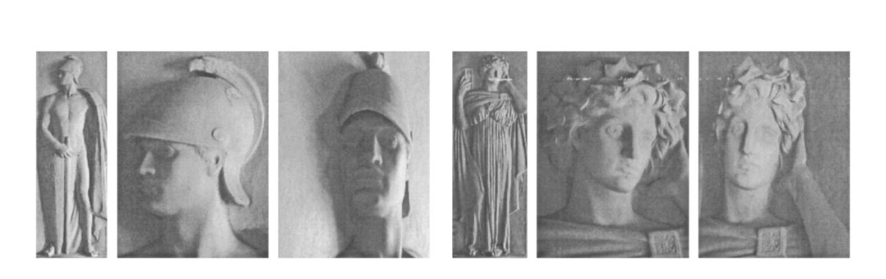
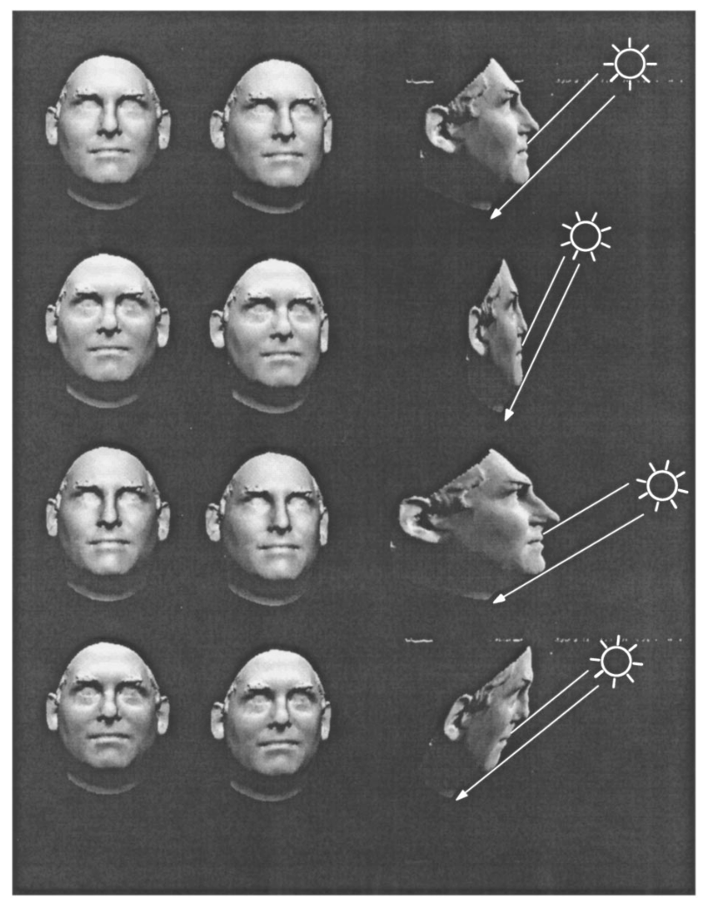
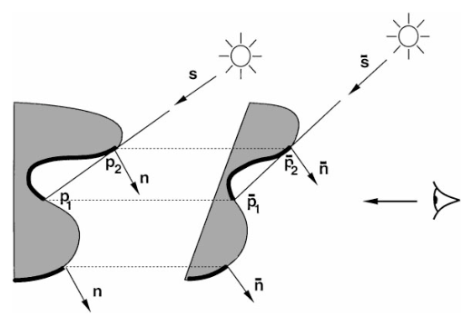
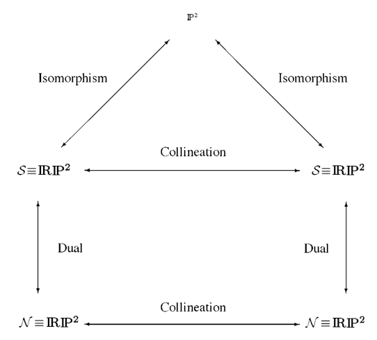

# 바렐리프 모호성 (Belhumeur 1999)

- 원제: The Bas-Relief Ambiguity
- 원문: 같은 폴더의 `Belhumeur1999_IJCV_bas_relief.pdf` (International Journal of Computer Vision 35(1), 33–44, 1999, Kluwer Academic Publishers)
- 저자: Peter N. Belhumeur (Yale University), David J. Kriegman (University of Illinois, Urbana-Champaign), Alan L. Yuille (Smith-Kettlewell Eye Research Institute)
- 접수: 1997년 11월 17일, 수정: 1998년 11월 20일
- 번역 범위: 전문(본문·부록·감사의 글·주 포함)
- 그림: 원문 그림 4개를 `그림/`에 넣고 본문에서 처음 언급되는 곳에 삽입

## 초록

램버트(Lambertian) 반사 특성을 가진 미지의 물체를 정사영(orthographic)으로 볼 때, 그 3차원 구조를 결정하는 데에는 내재적인 모호성이 있다. 이 논문은 물체의 보이는 곡면 $f(x, y)$가 물체 기하의 "일반화 바렐리프(generalized bas-relief)" 변환 $\bar f(x, y) = \lambda f(x, y) + \mu x + \nu y$ 및 그에 대응하는 물체 알베도(albedo) 변환과 구별할 수 없음을 보인다. 임의 개수의 먼 광원으로 조명한 물체의 각 영상에 대해, 마찬가지로 변환된 광원으로 조명한 변환된 물체의 동일한 영상이 존재한다. 이 결과는 물체의 조명된 영역뿐 아니라 투영 그림자(cast shadow)와 부착 그림자(attached shadow) 영역에서도 성립한다. 나아가 물체의 작은 운동도, 관찰자의 작은 운동도 물체 곡면의 납작해짐(또는 스케일) $\lambda$를 결정하는 모호성을 해소하지 못한다. 이 모호성이 구조 복원과 형상 표현에 주는 함의를 논의한다.

핵심어: 가변 조명, 그림자, 형상 모호성, 물체 표현, 물체 인식

## 1. 서론 (Introduction)

고대부터 장인들은 납작한 형상, 이른바 "바렐리프(bas-relief, 얕은 부조)"를 만들어 왔는데, 이것은 특정 시점에서 보면 완전 부조(full relief)와 구별하기가 어렵거나 불가능하다. 그림 1을 보라. 해가 하늘을 가로질러 움직이면 음영(shading)과 그림자가 바뀌지만, 잘 조각된 바렐리프에서는 납작해진 정도를 알아볼 수 없다. 관찰자의 머리가 조금 움직여도 이 모호성은 해소되지 않는다. 이 논문은 단지 부조 조각이 효과적인 이유를 설명하는 데 그치지 않고, 이 모호성이 어떤 물체의 구조를 복원하든 내재되어 있음을 보인다.

*그림 1 — 대리석 바렐리프 조각 한 쌍의 정면과 측면 모습. 정면 모습은 완전한 3차원 깊이를 가진 것처럼 보이지만, 측면 모습은 납작해짐을 드러낸다. 조각은 배경 평면에서 5 cm만 솟아 있다. 얼굴에는 미묘한 음영이 보이지만, 몸에서는 여인들의 옷 주름에 생긴 그림자가 지배적인 지각 단서이다.*

고정된 시점에서 물체를 보되, 먼 광원들의 모든 가능한 조합 아래에서 만들어지는 영상들의 집합을 생각해 보자. 모양은 다르지만 같은 영상 집합을 만드는 다른 물체가 존재하면, 물체의 구조를 결정하는 데 모호성이 생긴다. 이 논문은 이것이 성립하는 변환들의 족(family), 즉 "일반화 바렐리프 변환(generalized bas-relief transformations)"이 존재함을 보인다.

일반화 바렐리프(GBR) 변환은 곡면 형상과 알베도 패턴을 모두 바꾼다. 특히 $(x, y)$가 영상 평면 위 점의 좌표를, $z = f(x, y)$가 물체 곡면에서 영상 평면까지의 거리를 나타낸다면, 곡면 형상의 일반화 바렐리프 변환은 $\lambda > 0$인 $\bar f(x, y) = \lambda f(x, y) + \mu x + \nu y$로 주어지고, 그에 대응하는 곡면 알베도의 일반화 바렐리프 변환은 식 (3)으로 주어진다. 부조 조각은 형상 변환 가운데 $0 < \lambda < 1$이고 $\mu = \nu = 0$인 부분집합을 써서 만들어지지만, 우리가 아는 한 그에 대응하는 알베도 변환은 쓰지 않는다. 바렐리프(낮은 부조)는 보통 $\lambda < 0.5$인 것으로 정의된다.

그러나 바렐리프 모호성의 미묘함은 르네상스 예술가들도 놓쳤던 것 같다. 레오나르도 다빈치는 회화와 조각을 비교하면서 부조가 주는 사실감을 비판하였다(Kemp, 1989).

> 빛과 그림자에 관한 한, 낮은 부조는 조각으로서도 회화로서도 실패한다. 왜냐하면 그림자가 부조의 낮은 성질에 대응하기 때문이다. 예컨대 단축법으로 그린(foreshortened) 물체의 그림자처럼, 그 그림자는 회화나 환조(sculpture in the round)의 그림자가 보여 주는 깊이를 보여 주지 못한다.

같은 광원으로 조명했을 때 부조 곡면($\lambda < 1$)과 "환조" 곡면($\lambda = 1$)이 서로 다른 그림자를 드리운다는 것은 사실이다. 그러나 레오나르도의 말은, 곡면의 어떤 고전적 바렐리프 변환에 대해서도 그림자가 같아지도록 하는 광원 방향의 대응 변환이 존재한다는 사실을 간과한 것으로 보인다. 이는 고전적 부조에만 국한되지 않고, 앞으로 보이겠지만 더 큰 집합인 일반화 바렐리프 변환에도 똑같이 적용된다.

물체와 그 물체의 모든 GBR 변환이 같은 그림자 영역을 만든다는 사실은 내재적 쌍대성(duality)에서 나온다. 정사영(평행한 시선) 아래에서 보고 먼 광원 $\mathbf{s}$(예: 태양)로 조명한 램버트(Lambert, 1760; Horn, 1986) 곡면 $f$의 각 영상에 대해, 변환된 광원 $\bar{\mathbf{s}}$가 만드는, 알베도가 변환된 GBR 곡면 $\bar f$의 동일한 영상이 존재한다. 이 동일성은 곡면의 그림자 영역뿐 아니라 조명된 영역의 음영에서도 성립한다. 나아가 중첩(superposition) 덕분에 이 동일성은 임의의 — 무한할 수도 있는 — 개수의 광원에 대해서도 성립한다. 부록에서는 볼록한 형상의 물체에 대해 일반화 바렐리프 변환이 이 성질을 가진 유일한 변환임을, 즉 다른 그런 모호성은 존재하지 않음을 보인다.

따라서 단일 시점에서는 곡면의 3차원 유클리드 기하를 결정하는 데 모호성이 있다. 기껏해야 곡면의 부조(relief)를 3-파라미터 선형 변환 족까지만 결정할 수 있다. 곡면의 그림자나 음영 어느 쪽의 정보도 이를 해소할 수 없다. 그렇다면 관찰자가 곡면에 대해 움직이거나 곡면이 관찰자에 대해 움직이면 이 모호성을 해소할 수 있을까?

Helmholtz(1910)가 논했듯이, 관찰자의 운동이 만드는 영상 변화는 보이는 물체의 깊이와 형상을 모두 드러낸다. 강체 운동을 하며 원근 투영(perspective projection)으로 보이는 물체의 경우, 물체의 유클리드 구조는 영상 두 장만으로도 결정할 수 있다(Longuet-Higgins, 1981; Roach and Aggarwal, 1979; Waxman and Ullman, 1985). 물체를 영상 두 장에서 정사영으로 보면, 그 구조는 아핀(affine) 왜곡의 1-파라미터 족까지만 복원할 수 있다(Huang and Lee, 1989). 정사영 아래 무한소 운동에서는 진짜 바렐리프 모호성이 있다. 곡면의 형상은 카메라 광축 방향의 스케일 인자까지만, 즉 $\lambda$를 모르는 고전적 바렐리프 변환까지만 복원할 수 있다(Koenderink and Van Doorn, 1991).

일반화 바렐리프 모호성은 부조 조각의 효과를 설명하는 것을 넘어, 인간의 곡면 지각에 대한 이해와 계산 시각 알고리즘의 개발에도 함의를 가진다. 우리의 결과는 다양한 곡면에 대해 이 모호성이 존재하며 인간 시각 체계에서 종종 해소되지 않는다는 (Koenderink et al., 1996)의 최근 정신물리학적 발견을 뒷받침한다. 마찬가지로 이 결과는 구조 복원의 목표가 아핀 표현(Koenderink and Van Doorn, 1991; Rosenholtz and Koenderink, 1996; Shapiro et al., 1995; Ullman and Basri, 1991), 사영 표현(Faugeras, 1995), 순서 표현(ordinal representation)(Fermuller and Aloimonous, 1996) 같은 더 약한 비유클리드 표현일 수 있음을 시사한다. 많은 응용에서 기계 시각 시스템은 이 모호성을 해소할 필요가 없다.

요약하면, 이 논문은 다음을 밝힌다.

- 곡면과 GBR 변환된 곡면이 만드는 투영 그림자와 부착 그림자의 집합은 재질 종류와 무관하게 동일하다.
- 재질을 램버트 반사로 모델링할 수 있으면, 어떤 조명 조건에서든 그림자를 포함한 가능한 영상들의 집합(조명 원뿔, illumination cone (Belhumeur and Kriegman, 1996; Belhumeur and Kriegman, 1998))은 물체와 GBR 변환된 물체에서 동일하다. (GBR 변환은 곡면 기하와 곡면 알베도를 모두 바꾼다는 점에 유의하라.) 따라서 어떤 인식 알고리즘으로도 이 물체들을 구별할 수 없다.
- 일반화 바렐리프 변환은 위의 처음 두 성질을 가진 유일한 변환이다.
- 정사영 아래에서 곡면과 그 고전적 바렐리프가 만드는 운동장(motion field)의 집합은 동일하다(Huang and Lee, 1989; Koenderink and Van Doorn, 1991). 따라서 미지의 작은 카메라 운동으로는 물체와 그 부조를 구별할 수 없다.
- 광원 방향을 모르는 광도 스테레오(photometric stereo)에서는 구조를 일반화 바렐리프 변환까지만 결정할 수 있으며, 그림자는 추가 정보를 주지 않는다. 알베도와 광원 세기에 대한 사전 정보를 쓰면, 구조를 깊이 방향 반사(reflection in depth)까지 결정할 수 있다. 투영 그림자를 써서 이 두 경우를 구별할 수 있다.

GBR 모호성을 보여 주기 위해, 그림 2에 그래픽으로 렌더링한 사람 머리 네 개를 나타냈다. "정상" 머리 하나와, 원본을 GBR 변환하여 얻은 왜곡된 머리 세 개이다. 머리를 정면에서 적절한 위치의 광원 아래에서 관찰하면, 결과 영상들이 너무 비슷해서 그 차이가 진짜 구조에 대한 단서를 거의 주지 않는다. 머리를 조금 회전해도 모호성은 해소되지 않는다. 큰 운동(예: 측면 모습)을 통해서만 바렐리프 변환이 드러난다.

*그림 2 — 사람 머리의 3차원 데이터(맨 윗줄)는 레이저 스캐너(Cyberware)로 얻었고, 알베도가 일정한(모든 곡면 점의 회색 값이 같은) 램버트 곡면으로 렌더링하였다. 그 아래 세 줄은 형상은 서로 다른 일반화 바렐리프 변환으로 변환했지만 알베도는 변환하지 않은 머리의 영상이다. 셋째 열의 얼굴 옆모습은 각 변환의 성질과 광원 방향을 드러낸다. 맨 윗줄 영상은 진짜 형상이다. 위에서 둘째는 (고전적 바렐리프처럼) 납작해진 형상($\lambda = 0.5$), 셋째는 길쭉해진 형상($\lambda = 1.5$), 맨 아래는 납작해진 형상에 평면을 더한 것($\lambda = 0.7$, $\nu = 0.5$, $\mu = 0.0$)이다. 첫째 열은 셋째 열 얼굴들의 정면 모습이다. 이 시점에서는 물체의 진짜 3차원 구조를 결정할 수 없다. 각 영상에서 그림자 패턴은 동일하며, 알베도를 식 (3)에 따라 변환하지 않았는데도 음영 패턴이 매우 비슷해서 진짜 구조에 대한 단서를 거의 주지 않는다. 둘째 열은 같은 줄 얼굴들을, 납작해지거나 길쭉해진 정도를 보상하도록 각각 따로 회전한 뒤의 거의 정면 모습이다. 수직축에 대한 회전은 둘째 열 첫째 줄에서 7°, 둘째 줄에서 14°, 셋째 줄에서 4.6°, 넷째 줄에서 14°이다. 더해진 평면이 만드는 전단(shearing)을 가리기 위해, 넷째 줄은 시선 축에 대해서도 5° 회전하였다.*

## 2. 바렐리프 모호성: 조명 (Bas-Relief Ambiguity: Illumination)

이 절에서는 일반화 바렐리프 모호성을 낳는 요인들의 공모(complicity)를 자세히 설명한다. 특히 물체 형상의 특정 변환 집합과 그 물체를 비추는 광원 사이에 쌍대성이 있음을 보인다. 여기서는 정사영(평행한 시선)으로 보는 물체의 먼 조명(평행한 조명 광선)을 고려한다.

정사영 아래 관찰되는 곡면을 생각하고, $x$축과 $y$축이 영상 평면을 생성하도록 영상 평면에 붙은 좌표계를 정의하자. 이 좌표계에서 장면의 모든 보이는 점의 깊이는 다음과 같이 나타낼 수 있다.

$$z = f(x, y)$$

여기서 $f$는 조각별 미분가능(piecewise differentiable) 함수이다. $f(x, y)$의 그래프, 즉 $(x, y, f(x, y))$는 곡면을 정의하며, 이 곡면도 $f$로 나타낸다. 안쪽을 향하는 곡면 법선 $\mathbf{n}(x, y)$의 방향은 다음과 같이 나타낼 수 있다.

$$\mathbf{n}(x, y) = \begin{bmatrix} -f_x \\ -f_y \\ 1 \end{bmatrix} \tag{1}$$

여기서 $f_x$와 $f_y$는 각각 $x$와 $y$에 대한 $f$의 편미분이다.

곡면 $f$를 다음과 같은 방식으로 새 곡면 $\bar f$로 변환하는 것을 생각하자. 먼저 $z$축을 따라 납작하게 만들고(또는 스케일하고) 평면을 더한다. 즉

$$\bar f(x, y) = \lambda f(x, y) + \mu x + \nu y$$

이며, $\lambda \neq 0$이다(Epstein et al., 1996). 이 변환을 일반화 바렐리프(GBR) 변환이라 부른다. 그림 2와 3을 보라. $\mu = 0$이고 $\nu = 0$이면 이를 고전적 바렐리프 변환이라 부르는데, $\lambda < 1$이면 곡면이 고전적 바렐리프 조각처럼 납작해지기 때문이다.

$\mathbf{p} = (x, y, f(x, y))$이고 $\bar{\mathbf{p}} = (x, y, \bar f(x, y))$이면 $\bar{\mathbf{p}} = G\mathbf{p}$임에 유의하라. 여기서

$$G = \begin{bmatrix} 1 & 0 & 0 \\ 0 & 1 & 0 \\ \mu & \nu & \lambda \end{bmatrix} \tag{2}$$

행렬 곱 연산 아래에서 집합 $GBR = \{G\}$는 $GL(3)$의 부분군(subgroup)을 이루며,

$$G^{-1} = \frac{1}{\lambda}\begin{bmatrix} \lambda & 0 & 0 \\ 0 & \lambda & 0 \\ -\mu & -\nu & 1 \end{bmatrix}$$

이다. 또한 영상 점 $(x, y)$에 대해 $\bar f$와 $f$의 곡면 법선 방향 사이의 관계는 $\bar{\mathbf{n}} = G^{-T}\mathbf{n}$으로 주어진다는 점에 유의하라. 여기서 $G^{-T} \equiv (G^T)^{-1} = (G^{-1})^T$이다. 4절에서 보겠지만, 이것은 적분가능성(integrability)을 보존하는, 곡면 법선장의 유일한 선형 변환이다.

*그림 3 — 광원 $\mathbf{s}$ 아래 곡면에서 그림자 안에 놓이는 영상 점들은, 광원 $\bar{\mathbf{s}} = G\mathbf{s}$ 아래 변환된 곡면에서 그림자 안에 놓이는 영상 점들과 동일하다. 이 2차원 예시에서 아래쪽 그림자는 부착 그림자이고, 위쪽 그림자는 부착 성분과 투영 성분으로 이루어져 있다. 왼쪽 예시에 납작하게 만들기와 평면 더하기를 모두 포함한 일반화 바렐리프 변환을 적용하여 오른쪽 예시를 얻었다. 그림을 알아보기 쉽도록 곡면 법선은 바깥쪽을 향하게 그렸다.*

벡터 $\mathbf{s}$가 무한원점의 점광원을 나타내고, $\mathbf{s}$의 크기는 광원 세기에 비례한다고 하자. (광원을 무한원점에 한정하지 않는 등 더 일반적인 조명 모델은 (Langer and Zucker, 1997)을 보라.) 먼저 어떤 광원 $\mathbf{s}$에 대한 곡면 $f$ 위의 그림자가 적절한 광원 $\bar{\mathbf{s}}$에 대한 GBR 변환 곡면 $\bar f$ 위의 그림자와 동일함을 보이고, 이어서 곡면이 램버트이면 두 곡면의 가능한 모든 영상의 집합이 동일함을 보인다.

### 2.1. 그림자 (Shadows)

그림자는 부착 그림자(attached shadow)와 투영 그림자(cast shadow) 두 종류로 구별할 수 있다(Baxandall, 1995; Shashua, 1992). 그림 3을 보라. 곡면 점 $\mathbf{p} = (x, y, f(x, y))$는 $\mathbf{n}(x, y)^T\mathbf{s} < 0$일 때 그리고 그때에만(iff) 광원 방향 $\mathbf{s}$에 대해 부착 그림자 안에 놓인다. 이 정의로부터 다음 보조정리가 나온다.

**보조정리 1 (Lemma 1).** 점 $\mathbf{p} = (x, y, f(x, y))$가 광원 방향 $\mathbf{s}$에 대해 부착 그림자 안에 놓일 필요충분조건은 $\bar{\mathbf{p}} = (x, y, \bar f(x, y))$가 광원 방향 $\bar{\mathbf{s}} = G\mathbf{s}$에 대해 부착 그림자 안에 놓이는 것이다.

**증명:** $f$ 위의 점 $\mathbf{p}$가 부착 그림자 안에 놓이면 $\mathbf{n}^T\mathbf{s} < 0$이다. 변환된 곡면에서 점 $\bar{\mathbf{p}} = (x, y, \bar f(x, y))$도 $(x, y)$로 투영되며, 이 점에 대해 $\bar{\mathbf{n}}^T\bar{\mathbf{s}} = (G^{-T}\mathbf{n})^T G\mathbf{s} = \mathbf{n}^T\mathbf{s}$이다. 따라서 $\bar{\mathbf{p}}$도 부착 그림자 안에 있다. 역도 분명히 성립한다. □

곡면 위의 점 $\mathbf{p}_1 = (x_1, y_1, f(x_1, y_1))$이 광원 방향 $\mathbf{s}$에 대한 투영 그림자 경계(cast shadow boundary) 위에 놓이기 위한 필요조건은, 방향 $\mathbf{s}$로 $\mathbf{p}_2$를 지나는 광선이 $\mathbf{p}_2$에서 곡면을 스치고(grazes) $\mathbf{p}_1$에서 곡면과 교차하는 곡면 위의 다른 점 $\mathbf{p}_2 = (x_2, y_2, f(x_2, y_2))$가 존재하는 것이다. 점 $\mathbf{p}_2$는 부착 그림자의 경계이다.

**보조정리 2 (Lemma 2).** 점 $\mathbf{p} = (x, y, f(x, y))$가 광원 방향 $\mathbf{s}$에 대해 투영 그림자 경계 위에 놓이기 위한 필요조건을 만족할 필요충분조건은 $\bar{\mathbf{p}} = (x, y, \bar f(x, y))$가 광원 방향 $\bar{\mathbf{s}} = G\mathbf{s}$에 대해 그 조건을 만족하는 것이다.

**증명:** 점 $\mathbf{p}_1$이 $\mathbf{p}_2$가 드리운 그림자 경계 위에 놓일 조건은 어떤 $\gamma < 0$에 대해

$$\begin{cases} \mathbf{n}_2^T\mathbf{s} = 0 \\ \mathbf{p}_2 - \mathbf{p}_1 = \gamma\mathbf{s} \end{cases}$$

이다. 변환된 곡면에서 점이 그림자 경계 위에 놓일 첫째 조건은

$$\bar{\mathbf{n}}_2^T\bar{\mathbf{s}} = (G^{-T}\mathbf{n}_2)^T G\mathbf{s} = \mathbf{n}_2^T\mathbf{s} = 0$$

이다. GBR 변환 $\bar{\mathbf{p}} = G\mathbf{p}$ 아래에서, 둘째 조건은 부조 곡면에 대해 다음과 같이 나타낼 수 있다.

$$\bar{\mathbf{p}}_2 - \bar{\mathbf{p}}_1 - \bar\gamma\bar{\mathbf{s}} = G(\mathbf{p}_2 - \mathbf{p}_1) - \bar\gamma G\mathbf{s} = (\mathbf{p}_2 - \mathbf{p}_1) - \bar\gamma\mathbf{s} = 0.$$

[역주: 둘째 등호는 원문 그대로이다. $G$가 가역이므로 앞 식이 0인 것과 뒤 식이 0인 것이 동치라는 뜻으로 읽힌다.]

이 조건은 $\bar\gamma = \gamma$일 때 분명히 성립한다. 이 보조정리의 역도 비슷하게 증명할 수 있다. □

$\mathbf{p}_1$에서 $\mathbf{p}_2$를 지나는 광선이 $f$와 $\bar f$ 모두에서 곡면의 다른 부분과 교차하지 않을 때, 이 보조정리는 점이 그림자 경계 위에 놓이기 위한 필요충분조건이 된다. 일반적으로 이것은 $\lambda > 0$일 때 참이다.

두 보조정리를 함께 보면, 곡면 $f$의 어떤 부분이 광원 방향 $\mathbf{s}$에 대해 투영 그림자나 부착 그림자 안에 있을 때, 곡면에 GBR 변환 $G$를 가하면 변환된 곡면의 같은 부분도 그림자가 지게 하는 조명 방향 $\bar{\mathbf{s}} = G\mathbf{s}$가 존재한다는 결론이 나온다. 부착 그림자와 투영 그림자를 모두 포함하는 이 그림자 영역들을 다음과 같은 이진 함수 $\Psi_{f,\mathbf{s}}(x, y)$로 지정하자.

$$\Psi_{f,\mathbf{s}}(x, y) = \begin{cases} 0 & (x, y)\text{가 그림자 안에 있으면} \\ 1 & \text{그 밖의 경우} \end{cases}$$

이 표기와 위의 두 보조정리를 써서 $\Psi_{f,\mathbf{s}}(x, y) = \Psi_{\bar f,\bar{\mathbf{s}}}(x, y)$라고 쓸 수 있다.

광원의 직접 조명으로 생기는 그림자 $\Psi_{f,\mathbf{s}}(x, y)$는 물체 기하의 함수이며, 곡면의 반사 특성에 영향을 받지 않는다는 점을 강조해 둔다.¹ 어떤 곡면, 어떤 광원 방향, 그리고 그 곡면의 어떤 GBR 변환에 대해서도, 그림자가 동일해지는 광원 방향이 존재한다. 나아가 GBR 변환은 이것이 참인 유일한 변환이다. 볼록한 형상의 물체에 대한 증명은 부록을 보라.

### 2.2. 음영 (Shading)

이제 곡면 반사가 램버트이면(Horn, 1986; Lambert, 1760), 모든 가능한 조명 조건 아래에서 곡면과 변환된 곡면이 만드는 영상 집합(즉 곡면의 조명 원뿔(Belhumeur and Kriegman, 1996; Belhumeur and Kriegman, 1998))이 동일함을 보인다. 램버트 곡면 $f$의 알베도를 $a(x, y)$로 나타내면, 광원 $\mathbf{s}$가 만드는 세기 영상은 다음과 같이 나타낼 수 있다.

$$I_{f,a,\mathbf{s}}(x, y) = \Psi_{f,\mathbf{s}}(x, y)\,\mathbf{b}(x, y)^T\mathbf{s}$$

여기서 $\mathbf{b}(x, y)$는 알베도 $a(x, y)$와 안쪽을 향하는 단위 곡면 법선 $\hat{\mathbf{n}}(x, y)$의 곱이다.

다음 보조정리에서 보이듯이, $f$의 기하가 $\bar f$로 변환되면 알베도에도 다음과 같은 대응 변환이 있어야 한다.

$$\bar a = \frac{a}{\lambda}\left(\frac{(\lambda f_x + \mu)^2 + (\lambda f_y + \nu)^2 + 1}{f_x^2 + f_y^2 + 1}\right)^{\frac{1}{2}} \tag{3}$$

식 (3)을 고전적 바렐리프 변환 $0 < \lambda < 1$에 적용하면, $\mathbf{n}$이 광축에서 멀어지는 쪽을 향하는 곡면 점들이 어두워진다. 알베도와 기하 변환은 Koenderink와 van Doorn(1997)도 논의하였다.

**보조정리 3 (Lemma 3).** 알베도 $a(x, y)$를 가진 램버트 곡면 $f(x, y)$를 비추는 각 광원 $\mathbf{s}$에 대해, (식 (3)으로 주어진) 알베도 $\bar a(x, y)$를 가진 곡면 $\bar f(x, y)$($f$의 GBR 변환)를 비추어 $I_{f,a,\mathbf{s}}(x, y) = I_{\bar f,\bar a,\bar{\mathbf{s}}}(x, y)$가 되게 하는 광원 $\bar{\mathbf{s}}$가 존재한다.

**증명:** $f$의 영상은 다음과 같다.

$$I_{f,a,\mathbf{s}}(x, y) = \Psi_{f,\mathbf{s}}(x, y)\,\mathbf{b}^T(x, y)\mathbf{s}$$

임의의 $3 \times 3$ 가역 행렬 $A$에 대해 다음이 성립한다.

$$I_{f,a,\mathbf{s}}(x, y) = \Psi_{f,\mathbf{s}}(x, y)\,\mathbf{b}^T(x, y)A^{-1}A\mathbf{s}.$$

GBR이 $GL(3)$의 부분군이고 $\Psi_{f,\mathbf{s}}(x, y) = \Psi_{\bar f,\bar{\mathbf{s}}}(x, y)$이므로,

$$\begin{aligned} I_{f,a,\mathbf{s}}(x, y) &= \Psi_{f,\mathbf{s}}(x, y)\,\mathbf{b}^T(x, y)G^{-1}G\mathbf{s} \\ &= \Psi_{\bar f,\bar{\mathbf{s}}}(x, y)\,\bar{\mathbf{b}}^T(x, y)\bar{\mathbf{s}} \\ &= I_{\bar f,\bar a,\bar{\mathbf{s}}}(x, y) \end{aligned}$$

이다. 여기서 $\bar{\mathbf{b}}(x, y) = G^{-T}\mathbf{b}(x, y)$이고 $\bar{\mathbf{s}} = G\mathbf{s}$이다. □

식 (3)이 주는 알베도 변환은 미묘하므로 논의할 필요가 있다. $\lambda$가 1에 가까우면 알베도 변환은 거의 검출할 수 없다. 즉 곡면의 형상을 GBR 변환으로 바꾸되 알베도는 그대로 두면, 조명을 바꿔 가며 얻은 영상들의 차이가 너무 작아서 구조를 드러내지 못하는 것처럼 보인다. 그림 2에서 우리는 알베도를 바꾸지 않았고($\bar a(x, y) = a(x, y)$), $\lambda$가 0.5에서 1.5까지 변하는데도 정면 영상에서 형상 차이를 알아볼 수 없다. 그러나 알베도를 바꾸지 않고 납작하게 만드는 정도가 더 심하면, 예컨대 열 배($\lambda = 0.1$)이면, 음영 패턴이 곡면의 납작함을 드러낼 수 있다. 이 효과는 그림자는 정확히 재현하지만 음영은 잘 재현하지 못하는 매우 낮은 부조 조각(예: 도나텔로의 rilievo schiacciato)에서 흔히 볼 수 있다.

영상 집합이 동일하려면 알베도가 곡면과 함께 변환되고 $\lambda > 0$이어야 한다. $\lambda < 0$이면 곡면 $\bar f$는 (음각(intaglio)처럼) 뒤집힌다. 광원 $\bar{\mathbf{s}}$를 그에 맞게 변환하면 원래 곡면 $f$와 변환된 곡면 $\bar f$의 조명된 영역은 같아진다. 이것이 잘 알려진 "위/아래"(볼록/오목) 모호성이다. 그러나 $\bar f$와 $f$가 드리우는 그림자는 상당히 극적으로 다를 수 있다.

위의 세 보조정리를 바탕으로, 이제 이 절의 중심 명제를 진술하고 증명할 수 있다.

**명제 1 (Proposition 1).** 알베도 $a(x, y)$를 가진 램버트 곡면 $f$가 먼 광원들의 모든 가능한 조합 아래에서 만드는 영상 집합과, 임의의 GBR 변환만큼 다르고 알베도 $\bar a(x, y)$가 식 (3)으로 주어지는 곡면 $\bar f$들이 만드는 영상 집합은 동일하다.

**증명:** 보조정리 1, 2, 3으로부터, 단일 광원 $\mathbf{s}$가 만드는 곡면 $f$의 영상은 변환된 광원 $\bar{\mathbf{s}} = G\mathbf{s}$가 만드는 GBR 변환 곡면 $\bar f$의 영상과 같다. 즉 $I_{f,a,\mathbf{s}}(x, y) = I_{\bar f,\bar a,\bar{\mathbf{s}}}(x, y)$이다. 물체를 광원 집합 $\{\mathbf{s}_i\}$로 조명하면, 영상은 개별 광원 아래에서 형성될 영상들의 중첩으로 결정된다. 마찬가지로 변환된 곡면을 $\bar{\mathbf{s}}_i = G\mathbf{s}_i$인 광원 집합 $\{\bar{\mathbf{s}}_i\}$로 조명하면 같은 영상을 만들 수 있다. □

이상의 결과를 종합하면, 곡면과 광원 방향을 모두 $G$로 변환하면 원래 곡면과 변환된 곡면의 영상에서 그림자와 음영이 모두 동일함이 입증된다. 이 결과의 함의는, 고정된 시점에서 찍은 영상이 몇 장이든 컴퓨터 시각 알고리즘도 생물학적 과정도 GBR 변환만큼 다른 두 물체를 구별할 수 없다는 것이다. 이 모호성을 해소하려면 곡면 형상, 곡면 알베도, 광원 방향, 광원 세기에 대한 지식(또는 가정)을 써야 한다. 다시 그림 2를 보라.

## 3. 바렐리프 모호성: 운동 (Bas-Relief Ambiguity: Motion)

단일 시점에서 본 물체의 음영도 그림자도 정확한 3차원 구조를 드러내지 않지만, 운동은 추가 단서를 준다(Helmholtz, 1910). 곡면이 강체 운동을 하고 원근 투영으로 보이면, 물체의 유클리드 구조는 영상 두 장만으로도 결정할 수 있다(Longuet-Higgins, 1981; Roach and Aggarwal, 1979; Waxman and Ullman, 1985). 물체를 정사영으로 보면, 영상 두 장으로부터 물체의 구조를 아핀 왜곡의 1-파라미터 족까지만 결정할 수 있다(Koenderink and Van Doorn, 1991). 정사영 아래에서 유클리드 구조를 결정하려면 서로 다른 시점에서 찍은 영상이 적어도 세 장 필요하다.

그러나 물체의 운동이 작으면 복잡한 문제가 생긴다. 원근 투영 아래 무한소 운동에서는 구조 추정이 잡음에 민감하여, 곡면 부조의 추정에 내재적 오차가 생긴다(Oliensis, 1996; Szeliski and Kang, 1996). 정사영 아래 작은(무한소) 미지 운동에서는 진짜 바렐리프 모호성이 있다. 곡면의 형상은 카메라 광축 방향의 스케일 인자까지만, 즉 고전적 바렐리프 변환($\lambda > 0$, $\mu = \nu = 0$)까지만 복원할 수 있다.

이를 보기 위해, 곡면이 실제로 임의의 무한소 운동을 한다고 가정하자. 곡면 $f$ 위의 점 $\mathbf{p}(x, y, z)$의 속도 $\dot{\mathbf{p}} = (\dot x, \dot y, \dot z)$는 영상 평면에서 속도 $(\dot x, \dot y)$를 유발한다. 영상 평면의 모든 점에 대한 속도의 모음을 흔히 운동장(motion field)이라 부른다(Horn, 1986). 다음 명제에서, 곡면 $f$의 모든 3차원 무한소 운동이 유발하는 운동장의 집합이 정사영 아래에서 고전적 바렐리프 변환(일반화 바렐리프 변환이 아님)만큼 다른 곡면의 모든 운동장 집합과 같음을 보인다.

**명제 2 (Proposition 2).** 곡면 $f$의 모든 3차원 무한소 운동이 유발하는 운동장의 집합은, 정사영 아래에서 $\lambda \neq 0$인 바렐리프 변환 $\bar f(x, y) = \lambda f(x, y)$만큼 다른 곡면의 모든 운동장 집합과 같다.

**증명:** $\boldsymbol{\Omega} = (\Omega_x, \Omega_y, \Omega_z)$와 $\mathbf{v} = (v_x, v_y, v_z)$가 각각 관찰자에 대한 곡면 $f$의 각속도와 선속도를 나타낸다고 하자. $f$ 위의 점 $\mathbf{p}$의 3차원 속도는 $\dot{\mathbf{p}} = \boldsymbol{\Omega} \times \mathbf{p} + \mathbf{v}$이다. 변환된 곡면에 대해서는 $\mu = \nu = 0$인 $\bar{\mathbf{p}} = G\mathbf{p}$이고, 점의 속도는 $\dot{\bar{\mathbf{p}}} = \bar{\boldsymbol{\Omega}} \times (G\mathbf{p}) + \bar{\mathbf{v}}$로 주어진다. $\bar v_x = v_x$, $\bar v_y = v_y$, $\bar\Omega_z = \Omega_z$, $\bar\Omega_x = \Omega_x/\lambda$, $\bar\Omega_y = \Omega_y/\lambda$일 때 두 곡면의 운동장이 동일함(즉 $\dot x = \dot{\bar x}$이고 $\dot y = \dot{\bar y}$)을 쉽게 보일 수 있다. 즉 각속도 가운데 영상 평면에 평행한 성분이 부조에 반비례하여 스케일된다. 따라서 $f$의 모든 운동에 대해 같은 운동장을 내는 $\bar f$의 운동이 존재하므로, 운동장의 집합은 동일하다. □

이 증명은 Koenderink와 Van Doorn(1991), Rosenholtz와 Koenderink(1996)의 결과를 따른다.

명제 2의 함의는 정사영 아래에서 물체나 관찰자의 작은 운동으로는 바렐리프 모호성을 해소할 수 없다는 것이다. 나아가 운동장은 $f(x, y)$에 대해 선형이므로, 고전적 바렐리프 변환은 운동장의 집합을 보존하는 $f$의 유일한 변환이다.

그림 2의 둘째 열을 다시 보라. "정상" 부조를 정면에서 7° 회전한 뒤 만든 영상은, 납작해진 머리를 14°, 길쭉해진 머리를 4.6° 회전해 만든 영상과 거의 동일하다. 그러나 $\nu \neq 0$인 둘째 열 맨 아래 영상[역주: 원문 "the bottom image in the second row"는 문맥상 둘째 열 맨 아래 영상을 가리킴]이 만드는 왜곡은 어떤 회전으로도 완전히 감출 수 없다. 여기서는 머리를 수직축에 대해 10°, 이어서 시선 축에 대해 5° 회전하였다. [역주: 그림 2 캡션에는 넷째 줄 회전이 14°로 적혀 있어 본문의 10°와 다르다. 원문 그대로 둔다.]

## 4. 적분가능성, 복원, 바렐리프 모호성 (Integrability, Reconstruction, and the Bas-Relief Ambiguity)

이 절에서는 광도 스테레오를 이용한 곡면 복원에서 일반화 바렐리프 모호성이 하는 역할을 살펴본다. 램버트 곡면이 무한원점의 점광원으로 조명된다고 가정하자. 그림자가 없을 때(즉 $\Psi_{f,\mathbf{s}}(x, y) = 1$), 광원 $\mathbf{s}$가 만드는 세기 영상은 다음과 같이 나타낼 수 있다.

$$I_{f,a,\mathbf{s}}(x, y) = \mathbf{b}(x, y)^T\mathbf{s} \tag{4}$$

여기서 $\mathbf{b}(x, y)$는 곡면의 알베도 $a(x, y)$와 안쪽을 향하는 단위 곡면 법선 $\hat{\mathbf{n}}(x, y)$의 곱이다. 고정된 시점에서 광원 방향을 바꿔 가며 본 물체의 여러 영상으로부터, 광원 세기와 방향을 알면 식 (4)를 $\mathbf{b}$에 대해 풀 수 있다. 물론 이것이 표준 광도 스테레오 기법이다. (Horn, 1986; Silver, 1980; Woodham, 1981)을 보라.

그러나 광원 세기와 방향을 모르면, 곡면 법선과 알베도의 벡터장 $\mathbf{b}(x, y)$를 $3 \times 3$ 선형 변환까지만 결정할 수 있다. 임의의 가역 $3 \times 3$ 선형 변환 $A \in GL(3)$에 대해(Hayakawa, 1994; Epstein et al., 1996; Rosenholtz and Koenderink, 1996)

$$\mathbf{b}^T\mathbf{s} = (A\mathbf{b})^T A^{-T}\mathbf{s}. \tag{5}$$

수많은 시각 문제가 이런 쌍선형(bilinear) 형태와 비슷한 선형 모호성을 가진다는 점에 유의하라(Koenderink and van Doorn, 1997).

$\mathbf{b}(x, y)$가 곡면 법선의 참 벡터장이면, 복원된 벡터장 $\mathbf{b}^*(x, y)$는 군 $GL(3)$ 아래 $\mathbf{b}(x, y)$의 궤도(orbit)에 속한 임의의 벡터장이다. 그림자 진 곡면 점이 없는 화소 영상의 경우, 영상 모음으로부터 특이값 분해(SVD)를 써서 $\mathbf{b}^*$를 추정할 수 있다. 일부 곡면 점에 그림자가 지면 Jacobs의 방법으로 $\mathbf{b}^*$를 추정할 수 있다(Jacobs, 1997). 그러나 모든 벡터장 $\mathbf{b}^*(x, y)$가 연속(또는 조각별 연속) 곡면에 대응하는 것은 아니라는 점에 유의하라. 우리는 이 관찰을 써서 $\mathbf{b}(x, y)$에 허용되는 변환의 군을 제한한다(Epstein et al., 1996).

$\mathbf{b}$를 임의의 $A \in GL(3)$로 변환하면(즉 $GL(3)$ 아래 $\mathbf{b}$의 궤도에 속한 임의의 벡터장 $\mathbf{b}^*(x, y)$), 일반적으로 벡터장 $\mathbf{b}^*(x, y)$를 만들 수 있었던, 단위 법선장 $\hat{\mathbf{n}}^*(x, y)$와 알베도 $a^*(x, y)$를 가진 곡면 $f^*(x, y)$는 존재하지 않는다. $f^*(x, y)$가 곡면이려면 다음 적분가능성 제약(integrability constraint)을 만족해야 한다(Horn and Brooks, 1986).

$$f^*_{xy} = f^*_{yx}$$

이는 다시 $\mathbf{b}^*(x, y)$가 다음을 만족해야 함을 뜻한다.

$$\left(\frac{b_1^*}{b_3^*}\right)_y = \left(\frac{b_2^*}{b_3^*}\right)_x \tag{6}$$

여기서 $\mathbf{b}^* = (b_1^*, b_2^*, b_3^*)^T$이고, 아래첨자 $x$와 $y$는 편미분을 나타낸다.

**명제 3 (Proposition 3).** $\mathbf{b}(x, y)$가 알베도 $a(x, y)$를 가진 곡면 $f(x, y)$에 대응하면, 식 (6)의 적분가능성 제약을 만족하는 선형 변환 $\mathbf{b}^*(x, y) = A\mathbf{b}(x, y)$의 집합은 $A = G^{-T}$이다. 여기서 일반화 바렐리프 변환 $G$는 식 (2)로 주어진다.

**증명:** 식 (6)의 적분가능성 제약은 $(b_{1y}^* - b_{2x}^*)b_3^* + b_{3x}^* b_2^* - b_{3y}^* b_1^* = 0$으로 쓸 수 있다. $A_{ij}$를 $A$의 $(i, j)$ 원소라 하고 $\mathbf{b}^* = A\mathbf{b}$임을 상기하면, 좌변은 $i$ = 1, 2, 3에 대한 $b_i(x, y)$, $b_{ix}(x, y)$, $b_{iy}(x, y)$의 함수이다. 이 함수들은 일반적으로 독립이므로, 적분가능성 제약이 모든 $(x, y)$에서 성립하려면 이 함수들의 계수가 모두 0이 되어야 한다. 이로부터 $A$의 원소에 대한 다음 대수적 제약이 나온다.

$$\begin{cases} A_{22}A_{31} - A_{21}A_{32} = 0 \\ A_{21}A_{33} - A_{23}A_{31} = 0 \\ A_{12}A_{33} - A_{13}A_{32} = 0 \\ A_{12}A_{31} - A_{11}A_{32} = 0 \\ A_{22}A_{33} - A_{11}A_{33} + A_{13}A_{31} - A_{32}A_{23} = 0 \end{cases}$$

이 연립식은 동차(homogeneous)이므로, 이 연립식을 만족하는 임의의 $A$에 대해 $\rho A$도 연립식을 만족한다. $\rho$를 바꾸는 것은 광원 세기를 바꾸면서 알베도 함수를 그에 맞게 전역적으로 스케일하는 것에 해당한다. $A_{33} = 0$이면 제약을 만족하는 행렬 $A$가 특이(singular)임을 보일 수 있다. 그래서 $A_{33} = 1$로 두고 나머지 계수를 풀 수 있다. 유일한 비특이 해는 $A_{11} = A_{22}$이고 $A_{12} = A_{21} = A_{31} = A_{32} = 0$인 것이다. 즉 $A$는 일반화 바렐리프 변환이어야 한다. □

물론 $\mathbf{b}^*(x, y) = G\mathbf{b}$는 임의의 $G \in GBR$에 대해 적분가능성 제약을 만족하므로 $\mathbf{b}^*(x, y)$의 선택은 유일하지 않다. 그러나 모든 $\mathbf{b}^*$는 대응하는 알베도 $a(x, y)$를 가진 대응 곡면 $f^*$를 가지며, 이 곡면들은 GBR 모호성만큼 다르다. 따라서 램버트 곡면 $f(x, y)$의 영상을 — 각각 다른 광원 방향 아래에서 얻은 — 적어도 세 장 가지고 있으면, 식 (6)의 적분가능성 제약을 부과하여 곡면 $f(x, y)$를 GBR 변환 $\bar f(x, y) = \lambda f(x, y) + \mu x + \nu y$까지 복원할 수 있다. 영상 데이터로부터 적분가능한 $\mathbf{b}^*$를 추정하는 방법은 (Yuille and Snow, 1997)을 보라. 2절에서 곡면 $f(x, y)$의 가능한 모든 영상의 집합이 GBR 변환 아래 불변임을 보였으므로, 영상 그림자에 담긴 어떤 정보도 이 모호성을 해소할 수 없다는 점에 유의하라. Fan과 Wolff가, 비대각 원소의 동일성 $f_{xy} = f_{yx}$를 강제하는 적분가능성 제약을 써서 영상 세 장으로부터 $f(x, y)$의 헤세 행렬(Hessian)을 스케일 인자까지 결정할 수 있음을 보였다는 점도 언급해 둔다(Fan and Wolff, 1997). 헤세 행렬의 미지 스케일은 파라미터 $\lambda$에 해당하고, Fan과 Wolff의 미분방정식의 미지 초기 조건은 파라미터 $\mu$와 $\nu$에 해당한다.

그러나 알베도나 광원 세기에 대한 추가 정보가 있으면 모호성을 더 제한할 수 있다.

**따름정리 1 (Corollary 1).** 알베도 $a(x, y)$가 일정하거나(또는 알려져 있거나), 광원 $\mathbf{s}_i$들이 모두 같은(또는 알려진) 세기를 가지면, GBR 모호성 $G$는 $\lambda = \pm 1$, $\mu = 0$, $\nu = 0$으로 주어지는 이진 부분군으로 제한된다.

**증명:** $a(x, y) = |\mathbf{b}(x, y)|$가 일정하면(또는 알려져 있으면), $|\mathbf{b}(x, y)| = |\mathbf{b}^*(x, y)| = |A\mathbf{b}(x, y)|$이므로 $A$는 모든 $\mathbf{b}$에 대해 길이를 보존해야 한다. 길이를 보존하는 행렬은 정규직교(orthonormal) 행렬뿐이다. GBR 변환이기도 한 정규직교 행렬은 $\lambda = \pm 1$, $\mu = 0$, $\nu = 0$에 해당하는 것뿐이다. 광원 세기를 알 때도 비슷한 논증이 성립한다. □

따라서 참 곡면을 부호까지, 즉 $\bar f(x, y) = \pm f(x, y)$까지 결정할 수 있다. 이것은 음영으로부터의 형상(shape from shading)에서 생기는 고전적 안-밖(in-out) 모호성이다(Horn, 1986; Oliensis, 1991). 그러나 $\lambda$의 부호가 바뀌면 그림자 형상이 바뀌므로, 그림자가 있으면 이 모호성을 해소할 수 있다는 점에 유의하라.

(Hayakawa, 1994)와 대조적으로, 알려진 알베도(예: 흰 세계 가정, white world assumption)만으로는 곡면을 복원할 수 없다는 점은 짚어 둘 만하다. 이 가정은 $A$를 직교 변환(회전과 반사)으로 제한할 뿐이다. ($\mathbf{b}$ 장으로 표현된) 법선장의 회전은 단지 회전된 곡면에 해당할 것처럼 보일 수 있지만, 그 결과 법선장은 적분가능하지 않으므로 곡면에 대응하지 않는다.

## 5. 결론 (Conclusion)

어떤 조명 조건에서든, 램버트 반사를 가진 물체 위의 음영과 그림자는 그 물체의 임의의 일반화 바렐리프 변환 위의 음영과 그림자와 동일함을 보였다. GBR 변환은 이 성질을 가진 곡면의 유일한 변환이라는 점에서 특별하다. 따라서 단일 시점에서는 곡면 복원에 모호성이 있다. 곡면의 부조를 3-파라미터 선형 변환 족까지만 결정할 수 있다. 그림자나 음영 어느 쪽의 정보도 이를 해소할 수 없다. 나아가 관찰자(또는 물체)의 작은 운동이 만드는 운동장조차 곡면 부조를 해소할 수 없다.

서론에서 인용한, 부조 조각의 그림자가 "단축되어(foreshortened)" 있다는 레오나르도 다빈치의 말은 엄밀히 말하면 틀렸다. 그러나 부조는 투영 그림자가 환조가 만드는 것과 달라지는 방식으로 만들어지는 경우가 많다. 부조는 장면 안 서로 다른 깊이에 놓인 많은 인물이 등장하는 이야기를 묘사하는 데 쓰여 왔다. 판(slab)이 보통 예술가가 인물들을 적절한 상대 깊이로 조각할 만큼 두껍지 않으므로, 도나텔로나 기베르티 같은 조각가들은 원근법 규칙으로 인물의 크기와 위치를 정하고, 각 인물을 적절한 부조로 조각하였다(Kemp, 1990). 일정 알베도의 효과를 제외하면 각 인물의 음영과 그림자는 자기 일관적이지만, 한 인물이 다른 인물에 드리우는 그림자는 틀리다. 나아가 장면의 벽이나 바닥 방향과 보통 일치하지 않는 배경 판에 드리워지는 그림자도 일관적이지 않다. 따라서 레오나르도의 말은 피렌체 세례당의 기베르티 동문(East Doors) 같은 복잡한 부조를 정확히 묘사하지만, 그림 1에 보인 것처럼 단독으로 조각된 인물에는 적용되지 않는다.

부조 조각의 미묘함은 제쳐 두고, 물체의 GBR 변환 아래에서 그림자는 정확히 보존되지만 보존되지 않는 음영 효과도 있다는 점을 지적해야 한다. 비램버트(광택) 곡면에서 생기는 정반사(specularity)와, 곡면의 한 부분에서 다른 부분으로 빛이 상호반사(inter-reflection)되는 효과는 곡면 부조에 의존한다. 그럼에도 이 효과들은 이차적일 수 있다. 즉 알려진 물체를 볼 때조차 인간 관찰자가 GBR 모호성을 해소하게 해 주지 못할 수 있다. 최근 Koenderink, Van Doorn, Christon은 피험자가 조각(추상 조각 하나와 토르소 하나)의 영상을 보고 약 300개 점에서 곡면 법선 방향의 추정값을 제시하는 일련의 정신물리학 실험을 수행하였다(Koenderink et al., 1996). 추정된 법선 벡터장이 모든 피험자에 대해 적분가능성 제약을 만족하므로, 이 실험은 인간이 관찰한 장면의 곡면 표현을 유지한다는 증거를 제공한다. 나아가 피험자들은 곡면의 전체 형상은 올바르게 추정하지만, 그 부조와 기울기(slant)는 일관되게 잘못 추정한다.

GBR 모호성의 성질과 그것이 인간 시각 체계에 분명히 존재한다는 점은 기계 시각 시스템도 비슷하게 제약받을 것임을 시사한다. 컴퓨터 시각의 한 목표는 여러 영상으로부터 곡면 모델을 복원하는 것이다. 광도 스테레오에서는 고정된 시점에서, 그러나 조명 방향을 아는 서로 다른 조명 조건 아래에서 찍은 장면의 여러 영상으로부터 유클리드 구조를 추정한다(Horn, 1986). 광원 방향을 모르는 광도 스테레오는 먼저 광원 방향을 추정한 다음 곡면 구조를 추정하는 방식으로 풀 수 있다고 생각되어 왔지만, 이 논문은 이 추정값들이 GBR 변환을 통해 결합되어 있음을 보였다. 이 모호성을 해소하는 유일한 방법은 영상 데이터에 담긴 것 외의 추가 정보를 쓰는 것이다(Hayakawa, 1994; Epstein et al., 1996; Yuille and Snow, 1997).

최근 구조 복원 방법을 영상 형성 과정에 대해 이용 가능한 정보에 따라 계층화(stratified)해야 한다는 제안이 있었다(Faugeras, 1995; Koenderink and Van Doorn, 1991; Rosenholtz and Koenderink, 1996). 예를 들어 원근 투영으로 관찰한 장면의 유클리드 구조는 카메라의 내부 파라미터(예: 초점 거리, 주점)를 알면 영상 두 장으로부터 복원할 수 있다. 내부 파라미터를 모르면 구조는 사영 변환까지만 복원할 수 있다. 여기서 우리는 아핀 구조와 유클리드 구조 사이에 새로운 계층을 도입한다. 이런 비유클리드 표현(아핀(Koenderink and Van Doorn, 1991; Rosenholtz and Koenderink, 1996; Shapiro et al., 1995; Ullman and Basri, 1991), 사영(Faugeras, 1995), 순서(Fermuller and Aloimonos, 1996))은 이 모호성을 해소하지 않고도 물체·얼굴 인식(Georghiades et al., 1998), 차량 항법, 로봇 조작, 합성 영상 생성 같은 수많은 시각 기반 작업을 푸는 데 여전히 쓸 수 있다.

## 부록: 일반화 바렐리프 변환의 유일성 (Appendix: Uniqueness of the Generalized Bas-Relief Transformation)

여기서는 무한원점의 모든 가능한 점광원으로 물체를 조명하여 만드는 영상 집합을 보존하는 물체 곡면의 변환이 일반화 바렐리프 변환 외에는 없다는 의미에서, 일반화 바렐리프 변환이 유일함을 증명한다. 가장 간단한 경우 — 자기 곡면에 그림자를 드리우지 않는 볼록한 형상의 매끄러운 물체 — 만 고려하고, 부착 그림자 경계의 집합, 따라서 영상 집합이 물체 곡면의 GBR 변환 아래에서만 보존됨을 보인다. 현재 형태의 증명은 물체가 가우스 구(Gauss sphere)를 덮는 곡면 법선들을 가지고 물체의 가림 윤곽(occluding contour)이 완전히 보일 것을 요구한다.

부착 그림자 경계는 어떤 $\mathbf{s}$에 대해 $\mathbf{n}^T\mathbf{s} = 0$을 만족하는 점 $(x, y, f(x, y))$들의 윤곽으로 정의됨을 상기하라. 여기서 광원의 크기와 부호는 부착 그림자 경계의 위치에 영향을 주지 않으므로 중요하지 않다. 따라서 벡터 $\mathbf{s} = (s_1, s_2, s_3)^T$가 무한원점의 점광원을 나타내되, 같은 부착 그림자 경계를 만드는 모든 광원을 동일시하자. 즉 $(s_1, s_2, s_3)^T = (ks_1, ks_2, ks_3)^T\ \forall k \in \mathbb{R},\ k \neq 0$이다. 이렇게 하면 광원 방향 공간 $\mathcal{S}$는 실사영평면($\mathbb{RP}^2$)과 같아지며, 무한원직선은 $(s_1, s_2, 0)$ 꼴의 좌표로 주어진다.

세 값 $\mathbf{n} = (n_1, n_2, n_3)^T$가 곡면 법선을 나타낸다고 하자. 역시 곡면 법선의 크기와 부호는 중요하지 않으므로 $(n_1, n_2, n_3)^T = (kn_1, kn_2, kn_3)^T\ \forall k \in \mathbb{R},\ k \neq 0$으로 동일시한다. 따라서 곡면 법선 공간 $\mathcal{N}$도 마찬가지로 $\mathbb{RP}^2$와 같다. 식 $\mathbf{n}^T\mathbf{s} = 0$ 아래에서 곡면 법선은 광원의 쌍대(dual)라는 점에 유의하라. 광원의 $\mathbb{RP}^2$의 각 점에는 곡면 법선의 $\mathbb{RP}^2$의 대응 직선이 있고, 그 역도 마찬가지이다.

이제 어떤 $\mathbf{s}$에 대해 $\mathbf{n}^T\mathbf{s} = 0$을 만족하는 점 $(x, y)$들로 정의되는 영상 윤곽을 생각하자. 이 영상 윤곽은 부착 그림자 경계를 영상 평면에 정사영한 것이다. 더 나은 이름이 없으므로, 이를 영상화된 부착 그림자 경계(imaged attached shadow boundaries)라 부르겠다.

볼록 물체의 영상화된 부착 그림자 경계의 집합은 추상 사영평면 $\mathbb{P}^2$를 이룬다. 여기서 추상 사영평면의 "점"은 하나의 부착 그림자 경계이고, 추상 사영평면의 "직선"은 영상 평면의 공통점을 지나는 영상화된 부착 그림자 경계들의 모음이다. 이를 보려면, 광원 방향의 실사영평면 $\mathcal{S}$와 영상화된 부착 그림자 경계의 추상 사영평면 $\mathbb{P}^2$ 사이의 명백한 사영 동형(projective isomorphism)에 주목하라. 이 동형 아래에서 점을 점으로, 직선을 직선으로 보내는 전단사(bijection)를 얻는다.

이제 보이는 곡면이 각각 함수 $f(x, y)$와 $\tilde f(x, y)$로 기술되는 두 물체가 주어졌다고 하자. 두 물체가 영상 평면에서 보았을 때 같은 영상화된 부착 그림자 경계 집합을 가지면(즉 부착 그림자 경계를 정사영하여 만든 영상 윤곽의 집합이 두 물체에서 같으면), 다음 질문이 생긴다. 두 곡면 $f(x, y)$와 $\tilde f(x, y)$는 어떤 관계인가?

**명제 4 (Proposition 4).** 가림 윤곽이 보이는 두 볼록 곡면 $f(x, y)$와 $\tilde f(x, y)$가 정사영 아래 영상 평면에서 보았을 때 같은 부착 그림자 경계 집합을 만들면, 두 곡면은 일반화 바렐리프 변환으로 관계된다.

*그림 4 — 명제 4의 증명에 나오는 여러 공간 사이의 관계. (표기: Isomorphism=동형, Collineation=공선변환, Dual=쌍대)*

**증명:** 그림 4에 보인 것처럼, 영상화된 부착 그림자 경계의 집합 $\mathbb{P}^2$와 곡면 $f(x, y)$를 비추는 광원 방향의 실사영평면 $\mathcal{S}$ 사이에 사영 동형을 구성할 수 있다. 이 동형은 영상 평면의 공통점 $(x, y)$를 지나는 영상화된 부착 그림자 경계들의 모음(즉 $\mathbb{P}^2$의 직선)을 곡면 법선 $\mathbf{n}(x, y)$로 보내도록 선택한다. 같은 방식으로 $\mathbb{P}^2$와 곡면 $\tilde f(x, y)$를 비추는 광원 방향의 실사영평면 $\tilde{\mathcal{S}}$ 사이에 사영 동형을 구성할 수 있다. 이 동형도 마찬가지로, 영상 평면에서 $(x, y)$를 지나는 같은 영상화된 부착 그림자 경계 모음을 곡면 법선 $\tilde{\mathbf{n}}(x, y)$로 보내도록 선택한다. 이 두 사상 아래에서 $\mathcal{S}$와 $\tilde{\mathcal{S}}$ 사이의 사영 동형을 얻는데, 이는 다시 사영 변환(공선변환, collineation)이다. (Artin, 1957)을 보라. $\mathcal{N}$과 $\tilde{\mathcal{N}}$은 각각 $\mathcal{S}$와 $\tilde{\mathcal{S}}$의 쌍대이므로, $f(x, y)$의 곡면 법선도 $\tilde f(x, y)$의 곡면 법선과 사영 변환으로 관계된다. 즉 $\tilde{\mathbf{n}}(x, y) = P\mathbf{n}(x, y)$이며, 여기서 $P$는 일반 사영군 $GP(3)$의 $3 \times 3$ 행렬이다.

변환 $P$는 $f$와 $\tilde f$의 가림 윤곽을 따라 곡면 법선이 같다는 점에서 더 제한된다. 즉 변환 $P$는 곡면 법선의 무한원직선을 점별로 고정한다. 따라서 $P$는 식 (2)로 주어지는 꼴이고, 결국 두 곡면은 일반화 바렐리프 변환으로 관계되어야 한다. □

## 감사의 글 (Acknowledgments)

P.N. Belhumeur는 Presidential Early Career Award for Scientists and Engineers, NSF Career Award IRI-9703134, ARO grant DAAH04-95-1-0494의 지원을 받았다. D.J. Kriegman은 NSF의 NYI, IRI-9257990과 ONR N00014-93-1-0305의 지원을 받았다. A.L. Yuille은 ARO grant DAAH04-95-1-0494와 NSF grant IRI-93-17670의 지원을 받았다. 명제 4의 증명으로 이끌어 준 David Mumford와, 그림 2에 쓰인 데이터를 제공해 준 튀빙겐 Max-Planck-Institute의 Niko Troje에게 깊이 감사한다.

## 주 (Note)

1. 정반사의 영상 위치는 GBR 아래에서 보존되지 않으므로, 정반사라는 가상 광원으로부터 곡면이 간접 조명되어 생기는 그림자는 GBR 아래에서 보존되지 않는다는 점에 유의해야 한다.

## 참고문헌

- Artin, E. 1957. Geometric Algebra. Interscience Publishers, Inc.: New York.
- Baxandall, M. 1995. Shadows and Enlightenment. Yale University Press: New Haven.
- Belhumeur, P.N. and Kriegman, D.J. 1996. What is the set of images of an object under all possible lighting conditions? In Proc. IEEE Conf. on Comp. Vision and Patt. Recog., pp. 270–277.
- Belhumeur, P.N. and Kriegman, D.J. 1998. What is the set of images of an object under all possible lighting conditions? Int. J. Computer Vision, 28:245–260.
- Epstein, R., Yuille, A., and Belhumeur, P.N. 1996. Learning and recognizing objects using illumination subspaces. In Proc. of the Int. Workshop on Object Representation for Computer Vision.
- Fan, J. and Wolff, L. 1997. Surface curvature and shape reconstruction from unknown multiple illumination and integrability. Computer Vision and Image Understanding, 65(2):347–359.
- Faugeras, O. 1995. Stratification of 3-D vision: Projective, affine, and metric representations. J. Opt. Soc. Am. A, 12(7):465–484.
- Fermuller, C. and Aloimonos, Y. 1996. Ordinal representations of visual space. In Proc. Image Understanding Workshop, pp. 897–904.
- Georghiades, A., Kriegman, D., and Belhumeur, P. 1998. Illumination cones for recognition under variable lighting: Faces. In Proc. IEEE Conf. on Comp. Vision and Patt. Recog., pp. 52–59.
- Hayakawa, H. 1994. Photometric stereo under a light-source with arbitrary motion. JOSA-A, 11(11):3079–3089.
- Horn, B. 1986. Computer Vision. MIT Press, Cambridge, Mass.
- Horn, B. and Brooks, M. 1986. The variational approach to shape from shading. Computer Vision, Graphics and Image Processing, 33:174–208.
- Huang, T.S. and Lee, C.H. 1989. Motion and structure from orthographic projection. IEEE Trans. Pattern Anal. Mach. Intelligence, 11(5):536–540.
- Jacobs, D. 1997. Linear fitting with missing data: Applications to structure from motion and characterizing intensity images. In Proc. IEEE Conf. on Comp. Vision and Patt. Recog.
- Kemp, M. (Ed.) 1989. Leonardo On Painting. Yale University Press: New Haven.
- Kemp, M. 1990. The Science of Art: Optical Themes in Western Art from Brunelleschi to Seurat. Yale University Press: New Haven.
- Koenderink, J. and Van Doorn, A. 1991. Affine structure from motion. JOSA-A, 8(2):377–385.
- Koenderink, J. and van Doorn, A. 1997. The generic bilinear calibration estimation problem. Int. J. Computer Vision, 23(3):217–234.
- Koenderink, J.J., Van Doorn, A.J., and Christon, C. 1996. Shape constancy in pictorial relief. In Object Representation in Computer Vision II, J. Ponce, A. Zisserman, and M. Hebert, (Eds.), pp. 151–164. Springer.
- Lambert, J. 1760. Photometria Sive de Mensura et Gradibus Luminus, Colorum et Umbrae. Eberhard Klett.
- Langer, M. and Zucker, S. 1997. What is a light source? In Proc. IEEE Conf. on Comp. Vision and Patt. Recog., pp. 172–178.
- Longuet-Higgins, H. 1981. A computer algorithm for reconstructing a scene from two projections. Nature, 293:133–135.
- Oliensis, J. 1991. Uniqueness in shape from shading. Int. J. Computer Vision, 6(2):75–104.
- Oliensis, J. 1996. Structure from linear or planar motions. In Proc. IEEE Conf. on Comp. Vision and Patt. Recog., pp. 335–342.
- Roach, J. and Aggarwal, K.J. 1979. Computer tracking of objects from a sequence of images. IEEE Trans. on Pattern Analysis and Machine Intelligence, 1(2):127–135.
- Rosenholtz, R. and Koenderink, J. 1996. Affine structure and photometry. In Proc. IEEE Conf. on Comp. Vision and Patt. Recog., pp. 790–795.
- Shapiro, L., Zisserman, A., and Brady, M. 1995. 3D motion recovery via affine epipolar geometry. Int. J. Computer Vision, 16(2):147–182.
- Shashua, A. 1992. Geometry and Photometry in 3D Visual Recognition. Ph.D. Thesis, MIT.
- Silver, W. 1980. Determining Shape and Reflectance Using Multiple Images. Ph.D. Thesis, MIT, Cambridge, MA.
- Szeliski, R. and Kang, S. 1996. Shape ambiguities in structure from motion. In European Conf. on Computer Vision, vol. I, pp. 709–721.
- Ullman, S. and Basri, R. 1991. Recognition by a linear combination of models. IEEE Trans. Pattern Anal. Mach. Intelligence, 13:992–1006.
- von Helmholtz, H. 1910. Handbuch der Physiologischen Optik. Verlag von Leopoled Voss, Hamburg, Germany.
- Waxman, A. and Ullman, S. 1985. Surface structure and three-dimensional motion from image flow kinematics. Int. J. Robotics Research, 4:72–92.
- Woodham, R. 1981. Analysing images of curved surfaces. Artificial Intelligence, 17:117–140.
- Yuille, A. and Snow, D. 1997. Shape and albedo from multiple images using integrability. In Proc. IEEE Conf. on Comp. Vision and Patt. Recog., pp. 158–164.
