# 대상물 제어 시스템, 대상물 제어 방법 및 프로그램, 그리고 회전 중심 위치 특정 장치 (US9247684B2)
- 원제: Object control system, object control method and program, and rotational center position specification device
- 원문: 같은 폴더의 PDF, https://patents.google.com/patent/US9247684B2/en
- 번역 기준: USPTO 등록본 PDF 스캔을 직접 판독한 원문을 한국어로 옮김.
- 도면: 원문 PDF 도면 시트 14장을 도면/ 폴더에 넣고 본문에서 처음 언급되는 곳에 삽입함

## 요약

대상물 제어 시스템은, 예를 들어 촬상부의 설치 위치가 어긋나 있더라도 대상물을 목표 위치로 이동시키는 데 오랜 시간이 걸리지 않게 한다. 그리고 본 발명에 따르면 대상물 제어 시스템은, 대상물에 대하여 미리 정해진 제1 대상물 선을 특정하는 제1 기준 마크를 포함하는 제1 화상을 촬상하는 제1 촬상부; 상기 제1 화상 내의 상기 제1 기준 마크에 근거하여, 상기 제1 화상에 대하여 미리 정해진 제1 목표 대상물 선과 상기 제1 대상물 선 사이의 각도를 특정하는 제1 차분 각도를 취득하는 각도 취득부; 및 상기 제1 차분 각도에 근거하여 상기 대상물을 회전시키는 회전 기구를 제어하는 대상물 제어부를 포함한다.

## 청구범위

청구하는 것은 다음과 같다.

1. 대상물 제어 시스템으로서,

대상물에 대하여 미리 정해진 제1 대상물 선을 특정하는 제1 기준 마크를 포함하는 제1 화상을 촬상하는 제1 촬상 장치로부터 상기 제1 화상을 취득하는 화상 취득 장치;

상기 제1 화상 내의 상기 제1 기준 마크에 근거하여, 상기 제1 화상에 대하여 미리 정해진 제1 목표 대상물 선과 상기 제1 대상물 선 사이의 각도를 특정하는 제1 차분 각도를 취득하는 각도 취득 처리 구성요소;

상기 제1 차분 각도에 근거하여, 상기 대상물을 회전시키는 회전 기구를 제어하는 대상물 제어 처리 구성요소;

상기 대상물이 유지되는 유지 부재를 회전시키는 회전 기구의 회전 중심 위치를 특정하는 캘리브레이션 처리 구성요소를 포함하며,

상기 화상 취득 장치는 상기 제1 촬상 장치로 상기 유지 부재의 적어도 일부를 포함하는 화상들을 취득하고;

상기 캘리브레이션 처리 구성요소는,

상기 유지 부재가 상기 회전 기구에 의해 회전되기 전과 그 회전 후의 상기 화상들에 포함된, 상기 유지 부재에 대하여 정해진 제1 마크의 위치에 근거하여 상기 회전 기구의 제1 회전 중심 위치를 특정하는 제1 회전 중심 위치 특정 처리 구성요소;

상기 제1 회전 중심 위치에 근거하여 상기 제1 회전 중심 위치보다 상기 제1 촬상 장치의 촬상 범위에 더 가까운 설정 회전 중심 위치를 정하고, 상기 유지 부재가 상기 회전 기구에 의해 상기 설정 회전 중심의 위치를 중심으로 회전되기 전과 그 회전 후의 상기 화상들에 포함된, 상기 유지 부재에 대하여 정해진 제2 마크의 위치에 근거하여 상기 회전 기구의 제2 회전 중심 위치를 특정하는 제2 회전 중심 위치 특정 처리 구성요소; 및

상기 설정 회전 중심 위치와 상기 제2 회전 중심 위치에 근거하여 상기 제1 회전 중심 위치를 보정하는 회전 중심 위치 보정 처리 구성요소를 포함하고;

상기 대상물 제어 처리 구성요소는 보정된 상기 제1 회전 중심의 위치에 근거하여 상기 회전 기구를 제어하는, 대상물 제어 시스템.

2. 청구항 1에 있어서, 상기 대상물이 유지되는 유지 부재를 회전시키는 회전 기구의 회전 중심 위치를 특정하는 캘리브레이션 처리 구성요소를 더 포함하고,

상기 화상 취득 장치는 상기 제1 촬상 장치로 상기 유지 부재에 대하여 미리 설정된 제1 마크를 포함하는 제1 마크 화상들을 취득하며;

상기 캘리브레이션부는, 상기 유지 부재가 상기 회전 기구에 의해 회전되기 전과 그 회전 후에 상기 화상 취득 장치가 취득한 두 개의 상기 제1 마크 화상에 각각 포함된 제1 마크들을 잇는 직선을 밑변으로 하고 꼭지각이 상기 회전 기구의 회전량에 대응하는 각도인 이등변 삼각형 형상을 취득하고, 상기 이등변 삼각형 형상의 상기 꼭지각 꼭짓점의 제1 마크 화상 내 위치에 근거하여 상기 회전 중심 위치를 취득하며;

상기 대상물 제어 처리 구성요소는 상기 회전 중심 위치에 근거하여 상기 회전 기구를 제어하는, 대상물 제어 시스템.

3. 청구항 1에 있어서,

상기 제1 회전 중심 위치 특정 처리 구성요소는, 상기 유지 부재가 상기 회전 기구에 의해 상기 제1 촬상 장치의 촬상 범위 밖의 회전 중심 위치를 중심으로 회전되기 전과 그 회전 후의 상기 화상들에 포함된 상기 제1 마크의 위치에 근거하여 상기 회전 기구의 상기 제1 회전 중심 위치를 특정하고;

상기 제2 회전 중심 위치 특정 처리 구성요소는, 상기 유지 부재가 상기 회전 기구에 의해 상기 촬상부의 촬상 범위 안에 포함되는 상기 설정 회전 중심의 위치를 중심으로 회전되기 전과 그 회전 후의 상기 화상들에 포함된 상기 제2 마크의 위치에 근거하여 상기 회전 기구의 상기 제2 회전 중심 위치를 특정하는, 대상물 제어 시스템.

4. 청구항 1에 있어서,

상기 화상 취득 장치는 상기 대상물에 대하여 미리 정해진 제2 대상물 선을 특정하는 제2 기준 마크를 포함하는 제2 화상을 촬상하는 제2 촬상 장치로부터 상기 제2 화상을 취득하고;

상기 각도 취득 처리 구성요소는 또한 상기 제2 화상 내의 상기 제2 기준 마크에 근거하여, 상기 제2 화상에 대하여 미리 정해진 제2 목표 대상물 선과 상기 제2 대상물 선 사이의 각도를 특정하는 제2 차분 각도를 취득하며;

상기 대상물 제어 처리 구성요소는 상기 제2 차분 각도에 근거하여 상기 회전 기구를 제어하는, 대상물 제어 시스템.

5. 청구항 4에 있어서, 상기 제1 기준 마크가 상기 제1 화상 안에 포함되는지 여부를 판정하는 판정 처리 구성요소를 더 포함하고, 상기 제1 기준 마크가 상기 제1 화상 안에 포함되지 않으면, 상기 대상물 제어 처리 구성요소는 상기 제2 차분 각도에 근거하여 상기 회전 기구를 제어하는, 대상물 제어 시스템.

6. 청구항 4에 있어서, 상기 제1 기준 마크가 상기 제1 화상 안에 포함되는지 여부를 판정하는 판정 처리 구성요소를 더 포함하고, 상기 제1 기준 마크가 상기 제1 화상 안에 포함되지 않으면, 상기 대상물 제어 처리 구성요소는 상기 제1 기준 마크가 상기 제1 화상 안에 포함되도록 상기 제2 차분 각도에 근거하여 상기 회전 기구를 제어하는, 대상물 제어 시스템.

7. 청구항 4에 있어서, 상기 제1 촬상 장치와 상기 제2 촬상 장치에 대한 각각의 가중치를 저장하는 가중치 메모리 저장소를 더 포함하고, 상기 제1 차분 각도와 상기 제2 차분 각도에 대해 상기 제1 촬상 장치에 대한 가중치와 상기 제2 촬상 장치에 대한 가중치가 각각 부여되며, 상기 각각의 가중치가 부여된 상기 제1 차분 각도와 상기 제2 차분 각도에 근거하여 상기 회전 기구가 제어되는, 대상물 제어 시스템.

8. 청구항 7에 있어서,

상기 대상물 제어 처리 구성요소는 상기 대상물을 평행 이동시키는 평행 이동 기구를 더 제어하고, 상기 대상물 제어 처리 구성요소는,

상기 제1 기준 마크와 상기 제1 화상에 대하여 미리 정해진 제1 목표 기준 마크에 근거하여 상기 대상물의 제1 평행 이동량을 특정하고;

상기 제2 화상과 상기 제2 화상에 대하여 미리 정해진 제2 목표 기준 마크에 근거하여 상기 대상물의 제2 평행 이동량을 특정하며;

상기 제1 평행 이동량과 상기 제2 평행 이동량에 대해 상기 제1 촬상 장치에 대한 가중치와 상기 제2 촬상 장치에 대한 가중치를 각각 부여하고;

상기 각각의 가중치가 부여된 상기 제1 평행 이동량과 상기 제2 평행 이동량에 근거하여 상기 평행 이동 기구를 제어하는, 대상물 제어 시스템.

9. 청구항 7에 있어서, 상기 제1 촬상 장치와 상기 제2 촬상 장치의 분해능은 서로 다르고, 상기 가중치 저장부는 그중 분해능이 높은 쪽이 분해능이 낮은 쪽보다 높은 가중치 값을 갖도록 상기 제1 촬상 장치와 상기 제2 촬상 장치에 대한 각각의 가중치를 저장하는, 대상물 제어 시스템.

10. 청구항 9에 있어서, 상기 제1 촬상 장치와 상기 제2 촬상 장치는 해상도가 달라 분해능이 서로 다른, 대상물 제어 시스템.

11. 청구항 9에 있어서, 상기 제1 촬상 장치와 상기 제2 촬상 장치는 촬상 범위가 달라 분해능이 서로 다른, 대상물 제어 시스템.

12. 대상물 제어 방법으로서,

대상물에 대하여 미리 정해진 제1 대상물 선을 특정하는 제1 기준 마크를 포함하는, 제1 촬상 장치가 촬상한 제1 화상을 취득하는 단계;

상기 제1 화상 내의 상기 제1 기준 마크에 근거하여, 상기 제1 화상에 대하여 미리 정해진 제1 목표 대상물 선과 상기 제1 대상물 선 사이의 각도를 특정하는 제1 차분 각도를 취득하는 단계;

상기 제1 차분 각도에 근거하여 상기 대상물을 회전시키도록 회전 기구를 제어하는 단계;

유지 부재를 회전시키는 상기 회전 기구의 회전 중심 위치를 특정하는 단계로서, 상기 특정하는 단계는,

상기 유지 부재가 상기 회전 기구에 의해 회전되기 전과 그 회전 후의 상기 화상들에 포함된, 상기 유지 부재에 대하여 정해진 제1 마크의 위치에 근거하여 상기 회전 기구의 제1 회전 중심 위치를 특정하는 제1 단계;

상기 제1 회전 중심 위치에 근거하여 상기 제1 회전 중심 위치보다 상기 제1 촬상부의 촬상 범위에 더 가까운 설정 회전 중심 위치를 정하고, 상기 유지 부재가 상기 회전 기구에 의해 상기 설정 회전 중심의 위치를 중심으로 회전되기 전과 그 회전 후의 상기 화상들에 포함된, 상기 유지 부재에 대하여 정해진 제2 마크의 위치에 근거하여 상기 회전 기구의 제2 회전 중심 위치를 특정하는 제2 단계; 및

상기 설정 회전 중심 위치와 상기 제2 회전 중심 위치에 근거하여 상기 제1 회전 중심 위치를 보정하는 제3 단계를 포함하는, 단계;

보정된 상기 제1 회전 중심의 위치에 근거하여 상기 회전 기구를 제어하는 단계를 포함하는, 대상물 제어 방법.

13. 청구항 12의 대상물 제어 방법에 따른 프로그램 명령을 수행하는 비일시적 컴퓨터 판독 가능 매체.

14. 청구항 12에 있어서, 상기 제1 촬상 장치에 대한 각각의 가중치를 저장하는 가중치 메모리 저장소를 더 포함하고, 상기 제1 차분 각도에 대해 상기 제1 촬상 장치에 대한 가중치가 부여되며, 상기 각각의 가중치가 부여된 상기 제1 차분 각도에 근거하여 상기 회전 기구가 제어되는, 대상물 제어 방법.

15. 청구항 14에 있어서,

상기 제1 기준 마크와 상기 제1 화상에 대하여 미리 정해진 e 제1 목표 기준 마크에 근거하여 상기 대상물의 제1 평행 이동량을 특정하는 단계;

상기 제1 평행 이동량(원문 "parallel shirt amount")에 대해 상기 제1 촬상부에 대한 가중치를 부여하는 단계; 및

상기 각각의 가중치가 부여된 상기 제1 평행 이동량에 근거하여 평행 이동 기구를 제어하는 단계를 더 포함하는, 대상물 제어 방법.

## 상세한 설명

### 기술분야 (FIELD OF THE INVENTION)

본 발명은 대상물 제어 시스템, 대상물 제어 방법 및 프로그램, 그리고 회전 중심 위치 특정 장치에 관한 것이다.

### 발명의 배경 (BACKGROUND OF THE INVENTION)

일본 특허 3,531,674호에는 위치 결정 대상인 물체의 위치를 결정하는 위치 결정 장치가 개시되어 있다. 이 위치 결정 장치는 대상 물체가 놓인 테이블을 이동시키면서, 대상 물체에 마련된 마크를 포함하는 화상을 적어도 하나의 카메라로 촬상한다. 그리고 이 화상들을 사용하여 마크의 위치와 마크의 목표 위치 사이의 편차량을 산출하고, 이 편차가 없어질 때까지 테이블을 회전시키거나 평행 이동시킨다. 또한 일본 공개특허공보 2006-49755호에는 워크의 회전 편차를 보정하는 데 필요한 스테이지 회전 중심의 좌표를 취득하는 워크 위치 결정 장치가 개시되어 있다. 이 워크 위치 결정 장치는 두 대의 카메라로 두 번 촬상하여 얻은 화상으로부터 대응하는 마크들의 위치를 특정하는 좌표를 측정한다. 그리고 그 좌표로부터 얻은 마크의 이동량과 미리 입력된 마크 사이 거리를 사용하여 스테이지의 회전각을 산출하고, 이 회전각과 마크 좌표를 사용하여 스테이지 회전 중심의 좌표를 산출한다. 그리고 일본 공개특허공보 평5-48295호에는 칩형 전자 부품을 전자 회로 기판 위의 정해진 위치에 장착하는 전자 부품 장착 장치가 개시되어 있다. 이 전자 부품 장착 장치에서는, 미리 입력된 흡착 노즐의 위치 데이터와 카메라로 촬상한 화상에 근거하여 취득한 전자 부품의 기준 위치 데이터에 근거하여 흡착 노즐을 회전시킴으로써 전자 부품의 자세를 보정한다.

### 발명의 개요 (SUMMARY OF THE INVENTION)

#### 발명이 해결하려는 과제 (Problems to be Solved by the Invention)

그러나 일본 특허 3,531,674호에 기재된 장치에서는, 마크 위치와 그 목표 위치 사이의 편차가 상쇄될 때까지 테이블을 여러 번 회전시키거나 평행 이동시켜야 하는 경우가 있다. 그리고 일본 공개특허공보 2006-49755호나 일본 공개특허공보 평5-48295호에 기재된 장치에서는, 예를 들어 촬상부가 설치된 위치가 정확하지 않으면 전자 부품의 자세를 쉽게 보정할 수 없거나, 스테이지 회전 중심의 좌표에 오차가 생겨 대상물을 목표 위치로 이동시키는 데 오랜 시간이 걸리는 경우가 있다. 따라서 예를 들어 촬상부가 설치된 위치가 정확하지 않더라도 대상물을 목표 위치로 이동시키는 데 오랜 시간이 필요하지 않도록 보장할 수 있는 대상물 제어 시스템이 요구된다.

#### 과제를 해결하기 위한 수단 (Means for Solving the Problems)

상술한 과제를 해결하기 위해, 본 발명의 일 양태에 따른 대상물 제어 시스템은, 대상물에 대하여 미리 정해진 제1 대상물 선을 특정하는 제1 기준 마크를 포함하는 제1 화상을 촬상하는 제1 촬상부로부터 상기 제1 화상을 취득하는 화상 취득부; 상기 제1 화상 내의 상기 제1 기준 마크에 근거하여, 상기 제1 화상에 대하여 미리 정해진 제1 목표 대상물 선과 상기 제1 대상물 선 사이의 각도를 특정하는 제1 차분 각도를 취득하는 각도 취득부; 및 상기 제1 차분 각도에 근거하여, 상기 대상물을 회전시키는 회전 기구를 제어하는 대상물 제어부를 포함한다.

상기 대상물 제어 시스템에서, 상기 화상 취득부는 상기 대상물에 대하여 미리 정해진 제2 대상물 선을 특정하는 제2 기준 마크를 포함하는 제2 화상을 촬상하는 제2 촬상부로부터 상기 제2 화상을 취득할 수 있고; 상기 각도 취득부는 또한 상기 제2 화상 내의 상기 제2 기준 마크에 근거하여, 상기 제2 화상에 대하여 미리 정해진 제2 목표 대상물 선과 상기 제2 대상물 선 사이의 각도를 특정하는 제2 차분 각도를 취득할 수 있으며; 상기 대상물 제어부는 상기 제2 차분 각도에 근거하여 상기 회전 기구를 제어할 수 있다.

상기 대상물 제어 시스템에서, 상기 제1 촬상부와 상기 제2 촬상부에 대한 각각의 가중치를 저장하는 가중치 저장부를 더 포함할 수 있고; 상기 제1 차분 각도와 상기 제2 차분 각도에 대해 상기 제1 촬상부에 대한 가중치와 상기 제2 촬상부에 대한 가중치가 각각 부여되며, 상기 각각의 가중치가 부여된 상기 제1 차분 각도와 상기 제2 차분 각도에 근거하여 상기 회전 기구가 제어된다.

상기 대상물 제어 시스템에서, 상기 제1 촬상부와 상기 제2 촬상부의 분해능은 서로 다를 수 있고, 상기 가중치 저장부는 그중 분해능이 높은 쪽이 분해능이 낮은 쪽보다 높은 가중치 값을 갖도록 상기 제1 촬상부와 상기 제2 촬상부에 대한 각각의 가중치를 저장할 수 있다.

상기 대상물 제어 시스템에서, 상기 대상물 제어부는 상기 대상물을 평행 이동시키는 평행 이동 기구를 더 제어할 수 있으며, 상기 대상물 제어부는: 상기 제1 기준 마크와 상기 제1 화상에 대하여 미리 정해진 제1 목표 기준 마크에 근거하여 상기 대상물의 제1 평행 이동량을 특정하고; 상기 제2 화상과 상기 제2 화상에 대하여 미리 정해진 제2 목표 기준 마크에 근거하여 상기 대상물의 제2 평행 이동량을 특정하며; 상기 제1 평행 이동량과 상기 제2 평행 이동량에 대해 상기 제1 촬상부에 대한 가중치와 상기 제2 촬상부에 대한 가중치를 각각 부여하고; 상기 각각의 가중치가 부여된 상기 제1 평행 이동량과 상기 제2 평행 이동량에 근거하여 상기 평행 이동 기구를 제어할 수 있다.

상기 대상물 제어 시스템에서, 상기 제1 촬상부와 상기 제2 촬상부는 해상도가 달라 분해능이 서로 다를 수 있다.

상기 대상물 제어 시스템에서, 상기 제1 촬상부와 상기 제2 촬상부는 촬상 범위가 달라 분해능이 서로 다를 수 있다.

상기 대상물 제어 시스템에서, 상기 제1 기준 마크가 상기 제1 화상 안에 포함되는지 여부를 판정하는 판정부를 더 포함할 수 있고, 상기 제1 기준 마크가 상기 제1 화상 안에 포함되지 않으면, 상기 대상물 제어부는 상기 제1 기준 마크가 상기 제1 화상 안에 포함되도록 상기 제2 차분 각도에 근거하여 상기 회전 기구를 제어할 수 있다.

상기 대상물 제어 시스템에서, 상기 제1 기준 마크가 상기 제1 화상 안에 포함되는지 여부를 판정하는 판정부를 더 포함할 수 있고, 상기 제1 기준 마크가 상기 제1 화상 안에 포함되지 않으면, 상기 대상물 제어부는 상기 제2 각도가 제2 목표 각도에 가까워지도록 상기 회전 기구를 제어할 수 있다.

상기 대상물 제어 시스템에서, 상기 대상물이 유지되는 유지 부재를 회전시키는 회전 기구의 회전 중심 위치를 특정하는 캘리브레이션부를 더 구비할 수 있고: 상기 화상 취득부는 상기 제1 촬상부로 상기 유지 부재에 대하여 미리 설정된 제1 마크를 포함하는 제1 마크 화상들을 취득할 수 있으며; 상기 캘리브레이션부는, 상기 유지 부재가 상기 회전 기구에 의해 회전되기 전과 그 회전 후에 상기 화상 취득부가 취득한 두 개의 상기 제1 마크 화상에 각각 포함된 제1 마크의 화소 X, Y 좌표값을 잇는 직선을 밑변으로 하고 꼭지각이 상기 회전 기구의 회전량에 대응하는 각도인 이등변 삼각형 형상을 취득하고, 상기 이등변 삼각형 형상의 상기 꼭지각 꼭짓점의 제1 마크 화상 내 위치에 근거하여 상기 회전 중심의 위치를 취득할 수 있고; 상기 대상물 제어부는 상기 회전 중심 위치에 근거하여 상기 회전 기구를 제어할 수 있다.

상기 대상물 제어 시스템에서, 상기 대상물이 유지되는 유지 부재를 회전시키는 회전 기구의 회전 중심 위치를 특정하는 캘리브레이션부를 더 포함할 수 있고: 상기 화상 취득부는 상기 제1 촬상부로 상기 유지 부재의 적어도 일부를 포함하는 화상들을 취득할 수 있으며; 상기 캘리브레이션부는: 상기 유지 부재가 상기 회전 기구에 의해 회전되기 전과 그 회전 후의 상기 화상들에 포함된, 상기 유지 부재에 대하여 정해진 제1 마크의 위치에 근거하여 상기 회전 기구의 제1 회전 중심의 위치를 특정하는 제1 회전 중심 위치 특정부; 상기 제1 회전 중심의 위치에 근거하여 상기 제1 회전 중심의 위치보다 상기 제1 촬상부의 촬상 범위에 더 가까운 설정 회전 중심의 위치를 정하고, 상기 유지 부재가 상기 회전 기구에 의해 상기 설정 회전 중심의 위치를 중심으로 회전되기 전과 그 회전 후의 상기 화상들에 포함된, 상기 유지 부재에 대하여 정해진 제2 마크의 위치에 근거하여 상기 회전 기구의 제2 회전 중심의 위치를 특정하는 제2 회전 중심 위치 특정부; 및 상기 설정 회전 중심의 위치와 상기 제2 회전 중심의 위치에 근거하여 상기 제1 회전 중심의 위치를 보정하는 회전 중심 위치 보정부를 포함할 수 있고; 상기 대상물 제어부는 보정된 상기 제1 회전 중심의 위치에 근거하여 상기 회전 기구를 제어할 수 있다.

상기 대상물 제어 시스템에서: 상기 제1 회전 중심 위치 특정부는, 상기 유지 부재가 상기 회전 기구에 의해 상기 제1 촬상부의 촬상 범위 밖의 회전 중심 위치를 중심으로 회전되기 전과 그 회전 후의 상기 화상들에 포함된 상기 제1 마크의 위치에 근거하여 상기 회전 기구의 상기 제1 회전 중심의 위치를 특정할 수 있고; 상기 제2 회전 중심 위치 특정부는, 상기 유지 부재가 상기 회전 기구에 의해 상기 제1 촬상부의 촬상 범위 안에 포함되는 상기 설정 회전 중심의 위치를 중심으로 회전되기 전과 그 회전 후의 상기 화상들에 포함된 상기 제2 마크의 위치에 근거하여 상기 회전 기구의 상기 제2 회전 중심의 위치를 특정할 수 있다.

그리고 본 발명의 일 양태에 따른 회전 중심 위치 특정 장치는 대상물을 유지하는 유지 부재를 회전시키는 회전 기구의 회전 중심 위치를 특정하며: 상기 유지 부재의 적어도 일부를 포함하는 화상을 촬상하는 촬상부로부터 상기 화상을 취득하는 화상 취득부; 상기 유지 부재가 상기 회전 기구에 의해 회전되기 전과 그 회전 후의 상기 화상들에 포함된, 상기 유지 부재에 대하여 정해진 제1 마크의 위치에 근거하여 상기 회전 기구의 제1 회전 중심의 위치를 특정하는 제1 회전 중심 위치 특정부; 상기 제1 회전 중심의 위치에 근거하여 상기 제1 회전 중심의 위치보다 상기 촬상부의 촬상 범위에 더 가까운 설정 회전 중심의 위치를 정하고, 상기 유지 부재가 상기 회전 기구에 의해 상기 설정 회전 중심의 위치를 중심으로 회전되기 전과 그 회전 후의 상기 화상들에 포함된, 상기 유지 부재에 대하여 정해진 제2 마크의 위치에 근거하여 상기 회전 기구의 제2 회전 중심의 위치를 특정하는 제2 회전 중심 위치 특정부; 및 상기 설정 회전 중심의 위치와 상기 제2 회전 중심의 위치에 근거하여 상기 제1 회전 중심의 위치를 보정하는 회전 중심 위치 보정부를 포함한다.

상기 발명의 개요는 본 발명에 필요한 특징 전부를 열거한 것으로 보아서는 안 된다는 점을 이해해야 한다. 또한 이 특징군들의 하위 조합도 본 발명의 범위에 포함되는 것으로 보아야 한다.

### 도면의 간단한 설명 (BRIEF DESCRIPTION OF THE DRAWINGS)

도 1은 본 발명의 실시예에 따른 대상물 제어 시스템의 구조 예를 나타내는 도면이다.

도 2A는 대상물의 어떤 모서리 부분을 제1 기준 마크로 사용할 때의 제1 대상물 선과 제1 기준점을 설명하기 위한 도면이다.

도 2B는 대상물의 어떤 모서리 부분을 제2 기준 마크로 사용할 때의 제2 대상물 선과 제2 기준선을 설명하기 위한 도면이다.

도 3은 본 발명의 실시예에 따른 이 대상물 제어 시스템의 기능 블록을 나타내는 도면이다.

도 4는 캘리브레이션부가 좌표계 대응 관계를 취득하면서 캘리브레이션에서 수행하는 단계들의 예를 나타내는 흐름도이다.

도 5는 좌표계 대응 관계 유지부에 유지되는, 스테이지 X, Y 좌표값과 화소 X, Y 좌표값 사이의 대응 관계를 특정하는 좌표 대응 관계 테이블의 예를 나타내는 도면이다.

도 6은 얼라인먼트 절차의 예를 나타내는 흐름도이다.

도 7은 두 촬상부 중 하나에 의한 화상을 사용할 수 없어 다른 촬상부에 의한 화상을 사용하여 대상물을 목표 위치로 이동시킬 때, 스테이지 제어 장치가 수행하는 처리 순서를 나타내는 흐름도이다.

도 8은 촬상부 중 하나가 촬상한 화상 중 하나에 기준 마크가 포함되지 않을 때, 스테이지 제어 장치가 수행하는 처리 순서를 나타내는 흐름도이다.

도 9A는 촬상 범위 중 하나의 밖에 위치하는 회전 중심을 중심으로 스테이지가 회전될 때 마크의 이동 궤적의 예를 나타내는 도면이다.

도 9B는 촬상 범위 중 하나의 안에 위치하는 회전 중심을 중심으로 스테이지가 회전될 때 마크의 이동 궤적의 예를 나타내는 도면이다.

도 10은 캘리브레이션부의 기능 블록의 예를 나타내는 도면이다.

도 11은 캘리브레이션부가 화소 좌표계에서 회전 중심의 좌표값을 취득하는 절차의 예를 나타내는 흐름도이다.

도 12는 스테이지 제어 장치의 하드웨어 구조를 나타내는 도면이다.

### 발명을 실시하기 위한 구체적인 내용 (DETAILED DESCRIPTION)

이하 본 발명을 그 실시예로 설명하지만, 이하의 실시예는 청구범위에 의해 정해지는 발명의 범위를 한정하는 것으로 보아서는 안 된다. 또한 이 실시예들과 관련하여 설명하는 특징의 조합 전부가 본 발명의 실시 수단을 한정하거나 그에 필수적인 것으로 보아서는 안 된다.

도 1은 본 발명의 실시예에 따른 대상물 제어 시스템(100)의 구조 예를 나타내는 도면이다. 이 대상물 제어 시스템(100)은 스테이지(10), 스테이지 이동 기구(30), 제1 촬상부(40), 제2 촬상부(42), 및 스테이지 제어 장치(50)를 포함한다.

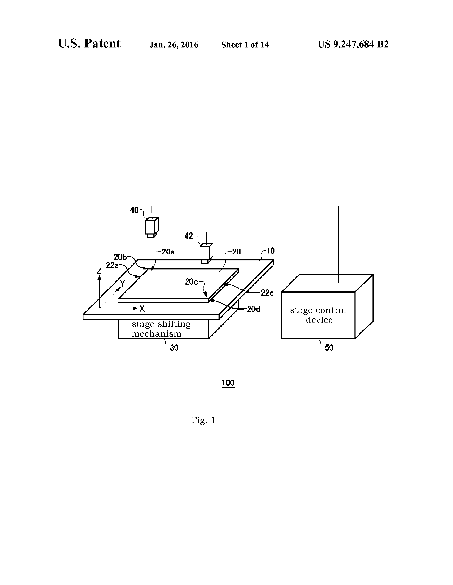
*도 1 — 대상물 제어 시스템(100): 스테이지(10), 스테이지 이동 기구(30), 두 촬상부(40, 42), 스테이지 제어 장치(50)*

스테이지(10)는 대상물(20)을 유지하는 유지 부재로 기능하며, 대상물(20)은 스테이지(10) 위에 설치된다. 스테이지 이동 기구(30)는 스테이지(10)를 수평 방향, 즉 도 1의 X 및 Y 방향으로 이동시키고, 또한 도 1에서 Z 방향으로 나타낸 회전축을 중심으로 회전시킴으로써 스테이지(10)를 θ 방향으로 변위시키는 회전 방향으로도 이동시킨다.

제1 촬상부(40)는 스테이지(10) 위의 대상물(20)에 대하여 미리 정해진 제1 대상물 선을 특정하는 제1 기준 마크를 포함하는 화상으로서, 대상물(20)의 한 모서리 부분(20a)을 포함하는 화상을 촬상한다. 이하 제1 촬상부(40)가 촬상한 화상을 "제1 화상"이라 한다.

제2 촬상부(42)는 스테이지(10) 위의 대상물(20)에 대하여 미리 정해진 제2 대상물 선을 특정하는 제2 기준 마크를 포함하는 화상으로서, 대상물(20)의 다른 모서리 부분(20c)을 포함하는 화상을 촬상한다. 이하 제2 촬상부(42)가 촬상한 화상을 "제2 화상"이라 한다.

스테이지 제어 장치(50)는 대상물(20)의 이동을 제어하는 대상물 제어부로 기능하며, 제1 화상 내의 제1 기준 마크와 제2 화상 내의 제2 기준 마크에 근거하여, 대상물(20)을 미리 특정된 목표 위치로 이동시키도록 스테이지 이동 기구(30)로 스테이지(10)의 이동을 제어한다.

상술한 구조를 갖는 본 실시예에 따른 대상물 제어 시스템(100)에서는, 제1 촬상부(40)와 제2 촬상부(42) 중 하나로 미리 특정된 기준 마크를 포함하는 화상을 촬상하지 못한 경우에도, 다른 촬상부가 촬상한 화상에 근거하여 대상물(20)을 목표 위치로 이동시킬 수 있다.

본 실시예에서는 스테이지(10)를 수평 방향과 회전 방향으로 이동시켜 대상물(20)을 이동시키는 예를 설명한다는 점을 이해해야 한다. 그러나 이 대상물(20)의 이동은 반드시 스테이지(10)를 이동시키지 않고도 수행할 수 있다. 예를 들어, 스테이지(10) 위에 실린 대상물(20)을 스테이지(10) 위쪽에 설치된 흡착 장치로 흡착하고, 이 흡착 장치를 수평 방향이나 회전 방향으로 이동시켜 대상물(20)을 이동시키도록 해도 된다.

도 2A는 대상물(20)의 모서리 부분(20a)을 제1 기준 마크로 사용할 때, 대상물(20)의 기울기를 특정하는 제1 화상(120) 내 제1 대상물 선의 예를 나타낸다. 본 실시예에서는 모서리 부분(20a)의 한 변(22a)이 제1 대상물 선에 해당한다. 또한 이 제1 대상물 선, 즉 변(22a)과 제1 화소 좌표계의 Y축 사이의 각도를 제1 각도 θ1로 나타낸다. 또한 본 실시예에서는 모서리 부분(20a)의 꼭짓점(20b)이 제1 화상 내 제1 화소 좌표계에서 대상물(20)의 위치를 특정하는 제1 기준점에 해당한다. 도 2A에서 파선으로 나타낸 대상물(20')은 목표 위치에 있을 때의 대상물(20)의 제1 화상 내 위치를 나타낸다는 점을 이해해야 한다. 여기서 대상물(20')의 모서리 부분(20a')이 제1 목표 기준 마크를 특정한다. 또한 모서리 부분(20a')의 한 변(22a')이 제1 목표 대상물 선을 특정하고, 모서리 부분(20a')의 꼭짓점(20b')이 제1 목표 기준점을 특정한다. 그리고 제1 목표 대상물 선과 Y축 사이의 각도를 제1 목표 각도 θt1로 나타낸다.

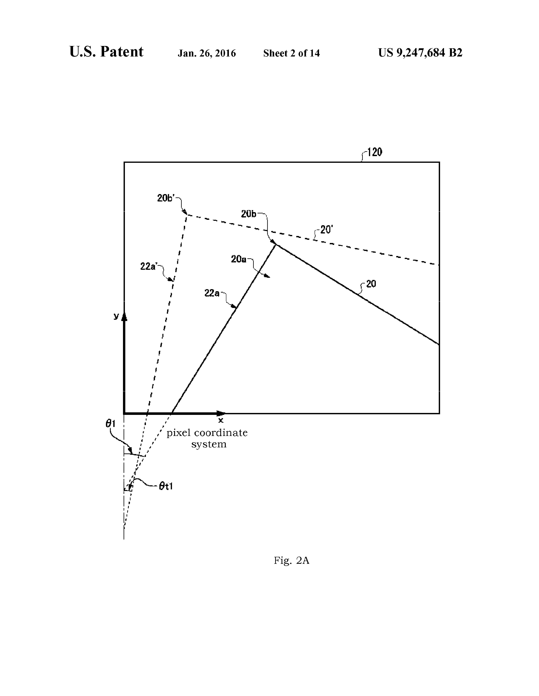
*도 2A — 제1 화상(120): 모서리 부분(20a)의 변(22a)=제1 대상물 선, 꼭짓점(20b)=제1 기준점, 파선(20')=목표 위치*

도 2B는 대상물(20)의 모서리 부분(20c)을 제2 기준 마크로 사용할 때, 대상물(20)의 기울기를 특정하는 제2 화상(122) 내 제2 대상물 선의 예를 나타낸다. 본 실시예에서는 모서리 부분(20c)의 한 변(22c)이 제2 대상물 선에 해당한다. 또한 이 제2 대상물 선, 즉 변(22c)과 제2 화소 좌표계의 Y축 사이의 각도를 제2 각도 θ2로 나타낸다. 또한 본 실시예에서는 모서리 부분(20c)의 꼭짓점(20d)이 제2 화상 내 제2 화소 좌표계에서 대상물(20)의 위치를 특정하는 제2 기준점에 해당한다. 도 2B에서 파선으로 나타낸 대상물(20')은 목표 위치에 있을 때의 대상물(20)의 제2 화상 내 위치를 나타낸다는 점을 이해해야 한다. 여기서 대상물(20')의 모서리 부분(20c')이 제2 목표 기준 마크를 특정한다. 또한 모서리 부분(20c')의 한 변(22c')이 제2 목표 대상물 선을 특정하고, 모서리 부분(20c')의 꼭짓점(20d')이 제2 목표 기준점을 특정한다. 그리고 제2 목표 대상물 선과 Y축 사이의 각도를 제2 목표 각도 θt2로 나타낸다.

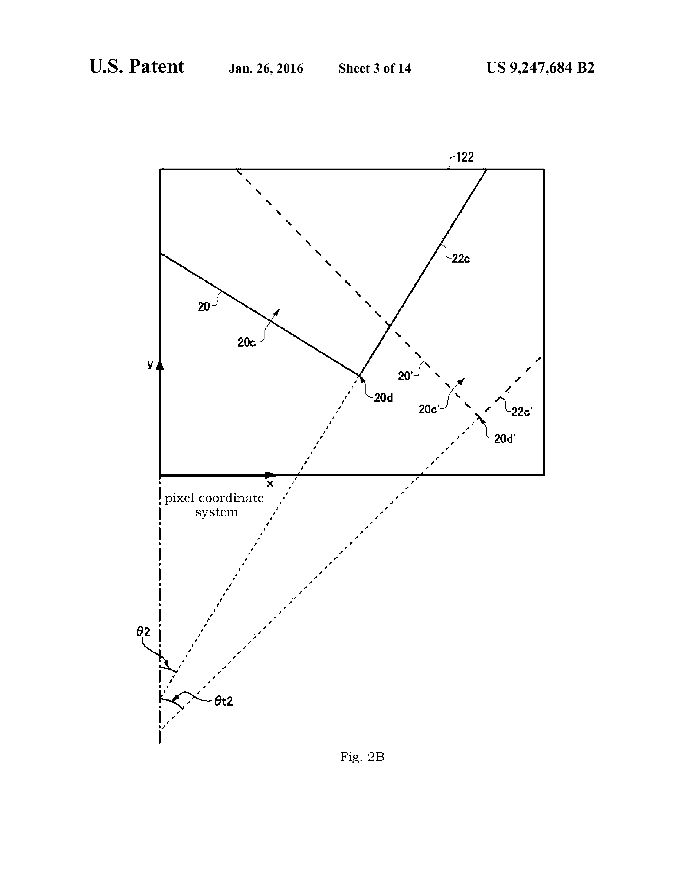
*도 2B — 제2 화상(122): 모서리 부분(20c)의 변(22c)=제2 대상물 선, 꼭짓점(20d)=제2 기준점, 파선(20')=목표 위치*

본 실시예에 따른 스테이지 제어 장치(50)는 제1 화상과 제2 화상에 근거하여, 제1 화상 내 제1 화소 좌표계에서의 대상물(20)의 현재 위치와 제2 화상 내 제2 화소 좌표계에서의 대상물(20)의 현재 위치를, 미리 취득해 둔 제1 화상 내 대상물(20)의 목표 위치와 마찬가지로 미리 취득해 둔 제2 화상 내 대상물의 목표 위치에 가까워지도록 스테이지 이동 기구(30)를 제어한다.

보다 구체적으로, 스테이지 제어 장치(50)는 제1 화상 내 제1 기준 마크로 특정되는 제1 대상물 선과 미리 특정된 제1 목표 대상물 선 사이의 각도, 그리고 제2 화상 내 제2 기준 마크로 특정되는 제2 대상물 선과 미리 특정된 제2 목표 대상물 선 사이의 각도를 취득한다. 이하 제1 대상물 선과 미리 특정된 제1 목표 대상물 선 사이의 이 각도를 "제1 차분 각도"라 한다. 또한 제2 대상물 선과 미리 특정된 제2 목표 대상물 선 사이의 이 각도를 "제2 차분 각도"라 한다.

스테이지 제어 장치(50)는 위의 제1 차분 각도와 제2 차분 각도에 근거하여, 대상물(20)을 목표 위치로 이동시키는 데 필요한 스테이지(10)의 회전량을 목표 회전량으로 취득한다. 보다 구체적으로, 본 실시예에서 스테이지 제어 장치(50)는 제1 차분 각도와 제2 차분 각도의 평균으로 주어지는 평균 차분 각도를 목표 회전량으로 취득한다.

또한 스테이지 제어 장치(50)는 제1 기준 마크로 특정되는 제1 화상 내 제1 기준점을 이 목표 회전량만큼 회전시켰을 때의 제1 화소 좌표계에서의 X, Y 좌표값을 취득하고, 그것과 제1 화상 내 제1 목표 기준점의 제1 화소 좌표계 X, Y 좌표값과의 차로 주어지는 제1 차분 X, Y 좌표값을 취득한다. 마찬가지로 스테이지 제어 장치(50)는 제2 기준 마크로 특정되는 제2 화상 내 제2 기준점을 이 목표 회전량만큼 회전시켰을 때의 제2 화소 좌표계에서의 X, Y 좌표값을 취득하고, 그것과 제2 화상 내 제2 목표 기준점의 제2 화소 좌표계 X, Y 좌표값과의 차로 주어지는 제2 차분 X, Y 좌표값을 취득한다. 다음으로 스테이지 제어 장치(50)는 이 제1 차분 화소 X, Y 좌표값과 제2 차분 화소 X, Y 좌표값에 근거하여, 대상물(20)을 목표 위치로 이동시키는 데 필요한 스테이지(10)의 X 방향 평행 이동량과 Y 방향 평행 이동량을 X 방향 목표 이동량과 Y 방향 목표 이동량으로 취득한다. 보다 구체적으로, 본 실시예에서 스테이지 제어 장치(50)는 제1 차분 X, Y 좌표값에 근거하여 X 방향과 Y 방향의 제1 평행 이동량을 특정하고, 제2 차분 X, Y 좌표값에 근거하여 X 방향과 Y 방향의 제2 평행 이동량을 특정하며, 이 평행 이동량들의 평균을 X 방향과 Y 방향 각각에 대해 계산함으로써 X 방향 목표 이동량과 Y 방향 목표 이동량을 취득한다.

그리고 스테이지 제어 장치(50)는 위와 같이 취득한 목표 회전량, X 방향 목표 이동량, Y 방향 목표 이동량에 근거하여 스테이지 이동 기구(30)를 제어함으로써 대상물(20)을 목표 위치로 이동시킨다.

본 실시예에서는 대상물(20)의 특정 모서리 부분들을 제1 기준 마크와 제2 기준 마크로 사용하는 예를 설명한다는 점을 이해해야 한다. 그러나 제1 기준 마크와 제2 기준 마크는 각 화상에서 대상물(20)의 기울기를 취득할 수 있는 마크라면 어떤 것이라도 된다. 따라서 제1 기준 마크와 제2 기준 마크는 대상물(20)에 미리 부착된, 각도를 나타내는 마크여도 된다. 또한 제1 기준 마크와 제2 기준 마크는 각각 대상물(20)에 미리 부착된 두 점으로 이루어져도 된다. 즉, 이 두 점을 잇는 직선이 대상물 선을 이루고, 이 두 점 중 어느 하나가 기준점을 이룰 수 있다. 다시 말해, 대상물 선은 기준 마크에 대하여 미리 정해지지만 실제로는 보이지 않는 가상선이어도 된다. 또한 대상물 선은 기준 마크에 대하여 미리 정해지는 기준축, 예를 들어 기준 마크의 관성 모멘트가 최소가 되도록 회전축에 대하여 미리 정해지는 가상선이어도 된다. 또한 대상물 선은 대상물(20)에 대하여 미리 정해진 좌표계에 근거하여 미리 정해지는 가상선이어도 된다.

또한 본 실시예에서는 대상물(20) 위의 서로 다른 위치에 있는 마크가 제1 기준 마크와 제2 기준 마크를 이루는 예를 설명한다. 다시 말해, 제1 촬상부(40)와 제2 촬상부(42)가 대상물(20) 위의 서로 다른 위치를 촬상하는 예를 설명한다. 그러나 제1 기준 마크와 제2 기준 마크가 대상물(20) 위의 서로 다른 위치의 마크로 이루어지지 않아도 된다. 다시 말해, 제1 기준 마크와 제2 기준 마크가 대상물(20) 위의 같은 위치의 마크로 이루어져도 된다. 따라서 제1 촬상부(40)와 제2 촬상부(42)가 대상물(20) 위의 같은 위치를 촬상해도 된다.

도 3은 대상물 제어 시스템(100)의 기능 블록을 나타낸다. 제1 촬상부(40)는 화상 취득부(51)를 통해 제1 화상을 캘리브레이션부(52)와 얼라인먼트부(60)에 공급한다. 마찬가지로 제2 촬상부(42)는 화상 취득부(51)를 통해 제2 화상을 캘리브레이션부(52)와 얼라인먼트부(60)에 공급한다.

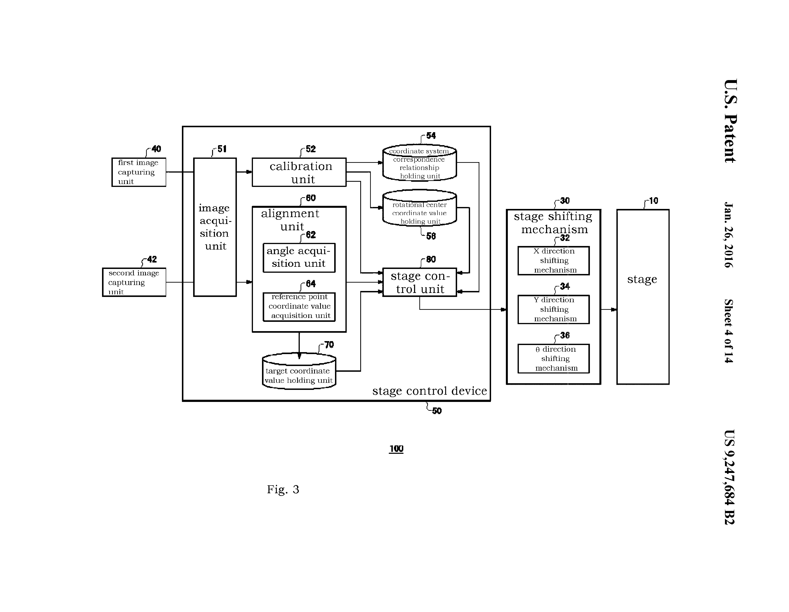
*도 3 — 대상물 제어 시스템(100)의 기능 블록: 화상 취득부(51), 캘리브레이션부(52), 얼라인먼트부(60), 스테이지 제어부(80) 등*

스테이지 이동 기구(30)는 스테이지(10)를 X 방향으로 평행 이동시키는 X 방향 이동 기구(32), 스테이지(10)를 Y 방향으로 평행 이동시키는 Y 방향 이동 기구(34), 그리고 회전 기구로 기능하며 Z 방향을 따르는 회전축을 중심으로 스테이지(10)를 회전시키는 θ 방향 이동 기구(36)를 포함한다.

스테이지 제어 장치(50)는 화상 취득부(51), 캘리브레이션부(52), 좌표계 대응 관계 유지부(54), 회전 중심 좌표값 유지부(56), 얼라인먼트부(60), 목표 좌표값 유지부(70), 및 스테이지 제어부(80)를 포함한다.

화상 취득부(51)는 제1 촬상부(40)가 촬상한 제1 화상과 제2 촬상부(42)가 촬상한 제2 화상을 취득하고, 이렇게 취득한 제1 화상과 제2 화상을 캘리브레이션부(52)와 얼라인먼트부(60)에 공급한다.

캘리브레이션부(52)는 스테이지(10) 위에 미리 정해진, 제1 화상과 제2 화상에 포함된 스테이지 기준점들의 이동 궤적에 근거하여 캘리브레이션을 수행한다. 다시 말해, 캘리브레이션부(52)는 스테이지(10)와 제1 촬상부(40) 및 제2 촬상부(42) 사이의 위치 관계, 즉 스테이지(10)의 직교 좌표계("스테이지 좌표계"라고도 함)와, 제1 촬상부(40)와 제2 촬상부(42)의 촬상 범위에 대한 직교 좌표계인 제1 화소 좌표계 및 제2 화소 좌표계 사이의 대응 관계를 특정하는 좌표계 대응 관계를 취득한다. 또한 캘리브레이션부(52)는 스테이지 좌표계에서 스테이지(10)의 회전 중심의 X, Y 좌표값("스테이지 X, Y 좌표값"이라고도 함)과, 제1 화소 좌표계에서의 X, Y 좌표값("제1 화소 X, Y 좌표값"이라고도 함) 및 제2 화소 좌표계에서의 X, Y 좌표값("제2 화소 X, Y 좌표값"이라고도 함) 사이의 대응 관계를 특정하는 회전 중심 좌표값 대응 관계를 취득한다. 좌표계 대응 관계와 회전 중심 좌표값 대응 관계를 취득하는 단계는 뒤에서 설명한다는 점을 이해해야 한다.

좌표계 대응 관계 유지부(54)는 캘리브레이션부(52)가 취득한 좌표계 대응 관계를 유지한다. 또한 회전 중심 좌표값 유지부(56)는 캘리브레이션부(52)가 취득한 회전 중심 좌표값 대응 관계를 유지한다.

얼라인먼트부(60)는 각도 취득부(62)와 기준점 좌표값 취득부(64)를 포함하며, 대상물(20)을 목표 위치로 이동시키도록 제1 화상과 제2 화상에 근거하여 얼라인먼트를 수행한다.

각도 취득부(62)는 제1 화상 내 제1 기준 마크에 근거하여, 예를 들어 제1 화상에 대하여 미리 정해진 제1 기준선 역할을 하는 제1 화소 좌표계의 Y축과 제1 화상 내 제1 대상물 선 사이의 각도인 제1 각도를 취득한다. 마찬가지로 각도 취득부(62)는 제2 화상 내 제2 기준 마크에 근거하여, 예를 들어 제2 화상에 대하여 미리 정해진 제2 기준선 역할을 하는 제2 화소 좌표계의 Y축과 제2 화상 내 제2 대상물 선 사이의 각도인 제2 각도를 취득한다. 다시 말해, 제1 기준 마크를 대상물(20)의 모서리 부분(20a)으로 하면, 각도 취득부(62)는 제1 화상에 근거하여 제1 화소 좌표계의 Y축과 변(22a) 사이의 각도를 이 제1 각도로 취득한다. 마찬가지로 제2 기준 마크를 대상물(20)의 모서리 부분(20c)으로 하면, 각도 취득부(62)는 제2 화상에 근거하여 제2 화소 좌표계의 Y축과 변(22d) 사이의 각도를 이 제2 각도로 취득한다.

기준점 좌표값 취득부(64)는 제1 화상 내에서 제1 기준 마크를 특정하는 제1 기준점의 제1 화소 X, Y 좌표값을 취득한다. 마찬가지로 기준점 좌표값 취득부(64)는 제2 화상 내에서 제2 기준 마크를 특정하는 제2 기준점의 제2 화소 X, Y 좌표값을 취득한다. 예를 들어, 제1 기준 마크를 대상물(20)의 모서리 부분(20a)으로 하면, 기준점 좌표값 취득부(64)는 모서리 부분(20a)의 꼭짓점(20b)의 제1 화소 X, Y 좌표값을 제1 기준점의 제1 화소 X, Y 좌표값으로 취득한다. 마찬가지로 제2 기준 마크를 대상물(20)의 모서리 부분(20c)으로 하면, 기준점 좌표값 취득부(64)는 모서리 부분(20a)의 꼭짓점(20d)의 제2 화소 X, Y 좌표값을 제2 기준점의 제2 화소 X, Y 좌표값으로 취득한다.

대상물(20)이 목표 위치에 놓였을 때, 목표 좌표값 유지부(70)는 제1 촬상부(40)와 제2 촬상부(42)가 촬상한 제1 화상과 제2 화상에 근거하여 각도 취득부(62)가 취득한 제1 각도와 제2 각도를 제1 목표 각도와 제2 목표 각도로 유지한다.

또한 목표 좌표값 유지부(70)는 기준점 좌표값 취득부(64)가 취득한 제1 기준점의 제1 화소 X, Y 좌표값과 제2 기준점의 제2 화소 X, Y 좌표값을 제1 목표 화소 X, Y 좌표값과 제2 목표 화소 X, Y 좌표값으로 유지한다.

그리고 스테이지 제어부(80)는 제1 화상과 제2 화상에 근거하여 취득한 제1 각도와 제2 각도를 목표 좌표값 유지부(70)에 유지된 제1 목표 각도와 제2 목표 각도에 가깝게 하기 위해 스테이지의 목표 회전량을 특정한다. 또한 스테이지 제어부(80)는 제1 화상과 제2 화상에 근거하여 취득한 제1 기준점의 제1 화소 X, Y 좌표값과 제2 기준점의 제2 화소 X, Y 좌표값을 목표 좌표값 유지부(70)에 유지된 제1 목표 화소 X, Y 좌표값과 제2 목표 화소 X, Y 좌표값에 가깝게 하기 위해 스테이지의 X 방향 및 Y 방향 이동량을 특정한다.

도 4는 캘리브레이션부(52)가 이 좌표계 대응 관계를 취득하면서 캘리브레이션 중에 수행하는 단계들의 예를 나타내는 흐름도이다. 먼저 캘리브레이션부(52)는 스테이지 제어부(80)에 명령을 내려, 스테이지(10) 회전 중심의 스테이지 X, Y 좌표값과, 제1 촬상부(40)가 촬상하는 제1 스테이지 기준점 및 제2 촬상부(42)가 촬상하는 제2 스테이지 기준점의 스테이지 X, Y 좌표값을 미리 취득해 둔 기준 위치로 스테이지(10)를 이동시킨다(단계 S100).

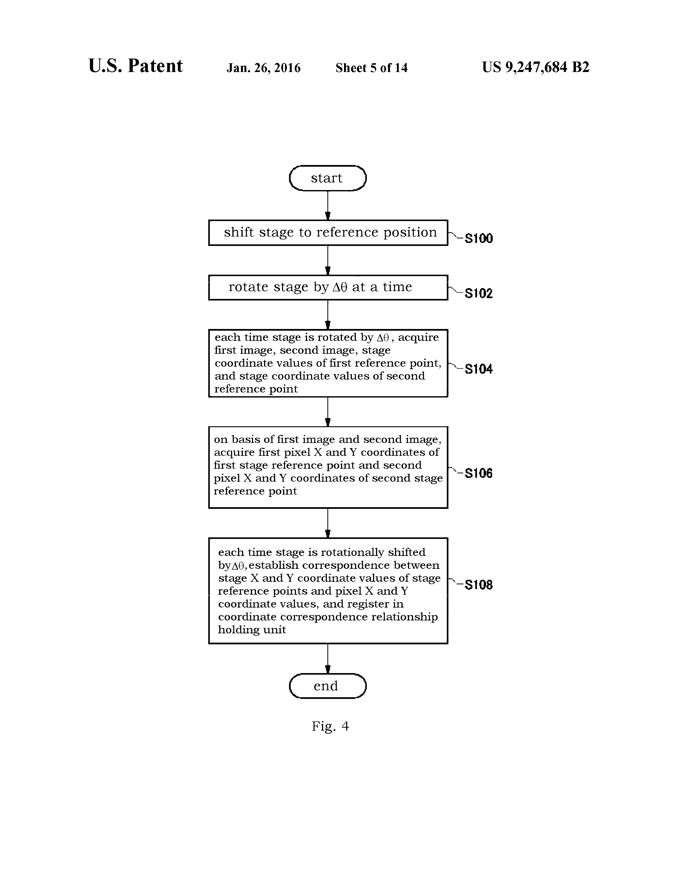
*도 4 — 좌표계 대응 관계를 취득하는 캘리브레이션 흐름도(S100~S108)*

다음으로 캘리브레이션부(52)는 스테이지 제어부(80)에 명령하여 스테이지(10)를 한 번에 Δθ씩 회전 이동시킨다(단계 S102). 그리고 스테이지(10)를 이렇게 Δθ만큼 회전 이동시킬 때마다, 캘리브레이션부(52)는 제1 촬상부(40)와 제2 촬상부(42)로부터 제1 화상과 제2 화상을 취득하고, 제1 기준점의 스테이지 좌표값과 제2 기준점의 스테이지 좌표값을 취득한다(단계 S104). 또한 제1 화상과 제2 화상을 취득할 때마다, 캘리브레이션부(52)는 제1 화상 내 제1 스테이지 기준점의 제1 화소 X, Y 좌표값과 제2 화상 내 제2 스테이지 기준점의 제2 화소 X, Y 좌표값을 취득한다(단계 S106). 이하 제1 화소 X, Y 좌표값과 제2 화소 X, Y 좌표값을 구별할 필요가 없으면 통칭하여 "화소 X, Y 좌표값"이라 한다.

다음으로 캘리브레이션부(52)는 스테이지(10)를 Δθ만큼 회전 이동시킬 때마다 취득한 스테이지 기준점의 스테이지 X, Y 좌표값과 화소 X, Y 좌표값을 서로 대응시키고, 이 대응을 좌표계 대응 관계 유지부(54)에 등록한다.

도 5는 좌표계 대응 관계 유지부(54)에 유지되는 스테이지 X, Y 좌표값과 화소 X, Y 좌표값 사이의 대응 관계를 특정하는 좌표 대응 관계 테이블의 예를 나타낸다.

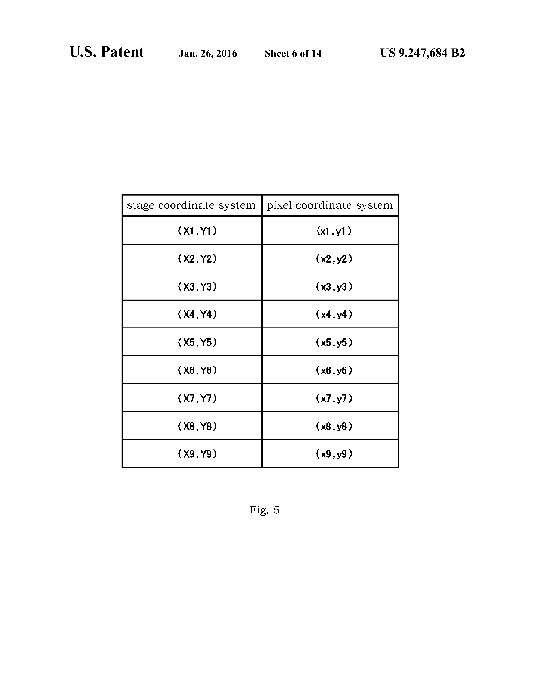
*도 5 — 좌표 대응 관계 테이블: 스테이지 X, Y 좌표값 ↔ 화소 X, Y 좌표값*

또한 캘리브레이션부(52)는 예를 들어 다음 단계를 수행하여 회전 중심 좌표값 대응 관계를 취득할 수 있다.

캘리브레이션부(52)는 Δθ만큼 회전 이동할 때마다 취득한 복수의 제1 화상 내 복수의 제1 스테이지 기준점의 복수의 제1 화소 X, Y 좌표값을 취득하고, 이 복수의 제1 화소 X, Y 좌표값에 근거하여 최소제곱법으로 가상 원호를 특정하며, 이 가상 원호의 중심에 해당하는 제1 화소 X, Y 좌표값에 근거하여 제1 화소 좌표계의 회전 중심에 대한 제1 화소 X, Y 좌표값을 취득한다. 마찬가지로 캘리브레이션부(52)는 Δθ만큼 회전 이동할 때마다 취득한 복수의 제2 화상에 근거하여 제2 화소 좌표계의 회전 중심의 제2 화소 X, Y 좌표값을 취득한다. 또한 캘리브레이션부(52)는 좌표 대응 관계 테이블을 참조하여 회전 중심들의 제1 화소 X, Y 좌표값과 제2 화소 X, Y 좌표값에 대응하는 스테이지 X, Y 좌표값을 취득한다. 그리고 캘리브레이션부(52)는 취득한 화소 X, Y 좌표값과 스테이지 X, Y 좌표값을 서로 대응시키고, 이 대응을 회전 중심 좌표값 유지부(56)에 등록한다.

또한 캘리브레이션부(52)가 다음 단계를 수행하여 회전 중심 좌표값 대응 관계를 취득하도록 해도 된다.

캘리브레이션부(52)는 제1 스테이지 기준점을 포함하는 제1 화상을 취득하고, 회전 전 제1 화상 내 제1 스테이지 기준점의 제1 화소 X, Y 좌표값을 회전 전 제1 화소 X, Y 좌표값으로 취득한다. 다음으로 제1 스테이지 기준점이 제1 화상에 포함되는 범위, 즉 제1 스테이지 기준점이 제1 촬상부(40)의 촬상 범위에 포함되는 범위만큼 스테이지(10)를 회전시키도록, 스테이지 제어부(80)에 명령하여 스테이지(10)를 Δθ만큼 회전시킨다. 스테이지(10)가 Δθ만큼 회전된 후, 캘리브레이션부(52)는 다시 제1 스테이지 기준점을 포함하는 제1 화상을 취득한다. 다음으로 캘리브레이션부(52)는 회전 후 제1 화상 내 제1 스테이지 기준점의 제1 화소 X, Y 좌표값을 회전 후 제1 화소 X, Y 좌표값으로 취득한다. Δθ 회전 전과 Δθ 회전 후의 제1 화소 X, Y 좌표값을 취득한 뒤, 캘리브레이션부(52)는 Δθ 회전 전의 제1 화소 X, Y 좌표값과 Δθ 회전 후의 값이 이루는 직선을 밑변으로 하고, 스테이지 제어부(80)에 명령한 스테이지(10)의 회전량에 해당하는 Δθ를 꼭지각으로 하는 이등변 삼각형 형상을 도출한다. 그리고 캘리브레이션부(52)는 도출한 이 이등변 삼각형 형상의 꼭지각 Δθ에 있는 꼭짓점의 제1 화소 X, Y 좌표값을 제1 화소 좌표계의 회전 중심의 제1 화소 X, Y 좌표값으로 취득한다. 마찬가지로 캘리브레이션부(52)는 Δθ 회전 전 제2 화상 내 제2 스테이지 기준점의 제2 화소 X, Y 좌표값과 Δθ 회전 후 제2 화상 내 제2 스테이지 기준점의 제2 화소 X, Y 좌표값을 취득한다. 또한 캘리브레이션부(52)는 Δθ 회전 전의 제2 화소 X, Y 좌표값과 Δθ 회전 후의 제2 화소 X, Y 좌표값을 잇는 직선을 밑변으로 하고 Δθ를 꼭지각으로 하는 이등변 삼각형 형상을 도출하고, 도출한 이 이등변 삼각형 형상의 꼭지각 Δθ에 있는 꼭짓점의 제2 화소 X, Y 좌표값을 제2 화소 좌표계의 회전 중심의 제2 화소 X, Y 좌표값으로 취득한다. 또한 캘리브레이션부(52)는 좌표 대응 관계 테이블을 참조하여 회전 중심들의 제1 화소 X, Y 좌표값과 제2 화소 X, Y 좌표값에 대응하는 스테이지 X, Y 좌표값을 취득한다. 그런 다음 캘리브레이션부(52)는 취득한 이 화소 X, Y 좌표값과 스테이지 X, Y 좌표값을 서로 대응시키고, 이 대응을 회전 중심 좌표값 유지부(56)에 등록한다.

이상의 처리에 의해 캘리브레이션부(52)는 스테이지 좌표계와 각 화소 좌표계 사이의 좌표계 대응 관계, 그리고 회전 중심의 스테이지 X, Y 좌표값과 각 화소 X, Y 좌표값 사이의 회전 중심 좌표값 대응 관계를 취득한다. 위에서 설명한 좌표계 대응 관계와 회전 중심 좌표계 대응 관계의 취득 절차는 하나의 예일 뿐이며, 그 자체로 알려진 다른 절차를 사용해도 된다는 점을 이해해야 한다.

도 6은 얼라인먼트 절차의 예를 나타내는 흐름도이다. 먼저 대상물(20)이 스테이지(10) 위에 설치된 상태에서, 얼라인먼트부(60)는 제1 촬상부(40)와 제2 촬상부(42)가 촬상한 제1 화상과 제2 화상을 취득한다(단계 S200). 그런 다음 얼라인먼트부(60)는 제1 화상과 제2 화상에 근거하여, 각도 취득부(62)를 사용해 제1 화소 좌표계의 Y축과 제1 화상 내 제1 대상물 선 사이의 제1 각도, 그리고 제2 화소 좌표계의 Y축과 제2 화상 내 제2 대상물 선 사이의 제2 각도를 취득한다(단계 S202).

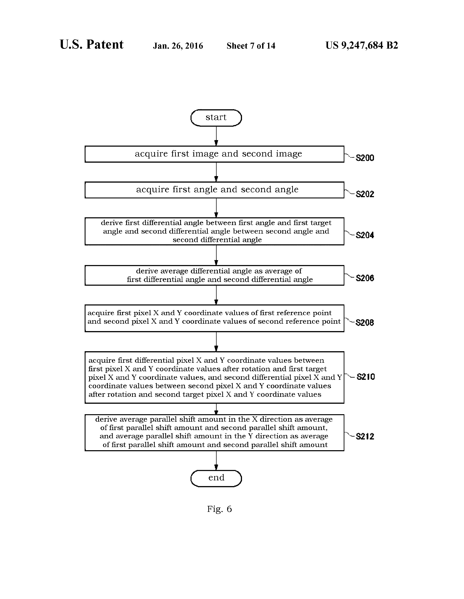
*도 6 — 얼라인먼트 절차 흐름도(S200~S216)*

그런 다음 얼라인먼트부(60)는 목표 좌표값 유지부(70)를 참조하여 제1 목표 각도와 제2 목표 각도를 취득한다. 또한 얼라인먼트부(60)는 단계 S200에서 취득한 제1 각도와 제1 목표 각도의 차로 주어지는 제1 차분 각도, 그리고 단계 S200에서 취득한 제2 각도와 제2 목표 각도의 차로 주어지는 제2 차분 각도를 도출한다(단계 S204). 그리고 얼라인먼트부(60)는 단계 S204에서 도출한 제1 차분 각도와 제2 차분 각도의 평균을 취하여, 목표 회전량으로 삼을 평균 차분 각도를 도출한다(단계 S206).

또한 얼라인먼트부(60)는 제1 화상과 제2 화상에 근거하여, 기준점 좌표값 취득부(64)로 제1 화상 내 제1 기준점의 제1 화소 X, Y 좌표값과 제2 화상 내 제2 기준점의 제2 화소 X, Y 좌표값을 취득한다(단계 S208).

그런 다음 얼라인먼트부(60)는 단계 S208에서 취득한 화소 X, Y 좌표값을 갖는 제1 기준점을, 캘리브레이션으로 특정된 회전 중심 위치에 해당하는 제1 화소 X, Y 좌표값을 중심으로 평균 차분 각도만큼 회전시켰을 때의 제1 화소 좌표값을 특정한다. 마찬가지로 얼라인먼트부(60)는 화소 X, Y 좌표값을 갖는 제2 기준점을, 캘리브레이션으로 특정된 회전 중심 위치에 해당하는 제2 화소 X, Y 좌표값을 중심으로 평균 차분 각도만큼 회전시켰을 때의 제2 화소 좌표값을 특정한다. 추가로 얼라인먼트부(60)는 목표 좌표값 유지부(70)를 참조하여 제1 목표 화소 X, Y 좌표값과 제2 목표 X, Y 좌표값을 취득하고, 위와 같이 특정한 회전을 수행한 후의 제1 화소 X, Y 좌표값과 제1 목표 X, Y 좌표값 사이의 차를 제1 차분 화소 X, Y 좌표값으로, 위와 같이 특정한 회전을 수행한 후의 제2 화소 X, Y 좌표값과 제2 목표 X, Y 좌표값 사이의 차를 제2 차분 화소 X, Y 좌표값으로 도출한다(단계 S210).

또한 스테이지 제어부(80)는 단계 S210에서 취득한 제1 차분 X, Y 화소값에 근거하여 X 방향과 Y 방향의 제1 평행 이동량을 특정하고, 제2 차분 X, Y 화소값에 근거하여 X 방향과 Y 방향의 제2 평행 이동량을 특정한다. 또한 스테이지 제어부(80)는 X 방향 제1 평행 이동량과 X 방향 제2 평행 이동량의 평균, 그리고 Y 방향 제1 평행 이동량과 Y 방향 제2 평행 이동량의 평균을 각각 취하여, X 방향 평균 평행 이동량과 Y 방향 평균 평행 이동량을 도출한다(단계 S212).

그런 다음 스테이지 제어부(80)는 대상물(20)을 목표 위치로 이동시키도록, 평균 차분 각도, X 방향 평균 평행 이동량, Y 방향 평균 평행 이동량에 근거하여 스테이지 이동 기구(30)를 제어하고 스테이지(10)를 이동시킨다.

위의 설명에서는 평균 차분 각도를 도출하는 것이 얼라인먼트부(60)인 예를 설명했다는 점을 이해해야 한다. 그러나 얼라인먼트부(60)가 단계 S202에서 취득한 제1 각도와 제2 각도를 스테이지 제어부(80)에 공급하고, 평균 차분 각도를 구하는 것이 스테이지 제어부(80)가 되도록 해도 된다.

이상 설명한 바와 같이, 본 실시예에 따르면 스테이지 제어 장치(50)는 대상물(20)의 기울기를 주는 대상물 선과 화상 내 기준점을 포함하는 기준 마크, 예를 들어 대상물(20)의 한 모서리 부분의 변과 꼭짓점을 포함하는 화상을 사용하여 화상 내 대상물(20)의 기울기를 취득하고, 이 기울기와 그 위치에 근거하여, 미리 취득해 둔 화상 내 대상물(20)의 목표 기울기와 목표 위치에 가까워지도록 스테이지(10)를 이동시킴으로써 대상물(20)을 목표 위치로 이동시킨다.

본 실시예에서 스테이지 제어 장치(50)는 제1 촬상부(40)와 제2 촬상부(42)(통칭하여 "촬상부"라고도 함)가 각각 촬상한 제1 화상과 제2 화상(통칭하여 "화상"이라고도 함)에 근거하여 목표 차분 각도와 목표 화소 좌표값을 취득한다. 다시 말해, 스테이지 제어 장치(50)는 촬상부마다 스테이지의 이동량을 특정하는 목표 차분 각도와 목표 화소 좌표값을 취득한다.

예를 들어, 두 마크 사이의 거리를 미리 입력하고 각 마크의 화상을 두 촬상부 중 하나로 촬상하여, 이 거리를 근거로 스테이지 회전 중심의 좌표를 취득한다면, 두 촬상부의 설치 위치를 정확하게 정해 두어야 한다. 그러나 본 실시예에서는 촬상부의 화상 각각을 개별적으로 활용하여 각각의 목표 차분 각도와 목표 화소 좌표값을 취득한다. 따라서 촬상부들 사이의 거리 등을 정확하게 정하지 않고 촬상부를 설치해도 된다. 또한 목표 회전량, X 방향 목표 이동량, Y 방향 목표 이동량은, 촬상부의 화상 각각을 독립적으로 활용하여 취득한 각각의 목표 차분 각도와 좌표값 기준의 X 방향 및 Y 방향 평행 이동량을 평균하여 취득한다. 따라서 목표 회전량, X 방향 목표 이동량, Y 방향 목표 이동량을 정확하게 취득할 수 있다. 또한 마크 위치와 마크 목표 위치 사이의 편차가 상쇄될 때까지 회전 및/또는 평행 이동을 수행해야 하는 횟수를 줄일 수 있어, 대상물(20)을 목표 위치로 이동시키는 데 필요한 시간을 단축할 수 있다.

이상 설명한 바와 같이, 본 실시예에서 스테이지 제어 장치(50)는 촬상부마다 스테이지 이동량을 특정하는 목표 차분 각도와 목표 화소 좌표값을 취득한다. 따라서 예를 들어 촬상부 중 하나가 촬상한 화상에 기준 마크가 포함되지 않거나 촬상부 중 하나에 고장이 생기더라도, 다른 촬상부가 촬상한 화상에 근거한 목표 차분 각도와 목표 화소 좌표값에 따라 대상물(20)을 목표 위치로 이동시킬 수 있다. 다시 말해, 예를 들어 촬상부 중 하나가 촬상한 화상에 기준 마크가 포함되지 않거나 촬상부 중 하나에 고장이 생기더라도, 대상물(20)을 목표 위치로 이동시킬 때까지 필요한 시간을 낮게 유지할 수 있다.

본 실시예에서 스테이지 제어 장치(50)는 제1 각도 또는 제2 각도와 제1 목표 각도 또는 제2 목표 각도 사이의 차로부터 제1 차분 각도 또는 제2 차분 각도를 취득한다는 점을 이해해야 한다. 그러나 스테이지 제어 장치(50)가 제1 대상물 선 또는 제2 대상물 선과 제1 목표 대상물 선 또는 제2 목표 대상물 선이 이루는 각도로부터 직접 제1 차분 각도 또는 제2 차분 각도를 취득하도록 해도 된다.

도 7은 촬상부 중 하나에 의한 화상을 사용할 수 없을 때 스테이지 제어 장치(50)가 수행하는 처리 순서를 나타내는 흐름도이다. 즉 다른 촬상부에 의한 화상을 사용하여 대상물(20)을 목표 위치로 이동시키는 경우이다.

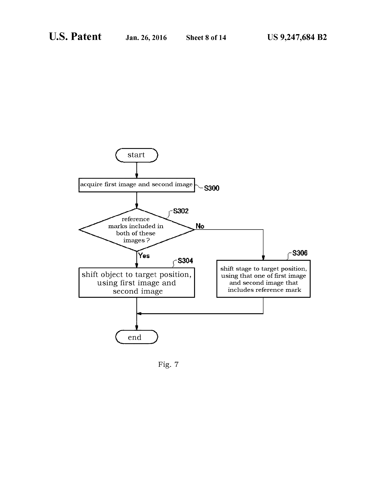
*도 7 — 한 촬상부의 화상을 쓸 수 없을 때 다른 촬상부 화상만으로 이동하는 처리 흐름도(S300~S306)*

대상물(20)이 스테이지(10) 위에 설치된 상태에서, 스테이지 제어 장치(50)는 각 촬상부로 화상을 취득한다(단계 S300). 다음으로 스테이지 제어 장치(50)는 이 화상들 각각을 참조하여, 각각의 기준 마크가 이 화상들 안에 포함되어 있는지 여부를 판정한다(단계 S302). 판정 결과 마크가 포함되어 있으면(즉 단계 S302의 판정 결과가 긍정 "Y"이면), 위의 설명대로 각 화상에 근거하여 평균 차분 각도와 X 방향 및 Y 방향 평균 평행 이동량을 도출하고, 이 차분 각도의 평균과 X 방향 및 Y 방향 평균 평행 이동량에 근거하여 스테이지를 이동시킴으로써 대상물(20)을 목표 위치로 이동시킨다(단계 S304). 한편 판정 결과 기준 마크가 포함되지 않은 화상이 있으면(즉 단계 S302의 판정 결과가 부정 "N"이면), 스테이지 제어 장치(50)는 기준 마크가 포함된 한 화상에 근거하여 차분 각도와 차분 화소 X, Y 좌표값을 취득하고, 이 차분 각도와 차분 화소 X, Y 좌표값에 근거하여 스테이지를 이동시킴으로써 대상물(20)을 목표 위치로 이동시킨다(단계 S306).

위에 따르면, 촬상부 중 하나가 촬상한 화상에 기준 마크가 포함되지 않거나 촬상부 중 하나에 고장이 생기더라도, 다른 촬상부가 촬상한 화상에 근거한 목표 차분 각도와 목표 화소 좌표값을 사용하여 대상물(20)을 목표 위치로 이동시킬 수 있다.

또한 위에서 설명한 바와 같이, 촬상부 중 하나가 촬상한 화상에 근거하여 대상물(20)의 기울기를 포함하는 화상 내 위치를 확인함으로써 스테이지 제어 장치(50)로 스테이지(10)를 제어할 수 있다. 따라서 예를 들어 촬상부 중 하나가 촬상한 화상에 기준 마크가 포함되지 않았다면, 다른 촬상부가 촬상한 화상에 근거하여 스테이지(10)를 제어하고, 그 촬상부가 촬상한 화상에 기준 마크가 포함되도록 대상물(20)을 이동시키도록 해도 된다.

도 8은 촬상부 중 하나가 촬상한 화상 중 하나에 기준 마크가 포함되지 않을 때 스테이지 제어 장치(50)가 수행하는 처리 순서를 나타내는 흐름도이다.

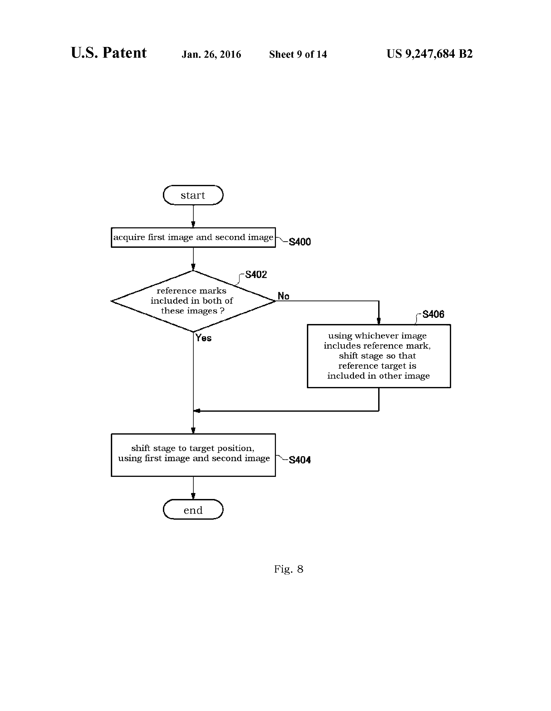
*도 8 — 한 화상에 기준 마크가 없을 때, 다른 화상으로 대상물을 옮겨 마크를 시야에 넣는 처리 흐름도(S400~S406)*

먼저 대상물(20)이 스테이지(10) 위에 설치된 상태에서, 스테이지 제어 장치(50)는 각 촬상부가 촬상한 각각의 화상을 취득한다(단계 S400). 다음으로 스테이지 제어 장치(50)는 이 두 화상을 참조하여 두 화상 모두에 기준 마크가 포함되어 있는지 여부를 판정한다(단계 S402). 판정 결과 마크가 포함되어 있으면(즉 단계 S402의 판정 결과가 긍정 "Y"이면), 위의 설명대로 각 화상에 근거하여 평균 차분 각도와 X 방향 및 Y 방향 평균 평행 이동량을 도출하고, 이 차분 각도의 평균과 X 방향 및 Y 방향 평균 평행 이동량에 근거하여 스테이지를 이동시킴으로써 대상물(20)을 목표 위치로 이동시킨다(단계 S404). 한편 판정 결과 기준 마크가 포함되지 않은 화상이 있으면(즉 단계 S402의 판정 결과가 부정 "N"이면), 스테이지 제어 장치(50)는 기준 마크가 포함된 화상 하나에 근거하여 그 화상 내에서 대상물(20)의 기울기를 포함하는 위치를 확인하고, 기준 마크가 다른 화상 안에 포함되도록 대상물(20)을 이동시킨다(단계 S406). 그리고 시스템이 다른 화상에 기준 마크가 포함된 상태에 이르면, 스테이지 제어 장치(50)는 평균 차분 각도와 X 방향 및 Y 방향 평균 평행 이동량에 근거하여 스테이지를 이동시킴으로써 대상물(20)을 목표 위치로 이동시킨다(단계 S406).

위에서 설명한 바와 같이, 본 실시예에 따른 스테이지 제어 장치(50)에 의하면, 촬상부 중 하나가 촬상한 화상에 근거하여 그 화상 내에서 대상물(20)의 기울기를 포함하는 위치를 확인하고, 이로써 스테이지(10)를 제어할 수 있다. 따라서 예를 들어 촬상부 중 하나가 촬상한 화상에 기준 마크가 포함되지 않으면, 다른 촬상부가 촬상한 화상에 근거하여 스테이지(10)를 제어할 수 있고, 따라서 그 촬상부가 촬상한 화상 안에 기준 마크가 포함되도록 대상물(20)을 이동시킬 수 있다.

또한 위의 설명에서 스테이지 제어 장치(50)는 제1 차분 각도와 제2 차분 각도의 평균을 취하고, 제1 차분 화소 X, Y 좌표값과 제2 차분 화소 X, Y 좌표값에 근거하여 특정한 X 방향 및 Y 방향 평행 이동량의 평균을 취하여 스테이지의 목표 이동량을 도출했다. 그러나 스테이지 제어 장치(50)가 제1 차분 각도와 제2 차분 각도 각각, 그리고 X 방향 및 Y 방향 제1 평행 이동량과 X 방향 및 Y 방향 제2 평행 이동량에 가중치를 부여하고, 그 가중 평균을 취하여 스테이지의 목표 이동량을 도출하도록 해도 된다.

이러한 가중 평균에 근거하여 목표 이동량을 도출하려면, 스테이지 제어 장치(50)는 촬상부마다 정해진 가중치 값을 저장하는 가중치 저장부를 포함해야 한다. 예를 들어 제1 촬상부(40)와 제2 촬상부(42)의 분해능이 다르면, 이 가중치 저장부는 그중 분해능이 높은 쪽이 분해능이 낮은 쪽보다 큰 가중치를 갖도록 제1 촬상부(40)와 제2 촬상부(42)에 대한 가중치를 저장할 수 있다. 그리고 얼라인먼트부(60)는 가중치 저장부로부터 촬상된 화상 각각에 해당하는 가중치를 취득하고, 제1 차분 각도와 제2 차분 각도, 그리고 X 방향 및 Y 방향 제1 평행 이동량과 X 방향 및 Y 방향 제2 평행 이동량에 각각의 가중치를 주면서 가중 평균을 수행하고, 이렇게 가중 평균으로 얻은 차분 각도와 X 방향 및 Y 방향 평행 이동량에 근거하여 스테이지의 목표 회전량과 스테이지의 X 방향 및 Y 방향 이동량을 취득한다.

두 촬상부의 분해능이 다른 경우로는, 예를 들어 두 촬상부의 해상도가 다른 경우, 또는 두 촬상부가 화상을 촬상하는 촬상 범위가 다른 경우를 들 수 있다는 점을 이해해야 한다.

또한 위의 설명에서 스테이지 제어 장치(50)는 두 촬상부가 취득한 화상에 근거하여 스테이지의 목표 이동량을 취득했다. 그러나 스테이지 제어 장치(50)가 세 개 이상의 촬상부가 취득한 화상에 근거하여 스테이지의 목표 이동량을 취득하도록 해도 된다. 이 경우 예를 들어 스테이지 제어 장치(50)가 각 화상에 근거하여 취득한 차분 화소 X, Y 좌표값으로부터 특정되는 X 방향 및 Y 방향 평행 이동량의 무게중심을 구하여 스테이지의 X 방향 및 Y 방향 이동량을 취득하도록 할 수 있다.

또한 촬상부들이 촬상한 화상에서 회전 중심의 화소 X, Y 좌표값에 각각 대응하는 스테이지 좌표값이 서로 일치한다고 한정되지 않는다. 따라서 화상들의 회전 중심 화소 X, Y 좌표값에 각각 대응하는 스테이지 좌표값이 서로 일치하도록 기준점의 화소 X, Y 좌표값을 보정한 뒤, 수정 후의 X, Y 화소값에 근거하여 차분 화소 X, Y 좌표값을 도출하도록 해도 된다.

그런데 캘리브레이션 중 스테이지(10)의 회전 중심 위치는 처음 설정된 회전 중심의 위치이거나, 대상물(20)을 실제로 이동시키는 작업이 수행되는 위치에 해당하는 회전 중심의 위치 등인 경우가 많다. 따라서 캘리브레이션 중 회전 중심의 위치가 촬상부의 촬상 범위 안에 포함된다고 한정되지 않는다. 다시 말해, 캘리브레이션부(52)가 촬상부 중 하나의 촬상 범위 밖에 위치하는 회전 중심을 중심으로 스테이지(10)를 회전시켜 캘리브레이션을 수행하는 경우가 많다.

도 9A는 촬상 범위 중 하나의 밖에 위치하는 회전 중심을 중심으로 스테이지(10)가 회전될 때 마크의 이동 궤적의 예를 나타내는 도면이다.

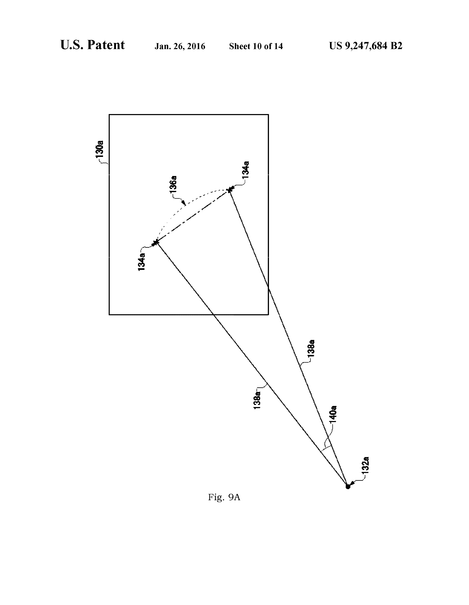
*도 9A — 촬상 범위(130a) 밖의 회전 중심(132a): 마크(134a)의 궤적은 원호(136a)의 일부, 등변(138a)이 길고 꼭지각(140a)이 작음*

스테이지(10)가 촬상 범위(130a) 밖에 위치하는 회전 중심(132a)을 중심으로 회전되면, 촬상 범위(130a)에 포함된 마크(134a)의 궤적은 원호의 한 부분(136a)을 그린다. 따라서 이 원호로부터 취득한 회전 중심 위치의 화소 X, Y 좌표값에 포함되는 오차가 비교적 큰 경우가 있다. 마찬가지로 스테이지(10)가 촬상 범위(130a) 밖에 위치하는 회전 중심(132a)을 중심으로 회전되면, 회전 전 화상에 포함된 마크(134a)와 회전 후 화상에 포함된 마크(134a)에 근거하여 취득한 이등변 삼각형 형상의 두 등변(138a) 각각의 길이는 비교적 길고 그 꼭지각의 각도(140a)는 비교적 작은 경우가 많다. 따라서 이 이등변 삼각형 형상으로부터 취득한 회전 중심 위치의 화소 X, Y 좌표값에 포함되는 오차가 비교적 커지는 경우가 있다.

도 9B는 촬상 범위 중 하나의 안에 위치하는 회전 중심을 중심으로 스테이지(10)가 회전될 때 마크의 이동 궤적의 예를 나타내는 도면이다.

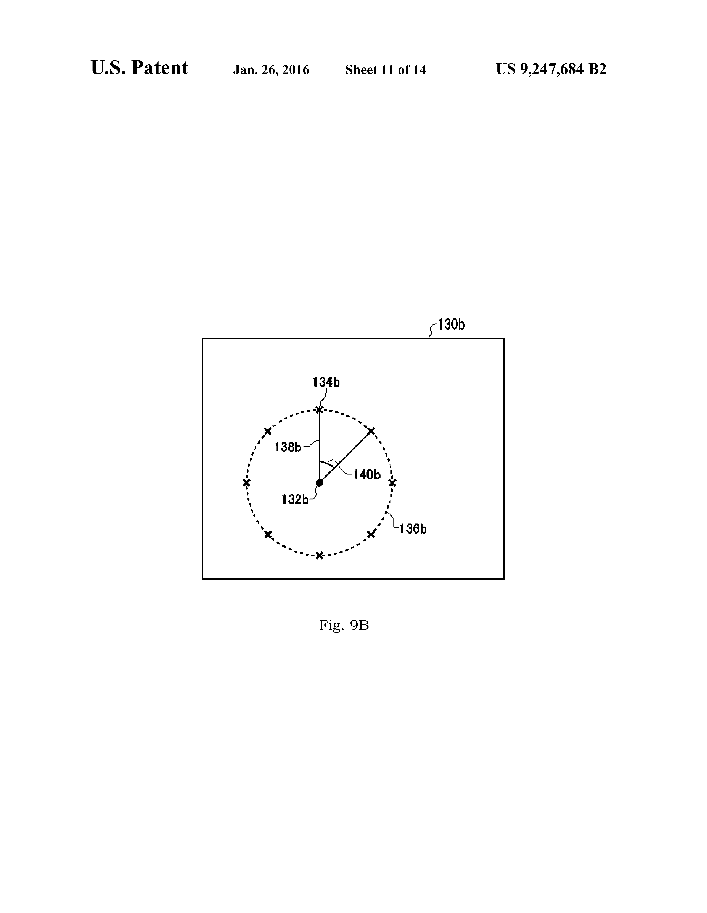
*도 9B — 촬상 범위(130b) 안의 회전 중심(132b): 원호(136b)의 반지름(138b)이 작고 꼭지각(140b)이 큼*

촬상 범위(130b) 안에 포함된 마크(134b)의 궤적이 그리는 원호(136b)의 반지름(138b)은, 촬상 범위(130a) 밖의 회전 중심 위치(132a)에 근거한 원호(136a)의 반지름(138a)보다 작다. 따라서 이 원호(136b)로부터 취득한 회전 중심 위치(132b)의 화소 X, Y 좌표값에 포함되는 오차는 비교적 작을 확률이 높다. 마찬가지로 스테이지(10)가 촬상 범위(130b) 안에 위치하는 회전 중심(132b)을 중심으로 회전되면, 취득되는 이등변 삼각형 형상의 두 등변 각각의 길이는 비교적 짧고 그 꼭지각의 각도(140b)는 비교적 크다. 따라서 이 이등변 삼각형 형상으로부터 취득한 회전 중심 위치의 화소 X, Y 좌표값에 포함되는 오차는 비교적 작을 확률이 높다.

다시 말해, 촬상 범위에 가깝게 위치한 회전 중심을 중심으로 스테이지(10)를 회전시켜 취득한 회전 중심 위치의 화소 X, Y 좌표값에 포함되는 오차는, 촬상 범위에서 멀리 위치한 회전 중심을 중심으로 스테이지(10)를 회전시켜 취득한 회전 중심 위치의 화소 X, Y 좌표값에 포함되는 오차보다 작을 확률이 높다.

따라서 캘리브레이션부(52)가 아래에 설명하는 절차에 따라 회전 중심 위치의 화소 X, Y 좌표값을 취득하도록 해도 된다.

도 10은 캘리브레이션부(52)가 회전 중심의 화소 X, Y 좌표값을 취득할 때 기능하는 블록의 예를 나타낸다.

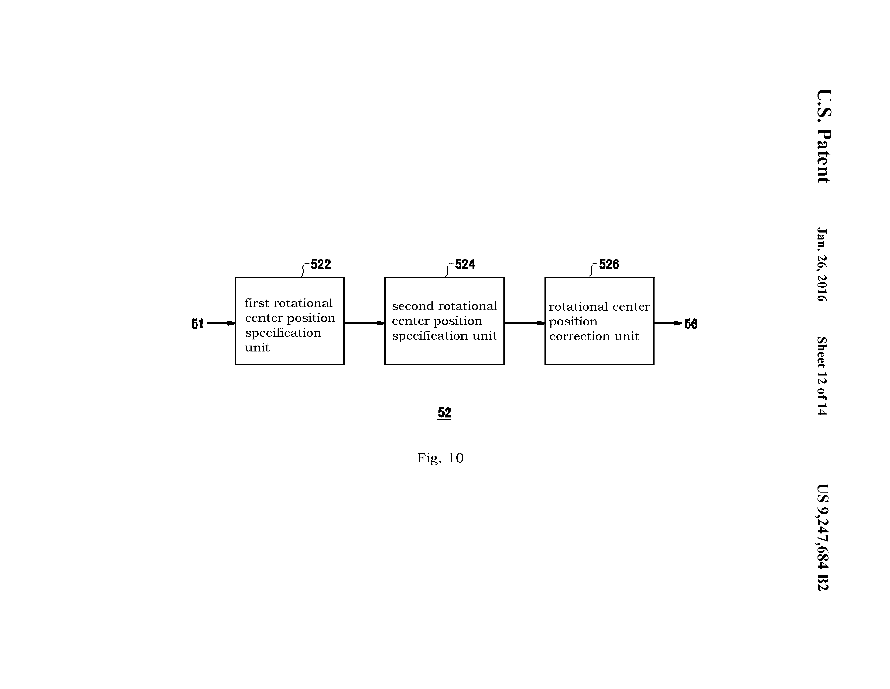
*도 10 — 캘리브레이션부(52)의 기능 블록: 제1 회전 중심 위치 특정부(522), 제2 회전 중심 위치 특정부(524), 회전 중심 위치 보정부(526)*

제1 회전 중심 위치 특정부(522)는 화상 취득부(51)를 통해, θ 방향 이동 기구(36)가 촬상부의 촬상 범위 밖의 회전 중심 위치인 제1 회전 중심의 위치를 중심으로 스테이지(10)를 회전시키기 전과, 기구(36)가 이렇게 스테이지(10)를 회전시킨 후의 화상을 취득한다. 이 취득한 화상들 각각에는 스테이지(10)에 미리 부착된 제1 마크가 포함된다. 그리고 제1 회전 중심 위치 특정부(522)는 해당 화상들에 포함된 이 제1 마크들 각각의 화소 X, Y 좌표값에 근거하여 θ 방향 이동 기구(36)의 화소 X, Y 좌표값을 제1 회전 중심의 위치로 특정한다.

그리고 제2 회전 중심 위치 특정부(524)는 화상 취득부(51)를 통해, 이 제1 회전 중심의 위치에 근거하여, θ 방향 이동 기구(36)가 정해진 촬상 범위 안에 설정된 회전 중심 위치를 중심으로 스테이지(10)를 회전시키기 전과, 기구(36)가 이렇게 스테이지(10)를 회전시킨 후의 화상을 취득한다. 이 취득한 화상들 각각에는 스테이지(10)에 미리 부착된 제2 마크가 포함된다. 그리고 제2 회전 중심 위치 특정부(524)는 해당 화상들에 포함된 이 제2 마크들 각각의 화소 X, Y 좌표값에 근거하여 θ 방향 이동 기구(36)의 화소 X, Y 좌표값을 제2 회전 중심의 위치로 특정한다.

그리고 회전 중심 위치 보정부(526)는 설정 회전 중심 위치의 화소 X, Y 좌표값과 제2 회전 중심 위치의 화소 X, Y 좌표값 사이의 차에 근거하여 제1 회전 중심의 위치를 보정한다.

도 11은 캘리브레이션부(52)가 회전 중심 위치의 화소 X, Y 좌표값을 취득하는 절차의 예를 나타내는 흐름도이다.

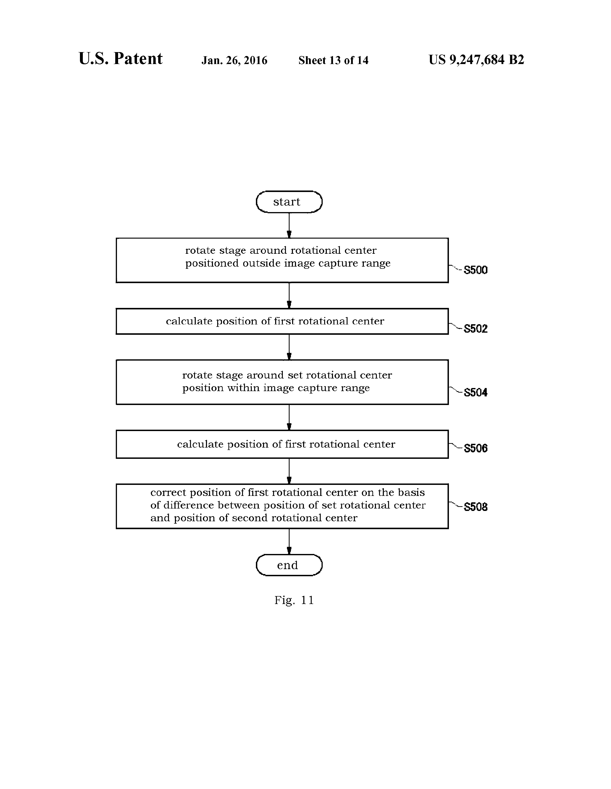
*도 11 — 회전 중심 위치 취득 절차 흐름도(S500~S508): 시야 밖 회전 → 제1 회전 중심, 시야 안 설정 중심 회전 → 제2 회전 중심, 차이로 보정*

먼저 제1 회전 중심 위치 특정부(522)는 스테이지 제어부(80)에 명령하여, 촬상 범위 밖에 위치하는 회전 중심을 중심으로 미리 설정된 회전량만큼 스테이지(10)를 회전시킨다(단계 S500).

제1 회전 중심 위치 특정부(522)는 화상 취득부(51)를 통해, 촬상 범위 밖에 위치하는 이 회전 중심을 중심으로 스테이지(10)를 회전시키기 전의 화상과 이렇게 스테이지(10)를 회전시킨 후의 화상을 취득한다. 그리고 제1 회전 중심 위치 특정부(522)는 이렇게 취득한 두 화상 모두에 포함된 제1 마크의 화소 X, Y 좌표값에 근거하여, 회전 중심에서의 화소 X, Y 좌표값을 제1 회전 중심의 위치로 계산한다(단계 S502).

예를 들어 제1 회전 중심 위치 특정부(522)는, 회전 전과 회전 후에 취득한 두 화상에 각각 포함된 제1 마크의 화소 X, Y 좌표값을 잇는 직선을 밑변으로 하고, 스테이지 제어부(80)에 명령하여 주게 한 스테이지의 회전량에 해당하는 각도를 꼭지각으로 하는 이등변 삼각형 형상에 근거하여, 제1 회전 중심의 위치를 특정하는 화소 X, Y 좌표값을 취득할 수 있다. 캘리브레이션부(52)가 제1 마크의 이동 궤적에 근거하여 제1 회전 중심의 위치를 특정하는 화소 X, Y 좌표값을 취득하도록 해도 된다는 점을 이해해야 한다. 다시 말해, 캘리브레이션부(52)는 스테이지(10)를 한 번에 Δθ씩 회전시킨다. 그리고 캘리브레이션부(52)는 이러한 Δθ 회전을 수행할 때마다 취득한 화상에 포함된 제1 마크의 화소 X, Y 좌표값을 취득한다. 또한 캘리브레이션부(52)는 취득한 화소 X, Y 좌표값에 근거하여 최소제곱법으로 가상 원호를 특정한다. 캘리브레이션부(52)가 특정한 가상 원호의 중심에 해당하는 화소 X, Y 좌표값에 근거하여 제1 회전 중심의 위치를 특정하는 화소 X, Y 좌표값을 취득하도록 해도 된다.

다음으로 제2 회전 중심 위치 특정부(524)는 스테이지 제어부(80)에 명령하여, 제1 회전 중심의 위치에 근거하여 정한 촬상 범위 안의 설정 회전 중심 위치를 중심으로 미리 설정된 회전량만큼 스테이지(10)를 회전시킨다(단계 S504). 예를 들어 제2 회전 중심 위치 특정부(524)는 촬상부의 촬상 범위에 포함되는 임의의 화소 좌표값을 설정 회전 중심의 위치로 선택할 수 있다. 그리고 다음으로 제2 회전 중심 위치 특정부(524)는 선택한 설정 회전 중심 위치의 화소 X, Y 좌표값과 제1 회전 중심 위치의 화소 X, Y 좌표값 사이의 차인 화소 X, Y 좌표값을 취득하고, 스테이지 제어부(80)에 명령하여 이 차분 화소 X, Y 좌표값만큼 스테이지(10)를 평행 이동시킨다. 스테이지(10)가 이렇게 평행 이동된 후, 제2 회전 중심 위치 특정부(524)는 스테이지 제어부(80)를 통해 θ 방향 이동 기구(36)에 명령하여 설정 회전 중심의 위치를 중심으로 스테이지(10)를 회전시킨다.

제2 회전 중심 위치 특정부(524)는 화상 취득부(51)를 통해, 설정 회전 중심의 위치를 중심으로 회전하기 전과 그 회전 후의 화상을 취득한다. 여기서 취득한 화상에는 스테이지(10)에 미리 부착된 제2 마크가 포함된다. 이 제2 마크는 예를 들어 θ 방향 이동 기구(36)의 회전 중심의 물리적 위치에 대응하여 스테이지(10) 위에 미리 부착된 마크일 수 있다. 다시 말해, 이 제2 마크는 스테이지(10)의 회전 중심에 부착된 마크일 수 있다. 그런 다음 제2 회전 중심 위치 특정부(524)는 이렇게 취득한 두 화상 모두에 포함된 제2 마크의 화소 X, Y 좌표값에 근거하여, 회전 중심에서의 화소 X, Y 좌표값을 제2 회전 중심의 위치로 계산한다(단계 S506). 다시 말해, 위에서 설명한 것과 마찬가지 방식으로 두 번째로, 제2 회전 중심 위치 특정부(524)는 회전 전과 회전 후에 취득한 두 화상에 각각 포함된 제2 마크의 화소 X, Y 좌표값을 잇는 직선을 밑변으로 하고, 스테이지 제어부(80)에 명령하여 주게 한 스테이지(10)의 회전량에 해당하는 각도를 꼭지각으로 하는 이등변 삼각형 형상에 근거하여, 회전 중심의 위치를 특정하는 화소 X, Y 좌표값을 취득한다. 또는 캘리브레이션부(52)가 스테이지(10)를 한 번에 Δθ씩 회전시키면서, Δθ 회전마다 취득한 복수의 화상 각각에 포함된 제2 마크의 화소 X, Y 좌표값을 취득하고, 이 화소 X, Y 좌표값에 근거하여 최소제곱법으로 가상 원호를 특정하며, 이 가상 원호의 중심에 해당하는 화소 X, Y 좌표값으로부터 제2 회전 중심의 위치를 특정하는 화소 X, Y 좌표값을 취득하도록 해도 된다.

다음으로 회전 중심 위치 보정부(526)는 설정 회전 중심 위치의 화소 X, Y 좌표값과 제2 회전 중심 위치의 화소 X, Y 좌표값 사이의 차를 계산한다. 제1 회전 중심 위치의 화소 X, Y 좌표값에 오차가 없다면, 제1 회전 중심의 위치에 근거하여 얻은 설정 회전 중심 위치의 화소 X, Y 좌표값과 제2 회전 중심 위치의 화소 X, Y 좌표값 사이에 차가 없을 것이다. 그러나 위에서 설명한 바와 같이, 촬상 범위 밖의 회전 중심 위치를 중심으로 회전하여 취득한 제1 회전 중심의 위치에는 실제로 어느 정도 오차가 포함될 확률이 높다. 반면 촬상 범위 안의 회전 중심 위치를 중심으로 회전하여 취득한 제2 회전 중심의 위치에 포함되는 오차는 제1 회전 중심의 위치에 포함되는 오차보다 작을 것이다. 따라서 회전 중심 위치 보정부(526)는 설정 회전 중심 위치의 화소 X, Y 좌표값과 제2 회전 중심 위치의 화소 X, Y 좌표값 사이의 차를 차분 화소 X, Y 좌표값으로 계산하고, 이 차분 화소 X, Y 좌표값에 근거하여 제1 회전 중심 위치의 화소 X, Y 좌표값을 보정한다(단계 S508). 보다 구체적으로, 제1 회전 중심 위치의 화소 X, Y 좌표값에 차분 화소 X, Y 좌표값을 더함으로써 제1 회전 중심 위치의 화소 X, Y 좌표값을 보정한다.

위에 따르면, 촬상 범위 안에 위치한 회전 중심을 중심으로 스테이지(10)를 회전시켜 취득한 회전 중심 위치의 화소 X, Y 좌표값에 근거하여, 캘리브레이션부(52)는 촬상 범위 밖에 위치한 이 회전 중심을 중심으로 스테이지(10)를 회전시켜 취득한 회전 중심 위치의 X, Y 화소값을 보정함으로써 촬상 범위 밖에 있는 회전 중심 위치의 X, Y 화소값의 정확도를 높일 수 있다.

캘리브레이션부(52)는 좌표 대응 관계 테이블을 참조하여, 수정 후 촬상 범위 밖 회전 중심 위치의 화소 X, Y 좌표값에 대응하는 스테이지 X, Y 좌표값을 취득하고, 수정 후의 화소 X, Y 좌표값과 스테이지 X, Y 좌표값을 서로 대응시키며, 이 대응을 회전 중심 좌표값 유지부(56)에 등록한다는 점을 이해해야 한다.

또한 위의 설명에서는 설정 회전 중심의 위치로서, 제1 회전 중심의 위치에 근거하여 촬상 범위 안에 위치를 설정하는 예를 설명했다. 그러나 스테이지(10)의 물리적 제약 때문에 회전 중심 위치를 촬상 범위 안에 설정할 수 없는 경우가 때때로 있을 수 있다. 이 경우에는 제1 회전 중심의 위치보다 촬상 범위에 더 가까운 회전 중심 위치를 설정 회전 중심의 위치로 설정해도 된다.

또한 위의 설명에서는 대상물 제어 시스템(100)의 예로서, 회전 기구로 기능하는 모터의 회전량과 스테이지의 회전량 사이에 비례 관계가 있는 이른바 X-Y-θ 스테이지를 설명했다. 그러나 대상물 제어 시스템(100)으로서, 스테이지(10)를 X 및 Y 방향으로 이동시키는 복수의 모터로 X-Y-θ 이동을 구현하되 이 모터들의 회전량이 스테이지의 회전량과 직접 상관되지 않는 이른바 U-V-W 스테이지를 사용해도 된다. 이러한 U-V-W 스테이지를 사용하는 경우, 단계 S504에서 캘리브레이션부(52)는 다음 절차로 스테이지(10)를 회전시킬 수 있다는 점을 이해해야 한다. 즉, 캘리브레이션부(52)는 제1 회전 중심의 위치에 근거하여, 설정 회전 중심의 위치로서 촬상부의 촬상 범위 안에 포함되는 원하는 임의의 화소 좌표값을 선택한다. 그런 다음 캘리브레이션부(52)는 선택한 이 설정 회전 중심 위치의 화소 X, Y 좌표값과 제1 회전 중심 위치의 화소 X, Y 좌표값 사이의 차를 차분 화소 X, Y 좌표값으로 취득한다. 또한 캘리브레이션부(52)는 이어서 스테이지 제어부(80)에 명령하여, 제1 회전 중심 위치의 화소 X, Y 좌표값에서 이 취득한 차분 화소 X, Y 좌표값만큼 이동한 위치를 회전 중심의 위치로 하여 스테이지를 회전시킨다.

또한 위의 설명에서는 캘리브레이션부(52)가 설정 회전 중심 위치의 화소 X, Y 좌표값과 제2 회전 중심 위치의 화소 X, Y 좌표값 사이의 차에 근거하여 제1 회전 중심 위치의 화소 X, Y 좌표값을 보정하는 예를 설명했다. 그러나 얼라인먼트부(60)가 캘리브레이션부(52)가 계산한, 설정 회전 중심 위치의 화소 X, Y 좌표값과 제2 회전 중심 위치의 화소 X, Y 좌표값 사이의 차에 근거하여 제1 차분 화소 X, Y 좌표값과 제2 차분 화소 X, Y 좌표값을 보정하도록 해도 된다. 다시 말해, 얼라인먼트부(60)가 이 차를 제1 차분 화소 X, Y 좌표값과 제2 차분 화소 X, Y 좌표값에 각각 더하도록 해도 된다. 또한 두 개 이상의 촬상부를 사용하는 경우, 각 촬상부가 촬상한 화상 각각에 근거하여 특정한 대응 제1 회전 중심 위치의 화소 X, Y 좌표값에 대응하는 차분 화소 X, Y 좌표값을 더함으로써 제1 회전 중심 위치 각각의 화소 X, Y 좌표값을 보정하도록 해도 된다.

도 12는 스테이지 제어 장치(50)의 하드웨어 구조 예를 나타낸다. 이 스테이지 제어 장치(50)는 CPU(1505), RAM(520), 그래픽 컨트롤러(1575), 및 표시 장치(1580)를 포함하며, 이들은 모두 호스트 컨트롤러(1582)에 의해 서로 연결된다. 또한 스테이지 제어 장치(50)는 I/O(입출력) 컨트롤러(1584)에 의해 호스트 컨트롤러(1582)에 연결되는 통신 I/F(1530), ROM(1510), 하드 디스크 드라이브(1540), 및 외부 메모리 드라이브(1560)를 포함한다.

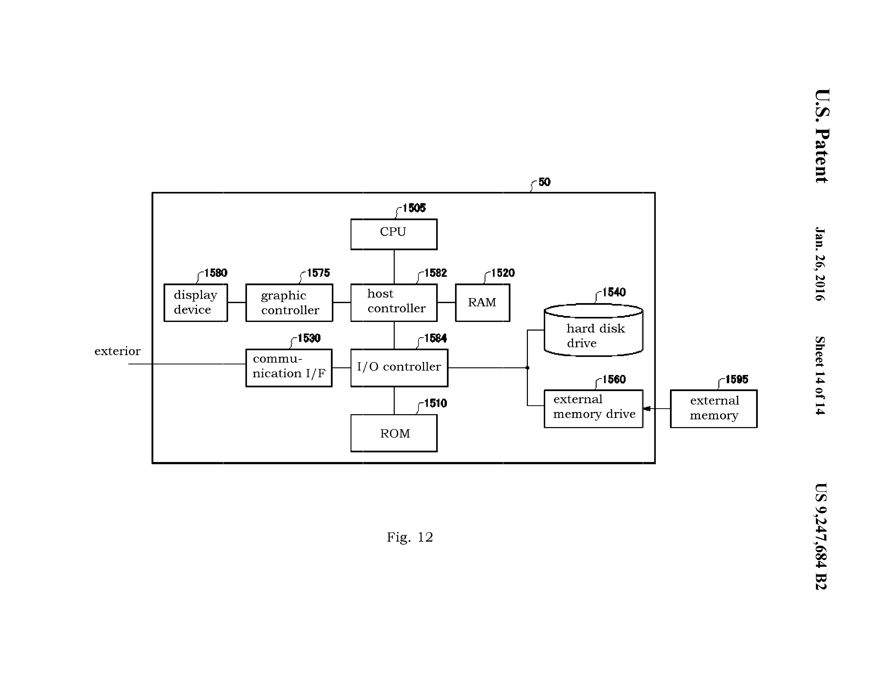
*도 12 — 스테이지 제어 장치(50)의 하드웨어 구조*

CPU(1505)는 ROM(1510), RAM(1520), 또는 하드 디스크 드라이브(1540)에 저장된 프로그램에 근거하여 동작하여 시스템의 각 부를 제어한다. 그리고 그래픽 컨트롤러(1575)는 RAM(1520) 등에서 취득한 화상 데이터를 표시 장치(1580)에 표시한다.

그리고 I/O(입출력) 컨트롤러(1584)는 마우스, 키보드 등의 입출력 장치를 추가로 연결한다. 통신 I/F(1530)는 외부로부터 네트워크를 통해 받은 프로그램 및/또는 데이터를 ROM(1510), RAM(1520), 및/또는 하드 디스크 드라이브(1540)에 공급한다. 그리고 ROM(1510)은 스테이지 제어 장치(50)가 기동할 때 CPU(1505)가 실행하는 부트 프로그램, 스테이지 제어 장치(50)의 하드웨어에 의존하는 프로그램 등을 유지한다.

하드 디스크 드라이브(1540)는 CPU(1505)가 사용하는 프로그램과 데이터를 저장한다. 그리고 외부 메모리 드라이브(1560)는 외부 메모리(1595)에서 읽은 프로그램 및/또는 데이터를 ROM(1510), RAM(1520), 및/또는 하드 디스크 드라이브(1540)에 공급한다.

CPU(1505)가 ROM(1510), RAM(1520), 및/또는 하드 디스크 드라이브(1540)에 저장된 프로그램을 실행함으로써, 스테이지 제어 장치(50)는 캘리브레이션부(52), 좌표계 대응 관계 유지부(54), 회전 중심 좌표값 유지부(56), 얼라인먼트부(60), 각도 취득부(62), 기준점 좌표값 취득부(64), 목표 좌표값 유지부(70), 및 스테이지 제어부(80)의 기능을 수행하게 된다. CPU(1505)가 실행하는 프로그램은 외부 메모리(1595) 등의 기록 매체에 저장되어 그로부터 공급되지 않고, 네트워크를 통해 외부 정보 처리 장치로부터 공급되어도 된다.

이상 본 발명을 그 실시예를 사용하여 설명했지만, 본 발명의 기술적 범위는 위의 실시예를 참조하여 설명한 범위로 한정되지 않는다. 당업자라면 위에서 설명한 실시예에 여러 가지 변경 및/또는 개량을 가할 수 있음이 명백할 것이다. 이렇게 변경 및/또는 개량된 형태도 본 발명의 기술적 범위에 포함될 수 있음은 청구범위의 기재로부터 명백할 것이다.

청구범위, 명세서, 및 도면에 개시된 장치, 시스템, 프로그램, 및 방법의 동작, 절차, 단계, 및 단계(stage) 등 각종 처리의 실행 순서는 "~보다 전에", "앞서" 등으로 특별히 명시되어 있지 않으며, 실제로 앞선 처리의 출력을 뒤의 처리가 사용하지 않는 한 임의의 순서로 실시할 수 있는 것으로 보아야 한다. 청구범위, 명세서, 및 도면의 동작 흐름에 관하여, 위의 설명에서 편의상 "먼저", "다음으로" 등의 용어를 사용했더라도, 각종 처리를 이 순서로 실시하는 것이 필수임을 의미하는 것으로 보아서는 안 된다.

### 부호의 설명 (EXPLANATION OF THE REFERENCE SYMBOLS)

- 10: 스테이지
- 20: 대상물
- 30: 스테이지 이동 기구
- 32: X 방향 이동 기구
- 34: Y 방향 이동 기구
- 36: θ 방향 이동 기구
- 40: 제1 촬상부
- 42: 제2 촬상부
- 50: 스테이지 제어 장치
- 51: 화상 취득부
- 52: 캘리브레이션부
- 522: 제1 회전 중심 위치 특정부
- 524: 제2 회전 중심 위치 특정부
- 526: 회전 중심 위치 보정부
- 54: 좌표계 대응 관계 유지부
- 56: 회전 중심 좌표값 유지부
- 60: 얼라인먼트부
- 62: 각도 취득부
- 64: 기준점 좌표값 취득부
- 70: 목표 좌표값 유지부
- 80: 스테이지 제어부
- 100: 대상물 제어 시스템

### 도면 범례 (FIGURE LEGENDS)

도 1
- 30: 스테이지 이동 기구
- 50: 스테이지 제어 장치

도 2: A, B
- 화소 좌표계

도 3
- 40: 제1 촬상부
- 42: 제2 촬상부
- 51: 화상 취득부
- 52: 캘리브레이션부
- 60: 얼라인먼트부
- 62: 각도 취득부
- 64: 기준점 좌표값 취득부
- 70: 목표 좌표값 유지부
- 54: 좌표계 대응 관계 유지부
- 56: 회전 중심 좌표값 유지부
- 80: 스테이지 제어부
- 50: 스테이지 제어 장치
- 30: 스테이지 이동 기구
- 32: X 방향 이동 기구
- 34: Y 방향 이동 기구
- 36: θ 방향 이동 기구
- 10: 스테이지

도 4
- 시작
- S100: 스테이지를 기준 위치로 이동
- S102: 스테이지를 한 번에 Δθ씩 회전
- S104: 스테이지를 Δθ 회전할 때마다 제1 화상, 제2 화상, 제1 기준점의 스테이지 좌표값, 제2 기준점의 스테이지 좌표값 취득
- S106: 제1 화상과 제2 화상에 근거하여 제1 스테이지 기준점의 제1 화소 X, Y 좌표와 제2 스테이지 기준점의 제2 화소 X, Y 좌표 취득
- S108: 스테이지를 Δθ 회전 이동할 때마다 스테이지 기준점의 스테이지 X, Y 좌표값과 화소 X, Y 좌표값을 대응시켜 좌표 대응 관계 유지부에 등록 종료

도 5
- 스테이지 좌표계
- 화소 좌표계

도 6
- 시작
- S200: 제1 화상과 제2 화상 취득
- S202: 제1 각도와 제2 각도 취득
- S204: 제1 각도와 제1 목표 각도 사이의 제1 차분 각도, 제2 각도와 제2 차분 각도 사이의 제2 차분 각도 도출
- S206: 제1 기준점의 제1 화소 X, Y 좌표값과 제2 기준점의 제2 화소 X, Y 좌표값 취득
- S208: 회전 후 제1 화소 X, Y 좌표값과 제1 목표 화소 X, Y 좌표값 사이의 제1 차분 화소 X, Y 좌표값, 회전 후 제2 화소 X, Y 좌표값과 제2 목표 화소 X, Y 좌표값 사이의 제2 차분 화소 X, Y 좌표값 취득
- S210: 제1 차분 각도와 제2 차분 각도의 평균으로 평균 차분 각도 도출
- S212: 제1 평행 이동량과 제2 평행 이동량의 평균으로 X 방향 평균 평행 이동량, 제1 평행 이동량과 제2 평행 이동량의 평균으로 Y 방향 평균 평행 이동량 도출 종료

도 7
- 시작
- S300: 제1 화상과 제2 화상 취득
- S302: 두 화상 모두에 기준 마크가 포함되었는가?
- S304: 제1 화상과 제2 화상을 사용하여 대상물을 목표 위치로 이동
- S306: 제1 화상과 제2 화상 중 기준 마크를 포함하는 쪽을 사용하여 스테이지를 목표 위치로 이동 종료

도 8
- 시작
- S400: 제1 화상과 제2 화상 취득
- S402: 두 화상 모두에 기준 마크가 포함되었는가?
- S404: 제1 화상과 제2 화상을 사용하여 스테이지를 목표 위치로 이동
- S406: 기준 마크를 포함하는 화상을 사용하여, 다른 화상에 기준 대상이 포함되도록 스테이지 이동 종료

도 10
- 522: 제1 회전 중심 위치 특정부
- 524: 제2 회전 중심 위치 특정부
- 526: 회전 중심 위치 보정부

도 11
- 시작
- S500: 촬상 범위 밖에 위치한 회전 중심을 중심으로 스테이지 회전
- S502: 제1 회전 중심의 위치 계산
- S504: 촬상 범위 안의 설정 회전 중심 위치를 중심으로 스테이지 회전
- S506: 제2 회전 중심의 위치 계산
- S508: 설정 회전 중심의 위치와 제2 회전 중심의 위치 사이의 차에 근거하여 제1 회전 중심의 위치 보정 종료

도 12
- 외부
- 1580: 표시 장치
- 1575: 그래픽 컨트롤러
- 1582: 호스트 컨트롤러
- 1530: 통신 I/F
- 1584: I/O 컨트롤러
- 1540: 하드 디스크 드라이브
- 1560: 외부 메모리 드라이브
- 1595: 외부 메모리
