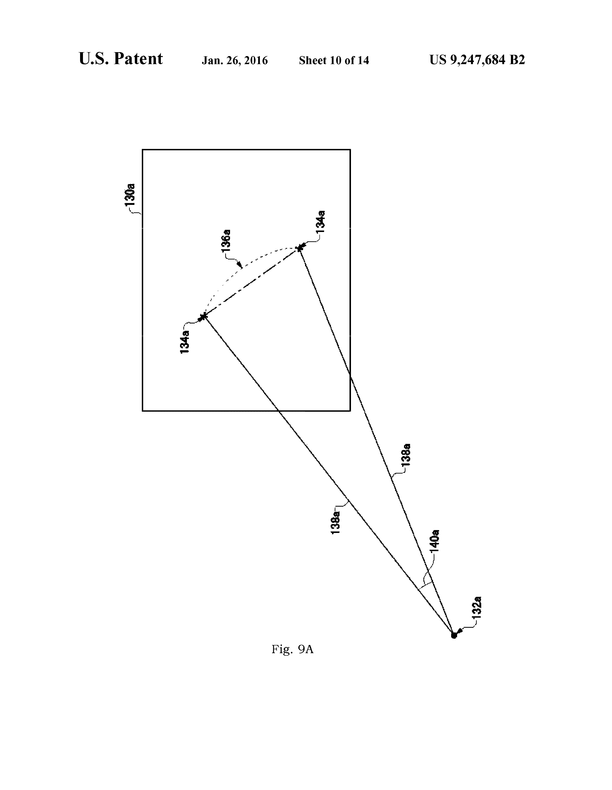
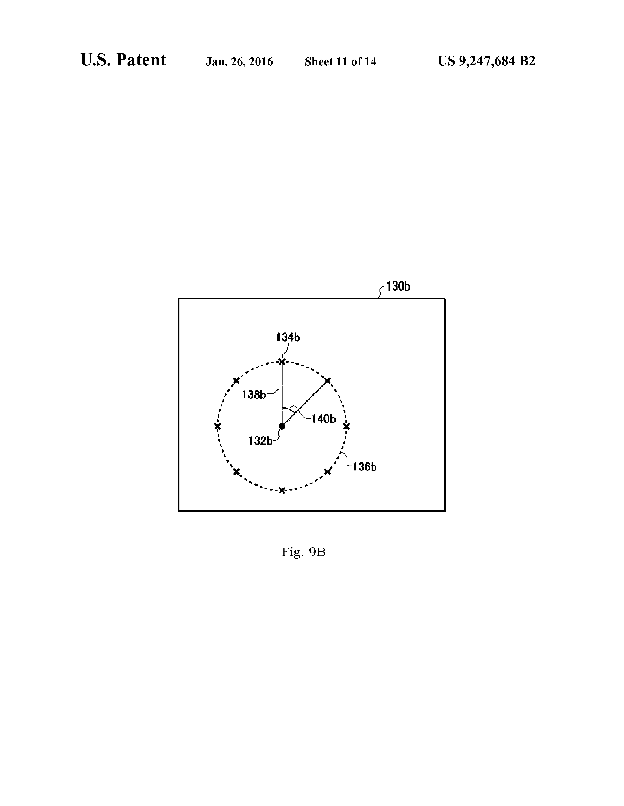
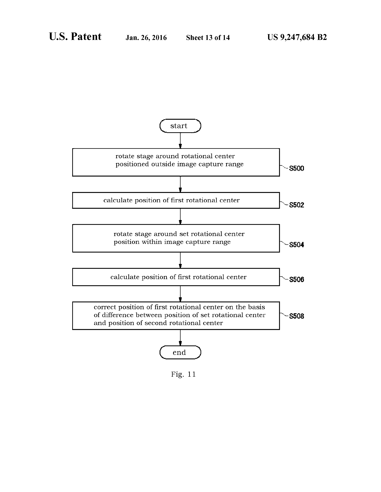

# US9247684B2 — 대상물 제어 시스템, 회전 중심 위치 특정 장치 (Cognex)

| 항목 | 내용 |
|---|---|
| 원문 | `US9247684.pdf`(등록, 2016-01-26, 15 청구항, 도면 14장) · `US20120262626.pdf`(공개 US2012/0262626 A1, 2012-10-18) |
| 출원인 | Cognex Corporation (발명자 Masaaki Ikeda) |
| 우선일 | 2009-12-07 (JP2009-278033), PCT 출원 2010-12-06 |
| 핵심 | X-Y-θ 스테이지 위 대상물을 카메라 1~2대로 찍어, 기준 마크(모서리 변)의 각도와 목표 각도의 차로 회전량을, 회전 후 기준점과 목표점의 화소 차로 평행 이동량을 구한다. 회전 중심이 촬상 범위 밖이면 마크 궤적이 짧은 원호라 중심 오차가 크므로, 범위 안에 "설정 회전 중심"을 두고 다시 회전시켜 얻은 중심과의 차로 바깥 중심을 보정한다. |
| 관련도 | ◎ 원인(회전 중심 미보정·시야 밖 회전 중심) 그 자체를 다룸 |
| 본 과제와의 관계 | "회전 중심이 시야 밖 멀리 있으면 회전이 짧은 원호 = 거의 평행이동처럼 보여 중심 추정 오차가 커진다"(P1)를 특허 본문이 직접 설명하고, 그 해법(시야 안 회전 중심으로 재측정 후 차로 보정, P4)을 제시한다. 카메라 설치 위치 오차에 둔감한 카메라별 독립 계산·가중 평균(P3)도 있다. |
| 링크 | [Google Patents](https://patents.google.com/patent/US9247684B2/en) |

---

## 상세 요약 (번역본 기준)

### 1. 해결하려는 문제
- 종래(일본 특허 3,531,674): 마크 편차가 없어질 때까지 테이블을 여러 번 회전·평행 이동해야 함.
- 종래(일본 공개 2006-49755, 평5-48295): 두 카메라와 미리 입력한 마크 간 거리로 스테이지 회전 중심을 구하므로, **촬상부 설치 위치가 정확하지 않으면** 자세 보정이 어렵거나 **회전 중심 좌표에 오차**가 생겨 목표 위치까지 오래 걸림.
- 캘리브레이션 때 회전 중심은 초기 설정값이나 실제 작업 위치의 중심인 경우가 많아 **촬상 범위 밖**에 있기 쉬움 → 짧은 원호·작은 꼭지각으로 중심을 구하므로 오차가 큼(도 9A).

### 2. 핵심 구성
| 구성 | 부호 | 위치·역할 |
|---|---|---|
| 스테이지 | 10 | 대상물(20)을 유지하는 유지 부재 |
| 스테이지 이동 기구 | 30 (32·34·36) | X·Y 평행 이동, Z축 둘레 θ 회전(36 = 회전 기구). X-Y-θ 또는 U-V-W 스테이지 |
| 제1·제2 촬상부 | 40, 42 | 대상물 모서리(20a, 20c)를 각각 촬상. 위에서 내려다보는 배치(회전축 ∥ 광축) |
| 화상 취득부 | 51 | 두 화상을 캘리브레이션부·얼라인먼트부에 공급 |
| 캘리브레이션부 | 52 (522·524·526) | 스테이지↔화소 좌표 대응 테이블, 회전 중심의 화소·스테이지 좌표 취득 및 보정 |
| 좌표계 대응 관계 유지부 / 회전 중심 좌표값 유지부 | 54 / 56 | 위 대응 관계 저장 |
| 얼라인먼트부 | 60 (62·64) | 각도 취득부(62): 대상물 선(변 22a)과 화소 Y축 사이 각 θ1·θ2. 기준점 좌표값 취득부(64): 꼭짓점(20b, 20d) 화소 좌표 |
| 목표 좌표값 유지부 | 70 | 목표 위치에서 측정한 θt1·θt2, 목표 기준점 화소 좌표 |
| 스테이지 제어부 | 80 | 목표 회전량·X/Y 이동량으로 기구 구동 |

- 기준 마크: 모서리(변+꼭짓점) 외에 각도 있는 마크, 두 점(잇는 선 = 대상물 선), 관성 모멘트 최소 축 같은 가상선도 가능.
- 카메라마다 독립 계산하므로 카메라 간 거리 등을 정확히 정하지 않고 설치해도 됨.

### 3. 동작 순서
1. 좌표계 캘리브레이션(도 4, S100~S108): 스테이지를 기준 위치로 → Δθ씩 회전 → 매번 스테이지 기준점의 스테이지 좌표와 화소 좌표를 짝지어 테이블(도 5)에 등록.
2. 회전 중심 화소 좌표(두 방법 중 하나)
   - 원호 맞춤: Δθ마다 얻은 기준점 화소 좌표들로 최소제곱 가상 원호 → 원 중심 = 회전 중심.
   - 이등변 삼각형: 회전 전·후 마크 화소 좌표를 잇는 선분(길이 L)을 밑변, 명령 회전량 Δθ를 꼭지각으로 하는 이등변 삼각형의 꼭짓점 = 회전 중심. (기하로 풀면 밑변 중점에서 수직으로 h = (L/2)/tan(Δθ/2), 반지름 r = (L/2)/sin(Δθ/2). 특허에는 식 없음.)
3. 시야 밖 회전 중심 보정(도 10·11, S500~S508)
   - S500·S502: 시야 밖 회전 중심으로 회전 → 제1 마크로 제1 회전 중심 c1 계산.
   - S504: c1을 근거로 시야 안의 임의 화소 좌표를 설정 회전 중심 cs로 고르고, 스테이지를 (cs − c1)만큼 평행 이동한 뒤 cs를 중심으로 회전(U-V-W 스테이지면 cs를 회전 중심으로 지정해 회전). 물리 제약으로 시야 안이 안 되면 c1보다 시야에 가까운 곳.
   - S506: 제2 마크(예: 스테이지 회전 중심 위치에 붙인 마크)로 제2 회전 중심 c2 계산.
   - S508: c1에 오차가 없으면 cs = c2. 차분(cs와 c2의 차)을 c1에 더해 보정 → 보정된 화소 좌표를 테이블로 스테이지 좌표에 대응시켜 등록. (부호는 특허에 명시 없음. 기하적으로는 c1' = c1 + (c2 − cs)가 맞음.)
   - 변형: 이 차분을 얼라인먼트의 차분 화소 좌표에 더해도 되고, 카메라가 여럿이면 카메라별로 보정.
4. 얼라인먼트(도 6, S200~S212)
   - θ1, θ2 측정 → Δθ1 = θ1 − θt1, Δθ2 = θ2 − θt2 → 목표 회전량 Δθ = (Δθ1 + Δθ2)/2.
   - 기준점 p를 (보정된) 회전 중심 c 둘레로 Δθ만큼 돌린 점 p' 계산 → 차분 화소 d = p' − p_target (카메라별) → 각각 이동량으로 바꿔 X·Y 평균.
   - 회전량·X/Y 이동량으로 스테이지를 한 번에 구동.
5. 예외 처리: 한 화상에 기준 마크가 없거나 카메라 고장이면 다른 카메라 화상만으로 이동(도 7), 또는 다른 화상으로 마크가 시야에 들어오게 옮긴 뒤 두 화상으로 얼라인(도 8).
6. 가중 평균: 분해능(해상도 또는 촬상 범위)이 높은 카메라에 큰 가중치. 카메라 3대 이상이면 이동량의 무게중심.

### 4. 청구항 요지
- 청구항 1(시스템, 독립): 제1 기준 마크 화상 → 제1 차분 각도 → 회전 기구 제어 + 캘리브레이션(① 회전 전후 제1 마크로 제1 회전 중심, ② 제1 중심보다 촬상 범위에 가까운 설정 회전 중심 둘레 회전 전후 제2 마크로 제2 회전 중심, ③ 설정 중심과 제2 중심으로 제1 중심 보정) → 보정된 중심으로 회전 제어.
- 청구항 12(방법, 독립): 청구항 1과 같은 내용을 단계로. 청구항 13: 이를 담은 비일시적 컴퓨터 판독 매체.
- 주요 종속항
  - 2: 회전 전후 제1 마크를 잇는 직선을 밑변, 회전량을 꼭지각으로 하는 이등변 삼각형의 꼭짓점으로 회전 중심.
  - 3: 제1 중심은 촬상 범위 **밖** 회전, 제2 중심은 촬상 범위 **안** 설정 중심 회전으로 구함.
  - 4: 제2 카메라·제2 차분 각도. 5·6: 제1 화상에 마크가 없으면 제2 차분 각도로 회전(6은 마크가 제1 화상에 들어오도록).
  - 7·8: 카메라별 가중치로 차분 각도·평행 이동량 가중. 9~11: 분해능 높은 쪽(해상도·촬상 범위 차이)에 높은 가중치.
  - 14·15: 방법 청구항의 가중치·평행 이동.

### 5. 대표 도면

*도 9A — 촬상 범위(130a) 밖 회전 중심(132a): 마크(134a) 궤적이 원호의 일부(136a)뿐이고, 등변(138a)이 길고 꼭지각(140a)이 작아 중심 오차가 큼*

*도 9B — 촬상 범위(130b) 안 회전 중심(132b): 반지름(138b)이 작고 꼭지각(140b)이 커서 중심 오차가 작음*

*도 11 — 시야 밖 회전 → 제1 중심, 시야 안 설정 중심 회전 → 제2 중심, 차로 제1 중심 보정(S500~S508)*

### 6. 본 과제(Y·Θ 얼라인먼트)와 비교
- 같은 점
  - 회전축 위치를 모르는 상태에서, 명령 회전량(Δθ)과 회전 전후 마크 화소 좌표로 회전 중심을 구한다 → **P4(회전축 위치, 카메라–스테이지 좌표 관계 미상)**를 정면으로 다룬다. 스테이지↔화소 대응 테이블은 우리의 화소–mm·축 각도 캘리브레이션과 같은 역할.
  - "회전 중심이 시야 밖 멀리 있으면 마크 궤적이 짧은 원호가 되고 꼭지각이 작아 중심 오차가 커진다"(도 9A) → **P1(먼 회전 중심이면 회전이 영상에서 거의 평행이동으로 보임)**과 같은 현상을 특허가 직접 인정하고 원인으로 삼는다.
  - 회전량과 평행 이동량을 한 번에 계산해 반복 이동 횟수를 줄이는 목적.
- 다른 점
  - 특허는 카메라가 위에서 내려다보고 θ축이 광축과 평행(평면 내 회전)이라 화상에서 변의 **각도 자체**가 회전량을 준다(Δθ = θ − θt). 우리는 카메라가 스테이지에 실려 PAN 회전(광축에 수직인 축)이므로 정면 판의 화상 내 각도는 거의 변하지 않는다 → 특허의 "각도로 회전 보정"은 그대로 쓸 수 없고, P1이 더 심하다.
  - 특허는 X·Y·θ 3자유도 스테이지로 시야 안에 설정 회전 중심을 만들 수 있다(평행 이동 + 회전). 우리는 Y·T 2축뿐이라 가상 회전 중심을 Y 방향으로만 옮길 수 있다.
  - 특허는 회전 중심을 정확히 알면 Y·θ 분리가 자동으로 된다고 전제한다. 감도 행렬 조건수(P2)나 백래시(P5)는 다루지 않는다.
  - 오차 크기·정밀도 수치, 계산식(삼각형 꼭짓점 식 등)은 본문에 없다.
- 참고할 점 (해결하는 P#와 본 과제에서 할 일)
  - **P4 — 회전축 위치 추정**: T를 Δθ씩 여러 번 명령 회전하며 QR 코너(와 뒷벽 선) 화소 좌표를 모아 최소제곱 원호(또는 이등변 삼각형 h = (L/2)/tan(Δθ/2))로 회전 중심을 구하는 캘리브레이션 단계를 따로 둔다. 화소↔스테이지(mm) 대응 테이블도 같은 회전 묶음에서 만든다.
  - **P1·P4 — 시야 안 설정 중심으로 재측정해 보정**: 특허의 U-V-W 변형처럼 "T 회전 + 그만큼 보상하는 Y 이동"을 함께 명령하면 가상 회전 중심을 옮길 수 있다. 추정한 축 위치 c1로 계산한 보상 Y를 넣어 QR 마커 한 점이 화상에서 제자리에 머물도록 회전시키고, 남은 이동(c2 − cs)을 c1 보정량으로 쓴다(c1' = c1 + (c2 − cs)). 축 위치 추정이 맞는지 확인하는 검증 시험으로도 쓴다.
  - **P3 — 측정 정밀도**: 짧은 원호·작은 꼭지각에서 중심 오차가 대략 1/tan(Δθ/2)배로 커진다는 점을 근거로, 캘리브레이션 때는 Δθ 범위를 크게 잡고 점을 많이 모은다. 관측끼리 합칠 때 분해능이 높은 관측에 큰 가중치(청구항 7~11)를 주는 방식을 QR 판·뒷벽 선 융합 가중치에 쓴다.
  - 관측 하나가 빠져도(마커 미검출) 남은 관측만으로 보정하는 분기(도 7·8)는 실시간 C++ 루프의 예외 처리로 참고한다.

---

> **같은 특허의 다른 폴더:** `문헌연구/03_Y_T_분리/특허/02_US9247684_Cognex_기준마크각도_회전중심특정` (번역 있음). 두 폴더는 주제 관점이 달라 요약을 따로 두었다.
