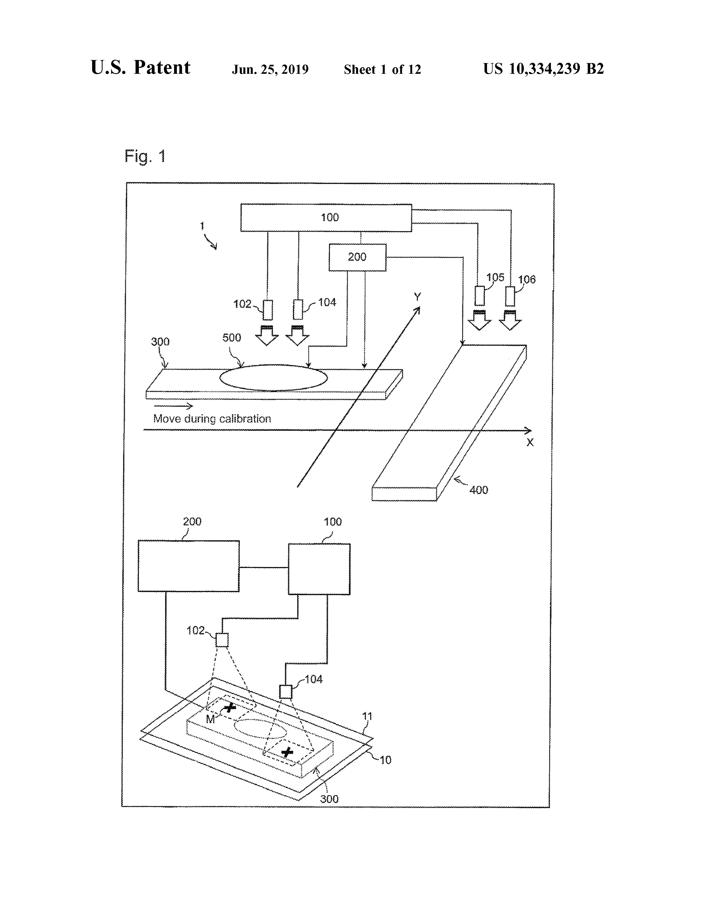
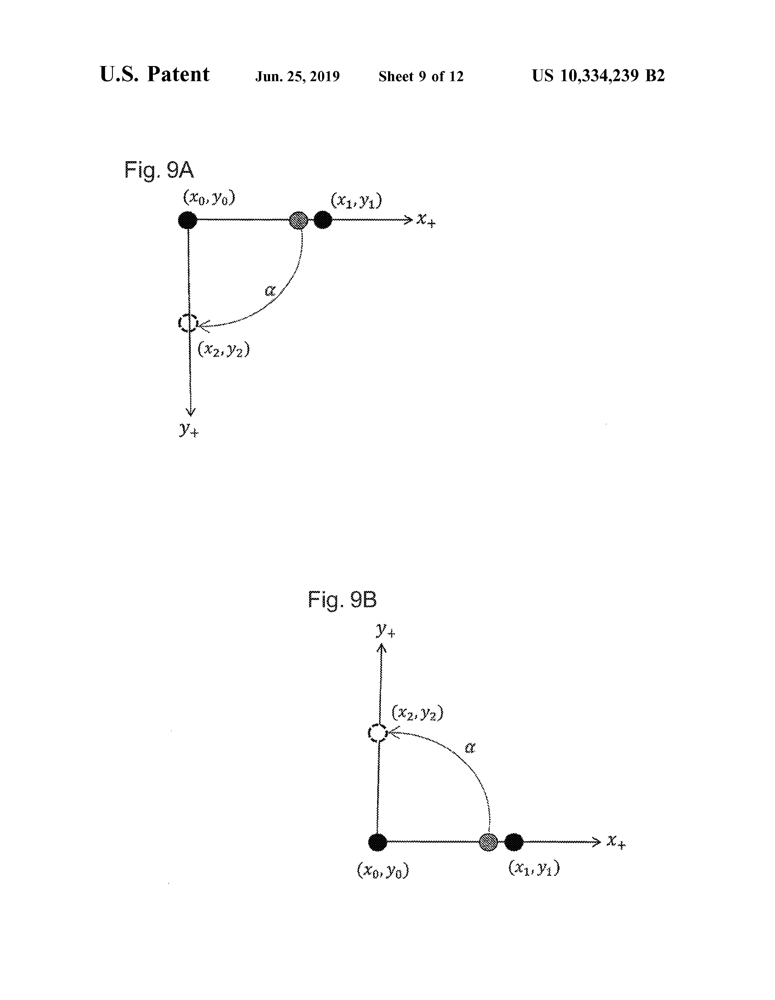
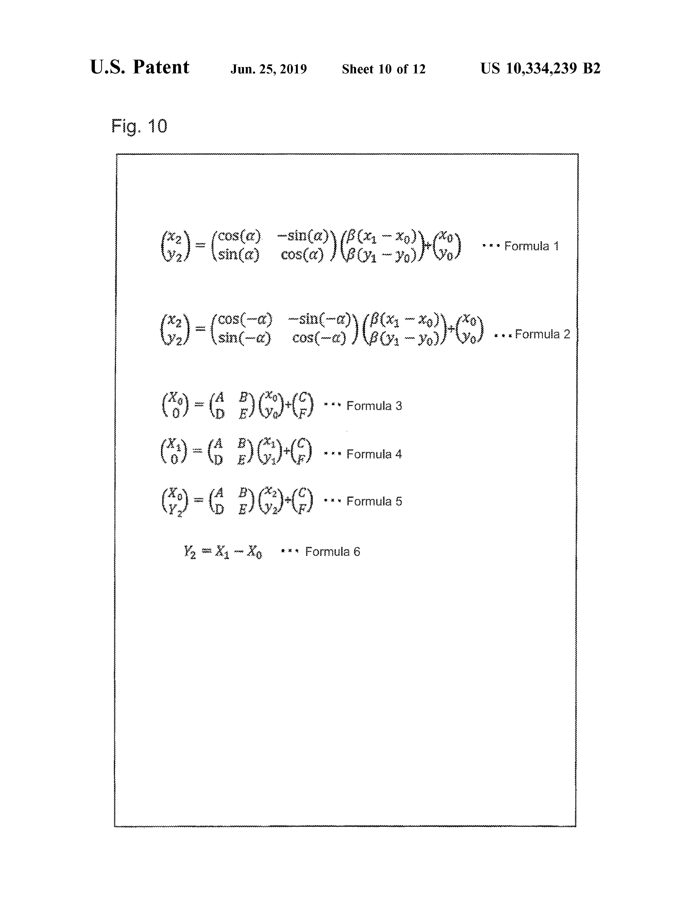
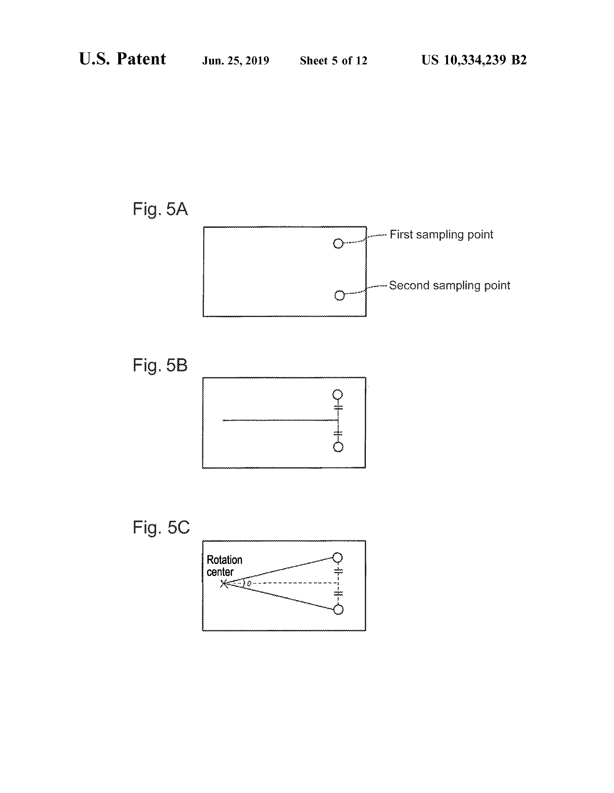

# US10334239B2 — 화상 처리 장치, 캘리브레이션 방법 및 캘리브레이션 프로그램 (OMRON)

| 항목 | 내용 |
|---|---|
| 원문 | `US10334239.pdf`(등록, 2019-06-25) · `US20170039715.pdf`(공개 US2017/0039715 A1, 2017-02-09) |
| 출원인 | OMRON Corporation (발명자 Kazushi Yoshioka, Kengo Ichimura, Hiroyuki Hazeyama) |
| 우선일 | 2015-08-07 (JP2015-157666), 미국 출원 2016-07-26 |
| 핵심 | X 스테이지와 Y 스테이지가 서로 떨어져 있어(비직교 가능) 한 카메라로 두 축 이동을 다 볼 수 없는 XYθ 구조에서, X축만 실제로 움직이고 Y축 이동은 상대 각도 α·상대 배율 β(특성값)로 계산한 "가상 위치"로 대신해 3점 대응으로 카메라→스테이지 아핀 변환(A~F)을 구한다. θ 스테이지는 소정 각도 θ만 돌려 회전 전후 두 점으로 회전 중심을 구한다. |
| 관련도 | ◎ 원인 P4(카메라–스테이지 관계·회전 중심)를 직접 다룸, P1(θ 회전이 마크를 평행이동시키는 결합)의 분리 절차 제공 |
| 본 과제와의 관계 | 장비 기하(화소–mm, 축 각도, 회전 중심)를 "알려진 단일 축 이동만 하고 마크를 다시 찍는" 방식으로 따로따로 캘리브레이션한다. 우리 장비에서 Y만, T만 각각 움직여 같은 값을 미리 측정하는 절차의 근거가 된다. 단, Y·T를 한 장의 영상에서 동시에 구분하는 문제(P2)는 다루지 않는다. |
| 링크 | [Google Patents](https://patents.google.com/patent/US10334239B2/en) |

---

## 상세 요약 (번역본 기준)

### 1. 해결하려는 문제
- 두 대상물(예: 유리 기판과 필름)을 맞출 때 각각 XYθ 스테이지에 올리면 6축이 되어 비용이 커짐 → 한쪽은 Xθ 스테이지, 다른 쪽은 Y 스테이지로 나눔.
- 종래 캘리브레이션(특허문헌 1, JP2007-17424)은 한 XYθ 스테이지를 X·Y로 움직이며 카메라 영상 변위를 측정 → X·Y 스테이지가 분리되면 Y 이동 후 마크가 같은 카메라 시야에 들어오지 않아 세 번째 점을 얻을 수 없음.
- X·Y 축이 정확히 90도가 아니거나 배율이 1이 아닐 수 있음(제조 오차, 특수 목적), 꼬인(skewed) 배치도 가능.

### 2. 핵심 구성
| 구성 | 부호 | 역할 |
|---|---|---|
| 위치 결정 시스템(산업용 장치) | 1 | 액정 패널 라인에서 유리 기판(워크 10)에 필름(워크 11)을 접합할 때 정렬 |
| 화상 처리 장치 | 100 | 처리부(101), 메모리(111, 특성값·캘리브레이션 파라미터 저장), 조작부(113)·디스플레이(114), 카메라 I/F(117), 모션 컨트롤러 I/F(119) |
| 제1·제2 카메라 | 102, 104 | Xθ 스테이지 위 워크(10)의 마크 촬상(제1 촬상 장치) |
| 제3·제4 카메라 | 105, 106 | Y 스테이지 위 워크(11)의 마크 촬상(제2 촬상 장치) |
| 모션 컨트롤러 | 200 | 서보 드라이버로 스테이지 구동 |
| X 스테이지 / Y 스테이지 / θ 스테이지 | 300 / 400 / 500 | 제1·제2·제3 스테이지. θ 스테이지는 X 스테이지 위에 장착, 회전 중심 = 스테이지 좌표 원점(X 이동 범위 중점) |
| 특성값 | α, β | α: X축 양의 방향과 (가상) Y축 양의 방향 사이 상대 각도, β: X 변위 대비 Y 변위 배율(같은 지령에 대한 이동량 비). 왼손/오른손 좌표계 설정 포함, UI로 입력 |
| 위치 결정 마크 | M | 보통 십자 마크, 스테이지·워크 모서리도 가능 |

### 3. 동작 순서
캘리브레이션(도 7, 정렬 전 수행):
1. S11~S12: Xθ 스테이지를 기준 위치(예: 원점)에 두고 마크 M 촬상 → 화상 기준 위치 (x_0, y_0). 스테이지 기준 위치 (X_0, 0).
2. S13~S15: X 스테이지만 X 방향으로 소정 거리 이동(마크가 화상 안에 남도록) → 화상 변위 위치 (x_1, y_1). 스테이지 변위 위치 (X_1, 0).
3. S16: S11~S15를 소정 횟수 반복(매번 기준 위치로 복귀) → 샘플링 잡음 평균, X축 추정 정확도 향상. θ로 마크를 화상의 왼쪽 위·오른쪽 위·왼쪽 아래·오른쪽 아래로 옮겨 가며 샘플링할 수도 있음.
4. S17: UI로 α, β, 좌표계(왼손/오른손) 입력 → 메모리 저장.
5. S18: 스테이지 좌표계 가상 위치 (X_0, Y_2): Y_2 = sin α×β(X_1−X_0) (α=90°, β=1이면 식 6: Y_2 = X_1 − X_0).
6. S19: 화상 가상 위치 (x_2, y_2) — 화상 변위 (x_1−x_0, y_1−y_0)에 β를 곱하고 기준 위치를 중심으로 α만큼 회전.
   - 식 1 (왼손 좌표계, 화상 y축 아래 방향, 도 8A·9A): (x_2, y_2)ᵀ = [[cos(α), −sin(α)], [sin(α), cos(α)]] · (β(x_1 − x_0), β(y_1 − y_0))ᵀ + (x_0, y_0)ᵀ
   - 식 2 (오른손 좌표계, 도 8B·9B): (x_2, y_2)ᵀ = [[cos(−α), −sin(−α)], [sin(−α), cos(−α)]] · (β(x_1 − x_0), β(y_1 − y_0))ᵀ + (x_0, y_0)ᵀ
7. S20: 세 대응점으로 아핀 변환 파라미터 (A, B, C, D, E, F) 계산(미지수 6개, 식 6개).
   - 식 3: (X_0, 0)ᵀ = [[A, B], [D, E]] · (x_0, y_0)ᵀ + (C, F)ᵀ
   - 식 4: (X_1, 0)ᵀ = [[A, B], [D, E]] · (x_1, y_1)ᵀ + (C, F)ᵀ
   - 식 5: (X_0, Y_2)ᵀ = [[A, B], [D, E]] · (x_2, y_2)ᵀ + (C, F)ᵀ
   - 식 6: Y_2 = X_1 − X_0
8. S21: θ 스테이지 회전축(회전 중심) 결정(도 4, 5A~5C).
   - θ 스테이지를 마크가 시야에 남는 각도 θ만큼 회전 → 회전 전 위치(제1 샘플링 점), 회전 후 위치(제2 샘플링 점).
   - 두 점을 잇는 직선의 수직 이등분선 위에서, 두 점과 각도 θ를 이루는 점 = 회전 중심.
   - 이 회전 중심을 스테이지 좌표 원점으로 쓰면 샘플링한 마크의 스테이지 좌표를 계산할 수 있어 카메라 좌표계와 스테이지 좌표계가 맞춰짐.
- 본문 끝 정리식(원문 그대로): Y_2=sin α×β(X_1−X_0), y_2=sin α×β(X_1−X_0)+cos α×β(y_1−y_0)+y_0 (둘째 식의 대문자 X는 식 1과 비교하면 소문자 x의 오기로 보임).
- 가상 축 전환: 카메라(105, 106)와 Y 스테이지에 대해서는 X 스테이지를 가상 축으로 삼아 같은 방식으로 캘리브레이션.

정렬(도 3, 캘리브레이션 후):
- S1·S2 카메라별 마크 검출 → S3 캘리브레이션 파라미터로 스테이지 좌표 변환 → S4 목표 위치 (X_t, 0) → S5 Y 변위 Y_t, S6 X 변위 X_t, S7 θ 회전 변위 → S8 모션 컨트롤러로 출력·이동.

### 4. 청구항 요지 (14항)
- 청구항 1(장치): 분리된 제1·제2 스테이지 구조에서, 메모리(두 스테이지의 기계적 관계 = 특성값, 캘리브레이션 파라미터) + 프로세서. 기준 위치·변위 위치 화상 좌표 취득, 특성값 × 스테이지 변위로 스테이지 좌표계 제1 가상 위치, 특성값 × 화상 변위로 화상 가상 위치 계산, 세 쌍(기준·변위·가상)을 비교해 카메라→스테이지 변환 파라미터 계산·저장.
- 청구항 10(방법)·13(저장 매체)·14(산업용 장치: 모션 컨트롤러로 결과 좌표 출력)이 같은 골격.
- 주요 종속항
  - 2: 특성값 = 상대 각도 및/또는 상대 배율.
  - 3: 화상 기준 위치를 변위 방향으로 (거리×상대 배율)만큼 옮긴 보정 위치를, 기준 위치 중심으로 상대 각도만큼 회전 → 화상 가상 위치(식 1·2의 말 풀이).
  - 4: 특성값을 사용자로부터 입력.
  - 5·11: 제2 카메라로 제2 스테이지 마크에 대해 같은 절차(가상 축 전환).
  - 6·7: 두 마크의 스테이지 좌표 또는 그 차이를 출력.
  - 8·12: 제1 스테이지와 함께 움직이는 회전 가능한 제3 스테이지 — 기준 위치와 소정 각도 회전 후 위치, 그 각도로 회전 중심 계산·저장.
  - 9: 마크를 목표 위치로 옮길 제3 스테이지 회전각 계산·출력.

### 5. 대표 도면

*도 1 — Xθ 스테이지(300·500)와 분리된 Y 스테이지(400), 각 스테이지를 보는 카메라(102·104 / 105·106)*

*도 9A, 9B — 화상 기준 위치 (x_0, y_0), X 이동 후 변위 위치 (x_1, y_1), β배(회색 점) 후 α 회전한 가상 위치 (x_2, y_2)*

*도 10 — 가상 위치(식 1·2)와 아핀 변환(식 3~5), Y_2(식 6)*

*도 5A~5C — θ 회전 전후 두 점의 수직 이등분선 위에서 회전 중심을 구함*

### 6. 본 과제(Y·Θ 얼라인먼트)와 비교
- 같은 점:
  - 카메라 한 대로 마크를 찍고, 화상 좌표(px)와 스테이지 좌표(mm, deg) 사이 관계를 캘리브레이션으로 구한다. 화소–mm 배율, 축 방향 각도, 축 사이 각도(비직교), 회전 중심을 모두 미지수로 둔다 → 우리 P4와 같은 대상.
  - 회전 스테이지(θ)와 평행이동 스테이지가 함께 있고, θ 회전이 마크를 화상에서 옮긴다(P1). 정렬 단계에서 X·Y 변위와 θ 회전 변위를 따로 계산해 출력한다.
  - 회전 중심 위치를 장비 사양으로 주지 않고 영상에서 측정한다.
- 다른 점:
  - 카메라는 고정, 스테이지가 마크를 옮긴다. 우리는 카메라가 로봇(스테이지)에 달려 고정된 QR 판을 본다(움직임이 반대 방향으로 보일 뿐 수식 구조는 같음).
  - 캘리브레이션 중에는 한 번에 한 축만, 지령값을 아는 상태로 움직인다(X만 이동, θ만 소정 각도 회전). 그래서 Y와 θ가 섞이지 않는다. 우리 실시간 문제는 Y·T가 모두 미지수인 상태에서 한 장의 영상으로 둘을 나눠야 하므로, 이 특허는 P1·P2를 "운전 중에 푸는" 방법은 주지 않는다.
  - 아핀 변환 6개 미지수를 3점으로 정확히 맞춘다(여분 없음). 잡음은 같은 이동을 여러 번 반복해 평균하는 것으로만 다룬다(P3 대책이 단순함). 백래시(P5) 언급은 없다(단, 매 반복마다 기준 위치로 되돌린 뒤 같은 방향으로 이동함).
  - 회전 중심을 구하는 θ 회전각은 "마크가 시야에 남는 각도"로 작게 잡는다. 우리처럼 회전 중심이 시야 밖 멀리 있으면 두 점 사이 거리가 짧고 수직 이등분선 위 거리가 길어져, 각도 오차가 중심 위치 오차로 크게 커진다(특허에 오차 분석·수치 없음).
- 참고할 점 (해결하는 P#와 본 과제에서 할 일):
  - P4 — 화소–mm·축 방향 측정: 로봇을 T=0에 두고 Y만 알려진 거리(예: ±수 mm)만큼 움직여 QR 마커 3개의 화상 이동을 측정 → 이동 벡터 크기로 화소/mm, 방향으로 화상 x축과 Y축 사이 각도를 구한다(특허 S11~S15, 식 3·4에 해당). 같은 거리를 여러 번 반복하고 매번 같은 방향으로 접근해 평균한다(P3·P5 완화).
  - P4 — 회전 중심 측정: Y는 고정하고 T만 알려진 각도 θ로 돌려 같은 마커의 회전 전후 위치 p0, p1을 얻고, 수직 이등분선 위에서 두 점과 각도 θ를 이루는 점으로 회전 중심 c를 구한다(특허 S21, 도 5). 계산식(특허 본문에는 말로만 있음, 우리 쪽 정리): 중점 m=(p0+p1)/2, 현 길이 d=|p1−p0|, 중점에서 중심까지 거리 h=(d/2)/tan(θ/2), c=m ± h·n(n은 현에 수직인 단위벡터, 부호는 회전 방향). 회전 중심이 멀어 d가 작으면 θ를 여러 값(±)으로 돌려 다점 원 맞춤으로 바꾸는 것이 안전하다.
  - P1 — 결합 분리: 회전 중심 c와 화소–mm를 미리 알면, T 회전이 마커에 주는 화상 이동은 p' = R(T)(p − c) + c로 예측된다. 우리 Y·T 동시 추정 모델의 "회전 팔 길이(c까지의 거리)"를 장비에서 측정한 값으로 고정해 미지수를 줄이는 데 쓴다. 다만 팔 길이가 길면 T 효과가 여전히 평행이동과 거의 같아지므로 P2(조건수)는 깊이가 다른 뒷벽 가로선 관측으로 따로 풀어야 한다.
  - P4 — 비직교·배율 보정 항: Y축과 T 회전 접선 방향이 정확히 직교·같은 배율이라고 가정하지 말고, α·β 같은 "기계 특성값"을 캘리브레이션 결과로 저장해 쓴다. 화상 좌표는 y축이 아래 방향(왼손 좌표계)이므로 회전 부호를 식 1/식 2처럼 구분해야 한다.
  - 직접 볼 수 없는 움직임은 기계 특성값으로 "가상 점"을 만들어 방정식 수를 채운다는 발상 — 우리 장비에서 한 축 이동이 시야를 벗어날 때(큰 T 등) 쓸 수 있다.

---

> **같은 특허의 다른 폴더:** `문헌연구/03_Y_T_분리/특허/01_US10334239_Omron_스테이지이동_좌표보정_회전중심` (번역 있음). 두 폴더는 주제 관점이 달라 요약을 따로 두었다.
