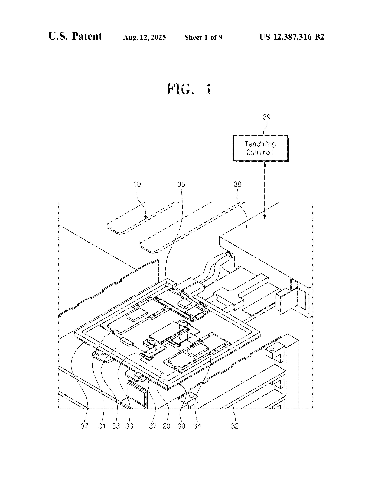
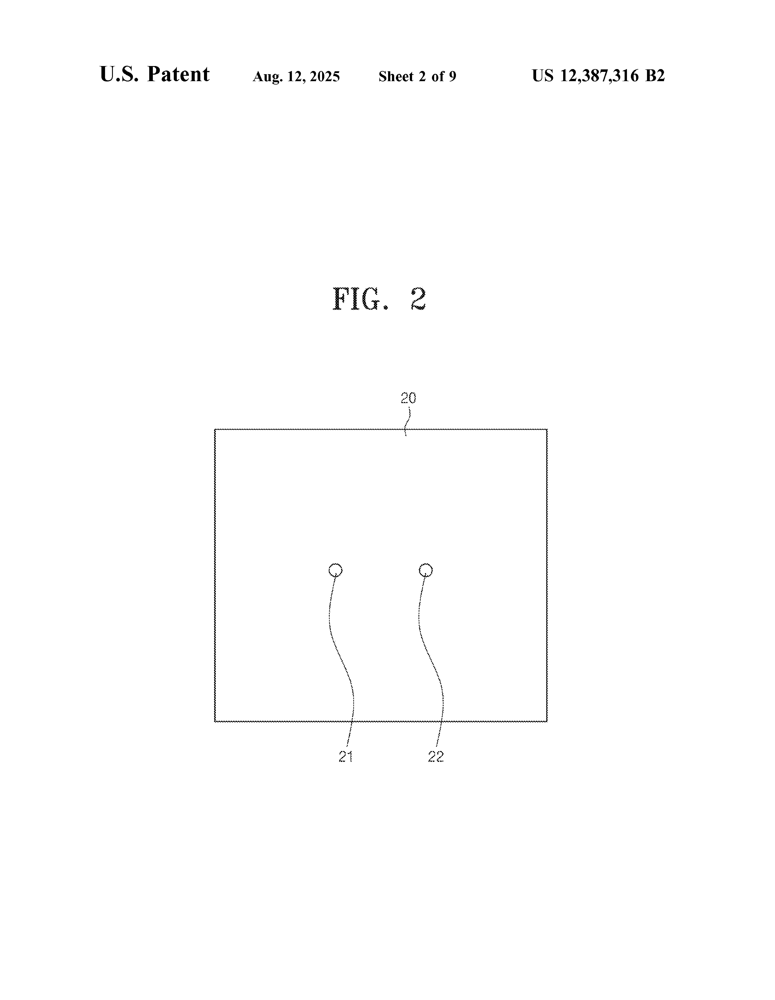
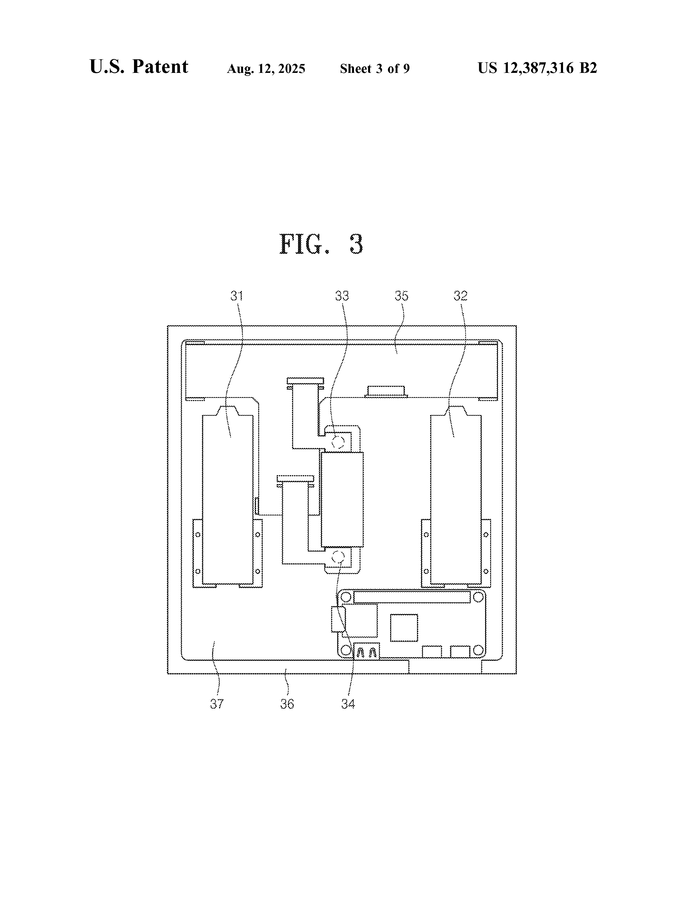
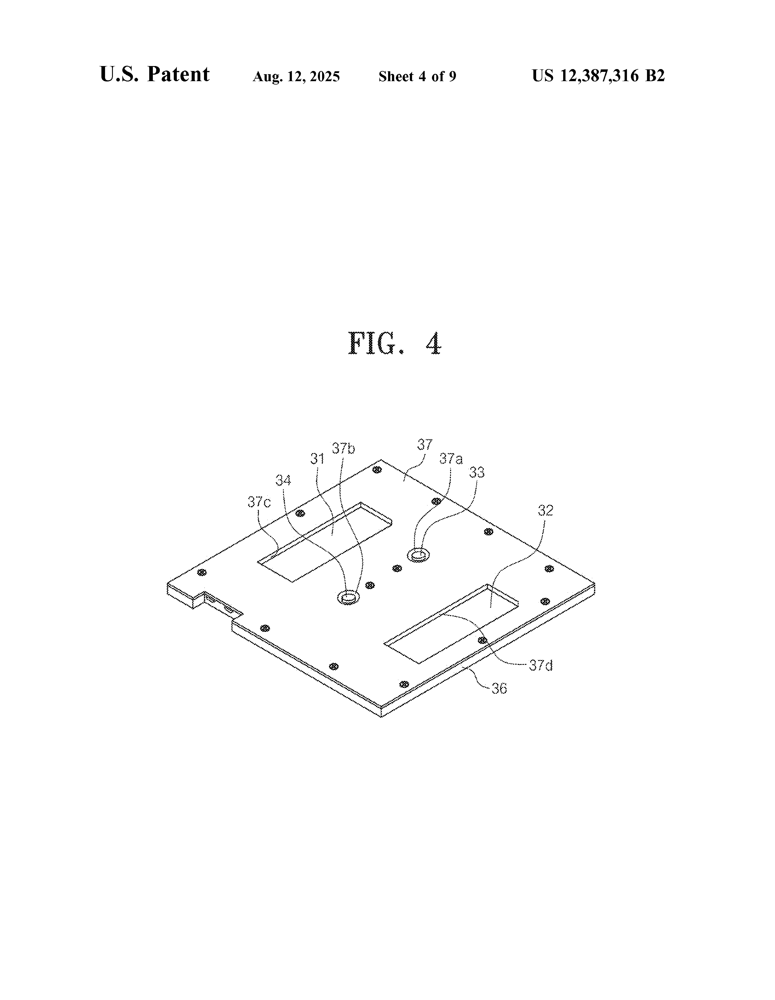
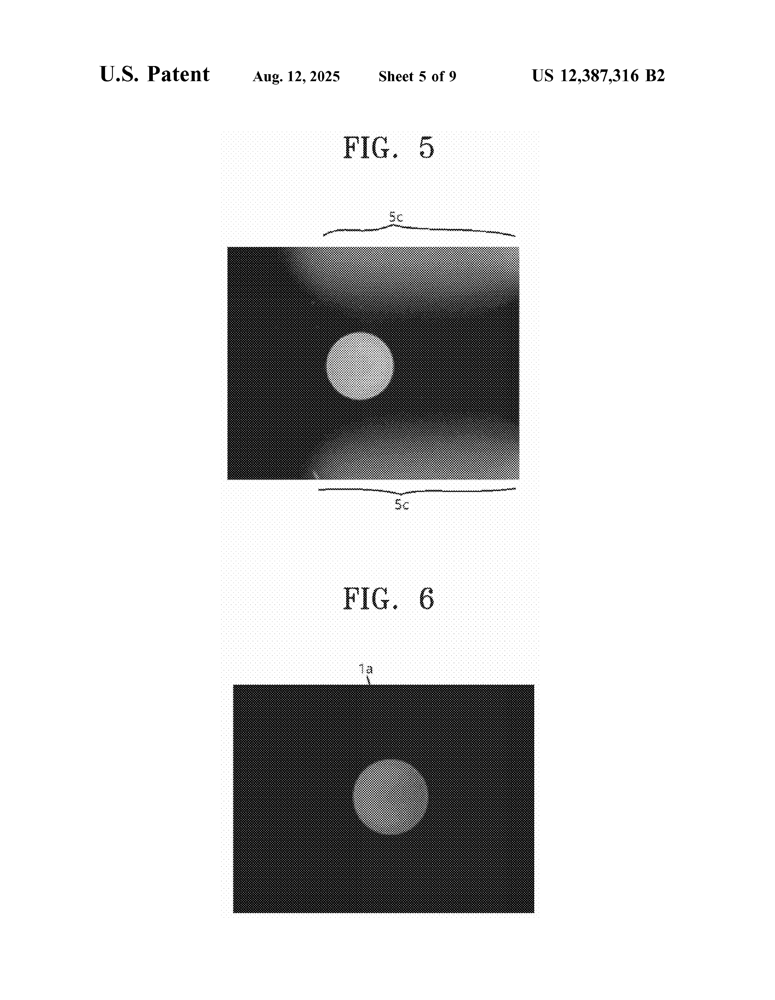
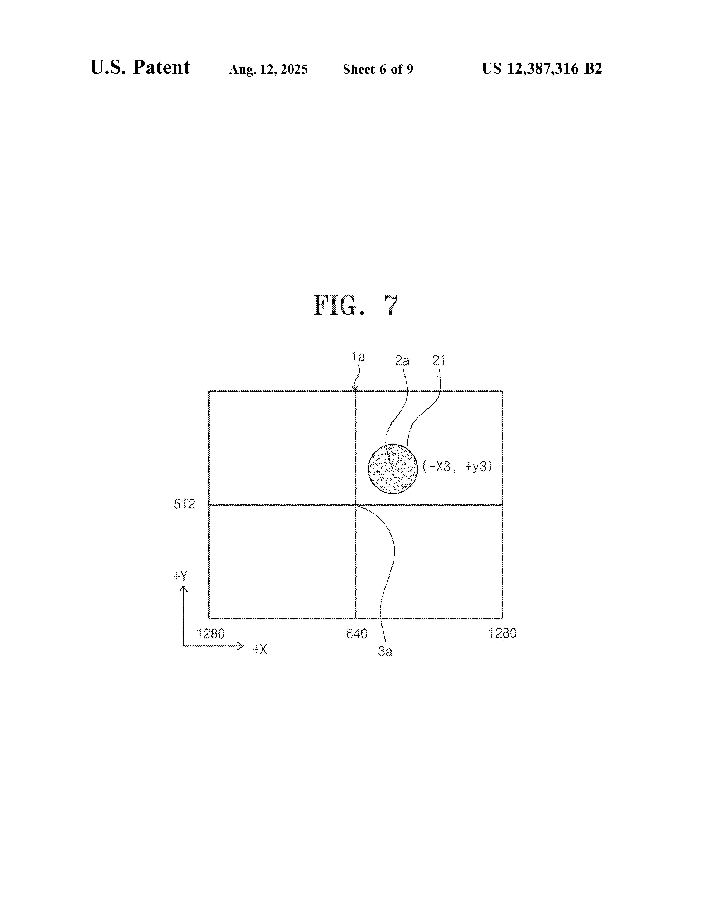
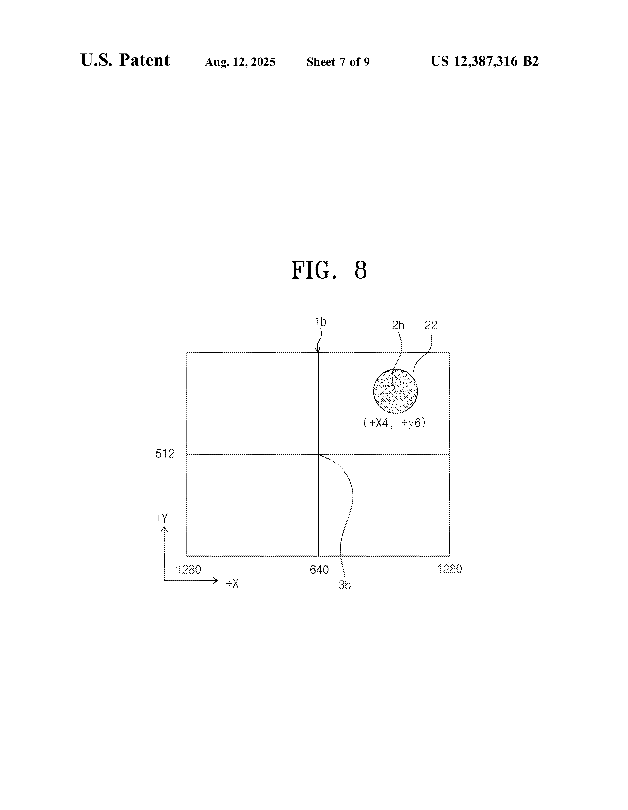
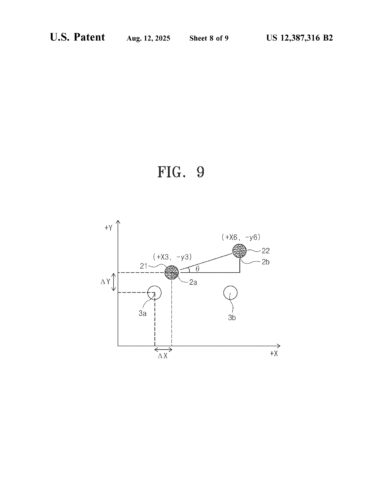
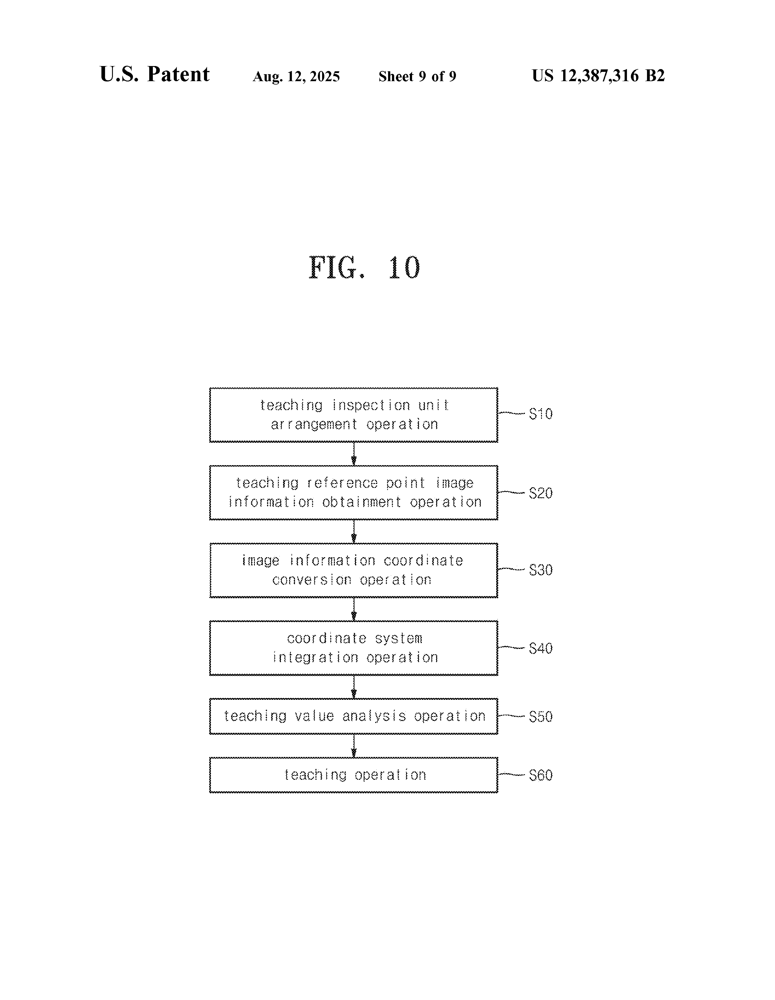

# 반도체 제조 설비 및 반도체 제조 설비의 티칭 방법 (US12387316B2)
- 원제: Semiconductor manufacturing facility and teaching method of semiconductor manufacturing facility
- 원문: 같은 폴더의 PDF, https://patents.google.com/patent/US12387316B2/en
- 번역 기준: USPTO 등록본 PDF 스캔을 직접 판독한 원문을 한국어로 옮김.
- 도면: 원문 PDF 도면 시트 9장을 도면/ 폴더에 넣고 본문에서 처음 언급되는 곳에 삽입함

## 요약

웨이퍼 또는 마스크를 이송하는 이송 장치의 티칭 작업 중에 티칭 타깃의 티칭 기준점을 얻기 위한 영상 정보의 부분 백화를 방지하여 판독성을 높이는 반도체 제조 설비 및 반도체 제조 설비의 티칭 방법이 개시된다. 반도체 제조 설비는 제1 티칭 기준점과 제2 티칭 기준점이 형성된 티칭 타깃; 티칭 타깃이 장착되는 이송 장치; 및 티칭 타깃의 제1 티칭 기준점과 제2 티칭 기준점을 영상 분석하여 제1 티칭 기준점과 제2 티칭 기준점 각각의 중심 좌표를 계산하고, 각 중심 좌표를 잇는 선의 각도값으로 이송 장치를 티칭하는 티칭 검사부를 포함한다.

## 청구범위

청구하는 것은 다음과 같다.

1. 반도체 제조 설비로서,

제1 티칭 기준점과 제2 티칭 기준점이 형성된 티칭 타깃;

상기 티칭 타깃이 장착되는 이송 장치; 및

상기 티칭 타깃의 상기 제1 티칭 기준점과 상기 제2 티칭 기준점을 영상 분석하여 상기 제1 티칭 기준점과 상기 제2 티칭 기준점 각각의 중심 좌표를 계산하고, 각 중심 좌표를 잇는 선의 각도값으로 상기 이송 장치를 티칭하는 티칭 검사부를 포함하는, 반도체 제조 설비.

2. 제1항에 있어서, 상기 티칭 검사부는,

상기 제1 티칭 기준점 주위에 빛을 내는 제1 조명부;

상기 제2 티칭 기준점 주위에 빛을 내는 제2 조명부;

상기 제1 티칭 기준점을 촬영하여 아날로그 영상 정보를 얻는 제1 카메라;

상기 제2 티칭 기준점을 촬영하여 아날로그 영상 정보를 얻는 제2 카메라;

상기 제1 카메라와 상기 제2 카메라 각각의 영상 정보를 제1 기준점 영상 정보와 제2 기준점 영상 정보로 디지털 변환하는 카메라 기판 모듈; 및

상기 제1 기준점 영상 정보와 상기 제2 기준점 영상 정보 각각을 분석하여 상기 제1 티칭 기준점의 제1 기준점 중심 좌표와 상기 제2 티칭 기준점의 제2 기준점 중심 좌표를 계산하고, 제1 기준점 절대 좌표와 제2 기준점 절대 좌표를 잇는 선과 상기 제1 기준점 중심 좌표와 상기 제2 기준점 중심 좌표를 잇는 선 사이의 각도값을 계산하여, 계산된 각도값만큼 상기 이송 장치를 티칭하는 티칭 제어부를 포함하는, 반도체 제조 설비.

3. 제2항에 있어서, 상기 티칭 제어부는 상기 제1 기준점 영상 정보와 상기 제2 기준점 영상 정보를 겹치고 겹친 영상 정보를 하나의 통합 좌표계로 통합하여, 하나의 통합 좌표계에서 상기 제1 기준점 중심 좌표와 상기 제2 기준점 중심 좌표가 상기 제1 기준점 절대 좌표와 상기 제2 기준점 절대 좌표로부터 X축과 Y축으로 얼마나 이동했는지에 대한 이동값을 계산하고, 계산된 이동값만큼 상기 이송 장치를 티칭하는, 반도체 제조 설비.

4. 제2항에 있어서, 상기 티칭 검사부는,

상기 제1 조명부, 상기 제2 조명부, 상기 제1 카메라, 상기 제2 카메라, 및 상기 카메라 기판 모듈을 장착하는 장착 영역을 내부 공간에 제공하는 기판 프레임부; 및

상기 카메라 기판 모듈이 노출되지 않도록 상기 기판 프레임부에 결합되고, 상기 제1 카메라의 렌즈와 상기 제2 카메라의 렌즈가 각각 노출되는 제1 카메라 구멍과 제2 카메라 구멍이 형성되며, 상기 조명부와 상기 제2 조명부가 각각 노출되는 제1 조명 구멍과 제2 조명 구멍이 형성된 기판 커버부를 포함하는, 반도체 제조 설비.

5. 제4항에 있어서, 상기 기판 커버부는 탄소섬유강화플라스틱(CFRP)으로 형성되는, 반도체 제조 설비.

6. 제4항에 있어서, 상기 기판 커버부는 탄소 섬유를 직조하고 복수의 층을 접착으로 적층한 판 형태로 형성되며, 노출면은 복수의 섬유가 직조된 직물면을 이루는, 반도체 제조 설비.

7. 제4항에 있어서, 상기 기판 커버부는 흰색으로 형성되는, 반도체 제조 설비.

8. 제2항에 있어서, 상기 제1 조명부와 상기 제2 조명부는 면조명으로 형성되는, 반도체 제조 설비.

9. 제8항에 있어서, 상기 제1 카메라와 상기 제2 카메라는 상기 제1 조명부와 상기 제2 조명부 사이에 배치되는, 반도체 제조 설비.

10. 제8항에 있어서, 상기 제1 카메라와 상기 제2 카메라는 상기 제1 조명부와 상기 제2 조명부 사이 영역에서 상기 기판 프레임부의 중심점을 기준으로 서로 마주보도록 배치되는, 반도체 제조 설비.

11. 제1항에 있어서, 상기 티칭 타깃은 웨이퍼 또는 마스크에 대응하는 형상으로 형성되는, 반도체 제조 설비.

12. 반도체 제조 설비로서,

제1 티칭 기준점과 제2 티칭 기준점이 형성된 티칭 타깃;

상기 티칭 타깃이 장착되는 이송 장치; 및

티칭 검사부를 포함하고, 상기 티칭 검사부는,

상기 제1 티칭 기준점 주위에 빛을 내며 면광원으로 형성된 제1 조명부,

상기 제2 티칭 기준점 주위에 빛을 내며 면광원으로 형성된 제2 조명부,

상기 제1 티칭 기준점을 촬영하여 아날로그 영상 정보를 얻으며 상기 제1 조명부와 상기 제2 조명부 사이에 배치된 제1 카메라,

상기 제2 티칭 기준점을 촬영하여 아날로그 영상 정보를 얻으며 상기 제1 조명부와 상기 제2 조명부 사이에 배치된 제2 카메라,

상기 제1 카메라와 상기 제2 카메라 각각의 영상 정보를 제1 기준점 영상 정보와 제2 기준점 영상 정보로 디지털 변환하는 카메라 기판 모듈,

상기 제1 조명부, 상기 제2 조명부, 상기 제1 카메라, 상기 제2 카메라, 및 상기 카메라 기판 모듈이 장착되도록 내부 공간에 장착 영역을 제공하는 기판 프레임부,

상기 카메라 기판 모듈이 노출되지 않도록 상기 기판 프레임부에 결합되고, 상기 제1 카메라의 렌즈와 상기 제2 카메라의 렌즈가 각각 노출되는 제1 카메라 구멍과 제2 카메라 구멍이 형성되며, 상기 제1 조명부와 상기 제2 조명부가 각각 노출되는 제1 조명 구멍과 제2 조명 구멍이 형성되고, 탄소 섬유를 직조하고 복수의 층을 접착으로 적층한 판 형태로 형성되며, 복수의 섬유가 직조된 직물면을 이루는 노출면을 가지고, 흰색으로 형성된 기판 커버부, 및

상기 제1 기준점 영상 정보와 상기 제2 기준점 영상 정보 각각을 분석하여 상기 제1 티칭 기준점의 제1 기준점 중심 좌표와 상기 제2 티칭 기준점의 제2 기준점 중심 좌표를 계산하고, 상기 제1 기준점 절대 좌표와 상기 제2 기준점 절대 좌표를 잇는 선과 상기 제1 기준점 중심 좌표와 상기 제2 기준점 중심 좌표를 잇는 선 사이의 각도값을 계산하여, 계산된 각도값만큼 상기 이송 장치를 티칭하는 티칭 제어부를 포함하는, 반도체 제조 설비.

## 상세한 설명

### 관련 출원의 상호 참조 (CROSS-REFERENCE TO RELATED APPLICATIONS)

본 출원은 2021년 12월 27일 및 2022년 9월 20일 한국 특허청에 출원된 한국 특허출원 제10-2021-0189018호 및 제10-2022-0118539호의 우선권과 이익을 주장하며, 그 전체 내용은 참조로 본 명세서에 포함된다.

### 기술 분야 (TECHNICAL FIELD)

본 발명은 반도체 제조 설비 및 반도체 제조 설비의 티칭 방법에 관한 것으로, 보다 상세하게는 이송 장치가 피이송물을 이송할 때 이송 기준점을 티칭하는 반도체 제조 설비 및 반도체 제조 설비의 티칭 방법에 관한 것이다.

### 배경 기술 (BACKGROUND ART)

반도체 및 디스플레이 장치를 위한 노광 공정, 식각 공정, 증착 공정 등 각 공정을 수행할 때, 각 공정 사이에서 웨이퍼 또는 마스크를 공정 챔버나 검사 장치로 이송할 필요가 있으며, 이러한 웨이퍼 또는 마스크는 주로 다자유도 로봇 같은 이송 장치에 의해 웨이퍼 또는 마스크의 최종 안착 위치를 정밀하게 조정하여 놓인다.

이송 장치는 생산 라인에 처음 설치하는 경우, 암 또는 핸드를 교체하는 경우, 또는 충격이 발생한 경우에 암의 이송 동작 시작점과 최종 이송 위치의 기준점을 다시 맞출 필요가 있으며, 이 기준점 조정 작업에서는 티칭 장치를 사용하여 이송 동작 사이의 구동점과 최종 이송 위치의 기준점을 조정한다.

통상 티칭 장치는 마스크 또는 웨이퍼의 형상에 대응하는 티칭 타깃을 이송 장치의 핸드에 장착하고, 티칭 타깃에 형성된 구멍 또는 홈 형태의 티칭 기준점을 비전 시스템으로 영상 정보로 받아, 받은 영상 정보에 기록된 티칭 기준점의 중심점이 마스크 또는 웨이퍼가 실제로 위치해야 하는 기준점으로부터 3차원의 X, Y, Z축으로 얼마나 떨어져 있는지를 판단하고, 벗어난 위치만큼 이송 장치의 최종 이송 위치를 보정한다.

티칭 작업 중 종래 기술의 티칭 장치는 티칭 타깃 주위에 빛을 내는 조명을 배치하여, 티칭 타깃의 티칭 기준점 주위에 그림자가 생기지 않은 상태로 티칭 타깃을 촬영한다.

이 경우 종래 기술의 티칭 장치에서는 빛의 반사율을 줄이려고 카메라가 장착된 조명 주위에 검은색 판을 설치하지만, 검은색 판이 빛을 균일하게 흡수하지 못하여 티칭 기준점 부근의 특정 영역만 밝기가 변하는 부분 백화(partial whitening) 현상이 발생한다.

따라서 티칭 타깃의 티칭 기준점을 촬영하여 얻은 영상 정보에서 부분 백화가 일어난 영상 정보가 얻어지므로, 티칭 기준점의 중심점 좌표값을 영상으로 분석할 때 중심점이 정확히 읽히지 않는다.

한편 종래 기술의 티칭 장치는 일반적으로 티칭 타깃의 티칭 기준점을 구멍 또는 홈 하나의 형태로 형성하고, 그 구멍 또는 홈 하나의 티칭 기준점에 대한 영상 정보를 얻어 3차원 X, Y, Z축에 대한 축간 거리의 티칭 작업을 수행한다.

그러나 티칭 타깃에 형성된 구멍 또는 홈 하나의 중심점을 영상으로 분석하여 기준점을 보정하는 종래 기술의 티칭 방법은 3차원 X축, Y축, Z축의 세로 및 가로 거리만 보정할 수 있을 뿐, 티칭 타깃이 얼마나 회전했는지는 인식할 수 없다는 문제가 있다.

### 발명의 내용 (SUMMARY OF THE INVENTION)

본 발명은 웨이퍼 또는 마스크를 이송하는 이송 장치의 티칭 작업 중에 티칭 타깃의 티칭 기준점을 얻기 위한 영상 정보의 부분 백화를 방지하여 판독성을 높이는 반도체 제조 설비 및 반도체 제조 설비의 티칭 방법을 제공하고자 한다.

또한 본 발명은 웨이퍼 또는 마스크를 이송하는 이송 장치의 티칭 작업 중에 티칭 타깃의 티칭 기준점까지의 거리뿐 아니라 티칭 타깃의 각도까지 보정하여 티칭 작업을 수행하는 반도체 제조 설비 및 반도체 제조 설비의 티칭 방법을 제공하고자 한다.

본 발명의 예시적 실시예는 반도체 제조 설비를 제공하며, 이 설비는 제1 티칭 기준점과 제2 티칭 기준점이 형성된 티칭 타깃; 티칭 타깃이 장착되는 이송 장치; 및 티칭 타깃의 제1 티칭 기준점과 제2 티칭 기준점을 영상 분석하여 제1 티칭 기준점과 제2 티칭 기준점 각각의 중심 좌표를 계산하고, 각 중심 좌표를 잇는 선의 각도값으로 이송 장치를 티칭하는 티칭 검사부를 포함한다.

예시적 실시예에 따르면, 티칭 검사부는 제1 티칭 기준점 주위에 빛을 내는 제1 조명부; 제2 티칭 기준점 주위에 빛을 내는 제2 조명부; 제1 티칭 기준점을 촬영하여 아날로그 영상 정보를 얻는 제1 카메라; 제2 티칭 기준점을 촬영하여 아날로그 영상 정보를 얻는 제2 카메라; 제1 카메라와 제2 카메라 각각의 영상 정보를 제1 기준점 영상 정보와 제2 기준점 영상 정보로 디지털 변환하는 카메라 기판 모듈; 및 제1 기준점 영상 정보와 제2 기준점 영상 정보 각각을 분석하여 제1 티칭 기준점의 제1 기준점 중심 좌표와 제2 티칭 기준점의 제2 기준점 중심 좌표를 계산하고, 제1 기준점 절대 좌표와 제2 기준점 절대 좌표를 잇는 선과 제1 기준점 중심 좌표와 제2 기준점 중심 좌표를 잇는 선 사이의 각도값을 계산하여, 계산된 각도값만큼 이송 장치를 티칭하는 티칭 제어부를 포함할 수 있다.

예시적 실시예에 따르면, 티칭 제어부는 제1 기준점 영상 정보와 제2 기준점 영상 정보를 겹치고 겹친 영상 정보를 하나의 통합 좌표계로 통합하여, 하나의 통합 좌표계에서 제1 기준점 중심 좌표와 제2 기준점 중심 좌표가 제1 기준점 절대 좌표와 제2 기준점 절대 좌표로부터 X축과 Y축으로 얼마나 이동했는지에 대한 이동값을 계산하고, 계산된 이동값만큼 이송 장치를 티칭한다.

예시적 실시예에 따르면, 티칭 검사부는 제1 조명부, 제2 조명부, 제1 카메라, 제2 카메라, 카메라 기판 모듈을 장착하는 장착 영역을 내부 공간에 제공하는 기판 프레임부; 및 카메라 기판 모듈이 노출되지 않도록 기판 프레임부에 결합되고, 제1 카메라의 렌즈와 제2 카메라의 렌즈가 각각 노출되는 제1 카메라 구멍과 제2 카메라 구멍이 형성되며, 조명부와 제2 조명부가 각각 노출되는 제1 조명 구멍과 제2 조명 구멍이 형성된 기판 커버부를 포함한다.

예시적 실시예에 따르면, 기판 커버부는 탄소섬유강화플라스틱(CFRP)으로 형성된다.

예시적 실시예에 따르면, 기판 커버부는 탄소 섬유를 직조하고 복수의 층을 접착으로 적층한 판 형태로 형성되며, 노출면은 복수의 섬유가 직조된 직물면을 이룬다.

예시적 실시예에 따르면, 기판 커버부는 흰색으로 형성된다.

예시적 실시예에 따르면, 제1 조명부와 제2 조명부는 면조명으로 형성된다.

예시적 실시예에 따르면, 제1 카메라와 제2 카메라는 제1 조명부와 제2 조명부 사이에 배치된다.

예시적 실시예에 따르면, 제1 카메라와 제2 카메라는 제1 조명부와 제2 조명부 사이 영역에서 기판 프레임부의 중심점을 기준으로 서로 마주보도록 배치된다.

예시적 실시예에 따르면, 티칭 타깃은 웨이퍼 또는 마스크에 대응하는 형상으로 형성된다.

본 발명의 다른 예시적 실시예는 반도체 제조 설비의 티칭 방법을 제공하며, 이 티칭 방법은 티칭 타깃이 장착된 이송 장치 아래에 티칭 검사부의 제1 카메라와 제2 카메라를 배치하는 티칭 검사부 배치 단계; 제1 카메라로 티칭 타깃의 제1 티칭 기준점을 촬영하여 아날로그 영상 정보를 얻고, 카메라 기판 모듈로 얻은 아날로그 영상 정보에 디지털 신호 처리를 하여 처리된 영상 정보를 제1 기준점 영상 정보로 변환하며, 제2 카메라로 티칭 타깃의 제2 티칭 기준점을 촬영하여 아날로그 영상 정보를 얻고, 카메라 기판 모듈로 얻은 아날로그 영상 정보에 디지털 신호 처리를 하여 처리된 영상 정보를 제2 기준점 영상 정보로 변환하는 티칭 기준점 영상 정보 획득 단계; 티칭 제어부가 제1 기준점 영상 정보의 화소값을 분석하여 제1 기준점 영상 정보 내의 제1 기준점 중심 좌표를 좌표로 변환하고, 제2 기준점 영상 정보의 화소값을 분석하여 제2 기준점 영상 정보 내의 제2 기준점 중심 좌표를 좌표로 변환하는 영상 정보 좌표 변환 단계; 제1 기준점 중심 좌표와 제2 기준점 중심 좌표를 하나의 좌표계로 출력하여 제1 기준점 중심 좌표와 제2 기준점 중심 좌표를 통합하는 좌표계 통합 단계; 제1 기준점 중심 좌표와 제2 기준점 중심 좌표가 제1 기준점 절대 좌표와 제2 기준점 절대 좌표로부터 얼마나 이동했는지에 대한 이동값과, 제1 기준점 중심 좌표와 제2 기준점 중심 좌표가 얼마나 회전했는지에 대한 각도값을 계산하는 티칭값 분석 단계; 및 이동값과 각도값에 기초하여 이송 장치의 엔드 이펙터를 티칭하는 티칭 단계를 포함한다.

예시적 실시예에 따르면, 티칭 검사부 배치 단계에서 제1 조명부는 티칭 타깃의 제1 티칭 기준점 주위에 빛을 내고, 제2 조명부는 티칭 타깃의 제2 티칭 기준점 주위에 빛을 내며, 탄소섬유강화플라스틱(CFRP)으로 형성된 기판 커버부가 제1 조명부와 제2 조명부 주위에 배치되어 반사 기능을 구현한다.

예시적 실시예에 따르면, 기판 커버부는 탄소 섬유를 직조하고 복수의 층을 접착으로 적층한 판 형태로 형성되며, 노출면은 복수의 섬유가 직조된 직물면을 이룬다.

예시적 실시예에 따르면, 기판 커버부는 흰색으로 형성된다.

예시적 실시예에 따르면, 제1 조명부와 제2 조명부는 면조명으로 형성된다.

예시적 실시예에 따르면, 제1 카메라와 제2 카메라는 제1 조명부와 제2 조명부 사이에 배치된다.

예시적 실시예에 따르면, 제1 카메라와 제2 카메라는 제1 조명부와 제2 조명부 사이 영역에서 기판 프레임부의 중심점을 기준으로 서로 마주보도록 배치된다.

예시적 실시예에 따르면, 티칭 타깃은 웨이퍼 또는 마스크에 대응하는 형상으로 형성된다.

본 발명의 또 다른 예시적 실시예는 반도체 제조 설비를 제공하며, 이 설비는 제1 티칭 기준점과 제2 티칭 기준점이 형성된 티칭 타깃; 티칭 타깃이 장착되는 이송 장치; 및 티칭 검사부를 포함하고, 티칭 검사부는 제1 티칭 기준점 주위에 빛을 내며 면광원으로 형성된 제1 조명부, 제2 티칭 기준점 주위에 빛을 내며 면광원으로 형성된 제2 조명부, 제1 티칭 기준점을 촬영하여 아날로그 영상 정보를 얻으며 제1 조명부와 제2 조명부 사이에 배치된 제1 카메라, 제2 티칭 기준점을 촬영하여 아날로그 영상 정보를 얻으며 제1 조명부와 제2 조명부 사이에 배치된 제2 카메라, 제1 카메라와 제2 카메라 각각의 영상 정보를 제1 기준점 영상 정보와 제2 기준점 영상 정보로 디지털 변환하는 카메라 기판 모듈, 제1 조명부·제2 조명부·제1 카메라·제2 카메라·카메라 기판 모듈이 장착되도록 내부 공간에 장착 영역을 제공하는 기판 프레임부, 카메라 기판 모듈이 노출되지 않도록 기판 프레임부에 결합되고 제1 카메라의 렌즈와 제2 카메라의 렌즈가 각각 노출되는 제1 카메라 구멍과 제2 카메라 구멍이 형성되며 제1 조명부와 제2 조명부가 각각 노출되는 제1 조명 구멍과 제2 조명 구멍이 형성되고, 탄소 섬유를 직조하고 복수의 층을 접착으로 적층한 판 형태로 형성되며, 복수의 섬유가 직조된 직물면을 이루는 노출면을 가지고, 흰색으로 형성된 기판 커버부, 및 제1 기준점 영상 정보와 제2 기준점 영상 정보 각각을 분석하여 제1 티칭 기준점의 제1 기준점 중심 좌표와 제2 티칭 기준점의 제2 기준점 중심 좌표를 계산하고, 제1 기준점 절대 좌표와 제2 기준점 절대 좌표를 잇는 선과 제1 기준점 중심 좌표와 제2 기준점 중심 좌표를 잇는 선 사이의 각도값을 계산하여, 계산된 각도값만큼 이송 장치를 티칭하는 티칭 제어부를 포함한다.

본 발명은 웨이퍼 또는 마스크를 이송하는 이송 장치의 티칭 작업 중에 티칭 타깃의 티칭 기준점을 얻기 위한 영상 정보의 부분 백화를 방지하여 판독성을 높이는 효과가 있다.

또한 본 발명은 웨이퍼 또는 마스크를 이송하는 이송 장치의 티칭 작업 중에 티칭 타깃의 티칭 기준점까지의 거리뿐 아니라 티칭 타깃의 각도까지 보정하여 티칭 작업을 수행하는 효과가 있다.

### 도면의 간단한 설명 (BRIEF DESCRIPTION OF THE DRAWINGS)

도 1은 본 발명의 예시적 실시예에 따른 반도체 제조 설비의 이송 장치가 티칭 타깃을 티칭하는 상태의 사시도이다.

도 2는 도 1에 도시된 티칭 타깃을 위에서 본 구성도이다.

도 3은 도 1에 도시된 기판 프레임부를 위에서 본 상태의 평면도이다.

도 4는 도 1에 도시된 기판 프레임부를 뒤집은 상태의 사시도이다.

도 5는 기판 커버부를 검은색으로 형성한 상태에서 기존 카메라로 촬영한 티칭 타깃의 영상이다.

도 6은 도 1에 도시된 제1 카메라로 촬영한 티칭 타깃의 영상이다.

도 7은 티칭 제어부가 제1 카메라에서 얻은 제1 기준점 영상 정보를 좌표로 변환한 그래프이다.

도 8은 티칭 제어부가 제2 카메라에서 얻은 제2 기준점 영상 정보를 좌표로 변환한 그래프이다.

도 9는 티칭 제어부가 도 7에 도시된 제1 기준점 영상 정보와 도 8에 도시된 제2 기준점 영상 정보를 통합한 통합 좌표계의 그래프이다.

도 10은 본 발명의 예시적 실시예에 따른 반도체 제조 설비의 티칭 방법의 순서도이다.

### 발명을 실시하기 위한 구체적인 내용 (DETAILED DESCRIPTION)

이하, 첨부된 도면을 참조하여 본 발명을 실시하기 위한 예시적 실시예를 설명하며, 이때 명세서 전체에서 어떤 구성요소가 어떤 구성요소를 "포함"한다고 할 때, 이는 특별히 반대되는 기재가 없는 한 다른 구성요소를 제어하는 것이 아니라 다른 구성요소를 더 포함할 수 있다는 의미로 본다. 또한 명세서에 기재된 "…부" 등의 용어는 전자 하드웨어 또는 전자 소프트웨어를 설명할 때는 적어도 하나의 기능이나 동작을 처리하는 단위를 의미하고, 기계 장치를 설명할 때는 하나의 구성품, 기능, 용도, 지점 또는 구동 요소를 의미하는 것으로 본다. 또한 이하에서는 같거나 유사한 구성에 같은 참조 부호를 사용하여 설명하고, 같은 구성요소에 대한 중복 설명은 생략한다.

도 1은 본 발명의 예시적 실시예에 따른 반도체 제조 설비의 이송 장치가 티칭 타깃을 티칭하는 상태의 사시도이다. 도 2는 도 1에 도시된 티칭 타깃을 위에서 본 구성도이다. 도 3은 도 1에 도시된 기판 프레임부를 위에서 본 상태의 평면도이다. 도 4는 도 1에 도시된 기판 프레임부를 뒤집은 상태의 사시도이다. 도 5는 기판 커버부를 검은색으로 형성한 상태에서 기존 카메라로 촬영한 티칭 타깃의 영상이다. 도 6은 도 1에 도시된 제1 카메라로 촬영한 티칭 타깃의 영상이다. 도 7은 티칭 제어부가 제1 카메라에서 얻은 제1 기준점 영상 정보를 좌표로 변환한 그래프이다. 도 8은 티칭 제어부가 제2 카메라에서 얻은 제2 기준점 영상 정보를 좌표로 변환한 그래프이다. 도 9는 티칭 제어부가 도 7에 도시된 제1 기준점 영상 정보와 도 8에 도시된 제2 기준점 영상 정보를 통합한 통합 좌표계의 그래프이다.

도 1 내지 도 4에 도시된 바와 같이, 본 발명의 예시적 실시예에 따른 반도체 제조 설비는 이송 장치(10), 티칭 타깃(20), 티칭 검사부(30)를 포함한다.

*도 1 — 이송 장치(10)의 엔드 이펙터에 단 티칭 타깃(20)을 아래의 티칭 검사부(30: 조명부 31·32, 카메라 33·34, 기판 프레임부 36, 티칭 제어부 39)가 촬영하는 상태*

이송 장치(10)는 반도체 제조 설비의 공정 중에 웨이퍼 또는 마스크를 이송하는 로봇으로, 구동 모터에 의해 복수의 암의 위치가 제어되고, 웨이퍼 또는 마스크가 안착되는 엔드 이펙터가 말단에 설치되어 구동된다. 또한 이송 장치(10)는 위와 같이 복수의 암으로 구성된 다축 로봇뿐 아니라, 리니어 모터 같은 액추에이터에 의해 평면상 또는 3축으로 위치를 이동하면서 웨이퍼 또는 마스크를 이송하는 2축 로봇 또는 3축 로봇도 당연히 포함한다. 여기서 이송 장치(10)에는 기준점을 티칭하기 위해 엔드 이펙터에 티칭 타깃(20)이 장착된다. 본 예시적 실시예는 이송 로봇이 마스크를 이송하는 경우를 예로 들어 설명한다.

티칭 타깃(20)은 이송 장치(10)의 최종 이송 위치에 대한 기준점을 티칭하기 위해 이송 장치(10)의 엔드 이펙터 끝단에 장착되는 지그 형태이며, 웨이퍼 또는 마스크에 대응하는 형상으로 형성된다. 본 예시적 실시예에서 티칭 타깃(20)은 도 1에 도시된 바와 같이 기판 프레임부(36) 아래에 배치된다. 또한 본 예시적 실시예에서 티칭 타깃(20)은 서로 떨어진 제1 티칭 기준점(21)과 제2 티칭 기준점(22)으로 형성된다. 여기서 제1 티칭 기준점(21)과 제2 티칭 기준점(22)은 티칭 타깃(20)의 넓은 한 면에 오목한 홈 형상으로 형성된다. 다만 본 발명에서 제1 티칭 기준점(21)과 제2 티칭 기준점(22)은 홈 형상에 한정되지 않으며, 구멍 형상, 돌기 형상, 인쇄 패턴 등 다양한 구성과 형상으로 변형되어 형성될 수 있다.

*도 2 — 티칭 타깃(20)을 위에서 본 구성도: 서로 떨어진 제1 티칭 기준점(21)과 제2 티칭 기준점(22)*

티칭 검사부(30)는 제1 조명부(31), 제2 조명부(32), 제1 카메라(33), 제2 카메라(34), 카메라 기판 모듈(35), 기판 프레임부(36), 및 기판 커버부(37), 티칭 구동부(38), 티칭 제어부(39)를 포함한다.

제1 조명부(31)는 기판 프레임부(36)에 장착되며, 광원을 판 형상의 면조명 커버로 덮은 형태로 구성될 수 있다. 이때 제1 조명부(31)의 광원은 서로 떨어져 배열된 복수의 LED 기판으로 형성될 수 있고, LED 기판을 덮는 조명 커버는 도광판을 통해 LED 빛을 균일하게 분포시키는 천장 조명 또는 반사 필름이나 광확산 커버를 통해 LED 광원을 분산시키는 직하 조명으로 구성될 수 있다. 다만 본 발명에서 제1 조명부(31)의 구성과 조사 방식은 위 예에 한정되지 않으며, 백라이트 광원 같은 다양한 광원과 다양한 종류의 광확산 커버로 변형하여 구현될 수 있음은 물론이다. 제1 조명부(31)는 티칭 타깃(20)의 하면으로 빛을 내어 티칭 타깃(20)의 제1 티칭 기준점(21)과 제2 티칭 기준점(22)을 촬영할 때 주위를 비추어, 제1 카메라(33)와 제2 카메라(34)가 제1 티칭 기준점(21)과 제2 티칭 기준점(22)에 대한 영상 정보를 얻을 때 제1 티칭 기준점(21)과 제2 티칭 기준점(22) 주위에 부분 백화(5c)가 생기는 것을 방지한다. 제1 조명부(31)는 면조명 형태로 구성되어 제1 카메라(33)와 제2 카메라(34)의 주변 전체에 면광원을 만들므로, 면광원에 의해 전체 휘도가 균일하게 유지되어 부분 백화(5c)가 생기는 것을 방지한다.

제2 조명부(32)는 기판 프레임부(36)에 장착되며, 광원을 판 형상의 면조명 커버로 덮은 형태로 구성될 수 있다. 제2 조명부(32)는 제1 조명부(31)와 떨어져 배치된다. 이때 제2 조명부(32)의 광원은 서로 떨어져 배열된 복수의 LED 기판(도시하지 않음)으로 형성될 수 있고, LED 기판을 덮는 조명 커버는 도광판을 통해 LED 빛을 균일하게 분포시키는 천장 조명 또는 반사 필름을 통해 LED 광원을 분산시키는 직하 조명으로 형성될 수 있다. 다만 본 발명에서 제2 조명부(32)의 구성과 조사 방식은 위 예에 한정되지 않으며, 백라이트 광원 같은 다양한 광원으로 변형하여 구현될 수 있음은 물론이다. 제2 조명부(32)는 티칭 타깃(20)의 하면으로 빛을 내어 티칭 타깃(20)의 제1 티칭 기준점(21)과 제2 티칭 기준점(22)을 촬영할 때 주위를 비추어(원문: emits the surroundings), 제1 카메라(33)와 제2 카메라(34)가 제1 티칭 기준점(21)과 제2 티칭 기준점(22)에 대한 영상 정보를 얻을 때 제1 티칭 기준점(21)과 제2 티칭 기준점(22) 주위에 부분 백화(5c)가 생기는 것을 방지한다. 제2 조명부(32)는 면조명 형태로 구성되어 제1 카메라(33)와 제2 카메라(34)의 주변 전체에 면광원을 만들므로, 면광원에 의해 전체 휘도가 균일하게 유지되어 부분 백화(5c)가 생기는 것을 방지한다.

이때 제1 조명부(31)와 제2 조명부(32)는 기판 프레임부(36)의 중심을 기준으로 서로 소정 거리만큼 떨어져 있고, 제1 카메라(33)와 제2 카메라(34)는 제1 조명부(31)와 제2 조명부(32) 사이에 배치된다. 따라서 제1 카메라(33)와 제2 카메라(34)가 촬영하는 영상 정보는 양쪽에서 면광원을 만드는 제1 조명부(31)의 광원과 제2 조명부(32)의 광원으로 조사되므로 광원의 전체 휘도가 균일하게 유지되어 부분 백화(5c)가 생기는 것을 방지한다.

또한 제1 카메라(33)와 제2 카메라(34)가 면광원인 제1 조명부(31)와 면광원인 제2 조명부(32) 사이에 배치될 때, 제1 카메라(33)의 촬영 영역과 제2 카메라(34)의 촬영 영역은 제1 조명부(31)와 제2 조명부(32) 사이 영역 안에서 기판 프레임부(36)의 중심점을 기준으로 서로 반대편에 배치되어, 제1 조명부(31)의 광원과 제2 조명부(32)의 광원이 제1 카메라(33)와 제2 카메라(34) 전체에 균일하게 방출된다. 제1 카메라(33)와 제2 카메라(34)가 제1 조명부(31)와 제2 조명부(32) 사이 영역을 벗어나면, 균일한 광원이 제1 카메라(33)와 제2 카메라(34)에 들어오지 않고 벗어나는 방향으로 낮은 밝기의 광원이 입사될 수 있어 부분 백화(5c)가 생길 수 있다.

제1 카메라(33)는 기판 프레임부(36)에 장착되어 티칭 타깃(20)의 제1 티칭 기준점(21)을 촬영하여 아날로그 영상 정보를 얻는다. 여기서 제1 카메라(33)는 CMOS 카메라를 사용하여 구성될 수 있다. 다만 제1 카메라(33)의 구성은 CMOS 카메라에 한정되지 않으며, 다양한 종류의 카메라로 구성될 수 있다.

제2 카메라(34)는 기판 프레임부(36)에 장착되어 티칭 타깃(20)의 제2 티칭 기준점(22)을 촬영하여 아날로그 영상 정보를 얻는다. 여기서 제2 카메라(34)는 CMOS 카메라를 사용하여 구성될 수 있다. 다만 제2 카메라(34)의 구성은 CMOS 카메라에 한정되지 않으며, 다양한 종류의 카메라로 구성될 수 있다.

카메라 기판 모듈(camera board module)(35)은 기판 프레임부(board frame part)(36)에 장착되며 제1 카메라(33) 및 제2 카메라(34)와 전기적으로 연결된다. 카메라 기판 모듈(35)은 제1 카메라(33)와 제2 카메라(34)가 촬영한 아날로그 영상 정보를 디지털 신호로 처리하고, 디지털 신호를 영상 정보로 변환하여, 변환된 영상 정보를 티칭 제어부(39)로 전송한다. 본 예시적 실시예를 설명함에 있어, 카메라 기판 모듈(35)이 제1 카메라(33)의 아날로그 영상 정보를 신호 처리하여 변환한 디지털 영상 정보를 제1 기준점 영상 정보(1a)로 정의하고, 카메라 기판 모듈(35)이 제2 카메라(34)의 아날로그 영상 정보를 신호 처리하여 변환한 디지털 영상 정보를 제2 기준점 영상 정보(1b)로 정의한다.

기판 프레임부(36)는 넓은 직사각형 틀 형상으로 형성되며, 제1 조명부(31), 제2 조명부(32), 제1 카메라(33), 제2 카메라(34) 및 카메라 기판 모듈(35)이 내부 공간에 장착되도록 장착 영역을 제공하고, 기판 커버부(37)가 안착되어 지지되도록 결합 영역을 제공한다. 기판 프레임부(36)는 제1 조명부(31), 제2 조명부(32), 제1 카메라(33), 제2 카메라(34), 카메라 기판 모듈(35), 및 기판 커버부(37)의 형상에 따라 다양한 형상으로 변형된다.

기판 커버부(37)는 기판 프레임부(36)의 개구 영역을 덮도록 결합된다. 기판 커버부(37)는 티칭 작업 중 티칭 지그 근처의 물체와 카메라 기판 모듈(35)이 직접 접촉하는 것을 막고 전기적 접촉을 차단하여 단락 같은 접촉 사고를 방지한다. 또한 기판 커버부(37)에는 제1 카메라(33)의 렌즈와 제2 카메라(34)의 렌즈가 각각 노출되는 제1 카메라 구멍(37a)과 제2 카메라 구멍(37b)이 형성되고, 제1 조명부(31)와 제2 조명부(32)가 각각 노출되는 제1 조명 구멍(37c)과 제2 조명 구멍(37d)이 형성된다.

*도 3 — 기판 프레임부(36)를 위에서 본 평면도: 기판 커버부(37)의 카메라 구멍(37a·37b)과 조명 구멍(37c·37d)*

*도 4 — 기판 프레임부(36)를 뒤집은 사시도*

또한 기판 커버부(37)는 탄소섬유강화플라스틱(CFRP)으로 형성된다. 기판 커버부(37)는 탄소 섬유를 직조하고 복수의 층을 접착으로 적층한 판 형태로 형성되며, 노출면은 복수의 섬유가 직조된 직물면을 이룬다. 기판 커버부(37)의 직물면은 티칭 타깃(20)에서 반사된 광원을 다시 산란시켜 티칭 타깃(20) 전체에 빛이 균일하게 조사되게 함으로써, 제1 기준점 영상 정보(1a)와 제2 기준점 영상 정보(1b) 안에 부분 백화(5c)가 생기는 것을 방지한다. 따라서 티칭 제어부(39)는 제1 티칭 기준점(21)과 제2 티칭 기준점(22)의 영상 안에서 제1 티칭 기준점(21)과 제2 티칭 기준점(22)의 중심점을 읽을 때 최소 편차로 좌표화할 수 있다.

특히 본 예시적 실시예의 경우, 기판 커버부(37)의 색은 이론상 모든 가시광선을 흡수하는 색인 검은색이 아닌 색으로 형성된다. 더 바람직하게는, 기판 커버부(37)의 색은 이론상 모든 가시광선을 반사하는 색인 흰색으로 형성되어, 반사된 광원의 전체 휘도가 균일하게 반사된다. 이에 따라 기판 커버부(37)의 색이 검은색인 경우와 흰색인 경우를 비교 영상으로 비교하면, 도면에 도시된 바와 같이 제1 기준점 영상 정보(1a)의 영상을 보면, 기판 커버부(37)의 색을 검은색으로 형성한 경우에는 제1 기준점 영상 정보(1a)에서 부분 백화(5c)가 간헐적으로 관찰되지만, 기판 커버부(37)의 색을 흰색으로 형성한 경우에는 제1 기준점 영상 정보(1a)에서 부분 백화(5c)가 관찰되지 않음을 알 수 있다. 따라서 기판 커버부(37)를 흰색으로 형성하면 반사된 광원의 전체 휘도가 균일하게 반사되어 제1 기준점 영상 정보(1a)와 제2 기준점 영상 정보(1b)에 부분 백화(5c)가 생기지 않으므로, 티칭 타깃(20)의 중심점을 더 선명하게 읽을 수 있다.

*도 5 — 기판 커버부를 검은색으로 한 기존 카메라 영상(부분 백화 5c 발생), 도 6 — 본 실시예 제1 카메라(33)의 영상(백화 없음)*

티칭 구동부(38)는 기판 프레임부(36)에 결합되며, 기판 프레임부(36)는 이송을 위한 이송 장치(10)의 형태로 구성된다. 티칭 구동부(38)는 티칭 작업 중 기판 프레임부(36)의 위치를 조정한다. 티칭 구동부(38)는 도면에 도시된 형상에 한정되지 않으며, 다자유도 로봇, 리니어 액추에이터 등으로 다양하게 변형되어 구현될 수 있다.

티칭 제어부(39)는 카메라 기판 모듈(35)과 전기적으로 연결되어, 제1 카메라(33)가 얻은 제1 기준점 영상 정보(1a)를 받고, 제2 카메라(34)가 얻은 제2 기준점 영상 정보(1b)를 받는다. 티칭 제어부(39)는 제1 카메라(33)를 통해 얻은 제1 기준점 영상 정보(1a)와 제2 카메라(34)를 통해 얻은 제2 기준점 영상 정보(1b)를 영상 분석하고, 분석한 영상 정보를 화소로 변환하여, 제1 기준점 영상 정보(1a)에 포함된 제1 기준점 중심 좌표(2a)와 제2 기준점 영상 정보(1b)에 포함된 제2 기준점 중심 좌표(2b)를 좌표화한다.

*도 7 — 제1 기준점 영상 정보(1a)의 좌표화: 가로 축 눈금 1280·640·1280, 세로 512에서 교차하는 기준선(제1 기준점 절대 좌표 3a = 촬영 중심), 제1 기준점 중심 좌표(2a)는 (−X3, +y3)로 표기*

*도 8 — 제2 기준점 영상 정보(1b)의 좌표화: 촬영 중심이 제2 기준점 절대 좌표(3b), 제2 기준점 중심 좌표(2b)는 (+X4, +y6)로 표기*

이때 도 9에 도시된 바와 같이, 티칭 제어부(39)는 제1 기준점 영상 정보(1a)와 제2 기준점 영상 정보(1b)를 겹치고 겹친 영상 정보를 하나의 통합 좌표계로 통합하여, 하나의 통합 좌표계에서 제1 기준점 중심 좌표(2a)와 제2 기준점 중심 좌표(2b)가 제1 기준점 절대 좌표(3a)와 제2 기준점 절대 좌표(3b)로부터 X축과 Y축으로 얼마나 이동했는지에 대한 이동값(Δx, Δy)을 계산하고, 제1 기준점 중심 좌표(2a)와 제2 기준점 중심 좌표(2b)를 잇는 선이 제1 기준점 절대 좌표(3a)와 제2 기준점 절대 좌표(3b)를 잇는 선에 대해 얼마나 회전했는지에 대한 각도값(θ)을 계산한다.

*도 9 — 통합 좌표계: 절대 좌표 3a·3b(빈 원)에 대해 중심 좌표 2a (+X3, −y3)·2b (+X6, −y6)(채운 원)의 이동값 ΔX·ΔY와, 2a–2b 선이 수평선과 이루는 각도 θ*

여기서 제1 기준점 절대 좌표(3a)와 제2 기준점 절대 좌표(3b)는 티칭 제어부(39)에 미리 설정된 기준 절대 좌표값으로, 제1 카메라(33)와 제2 카메라(34)의 위치를 정하며, 제1 카메라(33)와 제2 카메라(34)의 위치가 고정되었을 때 제1 카메라(33)의 촬영 중심점과 제2 카메라(34)의 촬영 중심점을 기준으로 티칭 제어부(39)에 미리 설정된 좌표값이다.

이와 같이 티칭 제어부(39)는 제1 기준점 절대 좌표(3a)와 제2 기준점 절대 좌표(3b)를 기준으로 제1 기준점 중심 좌표(2a)와 제2 기준점 중심 좌표(2b)가 X축과 Y축으로 얼마나 이동했는지에 대한 이동값(Δx, Δy)을 계산하고, 제1 기준점 중심 좌표(2a)와 제2 기준점 중심 좌표(2b)가 Z축을 기준으로 얼마나 회전했는지에 대한 각도값(θ)을 인식할 수 있다.

이에 따라 티칭 제어부(39)는 이동값(Δx, Δy)과 각도값(θ)을 통해, 이송 장치(10)의 엔드 이펙터가 X축과 Y축으로 얼마나 이동했는지에 대한 이동값(Δx, Δy)과 이송 장치(10)의 엔드 이펙터가 X축과 Y축에 수직한 Z축으로 얼마나 회전했는지에 대한 각도값(θ)을 판단하여 이송 장치(10)를 티칭할 수 있다.

이하, 위와 같은 본 발명의 예시적 실시예에 따른 반도체 제조 설비의 티칭 방법을 설명한다.

도 10은 본 발명의 예시적 실시예에 따른 반도체 제조 설비의 티칭 방법의 순서도이다.

도 10에 도시된 바와 같이, 본 발명의 예시적 실시예에 따른 반도체 제조 설비의 티칭 방법은 티칭 검사부 배치 단계(S10), 티칭 기준점 영상 정보 획득 단계(S20), 영상 정보 좌표 변환 단계(S30), 좌표계 통합 단계(S40), 티칭값 분석 단계(S50), 및 티칭 단계(S60)를 포함한다.

*도 10 — 티칭 방법 순서도: S10 티칭 검사부 배치 → S20 티칭 기준점 영상 정보 획득 → S30 영상 정보 좌표 변환 → S40 좌표계 통합 → S50 티칭값 분석 → S60 티칭*

티칭 검사부 배치 단계(S10)에서는 티칭 타깃(20)이 장착된 이송 장치(10) 위에(원문: above) 티칭 검사부(30)의 제1 카메라(33)와 제2 카메라(34)를 배치한다. 이때 티칭 검사부 배치 단계(S10)에서는 앞서 설명한 바와 같이 제1 조명부(31)가 티칭 타깃(20)의 제1 티칭 기준점(21) 주위에 빛을 내고, 제2 조명부(32)가 티칭 타깃(20)의 제2 티칭 기준점(22) 주위에 빛을 내며, 탄소섬유강화플라스틱(CFRP)으로 만든 기판 커버부(37)가 제1 조명부(31)와 제2 조명부(32) 주위에 배치되어 반사 기능을 구현한다.

티칭 기준점 영상 정보 획득 단계(S20)에서는 제1 카메라(33)가 티칭 타깃(20)의 제1 티칭 기준점(21)을 촬영하여 아날로그 영상 정보를 얻고, 카메라 기판 모듈(35)이 얻은 아날로그 영상 정보에 디지털 신호 처리를 하여 처리된 영상 정보를 제1 기준점 영상 정보(1a)로 변환하며, 제2 카메라(34)가 티칭 타깃(20)의 제2 티칭 기준점(21)(원문 그대로)을 촬영하여 아날로그 영상 정보를 얻고, 카메라 기판 모듈(35)이 얻은 아날로그 영상 정보에 디지털 신호 처리를 하여 처리된 영상 정보를 제2 기준점 영상 정보(1b)로 변환한다.

영상 정보 좌표 변환 단계(S30)에서는 티칭 제어부(39)가 제1 기준점 영상 정보(1a)의 화소값을 분석하여 제1 기준점 영상 정보(1a) 내의 제1 기준점 중심 좌표(2a)를 좌표로 변환하고, 제2 기준점 영상 정보(1b)의 화소값을 분석하여 제2 기준점 영상 정보(1b) 내의 제2 기준점 중심 좌표(2b)를 좌표로 변환한다.

좌표계 통합 단계(S40)에서는 제1 기준점 중심 좌표(2a)와 제2 기준점 중심 좌표(2b)를 하나의 좌표계로 출력하여 통합한다.

티칭값 분석 단계(S50)에서는 제1 기준점 중심 좌표(2a)와 제2 기준점 중심 좌표(2b)가 제1 기준점 절대 좌표(3a)와 제2 기준점 절대 좌표(3b)로부터 얼마나 이동했는지에 대한 이동값(Δx, Δy)과, 제1 기준점 중심 좌표(2a)와 제2 기준점 중심 좌표(2b)가 얼마나 회전했는지에 대한 각도값(θ)을 계산한다.

티칭 단계(S60)에서는 이동값(Δx, Δy)과 각도값(θ)을 이송 장치(10)로 전송하고, 이동값(Δx, Δy)과 각도값(θ)에 기초하여 이송 장치(10)의 엔드 이펙터의 기준 위치를 보정하는 티칭 작업을 수행한다.

이와 같이 본 발명의 예시적 실시예에 따른 반도체 제조 설비의 티칭 방법은 웨이퍼 또는 마스크를 이송하는 이송 장치(10)의 티칭 작업 중에 티칭 기준점에 대한 티칭 타깃(20)의 X축과 Y축 거리뿐 아니라 티칭 타깃(20)의 각도까지 보정하여 티칭 작업을 수행한다.

이상과 같이 본 발명은 구체적인 구성요소 등 특정 사항과 한정된 예시적 실시예 및 도면에 의해 설명되었으나, 이는 본 발명의 전반적인 이해를 돕기 위해 제공된 것일 뿐, 본 발명은 위 예시적 실시예에 한정되지 않으며, 본 발명이 속하는 분야의 통상의 기술자라면 이러한 기재로부터 다양한 수정 및 변형이 가능함을 알 것이다.

따라서 본 발명의 사상은 설명된 예시적 실시예에 국한되어 정해져서는 안 되며, 뒤에 설명하는 청구범위뿐 아니라 이 청구범위와 균등하거나 등가적 변형이 있는 모든 것은 본 발명 사상의 범주에 속한다고 할 것이다.
