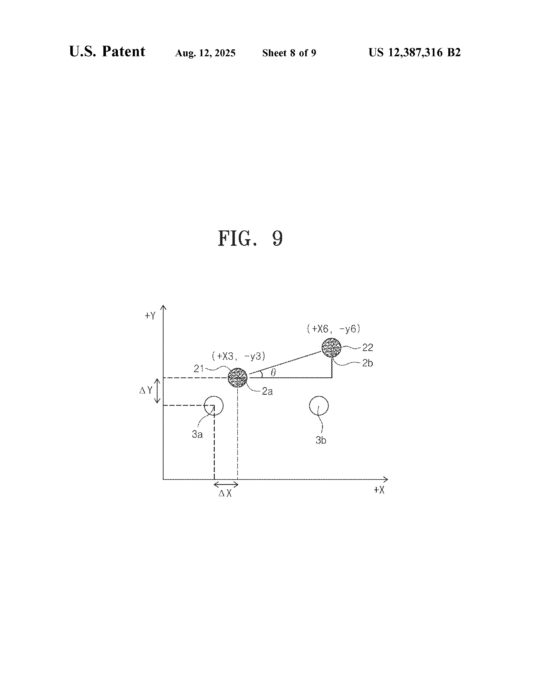
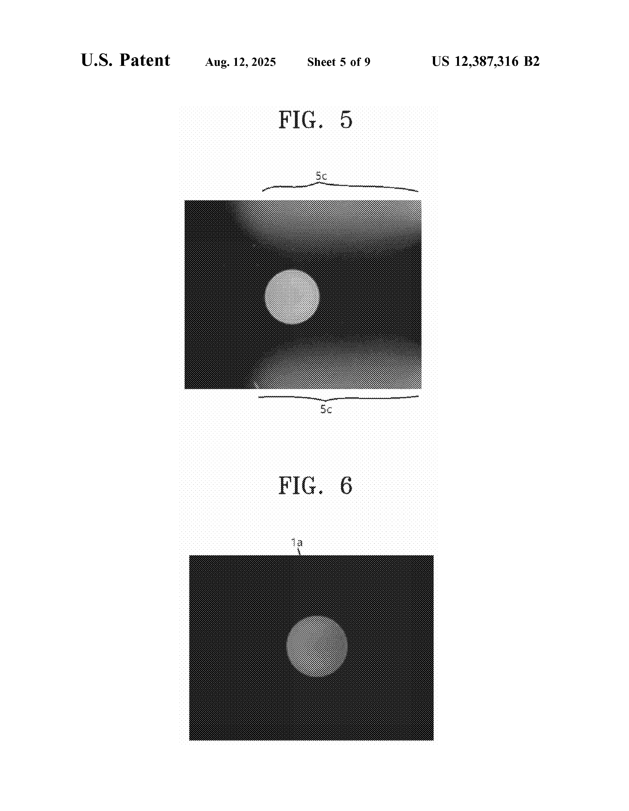

# US12387316B2 — 반도체 제조 설비 및 그 티칭 방법 (SEMES)

| 항목 | 내용 |
|---|---|
| 원문 | `US12387316.pdf`(등록, 2025-08-12, 12 청구항, 도면 9장) · `US20230206426.pdf`(공개 US2023/0206426 A1, 2023-06-29) |
| 출원인 | SEMES CO., LTD. (발명자 Seung Won Kim 외), 출원 2022-12-27 |
| 우선일 | 2021-12-27 (KR10-2021-0189018), 2022-09-20 (KR10-2022-0118539) |
| 핵심 | 핸드에 단 티칭 타깃의 서로 떨어진 두 기준점(홈)을 아래의 카메라 2대로 각각 찍어 중심 좌표를 구하고, 하나의 통합 좌표계에서 이동값(Δx, Δy)과 두 중심을 잇는 선의 회전 각도(θ)를 구해 엔드 이펙터를 티칭한다. 흰색 CFRP 직물면 커버와 양쪽 면조명으로 부분 백화를 막는다. |
| 관련도 | ○ 원인(회전·평행이동 분리, 신호 품질)을 다룸 |
| 본 과제와의 관계 | 본 과제의 기업(SEMES) 자체 특허. 기준점 하나로는 회전을 알 수 없다는 문제를 "멀리 떨어진 두 점 = 기준선"으로 풀어 회전과 평행이동을 분리한다(P2·P1). 백화 방지는 P3(신호 품질). 다만 각도·이동값 계산식은 글로 된 정의뿐이고 수식은 없다. |
| 링크 | [Google Patents](https://patents.google.com/patent/US12387316B2/en) |

---

## 상세 요약 (번역본 기준)

### 1. 해결하려는 문제
- 이송 장치(다자유도 로봇 등)는 라인 첫 설치, 암·핸드 교체, 충격 발생 시 최종 이송 위치 기준점을 다시 티칭해야 함.
- 종래 티칭: 핸드에 웨이퍼·마스크 모양 티칭 타깃을 달고, 구멍·홈 **하나**의 중심을 비전으로 읽어 X·Y·Z 거리만 보정 → **티칭 타깃이 얼마나 회전했는지 인식 불가**.
- 종래 조명: 그림자를 없애려 타깃 주위에 조명을 두고 반사를 줄이려 검은 판을 설치 → 검은 판이 빛을 고르게 흡수하지 못해 기준점 부근 특정 영역만 밝아지는 **부분 백화(5c)** 발생 → 중심점 좌표를 정확히 못 읽음.

### 2. 핵심 구성
| 구성 | 부호 | 위치·역할 |
|---|---|---|
| 이송 장치 | 10 | 다축 로봇 또는 리니어 모터 2축·3축 로봇, 엔드 이펙터에 티칭 타깃 장착(실시예는 마스크 이송) |
| 티칭 타깃 | 20 | 웨이퍼·마스크 모양 지그. 넓은 한 면에 **서로 떨어진** 오목 홈 2개(구멍·돌기·인쇄 패턴도 가능) |
| 제1·제2 티칭 기준점 | 21, 22 | 두 기준점. 두 점을 잇는 선이 각도 기준선 |
| 제1·제2 조명부 | 31, 32 | 면조명(LED 기판 + 도광판·반사 필름·확산 커버), 기판 프레임 중심 기준으로 소정 거리 떨어져 양쪽 배치 |
| 제1·제2 카메라 | 33, 34 | CMOS, 각각 기준점 21·22를 촬영. 두 조명부 사이, 프레임 중심점 기준 서로 반대편 |
| 카메라 기판 모듈 | 35 | 아날로그 영상 → 디지털 → 제1·제2 기준점 영상 정보(1a, 1b) |
| 기판 프레임부 / 커버부 | 36 / 37 | 커버는 흰색 CFRP 직물면, 카메라 구멍 37a·37b, 조명 구멍 37c·37d. 반사광을 재산란해 휘도 균일 |
| 티칭 구동부 | 38 | 티칭 중 기판 프레임부 위치 조정(다자유도 로봇·리니어 액추에이터) |
| 티칭 제어부 | 39 | 중심 좌표 2a·2b 계산, 통합 좌표계에서 Δx·Δy·θ 계산, 티칭 |

- 좌표 정의(본문 그대로)
  - 제1·제2 기준점 **절대 좌표(3a, 3b)**: 카메라 33·34 위치를 고정했을 때 **각 카메라의 촬영 중심점**을 기준으로 티칭 제어부에 미리 설정한 기준 절대 좌표값.
  - 제1·제2 기준점 **중심 좌표(2a, 2b)**: 영상 1a·1b의 화소값을 분석해 얻은 기준점 21·22의 중심 좌표.
- **영상 좌표 변환(S30, 도 7·8)**: 본문은 "영상 1a의 화소값을 분석해 2a를 좌표로 변환, 영상 1b의 화소값을 분석해 2b를 좌표로 변환"이라고만 함. 도면 표기: 영상 가로 눈금 1280 · 640 · 1280, 세로 512에서 교차하는 십자선 교점 = 촬영 중심 = 절대 좌표(3a/3b). 도 7의 2a = (−X3, +y3), 도 8의 2b = (+X4, +y6).
- **좌표계 통합(S40, 도 9)**: 1a와 1b를 **겹쳐** 하나의 통합 좌표계에 놓음(두 카메라 사이 실제 간격이나 화소–mm 환산 방법은 기재 없음). 도 9의 표기: 2a = (+X3, −y3), 2b = (+X6, −y6) — 도 7·8과 부호·첨자가 다름(원문 그대로).
- **티칭값(S50)**, 본문 정의 그대로:
  - 이동값(Δx, Δy) = 중심 좌표 2a·2b가 절대 좌표 3a·3b로부터 X축·Y축으로 이동한 양. 도 9에서는 ΔX, ΔY를 3a → 2a 사이 간격으로 표시.
  - 각도값(θ) = "2a와 2b를 잇는 선"이 "3a와 3b를 잇는 선"에 대해 회전한 양(Z축 기준 회전). 도 9에서는 2a–2b 선과 2a를 지나는 수평선 사이 각으로 표시.
  - 명시적 수식은 원문에 없음. 정의를 식으로 옮기면(본 조사의 해석): Δx = x(2a) − x(3a), Δy = y(2a) − y(3a); θ = atan2(y(2b) − y(2a), x(2b) − x(2a)) − atan2(y(3b) − y(3a), x(3b) − x(3a)).

### 3. 동작 순서 (도 10)
1. S10 티칭 검사부 배치: 티칭 타깃이 달린 이송 장치에 대해 카메라 33·34 배치(요약부는 "아래", 상세 설명은 "위"로 기재). 조명 31·32가 각 기준점 주위를 비추고 CFRP 커버가 반사 기능.
2. S20 영상 획득: 카메라 33 → 기준점 21 → 영상 1a, 카메라 34 → 기준점 22(본문은 "21"로 오기) → 영상 1b.
3. S30 영상 좌표 변환: 화소값 분석으로 2a, 2b 좌표화.
4. S40 좌표계 통합: 2a, 2b를 하나의 좌표계로 출력·통합.
5. S50 티칭값 분석: 이동값(Δx, Δy), 각도값(θ) 계산.
6. S60 티칭: Δx, Δy, θ를 이송 장치로 보내 엔드 이펙터 기준 위치 보정.

### 4. 청구항 요지
- 청구항 1(독립): 두 티칭 기준점이 있는 티칭 타깃 + 이송 장치 + 두 기준점 중심 좌표를 구해 **두 중심을 잇는 선의 각도값**으로 티칭하는 티칭 검사부.
- 청구항 2: 조명 2개·카메라 2개·카메라 기판 모듈·티칭 제어부. 각도 = 절대 좌표 연결선과 중심 좌표 연결선 사이 각.
- 청구항 3: 두 영상을 겹쳐 하나의 통합 좌표계로 → X·Y 이동값 계산·티칭.
- 청구항 4~7: 기판 프레임부·커버부(카메라·조명 구멍), CFRP(5), 직조·적층 직물면(6), 흰색(7).
- 청구항 8~10: 면조명(8), 카메라를 두 조명 사이에(9), 프레임 중심점 기준 서로 마주보게(10).
- 청구항 11: 티칭 타깃은 웨이퍼·마스크 모양.
- 청구항 12(독립): 청구항 1·2·4·6·7·8·9를 합친 형태(면광원, 조명 사이 카메라, 흰색 CFRP 직물면 커버, 각도 티칭).

### 5. 대표 도면

*도 9 — 통합 좌표계: 절대 좌표 3a·3b에 대한 중심 좌표 2a·2b의 이동값 ΔX·ΔY와 회전 각도 θ*

*도 5 — 검은 커버에서 생긴 부분 백화(5c), 도 6 — 흰색 CFRP 커버 적용 후 영상*

### 6. 본 과제(Y·Θ 얼라인먼트)와 비교
- 본 과제와의 관계: **SEMES 자체 특허**로, 본 과제를 낸 기업이 이미 "기준점 하나로는 회전을 알 수 없다 → 떨어진 두 점으로 각도를 구한다"는 방식을 권리화해 두었다. 우리 결과물은 이 특허의 연장선(카메라 1대, 실시간, Y·Θ 분리 난점까지 다룸)으로 설명할 수 있고, 같은 회사 장비의 티칭 체계와 용어(티칭 타깃, 절대 좌표, 이동값·각도값)를 맞추면 전달이 쉽다.
- 같은 점:
  - 로봇(엔드 이펙터)에 달린 기준 표식을 카메라로 찍어 평행이동과 회전 보정값을 함께 만든다.
  - 기준(절대) 위치를 미리 정해 두고 측정 위치와의 차이를 보정값으로 쓴다.
  - 보정 각도는 평면 내 회전(Z축 기준) 하나.
- 다른 점:
  - 카메라가 고정(아래·위)이고 타깃이 로봇에 달림. 우리는 카메라가 로봇에 달리고 QR 판이 고정.
  - 카메라 2대가 두 기준점을 **각각 확대 촬영**해 두 점 간격(기준선)이 시야보다 훨씬 김. 우리는 카메라 1대·좁은 시야로 QR 3개를 한 영상에 담음.
  - 판을 위에서 내려다보는 평면 내 회전이라, 회전이 두 점의 **상대 위치 변화**로 바로 드러남. 우리의 T(PAN)는 정면 평면을 보는 축 회전이라 영상에서 주로 가로 이동으로 보여 Y와 섞임 — 이 특허에는 이 문제(P1)가 생기지 않는 기하.
  - 회전 중심·축 위치, 화소–mm 환산, 두 카메라 좌표 통합 방법, 백래시 처리는 기재가 없음(P4, P5 미해결).
  - 각도·이동값 계산식은 글로 된 정의뿐(정확도 수치 없음), 오프라인 티칭용.
- 해결하는 P#:
  - **P2(관측 가능성)**: 떨어진 두 점의 연결선 각도는 공통 평행이동에 영향을 받지 않음 → 이동(Δx, Δy)과 회전(θ)이 분리된 관측량이 됨. 두 점 간격(기선)이 길수록 같은 위치 잡음에 대한 각도 오차가 작아짐(각도 오차 ≈ 위치 오차 / 기선 길이).
  - **P1(기하학적 동치) 보완**: 점 하나로는 회전과 이동이 하나의 숫자로 합쳐지는 문제를 두 번째 점으로 풀어냄. 다만 우리 PAN 회전처럼 "회전이 두 점을 같은 방향으로 거의 똑같이 미는" 기하에서는 연결선 각도 변화가 매우 작아 그대로는 해결되지 않음.
  - **P3(신호 대 잡음)**: 부분 백화(포화)를 흰색 CFRP 직물면 + 양쪽 면조명으로 막아 중심점 좌표 편차를 최소화 — 점 잡음 자체를 줄이는 하드웨어 대책.
- 본 과제에서 할 일:
  - 우리 영상에서 Θ 단서로 쓰는 점 쌍(QR 3개 사이, QR–뒷벽 가로선)의 **기선 길이와 방향**을 정리하고, 각 쌍의 연결선 각도·간격이 T와 Y에 대해 어떻게 달라지는지 감도로 계산해 이 특허식 "두 점 각도"가 우리 기하에서 얼마나 쓸모 있는지(조건수 개선 정도) 확인한다.
  - QR 판 조명·노출을 점검해 코너·중심 검출 영역에 포화(백화)가 없는지 확인한다(P3). 포화 화소 비율을 검출 품질 지표로 넣는다.
  - 보고서에서 이 특허를 "SEMES 기존 방식(두 점 각도 티칭)"으로 소개하고, 카메라 1대·정면 평면·PAN 회전에서는 Y·T가 섞이는 이유와 우리 보완(깊이가 다른 뒷벽 가로선 추가)을 대비해 설명한다.
- 참고할 점:
  - 절대 좌표 = 카메라 촬영 중심(영상 중앙 640, 512)으로 두고 차이를 보정값으로 쓰는 단순한 구조 — 우리도 기준 자세의 QR 좌표를 "절대 좌표"로 저장해 차이로 보정값을 구하는 틀과 같음.
  - 두 영상을 하나의 통합 좌표계로 겹치는 단계(S40) — 다중 관측(QR·뒷벽선)을 한 좌표계로 묶는 설계 참고.
