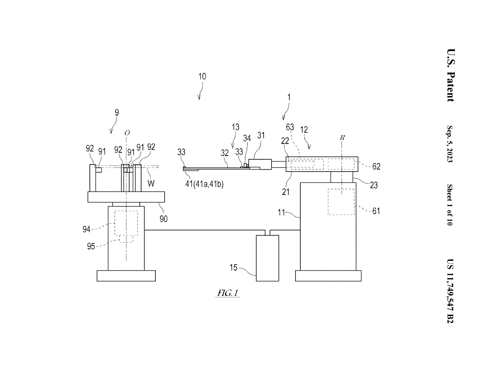
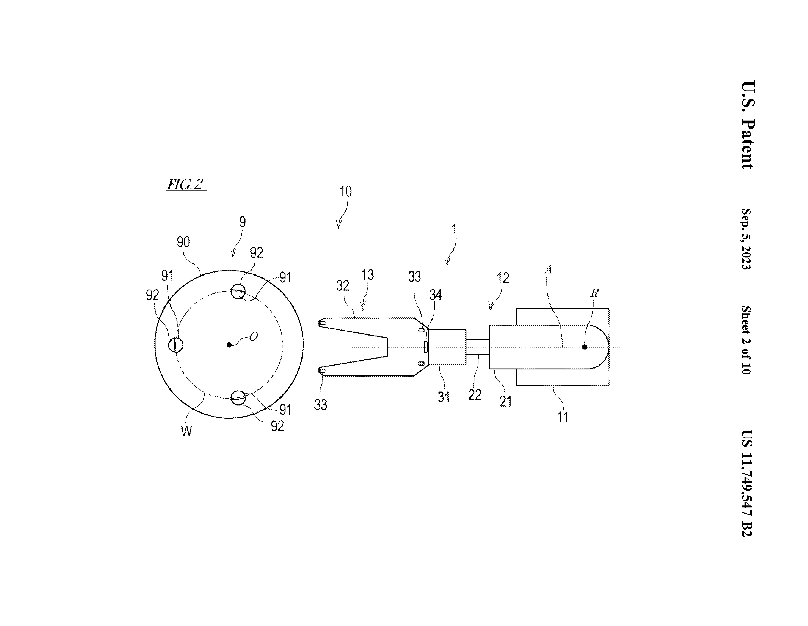
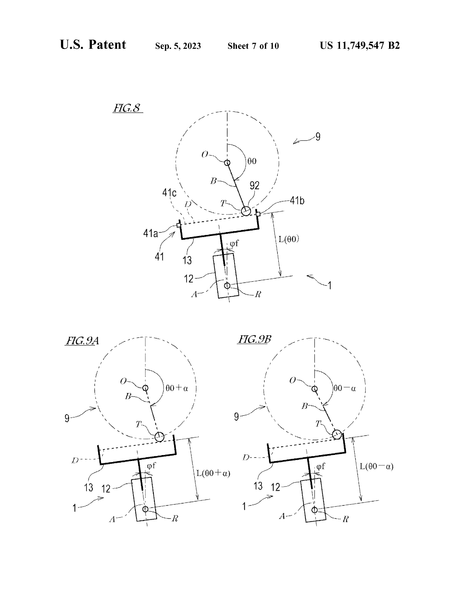
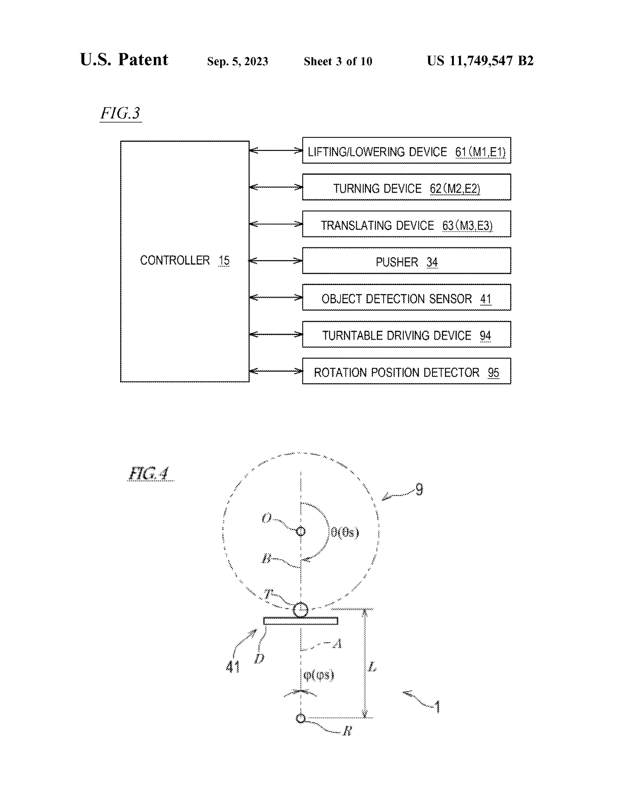
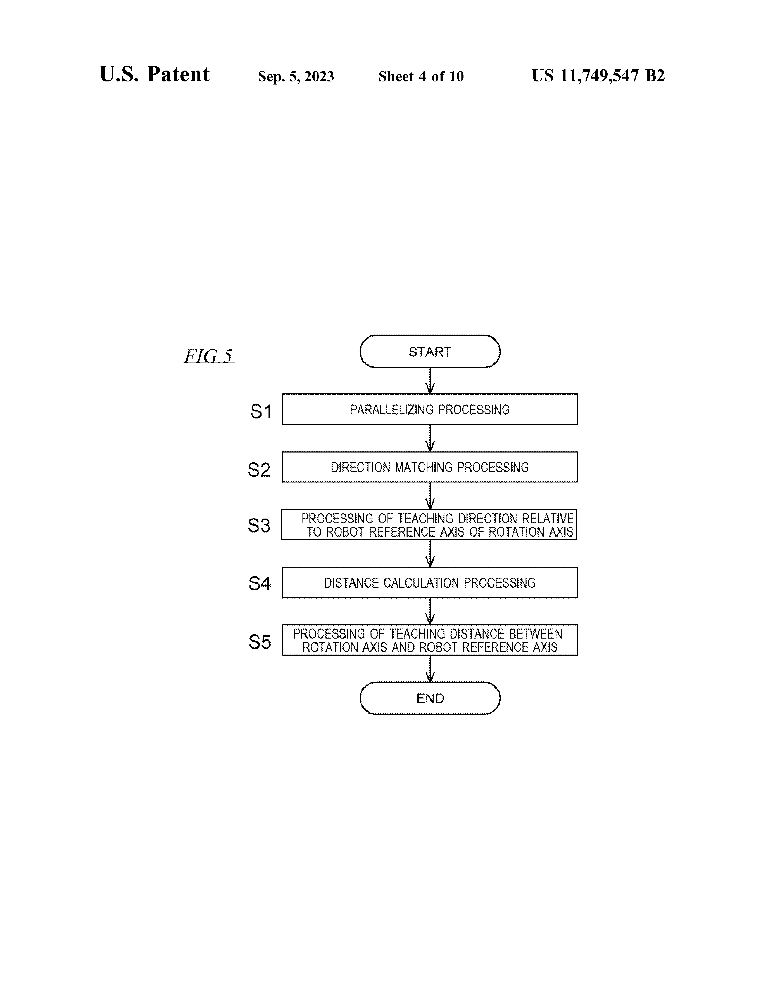
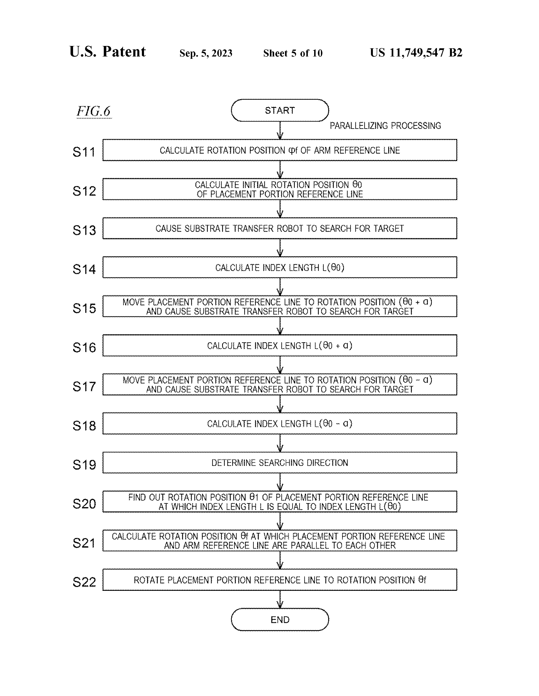
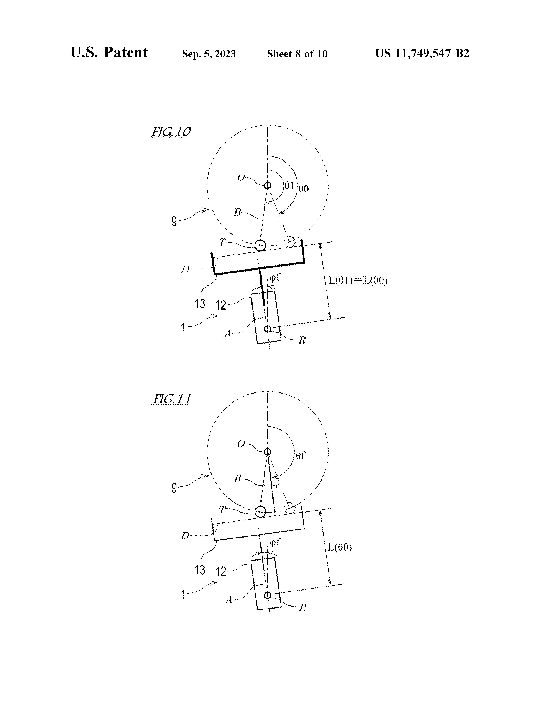
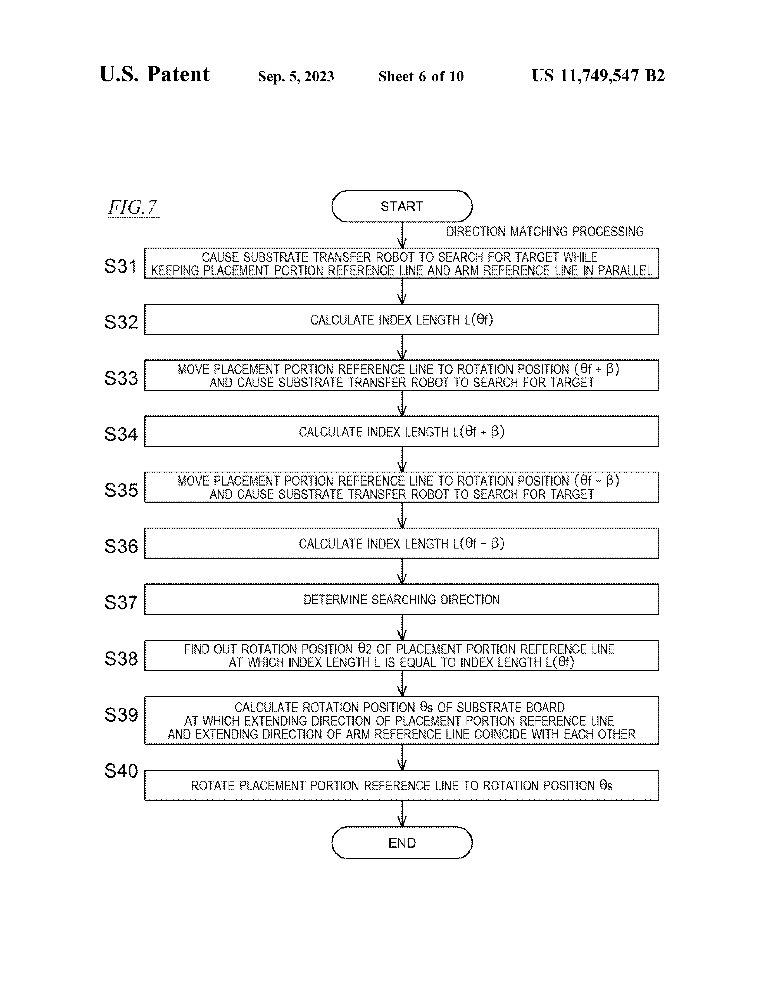
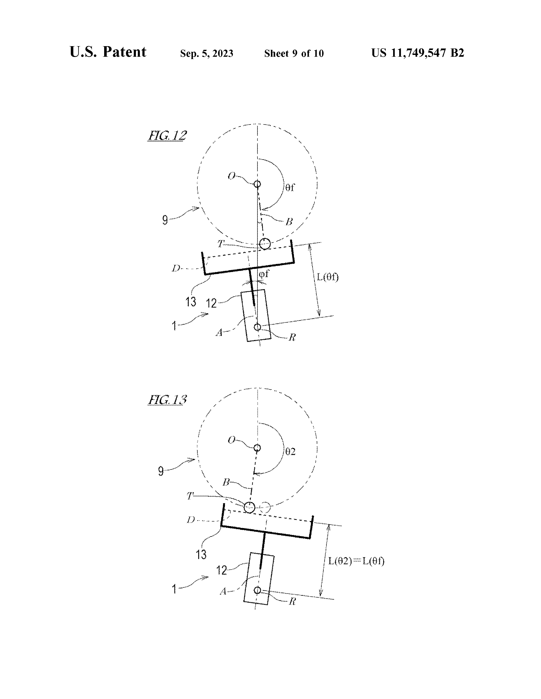
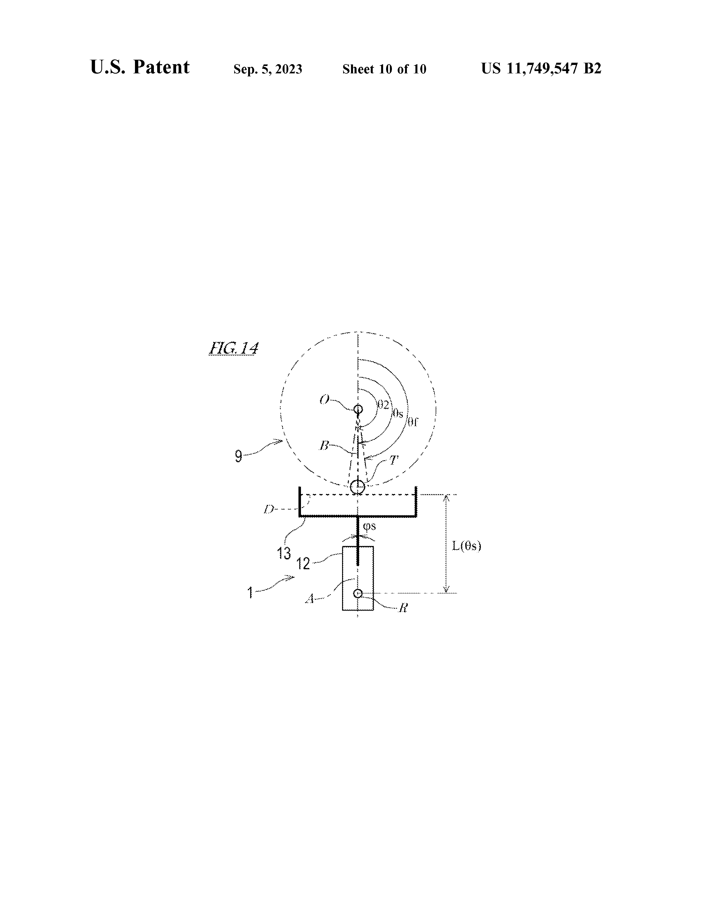

# 기판 이송 장치 및 기판 재치부 회전축 탐색 방법 (US11749547B2)
- 원제: Substrate transfer apparatus and substrate placement portion rotation axis searching method
- 원문: 같은 폴더의 PDF, https://patents.google.com/patent/US11749547B2/en
- 번역 기준: USPTO 등록본 PDF 스캔을 직접 판독한 원문을 한국어로 옮김. 원문의 오기(예: cps, Os, 74 s, rotation position y, reference tine, replacement portion, step S1)는 고치지 않고 그대로 둠.
- 도면: 원문 PDF 도면 시트 10장을 도면/ 폴더에 넣고 본문에서 처음 언급되는 곳에 삽입함

## 요약

기판 재치부에 마련된 타깃을 기판 재치부의 복수의 회전 위치에서 물체 검출 센서로 검출한다. 축 방향에 수직인 방향에서 로봇 기준축으로부터 타깃까지의 거리인 인덱스 길이, 또는 그와 상관된 정보를 산출한다. 산출된 인덱스 길이 또는 산출된 그와 상관된 정보를 바탕으로, 로봇 기준축과 회전축을 잇는 선 위에 위치한 타깃이 검출될 때의, 로봇 기준축을 중심으로 한 검출선의 회전 위치와 회전축을 중심으로 한 기판 재치부의 회전 위치 중 적어도 하나를 산출한다. 산출된 회전 위치를 바탕으로, 로봇 기준축에서 보았을 때 회전축이 존재하는 방향을 특정한다.

## 청구범위

청구하는 발명은 다음과 같다.

1. 로봇 기준축이 마련된 기판 이송 로봇으로서, 검출선을 가로막는 타깃을 검출하는 물체 검출 센서와, 상기 로봇 기준축의 축 방향에 수직인 평면 안에서 상기 물체 검출 센서를 이동시키는 로봇 암을 가지는 기판 이송 로봇을 사용하여, 회전축을 중심으로 회전하도록 구성된 기판 재치부의 상기 회전축 — 상기 회전축은 상기 축 방향에 평행하게 연장됨 — 을 탐색하는 기판 재치부 회전축 탐색 방법으로서, 다음 단계들을 포함하는 방법:

상기 기판 재치부의 복수의 회전 위치에서 상기 기판 재치부에 마련된 상기 타깃을 상기 물체 검출 센서로 검출하고, 상기 축 방향에 수직인 방향에서 상기 로봇 기준축으로부터 상기 타깃까지의 거리인 인덱스 길이 또는 그와 상관된 정보를 산출하는 단계;

산출된 상기 인덱스 길이 또는 산출된 그와 상관된 정보를 바탕으로, 상기 로봇 기준축과 상기 회전축을 잇는 선 위에 위치한 상기 타깃이 검출될 때의, 상기 로봇 기준축을 중심으로 한 상기 검출선의 회전 위치와 상기 회전축을 중심으로 한 상기 기판 재치부의 회전 위치 중 적어도 하나를 산출하는 단계; 및

산출된 상기 회전 위치를 바탕으로, 상기 로봇 기준축에서 보았을 때 상기 회전축이 존재하는 방향을 특정하는 단계를 포함하고,

상기 축 방향에 수직이고 상기 물체 검출 센서가 연결된 상기 로봇 암의 선단과 상기 로봇 기준축을 지나는 선을 암 기준선으로 정의하고, 상기 축 방향에 수직이고 상기 회전축과 상기 타깃을 지나는 선을 재치부 기준 tine으로 정의한다. 상기 방법은 다음 단계들을 더 포함한다:

상기 재치부 기준선과 상기 암 기준선이 서로 평행해지는, 상기 회전축을 중심으로 한 상기 재치부 기준선의 제1 교체부(replacement portion, 원문 그대로) 회전 위치와 상기 로봇 기준축을 중심으로 한 상기 암 기준선의 제1 암 회전 위치를 산출하는 단계;

상기 제1 재치부 회전 위치에 있는 상기 재치부 기준선과 상기 제1 암 회전 위치에 있는 상기 암 기준선을 같은 방향으로 같은 회전 각도만큼 회전시킴으로써, 상기 재치부 기준선이 뻗는 방향과 상기 암 기준선이 뻗는 방향이 서로 일치하는 상기 재치부 기준선의 제2 재치부 회전 위치와 상기 암 기준선의 제2 암 회전 위치를 산출하는 단계;

상기 재치부 기준선을 상기 제1 재치부 회전 위치로 이동시키고 상기 암 기준선을 상기 제1 암 회전 위치로 이동시키는 단계; 및

상기 재치부 기준선을 상기 제1 재치부 회전 위치에서 상기 제2 재치부 회전 위치로 이동시키고 상기 암 기준선을 상기 제1 암 회전 위치에서 상기 제2 암 회전 위치로 이동시키는 단계.

2. 제1항에 있어서, 상기 로봇 기준축과 상기 회전축을 잇는 선 위에 위치한 상기 타깃이 검출될 때의 상기 인덱스 길이와, 상기 회전축에서 상기 타깃까지의 이미 알고 있는 거리를 바탕으로, 상기 로봇 기준축에서 상기 회전축까지의 거리를 산출하는 단계를 더 포함하는 기판 재치부 회전축 탐색 방법.

3. 제1항에 있어서, 상기 제1 재치부 회전 위치를 산출하는 단계는, 상기 암 기준선을 상기 제1 암 회전 위치에 유지한 채 상기 인덱스 길이가 같아지는 상기 재치부 기준선의 두 회전 위치를 탐색하고, 상기 두 회전 위치 사이의 중앙 회전 위치를 상기 제1 재치부 회전 위치로 설정하는 것을 포함하는 기판 재치부 회전축 탐색 방법.

4. 제1항에 있어서, 상기 제1 재치부 회전 위치를 산출하는 단계는, 상기 암 기준선을 상기 제1 암 회전 위치에 유지한 채 상기 인덱스 길이가 최소가 되는 상기 재치부 기준선의 회전 위치를 탐색하고, 
그 회전 위치를 상기 제1 재치부 회전 위치로 설정하는 것을 포함하는 기판 재치부 회전축 탐색 방법.

5. 제1항에 있어서, 상기 제2 재치부 회전 위치를 산출하는 단계는, 상기 제1 암 회전 위치에 있는 상기 암 기준선을 상기 로봇 기준축을 중심으로, 그리고 상기 제1 재치부 회전 위치에 있는 상기 기판 재치부를 상기 회전축을 중심으로 같은 회전 방향으로 같은 회전 각도만큼 회전시켜 상기 인덱스 길이가 같아지는 두 회전 위치를 탐색하고, 상기 두 회전 위치 사이의 중앙 회전 위치를 상기 제2 재치부 회전 위치로 설정하는 것을 포함하는 기판 재치부 회전축 탐색 방법.

6. 제1항에 있어서, 상기 제2 재치부 회전 위치를 산출하는 단계는, 상기 제1 암 회전 위치에 있는 상기 암 기준선을 상기 로봇 기준축을 중심으로, 그리고 상기 제1 재치부 회전 위치에 있는 상기 기판 재치부를 상기 회전축을 중심으로 같은 회전 방향으로 같은 회전 각도만큼 회전시켜 상기 인덱스 길이가 최대가 되는 회전 위치를 탐색하고, 그 회전 위치를 상기 제2 재치부 회전 위치로 설정하는 것을 포함하는 기판 재치부 회전축 탐색 방법.

7. 제1항에 있어서, 상기 암 기준선은 상기 검출선이 마련된 상기 로봇 암의 선단과 상기 로봇 기준축을 잇는 기판 재치부 회전축 탐색 방법.

8. 기판 이송 장치로서,

로봇 기준축이 마련되고, 검출선을 가로막는 타깃을 검출하는 물체 검출 센서와, 상기 로봇 기준축의 축 방향에 수직인 평면 안에서 상기 물체 검출 센서를 이동시키는 로봇 암을 가지는 기판 이송 로봇;

상기 물체 검출 센서에 의해 검출될 상기 타깃을 가지며, 상기 축 방향에 평행하게 연장되는 회전축을 중심으로 회전하도록 구성된 기판 재치부; 및

상기 기판 이송 로봇과 상기 기판 재치부의 동작을 제어하도록 구성된 제어기를 포함하고,

상기 제어기는,

상기 기판 재치부의 복수의 회전 위치에서 상기 물체 검출 센서로 상기 타깃을 검출하고, 상기 축 방향에 수직인 방향에서 상기 로봇 기준축으로부터 상기 타깃까지의 거리인 인덱스 길이 또는 그와 상관된 정보를 산출하며,

산출된 상기 인덱스 길이 또는 산출된 그와 상관된 정보를 바탕으로, 상기 로봇 기준축과 상기 회전축을 잇는 선 위에 위치한 상기 타깃이 검출될 때의, 상기 로봇 기준축을 중심으로 한 상기 검출선의 회전 위치와 상기 회전축을 중심으로 한 상기 기판 재치부의 회전 위치 중 적어도 하나를 산출하고,

산출된 상기 회전 위치를 바탕으로, 상기 로봇 기준축에서 보았을 때 상기 회전축이 존재하는 방향을 특정하며,

상기 축 방향에 수직이고 상기 물체 검출 센서가 연결된 상기 로봇 암의 선단과 상기 로봇 기준축을 지나는 선을 암 기준선으로 정의하고, 상기 축 방향에 수직이고 상기 회전축과 상기 타깃을 지나는 선을 재치부 기준선으로 정의하며,

상기 제어기는,

상기 재치부 기준선과 상기 암 기준선이 서로 평행해지는, 상기 회전축을 중심으로 한 상기 재치부 기준선의 제1 재치부 회전 위치와 상기 로봇 기준축을 중심으로 한 상기 암 기준선의 제1 암 회전 위치를 산출하고;

상기 제1 재치부 회전 위치에 있는 상기 재치부 기준선과 상기 제1 암 회전 위치에 있는 상기 암 기준선을 같은 방향으로 같은 회전 각도만큼 회전시킴으로써, 상기 재치부 기준선이 뻗는 방향과 상기 암 기준선이 뻗는 방향이 서로 일치하는, 상기 암 기준선 기준선의 제2 재치부 회전 위치와 상기 암 기준선의 제2 암 회전 위치를 산출하며,

상기 재치부 기준선을 상기 제1 재치부 온(on) 회전 위치로 이동시키고 상기 암 기준선을 상기 제1 암 회전 위치로 이동시키고,

상기 재치부 기준선을 상기 제1 재치부 회전 위치에서 상기 제2 재치부 회전 위치로 이동시키고 상기 암 기준선을 상기 제1 암 회전 위치에서 상기 제2 암 회전 위치로 이동시키며,

상기 암 기준선이 상기 제2 암 회전 위치에 있을 때의 상기 로봇 암의 관절의 회전 위치를 저장하는, 기판 이송 장치.

9. 제8항에 있어서, 상기 제어기는 상기 로봇 기준축과 상기 회전축을 잇는 선 위에 위치한 상기 타깃이 검출될 때의 상기 인덱스 길이와, 상기 회전축에서 상기 타깃까지의 이미 알고 있는 거리를 바탕으로, 상기 로봇 기준축에서 상기 회전축까지의 거리를 산출하는 기판 이송 장치.

10. 제8항에 있어서, 상기 제어기는 상기 암 기준선을 상기 제1 암 회전 위치에 유지한 채 상기 인덱스 길이가 같아지는 상기 재치부 기준선의 두 회전 위치를 탐색하도록 상기 기판 이송 로봇과 상기 기판 재치부를 작동시키고, 상기 두 회전 위치 사이의 중앙 회전 위치를 상기 제1 재치부 회전 위치로 설정하는 기판 이송 장치.

11. 제8항에 있어서, 상기 제어기는 상기 암 기준선을 상기 제1 암 회전 위치에 유지한 채 상기 인덱스 길이가 최소가 되는 상기 재치부 기준선의 회전 위치를 탐색하도록 상기 기판 이송 로봇과 상기 기판 재치부를 작동시키고, 그 회전 위치를 상기 제1 재치부 회전 위치로 설정하는 기판 이송 장치.

12. 제8항에 있어서, 상기 제어기는 상기 제1 암 회전 위치에 있는 상기 암 기준선을 
상기 로봇 기준축을 중심으로, 그리고 상기 제1 재치부 회전 위치에 있는 상기 기판 재치부를 상기 회전축을 중심으로 같은 회전 방향으로 같은 회전 각도만큼 회전시켜 상기 인덱스 길이가 같아지는 두 회전 위치를 탐색하도록 상기 기판 이송 로봇과 상기 기판 재치부를 작동시키고, 상기 두 회전 위치 사이의 중앙 회전 위치를 상기 제2 재치부 회전 위치로 설정하는 기판 이송 장치.

13. 제8항에 있어서, 상기 제어기는 상기 제1 암 회전 위치에 있는 상기 암 기준선을 상기 로봇 기준축을 중심으로, 그리고 상기 제1 재치부 회전 위치에 있는 상기 기판 재치부를 상기 회전축을 중심으로 같은 회전 방향으로 같은 회전 각도만큼 회전시켜 상기 인덱스 길이가 최대가 되는 회전 위치를 탐색하도록 상기 기판 이송 로봇과 상기 기판 재치부를 작동시키고, 그 회전 위치를 상기 제2 재치부 회전 위치로 설정하는 기판 이송 장치.

14. 기판 이송 장치로서,

로봇 기준축이 마련되고, 검출선을 가로막는 타깃을 검출하는 물체 검출 센서와, 상기 로봇 기준축의 축 방향에 수직인 평면 안에서 상기 물체 검출 센서를 이동시키는 로봇 암을 가지는 기판 이송 로봇;

상기 물체 검출 센서에 의해 검출될 상기 타깃을 가지며, 상기 축 방향에 평행하게 연장되는 회전축을 중심으로 회전하도록 구성된 기판 재치부; 및

상기 기판 이송 로봇과 상기 기판 재치부의 동작을 제어하도록 구성된 제어기를 포함하고,

상기 제어기는,

상기 기판 재치부의 복수의 회전 위치에서 상기 물체 검출 센서로 상기 타깃을 검출하고, 상기 축 방향에 수직인 방향에서 상기 로봇 기준축으로부터 상기 타깃까지의 거리인 인덱스 길이 또는 그와 상관된 정보를 산출하며,

산출된 상기 인덱스 길이 또는 산출된 그와 상관된 정보를 바탕으로, 상기 로봇 기준축과 상기 회전축을 잇는 선 위에 위치한 상기 타깃이 검출될 때의, 상기 로봇 기준축을 중심으로 한 상기 검출선의 회전 위치와 상기 회전축을 중심으로 한 상기 기판 재치부의 회전 위치 중 적어도 하나를 산출하고,

산출된 상기 회전 위치를 바탕으로, 상기 로봇 기준축에서 보았을 때 상기 회전축이 존재하는 방향을 특정하며,

상기 축 방향에 수직이고 상기 물체 검출 센서가 연결된 상기 로봇 암의 선단과 상기 로봇 기준축을 지나는 선을 암 기준선으로 정의하고, 상기 축 방향에 수직이고 상기 회전축과 상기 타깃을 지나는 선을 재치부 기준선으로 정의하며,

상기 제어기는,

상기 재치부 기준선과 상기 암 기준선이 서로 평행해지는, 상기 회전축을 중심으로 한 상기 재치부 기준선의 제1 재치부 회전 위치와 상기 로봇 기준축을 중심으로 한 상기 암 기준선의 제1 암 회전 위치를 산출하고,

상기 제1 재치부 회전 위치에 있는 상기 재치부 기준선과 상기 제1 암 회전 위치에 있는 상기 암 기준선을 같은 방향으로 같은 회전 각도만큼 회전시킴으로써, 상기 재치부 기준선이 뻗는 방향과 상기 암 기준선이 뻗는 방향이 서로 일치하는 상기 재치부 기준선의 제2 재치부 회전 위치와 상기 암 기준선의 제2 암 회전 위치를 산출하며,

상기 제1 암 회전 위치에 있는 상기 암 기준선을 상기 로봇 기준축을 중심으로, 그리고 상기 제1 재치부 회전 위치에 있는 상기 기판 재치부를 상기 회전축을 중심으로 같은 회전 방향으로 같은 회전 각도만큼 회전시켜 상기 인덱스 길이가 같아지는 두 회전 위치를 탐색하도록 상기 기판 이송 로봇과 상기 기판 재치부를 작동시키고, 상기 두 회전 위치 사이의 중앙 회전 위치를 상기 제2 재치부 회전 위치로 설정하는, 기판 이송 장치.

## 상세한 설명

### 기술 분야 (TECHNICAL FIELD)

본 발명은 반도체 기판이나 유리 기판과 같은 기판을 이송하는 기술에 관한 것이다.

### 배경 기술 (BACKGROUND ART)

종래 반도체 공정에서는, 복수의 반도체 기판에 대한 처리를 일괄로 수행하기 위해, 복수의 반도체 기판을 정렬된 상태로 재치할 수 있는 기판 재치부가 사용된다. 일반적으로 이러한 기판 재치부는 서로 떨어진 한 쌍의 판 부재와, 한 쌍의 판 부재 사이에 걸쳐 연장된 복수의 지지 기둥을 포함한다. 각 지지 기둥은 지지 기둥의 축 방향으로 일정한 피치로 마련된 복수의 지지 홈을 가진다. 기판의 주연부가 지지 홈에 끼워짐으로써 기판이 지지 기둥에 지지된다.

상술한 기판 재치부에 대해 기판을 반입·반출하는 데에는 기판 이송 로봇이 사용된다. 일반적으로 기판 이송 로봇은 로봇 암, 로봇 암의 끝에 장착된 기판 이송 핸드, 및 제어기를 포함한다. 기판 이송 핸드는 기판을 유지하는 기판 유지부를 가지며, 기판은 예를 들어 흡착되거나 파지됨으로써 유지될 수 있다. PTL 1은 끝이 Y자로 갈라진 판 형상의 블레이드를 가지고 블레이드 위에 재치된 기판을 이송하는 기판 이송 핸드를 예시한다.

PTL 1에 기재된 기판 이송 로봇에서는, 기판 이송 핸드의 갈라진 양 끝 중 한쪽에 발광부가 장착되고, 다른 쪽 끝에는 발광부와 마주하도록 수광부가 장착된다. 발광부와 수광부는 투과형 광 센서를 이루며, 투과형 광 센서는 광축을 가로막는 물체를 검출할 수 있다. 기판 처리 장치의 전면 외벽에 장착된 외부 티칭 지그를 투과형 광 센서로 검출함으로써, 기판 처리 장치 내부의 이미 알고 있는 티칭 위치의 중심과 외부 티칭 위치의 중심 사이의 상대 위치 관계를 이용하여, 기판 이송 장치와 티칭 위치의 중심 사이의 상대 위치 관계를 추정한다.

### 인용 목록 (CITATION LIST)

#### 특허 문헌 (Patent Literature)

PTL 1: 일본 공개특허공보 2005-310858호

### 발명의 개요 (SUMMARY OF INVENTION)

#### 기술적 과제 (Technical Problem)

일부 기판 재치부는 턴테이블 위에 놓여 고정되고 턴테이블과 일체로 회전하도록 구성된다. 이러한 기판 재치부에는 기판 재치부의 회전축과 기판의 중심이 서로 일치하도록 기판이 재치된다. 따라서 작업자는 기판 이송 로봇과 기판 재치부를 눈으로 확인하면서 티칭 펜던트를 조작하여, 기판 재치부의 회전축과 기판의 중심이 일치하도록 기판 이송 로봇에 기판 재치 위치를 티칭한다. 그러나 이러한 티칭 작업은 매우 번거로운 작업이므로, 기판 재치부 위의 재치 위치를 기판 이송 로봇에 자동으로, 그리고 정밀하게 티칭하는 기술이 요구된다.

기판은 미리 정해진 원형이므로, 기판 재치부의 회전축 위치를 바탕으로 기판 재치 위치 위의 기판 재치 위치를 쉽게 도출할 수 있다. 따라서 본 발명의 목적은 기판 재치부의 회전 중심인 회전축의 위치를 기판 이송 로봇으로 탐색하는 기술을 제공하는 것이다.

#### 과제의 해결 수단 (Solution to Problem)

본 발명의 한 양태에 따른 기판 재치부 회전축 탐색 방법은, 로봇 기준축이 마련된 기판 이송 로봇으로서 검출선을 가로막는 물체를 검출하는 물체 검출 센서와, 로봇 기준축의 축 방향에 수직인 평면 안에서 물체 검출 센서를 이동시키는 로봇 암을 가지는 기판 이송 로봇을 사용하여, 상기 축 방향에 평행하게 연장되는 회전축을 중심으로 회전하도록 구성된 기판 재치부의 회전축을 탐색하는 방법으로서, 기판 재치부의 복수의 회전 위치에서 기판 재치부에 마련된 타깃을 물체 검출 센서로 검출하고, 축 방향에 수직인 방향에서 로봇 기준축으로부터 타깃까지의 거리인 인덱스 길이 또는 그와 상관된 정보를 산출하는 단계; 산출된 인덱스 길이 또는 산출된 그와 상관된 정보를 바탕으로, 로봇 기준축과 회전축을 잇는 선 위에 위치한 타깃이 검출될 때의, 로봇 기준축을 중심으로 한 검출선의 회전 위치와 회전축을 중심으로 한 기판 재치부의 회전 위치 중 적어도 하나를 산출하는 단계; 및 산출된 회전 위치를 바탕으로, 로봇 기준축에서 보았을 때 회전축이 존재하는 방향을 특정하는 단계를 포함한다.

본 발명의 한 양태에 따른 기판 이송 장치는, 로봇 기준축이 마련되고, 검출선을 가로막는 물체를 검출하는 물체 검출 센서와, 로봇 기준축의 축 방향에 수직인 평면 안에서 물체 검출 센서를 이동시키는 로봇 암을 가지는 기판 이송 로봇; 물체 검출 센서에 의해 검출될 타깃을 가지며, 상기 축 방향에 평행하게 연장되는 회전축을 중심으로 회전하도록 구성된 기판 재치부; 및 기판 이송 로봇과 기판 재치부의 동작을 제어하도록 구성된 제어기를 포함한다. 제어기는 기판 재치부의 복수의 회전 위치에서 물체 검출 센서로 타깃을 검출하고, 축 방향에 수직인 방향에서 로봇 기준축으로부터 타깃까지의 거리인 인덱스 길이 또는 그와 상관된 정보를 산출한다. 산출된 인덱스 길이 또는 산출된 그와 상관된 정보를 바탕으로, 제어기는 로봇 기준축과 회전축을 잇는 선 위에 위치한 타깃이 검출될 때의, 로봇 기준축을 중심으로 한 검출선의 회전 위치와 회전축을 중심으로 한 기판 재치부의 회전 위치 중 적어도 하나를 산출한다. 제어기는 산출된 회전 위치를 바탕으로, 로봇 기준축에서 보았을 때 회전축이 존재하는 방향을 특정한다.

상술한 기판 재치부 회전축 탐색 방법 및 기판 이송 장치에 의하면, 로봇 기준축과 회전축을 잇는 선 위에 위치한 타깃이 검출될 때의 로봇 기준축을 중심으로 한 검출선의 회전 위치를 바탕으로, 로봇 기준축에서 보았을 때 회전축이 존재하는 방향을 특정할 수 있다. 또한, 로봇 기준축과 회전축을 잇는 선 위에 위치한 타깃이 검출될 때의 회전축의 회전 위치가 구해지면, 그 회전 위치를 이용한 탐색을 통해 로봇 기준축을 중심으로 한 검출선의 회전 위치를 산출할 수 있다는 점에 유의한다. 그리고 기판 이송 로봇이 위의 동작을 자동으로 수행함으로써, 로봇 기준축에 대한 회전축 쪽 방향을 기판 이송 로봇에 자동으로 티칭하는 것이 가능해진다.

#### 발명의 유리한 효과 (Advantageous Effects of Invention)

본 발명은 기판 재치부의 회전 중심인 회전축을 기판 이송 로봇으로 탐색하는 기술을 실현할 수 있다.

### 도면의 간단한 설명 (BRIEF DESCRIPTION OF DRAWINGS)

도 1은 본 발명의 실시예에 따른 기판 이송 장치의 개략 측면도이다.

도 2는 기판 이송 장치의 개략 평면도이다.

도 3은 기판 이송 장치의 제어 시스템 구성을 나타내는 도면이다.

도 4는 회전축 탐색 방법을 설명하기 위한 기판 재치부와 기판 이송 로봇의 개략도이다.

도 5는 회전축 탐색 처리의 흐름을 나타내는 흐름도이다.

도 6은 제1 방법에서 평행화 처리의 흐름을 나타내는 흐름도이다.

도 7은 제1 방법에서 방향 일치 처리의 흐름을 나타내는 흐름도이다.

도 8은 평행화 처리를 설명하기 위한 기판 재치부와 기판 이송 로봇의 개략도이다.

도 9는 평행화 처리를 설명하기 위한 기판 재치부와 기판 이송 로봇의 개략도이다.

도 10은 평행화 처리를 설명하기 위한 기판 재치부와 기판 이송 로봇의 개략도이다.

도 11은 평행화 처리를 설명하기 위한 기판 재치부와 기판 이송 로봇의 개략도이다.

도 12는 평행화 처리를 설명하기 위한 기판 재치부와 기판 이송 로봇의 개략도이다.

도 13은 방향 일치 처리를 설명하기 위한 기판 재치부와 기판 이송 로봇의 개략도이다.

도 14는 방향 일치 처리를 설명하기 위한 기판 재치부와 기판 이송 로봇의 개략도이다.

### 실시예의 설명 (DESCRIPTION OF EMBODIMENTS)

#### [기판 이송 장치(10)의 개략 구조]

이하, 본 발명의 실시예를 도면을 참조하여 설명한다. 도 1은 본 발명의 실시예에 따른 기판 이송 장치(10)의 개략 측면도이고, 도 2는 기판 이송 장치(10)의 개략 평면도이다. 도 1 및 도 2에 나타낸 기판 이송 장치(10)는 기판(W)이 재치되는 기판 재치부(9), 기판 재치부(9)에 대해 기판(W)을 이송(재치)하는 기판 이송 로봇(1), 및 기판 이송 로봇(1)과 기판 재치부(9)의 동작을 제어하는 제어기(15)를 포함한다. 기판 이송 장치(10)는 기판(W)을 이송하는 다양한 종류의 시스템, 예를 들어 EFEM(Equipment Front End Module), 소터, 기판 처리 시스템에 적용될 수 있다.

*도 1 — 기판 이송 장치(10) 측면도: 턴테이블(90) 위 기판 재치부(9), 회전축 O, 핸드(13) 끝의 물체 검출 센서(41)*

*도 2 — 기판 이송 장치(10) 평면도*

#### [기판 재치부(9)의 구조]

본 실시예에 따른 기판 재치부(9)에는 같은 원주 위에 배치된 복수(3개 이상)의 지지 기둥(92)이 마련된다. 각 지지 기둥(92)에는 하나 또는 복수의 지지부(91)가 형성된다. 복수의 지지 기둥(92)은 서로 대응하는 지지부(91)가 실질적으로 같은 평면 위에 위치한다. 하나의 기판(W)의 가장자리는 대응하는 복수의 지지부(91)에 의해 지지된다. 각 지지부(91)는 예를 들어 지지 기둥(92)에 형성된 홈 또는 지지 기둥(92)에서 수평 방향으로 돌출한 돌기이며, 이로써 기판(W)의 가장자리를 아래에서 지지하는 위쪽을 향한 면을 이룬다.

기판 재치부(9)는 턴테이블(90)에 지지되어 회전축(O)을 중심으로 회전한다. 기판 재치부(9)에 재치된 기판(W)의 중심과 복수의 지지 기둥(92)(또는 복수의 지지부(91))가 이루는 원주의 중심은 회전축(O)의 연장선 위에 위치한다. 기판 재치부(9)는 턴테이블(90) 위에 착탈 가능하게 지지된다. 다만 기판 재치부(9)와 턴테이블(90)은 일체로 형성될 수도 있다. 턴테이블(90)에는 서보모터 등으로 이루어진 턴테이블 구동 장치(94)와, 턴테이블(90)의 회전 위치를 검출하는 회전 위치 검출기(95)가 마련된다.

#### [기판 이송 로봇(1)의 구조]

기판 이송 로봇(1)은 기대(11), 기대(11)에 지지된 로봇 암(이하 "암(12)"이라 함), 암(12)의 선단에 연결된 기판 이송 핸드(이하 "핸드(13)"라 함), 및 핸드(13)에 마련된 물체 검출 센서(41)를 포함한다.

본 실시예에 따른 암(12)은 수평 방향으로 연장되는 제1 링크(21)와, 직동 관절을 통해 제1 링크(21)에 연결된 제2 링크(22)를 포함한다. 제1 링크(21)에는 직동 장치(63)가 마련된다. 직동 장치(63)의 동작에 의해 제2 링크(22)는 제1 링크(21)에 대해 제1 링크(21)의 길이 방향에 평행하게 직동 이동한다. 직동 장치(63)는 레일과 슬라이더, 랙과 피니언, 볼 나사 또는 실린더와 같은 직선 운동 기구(도시 생략)와, 서보모터 M3
(도 3 참조)를 예를 들어 구동부로서 포함한다. 직동 장치(63)의 구조는 위의 것에 한정되지 않는다는 점에 유의한다.

암(12)의 기단부는 승강 및 선회할 수 있도록 기대(11)에 지지된다. 승강 장치(61)의 동작에 의해 암(12)의 기단부에 연결된 승강축(23)이 신축하여 암(12)이 기대(11)에 대해 승강 이동한다. 승강 장치(61)는 예를 들어 승강축(23)을 기대(11)에서 신축시키는 직선 운동 기구(도시 생략)와, 구동부로서 서보모터 M1(도 3 참조)을 포함한다.

선회 장치(62)의 동작에 의해 암(12)은 기대(11)에 대해 선회축을 중심으로 선회한다. 암(12)의 선회축은 승강축(23)의 축과 실질적으로 일치한다. 선회 장치(62)는 예를 들어 제1 링크(21)를 선회축을 중심으로 회전시키는 기어 기구(도시 생략)와, 구동부로서 서보모터 M2(도 3 참조)를 포함한다. 승강 장치(61)와 선회 장치(62)의 구조는 위의 것에 한정되지 않는다는 점에 유의한다.

핸드(13)는 암(12)의 선단에 연결된 베이스부(31)와, 베이스부(31)에 고정된 블레이드(32)를 포함한다. 블레이드(32)는 끝이 Y자(또는 U자)를 이루도록 갈라진 얇은 판 부재이다.

블레이드(32)의 주면은 수평이며, 블레이드(32)의 윗면에는 기판(W)을 지지하는 복수의 지지 패드(33)가 마련된다. 복수의 지지 패드(33)는 블레이드(32) 위에 재치된 기판(W)의 주연부와 접촉하도록 배치된다. 핸드(13)에서 블레이드(32)의 기단 쪽에는 푸셔(34)가 마련된다. 블레이드(32) 위에 재치된 기판(W)은 푸셔(34)와 블레이드(32)의 선단에 위치한 지지 패드(33) 사이에 파지된다.

본 실시예에 따른 핸드(13)는 기판(W)을 수평 자세로 유지한 채 이송한다. 다만 핸드(13)는 기판(W)을 수직 자세로 유지할 수 있어도 된다. 본 실시예에 따른 핸드(13)의 기판(W) 유지 방식은 에지 그립 방식이다. 다만 에지 그립 방식 대신 흡착 방식, 낙하 방식, 재치 방식과 같은 공지의 기판(W) 유지 방식을 채용해도 된다.

핸드(13)에는 적어도 하나의 물체 검출 센서(41)가 마련된다. 본 실시예에 따른 물체 검출 센서(41)는 투과형 광 센서이다. 다만 물체 검출 센서(41)는 이에 한정되지 않으며, 선 모양 또는 띠 모양의 검출 영역을 가지는 접촉식 또는 비접촉식 물체 검출 센서여도 된다.

물체 검출 센서(41)는 블레이드(32)의 갈라진 끝의 뒷면에 마련된다. 도 8을 참조하면, 물체 검출 센서(41)는 블레이드(32)의 갈라진 끝 중 한쪽에 마련된 투광기(41a)와 다른 쪽에 마련된 수광기(41b)로 구성된다. 투광기(41a)와 수광기(41b)는 블레이드(32)의 주면에 평행한 방향(즉, 수평 방향)으로 서로 떨어져 있다.

투광기(41a)는 검출 매체로서 빛을 투사하는 광원을 포함한다. 수광기(41b)는 투광기(41a)에서 투사된 빛을 받아 전기 신호로 변환하는 수광 소자를 포함한다. 투광기(41a)와 수광기(41b)는 서로 마주하도록 배치되며, 투광기(41a)에서 나온 빛은 직진하여 수광기(41b)의 입사창으로 들어간다. 도 8에서 투광기(41a)에서 나온 빛의 광축(41c)은 파선으로 표시되어 있다. 물체 검출 센서(41)는 투과형 광 센서이며 광축(41c)을 가로막는 물체를 검출할 수 있다. 물체가 광축(41c) 위를 지나가 수광기(41b)에 들어오는 광량이 줄어든 것을 물체 검출 센서(41)가 검출하면, 물체 검출 센서(41)는 제어기(15)에 물체 검출 신호를 출력한다.

*도 8 — 블레이드(32) 갈라진 끝의 투광기(41a)·수광기(41b)와 광축(41c), 도 9A·9B — 평행화 처리에서 광축과 타깃의 관계*

#### [제어기(15)의 구조]

도 3은 기판 이송 장치(10)의 제어 시스템 구성을 나타내는 도면이다. 도 3에 나타낸 바와 같이 기판 이송 로봇(1)과 기판 재치부(9)의 동작은 제어기(15)에 의해 제어된다. 다만 기판 이송 로봇(1)과 기판 재치부(9)에 각각 독립된 제어 수단을 마련하고, 이 제어 수단들이 서로 통신하면서 기판 이송 장치(10)의 동작을 제어해도 된다.

제어기(15)는 이른바 컴퓨터로서, 예를 들어 마이크로컨트롤러, CPU, MPU, PLC, DSP, ASIC 또는 FPGA와 같은 연산 처리 장치(프로세서)와, ROM 및 RAM과 같은 휘발성·비휘발성 기억 장치를 포함한다(이들은 도시 생략). 기억 장치에는 연산 처리 장치가 실행하는 프로그램, 각종 고정 데이터 등이 저장된다. 기억 장치에 저장되는 프로그램에는 본 실시예에 따른 회전축 탐색 프로그램이 포함된다. 또한 기억 장치에는 암(12)의 동작을 제어하기 위한 티칭 데이터, 암(12)과 핸드(13)의 형상·치수에 관한 데이터, 핸드(13)가 유지하는 기판(W)의 형상·치수에 관한 데이터, 턴테이블 구동 장치(94)의 동작을 제어하기 위한 데이터 등이 저장된다.

제어기(15)에서는 연산 처리 장치가 기억 장치에 저장된 프로그램 등의 소프트웨어를 읽어 실행함으로써 기판 이송 로봇(1)과 기판 재치부(9)의 동작을 제어하는 처리를 수행한다. 제어기(15)는 각 처리를 단일 컴퓨터에 의한 집중 제어로 실행해도 되고, 복수 컴퓨터의 협동에 의한 분산 제어로 실행해도 된다는 점에 유의한다.

제어기(15)에는 암(12)의 승강 장치(61)의 서보모터 M1, 선회 장치(62)의 서보모터 M2, 직동 장치(63)의 서보모터 M3이 연결된다. 서보모터 M1~M3에는 각각 출력축의 회전 각도를 검출하는 위치 검출기 E1~E3이 마련되며, 위치 검출기 E1~E3의 검출 신호는 제어기(15)로 출력된다. 또한 핸드(13)의 푸셔(34)도 제어기(15)에 연결된다. 위치 검출기 E1~E3이 검출한 회전 위치, 그에 대응하는 핸드(13)의 포즈(즉, 공간에서의 위치와 자세), 및 기억부에 저장된 티칭 데이터를 바탕으로, 제어기(15)는 소정의 제어 시간이 경과한 뒤 취해야 할 목표 포즈를 산출한다. 제어기(15)는 소정의 제어 시간이 경과한 뒤 핸드(13)가 목표 포즈를 갖도록 서보모터 M1~M3을 작동시킨다.

또한 턴테이블(90)의 턴테이블 구동 장치(94)와 회전 위치 검출기(95)는 제어기(15)에 연결된다. 제어기(15)는 미리 저장된 프로그램과 회전 위치 검출기(95)가 검출한 회전 위치를 바탕으로 턴테이블 구동 장치(94)를 작동시킨다. 이로써 기판 재치부(9)를 원하는 회전 위치로 회전시킬 수 있다.

*도 3 — 제어 시스템 구성(제어기 15, 서보모터 M1~M3, 위치 검출기 E1~E3, 턴테이블 구동 장치 94, 회전 위치 검출기 95), 도 4 — 회전축 탐색 방법 설명도*

#### [기판 재치부(9)의 회전축(O) 탐색 방법]

여기서는 기판 이송 로봇(1)으로 기판 재치부(9)의 회전축(O)을 탐색하는 방법을 설명한다. 이하에서는 특별히 언급하지 않더라도, 제어기(15)가 미리 저장된 소정의 프로그램을 읽어 실행하여 기판 재치부(9)의 회전축(O)을 탐색하기 위한 각 처리를 수행한다.

기판 이송 로봇(1)에는 "로봇 기준축(R)"이 마련된다. 로봇 기준축(R)은 기판 재치부(9)의 회전축(O)에 평행하게 연장되는 가상의 축이다. 본 실시예에서 로봇 기준축(R)은 암(12)의 선회축과 동축으로 설정되며, 로봇 기준축(R)을 바탕으로 기판 이송 로봇(1)의 제어에 사용할 로봇 좌표계가 설정된다. 로봇 기준축(R)은 기판 이송 로봇(1)의 어느 위치에든 설정될 수 있다. 이하에서는 로봇 기준축(R)에 대한 기판 재치부(9)의 회전축(O)의 위치, 즉 로봇 기준축(R)에서 보았을 때 회전축(O) 쪽 방향을 탐색하는 방법을 설명한다.

도 4에 나타낸 바와 같이, 물체 검출 센서(41)는 띠 모양 또는 선 모양의 검출 영역인 검출선(D)을 가진다. 본 실시예에서는 광축(41c)이 검출선(D)에 해당한다. 물체 검출 센서(41)는 암(12)에 지지되며, 암(12)의 선회 동작 및/또는 신축 동작에 의해 검출선(D)의 포즈(즉, 공간에서의 위치와 자세)를 바꿀 수 있다. 다시 말해, 암(12)의 선회 동작에 의해 검출선(D)은 로봇 기준축(R)을 중심으로 회전하고, 암(12)의 신축 동작에 의해 검출선(D)은 로봇 기준축(R)에 가까워지거나 멀어진다. 제어기(15)는 기판 이송 로봇(1)의 위치 검출기 E1~E3이 검출한 모터 M1~M3의 회전 위치 등으로부터 계산을 통해 검출선(D)의 포즈, 즉 로봇 기준축(R)에 대한 검출선(D)의 위치와 자세를 구할 수 있다. 특히 제어기(15)는 선회 장치(62)의 위치 검출기 E2가 검출한 선회용 모터 M2의 회전 위치를 바탕으로, 소정의 기준 회전 위치로부터 검출선(D)이 회전한 각도인 회전 위치 φ를 산출할 수 있다.

기판 재치부(9)는 회전축(O)을 중심으로 회전하며, 이로써 소정의 기준 회전 위치로부터 기판 재치부(9)가 회전한 각도인 회전 위치 θ를 바꿀 수 있다. 제어기(15)는 기판 재치부(9)에 마련된 회전 위치 검출기(95)의 검출값으로부터 기판 재치부(9)의 회전 위치 θ를 산출할 수 있다.

제어기(15)는 기판 재치부(9)의 복수의 회전 위치 θ에서 기판 이송 로봇(1)으로 타깃(T)을 탐색하는 처리를 수행하여, 회전 위치 θ마다 인덱스 길이 L을 산출한다. 인덱스 길이 L은 로봇 기준축(R)에서 타깃(T)(또는 검출선(D))까지의 거리이다. 본 실시예에서는 기판 재치부(9)에 마련된 복수의 지지 기둥(92) 중 하나를 타깃(T)으로 사용한다. 타깃(T)은 단면이 원형인 기둥 형상이며, 원의 반지름과 원의 중심에서 회전축(O)까지의 거리는 알려져 있다. 다만 타깃(T)은 본 실시예에 나타낸 것에 한정되지 않는다.

기판 이송 로봇(1)이 타깃(T)을 찾아냈다는 것은, 타깃(T)이 물체 검출 센서(41)의 광축(41c)을 가로막을 때 수광기(41b)의 수광이 ON에서 OFF로 전환되는 것을 바탕으로 검출된다. 또는 기판 이송 로봇(1)이 타깃(T)을 찾아냈다는 것은, 타깃(T)이 더 이상 물체 검출 센서(41)의 광축(41c)을 가로막지 않을 때 수광기(41b)의 수광이 OFF에서 ON으로 전환되는 것을 바탕으로 검출된다.

위와 같이 기판 재치부(9)의 복수의 회전 위치 θ에서 얻은 복수의 인덱스 길이 L을 바탕으로, 제어기(15)는 타깃(T)이 로봇 기준축(R)과 회전축(O)을 잇는 선 위에 위치할 때의 기판 재치부(9)의 회전 위치 θs 및/또는 검출선(D)의 회전 위치 φs를 산출한다. 로봇 기준축(R)과 회전축(O)을 잇는 선 위에 위치한 타깃(T)이 검출될 때의 인덱스 길이 L은 최대이다. 인덱스 길이 L을 사용하면 계산이 간단해지지만, 인덱스 길이 L 대신 인덱스 길이 L과 상관된 정보를 사용하더라도, 타깃(T)이 로봇 기준축(R)과 회전축(O)을 잇는 선 위에 위치할 때의 기판 재치부(9)의 회전 위치 θs 및/또는 검출선(D)의 회전 위치 cps를 산출할 수 있다. 인덱스 길이 L과 상관된 정보란, 예를 들어 핸드(13)에 설정된 소정 기준점의 포즈, 또는 검출선(D)을 변위시키는 모터 M2, M3의 회전 위치이다.

기판 재치부(9)의 회전 위치 θs와 검출선(D)의 회전 위치 φs 중 적어도 하나를 바탕으로, 제어기(15)는 로봇 기준축(R)과 회전축(O)을 잇는 선이 뻗는 방향, 다시 말해 로봇 기준축(R)에서 보았을 때 회전축(O) 쪽 방향을 산출한다. 기판 재치부(9)의 회전 위치 θs로부터는, 기판 재치부(9)를 회전 위치 θs에 둔 상태에서 기판 이송 로봇(1)으로 타깃(T)을 탐색함으로써 검출선(D)의 회전 위치 cps를 산출할 수 있다는 점에 유의한다. 검출선(D)의 회전 위치 φs로부터는 로봇 기준축(R)에서 보았을 때 회전축(O) 쪽 방향을 직접 산출할 수 있다.

제어기(15)는 위에서 산출한, 로봇 기준축(R)에서 보았을 때의 회전축(O) 쪽 방향을 검출선(D)(암(12))의 선회 각도 0°로서 기억 장치에 티칭(저장)해도 된다. 여기서 선회 각도를 티칭할 때 제어기(15)는 선회 장치(62)의 위치 검출기 E2의 검출값을 기억 장치에 저장한다.

또한 제어기(15)는 기판 재치부(9)의 회전 위치 θs를 바탕으로 로봇 기준축(R)에서 회전축(O)까지의 거리도 산출할 수 있다. 로봇 기준축(R)에서 회전축(O)까지의 거리는 인덱스 길이 L의 최댓값과, 회전축(O)에서 타깃(T)까지의 이미 알고 있는 거리의 합이다.

제어기(15)는 위에서 산출한 로봇 기준축(R)에서 회전축(O)까지의 거리를 기억 장치에 저장(티칭)해도 된다.

이하, 구체적인 예를 들어 기판 재치부(9)의 회전축(O) 탐색 처리를 설명한다. 이하의 설명에서, 로봇 기준축(R)의 축 방향에 수직이고, 검출선(D)이 마련된 암(12)의 선단과 로봇 기준축(R)을 잇는 선을 "암 기준선(A)"이라 정의한다. 
소정의 기준 회전 위치로부터 암 기준선(A)이 회전한 각도를 "회전 위치 φ"로 나타낸다. 암 기준선(A)의 회전 위치 φ는 검출선(D)의 회전 위치와 같거나 그와 상관된다. 본 실시예에서 암 기준선(A)이 뻗는 방향과 검출선(D)이 뻗는 방향은 서로 수직이다. 다만 암 기준선(A)이 뻗는 방향과 검출선(D)이 뻗는 방향은, 둘 사이의 상대 각도가 알려져 있다면 서로 수직이 아니어도 된다. 로봇 기준축(R)의 축 방향에 수직이고 타깃(T) 위의 소정 기준점과 회전축(O)을 잇는 선을 "재치부 기준선(B)"이라 정의한다. 소정의 기준 회전 위치로부터 재치부 기준선(B)이 회전한 각도를 "회전 위치 θ"로 나타낸다. 재치부 기준선(B)의 회전 위치 θ는 기판 재치부(9)의 회전 위치와 같거나 그와 상관된다.

도 5는 기판 재치부(9)의 회전축(O) 탐색 처리의 흐름을 나타내는 흐름도이다. 도 5에 나타낸 바와 같이, 기판 재치부(9)의 회전축(O) 탐색 처리에서는 재치부 기준선(B)과 암 기준선(A)을 서로 평행하게 만드는 평행화 처리(단계 S1), 재치부 기준선(B)이 뻗는 방향과 암 기준선(A)이 뻗는 방향을 서로 일치시키는 방향 일치 처리(단계 S2), 그리고 로봇 기준축(R)에 대한 회전축(O) 방향의 티칭 처리(단계 S3)가 이 순서로 수행된다.

*도 5 — 회전축 탐색 처리 흐름도(S1 평행화 → S2 방향 일치 → S3 방향 티칭 → S4 거리 산출 → S5 거리 티칭)*

또한 기판 재치부(9)의 회전축(O) 탐색 처리에서는 위의 단계 S3에 이어서, 로봇 기준축(R)에서 회전축(O)까지의 거리를 산출하는 거리 산출 처리(단계 S4)와, 로봇 기준축(R)에서 회전축(O)까지의 거리의 티칭 처리(단계 S5)가 수행된다. 이하, 평행화 처리, 방향 일치 처리, 거리 산출 처리를 자세히 설명한다.

#### [평행화 처리]

평행화 처리(단계 S1)는 재치부 기준선(B)과 암 기준선(A)이 서로 평행해지는 기판 재치부(9)의 제1 회전 위치 θf와 검출선(D)의 제1 회전 위치 φf를 산출하는 단계와, 기판 재치부(9)를 제1 회전 위치 θf로 이동시키고 검출선(D)을 제1 회전 위치 φf로 이동시키는 단계를 포함한다. 이 두 단계는 동시에 수행되어도 된다.

##### (평행화 처리의 제1 방법)

도 6은 제1 방법에서 평행화 처리의 흐름을 나타내는 흐름도이고, 도 8 내지 도 12는 평행화 처리를 설명하기 위한 기판 재치부(9)와 기판 이송 로봇(1)의 개략도이다. 제1 방법의 평행화 처리에서는, 암 기준선(A)의 회전 위치 φ(즉, 검출선(D)의 회전 위치 φ)를 제1 회전 위치 φf에 유지한 채, 인덱스 길이 L이 같아지는 재치부 기준선(B)의 두 회전 위치 θ0, θ1(즉, 기판 재치부(9)의 회전 위치 θ0, θ1)을 탐색하고, 두 회전 위치 θ0, θ1 사이의 중앙 회전 위치를 제1 회전 위치 θf로 산출한다.

*도 6 — 제1 방법의 평행화 처리 흐름도(S11~S22)*

제1 방법의 평행화 처리를 시작할 때, 제어기(15)는 기판 재치부(9)에 마련된 복수의 지지 기둥(92) 중 하나를 타깃(T)으로 지정한다. 타깃(T)으로는 예를 들어 복수의 지지 기둥(92) 중 로봇 기준축(R)에 가장 가까운 것을 선택할 수 있다. 또는 작업자로부터 받은 입력에 따라 복수의 지지 기둥(92) 중에서 타깃(T)을 지정해도 된다. 타깃(T)은 지지 기둥(92)에 한정되지 않는다. 지지 기둥(92) 이외의 타깃(T)을 기판 재치부(9)에 마련해도 된다.

도 6 및 도 8에 나타낸 바와 같이, 먼저 제어기(15)는 암 기준선(A)의 회전 위치 φ를 산출하고(단계 S11) 그 회전 위치 φ를 제1 회전 위치 φf로 저장한다. 또한 제어기(15)는 재치부 기준선(B)의 회전 위치 θ를 산출하고(단계 S12) 그 회전 위치 θ를 초기 회전 위치 θ0으로 저장한다.

다음으로, 제어기(15)는 재치부 기준선(B)이 초기 회전 위치 θ0에 있을 때 기판 이송 로봇(1)에 타깃(T)을 탐색시킨다(단계 S13). 그리고 제어기(15)는 타깃(T)이 검출되었을 때의 인덱스 길이 L(θ0)을 산출한다(단계 S14).

이어서 도 9A에 나타낸 바와 같이, 제어기(15)는 재치부 기준선(B)을 초기 회전 위치 θ0에서 소정 각도 α만큼 정회전시키고 기판 이송 로봇(1)에 타깃(T)을 탐색시킨다(단계 S15). 그리고 제어기(15)는 타깃(T)이 검출되었을 때의 인덱스 길이 L(θ0+α)를 산출한다(단계 S16).

이어서 도 9B에 나타낸 바와 같이, 제어기(15)는 재치부 기준선(B)을 초기 회전 위치 θ0에서 α만큼 역회전시키고 기판 이송 로봇(1)에 타깃(T)을 탐색시킨다(단계 S17). 그리고 제어기(15)는 타깃(T)이 검출되었을 때의 인덱스 길이 L(θ0−α)를 산출한다(단계 S18). 위의 단계 S13, S15, S17에서 제어기(15)는 암 기준선(A)을 제1 회전 위치 φf에 유지한 채, 타깃(T)이 검출되는 위치까지 검출선(D)을 이동시키도록 암(12)을 신축시킨다는 점에 유의한다.

또한 제어기(15)는 인덱스 길이 L(θ0+α)와 인덱스 길이 L(θ0−α)를 비교하여, 초기 회전 위치 θ0에서 인덱스 길이 L(θ0+α)와 인덱스 길이 L(θ0−α) 중 작은 쪽이 얻어지는 회전 위치로 향하는 회전 방향을 "탐색 방향"으로 결정한다(단계 S19). 도 9A 및 도 9B에 나타낸 예에서는 인덱스 길이 L(θ0+α)가 인덱스 길이 L(θ0−α)보다 작으므로 탐색 방향은 "정회전 방향"으로 결정된다.

이어서 도 10에 나타낸 바와 같이, 제어기(15)는 암 기준선(A)을 제1 회전 위치 φf에 유지한 채 기판 재치부(9)를 탐색 방향으로 회전시키고 기판 이송 로봇(1)으로 타깃(T)을 탐색하는 동작을 반복하여, 인덱스 길이 L(θ1)이 초기 인덱스 길이 L(θ0)과 같아지는 회전 위치 θ1을 찾아낸다(단계 S20).

그다음 도 11에 나타낸 바와 같이, 제어기(15)는 재치부 기준선(B)의 초기 회전 위치 θ0과 회전 위치 θ1 사이의 중간 회전 위치(θf=(θ0+θ1)/2)를, 재치부 기준선(B)과 암 기준선(A)이 서로 평행해지는 제1 회전 위치 θf로 산출한다(단계 S21).

*도 10 — 탐색 방향으로 회전시키며 L(θ1)=L(θ0)인 θ1 탐색, 도 11 — 중간 회전 위치 θf=(θ0+θ1)/2 산출*

마지막으로 제어기(15)는 재치부 기준선(B)을 제1 회전 위치 θf로 회전시킨다(단계 S22). 이상의 평행화 처리를 통해 재치부 기준선(B)과 암 기준선(A)은 서로 평행해진다.

##### (평행화 처리의 제2 방법)

평행화 처리는 위의 제1 방법 대신 다음의 제2 방법으로 수행되어도 된다. 제2 방법의 평행화 처리에서는, 제1 방법의 평행화 처리와 마찬가지로 암 기준선(A)의 회전 위치 φ를 제1 회전 위치 φf에 유지한 채, 인덱스 길이 L이 같아지는 재치부 기준선(B)의 두 회전 위치 θ0, θ1을 탐색하고, 두 회전 위치 θ0, θ1 사이의 중앙 회전 위치를 재치부 기준선(B)의 제1 회전 위치 θf로 산출한다. 다만 제1 방법에서는 재치부 기준선(B)을 조금씩 회전시켜 인덱스 길이 L을 산출하는 반면, 제2 방법에서는 물체 검출 센서(41)에 의한 타깃(T)의 검출과 비검출 사이의 변화점을 특정함으로써, 인덱스 길이 L을 산출하지 않고 두 회전 위치 θ0, θ1을 탐색한다.

제2 방법의 평행화 처리에서 위 제1 방법의 단계 S11부터 단계 S14까지, 그리고 단계 S21부터 단계 S22까지의 처리 흐름은 같으므로 이 단계들의 설명은 생략한다.

제2 방법에서는 단계 S14 뒤에, 제어기(15)가 물체 검출 센서(41)에 의해 타깃(T)이 더 이상 검출되지 않을 때까지 재치부 기준선(B)을 초기 회전 위치 θ0에서 정방향과 역방향 중 한쪽으로 회전시킨다. 이어서 제어기(15)는 물체 검출 센서(41)에 의해 타깃(T)이 다시 검출되지 않게 될 때까지 재치부 기준선(B)을 정방향과 역방향 중 다른 쪽으로 회전시킨다. 또한 제어기(15)는 물체 검출 센서(41)에 의해 타깃(T)이 검출될 때까지 재치부 기준선(B)을 정방향과 역방향 중 상기 한쪽으로 조금 회전시키고, 타깃(T)이 다시 검출될 때의 회전 각도(θ1)를 검출한다(도 10 참조). 마지막으로 제어기(15)는 초기 회전 위치 θ0과 회전 위치 θ1을 사용하여 위의 단계 S21 및 S22의 처리를 수행한다. 이상의 제2 방법의 평행화 처리를 통해 재치부 기준선(B)과 암 기준선(A)은 서로 평행해진다.

##### (평행화 처리의 제3 방법)

평행화 처리는 위의 제1 방법 대신 다음의 제3 방법으로 수행되어도 된다. 제3 방법의 평행화 처리에서는, 암 기준선(A)의 회전 위치 φ를 제1 회전 위치 φf에 유지한 채 인덱스 길이 L이 최소가 되는 재치부 기준선(B)의 회전 위치 θ를 탐색하고, 이 회전 위치 θ를 제1 회전 위치 θf로 산출한다.

제3 방법의 평행화 처리에서 위 제1 방법의 단계 S11부터 단계 S1까지의 처리 흐름은 같으므로 이 단계들의 설명은 생략한다.

제3 방법에서는 단계 S19 뒤에, 제어기(15)가 검출선(D)을 제1 회전 위치 φf에 유지한 채 재치부 기준선(B)을 탐색 방향으로 회전시키고 기판 이송 로봇(1)으로 타깃(T)을 탐색하는 동작을 반복하여, 인덱스 길이 L(θf)가 최소가 되는 제1 회전 위치 θf를 찾아낸다. 마지막으로 제어기(15)는 위의 단계 S22의 처리를 수행한다. 이상의 제3 방법의 평행화 처리를 통해 재치부 기준선(B)과 암 기준선(A)은 서로 평행해진다.

위에서 설명한 제1 내지 제3 방법의 평행화 처리에서는 암 기준선(A)을 제1 회전 위치 φf에 유지한 채 재치부 기준선(B)의 회전 위치 θ를 바꾼다. 다만 재치부 기준선(B)과 암 기준선(A)을 서로 평행하게 만드는 처리는, 재치부 기준선(B)의 회전 위치 θ를 제1 회전 위치 θf에 유지한 채 암 기준선(A)의 회전 위치 y를 바꾸거나, 재치부 기준선(B)의 회전 위치 θ와 암 기준선(A)의 회전 위치 φ를 바꾸어 수행되어도 된다.

#### [방향 일치 처리]

평행화 처리(단계 S1)가 끝난 상태에서는 재치부 기준선(B)과 암 기준선(A)이 서로 평행하므로, 회전축(O), 로봇 기준축(R)과 회전축(O)을 잇는 선과, 재치부 기준선(B) 및 암 기준선(A) 사이에 이루어지는 엇각은 서로 같다. 방향 일치 처리(단계 S2)는 재치부 기준선(B)이 뻗는 방향과 암 기준선(A)이 뻗는 방향이 서로 일치하는 재치부 기준선(B)의 회전 위치(제2 회전 위치 θs)를 산출하는 단계와, 재치부 기준선(B)을 제2 회전 위치 Os로 이동시키고 암 기준선(A)을 제2 회전 위치 φs로 이동시키는 단계를 포함한다. 이 두 단계는 동시에 수행되어도 된다.

##### (방향 일치 처리의 제1 방법)

도 7은 제1 방법에서 방향 일치 처리의 흐름을 나타내는 흐름도이고, 도 13 및 도 14는 방향 일치 처리를 설명하기 위한 재치부 기준선(B)과 기판 이송 로봇(1)의 개략도이다. 도 7 및 도 12에 나타낸 바와 같이, 제1 방법의 방향 일치 처리에서 제어기(15)는 재치부 기준선(B)이 제1 회전 위치 θf에 있고 암 기준선(A)이 제1 회전 위치 φf에 있는 상태를 유지한 채 기판 이송 로봇(1)에 타깃(T)을 탐색시키고(단계 S31), 타깃(T)이 검출되었을 때의 인덱스 길이 L(θf)를 산출한다(단계 S32).

*도 7 — 제1 방법의 방향 일치 처리 흐름도(S31~S40)*

*도 12 — 평행화가 끝난 상태(재치부 기준선 B ∥ 암 기준선 A, θf·φf)와 인덱스 길이 L(θf), 도 13 — B와 A를 같은 각도로 함께 돌려 L(θ2)=L(θf)인 θ2 탐색*

다음으로 제어기(15)는 재치부 기준선(B)을 제1 회전 위치 θf에서 소정 각도 β만큼 정회전시키고, 마찬가지로 암 기준선(A)을 제1 회전 위치 φf에서 각도 β만큼 정회전시킨다. 그리고 제어기(15)는 재치부 기준선(B)이 회전 위치 (θf+β)에 있을 때 기판 이송 로봇(1)에 타깃(T)을 탐색시키고(단계 S33), 타깃(T)이 검출되었을 때의 인덱스 길이 L(θf+β)를 산출한다(단계 S34).

이어서 제어기(15)는 재치부 기준선(B)을 제1 회전 위치 θf에서 소정 각도 β만큼 역회전시키고, 마찬가지로 암 기준선(A)을 제1 회전 위치 φf에서 각도 β만큼 역회전시킨다. 그리고 제어기(15)는 재치부 기준선(B)이 회전 위치 (θf−β)에 있을 때 기판 이송 로봇(1)에 타깃(T)을 탐색시키고(단계 S35), 타깃(T)이 검출되었을 때의 인덱스 길이 L(θf−β)를 산출한다(단계 S36).

또한 제어기(15)는 인덱스 길이 L(θf+β)와 인덱스 길이 L(θf−β)를 비교하여, 인덱스 길이 L(θf+β)와 인덱스 길이 L(θf−β) 중 큰 쪽이 얻어지는 회전 방향을 "탐색 방향"으로 결정한다(단계 S37). 도 12에 나타낸 예에서는 인덱스 길이 L(θf+β)가 인덱스 길이 L(θf−β)보다 크므로 탐색 방향은 정회전 방향으로 결정된다.

이어서 도 13에 나타낸 바와 같이, 제어기(15)는 재치부 기준선(B)과 암 기준선(A)을 탐색 방향으로 같은 회전 각도만큼 회전시키고 기판 이송 로봇(1)으로 타깃(T)을 탐색하는 동작을 반복하여, 인덱스 길이 L(θ2)가 인덱스 길이 L(θf)와 같아지는 재치부 기준선(B)의 회전 위치 θ2를 찾아낸다(단계 S38).

그다음 도 14에 나타낸 바와 같이, 제어기(15)는 제1 회전 위치 θf와 회전 위치 θ2 사이의 중간 회전 위치(θs=(θf +θ2)/2)를, 재치부 기준선(B)이 뻗는 방향과 암 기준선(A)이 뻗는 방향이 서로 일치하는 재치부 기준선(B)의 제2 회전 위치 θs로 산출한다(단계 S39).

*도 14 — 중간 회전 위치 θs=(θf+θ2)/2: 재치부 기준선(B)과 암 기준선(A)의 방향이 일치(로봇 기준축 R–회전축 O 직선 위)*

제어기(15)는 재치부 기준선(B)을 회전 위치 θ2에서 제2 회전 위치 θs로 회전시키고, 암 기준선(A)을 재치부 기준선(B)과 같은 회전 방향으로 같은 회전 각도만큼 회전시킨다(단계 S40). 이상의 방향 일치 처리를 통해 재치부 기준선(B)이 뻗는 방향과 암 기준선(A)이 뻗는 방향이 서로 일치한다.

##### (방향 일치 처리의 제2 방법)

방향 일치 처리는 위의 제1 방법 대신 다음의 제2 방법으로 수행되어도 된다. 제2 방법의 평행화 처리에서는, 제1 방법의 방법 일치 처리와 마찬가지로, 재치부 기준선(B)과 암 기준선(A)을 각각 회전축(O)과 로봇 기준축(R)을 중심으로 같은 회전 방향으로 같은 회전 각도만큼 회전시켜 인덱스 길이 L이 같아지는 두 회전 위치 θf, θ2를 탐색하고, 두 회전 위치 θf, θ2 사이의 중앙 회전 위치를 제2 회전 위치 θs로 산출한다. 다만 제1 방법에서는 재치부 기준선(B)을 조금씩 회전시켜 인덱스 길이 L을 산출하는 반면, 제2 방법에서는 물체 검출 센서(41)에 의한 타깃(T)의 검출과 비검출 사이의 변화점을 특정함으로써, 인덱스 길이 L을 산출하지 않고 두 회전 위치 θf, θ2를 탐색한다.

제2 방법의 방향 일치 처리에서 위 제1 방법의 단계 S31부터 단계 S32까지의 처리 흐름은 같으므로 이 단계들의 설명은 생략한다.

제2 방법에서는 단계 S32 뒤에, 제어기(15)가 물체 검출 센서(41)에 의해 타깃(T)이 더 이상 검출되지 않을 때까지 재치부 기준선(B)과 암 기준선(A)을 같은 회전 방향으로 같은 회전 각도만큼 회전시킨다. 여기서 회전 방향은 정방향과 역방향 중 한쪽이다. 이어서 제어기(15)는 물체 검출 센서(41)에 의해 타깃(T)이 다시 검출될 때까지 재치부 기준선(B)과 암 기준선(A)을 정방향과 역방향 중 다른 쪽으로 같은 회전 각도만큼 회전시킨다. 또한 제어기(15)는 타깃(T)이 다시 검출될 때의 재치부 기준선(B)의 회전 각도(θ2)를 검출한다(도 13 참조). 마지막으로 제어기(15)는 제1 회전 위치 θf와 회전 위치 θ2를 사용하여 위의 단계 S39 및 S40의 처리를 수행한다. 이상의 제2 방법의 방향 일치 처리를 통해 재치부 기준선(B)이 뻗는 방향과 암 기준선(A)이 뻗는 방향이 서로 일치한다.

##### (방향 일치 처리의 제3 방법)

방향 일치 처리는 위의 제1 방법 대신 다음의 제3 방법으로 수행되어도 된다. 제3 방법의 방향 일치 처리에서는 재치부 기준선(B)과 암 기준선(A)을 같은 회전 방향으로 같은 회전 각도만큼 회전시켜 인덱스 길이 L이 최대가 되는 재치부 기준선(B)의 회전 위치를 탐색하고, 이 회전 위치를 제2 회전 위치 θs로 산출한다.

제3 방법의 방향 일치 처리에서 위 제1 방법의 단계 S31부터 단계 S37까지의 처리 흐름은 같으므로 이 단계들의 설명은 생략한다.

제2 방법에서는 단계 S37 뒤에, 제어기(15)가 재치부 기준선(B)과 암 기준선(A)을 탐색 방향으로 같은 회전 각도만큼 회전시키고 물체 검출 센서(41)로 타깃(T)을 검출함으로써, 인덱스 길이 L이 최대가 되는 재치부 기준선(B)의 회전 위치 θs를 탐색한다. 탐색된 회전 위치 θs에서 재치부 기준선(B)이 뻗는 방향과 암 기준선(A)이 뻗는 방향은 서로 일치한다.

#### [거리 산출 처리]

거리 산출 처리(단계 S4)에서 제어기(15)는 재치부 기준선(B)이 제2 회전 위치 θs에 있을 때 기판 이송 로봇(1)에 타깃(T)을 탐색시키고, 타깃(T)이 검출되었을 때의 인덱스 길이 L(θs)를 산출한다. 또한 제어기(15)는 위의 인덱스 길이 L(θs), 회전축(O)에서 타깃(T)까지의 이미 알고 있는 거리, 그리고 타깃(T)의 이미 알고 있는 형상을 바탕으로 회전축(O)과 로봇 기준축(R) 사이의 거리를 산출하고, 산출한 거리를 티칭 데이터로서 기억 장치에 저장한다.

인덱스 길이 L(θs)는 방향 일치 처리의 제3 방법에서 산출되는 인덱스 길이 L의 최댓값과 같다. 따라서 방향 일치 처리에 제3 방법을 채용하는 경우에는 거리 산출 처리에서의 위 탐색 처리를 생략할 수 있다.

이상에서 설명한 바와 같이, 본 실시예에 따른 기판 이송 장치(10)는, 로봇 기준축(R)이 마련되고 검출선(D)을 가로막는 물체를 검출하는 물체 검출 센서(41)와 로봇 기준축(R)의 축 방향에 수직인 평면 안에서 물체 검출 센서(41)를 이동시키는 암(12)을 가지는 기판 이송 로봇(1); 물체 검출 센서(41)에 의해 검출될 타깃(T)을 가지며, 상기 축 방향에 평행하게 연장되는 회전축(O)을 중심으로 회전하도록 구성된 기판 재치부(9); 및 기판 이송 로봇(1)과 기판 재치부(9)의 동작을 제어하도록 구성된 제어기를 포함한다.

본 실시예에 따른 기판 이송 장치(10)에서 제어기(15)는 기판 재치부(9)의 복수의 회전 위치 θ에서 물체 검출 센서(41)로 타깃(T)을 검출하고, 축 방향에 수직인 방향에서 로봇 기준축(R)으로부터 타깃(T)까지의 거리인 인덱스 길이 L 또는 그와 상관된 정보를 산출한다. 산출된 인덱스 길이 L 또는 산출된 그와 상관된 정보를 바탕으로, 제어기(15)는 로봇 기준축(R)을 중심으로 한 검출선(D)의 회전 위치 cps와 
회전축(O)을 중심으로 한 기판 재치부(9)의 회전 위치 θs 중, 로봇 기준축(R)과 회전축(O)을 잇는 선 위에 위치한 타깃(T)이 검출될 때의 적어도 하나를 산출한다. 제어기(15)는 산출된 회전 위치를 바탕으로 로봇 기준축(R)에서 보았을 때 회전축(O)이 존재하는 방향을 특정한다.

마찬가지로 본 실시예에 따른 기판 재치부(9)의 회전축(O) 탐색 방법은, 기판 재치부(9)의 복수의 회전 위치 O에서 기판 재치부(9)에 마련된 타깃(T)을 물체 검출 센서(41)로 검출하는 단계; 축 방향에 수직인 방향에서 로봇 기준축(R)으로부터 타깃(T)까지의 거리인 인덱스 길이 L 또는 그와 상관된 정보를 산출하는 단계; 산출된 인덱스 길이 L 또는 산출된 그와 상관된 정보를 바탕으로, 로봇 기준축(R)과 회전축(O)을 잇는 선 위에 위치한 타깃(T)이 검출될 때의, 로봇 기준축(R)을 중심으로 한 검출선(D)의 회전 위치 cps와 회전축(O)을 중심으로 한 기판 재치부(9)의 회전 위치 θs 중 적어도 하나를 산출하는 단계; 및 산출된 회전 위치를 바탕으로 로봇 기준축(R)에서 보았을 때 회전축(O)이 존재하는 방향을 특정하는 단계를 포함한다.

위에서 설명한 기판 이송 장치(10) 및 기판 재치부(9)의 회전축(O) 탐색 방법에 의하면, 로봇 기준축(R)과 회전축(O)을 잇는 선 위에 위치한 타깃(T)이 검출될 때의 로봇 기준축(R)을 중심으로 한 검출선(D)의 회전 위치 φs를 바탕으로, 로봇 기준축(R)에서 보았을 때 회전축(O)이 존재하는 방향을 특정할 수 있다. 또한, 로봇 기준축(R)과 회전축(O)을 잇는 선 위에 위치한 타깃(T)이 검출될 때의 회전축(O)의 회전 위치 Os가 구해지면, 회전 위치 θs를 이용한 탐색을 통해 로봇 기준축(R)을 중심으로 한 검출선(D)의 회전 위치를 산출할 수 있다는 점에 유의한다. 그리고 기판 이송 로봇(1)이 위의 동작을 자동으로 수행함으로써, 로봇 기준축(R)에 대한 회전축(O) 쪽 방향을 기판 이송 로봇(1)에 자동으로 티칭하는 것이 가능해진다.

위 실시예에 따른 기판 이송 장치(10)에서 제어기(15)는, 로봇 기준축(R)과 회전축(O)을 잇는 선 위에 위치한 타깃(T)이 검출될 때의 인덱스 길이 L과, 회전축(O)에서 타깃(T)까지의 이미 알고 있는 거리를 바탕으로, 로봇 기준축(R)에서 회전축(O)까지의 거리를 산출한다.

마찬가지로 위 실시예에 따른 기판 재치부(9)의 회전축(O) 탐색 방법에서는, 로봇 기준축과 회전축을 잇는 선 위에 위치한 타깃이 검출될 때의 인덱스 길이와, 회전축에서 타깃까지의 이미 알고 있는 거리를 바탕으로, 로봇 기준축에서 회전축까지의 거리가 산출된다.

이러한 기판 이송 장치(10) 및 기판 재치부(9)의 회전축(O) 탐색 방법에 의하면, 로봇 기준축(R)에서 회전축(O)까지의 거리를 기판 이송 로봇(1)에 자동으로 티칭하는 것이 가능해진다.

위 실시예에 따른 기판 이송 장치(10)에서 제어기(15)는, 재치부 기준선(B)과 암 기준선(A)이 서로 평행해지는, 회전축(O)을 중심으로 한 재치부 기준선(B)의 제1 재치부 회전 위치 θf와 로봇 기준축(R)을 중심으로 한 암 기준선(A)의 제1 암 회전 위치 φf를 산출하고, 제1 재치부 회전 위치 θf에 있는 재치부 기준선(B)과 제1 암 회전 위치 φf에 있는 암 기준선(A)을 같은 방향으로 같은 회전 각도만큼 회전시킴으로써, 재치부 기준선(B)이 뻗는 방향과 암 기준선(A)이 뻗는 방향이 서로 일치하는 재치부 기준선(B)의 제2 재치부 회전 위치 θs와 암 기준선(A)의 제2 암 회전 위치 φs를 산출한다. 여기서, 로봇 기준축(R)의 축 방향에 수직이고 물체 검출 센서(41)가 연결된 암(12)의 선단과 로봇 기준축(R)을 지나는 선을 암 기준선(A)으로 정의하고, 로봇 기준축(R)의 축 방향에 수직이고 회전축(O)과 타깃(T)을 지나는 선을 재치부 기준선(B)으로 정의한다.

또한 제어기(15)는 재치부 기준선(B)을 제1 재치부 회전 위치 θf로 이동시키고 암 기준선(A)을 제1 암 회전 위치 φf로 이동시키며, 재치부 기준선(B)을 제1 재치부 회전 위치 θf에서 제2 재치부 회전 위치 θs로 이동시키고 암 기준선(A)을 제1 암 회전 위치 φf에서 제2 암 회전 위치 φs로 이동시킨다. 제어기(15)는 암 기준선(A)이 제2 암 회전 위치 φs에 있을 때의 암(12) 관절들의 회전 위치(즉, 위치 검출기 E1~E3이 검출한 회전 위치)를 저장한다.

마찬가지로 위 실시예에 따른 기판 재치부(9)의 회전축(O) 탐색 방법은, 재치부 기준선(B)과 암 기준선(A)이 서로 평행해지는, 회전축(O)을 중심으로 한 재치부 기준선(B)의 제1 재치부 회전 위치 θf와 로봇 기준축(R)을 중심으로 한 암 기준선(A)의 제1 암 회전 위치 φf를 산출하는 단계; 및 제1 재치부 회전 위치 θf에 있는 재치부 기준선(B)과 제1 암 회전 위치 φf에 있는 암 기준선(A)을 같은 방향으로 같은 회전 각도만큼 회전시킴으로써, 재치부 기준선(B)이 뻗는 방향과 암 기준선(A)이 뻗는 방향이 서로 일치하는 재치부 기준선(B)의 제2 재치부 회전 위치 74 s와 암 기준선(A)의 제2 암 회전 위치 φs를 산출하는 단계를 포함한다.

또한 위 실시예에 따른 기판 재치부(9)의 회전축(O) 탐색 방법은, 재치부 기준선(B)을 제1 재치부 회전 위치 θf로 이동시키고 암 기준선(A)을 제1 암 회전 위치 φf로 이동시키는 단계; 및 재치부 기준선(B)을 제1 재치부 회전 위치 θf에서 제2 재치부 회전 위치 θs로 이동시키고 암 기준선(A)을 제1 암 회전 위치 φf에서 제2 암 회전 위치 φs로 이동시키는 단계를 포함한다.

위에서 설명한 기판 이송 장치(10) 및 기판 재치부(9)의 회전축(O) 탐색 방법에 의하면, 
재치부 기준선(B)의 복수의 회전 위치 θ에서 타깃(T)이 검출될 때 산출된 인덱스 길이 L 또는 그와 상관된 정보를 이용하여 로봇 기준축(R)에서 보았을 때 회전축(O)이 존재하는 방향을 특정하는 처리를, 복잡한 계산 등 없이 실현할 수 있다.

이상 본 발명의 바람직한 실시예를 설명했지만, 본 발명의 범위를 벗어나지 않는 한 위 실시예의 구체적인 구조 및/또는 기능의 세부 사항은 변경될 수 있으며, 그러한 변경은 본 발명에 포함될 수 있다.

### 부호의 설명 (REFERENCE SIGNS LIST)

- 1 기판 이송 로봇
- 9 기판 재치부
- 10 기판 이송 장치
- 11 기대
- 12 암
- 13 핸드
- 15 제어기
- 21, 22 링크
- 23 승강축
- 31 베이스부
- 32 블레이드
- 33 지지 패드
- 34 푸셔
- 41 물체 검출 센서
- 41a 투광기
- 41b 수광기
- 41c 광축
- 61 승강 장치
- 62 선회 장치
- 63 직동 장치
- 90 턴테이블
- 91 재치부
- 92 지지 기둥
- 94 턴테이블 구동 장치
- 95 회전 위치 검출기
- A 암 기준선
- B 재치부 기준선
- D 검출선
- E1 내지 E3 위치 검출기
- L 인덱스 길이
- M1 내지 M3 서보모터
- O 회전축
- R 로봇 기준축
- T 타깃
- W 기판
