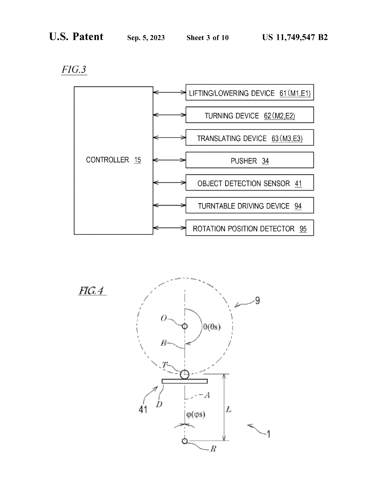
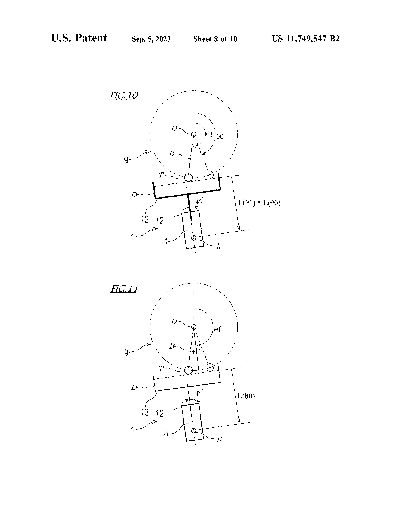
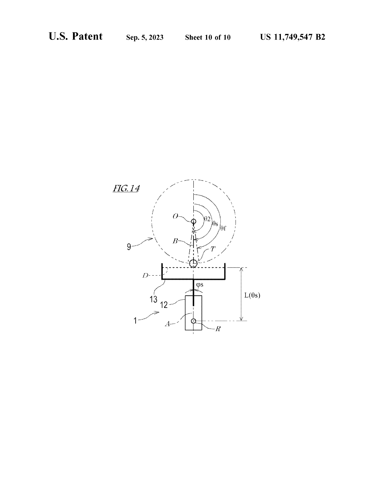

# US11749547B2 — 기판 이송 장치 및 기판 재치부 회전축 탐색 방법 (Kawasaki)

| 항목 | 내용 |
|---|---|
| 원문 | `US11749547.pdf`(등록, 2023-09-05) · `US20200243362.pdf`(공개 US2020/0243362 A1, 2020-07-30) |
| 출원인 | Kawasaki Jukogyo Kabushiki Kaisha (발명자 Masaya Yoshida, Kenji Noguchi, Hiroyuki Okada) |
| 우선일 | 2017-09-29 (JP2017-191618), PCT 출원 2018-07-30 (PCT/JP2018/028451) |
| 핵심 | 턴테이블 위 기판 재치부의 회전축 O 위치를 모를 때, 핸드 끝의 투과형 광 센서(검출선 D)로 재치부 기둥(타깃 T)을 여러 회전 위치 θ에서 검출해 인덱스 길이 L(로봇 기준축 R → 타깃 거리)을 잰다. L이 같아지는 두 회전 위치의 가운데 = 대칭축이라는 성질로 ① 평행화(θf), ② 방향 일치(θs, L 최대)를 차례로 찾아 R에서 본 O의 방향을 구하고, 거리 R–O = L_max + (O–T 기지 거리)로 구한다. |
| 관련도 | ○ 원인 P4(회전축 위치 미상) 해결 원리 |
| 본 과제와의 관계 | 카메라가 아닌 1차원 광 센서지만, "회전 위치를 여러 값으로 바꿔 측정한 1차원 신호의 대칭·극값으로 회전 중심을 찾는다"는 절차가 우리가 T를 여러 값으로 돌려 회전 중심(등가 회전 반경)을 역산하는 일과 같은 구조다. 원 맞춤 같은 매개변수 추정 없이 '같은 값 두 개의 중간', '최댓값'만 쓰는 점이 다르다. |
| 링크 | [Google Patents](https://patents.google.com/patent/US11749547B2/en) |

---

## 상세 요약 (번역본 기준)

### 1. 해결하려는 문제
- 턴테이블에 올려 함께 회전하는 기판 재치부는 기판 중심을 회전축 O에 맞춰 놓아야 함.
- 지금은 작업자가 티칭 펜던트로 눈으로 맞추는데 매우 번거로움 → 자동·정밀 티칭 필요.
- 기판은 원형이므로 회전축 O 위치만 알면 재치 위치를 바로 도출 가능 → **로봇으로 회전축 O의 위치(방향·거리)를 탐색**하는 것이 목적.
- 종래 PTL 1(JP2005-310858)은 장치 외벽의 티칭 지그를 투과형 광 센서로 검출하는 방식(회전체 축 탐색은 아님).

### 2. 핵심 구성
| 구성 | 부호 | 위치·역할 |
|---|---|---|
| 기판 재치부 | 9 | 같은 원주 위 지지 기둥(92, 3개 이상), 지지부(91). 턴테이블(90)에 실려 회전축 O를 중심으로 회전 |
| 턴테이블 구동 장치 / 회전 위치 검출기 | 94 / 95 | 서보모터로 재치부 회전, 회전 위치 θ 검출 |
| 기판 이송 로봇 | 1 | 기대(11), 암(12: 제1 링크 21 + 직동 제2 링크 22), 핸드(13). 승강 M1, 선회 M2, 직동 M3, 위치 검출기 E1~E3 |
| 물체 검출 센서 | 41 | 블레이드(32) 갈라진 끝의 투광기(41a)·수광기(41b), 광축(41c) = 검출선 D. 가로막히면 ON→OFF |
| 로봇 기준축 | R | 암 선회축과 동축인 가상축(회전축 O와 평행). 로봇 좌표계 기준 |
| 타깃 | T | 지지 기둥 하나(원형 단면, 반지름·O까지 거리 기지). 별도 타깃도 가능 |
| 인덱스 길이 | L | 축에 수직 방향으로 R에서 T(또는 검출선 D)까지 거리. 또는 그와 상관된 정보(핸드 기준점 포즈, M2·M3 회전 위치) |
| 암 기준선 / 재치부 기준선 | A / B | A: R과 암 선단을 잇는 선(회전 위치 φ), B: O와 타깃 기준점을 잇는 선(회전 위치 θ). 본 실시예에서 A ⟂ D |
| 제어기 | 15 | 회전축 탐색 프로그램 실행, 결과를 티칭 데이터로 저장 |

### 3. 동작 순서 (도 5~7)
1. **S1 평행화(B ∥ A) — 제1 방법(도 6, 도 8~11)**
   - S11~S12: 현재 암 위치 φ를 φf, 재치부 위치 θ를 θ0으로 저장.
   - S13~S14: 암 방향은 φf로 고정하고 암만 신축하며 타깃 탐색 → L(θ0).
   - S15~S18: 재치부를 +α, −α 돌려 L(θ0+α), L(θ0−α).
   - S19: 둘 중 **작은 쪽**으로 가는 방향을 탐색 방향으로.
   - S20: 그 방향으로 돌리며 L(θ1) = L(θ0)인 θ1을 찾음.
   - S21: **θf = (θ0+θ1)/2** (같은 L 두 점의 중간 = 대칭 위치 → B ∥ A).
   - S22: 재치부를 θf로 회전.
   - 제2 방법: L을 계산하지 않고 센서의 검출/비검출 변화점으로 θ0, θ1을 찾음.
   - 제3 방법: φf 고정 상태에서 **L이 최소**가 되는 θ를 θf로.
   - 변형: 재치부를 고정하고 암을 돌리거나, 둘 다 돌려도 됨.
2. **S2 방향 일치(B와 A가 같은 직선, 즉 T가 R–O 직선 위) — 제1 방법(도 7, 도 12~14)**
   - S31~S32: (θf, φf)에서 L(θf).
   - S33~S36: 재치부와 암을 **같은 방향으로 같은 각도 β** 함께 돌려 L(θf+β), L(θf−β).
   - S37: 둘 중 **큰 쪽** 방향을 탐색 방향으로.
   - S38: 같은 각도씩 함께 돌리며 L(θ2) = L(θf)인 θ2를 찾음.
   - S39: **θs = (θf+θ2)/2**, 이때 암은 φs.
   - S40: 재치부를 θ2 → θs, 암도 같은 방향·같은 각도로 회전.
   - 제2 방법: 검출/비검출 변화점으로 θ2 탐색. 제3 방법: 함께 돌리며 **L 최대**인 위치를 θs로.
3. **S3 방향 티칭**: φs(R에서 본 O 방향)를 암 선회 각도 0°로 저장(위치 검출기 E2 값).
4. **S4 거리 산출**: θs에서 L(θs) 측정. **거리 R–O = L(θs)(= L 최댓값) + O–T 기지 거리** (타깃 형상도 반영). 제3 방법을 썼다면 재탐색 생략 가능.
5. **S5 거리 티칭**: 산출 거리를 저장.
- 특징: 복수 θ에서 얻은 L(또는 상관 정보)만으로 복잡한 계산 없이 방향을 특정.

### 4. 청구항 요지 (총 14항: 독립항 1, 8, 14)
- 청구항 1(방법): 복수 회전 위치에서 타깃 검출 → 인덱스 길이 L(또는 상관 정보) 산출 → 타깃이 R–O 직선 위에 있을 때의 검출선 회전 위치 또는 재치부 회전 위치 산출 → R에서 본 O 방향 특정. 암 기준선·재치부 기준선을 정의하고, ① 두 선이 평행한 제1 재치부/제1 암 회전 위치 산출, ② 두 선을 같은 방향·같은 각도로 돌려 방향이 일치하는 제2 회전 위치 산출, ③④ 각 위치로 이동.
- 청구항 8(장치): 청구항 1의 절차를 제어기가 수행 + 암 기준선이 제2 암 회전 위치일 때 **로봇 암 관절 회전 위치 저장**.
- 청구항 14(장치): 청구항 8의 앞부분 + 제2 재치부 회전 위치를 "같은 L 두 위치의 중앙"으로 정함(관절 저장 대신).
- 주요 종속항
  - 2·9: 거리 R–O = L(정렬 시) + O–T 기지 거리.
  - 3·10: 제1 재치부 회전 위치 = 암 고정, 같은 L 두 위치의 중앙.
  - 4·11: 제1 재치부 회전 위치 = 암 고정, L 최소 위치.
  - 5·12: 제2 재치부 회전 위치 = 함께 회전, 같은 L 두 위치의 중앙.
  - 6·13: 제2 재치부 회전 위치 = 함께 회전, L 최대 위치.
  - 7: 암 기준선은 검출선이 있는 암 선단과 R을 잇는 선.

### 5. 대표 도면

*도 4 — 로봇 기준축 R, 회전축 O, 검출선 D, 타깃 T, 인덱스 길이 L의 관계*

*도 10·11 — 암 방향 고정, 재치부만 돌려 L(θ1)=L(θ0)인 θ1을 찾고 θf=(θ0+θ1)/2로 평행화*

*도 14 — 재치부·암을 함께 돌려 θs=(θf+θ2)/2: 타깃이 R–O 직선 위, 이때 L 최대*

### 6. 본 과제(Y·Θ 얼라인먼트)와 비교
- **해결하는 원인: P4(장비 기하 미보정 — 회전축 위치 미상).** 부수적으로 P1(회전 중심이 어디 있는지 모르면 회전이 평행이동과 섞임)을 완화하는 전제 정보를 준다.
- 같은 점:
  - 회전 중심의 위치를 사전에 모르는 상태에서, **회전 위치를 여러 값으로 바꿔 가며 같은 대상(타깃)을 반복 측정**하고 그 변화로 회전 중심을 역산한다. 우리가 T(PAN)를 여러 값으로 돌려 QR 마커 위치 변화로 회전 중심(등가 회전 반경)을 구하려는 것과 같은 구조.
  - 회전 위치(θ)는 엔코더(회전 위치 검출기 95)로 알고, 미지수는 회전축의 위치뿐 — 우리도 T 명령값은 알고 회전축 위치·카메라와의 관계가 미지수.
  - 결과를 장비 좌표(로봇 기준축 R 기준의 방향·거리)로 저장해 이후 동작의 기준으로 쓴다(티칭).
- 다른 점:
  - 센서가 카메라가 아니라 **1차원 투과형 광 센서**(검출선 가로막힘 ON/OFF). 영상 좌표·화소–mm 환산이 필요 없고, 거리 L은 로봇 관절 엔코더로 잰다. 우리는 영상의 화소 변위만 있어 화소–mm·카메라 축 각도까지 함께 풀어야 한다(P4의 나머지 절반은 이 특허가 다루지 않음).
  - 측정자(로봇)와 회전체(턴테이블)가 **분리된 두 장치**라서 암을 따로 움직여 '평행 → 방향 일치'를 물리적으로 맞출 수 있다. 우리는 카메라가 회전 스테이지 위에 같이 있어 관측 자체가 회전에 따라 움직인다.
  - 매개변수 추정(원 맞춤, 최소제곱)이 없고 **"같은 값 두 개의 중간 = 대칭축", "극값(최소·최대) = 정렬"**만 쓴다. 측정 오프셋(센서 장착 오차)이 같은 값 비교에서 상쇄되어 강건하지만, 탐색 반복 동작이 많아 실시간 보정용은 아니다(초기 티칭용).
  - 회전 반경(O–T 거리)과 타깃 형상은 **기지값**으로 둔다. 우리는 등가 회전 반경 자체가 미지수.
- 참고할 점 (본 과제에서 할 일):
  - **캘리브레이션 단계에서 T 스윕으로 회전 중심 추정**: T를 −Δ…+Δ 여러 값으로 돌려 각 T에서 마커 3개의 위치(가능하면 PnP 자세)를 측정 → 마커 점 궤적에 원(또는 x(T) = cx + (x0−cx)·cos T − (z0−cz)·sin T 모형)을 맞춰 회전 중심 (cx, cz)·등가 반경을 구한다. 이 특허의 L(θ) 곡선 대칭성과 같은 정보다.
  - **대칭성 기반 검산**: ±α로 돌렸을 때 응답이 같아지는 두 각도의 중간(θf=(θ0+θ1)/2 방식)으로 '회전축이 광축과 정렬되는 T'를 구하면 오프셋에 무관한 기준각을 얻을 수 있다 → 원 맞춤 결과와 비교해 P2(조건수) 문제를 피하는 독립 검증으로 사용.
  - **백래시 주의(P5)**: 이 특허의 θ0/θ1 탐색은 정·역 양방향 회전을 섞는다. 우리 장비는 접근 방향에 따라 영점이 −0.85~0 px 달라지므로, T 스윕은 **항상 같은 방향에서 접근**하도록 설계하고 양방향 데이터는 분리해 처리한다.
  - 추정한 회전 중심(방향·거리)은 이 특허처럼 **장비 기준 좌표로 저장(티칭)**해 두고, 실시간 Y·T 추정에서는 고정된 기지값으로 써서 미지수를 줄인다(P4 → 기지값화하면 P1·P2 부담 감소).

---

> **같은 특허의 다른 폴더:** `문헌연구/03_Y_T_분리/특허/06_US11749547_Kawasaki_기판재치부_회전축탐색` (요약만). 두 폴더는 주제 관점이 달라 요약을 따로 두었다.
