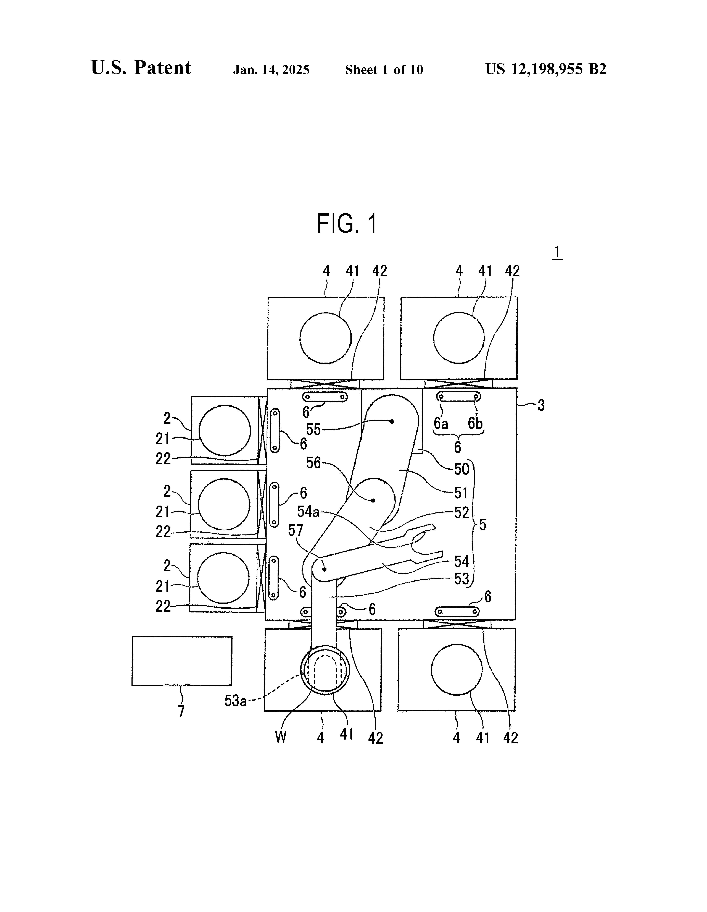
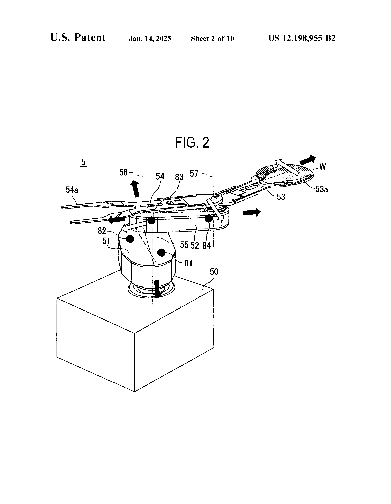
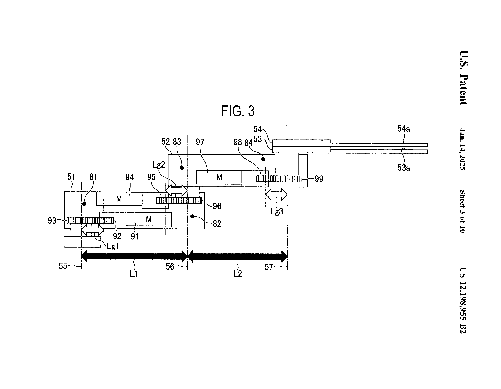
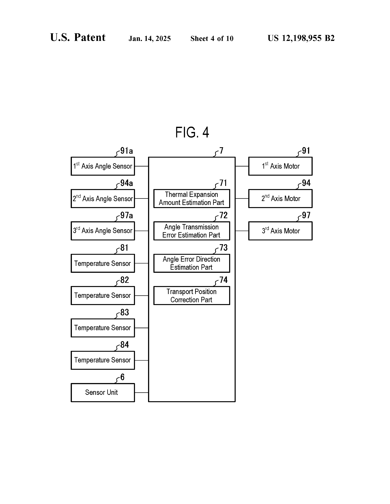
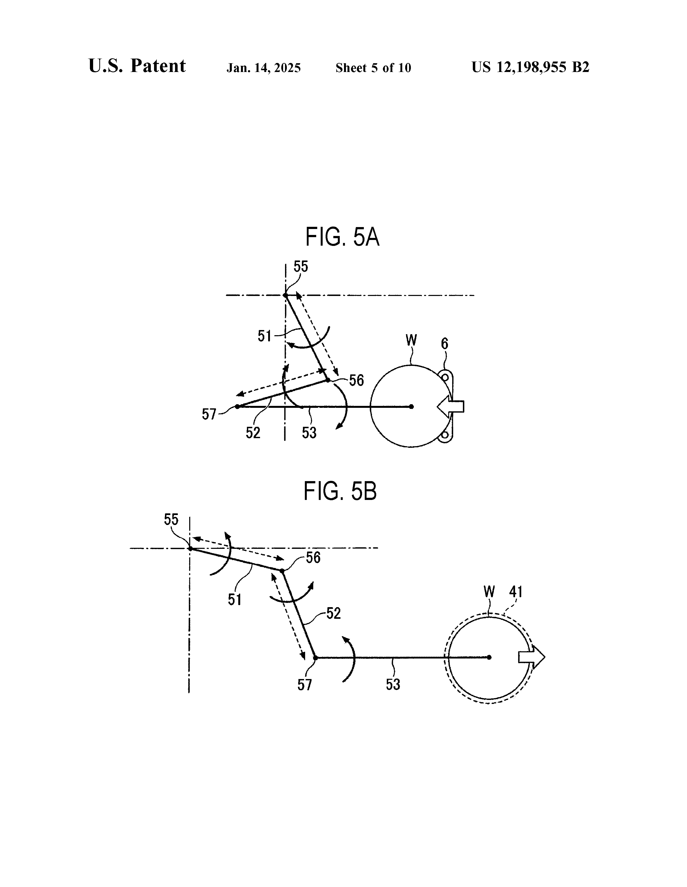
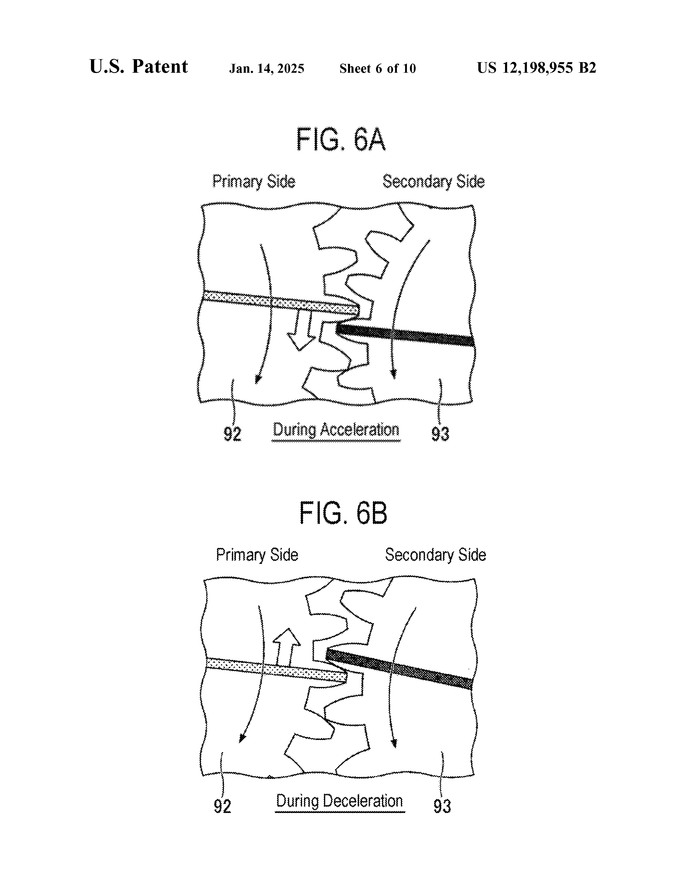
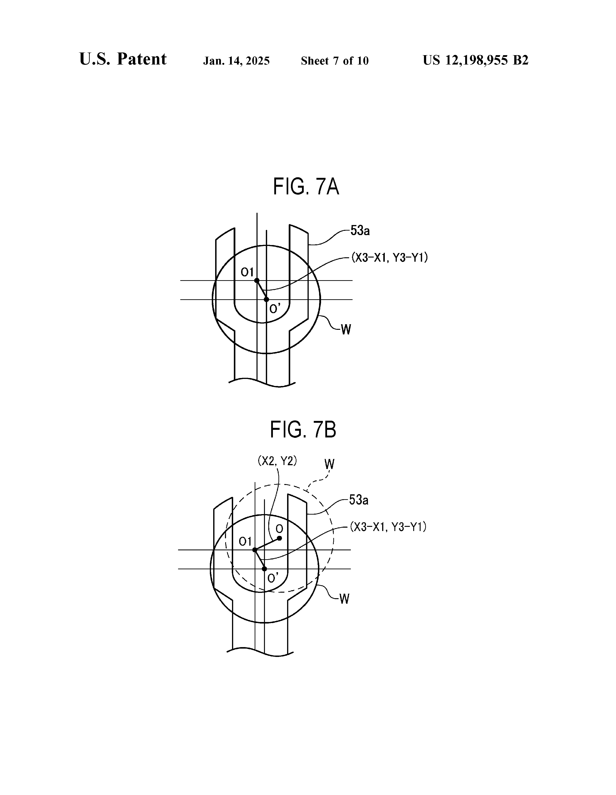
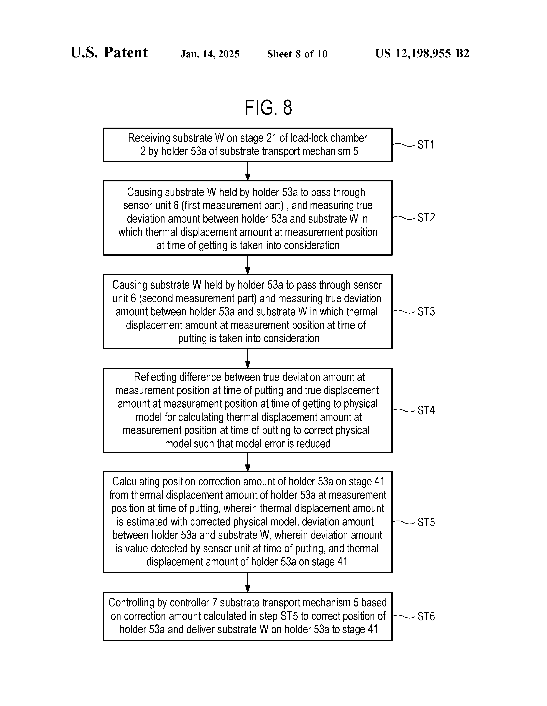
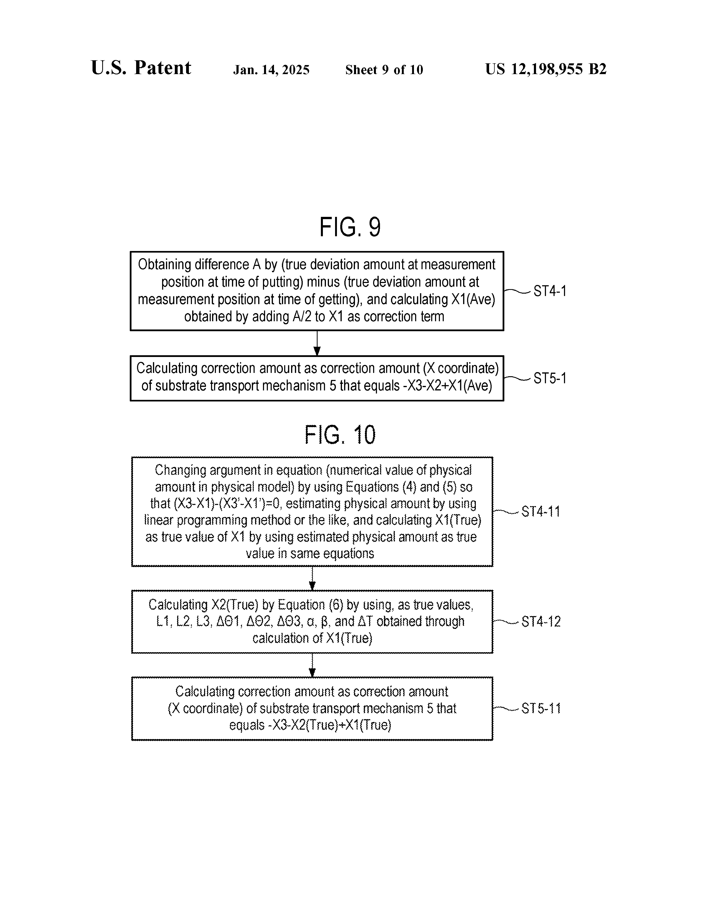
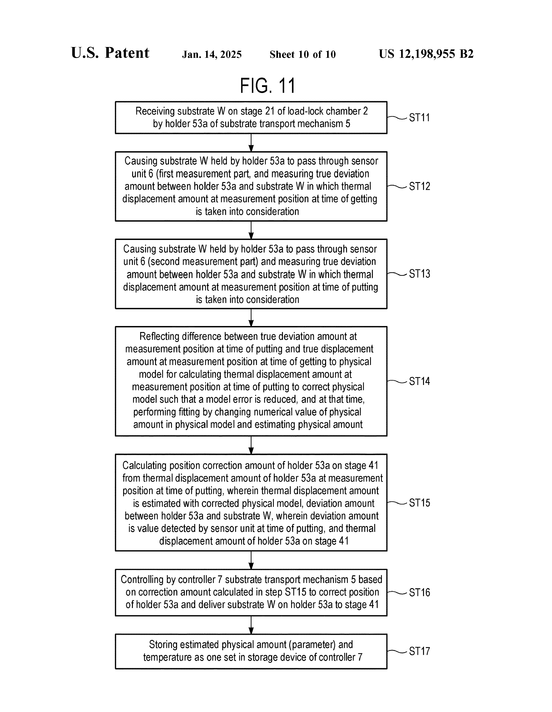

# 기판 이송 방법 및 기판 이송 시스템 (US12198955B2)
- 원제: Substrate transfer method and substrate transfer system
- 원문: 같은 폴더의 PDF, https://patents.google.com/patent/US12198955B2/en
- 번역 기준: USPTO 등록본 PDF 스캔을 직접 판독한 원문을 한국어로 옮김. (Google Patents 접속 503으로 사용 불가)
- 도면: 원문 PDF 도면 시트 10장을 도면/ 폴더에 넣고 본문에서 처음 언급되는 곳에 삽입함

## 요약

방법은 다음을 포함한다: 기판 이송 기구의 홀더로 제1 스테이지 위의 기판을 수취하는 단계; 기판이 제1 측정부를 통과하게 하고, 제1 위치에서 홀더와 기판 사이의 제1 참 편차량을 측정하는 단계; 기판을 제2 스테이지 쪽으로 이송할 때 기판이 제2 측정부를 통과하게 하고, 제2 위치에서 홀더와 기판 사이의 제2 참 편차량을 측정하는 단계; 제1 참 편차량과 제2 참 편차량 사이의 차이를 물리 모델에 반영하여 물리 모델을 보정하는 단계; 제2 위치에서의 홀더의 열변위량으로부터 제2 스테이지 위에서의 홀더의 위치 보정량을 산출하는 단계; 및 위치 보정량에 기초하여 기판 이송 기구를 제어하여 홀더의 위치 보정을 수행하는 단계.

## 청구범위

청구하는 것은 다음과 같다.

1. 기판을 유지하도록 구성된 홀더를 구비하고 상기 기판을 제1 스테이지에서 제2 스테이지로 이송하도록 구성된 기판 이송 기구, 상기 제1 스테이지에 인접한 제1 측정 위치에서 상기 기판의 위치를 측정하도록 구성된 제1 광전 센서, 및 제2 측정 위치에서 상기 기판의 위치를 측정하도록 구성된 제2 광전 센서를 포함하는 기판 이송 시스템에 의해 상기 기판을 상기 제2 스테이지의 목표 위치로 이송하는 기판 이송 방법으로서, 상기 기판 이송 방법은,

상기 홀더로 상기 제1 스테이지에서 상기 기판을 수취하는 단계;

상기 홀더에 유지된 상기 기판이 상기 제1 광전 센서를 통과하게 하고, 상기 제1 측정 위치에서의 상기 홀더 및 상기 기판의 위치에 기초하여 제1 참 편차량을 산출하는 단계로서, 상기 제1 참 편차량은 상기 제1 광전 센서가 검출한 검출값과 상기 제1 측정 위치에서의 상기 홀더의 열변위량으로부터 얻어지는 단계;

상기 홀더에 유지된 상기 기판을 상기 제2 스테이지 쪽으로 이송할 때 상기 기판이 상기 제2 광전 센서를 통과하게 하고, 상기 제2 측정 위치에서의 상기 홀더 및 상기 기판의 위치에 기초하여 제2 참 편차량을 산출하는 단계로서, 상기 제2 참 편차량은 상기 제2 광전 센서가 검출한 검출값과 상기 제2 측정 위치에서의 상기 홀더의 열변위량으로부터 얻어지는 단계;

상기 제1 참 편차량과 상기 제2 참 편차량 사이의 차이를 상기 제2 측정 위치에서의 상기 홀더의 상기 열변위량을 추정하도록 구성된 물리 모델에 반영하고, 모델 오차가 줄어들도록 상기 물리 모델을 보정하는 단계;

상기 제2 측정 위치에서의 상기 홀더의 상기 열변위량으로부터 상기 제2 스테이지에서의 상기 홀더의 위치 보정량을 산출하는 단계로서, 상기 위치 보정량은 보정된 상기 물리 모델, 상기 홀더와 상기 기판 사이의 편차량(상기 편차량은 상기 제2 광전 센서가 검출한 상기 검출값임), 및 상기 제2 스테이지에서의 상기 홀더의 열변위량으로부터 추정되는 단계; 및

상기 위치 보정량에 기초하여 상기 기판 이송 기구를 제어하여 상기 홀더의 위치 보정을 수행하고, 상기 홀더 위의 상기 기판을 상기 제2 스테이지에 전달하는 단계를 포함하는, 기판 이송 방법.

2. 제1항에 있어서, 상기 물리 모델을 보정하는 단계는 상기 제2 참 편차량과 상기 제1 참 편차량 사이의 상기 차이가 반영된 보정항을 초기 물리 모델에 더하는 단계를 포함하는, 기판 이송 방법.

3. 제2항에 있어서, 상기 제2 참 편차량과 상기 제1 참 편차량 사이의 상기 차이를 산출하고 상기 차이의 ½의 값을 상기 제2 측정 위치에서의 상기 홀더의 상기 열변위량의 상기 초기 물리 모델에 더하여 얻은 모델을 보정된 상기 물리 모델로 사용하는, 기판 이송 방법.

4. 제3항에 있어서, 상기 기판 이송 기구는 복수의 암 및 상기 복수의 암을 회전시키도록 구성된 모터를 포함하는 다관절 구조를 갖는, 기판 이송 방법.

5. 제1항에 있어서, 상기 물리 모델은, 상기 제2 측정 위치에서의 상기 홀더의 상기 열변위량을 추정하기 위한 제1 초기 물리 모델과 상기 제1 측정 위치에서의 상기 홀더의 상기 열변위량을 추정하기 위한 제2 초기 물리 모델 각각에, 온도 함수로 표현되며 상기 제1 초기 물리 모델 및 상기 제2 초기 물리 모델에 포함되지 않은 제1 오차 인자를 더하여 생성되고, (상기 제2 참 편차량) 빼기 (상기 제1 참 편차량)이 0이 되도록 상기 제1 오차 인자가 더해진 상기 물리 모델 내 물리량의 수치를 변경하여 피팅을 수행함으로써 상기 물리량을 추정하며, 상기 제2 측정 위치에서의 상기 홀더의 상기 열변위량의 보정된 상기 물리 모델이 얻어지는, 기판 이송 방법.

6. 제5항에 있어서, 상기 물리 모델은, 상기 제2 스테이지에서의 상기 홀더의 상기 열변위량을 추정하기 위한 제3 초기 물리 모델에, 상기 온도 함수로 표현되며 상기 제3 초기 물리 모델에 포함되지 않은 제2 오차 인자를 더하여 생성되고, 상기 제2 측정 위치에서의 상기 홀더의 상기 열변위량의 보정된 상기 물리 모델을 얻을 때 사용한 상기 물리량을 참값으로 사용하여 상기 제2 스테이지에서의 상기 홀더의 상기 열변위량이 보정된 물리 모델이 얻어지는, 기판 이송 방법.

7. 제5항에 있어서,

추정된 상기 물리량을 파라미터로서 온도와 한 세트로 저장부에 저장하는 단계를 더 포함하는, 기판 이송 방법.

8. 제1항에 있어서, 상기 기판 이송 기구는 복수의 암 및 상기 복수의 암을 회전시키도록 구성된 모터를 포함하는 다관절 구조를 갖는, 기판 이송 방법.

9. 기판 이송 시스템으로서,

기판을 유지하도록 구성된 홀더를 구비하고 상기 기판을 제1 스테이지에서 제2 스테이지로 이송하도록 구성된 기판 이송 기구;

상기 제1 스테이지에 인접한 제1 측정 위치에서 상기 기판의 위치를 측정하도록 구성된 제1 광전 센서;

제2 측정 위치에서 상기 기판의 위치를 측정하도록 구성된 제2 광전 센서; 및

상기 기판 이송 기구를 제어하도록 구성된 제어기를 포함하고,

상기 제어기는,

상기 홀더로 상기 제1 스테이지에서 상기 기판을 수취하는 것;

상기 홀더에 유지된 상기 기판이 상기 제1 광전 센서를 통과하게 하고, 상기 제1 측정 위치에서의 상기 홀더 및 상기 기판의 위치에 기초하여 제1 참 편차량을 산출하는 것으로서, 상기 제1 참 편차량은 상기 제1 광전 센서가 검출한 검출값과 상기 제1 측정 위치에서의 상기 홀더의 열변위량으로부터 얻어지는 것;

상기 홀더에 유지된 상기 기판을 상기 제2 스테이지 쪽으로 이송할 때 상기 기판이 상기 제2 광전 센서를 통과하게 하고, 상기 제2 측정 위치에서의 상기 홀더 및 상기 기판의 위치에 기초하여 제2 참 편차량을 산출하는 것으로서, 상기 제2 참 편차량은 상기 제2 광전 센서가 검출한 검출값과 상기 제2 측정 위치에서의 상기 홀더의 열변위량으로부터 얻어지는 것;

상기 제1 참 편차량과 상기 제2 참 편차량 사이의 차이를 상기 제2 측정 위치에서의 상기 홀더의 상기 열변위량을 추정하도록 구성된 물리 모델에 반영하고, 모델 오차가 줄어들도록 상기 물리 모델을 보정하는 것;

상기 제2 측정 위치에서의 상기 홀더의 상기 열변위량으로부터 상기 제2 스테이지에서의 상기 홀더의 위치 보정량을 산출하는 것으로서, 상기 위치 보정량은 보정된 상기 물리 모델, 상기 홀더와 상기 기판 사이의 편차량(상기 편차량은 상기 제2 광전 센서가 검출한 상기 검출값임), 및 상기 제2 스테이지에서의 상기 홀더의 열변위량으로부터 추정되는 것; 및

상기 위치 보정량에 기초하여 상기 기판 이송 기구를 제어하여 상기 홀더의 위치 보정을 수행하고, 상기 홀더 위의 상기 기판을 상기 제2 스테이지에 전달하는 것을 포함하는 제어를 수행하는, 기판 이송 시스템.

10. 제9항에 있어서, 보정된 상기 물리 모델은 상기 제2 참 편차량과 상기 제1 참 편차량 사이의 상기 차이가 반영된 보정항을 초기 물리 모델에 더하여 얻어지는, 기판 이송 시스템.

11. 제10항에 있어서, 보정된 상기 물리 모델은 상기 제2 참 편차량과 상기 제1 참 편차량 사이의 상기 차이를 산출하고 상기 차이의 ½의 값을 상기 제2 측정 위치에서의 상기 홀더의 상기 열변위량의 상기 초기 물리 모델에 더하여 얻어지는, 기판 이송 시스템.

12. 제11항에 있어서, 상기 기판 이송 기구는 복수의 암 및 상기 복수의 암을 회전시키도록 구성된 모터를 포함하는 다관절 구조를 갖는, 기판 이송 시스템.

13. 제9항에 있어서, 상기 제어기는, 상기 제2 측정 위치에서의 상기 홀더의 상기 열변위량을 추정하기 위한 제1 초기 물리 모델과 상기 제1 측정 위치에서의 상기 홀더의 상기 열변위량을 추정하기 위한 제2 초기 물리 모델 각각에, 온도 함수로 표현되며 상기 제1 초기 물리 모델 및 상기 제2 초기 물리 모델에 포함되지 않은 제1 오차 인자를 더하여 상기 물리 모델을 생성하는 것; (상기 제2 참 편차량) 빼기 (상기 제1 참 편차량)이 0이 되도록 상기 제1 오차 인자가 더해진 상기 물리 모델 내 물리량의 수치를 변경하여 피팅을 수행함으로써 상기 물리량을 추정하는 것; 및 상기 제2 측정 위치에서의 상기 홀더의 상기 열변위량의 보정된 상기 물리 모델을 얻는 것을 포함하는 상기 제어를 수행하는, 기판 이송 시스템.

14. 제13항에 있어서, 상기 제어기는, 상기 제2 스테이지에서의 상기 홀더의 상기 열변위량을 추정하기 위한 제3 초기 물리 모델에, 상기 온도 함수로 표현되며 상기 제3 초기 물리 모델에 포함되지 않은 제2 오차 인자를 더하여 상기 물리 모델을 생성하는 것; 및 상기 제2 측정 위치에서의 상기 홀더의 상기 열변위량의 보정된 상기 물리 모델을 얻을 때 사용한 상기 물리량을 참값으로 사용하여 상기 제2 스테이지에서의 상기 홀더의 상기 열변위량이 보정된 물리 모델을 얻는 것을 포함하는 상기 제어를 수행하는, 기판 이송 시스템.

15. 제13항에 있어서, 상기 제어기는 추정된 상기 물리량을 파라미터로서 온도와 한 세트로 저장부에 저장하는 것을 포함하는 상기 제어를 수행하는, 기판 이송 시스템.

16. 제9항에 있어서, 상기 기판 이송 기구는 복수의 암 및 상기 복수의 암을 회전시키도록 구성된 모터를 포함하는 다관절 구조를 갖는, 기판 이송 시스템.

## 상세한 설명

### 기판 이송 방법 및 기판 이송 시스템 (SUBSTRATE TRANSFER METHOD AND SUBSTRATE TRANSFER SYSTEM)

### 관련 출원의 상호 참조 (CROSS-REFERENCE TO RELATED APPLICATION)

본 출원은 2021년 7월 14일에 출원된 일본 특허출원 제2021-116712호에 기초하여 그 우선권의 이익을 주장하며, 그 전체 내용은 참조로 본 명세서에 포함된다.

### 기술 분야 (TECHNICAL FIELD)

본 개시는 기판 이송 방법 및 기판 이송 시스템에 관한 것이다.

### 배경 기술 (BACKGROUND)

복수의 기판을 연속적으로 처리하는 처리 시스템으로서, 로드락 챔버, 각각 기판에 소정의 처리를 수행하도록 구성된 복수의 처리 챔버, 및 로드락 챔버와 복수의 처리 챔버가 연결되고 기판 이송 기구를 포함하는 공통 이송 챔버를 포함하는 처리 시스템이 알려져 있다.

이와 같은 처리 시스템이 특허문헌 1에 개시되어 있다. 특허문헌 1에 개시된 처리 시스템에서, 공통 이송 챔버는 한 방향으로 길이 방향을 가지며, 공통 이송 챔버에는 길이 방향으로 이동 가능한 베이스 스탠드를 갖는 슬라이더 기구가 마련되고, 기판 이송 기구는 굽힘/신장 및 회전이 가능하도록 베이스 스탠드 위에 마련된다. 또한 특허문헌 1에 개시된 처리 시스템에서는, 기판 이송 기구에 유지된 기판의 위치 어긋남을 검출하기 위해, 복수의 위치 어긋남 검출부가 베이스 스탠드가 정지해야 하는 위치에 대응하도록 소정 간격으로 서로 떨어져 배치된다. 제어기는 복수의 위치 어긋남 검출부 중 어느 하나의 검출값을 기준 검출값으로 사용하고, 다른 위치 어긋남 검출부의 검출값에 대해 열팽창/수축 보정을 수행하도록 기판 이송 기구의 동작을 제어한다.

### 선행기술문헌 (PRIOR ART DOCUMENT)

특허문헌 (Patent Document)

특허문헌 1: 일본 공개특허공보 제2007-027378호

### 발명의 요약 (SUMMARY)

본 개시의 일 실시예에 따르면, 기판을 유지하도록 구성된 홀더를 구비하고 기판을 제1 스테이지에서 제2 스테이지로 이송하도록 구성된 기판 이송 기구, 제1 스테이지에 인접한 제1 측정 위치에서 기판의 위치를 측정하도록 구성된 제1 측정부, 및 제2 측정 위치에서 기판의 위치를 측정하도록 구성된 제2 측정부를 포함하는 기판 이송 시스템에 의해 기판을 제2 스테이지의 목표 위치로 이송하는 기판 이송 방법이 제공되며, 이 기판 이송 방법은 다음을 포함한다: 홀더로 제1 스테이지 위의 기판을 수취하는 단계; 홀더에 유지된 기판이 제1 측정부를 통과하게 하고, 제1 측정 위치에서 홀더와 기판 사이의 제1 참 편차량(true deviation amount)을 측정하는 단계로서, 제1 참 편차량은 제1 측정부가 검출한 검출값과 홀더의 열변위량으로부터 얻어지는 단계; 홀더에 유지된 기판을 제2 스테이지 쪽으로 이송할 때 기판이 제2 측정부를 통과하게 하고, 제2 측정 위치에서 홀더와 기판 사이의 제2 참 편차량을 측정하는 단계로서, 제2 참 편차량은 제2 측정부가 검출한 검출값과 홀더의 열변위량으로부터 얻어지는 단계; 제1 참 편차량과 제2 참 편차량의 차이를 제2 측정 위치에서의 열변위량을 추정하도록 구성된 물리 모델에 반영하고, 모델 오차가 줄어들도록 물리 모델을 보정하는 단계; 제2 측정 위치에서의 홀더의 열변위량으로부터 제2 스테이지 위에서의 홀더의 위치 보정량을 산출하는 단계로서, 위치 보정량은 보정된 물리 모델, 홀더와 기판 사이의 편차량(이 편차량은 제2 측정부가 검출한 검출값임), 및 제2 스테이지 위에서의 홀더의 열변위값으로부터 추정되는 단계; 및 위치 보정량에 기초하여 기판 이송 기구를 제어하여 홀더의 위치 보정을 수행하고, 홀더 위의 기판을 제2 스테이지에 전달하는 단계.

### 도면의 간단한 설명 (BRIEF DESCRIPTION OF DRAWINGS)

명세서에 포함되어 그 일부를 이루는 첨부 도면은 본 개시의 실시예를 도시하며, 위에 제시된 일반적인 설명 및 아래에 제시된 실시예의 상세한 설명과 함께 본 개시의 원리를 설명하는 역할을 한다.

도 1은 기판 처리 시스템의 전체 구성의 예를 도시하는 개략 평면도이다.

도 2는 기판 이송 기구의 예를 도시하는 사시도이다.

도 3은 기판 이송 기구의 예의 구조를 도시하는 개략도이다.

도 4는 기판 이송 기구가 제어기에 의해 제어될 때의 기능 블록도이다.

도 5a 및 도 5b는 기판 이송 기구의 자세를 개략적으로 도시하는 도면이다.

도 6a 및 도 6b는 가속/감속 상태와 각도 전달 오차의 오차 방향 사이의 관계를 도시하는 도면이다.

도 7a 및 도 7b는 홀더와 기판 사이의 참 편차량 및 스테이지 위에서의 홀더의 참 편차량을 설명하기 위한 도면이다.

도 8은 기판 이송 방법의 예를 도시하는 흐름도이다.

도 9는 도 8의 단계 ST4 및 ST5의 구체적인 예로서 제1 예를 도시하는 흐름도이다.

도 10은 도 8의 단계 ST4 및 ST5의 구체적인 예로서 제2 예를 도시하는 흐름도이다.

도 11은 기판 이송 방법의 다른 예를 도시하는 흐름도이다.

### 발명의 상세한 설명 (DETAILED DESCRIPTION)

이하, 첨부 도면을 참조하여 실시예를 상세히 설명한다. 다음의 상세한 설명에서는 본 개시의 철저한 이해를 제공하기 위해 다수의 구체적인 세부 사항이 제시된다. 그러나 본 개시가 이러한 구체적인 세부 사항 없이도 실시될 수 있음은 당업자에게 명백할 것이다. 다른 경우에, 다양한 실시예의 양태를 불필요하게 모호하게 하지 않도록 잘 알려진 방법, 절차, 시스템 및 구성 요소는 상세히 설명하지 않았다.

<기판 처리 시스템 (Substrate Processing System)>

먼저, 일 실시예에 따른 기판 이송 시스템을 포함하는 기판 처리 시스템을 설명한다. 도 1은 기판 처리 시스템의 전체 구성의 예를 도시하는 개략 평면도이다.

*도 1 — 기판 처리 시스템(1)의 전체 구성: 진공 이송 챔버(3), 로드락 챔버(2), 처리 챔버(4), 기판 이송 기구(5), 센서 유닛(6), 제어기(7)*

도 1에 도시된 기판 처리 시스템(1)은 진공 분위기에서 기판(W)을 처리하며, 클러스터 구조(멀티 챔버 형) 시스템으로 구성된다. 기판(W)의 예로는 반도체 웨이퍼와 같은 웨이퍼가 포함되지만 이에 한정되지 않는다.

기판 처리 시스템(1)은 로드락 챔버(2), 진공 이송 챔버(3), 처리 챔버(4), 기판 이송 기구(5), 센서 유닛(6), 및 제어기(7)를 포함한다. 일 실시예에 따른 기판 이송 시스템은 기판 이송 기구(5), 센서 유닛(6), 및 제어기(7)를 포함한다.

진공 이송 챔버(3)는 직사각형의 평면 형상을 갖는다. 진공 이송 챔버의 내부는 진공 배기부(도시하지 않음)에 의해 진공 분위기로 감압된다. 기판 이송 기구(5)는 진공 이송 챔버(3) 내부에 마련된다. 3개의 로드락 챔버(2)가 진공 이송 챔버(3)의 한쪽 긴 변에 해당하는 벽에 연결된다. 또한, 총 4개의 처리 챔버(4)가 두 짧은 변에 해당하는 서로 마주보는 벽에, 벽마다 2개의 처리 챔버씩 연결된다.

로드락 챔버(2)는 진공 이송 챔버(3)와 대기 이송 챔버(도시하지 않음) 사이에 마련되며, 각각 그 내부에 기판(W)이 놓이는 스테이지(21)가 마련된다. 각 로드락 챔버(2)와 진공 이송 챔버(3) 사이에는 게이트 밸브(22)가 마련되고, 각 로드락 챔버(2)와 대기 이송 챔버 사이에도 게이트 밸브(도시하지 않음)가 마련된다. 로드락 챔버(2)와 진공 분위기의 진공 이송 챔버(3)는 게이트 밸브(22)를 개방/폐쇄함으로써 서로 연통/차단된다. 로드락 챔버(2)와 대기 이송 챔버 역시 게이트 밸브(도시하지 않음)를 개방/폐쇄함으로써 서로 연통/차단된다. 각 로드락 챔버(2)의 내부 압력은 두 게이트 밸브가 모두 닫힌 상태에서 대기압과 진공 분위기 사이로 제어될 수 있다. 기판(W)을 대기 이송 챔버로 전달할 때에는 로드락 챔버(2)의 내부를 대기 분위기로 만들고 대기 이송 챔버 쪽 게이트 밸브를 연다. 기판(W)을 진공 이송 챔버(3)로 전달할 때에는 로드락 챔버(2)의 내부를 진공 분위기로 만들고 게이트 밸브(22)를 연다.

전술한 바와 같이, 처리 챔버(4)는 진공 이송 챔버(3)의 짧은 변에 해당하는 벽에 연결되며, 각각 그 내부에 기판(W)이 놓이는 스테이지(41)가 마련된다. 각 처리 챔버(4)는 진공 분위기로 감압된다. 처리 챔버(4) 내부에서는 스테이지(41) 위에 놓인 기판(W)에 대해 원하는 처리(예: 식각 처리, 성막 처리, 세정 처리, 애싱 처리 등)가 수행된다. 각 처리 챔버(4)와 진공 이송 챔버(3) 사이에는 게이트 밸브(42)가 마련된다. 처리 챔버(4)와 진공 이송 챔버(3)는 게이트 밸브(42)와 연통하며 게이트 밸브(42)를 개방/폐쇄함으로써 차단된다.

기판 이송 기구(5)는 로드락 챔버(2)의 스테이지(21)와 처리 챔버(4)의 스테이지(41) 사이에서 기판을 이송한다. 기판 이송 기구(5)는 예를 들어 베이스(50), 제1 암(51), 제2 암(52), 제3 암(53), 및 제4 암(54)을 포함하는 다관절 암으로 구성된다. 베이스(50)와 제1 암(51)의 길이 방향 한쪽은 회전축(55)에 의해 서로 회전 가능하게 연결된다. 제1 암(51)의 길이 방향 다른 쪽과 제2 암(52)의 길이 방향 한쪽은 회전축(56)에 의해 서로 회전 가능하게 연결된다. 제2 암(52)의 길이 방향 다른 쪽과 제3 암(53)의 길이 방향 한쪽은 회전축(57)에 의해 서로 회전 가능하게 연결된다. 제3 암(53)의 길이 방향 다른 쪽은 기판(W)을 그 위에 유지하는(올려놓는) 홀더(53a)를 포함한다. 또한, 제2 암(52)의 길이 방향 다른 쪽과 제4 암(54)의 길이 방향 한쪽은 회전축(57)에 의해 서로 회전 가능하게 연결된다. 제4 암(54)의 길이 방향 다른 쪽은 기판(W)을 그 위에 유지하는(올려놓는) 홀더(54a)를 포함한다. 기판 이송 기구(5)의 세부 사항은 후술한다.

진공 이송 챔버(3) 내부에는, 기판 이송 기구(5)에 의해 이송되는 기판(W)을 검출하는 센서 유닛(측정부)(6)이 4개의 처리 챔버(4) 및 3개의 로드락 챔버(2)에 각각 대응하도록 마련된다. 각 센서 유닛(6)은, 기판 이송 기구(5)가 기판(W)을 대응하는 처리 챔버(4) 또는 로드락 챔버(2)에서 진공 이송 챔버(3)로 이송할 때, 또는 기판 이송 기구(5)가 기판(W)을 진공 이송 챔버(3)에서 대응하는 처리 챔버(4) 또는 로드락 챔버(2)로 이송할 때 기판(W)이 통과하는 위치에 마련된다.

각 센서 유닛(6)은 2개의 센서(6a, 6b)를 포함한다. 센서(6a, 6b)는 예를 들어 광전 센서이다. 기판 이송 기구(5)에 의해 이송되는 기판(W)이 센서(6a, 6b)를 통과할 때, 기판(W) 외측 가장자리의 4개 점이 센서(6a, 6b)에 의해 검출될 수 있다.

제어기(7)는 기판 이송 기구(5), 로드락 챔버(2)·진공 이송 챔버(3)·처리 챔버(4)의 배기 시스템, 게이트 밸브(22, 42) 등과 같은 기판 처리 시스템(1)의 각 구성 요소의 동작을 제어한다. 제어기(7)는 전형적으로 컴퓨터이며, 주 제어부, 입력 장치, 출력 장치, 표시 장치, 및 저장 장치를 포함한다. 주 제어부는 중앙 처리 장치(CPU), RAM, 및 ROM을 포함한다. 저장 장치는 하드 디스크와 같은 컴퓨터 판독 가능 저장 매체를 포함하며, 제어에 필요한 정보를 기록하고 판독하도록 구성된다. 제어기(7)에서 CPU는 RAM을 작업 영역으로 사용하여 ROM 또는 저장 장치의 저장 매체에 저장된 처리 레시피와 같은 프로그램을 실행함으로써, 기판 처리 시스템(1)에서 기판(W)의 처리 또는 기판(W)의 이송을 제어한다.

후술하는 바와 같이, 제어기(7)는 기판 이송 기구(5)의 열팽창에 관한 정보를 수신하여 기판 이송 기구(5)의 홀더(53a) 및 홀더(54a)의 위치를 보정한다.

제어기(7)는 센서 유닛(6)(센서 6a 및 6b)에 의한 기판(W) 외측 가장자리의 검출과 그때의 기판 이송 기구(5)의 동작에 기초하여, 제3 암(53)의 홀더(53a)에 유지된 기판(W)의 가장자리 좌표를 검출한다. 그런 다음 제어기(7)는 검출된 4개 점의 외측 가장자리 좌표로부터 기판(W)의 중심 위치를 산출한다. 따라서 센서 유닛(6)과 제어기(7)는 제3 암(53)에 유지된 기판(W)의 중심 위치를 측정하는 측정부로 기능한다. 제어기(7)는 제3 암(53)에서 기판(W)이 놓이는 기준 위치(홀더 53a의 중심 위치)로서 미리 설정된 기준 위치와, 센서 유닛(6)에 의해 검출된 제3 암(53)의 홀더(53a)에 유지된 기판(W)의 중심 위치 사이의 편차(편심량)를 검출한다. 제어기(7)는 제4 암(54)의 홀더(54a)도 같은 방식으로 제어한다.

<기판 이송 기구 (Substrate Transfer Mechanism)>

다음으로, 도 2 및 도 3을 참조하여 기판 이송 기구(5)를 더 상세히 설명한다. 도 2는 기판 이송 기구(5)의 예를 도시하는 사시도이고, 도 3은 기판 이송 기구(5)의 예의 구조를 도시하는 개략도이다.

*도 2 — 기판 이송 기구(5): 검은 화살표는 암의 길이 방향 열팽창, 흰 화살표는 백래시에 의한 각도 전달 오차*

*도 3 — 기판 이송 기구(5)의 구조: 축 모터(91, 94, 97), 기어 쌍(92·93, 95·96, 98·99), 온도 센서(81~84), 링크 길이 L1·L2, 기어 축간 거리 Lg1~Lg3*

기판 이송 기구(5)에서, 제1 암(51) 내부의 아래쪽에는 제1 축 모터(91), 제1 축 모터(91)에 의해 회전되는 기어(92), 및 기어(92)와 맞물리는 기어(93)가 마련된다. 기어(93)는 베이스(50)에 고정되며 회전축(55)과 동축으로 배치된다. 기어(92, 93)는 동력 전달 기구를 구성한다. 제1 축 모터(91)로 기어(92)를 회전시킴으로써, 제1 암(51)이 베이스(50)에 대해 회전축(55)을 중심으로 회전한다.

또한 제1 암(51) 내부의 위쪽에는 제2 축 모터(94), 제2 축 모터(94)에 의해 회전되는 기어(95), 및 기어(95)와 맞물리는 기어(96)가 마련된다. 기어(96)는 제2 암(52)에 고정되며 회전축(56)과 동축으로 배치된다. 기어(95, 96)는 동력 전달 기구를 구성한다. 제2 축 모터(94)로 기어(95)를 회전시킴으로써, 제2 암(52)이 제1 암(51)에 대해 회전축(56)을 중심으로 회전한다.

제2 암(52) 내부에는 제3 축 모터(97), 제3 축 모터(97)에 의해 회전되는 기어(98), 및 기어(98)와 맞물리는 기어(99)가 마련된다. 기어(99)는 제3 암(53)에 고정되며 회전축(57)과 동축으로 배치된다. 기어(98, 99)는 동력 전달 기구를 구성한다. 제3 축 모터(97)로 기어(98)를 회전시킴으로써, 제3 암(53)이 제2 암(52)에 대해 회전축(57)을 중심으로 회전한다. 마찬가지로, 제2 암(52) 내부에는 제4 암(54)을 회전시키는 모터(도시하지 않음)와 한 쌍의 기어로 구성된 동력 전달 기구(도시하지 않음)가 마련된다. 제4 암(54)은 동력 전달 기구를 통해 모터에 의해 제2 암(52)에 대해 회전축(57)을 중심으로 회전한다.

제1 암(51)에는 온도 센서(온도 검출기)(81, 82)가 마련된다. 온도 센서(81, 82)로는 예를 들어 열전대가 사용될 수 있다. 온도 센서(81)는 제1 암(51)의 길이 방향 한쪽(회전축 55 쪽)에 마련되고, 온도 센서(82)는 제1 암(51)의 길이 방향 다른 쪽(회전축 56 쪽)에 마련된다. 온도 센서(81, 82)가 검출한 제1 암(51)의 온도 정보는 제어기(7)에 입력된다.

제2 암(52)에는 온도 센서(온도 검출기)(83, 84)가 마련된다. 온도 센서(83, 84)로는 예를 들어 열전대가 사용될 수 있다. 온도 센서(83)는 제2 암(52)의 길이 방향 한쪽(회전축 56 쪽)에 마련되고, 온도 센서(84)는 제2 암(52)의 길이 방향 다른 쪽(회전축 57 쪽)에 마련된다. 온도 센서(83, 84)가 검출한 제2 암(52)의 온도는 제어기(7)에 입력된다.

다음으로, 기판 이송 기구(5)에서의 열팽창을 설명한다.

기판 이송 기구(5)에서는 그 내부에 마련된 제1 축 모터(91) 등이 열원이 되어 열을 발생시킨다. 또한 처리 챔버(4)가 고온인 경우, 처리 챔버(4)로부터 기판 이송 기구(5)로 열이 입력된다. 나아가 처리 챔버(4)에서 처리된 뜨거운 기판(W)으로부터 기판 이송 기구(5)로 열이 입력된다. 그 결과 기판 이송 기구(5)에 열팽창이 발생한다.

이하의 설명에서는 회전축(55)과 회전축(56) 사이의 축간 거리(제1 암 51의 링크 길이)를 L1, 회전축(56)과 회전축(57) 사이의 축간 거리(제2 암 52의 링크 길이)를 L2라고 가정한다. 또한 기어(92)와 기어(93) 사이의 축간 거리를 Lg1, 기어(95)와 기어(96) 사이의 축간 거리를 Lg2, 기어(98)와 기어(99) 사이의 축간 거리를 Lg3이라고 가정한다(도 3 참조). 기어(92, 95, 98) 각각의 재료는 예를 들어 Fe이고, 제1 암(51), 제2 암(52), 제3 암(53), 제4 암(54), 및 기어(93, 96, 99) 각각의 재료는 예를 들어 Al이다.

도 2의 검은 화살표로 나타낸 바와 같이, 기판 이송 기구(5)에 열이 입력되면 제1 암(51), 제2 암(52), 제3 암(53), 및 제4 암(54)이 길이 방향으로 열팽창한다.

또한 기어(92, 93)의 열팽창으로 인해 기어(92, 93)의 백래시가 증가한다. 도 2에서 제1 암(51)의 길이 방향 중심축의 위치는 1점 쇄선으로 나타내고, 백래시의 영향을 받는 제1 암(51)의 길이 방향 중심축의 위치는 2점 쇄선으로 나타낸다. 도 2의 흰 화살표로 나타낸 바와 같이, 기어(92, 93)에 의해 제1 암(51)이 회전축(55)을 중심으로 회전할 때 각도 전달 오차가 발생한다. 마찬가지로 기어(95, 96) 및 기어(98, 99)에서도 백래시가 증가하여 각도 전달 오차가 발생한다.

도 4는 기판 이송 기구(5)가 제어기(7)에 의해 제어될 때의 기능 블록도이다. 제어기(7)는 열팽창 보정을 포함하여 기판 이송 기구(5)의 제어를 수행한다.

*도 4 — 제어기(7)의 기능 블록: 열팽창량 추정부(71), 각도 전달 오차 추정부(72), 각도 오차 방향 추정부(73), 이송 위치 보정부(74)*

기판 이송 기구(5)는 제1 축 모터(91)의 회전 각도, 제2 축 모터(94)의 회전 각도, 및 제3 축 모터(97)의 회전 각도를 각각 검출하는 제1 축 각도 센서(91a), 제2 축 각도 센서(94a), 및 제3 축 각도 센서(97a)를 포함한다. 그리고 제1 축 각도 센서(91a), 제2 축 각도 센서(94a), 및 제3 축 각도 센서(97a)가 검출한 값은 제어기(7)에 입력된다. 제어기(7)는 제1 축 각도 센서(91a), 제2 축 각도 센서(94a), 및 제3 축 각도 센서(97a)가 검출한 값에 기초하여 제1 축 모터(91), 제2 축 모터(94), 및 제3 축 모터(97)를 제어함으로써 기판 이송 기구(5)의 동작을 제어한다.

또한 온도 센서(81~84)가 검출한 값과 센서 유닛(6)이 검출한 값도 제어기(7)에 입력된다.

제어기(7)는 열팽창량 추정부(71), 각도 전달 오차 추정부(72), 각도 오차 방향 추정부(73), 및 이송 위치 보정부(74)를 포함한다.

열팽창량 추정부(71)는 제1 암(51) 및 제2 암(52)의 열팽창량을 추정한다.

제1 암(51)의 열팽창량을 추정할 때, 열팽창량 추정부(71)는 예를 들어 제1 암(51)의 온도, 제1 암(51)의 열팽창 계수, 및 제1 암(51)의 기준 링크 길이(L1)에 기초하여 열팽창량을 추정한다. 제1 암(51)의 온도는 온도 센서(81, 82)에 의해 검출된다. 예를 들어 온도 센서(81, 82)의 평균값을 제1 암(51)의 온도로 할 수 있다. 제1 암(51)이 Al로 만들어진 경우, 제1 암(51)의 열팽창 계수는 Al의 열팽창 계수로 할 수 있다. 제1 암(51)의 기준 링크 길이(L1)는 기준 온도에서의 제1 암(51)의 링크 길이이다.

제2 암(52)의 열팽창량을 추정할 때, 열팽창량 추정부(71)는 예를 들어 제2 암(52)의 온도, 제2 암(52)의 열팽창 계수, 및 제2 암(52)의 기준 링크 길이(L2)에 기초하여 열팽창량을 추정한다. 제2 암(52)의 온도는 온도 센서(83, 84)에 의해 검출된다. 예를 들어 온도 센서(83, 84)의 평균값을 제2 암(52)의 온도로 할 수 있다. 제2 암(52)이 Al로 만들어진 경우, 제2 암(52)의 열팽창 계수는 Al의 열팽창 계수로 할 수 있다. 제2 암(52)의 기준 링크 길이(L2)는 기준 온도에서의 제2 암(52)의 링크 길이이다.

각도 전달 오차 추정부(72)는 기어 백래시로 인한 각도 전달 오차의 양을 추정한다.

제1 암(51)이 회전축(55)에 의해 회전될 때의 각도 전달 오차의 양을 추정할 때, 각도 전달 오차 추정부(72)는 예를 들어 기어(92, 93)의 온도, 기어(92, 93)의 열팽창 계수 차이, 및 기어(92, 93)의 기준 축간 거리(Lg1)에 기초하여 각도 전달 오차의 양을 추정한다. 기어(92, 93)의 온도는 예를 들어 온도 센서(81)에 의해 검출된다. 기어(92)가 Fe로, 기어(93)가 Al로 만들어진 경우, 기어(92, 93) 사이의 열팽창 계수 차이는 Al의 열팽창 계수와 Fe의 열팽창 계수 사이의 차이로 할 수 있다. 기준 축간 거리(Lg1)는 기준 온도에서의 기어(92, 93)의 축간 거리이다.

제2 암(52)이 회전축(56)에 의해 회전될 때의 각도 전달 오차의 양을 추정할 때, 각도 전달 오차 추정부(72)는 예를 들어 기어(95, 96)의 온도, 기어(95, 96)의 열팽창 계수 차이, 및 기어(95, 96)의 기준 축간 거리(Lg2)에 기초하여 각도 전달 오차의 양을 추정한다. 기어(95, 96)의 온도는 예를 들어 온도 센서(82)에 의해 검출된다. 기어(95)가 Fe로, 기어(96)가 Al로 만들어진 경우, 기어(95, 96) 사이의 열팽창 계수 차이는 Al의 열팽창 계수와 Fe의 열팽창 계수 사이의 차이로 할 수 있다. 기준 축간 거리(Lg2)는 기준 온도에서의 기어(95, 96)의 축간 거리이다.

제3 암(53)이 회전축(57)에 의해 회전될 때의 각도 전달 오차의 양을 추정할 때, 각도 전달 오차 추정부(72)는 예를 들어 기어(98, 99)의 온도, 기어(98, 99)의 열팽창 계수 차이, 및 기어(98, 99)의 기준 축간 거리(Lg3)에 기초하여 각도 전달 오차의 양을 추정한다. 기어(98, 99)의 온도는 예를 들어 온도 센서(84)에 의해 검출된다. 기어(98)가 Fe로, 기어(99)가 Al로 만들어진 경우, 기어(98, 99) 사이의 열팽창 계수 차이는 Al의 열팽창 계수와 Fe의 열팽창 계수 사이의 차이로 할 수 있다. 기준 축간 거리(Lg3)는 기준 온도에서의 기어(98, 99)의 축간 거리이다. 각도 전달 오차 추정부(72)는 제4 암(54)이 회전축(57)에 의해 회전될 때의 각도 전달 오차의 양도 같은 방식으로 추정한다.

각도 오차 방향 추정부(73)는 각도 전달 오차의 방향을 추정한다. 각도 오차 방향 추정부(73)는 제1 축 모터(91)의 가속/감속 상태에 기초하여 제1 암(51)이 회전축(55)에 의해 회전될 때의 각도 전달 오차의 방향을 추정한다. 각도 오차 방향 추정부(73)는 같은 방식으로 제2 축 모터(94)의 가속/감속 상태에 기초하여 제2 암(52)이 회전축(56)에 의해 회전될 때의 각도 전달 오차의 방향을 추정한다. 각도 오차 방향 추정부(73)는 제3 축 모터(97)의 가속/감속 상태에 기초하여 회전축(57)을 이용해 제3 암(53)이 회전될 때의 각도 전달 오차의 방향을 추정한다. 제4 암(54)이 회전축(57)에 의해 회전될 때의 각도 전달 오차의 방향도 같은 방식으로 추정된다.

각도 전달 오차의 방향 추정을 도 5a 및 도 5b와 도 6a 및 도 6b를 참조하여 설명한다.

도 5a 및 도 5b는 기판 이송 기구(5)의 자세를 개략적으로 도시하는 도면이다. 도 5a는 기판(W)이 센서 유닛(6)으로 측정하는 측정 위치에 위치할 때의 기판 이송 기구(5)의 자세의 예를 도시하는 도면이다. 도 5b는 이송될 기판(W)이 목표 위치에 위치할 때의 기판 이송 기구(5)의 자세의 예를 도시하는 도면이다.

*도 5A·5B — 측정 위치(가속 중 센서 유닛 6 통과)와 목표 위치(감속 후 정지)에서의 기판 이송 기구 자세: 파선 화살표는 링크 길이의 열팽창, 실선 화살표는 각도 전달 오차 방향, 흰 화살표는 관성력 방향*

파선 화살표로 나타낸 바와 같이, 제1 암(51) 및 제2 암(52)의 링크 길이가 열팽창한다. 기판(W)이 놓이는 제3 암(53) 및 제4 암(54) 위의 기준 위치는 회전축(57)으로부터 소정 거리에 설정되어 있으므로, 제3 암(53) 및 제4 암(54)의 열팽창은 고려하지 않아도 된다.

도 5a에 도시된 측정 위치에서, 기판 이송 기구(5)는 기판(W)을 가속하는 상태에서 기판(W)이 센서 유닛(6) 위를 통과하게 한다. 그 결과, 이송 중인 기판(W)은 흰 화살표로 나타낸 방향으로 관성력을 받는다. 기판 이송 기구(5)는 기판(W)이 감속되는 상태에서 기판(W)을 스테이지(41)의 목표 위치로 향하게 한 다음, 도 5b에 도시된 바와 같이 목표 위치에서 기판(W)의 이송을 정지시킨다. 따라서 이송 중인 기판(W)은 흰 화살표로 나타낸 방향으로 관성력을 받는다.

여기서, 가속/감속 상태와 각도 전달 오차의 오차 방향 사이의 관계를 도 6a 및 도 6b를 참조하여 설명한다. 도 6a 및 도 6b는 각각 각도 전달 오차의 오차 방향을 도시하는 예시도이다. 도 6a는 제1 축 모터(91)의 가속 중 각도 전달 오차의 오차 방향을 도시한다. 도 6b는 제1 축 모터(91)의 감속 중 각도 전달 오차의 오차 방향을 도시한다. 실선 화살표는 각 기어의 회전 방향을 나타낸다.

*도 6A·6B — 제1 축 모터(91)의 가속 시(6A)와 감속 시(6B) 기어(92, 93)의 이 접촉면이 바뀌어 백래시에 의한 각도 전달 오차 방향(흰 화살표)이 반대가 됨*

도 6a에 도시된 제1 축 모터(91)의 가속 중에는 1차측 기어(92)가 시계 방향으로 회전하고, 2차측 기어(93)는 반시계 방향으로 회전한다. 이때 1차측 기어(92)의 이는 관성력으로 인해 2차측 기어(93)의 이를 미는 방향으로 2차측 기어(93)의 이와 접촉한다. 그 결과, 백래시로 인한 각도 전달 오차가 흰 화살표로 나타낸 방향으로 발생한다.

한편, 도 6b에 도시된 제1 축 모터(91)의 감속 중에는 1차측 기어(92)가 시계 방향으로 회전하고, 2차측 기어(93)는 반시계 방향으로 회전한다. 이때 2차측 기어(93)의 이는 관성력으로 인해 1차측 기어(92)의 이를 미는 방향으로 1차측 기어(92)의 이와 접촉한다. 그 결과, 백래시로 인한 각도 전달 오차가 흰 화살표로 나타낸 방향으로 발생한다.

이와 같이, 동력 전달 기구인 기어(92, 93)의 백래시로 인한 각도 전달 오차의 방향은 제1 축 모터(91)의 가속 및 감속에 따라 달라진다. 제2 축 모터(94)의 동력 전달 기구인 기어(95, 96), 및 제3 축 모터(97)의 동력 전달 기구인 기어(98, 99)의 백래시로 인한 각도 전달 오차의 방향에도 마찬가지로 적용된다. 각도 전달 오차의 방향의 예가 도 5a 및 도 5b의 실선 화살표로 나타나 있으며, 여기서 각도 전달 오차의 방향은 도 5a의 측정 위치와 도 5b의 목표 위치에서 바뀐다.

기판(W)을 이송하는 동안의 기판 이송 기구(5)의 온도 변화가 충분히 작다고 가정하면, 측정 위치와 이송 위치에서 제1 암(51) 및 제2 암(52)의 열팽창량과 회전축(55, 56, 57)에서의 각도 전달 오차의 양은 변하지 않는다고 간주할 수 있다.

기판 이송 기구(5)가 로드락 챔버(2)의 스테이지(21)와 처리 챔버(4)의 스테이지(41) 중 한쪽에서 하나의 기판을 수취하고 다른 쪽에 다른 기판을 전달하는 기판 이송을 수행할 때, 이송 위치 보정부(74)는 기판(W)의 이송 위치가 목표 위치가 되도록 기판 이송 기구(5)의 위치 어긋남을 보정한다. 이때의 보정량은 기판 이송 기구(5)의 열팽창으로 인한 변위(열변위)를 포함하며, 이송 위치 보정부(74)에 저장된 열변위량은 물리 모델을 사용하여 추정된다.

즉, 전술한 바와 같이 기판 이송 기구(5)는 서로 회전 가능하게 연결된 암(51~54), 및 동력 전달 기구인 기어를 통해 암(51~54)을 회전시키는 모터(91, 94, 97)를 포함한다. 홀더(53a, 54a)의 열변위량을 추정하기 위한 물리 모델은, 암(51~54)의 온도에 기초하여 추정되는 암(51~54)의 열팽창량, 암의 연결 부분인 관절의 각도, 온도에 기초하여 추정되는 각도 지연량(각도 전달 오차의 양) 등에 대한 방정식으로 표현된다.

본 실시예에서는, 이송 위치 보정부(74)에 의해, 기판을 이송처의 스테이지에 전달할 때(풋(put) 시) 측정 위치에서의 열변위량을 고려한 홀더(53a 또는 54a)와 기판(W) 사이의 참 편차량과, 기판을 이송원의 스테이지에서 수취할 때(겟(get) 시) 측정 위치에서의 열변위량을 고려한 홀더(53a 또는 54a)와 기판(W) 사이의 참 편차량 사이의 차이가, 풋 시 측정 위치에서의 열변위량을 추정하기 위한 물리 모델에 반영된다.

이 점을 이송원이 스테이지(21)이고, 이송처가 스테이지(41)이며, 기판(W)이 홀더(53a)에 놓여 이송되는 경우를 예로 들어 아래에서 상세히 설명한다.

제어기(7)는 기판(W)이 스테이지(41) 위의 목표 위치로 이송되도록 기판 이송 기구(5)를 제어하는데, 홀더(53a)가 기판(W)을 수취할 때의 편차 또는 기판 이송 기구(5)의 열팽창으로 인한 홀더(53a)의 열변위로 인해 이송 위치에 편차가 발생한다. 스테이지(41) 위에서의 위치 어긋남은 처리 챔버(4)에 인접한 센서 유닛(6)이 검출한 값인 기판(W)과 홀더(53a) 사이의 편차량(X3, Y3), 센서 유닛(6)에 의한 측정 위치의 열변위량(X1, Y1), 및 스테이지(41)에서의 홀더(53a)의 열변위량(X2, Y2)으로부터 얻어진다.

구체적으로, (X3, Y3)은 기준 위치(홀더 53a의 중심 위치)와 홀더(53a)에 유지된 기판(W)의 중심 위치 사이의 편차량이다. 또한 (X1, Y1)은 풋 시 측정 위치에서 기판 이송 기구(5)의 열팽창으로 인한 홀더(53a)의 위치 어긋남량이다. (X2, Y2)는 기판(W)의 목표 위치에 대한 제3 암(53)(홀더 53a)의 기준 위치의 위치 어긋남으로 나타난다. 홀더(53a)와 기판(W) 사이의 참 편차량은 측정 위치에서의 기판 이송 기구(5)의 열팽창을 고려하여 얻어진다. 구체적으로, 도 7a에 도시된 바와 같이 참 편차량은 설정상의 편차량으로 표현되는 검출값(X3, Y3)과 측정 위치에서의 열변위량(X1, Y1)(측정 위치에서 열팽창으로 인한 홀더 53a의 위치 어긋남량)으로부터 도출되는 (X3-X1, Y3-Y1)이다. 도 7a에서 기판(W)의 중심은 O'로, 기준 위치는 O1로 나타낸다. 또한 스테이지(41)에서는 도 7b에 도시된 바와 같이 기준 위치(O1)와 목표 위치(O) 사이의 열팽창으로 인한 편차량이 (X2, Y2)이다. 이송처의 스테이지(41) 위의 목표 위치로부터의 기판(W)의 편차량은 스테이지(41) 위에서의 열변위량(X2, Y2)을 참 편차량(X3-X1, Y3-Y1)에 더함으로써 얻어진다.

*도 7A·7B — 측정 위치에서 홀더(53a)와 기판(W) 사이의 참 편차량 (X3-X1, Y3-Y1)(기판 중심 O', 기준 위치 O1)과, 스테이지(41)에서 기준 위치 O1과 목표 위치 O 사이의 열변위량 (X2, Y2)*

따라서 이때 홀더(53a)의 위치 보정량은 마이너스(-)(홀더 53a와 기판 W 사이의 참 편차량 더하기 스테이지 41에서의 열변위량)와 같으며, 그 값은 (−X3-X2+X1, Y3-Y2+Y1)이다. 따라서 기판 이송 기구(5)의 제1 축 모터(91), 제2 축 모터(94), 제3 축 모터(97) 등을 제어하여 홀더(53a)의 위치를 상기 보정량만큼 보정함으로써, 홀더(53a) 위의 기판(W)의 이송 위치를 목표 위치로 제어할 수 있다.

전술한 바와 같이, 기판 이송 기구(5)의 보정량 중 열변위량은 물리 모델을 사용하여 산출된다. 예를 들어, 풋 시 측정 위치에서의 열변위량의 X 좌표인 X1을 얻기 위한 물리 모델로서 다음 식 (1)을 사용할 수 있다. Y 좌표인 Y1에도 마찬가지로 적용된다.

    X1=L1 cos Ω1'α1ΔT+L2 cos Ω2'α2ΔT+L3 cos Ω3'α3ΔT+L1(cos Ω1'−cos Ω1)+L2(cos Ω2'−cos Ω2)+L3(cos Ω3'−cos Ω3)   (1)

여기서 L1, L2, L3은 전술한 바와 같이 각각 제1 암(51)의 링크 길이, 제2 암의 링크 길이, 제3 암의 링크 길이이다. α1, α2, α3은 각각 제1 링크의 선팽창 계수, 제2 링크의 선팽창 계수, 제3 링크의 선팽창 계수이다(초깃값은 모두 암 재료의 열팽창 계수와 같은 수치이다). Ω1, Ω2, Ω3은 각각 풋 시의 제1 관절 각도, 제2 관절 각도, 제3 관절 각도(모두 설계값)이다. Ω1', Ω2', Ω3'은 각각 Ω1'=Ω1+ΔΩ1, Ω2'=Ω2+ΔΩ2, Ω3'=Ω3+ΔΩ3이며, 여기서 ΔΩ1, ΔΩ2, ΔΩ3은 기어 축간 거리 증가로 인한 각도 지연량(ΔT에 비례)이다.

그러나 열변위량에 물리 모델을 사용할 때에는 물리 모델의 정합성이 문제가 된다. 즉, 물리 모델을 사용하면 기판 이송 기구(5)의 열변위를 고려하여 위치를 보정할 수 있지만, 물리 모델에는 항상 모델 오차가 있다. 예를 들어 풋 시의 열변위를 나타내는 상기 식 (1)의 물리 모델에도 모델 오차가 포함된다. 따라서 위치 보정의 정확도에도 한계가 있다.

이러한 모델 오차를 줄이기 위해, 본 실시예의 이송 위치 보정부(74)는 풋 시 측정 위치에서의 열변위량까지 고려한 홀더(53a)와 기판(W) 사이의 참 편차량과, 겟 시 측정 위치에서의 열변위량까지 고려한 홀더(53a)와 기판(W) 사이의 참 편차량 사이의 차이를 사용한다. 이상적으로는, 아래에 설명하는 바와 같이 두 참 편차량은 같은 값을 나타낸다.

겟 시 로드락 챔버(2)에 인접한 센서 유닛(6)의 검출값이 (X3', Y3')이고, 센서 유닛(6)에 의한 측정 위치에서의 열변위량이 (X1', Y1')라고 가정한다. 구체적으로, (X3', Y3')은 제3 암(53)의 설정상 기준 위치(홀더 53a의 중심 위치)와 홀더(53a)에 유지된 기판(W)의 중심 위치 사이의 편차량이다. 또한 구체적으로, (X1', Y1')은 겟 시 측정 위치에서 기판 이송 기구(5)의 열팽창으로 인한 홀더(53a)의 위치 어긋남량이다. 홀더(53a)와 기판(W) 사이의 참 편차량은 설정상의 편차량으로 표현되는 검출값(X3', Y3')과 측정 위치에서의 열변위량(X1', Y1')(열팽창으로 인한 홀더 53a의 위치 어긋남량)으로부터 도출되는 (X3'−X1', Y3'−Y1')이다.

겟 시 측정 위치에서의 열변위량(X1', Y1')도 물리 모델을 사용하여 얻을 수 있다. 겟 시 측정 위치에서의 열변위량의 X 좌표인 X1'을 얻기 위한 물리 모델로서, 예를 들어 다음 식 (2)를 사용할 수 있다.

    X1'=L1 cos Θ1'α1ΔT+L2 cos Θ2'α2ΔT+L3 cos Θ3'α3ΔT+L1(cos Θ1'−cos Θ1)+L2(cos Θ2'−cos Θ2)+L3(cos Θ3'−cos Θ3)   (2)

여기서 L1, L2, L3, α1, α2, α3은 식 (1)과 같고, Θ1, Θ2, Θ3은 각각 겟 시의 제1 관절 각도, 제2 관절 각도, 제3 관절 각도(모두 설계값)이다. Θ1', Θ2', Θ3'은 각각 Θ1'=Θ1+ΔΘ1, Θ2'=Θ2+ΔΘ2, Θ3'=Θ3+ΔΘ3이며, 여기서 ΔΘ1, ΔΘ2, ΔΘ3은 기어 축간 거리 증가로 인한 각도 지연량(ΔT에 비례)이다.

전술한 바와 같이, 풋 시 홀더(53a)와 기판(W) 사이의 열변위를 고려한 참 편차량(X3-X1, Y3-Y1)과 겟 시 홀더(53a)와 기판(W) 사이의 참 변위량(X3'−X1', Y3'−Y1')은 이상적으로는 같은 값이어야 한다. 그러나 실제로는 두 참 편차량이 같은 값이 되지 않고 그 사이에 차이가 발생한다. 예를 들어 X 좌표에 관해서는 (X3-X1)과 (X3'−X1') 사이에 차이 A가 발생한다. 이는 센서 유닛(6)의 검출 오차를 제외하면, 물리 모델의 모델 오차로 인해 추정 열변위량에 오차가 생기기 때문이다.

따라서 이송 위치 보정부(74)는 풋 시 측정 위치에서의 홀더(53a)와 기판(W) 사이의 참 편차량(풋 시 측정 위치에서의 참 편차량)과 겟 시 측정 위치에서의 홀더(53a)와 기판(W) 사이의 참 편차량(겟 시 측정 위치에서의 참 편차량) 사이의 차이를, 풋 시 측정 위치에서의 열변위량을 산출하기 위한 물리 모델에 반영하여, 모델 오차가 줄어들도록 물리 모델을 보정한다. 예를 들어, 풋 시 측정 위치에서의 참 편차량과 겟 시 측정 위치에서의 참 편차량 사이의 차이를 반영한 보정항을 초기 물리 모델에 더한다.

구체적인 예로서, 차이 A를 (풋 시 측정 위치에서의 참 변위량) 빼기 (겟 시 측정 위치에서의 참 변위량)으로 산출하고, A의 단순 평균인 A/2를 풋 시 측정 위치에서의 열변위량의 초기 물리 모델인 X1에 더하여, 물리 모델을 다음 식 (3)으로 나타나는 X1(Ave)로 보정한다. 이로써 물리 모델의 오차를 줄일 수 있다.

    X1(Ave)=X1+A/2   (3)

전술한 바와 같이, 기판 이송 기구(5)의 위치 보정량은 마이너스(-)(홀더 53a와 기판 W 사이의 참 편차량 더하기 스테이지 41에서의 열변위량)와 같으며, 그 X 좌표의 초깃값은 −X3−X2+X1이다. 따라서 초기 위치 보정량의 X1을 X1(Ave)로 대체하여, 위치 보정량을 −X3−X2+X1(Ave)로 산출한다. Y 좌표에도 마찬가지로 적용된다. 그 결과, 간단한 방법으로 오차가 작은 물리 모델로 보정할 수 있다. 이는 또한 위치 보정 정확도를 향상시키고, 따라서 기판(W)의 이송 정확도를 향상시킬 수 있게 한다. 이 예에서는 이송 위치 보정에 사용되는 열변위량 X2에는 초기 물리 모델이 사용된다.

또는 다른 방법으로서 다음 방법을 사용할 수도 있다.

상기 식 (1) 및 (2)의 물리 모델에, 이들 모델에 포함되지 않은 ΔT의 함수로 표현되는 오차 인자 β(ΔT)를 보정항으로 더한 다음 식 (4) 및 (5)를 사용한다.

    X1=L1 cos Ω1'α1ΔT+L2 cos Ω2'α2ΔT+L3 cos Ω3'α3 ΔT+L1(cos Ω1'−cos Ω1)+L2(cos Ω2'−cos Ω2)+L3(cos Ω3'−cos Ω3)+β(ΔT)   (4)

    X1'=L1 cos Θ1'α1 ΔT+L2 cos Θ2'α2ΔT+L3 cos Θ3'α3ΔT+L1(cos Θ1'−cos Θ1)+L2(cos Θ2'−cos Θ2)+L3(cos Θ3'−cos Θ3)+β(ΔT)   (5)

상기 식 (4) 및 (5)에서 ΔΘ1과 ΔΩ21, ΔΘ2와 ΔΩ2, ΔΘ3과 ΔΩ23은 각각 기어의 제1 축간 거리, 기어의 제2 축간 거리, 기어의 제3 축간 거리에 비례하며, 같은 물리량으로부터 산출된다. L1, L2, L3, ΔT, α에도 마찬가지로 적용된다. 따라서 이들 파라미터는 차이 A가 가장 작아지도록 피팅된다. 예를 들어 이들 파라미터는 선형 계획법 등을 사용하여 풀거나, 기계 학습 등을 통해 오차가 작은 파라미터를 도출한다. ΔT의 함수로는 ΔT에 비례, ΔT의 제곱에 비례, ΔT의 지수에 비례하는 등의 함수형을 갖는 것을 사용할 수 있다.

예를 들어, 상기 식 (4) 및 (5)를 사용하여 차이 A가 0, 즉 (X3−X1)−(X3'−X1')=0이 되도록 식의 인수(물리 모델 내 물리량의 수치)를 변경함으로써 X1의 참값으로서 X1(True)를 산출할 수 있다. 이 경우, (X3'−X1')−(X3-X1)=0이 되도록 선형 계획법 등을 사용하여 피팅을 수행하고, 상기 식 (4) 및 (5)의 물리량, 즉 L1, L2, L3, Θ1', Θ2', Θ3'', α, β, 및 ΔT를 결정한다. 그런 다음 이렇게 얻은 L1, L2, L3, ΔΩ1, ΔΩ2, ΔΩ3, α, β, 및 ΔT를 참값으로 사용하여, 식 (4) 및 (5)와 같은 유형의 식으로부터 X1(True)를 산출한다. X1(True)는 차이 A=0이 만족되도록 피팅하여 도출된 식이며, 오차가 매우 작다.

X1(True)를 사용하면, 이송 위치 보정에 사용되는 전술한 열변위량 X2의 물리 모델을 보정할 수 있다. 이때 X1(True)를 추정할 때 사용한 물리량을 참값으로 사용하고, X2의 초기 물리 모델에 이 모드(mode)에 포함되지 않은 ΔT의 함수로 표현되는 오차 인자 β(ΔT)를 더하여 얻은 물리 모델로 X2(True)를 산출함으로써 X2(True)를 추정할 수 있다.

X1(True)의 산출로 얻은 L1, L2, L3, ΔΘ1, ΔΘ2, ΔΘ3, α, β, 및 ΔT를 참값으로 사용하여, 다음 식 (6)으로 X2(True)를 산출할 수 있다.

    X2(True)=L1 cos ξ1'αΔT+L2 cos ξ2'αΔT+L3 cos ξ3'αΔT+L1(cos ξ1'−cos ξ1)+L2(cos ξ2'−cos ξ2)+L3(cos ξ3'−cos ξ3)+β(ΔT)   (6)

여기서 ξ1, ξ2, ξ3은 각각 제1 관절 각도, 제2 관절 각도, 제3 관절 각도(모두 설계값)이다. ξ1', ξ2', ξ3'은 각각 ξ1'=ξ1+Δξ1, ξ2'=ξ2+Δξ2, ξ3'=ξ3+Δξ3이며, 여기서 Δξ1, Δξ2, Δξ0은 기어 축간 거리 증가로 인한 각도 지연량(ΔT에 비례)이고, Δξ1=ΔΩ1, Δξ2=ΔΩ2, Δξ3=ΔΩ3이다.

X2(True)는 X1(True)와 같은 식으로 얻어지며, X1(True)와 마찬가지로 오차가 매우 작다.

전술한 바와 같이, 기판 이송 기구(5)의 위치 보정량은 마이너스(-)(홀더 53a와 기판 W 사이의 참 편차량 더하기 스테이지 41에서의 열변위량)로 표현되며, 그 X 좌표의 초깃값은 −X3−X2+X1이다. 따라서 초기 위치 보정량의 X1을 X1(True)로, X2를 X2(True)로 대체하여, 위치 보정량을 −X3−X2(True)+X1 (True)로 산출한다. Y 좌표에도 마찬가지로 적용된다. 이 예의 경우, X1을 X1(True)로 보정함으로써 측정 위치에서의 열변위량의 오차뿐만 아니라 스테이지 위에서의 열변위량의 오차도 줄일 수 있다. 따라서 기판 이송 기구의 위치 보정 정확도를 더욱 향상시킬 수 있다.

<기판 이송 방법 (Substrate Transfer Method)>

다음으로, 기판 이송 기구(5)를 사용한 기판 이송 방법의 예를 상세히 설명한다.

여기서는 기판(W)이 제3 암(53)의 홀더(53a)에 의해 로드락 챔버(2)의 스테이지(21)에서 처리 챔버(4)의 스테이지(41)로 이송되는 경우를 설명한다.

도 8은 기판 이송 방법의 예를 도시하는 흐름도이다.

*도 8 — 기판 이송 방법: ST1 수취 → ST2 겟 시 참 편차량 측정 → ST3 풋 시 참 편차량 측정 → ST4 물리 모델 보정 → ST5 위치 보정량 산출 → ST6 보정 후 전달*

먼저, 로드락 챔버(2)의 스테이지(21) 위의 기판(W)을 기판 이송 기구(5)의 홀더(53a)로 수취한다(단계 ST1).

이어서, 기판(W)을 유지한 홀더(53a)를 후퇴시키면서 기판(W)이 로드락 챔버(2)에 인접한 센서 유닛(6)(제1 측정부)을 통과하게 하고, 겟 시 측정 위치에서의 열변위량을 고려한 홀더(53a)와 기판(W) 사이의 참 편차량을 측정한다(단계 ST2). 전술한 바와 같이, 이때의 참 편차량은 설정상의 편차량으로 표현되는 검출값(X3', Y3')과 측정 위치에서의 열변위량(X1', Y1')(열팽창으로 인한 홀더 53a의 위치 어긋남량)으로부터 도출되는 (X3'−X1', Y3'−Y1')이다.

이어서, 기판(W)이 처리 챔버(4) 쪽으로 이송되고 기판(W)을 유지한 홀더(53a)가 스테이지(41) 쪽으로 신장하는 동안, 기판(W)이 처리 챔버(4)에 인접한 센서 유닛(6)(제2 측정부)을 통과하게 하고, 풋 시 측정 위치에서의 열변위량을 고려한 홀더(53a)와 기판(W) 사이의 참 편차량을 측정한다(단계 ST3). 전술한 바와 같이, 이때의 참 편차량은 설정상의 편차량으로 표현되는 검출값(X3, Y3)과 측정 위치에서의 열변위량(X1, Y1)(열팽창으로 인한 홀더 53a의 위치 어긋남량)으로부터 도출되는 (X3-X1, Y3-Y1)이다.

이어서, 풋 시 측정 위치에서의 참 편차량과 겟 시 측정 위치에서의 참 변위량 사이의 차이를 풋 시 측정 위치에서의 열변위량을 산출하기 위한 물리 모델에 반영하여, 모델 오차가 줄어들도록 물리 모델을 보정한다(단계 ST4).

이어서, 보정된 물리 모델로 추정된 풋 시 측정 위치에서의 홀더(53a)의 열변위량, 풋 시 센서 유닛(6)이 검출한 값인 홀더(53a)와 기판(W) 사이의 편차량, 및 스테이지(41) 위에서의 홀더(53a)의 열변위량으로부터 스테이지(41) 위에서의 홀더(53a)의 위치 보정량을 산출한다(단계 ST5).

이어서, 단계 ST5에서 산출된 보정량에 기초하여, 제어기(7)는 기판 이송 기구(5)를 제어하여 홀더(53a)의 위치를 보정하고, 홀더(53a) 위의 기판(W)을 스테이지(41)에 전달한다(단계 ST6).

이상과 같이 본 실시예에서는, 풋 시 측정 위치에서의 참 편차량과 겟 시 측정 위치에서의 참 편차량 사이의 차이를 풋 시 측정 위치에서의 열변위량을 산출하기 위한 물리 모델에 반영하여 물리 모델을 보정하고, 물리 모델의 오차를 줄인다. 그 결과, 열팽창으로 인한 기판 이송 기구(5)의 위치 어긋남에 대한 위치 보정 정확도를 향상시킬 수 있고, 기판(W)을 목표 위치로 높은 정확도로 이송할 수 있다.

이어서, 단계 ST4에서 물리 모델을 보정하는 처리와 단계 ST5에서 기판 이송 기구(5)의 위치 보정량을 산출하는 단계의 구체적인 예를 설명한다.

제1 예는 도 9에 도시된, 전술한 X1(Ave)를 사용하는 경우이다.

*도 9 — 제1 예: ST4-1 X1(Ave)=X1+A/2 산출 → ST5-1 보정량 −X3−X2+X1(Ave), 도 10 — 제2 예: ST4-11 X1(True) 산출 → ST4-12 X2(True) 산출 → ST5-11 보정량 −X3−X2(True)+X1(True)*

먼저, 차이 A를 (풋 시 측정 위치에서의 참 편차량) 빼기 (겟 시 측정 위치에서의 참 편차량)으로 구하고, 상기 식 (3)에 따라 X1에 A/2를 보정항으로 더하여 얻은 X1(Ave)를 산출한다(단계 ST4-1).

이어서, 보정량을 −X3-X2+X1(Ave)와 같은 기판 이송 기구(5)의 보정량(X 좌표)으로 산출한다(단계 ST5-1).

이와 같이, 풋 시 측정 위치에서의 참 편차량과 겟 시 측정 위치에서의 참 편차량 사이의 차이를 구해 평균하기만 하면 되므로, 오차가 작은 물리 모델로 쉽게 보정할 수 있다. 이는 또한 위치 보정 정확도를 향상시키고, 따라서 기판(W)의 이송 정확도를 향상시킬 수 있게 한다.

제2 예는 도 10에 도시된, 상기 식 (4) 및 (5)에 나타난 오차 인자 β(ΔT)를 사용하여 물리 모델 내 물리량의 수치를 변경하는 경우이다.

먼저, 예를 들어 상기 식 (4) 및 (5)를 사용하여 차이 A가 0, 즉 (X3−X1)−(X3'−X1')=0이 되도록 식의 인수(물리 모델 내 물리량의 수치)를 변경하고, 선형 계획법 등을 사용하여 물리량을 추정하며, 추정된 물리량을 같은 식에 참값으로 사용하여 X1의 참값으로서 X1(True)를 산출한다(단계 ST4-11).

이어서, X1(True)의 산출을 통해 얻은 L1, L2, L3, ΔΘ1, ΔΘ2, ΔΘ3, α, β, 및 ΔT를 참값으로 사용하여 상기 식 (6)으로 X2(True)를 산출한다(단계 ST4-12).

이어서, 보정량을 −X3-X2(True)+X1(True)와 같은 기판 이송 기구(5)의 보정량(X 좌표)으로 산출한다(단계 ST5-11).

이 예에서는, 물리 모델 내 물리량의 수치를 변경하고 (X3−X1)−(X3'−X1')=0을 풂으로써 오차가 작은 물리 모델인 X1(True)를 도출하여 정확도를 향상시킬 수 있다. 측정 위치의 열변위량뿐만 아니라 스테이지(41)의 열변위량의 물리 모델도 보정할 수 있으므로, 기판 이송 기구(5)의 위치 어긋남에 대한 위치 보정 정확도를 더욱 향상시킬 수 있다.

이어서, 기판 이송 방법의 다른 예를 상세히 설명한다.

여기서도 마찬가지로, 기판(W)이 로드락 챔버(2)의 스테이지(21)에서 처리 챔버(4)의 스테이지(41)로 이송되는 경우를 설명한다.

도 11은 기판 이송 방법의 다른 예를 도시하는 흐름도이다.

*도 11 — 기판 이송 방법의 다른 예: ST11 수취 → ST12·ST13 겟·풋 시 참 편차량 측정 → ST14 피팅으로 물리량 추정 → ST15 위치 보정량 산출 → ST16 보정 후 전달 → ST17 추정 물리량(파라미터)과 온도를 한 세트로 저장*

먼저, 단계 ST1과 같이 로드락 챔버(2)의 스테이지(21) 위의 기판(W)을 기판 이송 기구(5)의 홀더(53a)로 수취한다(단계 ST11).

이어서, 단계 ST2와 같이 기판(W)을 유지한 홀더(53a)를 후퇴시키면서 기판(W)이 로드락 챔버(2)에 인접한 센서 유닛(6)(제1 측정부)을 통과하게 하고, 겟 시 측정 위치에서의 열변위량을 고려한 홀더(53a)와 기판(W) 사이의 참 편차량을 측정한다(단계 ST12).

이어서, 단계 ST3과 같이 기판(W)이 처리 챔버(4) 쪽으로 이송되고 기판(W)을 유지한 홀더(53a)가 스테이지(41) 쪽으로 신장하는 동안, 기판(W)이 처리 챔버(4)에 인접한 센서 유닛(6)(제2 측정부)을 통과하게 하고, 풋 시 측정 위치에서의 열변위량을 고려한 홀더(53a)와 기판(W) 사이의 참 편차량을 측정한다(단계 ST13).

이어서, 풋 시 측정 위치에서의 참 편차량과 겟 시 측정 위치에서의 참 변위량 사이의 차이를 풋 시 측정 위치에서의 열변위량을 산출하기 위한 물리 모델에 반영하여 모델의 오차가 줄어들도록 물리 모델을 보정하며, 이때 물리 모델 내 물리량의 수치를 변경하여 피팅을 수행하고 물리량을 추정한다(단계 ST14).

여기서는 예를 들어, 전술한 구체적인 예의 제2 예에 나타난 식 (4) 및 (5)로 표현되는 초기 모델에, 초기 물리 모델에 포함되지 않은 온도의 함수로 표현되는 오차 인자를 더하여 얻은 물리 모델을 사용한다. 그런 다음 (풋 시 측정 위치에서의 참 편차량) 빼기 (겟 시 측정 위치에서의 참 편차량)으로 표현되는 차이 A가 가장 작아지도록, 바람직하게는 (X3−X1)−(X3'−X1')=0이 되도록 물리 모델 내 물리량의 수치(예: 암 길이, 암 각도, 열팽창 계수, 온도 변화 등)를 변경한다. 선형 계획법 등을 사용하여 물리량을 추정하고, 추정된 물리량을 참값으로 사용하여 같은 식으로 X1(True)를 산출한다. 그런 다음 열변위량 X2에 대해서도, 상기 식 6으로 표현되는 초기 물리 모델에 이 모델에 포함되지 않은 온도의 함수로 표현되는 오차 인자를 더하여 얻은 물리 모델을 사용한다. X1(True)를 얻는 데 사용한 물리량을 참값으로 사용하여 X2의 참값으로서 X2(True)를 산출한다. 이러한 절차는 예를 들어 전술한 구체적인 예의 제2 예와 같은 방식으로 수행될 수 있다.

이어서, 보정된 물리 모델로 추정된 풋 시 측정 위치에서의 홀더(53a)의 열변위량, 풋 시 센서 유닛(6)이 검출한 값인 홀더(53a)와 기판(W) 사이의 편차량, 및 스테이지(41) 위에서의 홀더(53a)의 열변위량으로부터 스테이지(41) 위에서의 홀더(53a)의 위치 보정량을 산출한다(단계 ST15).

이어서, 단계 ST15에서 산출된 보정량에 기초하여, 제어기(7)는 기판 이송 기구(5)를 제어하여 홀더(53a)의 위치를 보정하고, 홀더(53a) 위의 기판(W)을 스테이지(41)에 전달한다(단계 ST16).

이어서, 추정된 물리량(파라미터)과 온도를 한 세트로 제어기(7)의 저장 장치에 저장한다(단계 ST17). 이러한 데이터 저장은 기판(W)을 이송할 때마다 수행할 수도 있고, 복수의 기판을 이송한 후에 수행할 수도 있다. 물리량(파라미터)과 온도는 온도-물리량 테이블에 저장될 수 있으며, 테이블은 데이터가 입력될 때마다 갱신될 수 있다. 그런 다음 이 테이블로부터 물리량을 추정할 수 있다. 다만 추정 결과가 물리량 테이블로부터 크게 벗어나는 경우, 잔차와 테이블로부터의 이탈량 사이의 균형에 의해 추정 물리량을 결정할 수 있다. 테이블을 사용하는 대신 신경망 등을 사용하여 물리량을 추정할 수도 있다.

이와 같이 물리량(파라미터)과 온도를 한 세트로 저장함으로써, 제어기(7)가 보유한 물리 모델에 대해 피드백을 수행하여 물리 모델을 보정할 수 있다. 따라서 초기 물리 모델이 정확하지 않더라도 물리 모델의 정확도를 향상시킬 수 있고, 열팽창으로 인한 기판 이송 기구(5)의 위치 어긋남에 대해 높은 정확도로 위치 보정을 수행할 수 있다. 또한 시스템 또는 기판 이송 기구마다 물리 모델을 바꿀 수 있어, 경년 변화와 기기 간 차이(기차)에 대응하는 것이 가능해진다.

### 기타 적용 (Other Applications)

이상에서 실시예를 설명하였으나, 본 명세서에 개시된 실시예는 모든 점에서 예시적이며 제한적이지 않은 것으로 간주되어야 한다. 상술한 실시예는 첨부된 청구범위의 범위 및 취지를 벗어나지 않고 다양한 형태로 생략, 치환 또는 변경될 수 있다.

예를 들어, 상술한 실시예에서는 기판 이송 기구(5)에 의해 기판(W)이 로드락 챔버(2)의 스테이지(21)에서 처리 챔버(4)의 스테이지(41)로 이송되는 경우를 설명하였으나, 본 개시는 이에 한정되지 않는다. 기판(W)은 스테이지(41)에서 스테이지(21)로 이송될 수도 있다. 또한 상술한 실시예에서는 진공 이송을 수행하는 기판 이송 시스템에서 로드락 챔버와 처리 챔버 사이의 기판 이송을 설명하였으나, 본 개시는 이에 한정되지 않는다.

본 개시에 따르면, 기판 이송 기구에 의해 기판을 목표 위치로 높은 정확도로 이송할 수 있는 기판 이송 방법 및 기판 이송 시스템이 제공된다.
