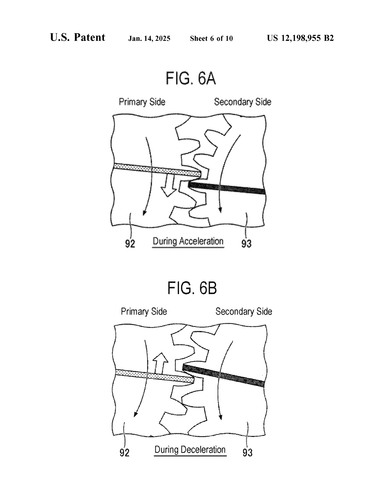
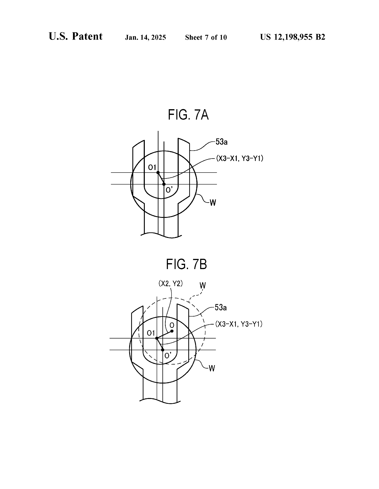

# US12198955B2 — 두 지점 실측으로 물리 모델을 보정하는 기판 이송 (Tokyo Electron)

| 항목 | 내용 |
|---|---|
| 원문 | `US12198955.pdf`(등록, 2025-01-14) · `US20230019299.pdf`(공개 US2023/0019299 A1, 2023-01-19) |
| 출원인 | Tokyo Electron Limited (발명자 Wataru Matsumoto), 출원 2022-07-05 |
| 우선일 | 2021-07-14 (JP2021-116712) |
| 핵심 | 이송 로봇의 열팽창(링크 길이 증가)과 기어 백래시(축간 거리 증가에 따른 각도 지연, 가속·감속에 따라 방향이 바뀜)로 홀더 위치가 변한다. 같은 기판을 겟(로드락 쪽 센서)과 풋(처리 챔버 쪽 센서) 두 지점에서 실측해, 이상적으로 같아야 할 두 "참 편차량"의 차이 A로 열변위 물리 모델의 오차를 보정한다(A/2 평균 보정 또는 오차 인자 β(ΔT) 피팅). |
| 관련도 | ○ 원인(백래시·영점 변동)과 해결 원리가 같음, 측정 수단(광전 센서)·대상(기판 편심)은 다름 |
| 본 과제와의 관계 | P5 해결 원리. 가속/감속(=접근 방향)에 따라 백래시 오차 방향이 바뀐다는 점을 명시하고, "같은 물체를 두 번 재면 같아야 한다"는 조건으로 모델 오차를 걸러 낸다. 백래시 방향 추정 자체는 정성적(가속/감속 상태로 판정)이며 별도 수식은 없다. |
| 링크 | [Google Patents](https://patents.google.com/patent/US12198955B2/en) |

---

## 상세 요약 (번역본 기준)

### 1. 해결하려는 문제
- 진공 이송 로봇은 모터 발열, 고온 처리 챔버, 처리 직후 뜨거운 기판에서 열을 받아 암이 길이 방향으로 늘어난다.
- 기어 쌍(Fe 구동 기어 + Al 피동 기어)의 열팽창 계수 차로 축간 거리가 늘어 백래시가 커지고, 관절 회전 시 각도 전달 오차(각도 지연)가 생긴다.
- 이 오차의 방향은 모터의 가속/감속 상태에 따라 반대가 된다(도 6A·6B). 측정 위치(가속 중 통과)와 목표 위치(감속 후 정지)에서 방향이 다르다(도 5A·5B).
- 종래(JP2007-027378)는 여러 검출부 중 하나를 기준으로 열팽창 보정만 했다. 열변위를 물리 모델로 추정하면 모델 오차가 항상 남아 위치 보정 정확도에 한계가 있다.

### 2. 핵심 구성
| 구성 | 부호 | 역할 |
|---|---|---|
| 기판 이송 기구 | 5 | 다관절 암: 베이스 50, 암 51~54, 회전축 55·56·57, 홀더 53a·54a |
| 축 모터·기어 | 91·92·93 / 94·95·96 / 97·98·99 | 관절 구동. 기어 축간 거리 Lg1·Lg2·Lg3, 링크 길이 L1·L2 |
| 각도 센서 | 91a, 94a, 97a | 모터 회전 각도 검출 |
| 온도 센서(열전대) | 81·82(암 51), 83·84(암 52) | 암 온도(두 센서 평균), 기어 온도 |
| 센서 유닛(측정부) | 6 (6a·6b 광전 센서) | 챔버마다 하나, 통과하는 기판 외곽 4점 검출 → 기판 중심 → 홀더 기준 위치 대비 편심 |
| 열팽창량 추정부 | 71 | 암 온도 × 열팽창 계수 × 기준 링크 길이 |
| 각도 전달 오차 추정부 | 72 | 기어 온도, 두 기어 열팽창 계수 차, 기준 축간 거리 → 백래시 각도 오차량 |
| 각도 오차 방향 추정부 | 73 | 각 축 모터의 가속/감속 상태로 오차 방향 판정 |
| 이송 위치 보정부 | 74 | 두 지점 참 편차량 차이로 물리 모델 보정, 위치 보정량 산출 |

- 기호: (X3, Y3) 풋 시 센서 검출값(홀더 기준 대비 기판 중심 편차), (X1, Y1) 풋 시 측정 위치의 홀더 열변위, (X2, Y2) 목표 스테이지에서의 홀더 열변위, (X3', Y3')·(X1', Y1') 겟 시 같은 양.
- 참 편차량: 풋 (X3−X1, Y3−Y1), 겟 (X3'−X1', Y3'−Y1'). 이송 중 온도 변화가 작으면 둘은 같아야 한다.
- 위치 보정량 = −(참 편차량 + 스테이지 열변위) → X: −X3−X2+X1, Y: −Y3−Y2+Y1 (원문 표기 (−X3-X2+X1, Y3-Y2+Y1)).
- 열변위 물리 모델(X1, 풋 시; Ω = 풋 시 관절 각도 설계값, Ω' = Ω + ΔΩ, ΔΩ = 기어 축간 거리 증가에 의한 각도 지연, ΔT에 비례):
  - 식 (1) X1 = L1 cos Ω1'·α1ΔT + L2 cos Ω2'·α2ΔT + L3 cos Ω3'·α3ΔT + L1(cos Ω1' − cos Ω1) + L2(cos Ω2' − cos Ω2) + L3(cos Ω3' − cos Ω3)
  - 식 (2) X1' : 같은 꼴, 겟 시 관절 각도 Θ, Θ' = Θ + ΔΘ.
  - 앞 3항은 링크 열팽창, 뒤 3항은 백래시 각도 지연에 의한 변위.
- 보정 방법 1(평균): A = (X3−X1) − (X3'−X1'), 식 (3) X1(Ave) = X1 + A/2 → 보정량 −X3−X2+X1(Ave). X2는 초기 모델 그대로.
- 보정 방법 2(피팅): 식 (4)·(5) = 식 (1)·(2) + β(ΔT) (ΔT 비례·제곱·지수 등). (X3−X1)−(X3'−X1') = 0이 되도록 L1~L3, 각도, α, β, ΔT를 선형 계획법·기계 학습 등으로 피팅 → X1(True). 같은 물리량으로 식 (6) X2(True) = (ξ: 목표 위치 관절 각도, Δξ = ΔΩ) + β(ΔT) → 보정량 −X3−X2(True)+X1(True).

### 3. 동작 순서 (도 8, 9, 10, 11)
1. ST1: 로드락 스테이지(21)에서 홀더(53a)로 기판 수취.
2. ST2(겟): 홀더 후퇴 중 로드락 쪽 센서 유닛(제1 측정부) 통과 → (X3'−X1', Y3'−Y1').
3. ST3(풋): 처리 챔버 쪽으로 신장 중 그쪽 센서 유닛(제2 측정부) 통과 → (X3−X1, Y3−Y1).
4. ST4: 두 참 편차량 차이를 풋 시 열변위 물리 모델에 반영해 보정.
   - 제1 예(도 9): ST4-1 X1(Ave)=X1+A/2 → ST5-1 보정량 −X3−X2+X1(Ave).
   - 제2 예(도 10): ST4-11 피팅으로 X1(True) → ST4-12 식 (6)으로 X2(True) → ST5-11 보정량 −X3−X2(True)+X1(True).
5. ST5: 보정량 산출. ST6: 홀더 위치 보정 후 스테이지(41)에 전달.
6. 다른 예(도 11): ST11~ST16은 같고, ST17에서 추정 물리량(파라미터)과 온도를 한 세트로 저장 → 온도-물리량 테이블(또는 신경망)로 다음 추정. 추정이 테이블에서 크게 벗어나면 잔차와 테이블 이탈량의 균형으로 결정. 경년 변화·기기 간 차이에 대응.

### 4. 청구항 요지 (16항)
- 청구항 1(방법)·9(시스템): 제1 스테이지 인접 제1 광전 센서와 제2 광전 센서로 각 측정 위치에서 "검출값 + 홀더 열변위"로 제1·제2 참 편차량 산출 → 그 차이를 제2 측정 위치 열변위 물리 모델에 반영해 모델 오차 감소 → 보정 모델·제2 센서 검출값·제2 스테이지 열변위로 위치 보정량 산출 → 홀더 보정 후 전달.
- 2·10: 차이를 반영한 보정항을 초기 물리 모델에 더함. 3·11: 차이의 ½을 더함(식 3).
- 5·13: 제1·제2 초기 모델에 온도 함수 오차 인자를 더하고 (제2 참 편차량 − 제1 참 편차량) = 0이 되도록 물리량 피팅.
- 6·14: 제2 스테이지 열변위 모델(제3 초기 모델)에도 오차 인자를 더하고 피팅된 물리량을 참값으로 사용.
- 7·15: 추정 물리량(파라미터)과 온도를 한 세트로 저장.
- 4·8·12·16: 복수 암 + 모터의 다관절 구조.

### 5. 대표 도면

*도 6A·6B — 같은 회전 방향이라도 가속 시에는 구동 기어(92)가 피동 기어(93)를 밀고, 감속 시에는 피동 기어가 구동 기어를 밀어 이 접촉면이 바뀐다 → 백래시 오차 방향(흰 화살표)이 반대*

*도 7A·7B — 측정 위치의 참 편차량 (X3−X1, Y3−Y1)과 스테이지에서의 열변위 (X2, Y2)*

### 6. 본 과제(Y·Θ 얼라인먼트)와 비교
- 같은 점:
  - 원인이 같다(P5): 기어 백래시로 실제 각도가 지령 각도보다 늦거나 앞서며, 그 방향이 구동 방향(가속/감속 = 어느 쪽 이면이 닿는가)에 따라 바뀐다. 본 과제의 "접근 방향에 따라 영점이 −0.85~0 px 달라짐"과 같은 현상이다.
  - 백래시 오차를 "방향(부호)"과 "크기"로 나눠 다룬다(추정부 72·73). 본 과제의 "접근 방향별 영점 2개 모형"은 이 방향 구분을 측정값에서 직접 두 값으로 두는 형태다.
  - 장비 기하(링크 길이·관절 각도·축간 거리)를 물리 모델로 두고, 실측으로 그 파라미터를 고친다 → P4(장비 기하 미보정)와도 접점.
- 다른 점:
  - 측정 대상은 홀더 위 기판의 편심(X·Y)이며 광전 센서 2개로 잰다. 카메라·마커·Θ(회전) 추정은 없다.
  - 영점 변동의 주원인을 온도(ΔT)로 보고 백래시 크기를 ΔT에 비례하는 각도 지연으로 모델링한다. 본 과제는 온도 정보가 없고, 변동이 촬영 묶음(세션) 단위로 나타난다.
  - 백래시 방향 추정은 가속/감속 상태로 정성적으로 판정할 뿐 수식이 없다. 두 지점 차이 A도 백래시 방향 성분을 따로 떼어 내지 않고 모델 오차 전체로 흡수한다.
  - 같은 기판을 두 번 잰다는 "자기 일치(self-consistency)" 조건으로 보정하므로 외부 기준(지그·참값)이 필요 없다. 본 과제는 QR 판이라는 외부 기준이 있다.
- 참고할 점:
  - 해결하는 원인: **P5(백래시·영점 변동)**, 보조로 **P4(장비 기하 미보정)**.
  - 자기 일치 조건: "같은 물리량을 서로 다른 조건(겟/풋 ≈ 접근 방향 +/−)에서 두 번 재면 같아야 한다"를 잔차 A로 두고 A=0이 되게 모델 파라미터를 맞춘다. 본 과제에서는 같은 목표 위치를 +방향·−방향으로 접근해 찍은 두 측정의 차이를 백래시 항(접근 방향 부호 × b)으로 두고, 나머지를 공통 영점으로 추정하면 된다.
  - 간단 보정(A/2 평균, 식 3)과 정밀 보정(오차 인자 β 피팅, 식 4~6)의 2단계 구성: 본 과제도 1단계로 접근 방향별 영점 2개의 평균·반차(= 공통 영점, 백래시 반폭)를 쓰고, 2단계로 Y·T 추정식에 방향 부호 항을 넣어 함께 맞추는 순서가 자연스럽다.
  - 파라미터와 조건을 한 세트로 저장하고 테이블·신경망으로 다음 추정에 쓰는 방식(ST17): 본 과제의 "촬영 묶음마다 영점 변동"에 대해, 묶음 시작 시 짧은 왕복 측정으로 영점·백래시를 다시 잡고 묶음 ID와 함께 기록해 경향(시간·온도·접근 방향)을 보는 데 쓸 수 있다. 추정이 기록 경향에서 크게 벗어나면 잔차와 이탈량의 균형으로 정하는 규칙도 이상치 방어로 쓸 만하다.
  - 본 과제에서 할 일:
    1. 같은 목표 위치를 양방향으로 접근해 찍는 측정 순서를 정하고, 두 측정 차이로 백래시 반폭(현재 관측 0~0.85 px)과 공통 영점을 분리한다.
    2. Y·T 추정 모형에 "접근 방향 부호 × 백래시" 항을 넣고 자기 일치 잔차(A)를 보정 품질 지표로 기록한다.
    3. 촬영 묶음마다 영점·백래시 추정값을 저장해 묶음 간 변동이 온도·시간·이동 이력 중 무엇과 따라가는지 확인한다.

---

> **같은 특허의 다른 폴더:** `문헌연구/04_Y_T_오차_보정/특허/05_US12198955_TEL_두지점측정차_물리모델보정` (요약만). 두 폴더는 주제 관점이 달라 요약을 따로 두었다.
