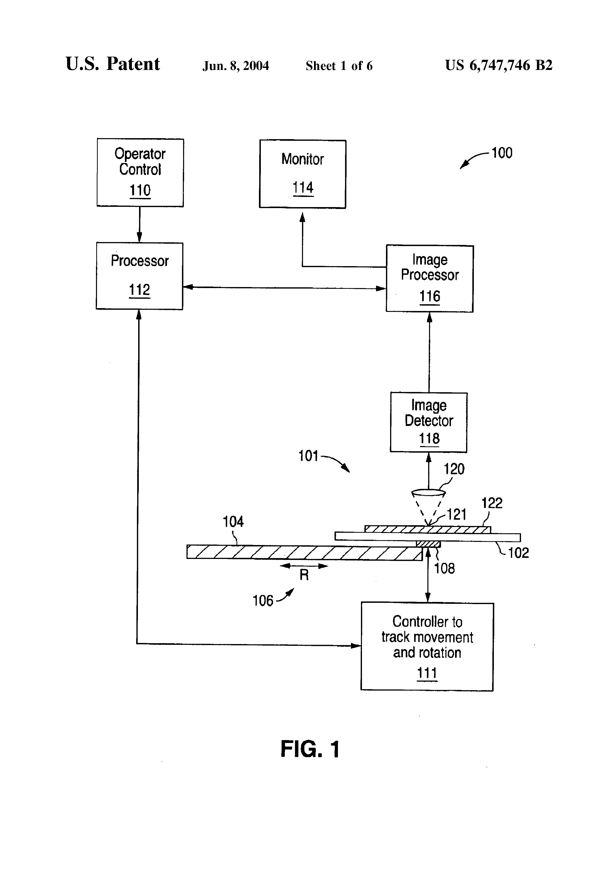
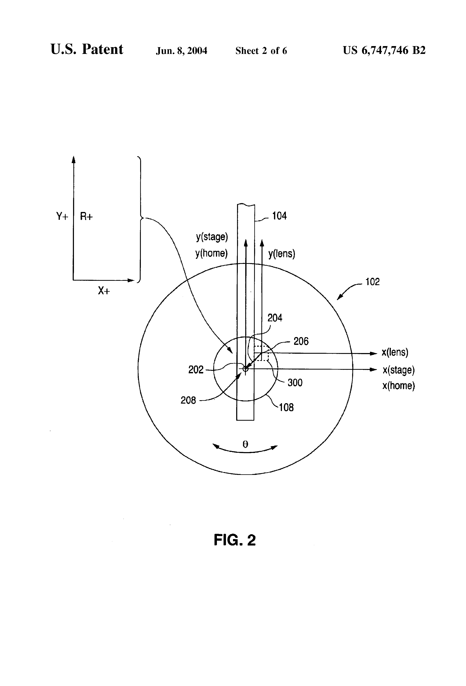
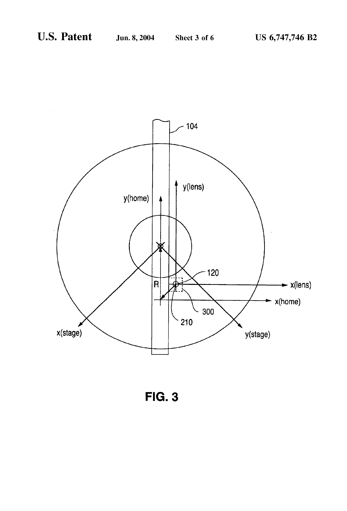
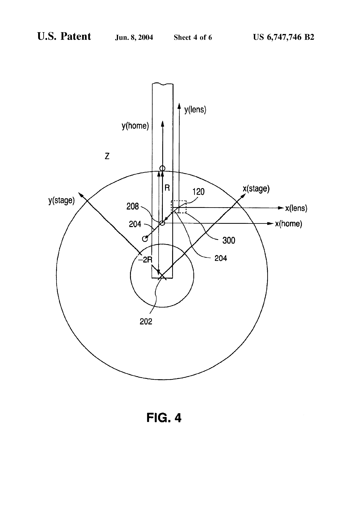
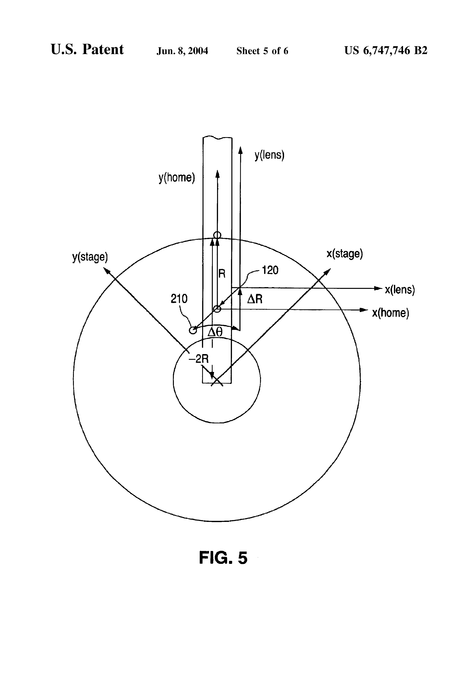
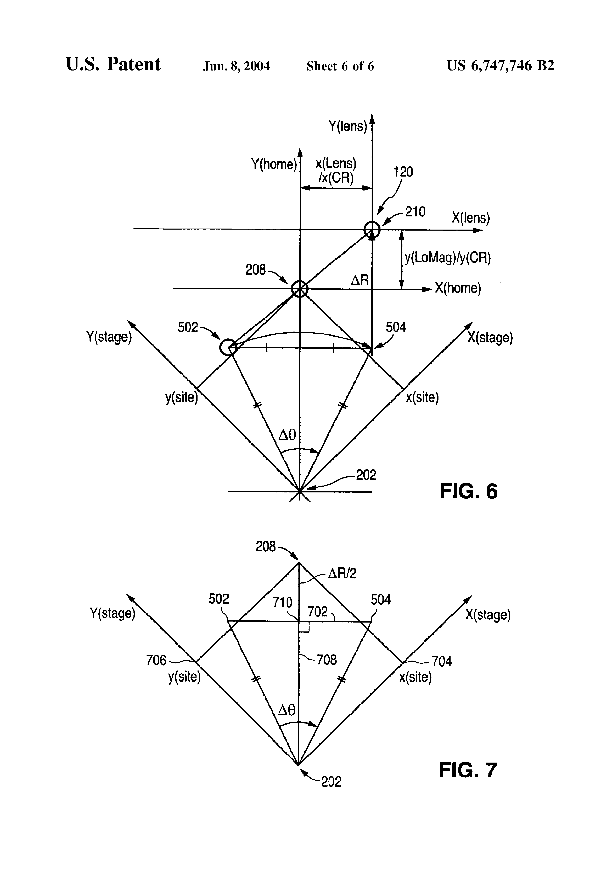

# R-θ 스테이지의 회전 중심을 찾는 시스템 및 방법 (US6747746B2)
- 원제: System and method for finding the center of rotation of an R-theta stage
- 원문: 같은 폴더의 `US6747746.pdf`(등록본), `US20030025919.pdf`(공개본), https://patents.google.com/patent/US6747746B2/en
- 번역 기준: USPTO 등록본 PDF(스캔 이미지)를 문자 인식(OCR)해 얻은 원문 텍스트를 한국어로 옮김. 조사 당일 Google Patents가 자동 접근을 막아(HTTP 503) 그 텍스트를 쓰지 못했다. 식과 그리스 문자(ΔΘ, ΔR)는 PDF 화상으로 확인했다. 원문 오기(예: "fist step", "filed of view", 청구항 6·7의 표기)는 고치지 않았다.
- 도면: 원문 PDF 도면 시트 6장(도 1~7)을 도면/ 폴더에 넣고 본문에서 처음 설명되는 곳에 삽입함

## 요약

시야와 R-θ 스테이지(극좌표 스테이지)의 회전 중심 사이의 오프셋을 결정하는 절차를 사용하는 광학 검사 시스템과 방법. 이 오프셋을 결정하면 웨이퍼 위에서 검사되는 사이트의 정확한 위치를 결정할 수 있다. 이 시스템과 방법은, R-θ 시스템에서는 특정 사이트를 광학 검사 시스템의 촬상 시스템 렌즈 아래에 위치시키는 R-θ 스테이지의 위치가 두 개뿐일 수 있다는 사실을 이용한다. 특정 사이트가 시야에 위치하는 제1 위치에서, 특정 사이트가 시야에 위치하는 제2 위치로 스테이지를 이동시킴으로써 오프셋을 결정할 수 있다.

## 청구범위

청구하는 것은 다음과 같다.

1. 시료를 검사하는 검사 시스템으로서,

척과 트랙을 가진 극좌표 스테이지 — 상기 척과 상기 트랙은 상기 척이 상기 트랙을 따라 서로 다른 위치로 이동할 수 있도록 결합되고, 상기 척은 회전 중심을 중심으로 회전할 수 있음 —;

상기 척 위에 위치한 시료에서 반사된 탐침 빔을 받는, 시야를 가진 광학 촬상 시스템; 및

상기 트랙에 대한 상기 척의 위치를 제어하고, 시료 위의 사이트를 상기 시야에 위치시키는 것으로부터 얻은 제1 정보를 사용해 상기 시야의 중심으로부터 상기 극좌표 스테이지의 상기 회전 중심까지의 오프셋을 결정하는 프로세서 시스템을 포함하며, 상기 제1 정보는 검사되는 시료 위 사이트의 위치를 결정하는 데 사용되는, 검사 시스템.

2. 제1항에 있어서, 상기 제1 정보는 제1 사이트를 상기 시야에 위치시키고, 그런 다음 상기 척을 180도 회전시키고 상기 척을 제1 거리의 두 배와 같은 거리만큼 이동시킨 뒤 — 상기 제1 거리는 제1 위치에 있는 척과 홈 위치 사이의 거리에 해당함 — 상기 제1 사이트를 상기 시야에 위치시킴으로써 결정되는, 검사 시스템.

3. 제2항에 있어서, 작업자가 상기 척의 위치를 제어할 수 있도록 상기 프로세서에 결합된 작업자 조작부를 더 포함하고;

상기 제1 사이트가 상기 시야에 위치하고 상기 척이 180도 회전되어 상기 제1 거리의 두 배와 같은 거리만큼 이동된 뒤, 상기 작업자는 상기 작업자 조작부를 사용해 상기 제1 사이트를 상기 시야에 위치시키며, 상기 프로세서 시스템은 상기 제1 사이트를 상기 시야에 위치시키는 데 필요한 회전량과 이동량에 해당하는 정보를 저장하는, 검사 시스템.

4. 제2항에 있어서, 상기 프로세서는, 상기 제1 사이트가 상기 시야에 위치한 뒤 상기 프로세서가 상기 척을 180도 회전시키고 상기 제1 거리의 두 배와 같은 거리만큼 이동시키도록 프로그래밍되는, 검사 시스템.

5. 제4항에 있어서, 작업자가 상기 척의 위치를 제어할 수 있도록 상기 프로세서에 결합된 작업자 조작부를 더 포함하고;

상기 제1 사이트가 상기 시야에 위치하고 상기 척이 180도 회전되어 상기 제1 거리의 두 배와 같은 거리만큼 이동된 뒤, 상기 작업자는 상기 작업자 조작부를 사용해 상기 제1 사이트를 상기 시야에 위치시키며, 상기 프로세서 시스템은 상기 제1 사이트를 상기 시야에 위치시키는 데 필요한 회전량과 이동량에 해당하는 정보를 저장하는, 검사 시스템.

6. 제1항에 있어서, 상기 제1 정보는, 상기 척을 제1 각도만큼 회전시키고 홈 위치로부터 제1 거리만큼 이동시켜 제1 사이트를 상기 시야에 위치시킨 제1 위치에 상기 척을 두고, 그런 다음 상기 척을 180도 회전시키고 스테이지를 상기 제1 거리의 두 배와 같은 거리만큼 이동시켜 상기 척을 제2 위치에 두며, 그런 다음 상기 척을 제2 각도 ΔΘ만큼 회전시키고 상기 척을 제2 거리 ΔR만큼 이동시켜 상기 제1 사이트를 상기 시야에 위치시킴으로써 결정되고, 상기 프로세서는 상기 척이 상기 제2 위치에 있을 때 홈 위치의 상기 회전 중심의 위치를 x 및 y 좌표로 결정하며 — 이 좌표를 x(site), y(site)라 함 —; 상기 프로세서는 다음 식을 사용해 상기 제1 정보를 결정하도록 프로그래밍되는, 검사 시스템:

y(lens)=ΔR/2, 및

x(lens)=tan(ΔΘ/2)·[(x(site)²+y(site)²)^1/2−ΔR/2].

7. 프로세서 시스템과 시료를 지지하는 척을 포함하는 극좌표 스테이지를 가진 검사 시스템에서, 극좌표 스테이지의 회전 중심과 촬상 시스템의 시야 중심 사이의 오프셋을 결정하는 방법으로서,

제1 사이트가 상기 시야에 위치하도록, 홈 위치로부터 제1 거리에 있는 제1 위치로 상기 척을 이동시키는 단계;

상기 척이 제2 위치에 있도록 상기 척을 180도 회전시키고 상기 척을 상기 제1 거리의 두 배만큼 이동시키는 단계;

상기 척이 상기 제1 사이트가 상기 시야에 위치하는 제3 위치에 있도록 상기 척의 위치를 조정하는 단계;

상기 척의 위치를 상기 제2 위치에서 상기 제3 위치로 조정하는 것과 관련된 회전 각도 ΔΘ와, 상기 척의 위치를 상기 제2 위치에서 상기 제3 위치로 조정하는 것과 관련된 거리 ΔR을 사용해, 상기 극좌표 스테이지가 홈 위치에 있을 때의 회전 중심과 상기 시야의 중심 사이의 오프셋을 결정하는 단계; 및

상기 오프셋을 사용해 웨이퍼 위 특정 위치를 상기 시야에 위치시키도록 상기 척의 이동을 제어하는 단계를 포함하는, 방법.

8. 제7항에 있어서, 상기 척을 상기 제1 위치에서 상기 제2 위치로 이동시키도록 상기 프로세서 시스템을 프로그래밍하는 단계를 더 포함하는, 방법.

9. 제8항에 있어서, 작업자 입력을 상기 프로세서 시스템으로 전송하고, 그에 응답해 상기 프로세서 시스템이 상기 척을 상기 제2 위치에서 상기 제3 위치로 이동시키는 단계를 더 포함하는, 방법.

10. 제7항에 있어서,

홈 위치 회전 중심의 x 좌표 x(site)를, 상기 척이 상기 제2 위치에 있을 때의 상기 척의 위치에 대한 상대값으로 결정하는 단계; 및

홈 위치 회전 중심의 y 좌표 y(site)를, 상기 척이 상기 제2 위치에 있을 때의 상기 척의 위치에 대한 상대값으로 결정하는 단계를 더 포함하는, 방법.

11. 제10항에 있어서, 상기 프로세서가 다음 식을 사용해 상기 시야로부터 상기 회전 중심까지의 오프셋을 결정하게 하는 단계를 더 포함하는, 방법:

y(lens)=ΔR/2, 및

x(lens)=tan(ΔΘ/2)·[(x(site)²+y(site)²)^1/2−ΔR/2],

여기서 y(lens)와 x(lens)는 상기 척이 홈 위치에 있을 때 상기 회전 중심에 대한 상기 시야의 위치에 해당한다.

12. 시야를 가진 촬상 시스템과 시료를 지지하는 척을 포함하는 스테이지를 가진 검사 시스템에서, 상기 스테이지의 회전 중심과 상기 시야의 중심 사이의 오프셋을 결정하는 방법으로서,

제1 사이트가 상기 시야에 위치하는 것에 기초해 상기 척을 제1 위치에 위치시키는 단계;

상기 제1 사이트가 상기 시야에 위치하도록 상기 척을 제2 위치에 위치시키는 단계;

상기 제1 위치와 상기 제2 위치 사이의 차이를 결정하는 단계; 및

상기 제1 위치와 상기 제2 위치 사이의 차이를 사용해 상기 스테이지의 회전 중심과 상기 시야의 중심 사이의 오프셋을 계산하는 단계를 포함하는, 방법.

13. 제12항에 있어서, 상기 오프셋을 사용해 상기 척의 위치 결정을 제어하는 단계를 더 포함하는, 방법.

14. 제12항에 있어서, 상기 제1 위치와 상기 제2 위치 사이의 차이를 회전 각도 ΔΘ와 이동 거리 ΔR로 결정하는 단계를 더 포함하는, 방법.

15. 제14항에 있어서, 상기 척이 상기 제1 위치에 있을 때의 상기 척에 대한, 홈 위치 회전 중심의 x 및 y 좌표 x(site), y(site)를 결정하는 단계를 더 포함하는, 방법.

16. 제14항에 있어서, 다음 식을 사용해 상기 시야와 상기 회전 중심 사이 오프셋의 y 성분을 결정하는 단계를 더 포함하는, 방법:

y(lens)=ΔR/2.

17. 제15항에 있어서, 다음 식을 사용해 상기 시야와 상기 회전 중심 사이 오프셋의 x 성분을 결정하는 단계를 더 포함하는, 방법:

x(lens)=tan(ΔΘ/2)·[(x(site)²+y(site)²)^1/2−ΔR/2].

18. 제15항에 있어서,

다음 식을 사용해 상기 시야와 상기 회전 중심 사이 오프셋의 x 성분을 결정하는 단계:

x(lens)=tan(ΔΘ/2)·[(x(site)²+y(site)²)^1/2−ΔR/2]; 및

다음 식을 사용해 상기 시야와 상기 회전 중심 사이 오프셋의 y 성분을 결정하는 단계를 더 포함하는, 방법:

y(lens)=ΔR/2.

19. 시료를 검사하는 검사 시스템으로서,

척이 트랙을 따라 서로 다른 위치로 이동할 수 있고 회전 중심을 중심으로 회전할 수 있도록 트랙에 결합된 척을 가진 스테이지;

시야를 가진 광학 촬상 시스템; 및

상기 트랙에 대한 상기 척의 위치를 제어하고, 상기 시야의 중심과 상기 회전 중심 사이의 오프셋에 해당하는 제1 정보를 사용해 검사되는 웨이퍼 위 사이트의 위치를 결정하는 프로세서 시스템을 포함하는, 검사 시스템.

20. 회전 중심을 가진 스테이지와 시야를 가진 촬상 시스템을 가진 검사 시스템에서, 검사되는 웨이퍼 위 사이트의 위치를 결정하는 방법으로서,

스테이지 홈 위치를 설정하는 단계;

프로세서를 사용해 상기 스테이지의 위치를 제어하는 단계; 및

상기 회전 중심과 상기 시야의 중심 사이의 오프셋을 사용해, 상기 검사 시스템이 검사하는 사이트의 위치를 상기 스테이지 홈 위치에 대해 결정하는 단계를 포함하는, 방법.

21. 프로세서 시스템과 시료를 지지하는 척을 포함하는 스테이지를 가진 검사 시스템에서, 상기 스테이지의 회전 중심과 시야 중심을 가진 촬상 시스템 사이의 오프셋을 결정하는 방법으로서,

시료 위의 제1 사이트가 시야에 위치하도록, 홈 위치로부터 제1 거리에 있는 제1 위치로 상기 스테이지의 척을 이동시키는 단계;

상기 제1 사이트가 상기 시야에 위치하는 제2 위치로 상기 척을 이동시키는 단계; 및

상기 제2 위치와, 상기 척이 상기 제1 위치에서 180도 회전되고 상기 제1 위치에서 상기 제1 거리의 두 배만큼 이동된 제3 위치 사이의 차이를 사용해 상기 오프셋을 결정하는 단계를 포함하는, 방법.

## 상세한 설명

### 관련 출원 (RELATED APPLICATION)

본 출원은 2001년 7월 16일 출원된 미국 가출원 60/305,761호 "ALGORITHM FOR FINDING THE CENTER OF ROTATION OF AN R-THETA STAGE"의 이익을 주장하며, 이 가출원은 여기에 참조로 포함된다.

### 기술 분야 (TECHNICAL FIELD)

광학 계측 시스템은 반도체 웨이퍼의 마이크론 및 서브마이크론 수준의 세부를 검사하는 데 사용된다. 본 발명은 그러한 시스템에 관한 것으로, 웨이퍼 위에서 검사되는 사이트의 정확한 위치를 결정할 수 있도록 시스템 구성요소들의 서로에 대한 위치를 결정하는 것을 제공한다.

### 발명의 배경 (BACKGROUND OF THE INVENTION)

광학 계측 시스템은 반도체 산업에서 반도체 웨이퍼의 특성을 촬상하고 측정하는 데 사용된다. 통상 웨이퍼는 이동 가능한 스테이지 위에 지지되어 광학 탐침 빔에 대해 주사된다. 과거에 가장 흔히 쓰인 시스템 형태는 사용자가 스테이지를 X와 Y 두 방향으로 움직일 수 있는 조작부를 가졌다. 이러한 X-Y 스테이지는 회전 마운트와 결합될 수도 있었다. 광학 계측 시스템에는 통상 작업자가 웨이퍼를 볼 수 있도록 광학계와 촬상 시스템이 마련된다.

광학 계측 시스템의 설치 면적을 줄이기 위해, 극좌표 스테이지라고도 하는 R-θ 스테이지가 개발되었다. 이 스테이지는 웨이퍼를 한 직선축(R)을 따라 움직이고 회전 중심을 중심으로 회전시킬 수 있다. 이러한 스테이지는 종래의 X-Y 스테이지보다 공간을 덜 쓰면서 웨이퍼의 어느 부분이든 탐침 빔 및 촬상 시스템과 정렬할 수 있다.

R-θ 스테이지에 촬상 시스템을 쓸 때의 한 가지 문제는 스테이지가 회전하면 시야도 회전한다는 점이다. 따라서 이 시야 회전을 보상하는 것이 바람직하다. 시야 회전의 영향을 다루는 한 가지 시스템이 2000년 12월 1일 공개된 유럽 특허 출원 EP 0 971 254와 미국 특허 6,320,609 B1에 논의되어 있다. 이 문헌들은 여기에 참조로 포함된다.

'609 특허의 도 1은 스테이지를 X와 Y 두 방향으로 움직일 수 있는 종래 X Y 스테이지를 보여 준다. 이러한 종래 시스템은 사용자가 스테이지를 회전시킬 수도 있게 한다. 스테이지를 X와 Y 두 방향으로 움직여, 사용자는 스테이지의 회전 중심을 광학 촬상 시스템의 시야 중심과 정렬할 수 있다. 스테이지의 회전 중심에 대한 광학 촬상 시스템의 시야, 또는 촬상 시스템 렌즈의 위치를 결정하는 데 쓰인 알고리즘들은 스테이지를 X와 Y 두 방향으로 정밀하게 제어할 수 있는 능력을 이용했다. 구체적으로, 이러한 종래 알고리즘은 X-Y-θ 스테이지가 제공하는 세 자유도를 이용하며, 임의의 θ 회전 뒤 스테이지(와 스테이지에 장착된 웨이퍼) 위의 어떤 점이든 시야 중심으로 가져올 수 있는 능력에 의존한다.

'609 특허에 기재된 시스템은 극좌표 스테이지의 회전 중심을 촬상 시스템의 시야 중심과 거의 일치시킬 수 있다고 가정한다. 실제로 이 정렬은 불가능하지는 않더라도 어렵다. 홈 위치에서 광학 촬상 시스템의 시야 중심이 스테이지의 회전 중심과 정렬되어 있지 않고 이 오프셋을 고려하지 않으면, 시스템은 검사되는 웨이퍼 위의 특정 위치를 시야 중심에 정확하게 위치시킬 수 없다. 따라서 광학 촬상 시스템의 시야 중심으로부터 스테이지 회전 중심의 정확한 변위량을 결정하고 그 오프셋을 보정하여, 웨이퍼 시료 위 사이트의 정확한 위치를 정확하게 제어할 수 있게 하는 것이 바람직하다.

### 발명의 내용 (SUMMARY)

본 발명은 검사 시스템의 광학 촬상 시스템 시야 안의 한 점과 극좌표 스테이지의 회전 중심 사이의 오프셋을 결정하는 시스템과 방법에 관한 것이다. 이 시스템과 방법은, 검사되는 웨이퍼 위의 특징적인 사이트를 극좌표 스테이지가 두 가지 가능한 방향 중 하나에 있을 때 시야에 위치시킬 수 있다는 사실을 이용한다. 이는 극좌표 스테이지를 사이트가 시야의 특정 위치에 오는 제1 위치에 두고, 그런 다음 극좌표 스테이지를 사이트가 다시 시야의 특정 위치에 오는 제2 위치에 두는 방식으로 이루어진다. 그런 다음 검사 시스템의 프로세서 시스템을 사용해, 극좌표 스테이지의 위치를 제1 위치에서 제2 위치로 바꾸는 데 필요한 스테이지의 움직임에 기초해 오프셋을 계산한다.

### 도면의 간단한 설명 (BRIEF DESCRIPTION OF DRAWINGS)

도 1은 본 발명의 광학 계측 시스템을 나타내는 도면이다.

도 2는 계측 시스템의 R-θ 스테이지의 평면도이다.

도 3은 시야와 R-θ 스테이지의 회전 중심 사이의 오프셋을 결정하는 과정의 한 단계를 나타내는 도면이다.

도 4는 시야와 R-θ 스테이지의 회전 중심 사이의 오프셋을 결정하는 과정의 다른 단계를 나타내는 도면이다.

도 5는 시야와 R-θ 스테이지의 회전 중심 사이의 오프셋을 결정하는 과정의 또 다른 단계를 나타내는 도면이다.

도 6은 도 5의 단계를 확대한 도면이다.

도 7은 시야와 R-θ 스테이지의 회전 중심 사이의 오프셋 계산에 쓰이는 치수를 강조한 도 5 단계의 도면이다.

### 상세한 설명 (DETAILED DESCRIPTION)

극좌표 스테이지라고도 하는 R-θ 스테이지의 회전 중심을 광학 촬상 시스템의 대물 렌즈, 또는 시야에 대해 찾는 시스템과 방법이 개발되었다. 본 발명의 광학 검사 시스템을 도 1에 나타낸다. R-θ 스테이지(101)는 두 자유도를 가진다. R-θ 스테이지는 트랙(104)과, 트랙을 따라 R축(106)으로 직선 이동할 수 있도록 트랙에 결합된 척(102)을 포함한다. 일 실시예에서 트랙(104)은 길이가 약 160 mm이며 직경 300 mm 웨이퍼를 측정하는 데 쓰인다. R-θ 스테이지(101)는 척(102)이 회전 중심을 중심으로 회전할 수 있도록 회전자(108)를 포함한다. 사용자는 프로세서 시스템(112)에 결합된 작업자 조작부(110)를 사용해 척(102)의 위치를 제어할 수 있다.

*도 1 — 광학 계측 시스템 100: R-θ 스테이지(트랙 104, 척 102, 회전자 108), 대물 렌즈 120, 화상 검출기 118, 화상 처리기 116, 프로세서 112*

광학 계측 시스템(100)은 모니터(114), 화상 처리기(116), 화상 검출기(118)를 포함하는 광학 촬상 시스템을 포함한다. 화상 검출기는 척 위에 위치한 웨이퍼(122) 위의 검출점(121)에서 반사되어 대물 렌즈(120)를 통과한 탐침 빔을 받는다. 웨이퍼(122)는 척(102)에 고정되어, 척(102)의 위치를 바꾸면 광학 촬상 시스템에 대한 웨이퍼의 위치가 바뀐다. 탐침 빔은 백색광원, 또는 광학 촬상 시스템에 쓰기에 적합한 다른 광원이나 에너지원을 포함할 수 있다. 화상 검출기(118)는 화상 처리기(116)에 결합되며, 화상 처리기는 화상 검출기(118)가 얻은 정보로 모니터(114)에 표시할 화상을 생성한다.

여기 논의의 일부는 특징적인 사이트를 촬상 시스템의 렌즈 아래에 위치시키는 것을 다룬다는 점에 유의해야 한다. 그러나 일부 실시예에서는 시스템이 렌즈 없이 구현될 수도 있다. 그러한 시스템에도 여기 가르침은 여전히 적용된다. 일반적으로 사이트가 촬상 시스템의 시야 중심에 나타날 때, 그 사이트는 촬상 시스템 렌즈 아래의 검출점에 위치한다. 당업자에게 분명하듯, 본 시스템을 사용하면 "렌즈"가 시스템의 일부이든 아니든 촬상 시스템의 시야와 스테이지 회전 중심 사이의 오프셋을 고려할 수 있다.

도 2는 R-θ 스테이지(101)의 트랙(104)을 내려다본 도면이다. 척(102)은 트랙(104)을 따라 이동할 수 있고 회전 중심(202)을 중심으로 회전할 수 있도록 트랙(104)에 장착된다. 대물 렌즈(120)는 점(206)에 위치하며, 이 위치는 촬상 시스템 시야(300)의 중심이기도 하다. 이상적으로는 스테이지(102)가 홈 위치(208)에 있을 때 렌즈(120)와 촬상 시스템의 시야 중심이 회전 중심(202) 위에 있을 것이다.

*도 2 — 회전 중심 202, 렌즈 위치 206(시야 300의 중심), 홈 위치 208, 둘 사이의 오프셋 204*

현실에서는 홈 위치(208)에서 촬상 시스템의 시야 중심을 회전 중심(202) 위에 기계적으로 정밀하게 정렬하는 것이 실용적이지 않으므로 작은 오프셋 거리(204)가 있다. 도 2의 R-θ 스테이지 시스템을 참조하면, 스테이지 위(웨이퍼 위)의 같은 점이 촬상 시스템의 시야 중심에 오는 스테이지 위치는 최대 두 개다(X-Y-θ 스테이지의 무한 개와 대조됨). 실제로 많은 R-θ 스테이지 시스템에서 웨이퍼 위의 사이트는 렌즈(120) 아래 시야 중심에서 오직 한 위치에서만 보이는데, 그러한 시스템에서는 트랙 위 웨이퍼(122)의 이동 거리가 일반적으로 검사되는 웨이퍼의 반지름이기 때문이다. 본 발명의 일 실시예에서는 트랙 위 웨이퍼의 이동 거리가 검사되는 웨이퍼의 반지름보다 약간 길어서, R-θ 스테이지의 회전 중심에 가까운 특징적인 사이트(210)를 골라 R-θ 스테이지가 두 위치 중 어느 하나에 있을 때 렌즈(120) 아래 시야(300)의 중심에 위치시킬 수 있다(아래에서 더 자세히 설명).

특징적인 사이트(210)를 시야(300)의 중심에 위치시키면 — 많은 실시예에서 이는 특징적인 사이트(210)가 렌즈(120) 아래에 위치하는 것에 해당함 — 척(102)을 180도 회전시키고 반경 방향으로 −2R만큼 이동시켜 특징적인 사이트를 두 번째로 시야 중심에 가져오도록 척을 제2 위치로 이동시킬 수 있다. 여기서 R은 사이트를 처음 시야 중심에 위치시킬 때 R-θ 스테이지가 홈 위치에서 이동한 거리이다.

여기 설명하는 절차는 대물 렌즈(120)의 좌표, 즉 시야 중심의 좌표를 스테이지 홈 좌표계에서 R-θ 스테이지의 회전 중심(202)에 대해 결정한다. 이 절차는 프로세서 시스템(112)을 프로그래밍하는 소프트웨어와, 트랙(104) 및 척을 트랙을 따라 움직이고 척(102)을 회전시키도록 척에 결합된 모터 등 R-θ 스테이지(101)의 척(102)을 움직이는 데 필요한 하드웨어를 사용한다. 프로세서 시스템(112)은 작업자 조작부(110)로부터 작업자 입력 신호를 받을 수 있고, 이 신호에 기초해 컨트롤러(111)가 척의 위치를 바꾸게 할 수 있다. 프로세서 시스템은 척을 자동으로 움직이도록 프로그래밍될 수도 있다.

이 시스템과 방법은 다음 좌표계를 사용한다. 홈 좌표계(x(home)와 y(home)로 나타냄)는 R-θ 스테이지(102)가 홈 위치(즉 (0,0))에 있을 때 R-θ 스테이지의 회전 중심(202)과 같은 점에 원점(208)을 가진다. Y+ 축은 양의 반경 방향 운동(R+) 축을 따라 향한다.

렌즈 좌표계(x(lens)와 y(lens)로 나타냄)는 대물 렌즈(120)의 중심(모니터 114에서 관찰되는 중심)을 중심으로 삼는다. 렌즈 좌표계는 시스템 시야(300)의 중심으로 볼 수도 있다. 간단히 하기 위해 여기서는 이 좌표계를 렌즈 좌표계라 한다. Y+ 축은 홈 좌표계의 Y+ 축과 같다(즉 스테이지의 양의 반경 방향 운동 축을 따름).

스테이지 좌표계(x(stage)와 y(stage))는 R-θ 스테이지 척의 기계적 중심인 회전 중심(202)을 가진다. 이 좌표계는 스테이지와 함께 회전하고 평행 이동한다. R-θ 스테이지에 장착된 웨이퍼(122) 위의 한 점은 스테이지가 어떻게 움직이든 스테이지 좌표계에서 같은 좌표를 가지지만, 홈 좌표계와 렌즈 좌표계에서의 좌표는 스테이지가 움직이면 바뀐다.

홈 위치에서 R-θ 스테이지의 회전 중심(202)을 대물 렌즈(120), 즉 시야(300)에 대해 결정하는 첫 단계는, R-θ 스테이지(102)의 회전 중심과 렌즈(120) 사이의 정렬 오차를 최소화하도록 (가로로 움직일 수 없는) 촬상 시스템(118)의 대물 렌즈(120)에 대해 (움직일 수 있는) R-θ 스테이지(101)의 가로 위치(가로 방향은 트랙 104에 수직인 방향)를 조정하는 것이다. 일 실시예에서 이 조정은 기계식 나사(도시 생략)로 할 수 있다. 나사를 돌려 스테이지(101)의 회전 중심의 가로 위치를 대물 렌즈(120)의 가로 위치와 가깝게(즉 약 10~20 마이크론) 정렬할 수 있다.

R-θ 스테이지(101)를 대물 렌즈(120)와 가깝게 정렬하면, 광학 촬상 시스템으로 R-θ 스테이지(101)에 장착된 웨이퍼(122)를 관찰할 수 있다. 이 시점에서 사용자는 작업자 조작부(110)로 R-θ 스테이지의 척을 움직여 특징적인 사이트가 모니터(114)에 표시된 시야(300)의 중심에 오도록 함으로써 웨이퍼 위의 특징적인 사이트를 선택할 수 있으며, 이는 사이트(210)가 렌즈(120) 아래에 있는 것에 해당한다. 특징적인 사이트(210)는 웨이퍼 중심에 가까운 것을 골라야 한다. 오프셋(아래에서 논의)이 더 작아지기 때문이다. 특징적인 사이트(210)를 선택하는 이 과정을 도 3에 나타냈으며, 여기서 특징적인 사이트(210)는 대물 렌즈(120) 아래에 위치한다. 일 실시예에서 특징적인 사이트(210)를 대물 렌즈(120) 아래에 위치시키면 특징적인 사이트(210)가 촬상 시스템의 시야(300) 중심에 놓이게 된다. 반드시 시야 중심일 필요는 없지만, 이 단계에서 특징적인 사이트가 촬상 시스템의 시야(300) 안 어딘가에 위치해야 한다는 점에 유의해야 한다. 도 3에서 홈 좌표계와 렌즈 좌표계는 바뀌지 않았지만, 특징적인 사이트(210)가 대물 렌즈(120) 바로 아래에 오도록 스테이지 좌표계는 바뀌었다는 점에 유의하라. 이는 R-θ 스테이지를 시계 방향으로 약 130도 회전시키고 스테이지를 트랙을 따라 거리 R만큼 이동시켜 이루어진다. (회전 각도와 거리는 예시를 위한 것이며, 여러 다른 위치를 선택할 수 있었다.)

*도 3 — 특징적인 사이트 210을 렌즈 120 아래(시야 300)에 위치시킨 상태: 스테이지 좌표계가 회전·이동*

특징적인 사이트(210)를 선택하면 스테이지를 180도 회전시키고 거리 −2R만큼 이동시킨다. 이 회전은 작업자가 작업자 조작부(110)로 할 수도 있고, 특징적인 사이트(210)를 선택한 뒤 프로세서 시스템(112)이 이 조정을 자동으로 하도록 프로그래밍할 수도 있다. 이 회전과 이동으로 특징적인 사이트(210)가 렌즈(120)의 시야 안으로 들어와야 하지만, R-θ 스테이지(101)의 회전 중심(202)은 이제 렌즈(120)의 반대편에 있다. 홈 위치(즉 홈 좌표계의 0,0)에서 렌즈(120)와 스테이지 회전 중심 사이에 오프셋(204)이 없다면, 이 절차로 특징적인 사이트(210)는 대물 렌즈(120)의 중심과 정확히 정렬될 것이다. 그러나 도 4에 나타낸 바와 같이, 렌즈(120)의 중심이 홈 좌표계의 중심에서 거리(204)만큼 어긋나 있기 때문에 특징적인 사이트(210)는 렌즈(120) 아래에 정렬되지 않는다.

*도 4 — 180도 회전 후 −2R 이동: 오프셋 204 때문에 사이트 210이 렌즈 120 바로 아래에 오지 않는다*

이 시점에서 작업자는 모니터(114)에 표시된 시야에서 특징적인 사이트(210)를 볼 수 있어야 한다. 그런 다음 작업자 조작부를 사용해 특징적인 사이트(210)가 대물 렌즈(120) 아래에 오도록 척(102)을 움직이며, 그 결과 사이트(210)가 시각적으로 시야 중심에 위치하게 된다. 도 5에 나타낸 바와 같이, 특징적인 사이트(210)를 대물 렌즈(120) 아래에 위치시키는 것은 척을 ΔΘ만큼 회전시키고 척을 트랙(104)을 따라 ΔR만큼 이동시켜 이루어진다. 처리 시스템(112)은 각 변위 ΔΘ와 반경 변위 ΔR의 값을 저장하고, 이 값들을 사용해 무엇보다도 척(102)이 원점(208)에 위치할 때 렌즈(120)와 회전 중심(202) 사이의 오프셋을 계산한다. 이 오프셋은 사용자가 웨이퍼 위의 특정 위치를 렌즈(120) 아래에 위치시킬 수 있도록 척의 위치 결정을 제어하는 데 사용된다.

*도 5 — 척을 ΔΘ 회전, ΔR 이동해 사이트 210을 렌즈 아래로 가져옴*

위 단계를 여러 다른 점에 대해, 바람직하게는 웨이퍼의 서로 다른 사분면에서 반복할 수 있다. 또한 웨이퍼 중심에서 점점 더 멀리 떨어진 특징적인 사이트를 선택할 수 있다. 오프셋을 결정하는 반복 과정은, 180도 회전하고 스테이지를 −2R만큼 이동시킨 뒤 선택한 특징적인 사이트를 렌즈 중심 바로 아래로 가져오는 데 사용자 조정이 필요 없고, 대신 프로세서 시스템(112)이 저장된 오프셋 정보를 사용해 180도 회전과 −2R 이동 뒤 특징적인 사이트를 렌즈 아래로 자동으로 가져올 수 있게 되면 완료된다. 실제로 사용자는 원점(208)에 위치한 렌즈(120)와 회전 중심(202) 사이의 오프셋(204)을 정확하게 결정하는 데 한 번의 반복으로 충분하다는 것을 알 수 있다.

도 6은 도 5를 확대한 도면으로, 특징적인 사이트(210)를 렌즈(120) 바로 아래로 가져오기 위한 위치 보정을 보여 준다. 이 도면은 홈, 렌즈, 스테이지 좌표계 사이의 관계를 결정하는 데 쓰이는 식을 설명하는 데 사용된다. 스테이지의 회전 중심(202)은 처음에 특징적인 사이트(210)가 점(502)에 있도록 위치한다. 척을 ΔΘ 회전시켜 사이트(210)를 점(504)으로 옮긴다. 그런 다음 척을 ΔR 이동시켜 사이트를 렌즈 아래에 위치시킨다.

*도 6 — 회전 전후 사이트 위치 502·504, 회전각 ΔΘ, 이동 ΔR, 렌즈 120·회전 중심 202·홈 208의 관계. 도 7 — 오프셋 계산 치수(ΔR/2, 선분 702·708, 점 710)*

도 6에 나타낸 바와 같이, 홈 위치(208)에 있을 때의 회전 중심(202)과 대물 렌즈(120) 사이의 Y(또는 R) 축 방향 위치 차이는 ΔR의 절반과 같으며, 여기서 ΔR은 특징적인 사이트(210)를 렌즈(120) 아래로 가져오기 위해 스테이지가 이동해야 하는 거리이다. 홈 위치(208)에서 렌즈(120)와 회전 중심(202)의 x 좌표 사이 거리를 결정하는 것은 더 복잡하다.

도 7은 도 6에 대응하며 x 오프셋 계산을 설명하는 데 도움이 된다. 홈 좌표계의 위치는 알려져 있고 시작점으로 정의되었으므로 x(site) 좌표(704)를 결정할 수 있다. 마찬가지로 스테이지 좌표계는 처음에 홈 좌표계와 정렬된 상태(회전 중심 202가 홈 좌표계의 원점 208과 정렬된 상태)에서 시작했고, 프로세서 시스템(112)이 척(102)의 이동을 제어하며 척의 이동 정보를 저장했으므로 알려져 있다. 마찬가지로 y(site)(706) 좌표도 알려져 있다. 홈 위치의 회전 중심(208)에서, 180도 회전하고 −2R 이동한 뒤 위치한 척(102)의 회전 중심(202)까지의 총 거리는 선(708)으로 나타나며 다음 식으로 결정된다:

208에서 202까지의 총 거리=[x(site)²+y(site)²]^1/2.

도 6은 점(502)과 점(504)을 잇는 선에서 점(208)까지의 거리가 ΔR/2임을 보여 준다. 202와 504를 잇는 선, 504에서 710까지의 선(선 702), 710에서 202까지의 선으로 정의되는 삼각형을 사용해 선(702)의 거리를 결정할 수 있다. 각도 ΔΘ는 알려져 있다. 선(702)을 포함하는 삼각형의 각은 ΔΘ/2이다. 202에서 710까지의 선은 (208에서 202까지의 선)−ΔR/2와 같다. 따라서 ΔΘ/2의 탄젠트에 710에서 202까지 선의 길이를 곱하면 선(702)의 길이를 얻는다. 이러한 원리를 사용해 홈 좌표계에서 렌즈(120) 중심의 위치를 결정할 수 있고, 반대로 다음 식으로 렌즈 좌표에서 홈 위치에 있는 스테이지의 회전 중심을 결정할 수 있다.

| | |
|---|---|
| 홈 좌표계에서의 렌즈: | y(lens) = ΔR/2   x(lens) = tan(ΔΘ/2) · [(x(site)² + y(site)²)^1/2 − ΔR/2] |
| 렌즈 좌표계에서의 회전 중심: | y(CR) = −ΔR/2 = −y(lens)   x(CR) = −tan(ΔΘ/2) · [(x(site)² + y(site)²)^1/2 − ΔR/2] = −x(lens) |

오프셋이 결정되면 프로세서 시스템(112)이 사용하는 내부 소프트웨어 파라미터를 마지막으로 계산한 회전 중심 좌표로 갱신한다. 이 값은 이후 소프트웨어에서 회전 중심 오프셋을 보상하는 데 쓰이며, 이로써 사용자는 광학 검사 시스템으로 관찰하는 사이트의 정확한 좌표를 결정하고 웨이퍼 위치와 렌즈의 위치를 제어할 수 있다.

위에서 설명한 동작은 초기 위치에서 스테이지를 180도 회전시키고 −2R만큼 이동시킨 뒤 특징적인 사이트를 렌즈 아래로 옮기는 것을 제공한다는 점에 유의해야 한다. 이 방법은 비교적 빠르고 효율적이지만, 특징적인 사이트를 제2 위치에서 렌즈 아래로 가져오는 다른 어떤 웨이퍼 이동 방법도 쓸 수 있다. 예컨대 작업자에게 조작권을 주어 웨이퍼를 제2 위치로 그냥 몰고 가 촬상 시스템으로 렌즈와 특징적인 사이트를 정렬하게 할 수 있다. 그러면 프로세서가 이 제2 위치에 해당하는 실제 스테이지 좌표와, 렌즈와 스테이지 회전 중심이 정렬되어 있었다면 기대되었을 스테이지 좌표 사이의 차이를 결정하고 그 차이를 사용해 오프셋을 결정한다.

R-θ 스테이지(101)와 렌즈(120)는 통상 재조정 없이 오랜 기간 작동할 수 있도록 장착된다. 여기 설명한 정렬 절차는 시스템의 스테이지(101)나 광학 요소를 교체하거나 옮기거나 바꿀 때만 수행하면 된다. 여기 개시한 방법과 시스템은 R-θ 스테이지 같은 회전 가능한 스테이지에 특히 적용할 수 있지만, X와 1/2 Y 스테이지 같은 다른 회전 가능한 스테이지에도 활용할 수 있다는 점에 유의해야 한다.

본 발명의 방법과 장치를 현재 바람직한 실시예와 대안 실시예로 설명했지만, 당업자는 첨부한 청구범위의 취지와 범위 안에서 변형과 변경을 가해 본 발명을 실시할 수 있음을 알 것이다. 따라서 명세서와 도면은 제한적이 아니라 예시적인 것으로 보아야 한다. 또한 일부 실시예만 자세히 설명했지만, 통상의 기술자는 그 가르침에서 벗어나지 않고 많은 변형이 가능함을 확실히 이해할 것이다. 그러한 변형은 모두 다음 청구범위에 포함되는 것으로 의도된다.
