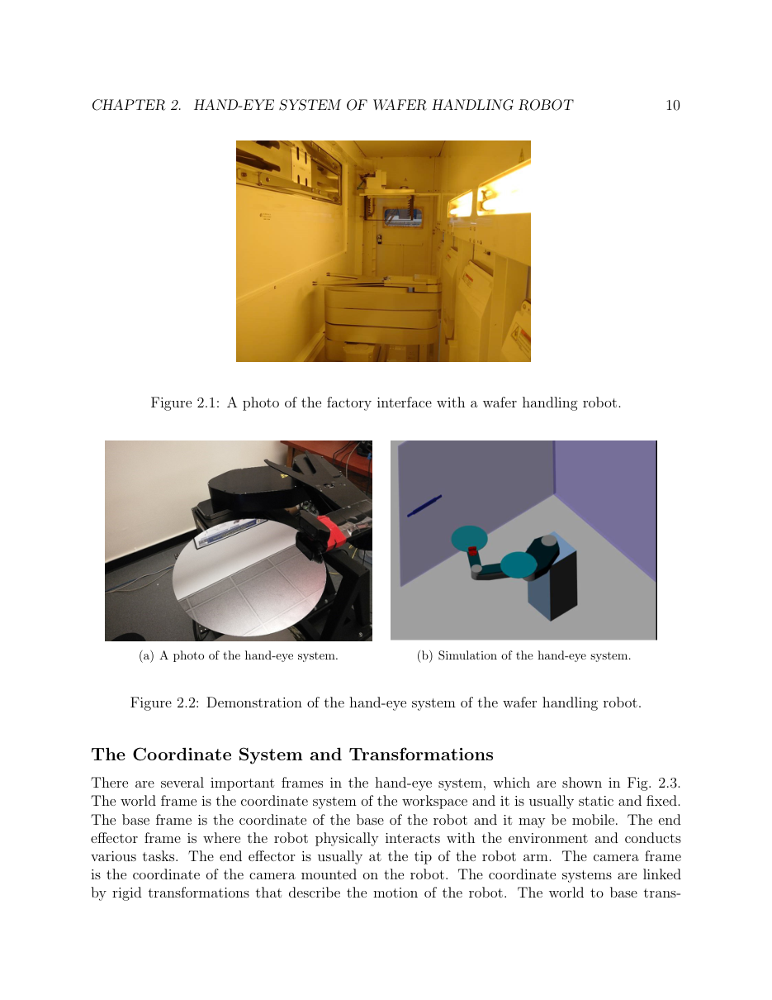
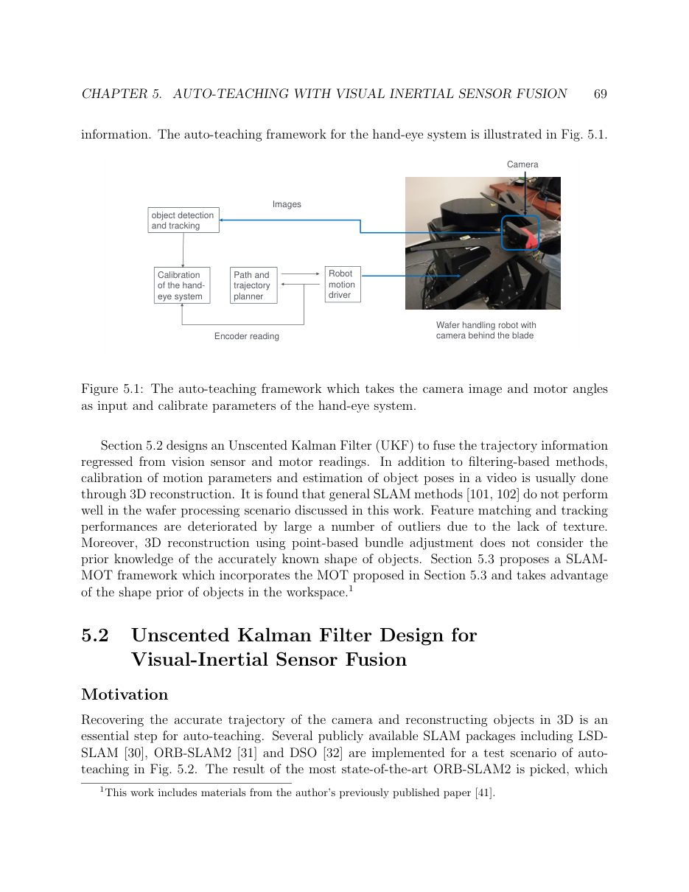
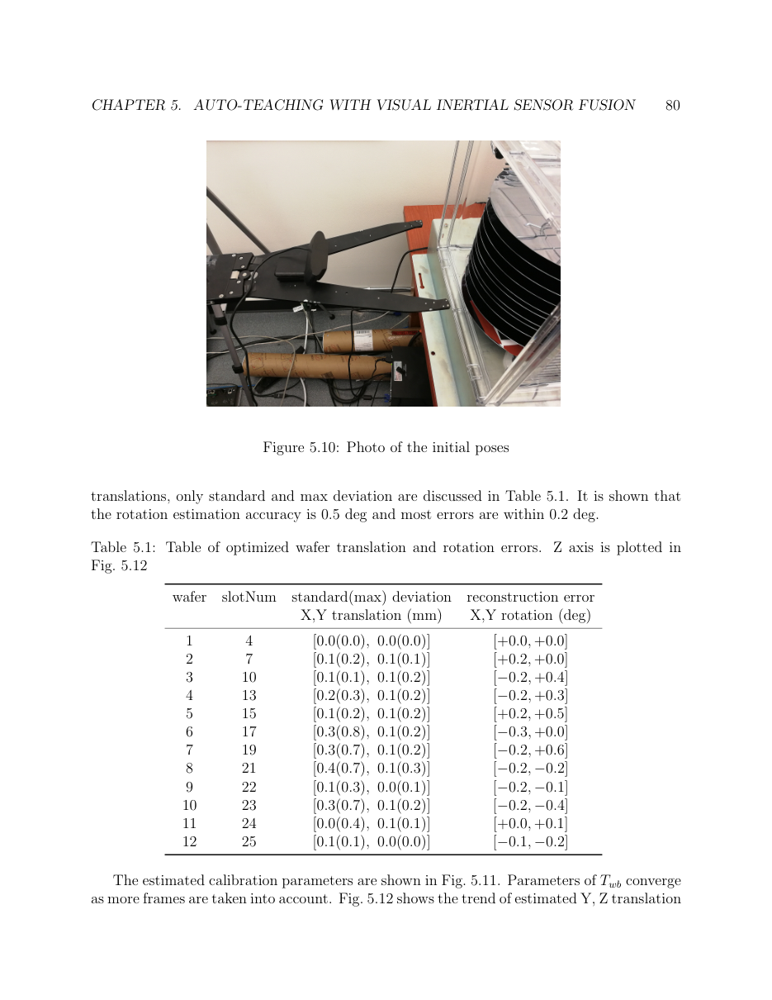
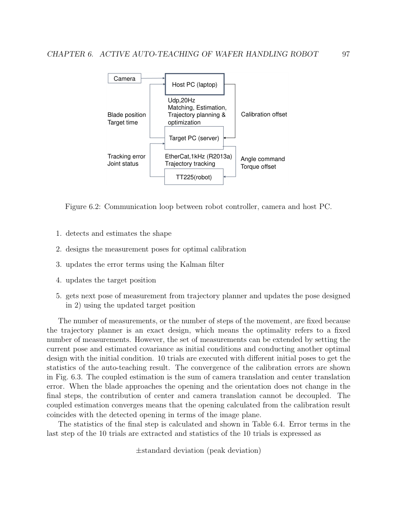

# 자율 로봇 시스템의 강건한 인식과 오토 티칭 — 발췌 번역 (Wang 2020, UC Berkeley 박사논문)

- 원제: Robust Perception and Auto-teaching for Autonomous Robotic Systems
- 원문: 같은 폴더의 `Wang2020_UCB_PhD_thesis.pdf` (본문 쪽수 기준. PDF 쪽수는 본문 쪽수 + 16)
- 번역 범위: 논문 전체(9장, 약 150쪽) 중 웨이퍼 핸들링 로봇의 오토 티칭과 직접 관련된 부분만 옮겼다. 7·8장(자율주행 카메라-라이다 융합)과 2장의 경로·궤적·제어기 설계는 제외했다. 수식은 생략하고 `[수식 생략]`으로 표시했다.
- 그림: 원문 쪽을 그대로 렌더링해 `그림/`에 넣었다.

## 1.1 강건한 검출과 오토 티칭의 배경 (발췌, 1~2쪽)

로봇은 큰 외란을 받기도 하는데, 이는 인식 서브시스템만으로는 처리할 수 없다. 예를 들어 매니퓰레이터에 심각한 고장이 나면 작업 공간이 크게 바뀌고, 세밀하게 맞춰 둔 파라미터가 틀어진다. 센서가 모델 불확실성을 가진 로봇에 실려 있으므로, 인식 서브시스템도 더 이상 정확한 정보를 주지 못할 수 있다. 이런 경우를 위해 **오토 티칭(auto-teaching)** 을 제안한다. 오토 티칭은 사람의 개입 없이 파라미터를 보정해 로봇이 스스로 고장에서 회복하게 한다. 그림 1.1처럼 인식 루프를 닫아 모델 불확실성을 처리한다.

오토 티칭은 여전히 어느 정도 개루프 시스템이다. 제어 루프는 닫혀 있지만, 보정용 궤적이 갱신된 파라미터나 주변 물체에 따라 바뀌지 않으므로 보정 루프는 열려 있다. 오토 티칭의 정확도는 주변 물체 측정에 크게 좌우되므로, 물체를 더 잘 관측하는 궤적을 설계하는 것이 성능 향상에 중요하다. 그래서 궤적 계획기에 피드백을 하나 더 추가하는 **능동 오토 티칭(active auto-teaching)** 을 제안한다.

## 2장 웨이퍼 핸들링 로봇의 핸드-아이 시스템 (발췌, 10~12쪽)

> 그림 2.1: 웨이퍼 핸들링 로봇이 있는 팩토리 인터페이스 사진.
> 그림 2.2: 웨이퍼 핸들링 로봇의 핸드-아이 시스템. (a) 사진 (b) 시뮬레이션.

핸드-아이 시스템에는 중요한 좌표계가 여럿 있다. 월드 좌표계는 작업 공간의 좌표계로 보통 고정되어 있다. 베이스 좌표계는 로봇 베이스의 좌표계이며 움직일 수도 있다. 엔드이펙터 좌표계는 로봇이 환경과 물리적으로 상호작용하며 작업하는 곳이며, 보통 로봇 팔 끝에 있다. 카메라 좌표계는 로봇에 장착된 카메라의 좌표계다. 좌표계들은 로봇의 운동을 나타내는 강체 변환으로 연결된다. [수식 생략: 월드→베이스→엔드이펙터→카메라 동차변환의 곱]

이 논문에서 쓴 로봇은 **대기(atmosphere) 웨이퍼 핸들링 로봇**이다. 반도체 산업에서 쓰이며, 팩토리 인터페이스(FI)의 웨이퍼 캐리어(FOUP)에서 웨이퍼를 꺼내 공정으로 보내고, 공정이 끝난 웨이퍼를 다른 FOUP에 다시 넣는다. 이 로봇은 300 mm 웨이퍼를 옮긴다.

## 5.1 서론 — 시각-관성 센서 융합 오토 티칭 (68~69쪽)

오토 티칭은 오토 캘리브레이션(auto-calibration)이라고도 하며, 공정 장비의 매핑과 함께 웨이퍼 공정의 중요한 효율 기능이다. 반도체 산업의 초청정 작업 환경은 사람의 개입을 막는다. 웨이퍼가 잘못 놓이는 등의 고장이 나면, 로봇은 충돌을 피하기 위해 작업 환경을 다시 초기화해야 한다. **오토 티칭은 작업 공간에 접촉하거나 들어가지 않고 로봇을 정밀하게 보정하는 데 중점을 둔다.** 오토 티칭이 끝나면 캐리어나 챔버 입구 같은 체크포인트의 로봇 기준 좌표를 정밀하게 알게 된다. 로봇은 훨씬 짧은 정지 시간 뒤에 FI 안에서 다시 안전하게 움직이며 웨이퍼를 옮길 수 있다.

이 장은 물체의 3D 자세를 추정하면서 핸드-아이 시스템의 파라미터를 보정하는 것을 목표로 한다. 이를 위해 카메라와 엔코더의 센서 값으로 로봇과 물체의 운동을 함께 풀어야 한다. (...) 2장에서 설계한 웨이퍼 핸들링 로봇의 핸드-아이 시스템은 주변 물체를 측정할 수 있다. 비전 센서에 더해, 핸드-아이 시스템은 엔코더에서 매우 정밀한 운동 데이터를 얻으므로 이 정보를 활용하는 것이 중요하다. 핸드-아이 시스템의 오토 티칭 구조는 그림 5.1과 같다.

> 그림 5.1: 카메라 영상과 모터 각도를 입력으로 받아 핸드-아이 시스템의 파라미터를 보정하는 오토 티칭 구조. (카메라는 블레이드 뒤에 있다.)

5.2절은 비전 센서에서 회귀한 궤적과 모터 값을 융합하는 무향 칼만 필터(UKF)를 설계한다. (...) 일반 SLAM 방법은 이 논문의 웨이퍼 공정 환경에서 잘 동작하지 않는다는 것을 확인했다. **질감이 부족해 이상치가 많아서 특징점 매칭과 추적 성능이 떨어진다.** 또한 점 기반 번들 조정을 쓰는 3D 복원은 물체 모양을 정확히 안다는 사전 지식을 반영하지 않는다. 5.3절은 작업 공간 물체의 형상 사전 정보를 활용하는 SLAM-MOT 구조를 제안한다.

## 5.4 실험 결과 (77~85쪽, 발췌)

실험은 웨이퍼 핸들링 로봇과 반도체 제조 산업의 표준 캐리어에 담긴 웨이퍼로 진행했다. 로봇 엔드이펙터가 카메라를 들고, 로봇이 캐리어 주변을 움직이는 동안 영상을 녹화한다. 실험 목적은 보정된 웨이퍼 3D 자세와 로봇 기구학 파라미터의 정확도를 확인하는 것이다.

**UKF 결과.** Intel RealSense RGBD 카메라를 썼다. 카메라 내부 파라미터는 미리 보정했고 로봇의 관절 영점 오차는 보정하지 않았다. 카메라로 SLAM이 계산한 궤적과 모터 엔코더로 순기구학이 계산한 궤적은 같은 곳에서 출발하지만 시간이 지나면서 크게 벌어진다. 제안한 UKF는 둘을 융합한 궤적을 낸다.

**시각-관성 SLAM-MOT 결과.**

캐리어에는 아래부터 1~26번 슬롯이 있다. 슬롯은 서로 평행하며 가공 간격은 10 mm ± 0.5 mm다. 월드 좌표계는 4번 슬롯의 맨 아래 웨이퍼 1에 둔다. 웨이퍼 1은 캐리어 바닥을 대표하도록 정확히 놓았다. 이 웨이퍼 표면이 월드 좌표의 XY 평면이고 법선이 Z축이다. 모든 결과 자세는 웨이퍼 1 기준으로 나타낸다.

로봇은 5자유도 듀얼 블레이드 웨이퍼 핸들링 로봇이다. 이 실험에서는 엔드이펙터가 X, Y, Z와 요(yaw) 각도에 모두 도달할 수 있도록 관절 4개만 사용했다. **단안 카메라는 로봇의 엔드이펙터에 장착**했다. 최적화의 슬라이딩 윈도 크기는 5다.

캐리어에 웨이퍼 12장을 넣었고, 오배치를 흉내 내기 위해 웨이퍼 12는 일부러 기울였다. 로봇을 움직이며 웨이퍼를 추적하고, 제안한 최적화로 3D 자세를 추정한다. 회전에 대해서만 기준값(±0.1°)이 있으므로, 평행이동은 표준편차와 최대 편차만 다룬다(표 5.1). **회전 추정 정확도는 0.5°이며, 대부분의 오차는 0.2° 이내다.**

표 5.1: 최적화된 웨이퍼 평행이동·회전 오차 (원문 표를 옮김)

| 웨이퍼 | 슬롯 | X, Y 평행이동 표준편차(최대) [mm] | X, Y 회전 복원 오차 [°] |
|---:|---:|---|---|
| 1 | 4 | 0.0(0.0), 0.0(0.0) | +0.0, +0.0 |
| 2 | 7 | 0.1(0.2), 0.1(0.1) | +0.2, +0.0 |
| 3 | 10 | 0.1(0.1), 0.1(0.2) | −0.2, +0.4 |
| 4 | 13 | 0.2(0.3), 0.1(0.2) | −0.2, +0.3 |
| 5 | 15 | 0.1(0.2), 0.1(0.2) | +0.2, +0.5 |
| 6 | 17 | 0.3(0.8), 0.1(0.2) | −0.3, +0.0 |
| 7 | 19 | 0.3(0.7), 0.1(0.2) | −0.2, +0.6 |
| 8 | 21 | 0.4(0.7), 0.1(0.3) | −0.2, −0.2 |
| 9 | 22 | 0.1(0.3), 0.0(0.1) | −0.2, −0.1 |
| 10 | 23 | 0.3(0.7), 0.1(0.2) | −0.2, −0.4 |
| 11 | 24 | 0.0(0.4), 0.1(0.1) | +0.0, +0.1 |
| 12 | 25 | 0.1(0.1), 0.0(0.0) | −0.1, −0.2 |

> 원문 80쪽 표 이미지로 대조함 (`그림/그림5_10.png` 아래쪽).

(...) X축의 경향은 Y와 비슷하며 통계는 표 5.1에 있다. **모든 웨이퍼의 Y축 추정 변동은 0.2 mm 이내이고, X축은 최대 0.8 mm까지 변동이 더 크다.**

제안 방법은 웨이퍼를 물체 단위로 복원하여 더 정밀하다. ORB-SLAM2는 각 점을 복원하므로 결과가 매우 잡음이 많다(그림 5.13).

3D 보정 결과에서 X와 Z축 위치의 최종 정확도는 Y축과 회전각만큼 좋지 않다. 이 두 축의 보정 오차는 커지는 경향이 있다. 이 실험의 이론적 분해능을 유도했다. 분해능은 웨이퍼의 3D 자세를 영상 속 타원으로 사상하는 투영 함수의 미분(자코비안)으로 계산한다. [수식 생략]

표 5.2: 웨이퍼 배치와 이론 분해능 (원문 81쪽 표 이미지로 대조함)

| 웨이퍼 | 슬롯 | 평행이동 분해능 [pixel/mm] | 회전 분해능 [pixel/°] |
|---:|---:|---|---|
| 1 | 4 | 0.32, 0.25 | 0.44, 0.39 |
| 2 | 7 | 0.31, 0.24 | 0.39, 0.35 |
| 3 | 10 | 0.31, 0.22 | 0.30, 0.31 |
| 4 | 13 | 0.26, 0.19 | 0.24, 0.26 |
| 5 | 15 | 0.23, 0.16 | 0.20, 0.20 |
| 6 | 17 | 0.19, 0.13 | 0.16, 0.18 |
| 7 | 19 | 0.18, 0.12 | 0.14, 0.05 |

(...) 강건성 시험에서 조명이 가장 나쁜 경우에도 검출된 타원의 편향은 약 2~3 픽셀이므로, 3D 보정 오차에는 다른 요인이 있을 것이다. 요인을 분리하기 위해 보정판을 웨이퍼 표면에 붙여 슬롯에 넣었다. 보정판은 램버시안(난반사) 표면이라 조명 조건의 영향을 받지 않는다. (...) 조명 색 변화는 영상 세로축 방향으로 2픽셀의 편향을 만든다. 정확도는 떨어지지만, N(0, 1) 가우시안 잡음을 이미 모델링했으므로 분산(정밀도)은 크게 영향받지 않는다.

## 5.5 장 요약 (86쪽)

이 장은 시스템 파라미터를 보정하고 다시점 인식으로 3D 공간의 물체를 복원하는 핸드-아이 시스템의 오토 티칭을 소개했다. 오토 티칭은 정밀 보정을 위해 비전과 운동 정보를 융합한다. 두 방법을 제안했다. 첫째, 시각 센서와 운동 센서의 궤적을 융합하는 UKF로 시스템의 관절 영점 오차를 보정한다. 둘째, 파라미터 보정과 물체 복원을 동시에 하는 SLAM-MOT 구조다. 작업 공간에 웨이퍼를 두고 한 실험에서 두 센서 정보를 효과적으로 융합함을 보였다. 정성적 시각화와 정량 비교에서 최신 시각 SLAM 방법보다 더 정밀하고 강건했다.

## 6.1 서론 — 능동 오토 티칭 (87~88쪽, 발췌)

이 장은 로봇이 보정용 영상을 찍는 자세를 최적화해 시스템의 루프를 더 닫는 것을 목표로 하며, 이를 능동 오토 티칭이라 부른다. (...) 최적 측정 자세 집합을 찾는 것은 목적 함수가 분명하지 않은 최적화 문제다. 추정 파라미터에서 보정 성능으로 가는 최선의 스칼라 함수가 없기 때문이다. 통계학의 최적 실험 설계(OEM) 원리에 따라 로봇 분야에서 여러 기준이 제안되었다. (...) 로봇 시스템에서 최적 측정 자세를 고르는 효과는 크다.

제안하는 능동 오토 티칭 구조는 보정이 갱신될 때 다음 측정 자세를 출력해 루프를 닫는다. 5장의 상황과 달리, 이 장은 **대상 물체가 챔버 입구 하나뿐인 상황**에 집중한다.

## 6.4 실험 결과 (96~98쪽)

실험은 웨이퍼 핸들링 로봇과 실험실에서 직접 만든 챔버 입구로 진행했다. 로봇은 위쪽 블레이드에 웨이퍼를 들고, **카메라는 블레이드에 장착**했다. 카메라 내부 행렬은 미리 보정했다. 카메라 영상은 호스트 PC가 받아 처리한다. 오토 티칭 관련 보정은 모두 호스트 PC에서 한다. 추정한 물체 위치는 공칭 위치에 대한 오프셋으로 표현해 UDP로 20 Hz마다 타깃 PC에 보낸다. 호스트 PC는 영상을 찍은 시점의 엔코더 값도 받는다. 모터 단 제어는 1 kHz로 로봇 드라이버에 명령을 보낸다.

진동과 카메라 지연의 영향을 피하기 위해 로봇을 한 단계씩 움직이고, 로봇이 완전히 멈춘 뒤에 영상을 찍는다. 매 시행마다 로봇을 임의의 초기 자세로 옮긴다. 각 시행에서 로봇은

1. 형상을 검출하고 추정한다.
2. 최적 보정을 위한 측정 자세를 설계한다.
3. 칼만 필터로 오차 항을 갱신한다.
4. 대상 위치를 갱신한다.
5. 궤적 계획기에서 다음 측정 자세를 받고, 갱신된 대상 위치로 2)의 설계 자세를 갱신한다.

초기 자세를 달리해 10회 시행했다. (...) 블레이드가 입구에 다가가 마지막 단계에서 방향이 바뀌지 않으면, 중심 평행이동과 카메라 평행이동의 기여를 분리할 수 없다. 결합 추정이 수렴한다는 것은 보정 결과로 계산한 입구가 영상 평면에서 검출된 입구와 일치한다는 뜻이다.

표 6.4: 10회 시행의 최종 추정 통계 (± 표준편차(최대 편차), 단위는 원문에 명시되지 않음 — 본문 맥락상 mm로 추정*)

| 평행이동 오차 | | X (뻗는 방향) | Y (수평) | Z (수직) |
|---|---|---|---|---|
| 입구 | 능동 보정 없음 | ±33(90) | ±25(65) | ±0.2(0.5) |
| | 제안 방법 | ±0.5(0.9) | ±2.0(4.0) | ±0.1(0.3) |
| 카메라 | 능동 보정 없음 | ±33(86) | ±26(66) | ±0.2(0.5) |
| | 제안 방법 | ±0.4(0.6) | ±1.9(3.4) | - |
| 결합 | 능동 보정 없음 | ±0.9(1.2) | ±1.1(0.7) | ±0.4(0.5) |
| | 제안 방법 | ±0.5(1.0) | ±0.3(0.6) | ±0.1(0.3) |

Z축(수직, 높이)의 표준편차가 X·Y축보다 훨씬 작다. 챔버 입구 형상에 아주 긴 직선 특징 두 개가 있어서 Z축 방향 고윳값이 가장 커지고, 따라서 정확도가 가장 높기 때문이다. 제안한 능동 오토 티칭의 관측성 지표는 적응 제어기를 쓴 기존 오토 티칭 실험보다 항상 높았다.

## 6.5 장 요약 (98~99쪽)

이 장은 핸드-아이 시스템 보정 과정의 루프를 닫는 능동 오토 티칭을 소개했다. 보정 모듈의 피드백으로 오토 티칭 궤적의 경유점을 계획하는 최적 측정 자세 계획기를 제안했다. OEM 기반 계획기는 보정용 피셔 정보 행렬의 고윳값을 최대화하는 로봇 자세를 설계해, 추정 변수의 사후 불확실성을 최소화한다. 챔버 입구가 있는 작업 공간에서의 실험 결과, 능동 오토 티칭은 추정한 핸드-아이 시스템 파라미터와 물체 위치의 정확도와 강건성을 모두 높였다.

---

### 우리 과제에 주는 시사점 (번역자 메모)

- 대상 형상에 **긴 직선 특징**이 있는 방향의 정확도가 가장 높았다(6.4절). 마커 설계에서 Y·Θ를 잘 잡으려면 해당 방향으로 긴 에지를 두는 것이 유리하다는 근거가 된다.
- 정확도는 **픽셀 분해능(pixel/mm, pixel/°)** 으로 설명된다(표 5.2). 우리도 카메라 거리·해상도에서 Y·Θ의 이론 분해능을 계산해 목표 정확도와 비교할 수 있다.
- 진동과 지연을 피하려고 **로봇이 완전히 멈춘 뒤 촬영**했다(6.4절). 우리 측정 절차에도 같은 조건을 명시할 근거.
