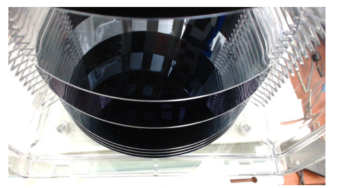
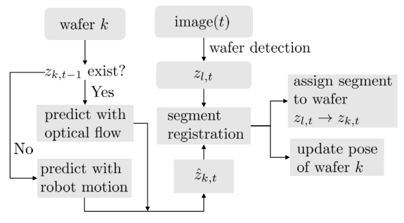
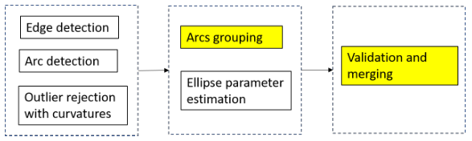
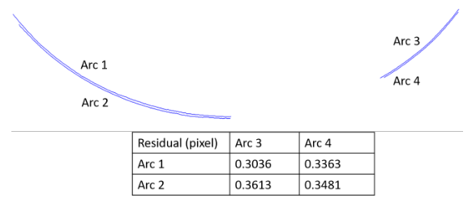
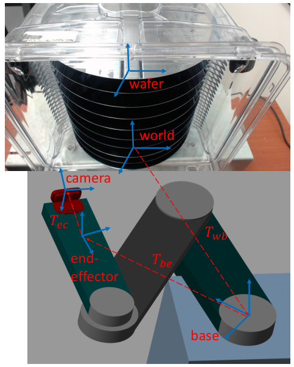
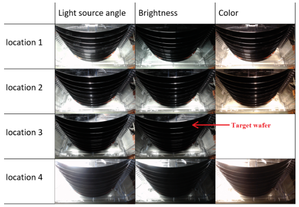
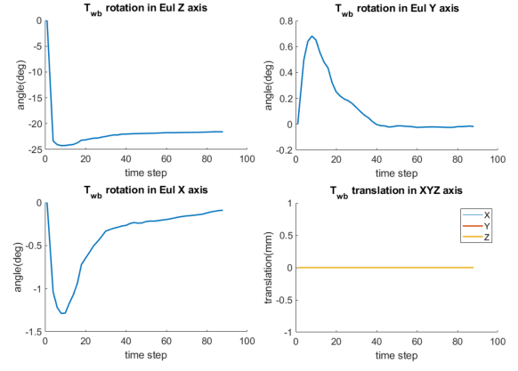
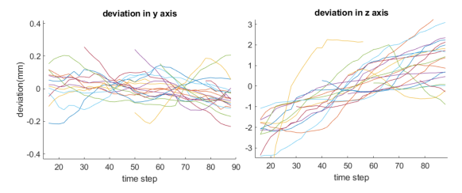
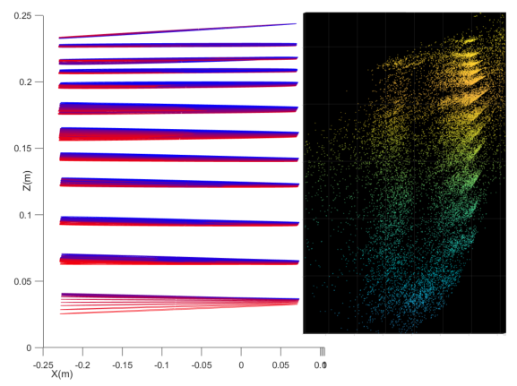

# 타원형 웨이퍼의 시각 검출·추적을 통한 웨이퍼 핸들링 로봇의 정밀 3D 보정 (Wang 2020)

- 원제: Precise 3D Calibration of Wafer Handling Robot by Visual Detection and Tracking of Elliptic-shape Wafers
- 저자: Zining Wang, Masayoshi Tomizuka (University of California, Berkeley 기계공학과)
- 원문: 같은 폴더의 `Wang2020_ICRA_wafer_ellipse.pdf` (2020 IEEE International Conference on Robotics and Automation (ICRA), 2020년 5월 31일~8월 31일, 프랑스 파리, pp. 4977–4982)
- 번역 범위: 전문
- 그림: 원문 그림 9개를 `그림/`에 넣고 본문에서 처음 언급되는 곳에 삽입. 표 I은 마크다운 표로 옮김.

## 초록

본 연구는 단안 비전(monocular vision)으로 웨이퍼와 웨이퍼 핸들링 로봇을 3D 보정(캘리브레이션, calibration)하는 프레임워크를 제시한다. 제안 방법은 로봇에 장착된 카메라로 촬영한 영상 집합으로부터 웨이퍼의 3D 자세(pose)를 정밀하게 복원한다. 또한 로봇 기구학(kinematics)도 동시에 보정한다. 영상에서 웨이퍼를 인식하기 위해 에지 호(edge arc) 기반의 강건한 타원 검출·추적 알고리즘을 개발하였다. 이어서 다중 물체 자세 그래프(multi-object pose graph)로 결합 최적화(joint optimization)를 구성하여 웨이퍼의 3D 자세와 로봇-카메라 시스템의 다른 보정 파라미터를 푼다. 제안한 추적 방법은 가우시안 혼합 모델(Gaussian Mixture Model, GMM) 기반 정합(registration) 알고리즘을 사용해 여러 개의 불완전한 타원 조각(elliptic segment)을 연관(association)시킬 수 있다. 이 알고리즘은 점 기반이며 특징 기술자(feature descriptor)가 필요 없다. 제안한 3D 자세 최적화는 형상 제약(shape constraint)을 포함하며, 고전적인 번들 조정(bundle adjustment) 방법이 만드는 점 단위 복원보다 정확하다.

## I. 서론 및 관련 연구 (INTRODUCTION AND RELATED WORK)

공정 장비의 자동 보정과 매핑(mapping)은 웨이퍼 공정에서 중요한 효율 기능이다. 반도체 산업의 초청정 작업 환경은 사람의 개입을 허용하지 않는다. 웨이퍼 오배치(misplacement) 같은 고장이 발생하면 로봇은 충돌을 피하기 위해 작업 환경을 다시 초기화해야 한다. 본 논문은 웨이퍼의 3D 자세와 로봇의 기구학 파라미터를 모두 보정해야 하는 상황을 다룬다. 위치 보정의 정밀도 요구 사항은 서브밀리미터(sub-millimeter)이다.

웨이퍼 자세 검사는 반도체 산업에서 많이 다뤄진 주제이다. 레이저 발신기(laser emitter)는 웨이퍼의 표면이나 가장자리를 찾는 정밀 센서로 [1]–[3]에서 사용되었다. 단점은 한 번에 한 장의 웨이퍼만 검출할 수 있다는 것이다[4], [5]. 또한 웨이퍼를 측정 장치 위에 올려 두어야 하므로[2], [3] 원격 감지가 불가능하다. 초기 오차가 너무 크면 웨이퍼가 장치와 충돌할 수도 있다. 웨이퍼 카세트 안의 여러 웨이퍼를 검출할 수 있는 방법도 있으나[6], 정밀한 3D 자세가 아니라 특정 유형의 오배치 오차만 식별한다. 본 논문에서는 웨이퍼 자세를 정확히 추정하고 로봇-카메라 시스템도 보정하는 시각적 해법을 제안한다.

동영상에서 자기 운동(self-motion)과 물체 자세를 추정하는 일은 보통 추적과 3D 복원으로 이루어진다. 동시적 위치 추정 및 지도 작성(Simultaneous localization and mapping, SLAM)은 이 문제의 표준 해법이다[7]. 그러나 일반 SLAM 방법[8], [9]의 정밀도는 본 논문에서 다루는 웨이퍼 공정 상황의 요구를 충족하지 못한다.

(각주) 모든 저자는 University of California, Berkeley 기계공학과(Etcheverry Hall, Berkeley, CA 94709, USA) 소속이다. ¹ wangzining@berkeley.edu ² tomizuka@me.berkeley.edu

시각 특징의 주된 원천인 웨이퍼는 대부분의 국소 특징 기술자로는 서로 구별되지 않는다. 게다가 실리콘 웨이퍼의 비람베르트(non-Lambertain [역주: non-Lambertian의 오기]) 반사 특성 때문에 점 단위 특징이 불안정하다. 따라서 다수의 이상치(outlier) 때문에 특징 매칭과 추적 성능이 떨어진다. 더욱이 점 기반 번들 조정을 이용한 3D 복원은 웨이퍼의 정확히 알려진 형상이라는 사전 지식을 고려하지 않는다.

웨이퍼는 정밀 가공된 결정질 실리콘 박판이다. 본 논문에서는 웨이퍼의 3D 모델을 반도체 산업에서 가장 널리 쓰이는 형상인 지름 300 mm, 두께 1 mm의 원기둥으로 본다. 금속과 같은 정반사(specular reflection) 표면 때문에, 그림 1과 같이 윗면과 아랫면의 경계가 영상에서 타원형 에지로 투영된다. 복원에 웨이퍼 형상 제약을 넣기 위해서는 타원 검출과 추적이 바람직하다[10].

*그림 1 — 캐리어 안의 웨이퍼. 웨이퍼의 밝은 경계는 두 개의 에지를 이룬다. 위쪽 에지는 윗면에, 아래쪽 에지는 아랫면에 대응한다.*

2D 타원 검출은 원형 물체 검출의 기반이 되므로 컴퓨터 비전에서 여전히 진행 중인 주제이다[11], [12]. 에지 영상이 주어졌을 때, 원이나 직선과 달리 타원에 대해서는 빠르고 전수적인 탐색 방법이 없다. 타원 또는 타원 조각은 5차원 파라미터 공간을 가지므로 고전적인 허프 변환(Hough transform)이나 RANSAC으로 쉽게 검출되지 않는다[13], [14]. 호 기반 타원 검출 방법[12], [15]에서는 에지 영상의 점 대부분이 연결되어 있어 매끄러운 호로 조립될 수 있다고 가정한다. 기본 요소가 수백 개의 점으로 이루어진 호가 되므로 복잡도가 크게 줄어든다. 그러나 웨이퍼가 항상 완전한 타원을 만들지는 않기 때문에 본 논문에서는 수정이 필요하다.

같은 3D 물체에 속하는 타원들의 추적은 [16], [17], [10]에서 논의되었으나, 이들은 위치 예측 없이 구형 물체만 연관시킨다. [18]과 [19]는 단일 타원 추적에 칼만 필터(Kalman filter) 같은 필터링 방법을 구현했다. 이 방법들은 물체 연관을 다루지 않으므로 다중 물체로 확장할 수 없다. [20], [21]의 저자들은 다중 타원 추적을 위한 입자 필터(particle filter)를 제안했다. 그러나 점들이 물체 검출이 아닌 군집화(clustering)로 분할되며, 서로 가까운 두 타원의 연관에 문제가 있다. 본 논문은 타원 조각의 가우시안 혼합 모델(GMM)을 제안하고, 점과 타원 조각을 계층적으로 연관시켜 여러 웨이퍼를 동시에 추적한다. 잡음 모델이 포함되어 이상치를 식별할 수 있다.

두 가지 주요 기여는 계층적 조각 정합 알고리즘과, 형상 제약 번들 조정을 위한 결합 최적화이다. 부수적인 기여 하나는 웨이퍼 검출을 위해 타원 검출 알고리즘을 타원 조각 검출 알고리즘으로 수정한 것이다.

## II. 강건한 웨이퍼 검출 및 추적 (ROBUST WAFER DETECTION AND TRACKING)

웨이퍼는 $k=1, 2, \cdots$로 색인하며, 웨이퍼 검출 알고리즘은 프레임 $t$의 영상에서 타원 조각 $z_{l,t}$들을 추출한다. 각 조각 $z_{l,t}$는 화소들의 집합이다. 타원 조각 추적은 서로 다른 프레임의 조각들을 웨이퍼에 할당하는 것이다. SLAM이 다루는 추적 문제와 달리 웨이퍼의 국소 특징은 불안정하고 고유하지 않으므로, 특징점 매칭으로 조각을 연관시키는 것은 불가능하다. 또한 서로 매우 가까운 위·아래 에지는 비슷한 파라미터를 가진 조각을 더 만들어 문제를 더욱 어렵게 한다. 따라서 이 응용을 위해 예측(prediction), 연관(association), 상태 갱신(state update)을 갖춘 완전한 추적 프레임워크를 개발했으며 이를 그림 2에 나타냈다. $z_{k,t-1}$은 프레임 $t-1$에서 검출되어 이미 웨이퍼 $k$에 정합된 조각이다. $z_{l,t}$는 $t$에서 검출되어 정합되어야 하는 조각 $l$이다.

*그림 2 — 프레임 t에서의 웨이퍼 추적 절차*

### A. 타원 조각 검출 알고리즘 (Elliptic Segment Detection Algorithm)

타원형 웨이퍼의 검출은 I절에서 소개한 방법들이 마주하는 상황과 약간 다르다. 그림 1에서 보듯이, 캐리어 안의 웨이퍼는 경계의 절반 미만만 보인다. 따라서 에지는 온전한 타원이라기보다 타원 조각이다. 그 결과, 호 기반 방법의 호 그룹화(arc grouping)용으로 설계된 알고리즘은 웨이퍼에 적용되지 않는다. 타원 조각이라는 것은 추정 오차가 잡음에 더 취약하고 더 엄격한 이상치 제거가 필요하다는 뜻이기도 하다.

제안 프레임워크는 [15]에 기반하지만 웨이퍼 검출 상황에 맞게 몇 가지를 수정했으며, 수정 부분은 처리 과정을 보여 주는 그림 3에 강조 표시되어 있다. 지면 제약 때문에 수정된 부분만 논의한다. 호 그룹화에서 [15]는 타원 하나를 맞추기 위해 세 개의 호 조합을 요구한다. 본 논문에서는 웨이퍼 에지 하나가 호 두 개만 만들기 때문에, 그룹화 조건을 두 호의 조합을 고르는 것으로 완화했다.

*그림 3 — 제안한 웨이퍼 검출 방법의 처리 과정 (에지 검출, 호 검출, 곡률 기반 이상치 제거 → 호 그룹화, 타원 파라미터 추정 → 검증 및 병합)*

검증 단계에서는 호 그룹화의 수정 때문에 그림 4와 같은 문제가 생긴다. 그림의 네 호는 잔차(residual)가 작은 타원 네 개를 만들지만, 그중 둘은 명백한 이상치이다. 원래 알고리즘처럼 맞춤 잔차에 문턱값을 두는 방법으로는 이 이상치들을 제거하지 못한다. 잔차의 합을 최소화하는 최적 조합을 고르기 위해 헝가리안 알고리즘(Hungarian algorithm)[22]을 사용한다.

*그림 4 — 네 호로 만들어지는 유효한 짝 네 개. 두 짝, 즉 Arc1&Arc3과 Arc2&Arc4만 실제 웨이퍼의 타원 조각이다. 잔차는 점들로부터 호 한 쌍으로 맞춘 타원까지의 평균 절대 거리이다.*

| Residual (pixel) | Arc 3 | Arc 4 |
|---|---|---|
| Arc 1 | 0.3036 | 0.3363 |
| Arc 2 | 0.3613 | 0.3481 |

### B. 조각 예측 (Prediction of Segments)

예측은 서로 다른 프레임의 웨이퍼를 연관시키는 데 중요하며, 특히 서로 다른 웨이퍼의 타원 조각을 구별할 고유한 국소 특징이 없을 때 그렇다. 프레임 $t+1$에서 색인 $k$의 조각 $\hat{z}_{k,t+1}$을 예측하는 데에는 두 경우가 있다. 첫째는 직전 프레임 $t$의 조각 $z_{k,t}$가 보이는 경우이다. 둘째는 마지막으로 보인 조각이 프레임 $\tau < t$에 있는 경우이다. 이 두 경우에 대해 두 가지 예측 전략을 설계했다.

연속 예측에는 광류(optical flow)가 더 정확한 것으로 나타나 첫째 경우에 사용한다. OpenCV에 구현된 Deepflow[23]로 타원 조각 $z_{k,t}$에서 흐름을 추출하고, 예측 $\hat{z}_{k,t+1}$은 단순히 흐름을 조각에 더해서 만든다. 조각이 연속적으로 보이지 않으면 광류를 쓸 수 없다. 이 둘째 경우에는 추정된 3D 웨이퍼 $w_k$를 영상 평면에 투영하여 $\hat{z}_{k,t+1}$을 예측한다.

### C. 가우시안 혼합 모델을 이용한 계층적 조각 정합 (Hierarchical Segment Registration using Gaussian Mixture Model)

II절에서 언급한 정확도 문제 때문에 타원 파라미터에 의한 연관은 실패한다. 이 절의 기여는 다중 물체의 연관을 출력할 수 있는 점들의 가우시안 혼합 모델을 개발한 것이다.

$X$를 프레임 $t$의 점 $x_i \in \mathbb{R}^d, i=1,\cdots,M$의 집합이라 하자. 각 점 $x_i$는 사상 $k=f(i)$로 검출된 타원 조각 $z_{k,t}, k=1,\cdots,K$에 속하는 화소이다. $\widehat{X}$는 프레임 $t$에 대해 예측된 점 $\hat{x}_j \in \mathbb{R}^d, j=1,\cdots,N$의 집합이다. 각 점 $\hat{x}_j$는 사상 $l=g(j)$를 통해 예측된 타원 조각 $\hat{z}_{l,t}, l=1,\cdots,L$에 속한다. GMM은 $X$가 $\hat{x}_j$들을 중심으로 하는 가우시안들의 혼합에 의해 $\widehat{X}$로부터 생성된다고 가정한다.

$$p(x_i|s_i=j;\theta) \sim \mathcal{N}(\hat{x}_j, \sigma^2 I_d),$$

여기서 $s_i=j$는 점 $x_i \in X$가 $y_j$에 의해 생성되었음을 뜻하는 잠재 변수(latent variable)이고, $\sigma^2 I_d$는 가우시안 성분의 공분산을 나타내는 대각 행렬이며, $\theta$는 모델의 파라미터를 나타낸다. 점 정합 방법[24]에서는 이것이 점들의 변환장(transformation field)이다. 본 논문에서는 변환장을 고정하고 조각들의 할당을 파라미터로 한다. GMM은 다음과 같이 수정된다.

$$p(x_i|s_i=j;\theta) \sim \begin{cases} \omega, & \theta(k,l)=0 \\ \mathcal{N}\left(\hat{x}_j, \sigma^2 I_d\right), & \theta(k,l)=1 \end{cases},$$

여기서 $\theta \in \mathbb{R}^{K\times L}$은 조각들의 할당을 나타내는 이진값 행렬이다. 조각 $z_{k,t}$는 $\theta(k,l)=1$일 때에만 예측 조각 $\hat{z}_{l,t}$에 할당된다. $\theta(k,l)=0$인데 점 $x_i \in z_{k,t}$가 $y_j \in \hat{z}_{l,t}$에 할당되면(즉 $s_i=j$), 그 분포는 균일 분포로 간주되며 이는 그 점이 잡음 점이라는 뜻이다. $x_i$의 균일 분포는 영상 영역인 지지 영역(support region)으로 한정되며 밀도는 $\omega$이다.

$\theta$의 최적해는 고전적인 기댓값 최대화(expectation-maximization, EM) 알고리즘으로 구한다. E 단계는 사전확률 $p(s_i=j)=\frac{1}{N}$ 아래에서 점 연관의 사후확률 $Q(i,j):=p(s_i=j|x_i;\theta)$를 푼다.

$$Q(i,j) = \frac{\omega + \theta(k,l)\left(\exp\left(-\frac{\|x_i-\hat{x}_j\|^2}{2\sigma^2}\right) - \omega\right)}{N\omega + \sum_j \theta(k,l)\left(\exp\left(-\frac{\|x_i-\hat{x}_j\|^2}{2\sigma^2}\right) - \omega\right)},$$

여기서 $Q$는 확률 행렬로, 각 원소 $Q(i,j)$는 점 $x_i$가 $\hat{x}_j$와 연관됨을 뜻한다. 이어서 M 단계는 $Q$를 바탕으로 조각 정합 행렬 $\theta$를 최적화한다.

$$\theta = \arg\max \sum_{i,j} Q(i,j) \log p(x_i|s_i=j;\theta)\, p(s_i=j).$$

$p(x_i|s_i=j;\theta)$를 대입하면 우변의 비용 함수는 상수 차이를 제외하고 다음과 동등해진다.

$$\frac{1}{2\sigma^2}\sum_{i,j} Q(i,j)\,\theta(k,l)\left(c_1 - 2\sigma^2\log\omega - \|x_i-\hat{x}_j\|^2\right),$$

여기서 $c_1 = 2d\sigma^2\log(\sqrt{2\pi}\sigma)$이다. 정합이 영상 평면에서 이루어지므로 본 논문의 경우 $d=2$이다. 이 문제에서는 조각 간에 일대일 정합이 바람직하며, 이는 $\theta$의 각 열과 각 행의 합이 1 이하여야 한다는 제약을 추가한다. 조각 정합을 위해 구성한 최적화 문제는 다음과 같다.

$$\begin{aligned} \max_{\theta}\ & \sum_{k,l} C(k,l)\,\theta(k,l) \\ \text{s.t.}\ & \sum_{k=1}^{K}\theta(k,l) \leqslant 1, \forall l \in \{1,2,\cdots,L\} \\ & \sum_{l=1}^{L}\theta(k,l) \leqslant 1, \forall k \in \{1,2,\cdots,K\} \\ & \theta(k,l) \in \{0,1\}, \forall k,l \end{aligned},$$

여기서

$$C(k,l) := \sum_{I(k),J(l)} Q(i,j)\left(c_1 - 2\sigma^2\log\omega - \|x_i-\hat{x}_j\|^2\right),$$
$$I(k) := \{\, i \mid f(i)=k \,\},\quad J(l) := \{\, j \mid g(j)=l \,\}.$$

이는 이분 매칭(bipartite matching) 문제와 동등하며 Munkres 알고리즘[22]으로 해석적으로 풀 수 있다. 모든 $l$에 대해 $\theta(k,l)=0$이면 관측 조각 $k$는 어떤 예측 조각에도 정합되지 않은 것이며, 새로운 물체라는 뜻이다. 그것이 이상치가 아니면 새 트랙렛(tracklet)을 초기화한다. 모든 $k$에 대해 $\theta(k,l)=0$이면 예측 조각 $l$은 어떤 관측 조각에도 정합되지 않은 것이며, 그 웨이퍼가 이 프레임에서 보이지 않는다는 뜻이다.

정리하면, 수정된 GMM은 점 정합 방법[24], [25]처럼 점들 사이의 연성 연관(soft association)과 다중 물체 사이의 경성 연관(hard association)을 함께 가능하게 한다.

## III. 웨이퍼와 카메라-로봇 시스템의 3D 자세 최적화 (3D POSE OPTIMIZATION OF WAFERS AND CAMERA-ROBOT SYSTEM)

앞의 두 절에서 검출·추적된 웨이퍼는 2D 영상 평면 위에 있다. 이 절에서는 웨이퍼와 로봇-카메라 시스템의 3D 보정을 위한 번들 조정 해법을 전개한다. 그림 5는 시스템의 좌표계를 보여 준다. 월드 좌표계는 가장 아래 슬롯에 있는 웨이퍼의 중심에 정의된다.

*그림 5 — 시스템 기구학 설명도*

### A. 웨이퍼 3D 자세의 초기화 (Initialization of 3D Poses of Wafers)

최적화를 위해서는 웨이퍼와 카메라 자세의 초기 추정값이 필요하다. 타원 조각은 원뿔 곡선(conic curve)이고 웨이퍼의 반지름을 알고 있으므로, 이는 카메라에 대한 원의 자세를 푸는 문제에 해당하며 [26]에 주어진 방법으로 푼다. 이 방법은 웨이퍼 한 장의 자세에 대해 두 개의 가능한 해를 준다. 이 모호성은 원의 중심 같은 추가 관측[27]으로만 제거할 수 있는데, 본 연구에서는 이를 사용할 수 없다. 두 가능한 해 중 하나를 고르기 위해, 웨이퍼 표면의 법선(norm)이 월드 좌표의 Z축과 거의 평행하다는 사전 지식이 있다고 가정한다.

### B. 최적화 구성과 보정 모델 파라미터화 (Optimization Construction and Calibration Model Parameterization)

최적화는 자세 그래프(pose graph)를 이용해 정식화한다. 로봇 자세만 고려하는 [28], [29] 같은 SLAM 방법과 달리, 우리 방법은 웨이퍼의 자세도 그래프에 포함한다. 모든 물체의 전체 그래프는 [30]에서 소개된 다중 물체 추적을 동반한 SLAM(SLAM with multiple objects tracking, SLAMMOT)의 틀에 들어간다. [7]의 독립성 가정을 따르면, 결합 최적화는 개별 물체 자세의 교대 최적화(alternative optimization)로 분해할 수 있다. 본 논문은 더 나아가 웨이퍼 핸들링 로봇의 정기구학(forward kinematics)을 사용해 로봇 자세를 보정 파라미터로 파라미터화한다.

추론할 자세는 두 종류 $x_t, w_k$, 즉 카메라 자세와 웨이퍼 자세이다. 관측은 $z_{k,t}, r_t$, 즉 타원 조각과 로봇 운동이다. $t$는 프레임 번호, $k$는 웨이퍼 색인을 나타낸다. 각 관측은 결합 분포의 한 인수분해(factorization)에 대응한다.

가우시안 가정 아래에서 자세 그래프의 로그 우도를 최대화하는 것은 두 종류의 오차를 최소화하는 것이 된다. 첫째 오차 항은 타원 조각에 투영된 웨이퍼 경계점의 투영 오차 $e_p(x_t, w_k, z_{k,t})$이다. 본 논문에서 투영 오차는 특징점 거리가 아니라 타원의 형상 오차이다.

$$e_p(x_t, w_k, z_{k,t}) = \sum_{p\in z_{k,t}} p^T C(x_t, w_k)\, p,$$

여기서 $C(x_t, w_k)$는 투영으로부터 계산한 원뿔 곡선 형식(conic form)이다[31]. 둘째 오차 항은 로봇 운동 오차 $e_r(x_t, x_{t+1}, r_t)$이다. 이는 카메라 자세 $x_t, x_{t+1}$로부터 예측한 카메라 운동과 로봇 정기구학으로부터 예측한 카메라 운동의 차이이다.

$$e_r(x_t, x_{t+1}, r_t) = \|x_t \oplus r_t \ominus x_{t+1}\|,$$

여기서 연산자는 $SE(3)$에 대해 정의된다. 야코비안(Jacobian)의 정의와 계산은 [32]를 따랐다. 로봇 운동은 그림 5로부터 계산한다.

그림 5에는 월드, 로봇 베이스(basement), 엔드이펙터, 카메라 좌표계 등 여러 좌표계가 정의되어 있다. 기저의 회전(rotation)과 평행이동(translation)의 조합인 변환 행렬은 두 좌표계마다 정의되며, 각 좌표계 이름의 첫 글자 $w, b, e, c$를 아래첨자로 쓴다. 예를 들어 $T_{wb}$는 월드에서 로봇 베이스로의 변환을 나타낸다. 그러면 월드에서 카메라로의 변환 행렬은 다음과 같다.

$$T_{wc} = T_{wb}T_{be}T_{ec}.$$

로봇이 움직이므로 변환 행렬은 프레임 번호 $t$의 함수이다. 로봇 베이스는 고정되어 있고 카메라는 엔드이펙터에 장착되어 있으므로 $T_{wb}, T_{ec}$는 상수임에 주목하라.

$$T_{wc}(t) = T_{wb}T_{be}(t)T_{ec},$$

여기서 $r_t$는 외부 파라미터 행렬(extrinsic matrix)의 변화량이다.

$$r_t := T_{wc}(t)T_{wc}(t+1)^{-1} = T_{wb}T_{be}(t)T_{be}(t+1)^{-1}T_{wb}^{-1},$$

$T_{be}$는 보정 파라미터 $\gamma$를 가진 로봇 정기구학으로 결정되며, 따라서 $r(t)$는 $r(t,\gamma,T_{wc})$로 파라미터화된다. 미지 파라미터 $\gamma, T_{wb}$는 로봇 기구학의 표준 보정 파라미터이며 그 모델링은 [33], [34]에서 자세히 논의된다. $T_{ec}$는 소거되어 최적화에 나타나지 않는다. 결합 최적화는 다음 비용 함수를 갖는 최소제곱 문제가 된다.

$$\sum_{k,t}\|e_p(x_t, w_k, z_{k,t})\|^2_{\Omega^z_{k,t}} + \sum_t \|e_r(x_t, x_{t+1}, \gamma, T_{wb})\|^2_{\Omega^r_t},$$

여기서 $\Omega^z_{k,t}$와 $\Omega^r_t$는 정보 행렬(information matrix)로, 영상과 로봇 엔코더의 정밀도에 대한 사전 지식으로부터 얻는다. $\|\cdot\|_\Omega$는 마할라노비스 노름(Mahalanobis norm)이다. 최적화 변수는 자세 $x_t, w_k$와 보정 파라미터 $\gamma, T_{wb}$이다. 변수들은 표준적인 슬라이딩 윈도(sliding-window) 최적화[9]로 푼다.

## IV. 실험 결과 (EXPERIMENTAL RESULTS)

실험은 웨이퍼 핸들링 로봇과 반도체 제조 산업의 표준 캐리어에 담긴 웨이퍼로 수행했다. 로봇의 엔드이펙터가 카메라를 들고, 로봇이 캐리어 주위를 움직이는 동안 동영상을 기록한다. 실험의 목적은 보정된 웨이퍼 3D 자세와 로봇 기구학 파라미터의 정확도를 검증하는 것이다.

### A. 로봇-카메라 시스템 구성 (Setup of the Robot-camera System)

캐리어에는 26개의 슬롯이 있으며, 아래에서 위로 1부터 26까지 번호를 붙인다. 슬롯은 서로 평행하며 가공된 간격은 10 mm ± 0.5 mm이다. 월드 좌표계는 맨 아래 슬롯 4에 있는 웨이퍼 1에 정의된다. 웨이퍼 1은 캐리어의 바닥을 대표하도록 정확하게 놓인다. 이 웨이퍼의 표면이 월드 좌표의 XY 평면이고 그 법선이 Z축이다. 모든 결과 자세는 웨이퍼 1에 대한 상대 자세로 표현한다.

로봇은 5 자유도의 듀얼 블레이드(dual-blade) 웨이퍼 핸들링 로봇이다. 이 실험에서는 엔드이펙터가 X, Y, Z와 요(yaw) 각도를 모두 도달할 수 있도록 4개 관절만 사용했다. 단안 카메라는 로봇 엔드이펙터에 장착되어 있다. 최적화의 슬라이딩 윈도 크기는 5이다.

### B. 웨이퍼 검출 강건성 검증 (Wafer Detection Robustness Verification)

이 부분에서는 카메라와 웨이퍼를 고정하고 웨이퍼 검출 알고리즘의 강건성만 검증한다. 캐리어 점유 상태 변화와 조명 변화를 포함한 여러 외란을 환경에 추가했다. 총 105장의 사진 중 일부를 그림 6에 실었다. 이 실험에서는 광원을 여러 위치에 다양한 각도·세기·색으로 두었으며, 일부 극단적인 조명 조건도 포함했다. 검출 성공률은 빨간 화살표로 표시한 대상 웨이퍼를 확인하여 검증했다. 참값(ground truth)은 수작업으로 라벨링했으며, 양성 86개와 음성 19개 라벨이 나왔다. 음성 라벨은 너무 나쁜 조명 각도나 너무 낮은 밝기 때문에 대상 웨이퍼가 충분히 긴 에지를 만들지 못할 때 부여했다. 대상 웨이퍼에 대한 검출 정확도는 100%이다.

*그림 6 — 검출 강건성 시험에서 표본 추출한 사진. 오른쪽 화살표는 검출 정확도 검증에 사용한 대상 웨이퍼를 표시한다. (열: 광원 각도, 밝기, 색 / 행: 위치 1~4)*

이용 가능한 웨이퍼 데이터셋이 없고, 표준 타원 검출 알고리즘은 본 논문이 마주한 타원 조각 문제에 동작하지 않는다. 따라서 제안 방법을 다른 타원 검출 방법과 비교하지 않았다.

### C. 3D 웨이퍼 보정 결과 (3D Wafer Calibration Result)

12장의 웨이퍼를 표 I에 나열한 슬롯에 넣었다. 웨이퍼 12는 오배치를 모사하기 위해 일부러 기울였다. 로봇에 이동 명령을 주어(commended [역주: commanded의 오기]) 주위를 움직이게 했다. 웨이퍼를 추적하고 제안 최적화로 그 3D 자세를 추정했다. 회전에 대해서만 참값(±0.1 deg)이 있다는 점에 유의할 필요가 있다. 따라서 평행이동에 대해서는 표 I에 표준편차와 최대 편차만 논의한다. 회전 추정 정확도는 0.5 deg이며 대부분의 오차가 0.2 deg 이내임을 보여 준다.

**표 I: 최적화된 웨이퍼 평행이동 및 회전 오차 표. Z축은 그림 8에 그렸다.**

| wafer | slotNum | standard(max) deviation X,Y translation (mm) | reconstruction error X,Y rotation (deg) |
|---|---|---|---|
| 1 | 4 | [0.0(0.0), 0.0(0.0)] | [+0.0, +0.0] |
| 2 | 7 | [0.1(0.2), 0.1(0.1)] | [+0.2, +0.0] |
| 3 | 10 | [0.1(0.1), 0.1(0.2)] | [−0.2, +0.4] |
| 4 | 13 | [0.2(0.3), 0.1(0.2)] | [−0.2, +0.3] |
| 5 | 15 | [0.1(0.2), 0.1(0.2)] | [+0.2, +0.5] |
| 6 | 17 | [0.3(0.8), 0.1(0.2)] | [−0.3, +0.0] |
| 7 | 19 | [0.3(0.7), 0.1(0.2)] | [−0.2, +0.6] |
| 8 | 21 | [0.4(0.7), 0.1(0.3)] | [−0.2, −0.2] |
| 9 | 22 | [0.1(0.3), 0.0(0.1)] | [−0.2, −0.1] |
| 10 | 23 | [0.3(0.7), 0.1(0.2)] | [−0.2, −0.4] |
| 11 | 24 | [0.0(0.4), 0.1(0.1)] | [+0.0, +0.1] |
| 12 | 25 | [0.1(0.1), 0.0(0.0)] | [−0.1, −0.2] |

(열 이름: 표준(최대) 편차 X,Y 평행이동 (mm) / 복원 오차 X,Y 회전 (deg))

추정된 보정 파라미터를 그림 7에 나타냈다. 더 많은 프레임을 고려할수록 $T_{wb}$의 파라미터가 수렴한다. 그림 8은 웨이퍼의 Y, Z 평행이동 추정값의 추이를 보여 준다. X축의 추이는 Y와 비슷하며 그 통계는 표 I에 실었다. 모든 웨이퍼의 Y축 추정 변동은 0.2 mm 이내이고, X축은 최대 0.8 mm로 변동이 더 크다.

*그림 7 — 시스템의 보정 파라미터 $T_{wb}$ 추정값 (오일러 Z·Y·X축 회전, XYZ축 평행이동)*

*그림 8 — 12장 모든 웨이퍼의 Y, Z축 평행이동 추정값. X축 추이는 Y와 비슷하나 변동이 더 크다.*

웨이퍼의 복원된 3D 지도를 그림 9 왼쪽에 나타냈다. 빨간색은 중간 결과이고 파란색은 수렴 결과이다. 그림 9 오른쪽의 ORB-SLAM2[8]로 복원한 3D 지도는 잡음이 매우 심한데, 이와 비교하면 제안 방법의 정밀도가 일반 SLAM 방법보다 분명히 뛰어나다.

*그림 9 — 웨이퍼의 3D 지도. 왼쪽은 제안 방법으로 복원한 것으로, 최적화가 진행됨에 따라 색이 빨간색에서 파란색으로 바뀐다. 오른쪽은 ORB-SLAM2[8]로 복원한 것이다.*

## V. 결론 (CONCLUSION)

본 논문은 웨이퍼의 3D 자세를 추정하고 시스템의 기구학을 보정하는 시각적 해법을 제안한다. 로봇이 단안 카메라를 들고 여러 자세에서 사진을 찍는다. 웨이퍼는 타원 조각으로 검출된 뒤 추적된다. 제안한 가우시안 혼합 모델은 프레임 간 웨이퍼를 효율적으로 연관시킨다. 복원된 웨이퍼 3D 지도와 보정된 로봇 파라미터는 회전 0.5 deg의 정확도와 Y축 평행이동 0.2 mm의 정밀도를 보이며, 이는 일반 SLAM보다 훨씬 높다. 본 연구는 작업 공간의 다른 장비로 확장하고 더 정교한 로봇 기구학 모델을 보정하는 방향으로 발전할 가능성이 있다.

## 참고문헌

- [1] W. R. Johanson, C. Stevens, S. Kleinke, and D. Genetti, "Wafer centering system and method," Jun. 11 2002, uS Patent 6,405,101.
- [2] J.-M. Chen and L.-C. Wei, "Apparatus and method for detecting wafer position," Jan. 20 2005, uS Patent App. 10/621,453.
- [3] M. Schattenburg, R. Hendel, P. Glenn, and J. Glenn, "Detection of position, orientation and scale of work pieces using retroreflective surfaces," Jul. 26 2018, uS Patent App. 15/414,385.
- [4] F. W. Freerks, L. M. Berken, M. U. Crithfield, D. Schott, M. Rice, M. Holtzman, W. Reams, R. Giljum, L. Reinke, J. S. Booth et al., "Wafer position error detection and correction system," Nov. 9 1999, uS Patent 5,980,194.
- [5] B. W. Mooring and C. W. Freund, "Method of and apparatus for dynamic alignment of substrates," Dec. 31 2002, uS Patent 6,502,054.
- [6] J. M. Gordon, C. M. Kindt, K. A. Hardy, S. A. Bumgardner, W. E. Wegener, and E. Meyhofer, "Wafer-mapping load post interface having an effector position sensing device," Jan. 11 2000, uS Patent 6,013,920.
- [7] C.-C. Wang, C. Thorpe, S. Thrun, M. Hebert, and H. Durrant-Whyte, "Simultaneous localization, mapping and moving object tracking," The International Journal of Robotics Research, vol. 26, no. 9, pp. 889–916, 2007.
- [8] R. Mur-Artal and J. D. Tardós, "Orb-slam2: An open-source slam system for monocular, stereo, and rgb-d cameras," IEEE Transactions on Robotics, vol. 33, no. 5, pp. 1255–1262, 2017.
- [9] S. Leutenegger, S. Lynen, M. Bosse, R. Siegwart, and P. Furgale, "Keyframe-based visual–inertial odometry using nonlinear optimization," The International Journal of Robotics Research, vol. 34, no. 3, pp. 314–334, 2015.
- [10] N. Greggio, A. Bernardino, C. Laschi, P. Dario, and J. Santos-Victor, "Real-time ellipse fitting, 3d spherical object localization, and tracking for the icub simulator." in ICINCO (2), 2011, pp. 248–256.
- [11] D. K. Prasad, M. K. Leung, and C. Quek, "Ellifit: An unconstrained, non-iterative, least squares based geometric ellipse fitting method," Pattern Recognition, vol. 46, no. 5, pp. 1449–1465, 2013.
- [12] Q. Jia, X. Fan, Z. Luo, L. Song, and T. Qiu, "A fast ellipse detector using projective invariant pruning," IEEE Transactions on Image Processing, vol. 26, no. 8, pp. 3665–3679, 2017.
- [13] W. Lu and J. Tan, "Detection of incomplete ellipse in images with strong noise by iterative randomized hough transform (irht)," Pattern Recognition, vol. 41, no. 4, pp. 1268–1279, 2008.
- [14] Y. Xie and Q. Ji, "A new efficient ellipse detection method," in Object recognition supported by user interaction for service robots, vol. 2. IEEE, 2002, pp. 957–960.
- [15] M. Fornaciari, A. Prati, and R. Cucchiara, "A fast and effective ellipse detector for embedded vision applications," Pattern Recognition, vol. 47, no. 11, pp. 3693–3708, 2014.
- [16] J. Biber, M. Vincze, M. Ayromlou, and W. Ponweiser, Robust real-time tracking of ellipse arcs. na, 2001.
- [17] I. Martinikorena, R. Cabeza, A. Villanueva, I. Urtasun, and A. Larumbe, "Fast and robust ellipse detection algorithm for head-mounted eye tracking systems," Machine Vision and Applications, vol. 29, no. 5, pp. 845–860, 2018.
- [18] C. Meng, Z. Hu, and H. Sun, "An ellipse feature tracking method based on the kalman filter," in 2015 8th International Congress on Image and Signal Processing (CISP). IEEE, 2015, pp. 882–887.
- [19] P. G. Tahoces, L. Alvarez, E. González, C. Cuenca, A. Trujillo, D. Santana-Cedrés, J. Esclarín, L. Gomez, L. Mazorra, M. Alemán-Flores et al., "Automatic estimation of the aortic lumen geometry by ellipse tracking," International journal of computer assisted radiology and surgery, vol. 14, no. 2, pp. 345–355, 2019.
- [20] K. Granstrom and U. Orguner, "A phd filter for tracking multiple extended targets using random matrices," IEEE Transactions on Signal Processing, vol. 60, no. 11, pp. 5657–5671, 2012.
- [21] S. Yang, M. Baum, and K. Granström, "Metrics for performance evaluation of elliptic extended object tracking methods," in 2016 IEEE International Conference on Multisensor Fusion and Integration for Intelligent Systems (MFI). IEEE, 2016, pp. 523–528.
- [22] F. Bourgeois and J.-C. Lassalle, "An extension of the munkres algorithm for the assignment problem to rectangular matrices," Communications of the ACM, vol. 14, no. 12, pp. 802–804, 1971.
- [23] P. Weinzaepfel, J. Revaud, Z. Harchaoui, and C. Schmid, "Deepflow: Large displacement optical flow with deep matching," in Proceedings of the IEEE international conference on computer vision, 2013, pp. 1385–1392.
- [24] A. Myronenko and X. Song, "Point set registration: Coherent point drift," IEEE transactions on pattern analysis and machine intelligence, vol. 32, no. 12, pp. 2262–2275, 2010.
- [25] J. Yang, "The thin plate spline robust point matching (tps-rpm) algorithm: A revisit," Pattern Recognition Letters, vol. 32, no. 7, pp. 910–918, 2011.
- [26] D. Mariyanayagam, P. Gurdjos, S. Chambon, F. Brunet, and V. Charvillat, "Pose estimation of a single circle using default intrinsic calibration," in Asian Conference on Computer Vision. Springer, 2018, pp. 575–589.
- [27] G. Wang, J. Wu, and Z. Ji, "Single view based pose estimation from circle or parallel lines," Pattern Recognition Letters, vol. 29, no. 7, pp. 977–985, 2008.
- [28] G. Grisetti, R. Kummerle, C. Stachniss, and W. Burgard, "A tutorial on graph-based slam," IEEE Intelligent Transportation Systems Magazine, vol. 2, no. 4, pp. 31–43, 2010.
- [29] E. Olson, J. Leonard, and S. Teller, "Fast iterative alignment of pose graphs with poor initial estimates," in Proceedings 2006 IEEE International Conference on Robotics and Automation, 2006. ICRA 2006. IEEE, 2006, pp. 2262–2269.
- [30] D. Márquez-Gámez and M. Devy, "Active visual-based detection and tracking of moving objects from clustering and classification methods," in International Conference on Advanced Concepts for Intelligent Vision Systems. Springer, 2012, pp. 361–373.
- [31] L. Quan, "Conic reconstruction and correspondence from two views," IEEE Transactions on Pattern Analysis and Machine Intelligence, vol. 18, no. 2, pp. 151–160, 1996.
- [32] J. Sola, "Quaternion kinematics for the error-state kalman filter," arXiv preprint arXiv:1711.02508, 2017.
- [33] M. T. Zhang and K. Goldberg, "Calibration of wafer handling robots: A fixturing approach," in 2007 IEEE International Conference on Automation Science and Engineering. IEEE, 2007, pp. 255–260.
- [34] C. Yu, X. Chen, and J. Xi, "Determination of optimal measurement configurations for self-calibrating a robotic visual inspection system with multiple point constraints," The International Journal of Advanced Manufacturing Technology, vol. 96, no. 9-12, pp. 3365–3375, 2018.
