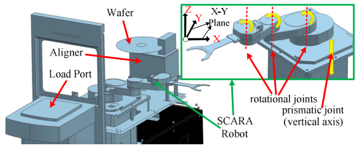
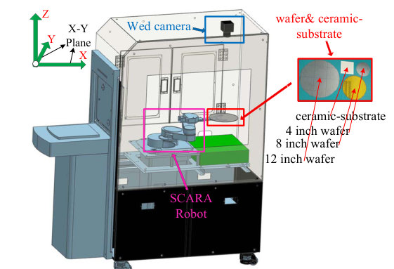
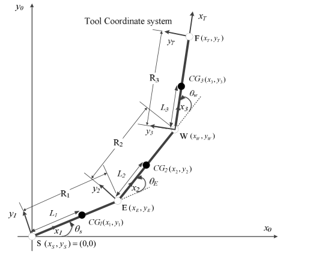
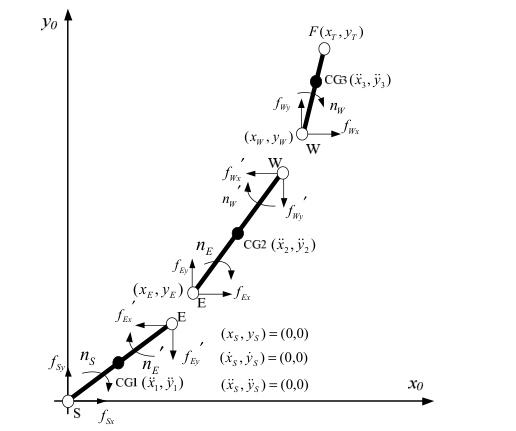
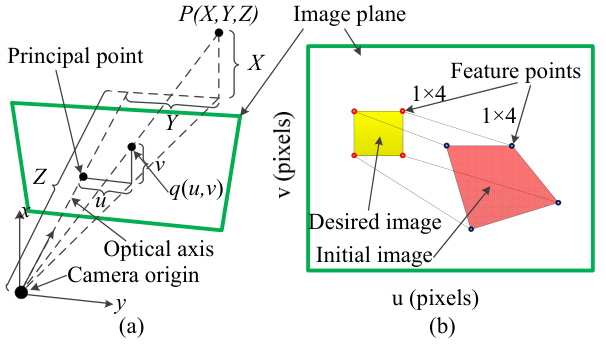
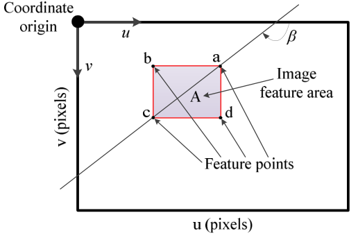
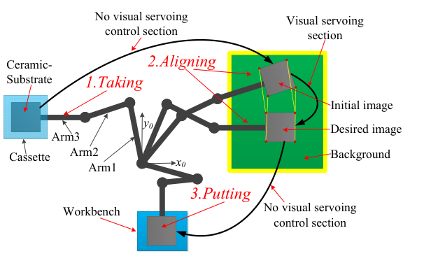
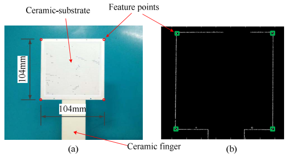
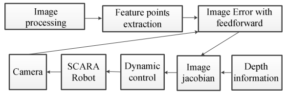
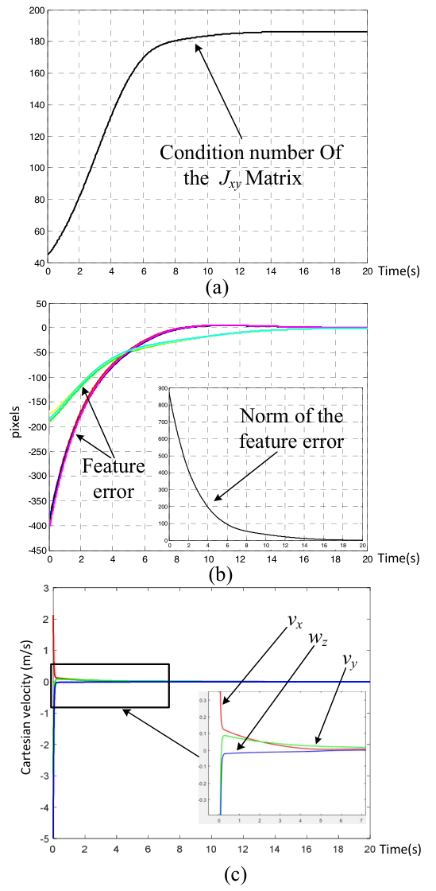

# 시각 서보 기반 웨이퍼·세라믹 기판 핸들링용 직접 구동 SCARA 로봇 (He 2017)

- 원제: A Direct-Drive SCARA Robot for Wafer&Ceramic-Substrate Handling Based on Visual Servoing
- 저자: Yunbo He*, Chang Zhang*, Wentao Ye, Zuoxiong He, Xin Chen, Jian Gao, Kai Zhang, Zhijun Yang, Xun Chen, Yun Chen, Hui Tang (Guangdong University of Technology 전기기계공학부, 중국 광저우)
- 원문: 같은 폴더의 `He2017_ICCIS_SCARA_visual_servo.pdf` (2017 IEEE 8th International Conference on CIS & RAM, 중국 닝보, pp. 428–433)
- 번역 범위: 전문
- 그림: 원문 그림 10개를 `그림/`에 넣고 본문에서 처음 언급되는 곳에 삽입. 표 I, II는 마크다운 표로 옮김.

## 초록

본 논문에서는 웨이퍼·세라믹 기판(wafer&ceramic-substrate) 핸들링을 위한 4자유도(Degrees of Freedom, DOF) 직접 구동(direct-drive) SCARA(Selective Compliant Assembly Robot Arm) 로봇을 설계한다. 웨이퍼·세라믹 기판 핸들링 시스템 전체의 유연성을 높이기 위해, 웨이퍼의 정확한 위치 결정만 가능하고 세라믹 기판에는 무력한 기존 얼라이너(aligner)를 버리고, 시각 서보(visual servoing) 제어 전략을 도입하여 웨이퍼·세라믹 기판을 빠르고 정확하게 정렬하는 목적을 훌륭히 달성한다. SCARA 로봇의 구조적 특성을 고려하여 XY/Z 분할(XY/Z-Partitioned) IBVS 방식을 채택했으며, 이로써 x·y축과 z축의 제어 분리(decoupling)를 실현했다. 시각 서보 제어 전략의 신뢰성은 시뮬레이션과 SCARA 로봇의 실물 시제품으로 검증했다. 성능은 웨이퍼·세라믹 기판 핸들링 공정의 요구 사항을 충족한다.

키워드 — SCARA 로봇, 시각 서보, 직접 구동, 웨이퍼·세라믹 기판 핸들링

## I. 서론 (INTRODUCTION)

집적회로의 고밀도 집적화에 따라 웨이퍼 핸들러의 정밀도와 운동 평활성 요구가 점점 더 엄격해지고 있다. 웨이퍼·세라믹 기판 핸들링 SCARA 로봇은 집적회로 제조에 없어서는 안 될 장치로, 여러 작업 공정 사이에서 웨이퍼를 이송하고 정렬할 수 있다. 고속, 고신뢰성, 고정밀의 특성을 가진다. 이를 활용하면 웨이퍼 생산에서 자동화와 최소 오염을 실현할 수 있다[1]. 기존 웨이퍼 핸들링 공정은 그림 1과 같으며, SCARA 로봇은 웨이퍼 이송을, 얼라이너는 웨이퍼 보정(calibration)과 위치 결정을 담당한다[2]. 그러나 얼라이너가 보정할 수 있는 웨이퍼 크기는 제한되어 있고 원형 웨이퍼의 보정에만 쓸 수 있으므로, SCARA 로봇과 얼라이너로 이루어진 웨이퍼 핸들링 시스템은 유연성이 떨어지며 웨이퍼·세라믹 기판 겸용 핸들링과 위치 결정이라는 우리의 요구를 충족하지 못한다. 웨이퍼·세라믹 기판의 정렬 보정 문제를 풀기 위해 본 논문은 시각 서보 제어 전략을 제시한다. SCARA 로봇 끝단에서 얻는 웨이퍼·세라믹 기판의 시각 정보와 X-Y 평면에서의 SCARA의 3자유도(그림 2 참조)를 이용하여 웨이퍼·세라믹 기판의 정밀하고 매끄러운 위치 결정을 달성한다. 그림 2에서 볼 수 있듯이, 시각 서보 기반 SCARA 로봇의 실물 시제품은 4~12인치 웨이퍼와 직사각형 세라믹 기판을 모두 다룰 수 있다. 얼라이너를 없앴기 때문에 웨이퍼 편심(eccentricity)과 세라믹 기판 자세 오차의 측정은 시각 서보 시스템이 수행하며, 웨이퍼·세라믹 기판의 위치 결정과 보정은 SCARA 로봇의 (X-Y 평면상) 3자유도로 수행한다(그림 2 참조). 오늘날 집적회로 산업에서는 Z(상하) 운동, θ(회전) 운동, R(반경 방향 직선 신축) 운동을 할 수 있는 3자유도 R-θ 웨이퍼 핸들링 로봇이 일반적이다[3]. 또한 이 SCARA 로봇 구조는 복잡한 기어박스와 타이밍 벨트로 구동하는 전통적인 AC 서보 모터로 설계된다. 이 구조는 X-Y 평면에서 2자유도만 가지므로, SCARA 로봇의 자유도를 이용해 웨이퍼·세라믹 기판의 보정과 위치 결정을 수행한다는 목적을 충족할 수 없음이 분명하다.

*그림 1 — 웨이퍼 핸들링 작업 흐름 개략도 (Wafer, Aligner, Load Port, SCARA Robot, 회전 관절 rotational joints, 직동 관절 prismatic joint(수직축))*

*그림 2 — 시각 서보 기반 SCARA 로봇의 실물 시제품 (웹 카메라(원문 표기 "Wed camera"), 웨이퍼·세라믹 기판: 세라믹 기판, 4·8·12인치 웨이퍼)*

직접 구동 기술은 부하를 모터 축에 직접 연결하므로 기구를 단순화하고, 구조 강성을 높이며, SCARA 로봇 구조의 무게를 줄인다[4]. 그림 1에 보인 것처럼, 우리는 R-θ 구조를 버리고 X-Y 평면에서 3자유도를 갖는 4자유도 직접 구동 SCARA 로봇을 새로 설계했으며, 이는 웨이퍼·세라믹 기판 정렬의 요구 사항을 충족한다.

현재 시각 서보는 여러 분야의 많은 연구자가 사용하고 있다. 문헌 [5]에서는 스패너 집기·놓기에 대한 시각 서보 응용을 기술했다. [6]에서는 비전 기반 윤곽 추종 문제를 다루는 정교한 접근법을 개발했다. [7]에서는 복잡하고 미지인 형상을 가진 평면 윤곽에 대한 2.5D 시각 서보를 깊이 연구하여 실제 산업 생산에서 좋은 결과를 얻었다. 일반적으로 시각 서보는 위치 기반 시각 서보(Position-Based Visual Servoing, PBVS)와 영상 기반 시각 서보(Image-Based Visual Servoing, IBVS)의 두 범주로 나눌 수 있다[8]. PBVS와 비교하여 IBVS는 PBVS에 필수적인 외부 파라미터 보정이 필요 없으므로 더 강건하다는 것이 잘 알려져 있다[6]. 동시에 IBVS 시스템에는 카메라 후퇴(camera retreat) 문제가 있다는 것도 알려져 있다[9]. 따라서 본 논문의 웨이퍼·세라믹 기판 핸들링 시스템에서는 XY/Z 분할 IBVS 방식을 채택하며, 이는 IBVS의 장점을 충분히 살리면서 IBVS의 단점을 가능한 한 극복할 수 있다. III절에서 XY/Z 분할 IBVS 방식을 더 분석한다.

이 논문의 나머지 구성은 다음과 같다. SCARA 로봇의 야코비안(Jacobian) 행렬과 동역학 방정식을 □절에서 구한다. III절에서는 SCARA 웨이퍼·세라믹 기판 핸들링 시스템에 XY/Z 분할 IBVS 방식을 적용하는 것을 자세히 분석한다. 실험 결과와 결론은 각각 □절과 □절에서 제시한다. [역주: 원문에서 절 번호(로마 숫자)가 깨진 글자로 표시되어 있다. 각각 II, IV, V절로 보인다.]

## II. SCARA 로봇의 기구학 및 동역학 (KINEMATICS AND DYNAMICS OF SCARA ROBOTS)

### A. SCARA 로봇의 야코비안 (Jacobian for SCARA robot)

그림 1은 SCARA 로봇의 구조를 보여 주며, 이 로봇은 X-Y 평면에 분포한 회전 관절 세 개와 Z축(수직축) 방향의 직동 관절(prismatic joint) 하나를 가진다. 표 I은 SCARA 로봇의 수정 D-H 파라미터(modified D-H parameters)를 나열하며, 그림 3은 각 관절의 수정 D-H 좌표계, 각 링크의 길이, 각 링크의 무게중심(centroid)을 보여 준다. 이제 이 링크 파라미터들로 SCARA 로봇의 야코비안 행렬을 계산한다.

**표 I. SCARA 로봇의 D-H 파라미터**

| Joint i | $\alpha_{i-1}$ | $a_{i-1}$ | $d_i$ | $\theta_i$ |
|---|---|---|---|---|
| 1 | 0 | 0 | 0 | $\theta_1$ |
| 2 | 0 | $R_1$ | 0 | $\theta_2$ |
| 3 | 0 | $R_2$ | 0 | $\theta_3$ |
| End-effector | 0 | $R_3$ | 0 | 0 |

*그림 3 — SCARA 로봇 개략도 (Tool Coordinate system: 공구 좌표계)*

각 링크 사이의 기하학적 관계(그림 3 참조)로부터 다음 식들을 얻을 수 있다.

$(x_S, y_S) = (0,0)$이라 하자.

$$x_E = R_1\cos(\theta_S),\quad y_E = R_1\sin(\theta_S) \tag{1}$$

$$x_W = R_2\cos(\theta_S+\theta_E) + R_1\cos(\theta_S),\quad y_W = R_2\sin(\theta_S+\theta_E) + R_1\sin(\theta_S) \tag{2}$$

$$\begin{aligned} x_T &= R_3\cos(\theta_S+\theta_E+\theta_W) + R_2\cos(\theta_S+\theta_E) + R_1\cos(\theta_S) \\ y_T &= R_3\sin(\theta_S+\theta_E+\theta_W) + R_2\sin(\theta_S+\theta_E) + R_1\sin(\theta_S) \end{aligned} \tag{3}$$

식 (3)의 양변을 미소 시간 요소로 나누면 야코비안을 얻는다.

$$J_m = \begin{bmatrix} -R_3S_{SEW} - R_2S_{SE} - R_1S_S & -R_3S_{SEW} - R_2S_{SE} & -R_3S_{SEW} \\ R_3C_{SEW} + R_2C_{SE} + R_1C_S & R_3C_{SEW} + R_2C_{SE} & R_3C_{SEW} \end{bmatrix}. \tag{4}$$

여기서 $S_{SEW}$는 $\sin(\theta_S+\theta_E+\theta_W)$, $C_{SEW}$는 $\cos(\theta_S+\theta_E+\theta_W)$, $S_{SE}$는 $\sin(\theta_S+\theta_E)$, $C_{SE}$는 $\cos(\theta_S+\theta_E)$, $S_S$는 $\sin(\theta_S)$, $C_S$는 $\cos(\theta_S)$의 약기이며 나머지도 같은 방식이다. 그림 3은 SCARA 로봇의 상세 파라미터를 보여 준다. $R_i$와 $L_i$는 각각 각 링크의 길이와 각 링크의 무게중심 위치를 나타낸다. $\theta_S$, $\theta_E$, $\theta_W$는 각각 SCARA 로봇의 관절각을 나타낸다.

### 동역학 모델 (dynamics model)

SCARA 로봇 링크 사이의 힘 관계를 그림 4에 나타냈다. 힘 방정식(뉴턴 제2법칙)과 모멘트 방정식(오일러 법칙)을 이용하면 SCARA 로봇 팔의 힘 방정식을 유도할 수 있다.

*그림 4 — SCARA 로봇 링크 사이의 힘 관계*

$$\begin{pmatrix} f_{Wx} \\ f_{Wy} \end{pmatrix} = \begin{pmatrix} m_3\ddot{x}_3 \\ m_3\ddot{y}_3 \end{pmatrix} \tag{5}$$

$$\begin{pmatrix} f_{Ex} \\ f_{Ey} \end{pmatrix} = \begin{pmatrix} m_2\ddot{x}_2 + f_{Wx} \\ m_2\ddot{y}_2 + f_{Wy} \end{pmatrix} = \begin{pmatrix} m_2\ddot{x}_2 + m_3\ddot{x}_3 \\ m_2\ddot{y}_2 + m_3\ddot{y}_3 \end{pmatrix} \tag{6}$$

$$\begin{pmatrix} f_{Sx} \\ f_{Sy} \end{pmatrix} = \begin{pmatrix} m_1\ddot{x}_1 + f_{Ex} \\ m_1\ddot{y}_1 + f_{Ey} \end{pmatrix} = \begin{pmatrix} m_1\ddot{x}_1 + m_2\ddot{x}_2 + m_3\ddot{x}_3 \\ m_1\ddot{y}_1 + m_2\ddot{y}_2 + m_3\ddot{y}_3 \end{pmatrix} \tag{7}$$

$$n_W = I_3\dot{\omega}_W - m_3\ddot{x}_3(y_3-y_W) + m_3\ddot{y}_3(x_3-x_W) \tag{8}$$

$$n_E = n_W + I_2\dot{\omega}_E - m_2\ddot{x}_2(y_2-y_E) - m_2\ddot{y}_2(x_E-x_2) + f_{Wx}(y_W-y_E) + f_{Wy}(x_E-x_W) \tag{9}$$

$$n_S = n_E + I_1\dot{\omega}_S - m_1\ddot{x}_1(y_1-y_S) + m_1\ddot{y}_1(x_1-x_S) - f_{Ex}(y_E-y_S) + f_{Ey}(x_E-x_S) \tag{10}$$

여기서 $\omega_S=\dot{\theta}_S$, $\dot{\omega}_S=\ddot{\theta}_S$, $\omega_E=\dot{\theta}_E+\dot{\theta}_S$, $\dot{\omega}_E=\ddot{\theta}_E+\ddot{\theta}_S$, $\omega_W=\dot{\theta}_S+\dot{\theta}_E+\dot{\theta}_W$, $\dot{\omega}_W=\ddot{\theta}_S+\ddot{\theta}_E+\ddot{\theta}_W$이고, $\theta, \dot{\theta}, \ddot{\theta}$는 각각 관절각, 속도, 가속도이며, $n_W, n_E, n_S$는 SCARA 로봇 세 관절의 모멘트(또는 힘)이고, $m_i$, $I_i$는 각각 각 링크의 질량과 관성이다.

변수들(각 무게중심의 가속도, 각 무게중심의 위치 좌표, 각 링크의 좌표 위치)을 (8), (9), (10)에 대입하고 정리하면 다음과 같다.

$$\begin{aligned} n_S = {} & \{(I_1+I_2+I_3) + m_1L_1^2 + m_2(L_2^2 + R_1^2 + 2L_2R_1C_E) + m_3(L_3^2 + R_2^2 + R_1^2 + 2L_3R_2C_W + 2L_3R_1C_{EW} + 2R_2R_1C_E)\}\ddot{\theta}_S \\ & + \{(I_2+I_3) + m_2(L_2^2 + L_2R_1C_E) + m_3(L_3^2 + R_2^2 + 2L_3R_2C_W + L_3R_1C_{EW} + R_2R_1C_E)\}\ddot{\theta}_E \\ & + \{I_3 + m_3(L_3^2 + L_3R_2C_W + L_3R_1C_{EW})\}\ddot{\theta}_W \\ & + \{(2L_3R_1m_3S_{EW} + 2L_2R_1m_2S_E + 2R_1R_2m_3S_E)\dot{\theta}_E - (2L_3R_1m_3S_{EW} + 2L_3R_2m_3S_W)\dot{\theta}_W\}\dot{\theta}_S \\ & + \{(-L_3R_1m_3S_{EW} - L_2R_1m_2S_E - R_1R_2m_3S_E)\dot{\theta}_E\}\dot{\theta}_E \\ & + \{(-2L_3R_1m_3S_{EW} - 2L_3R_2m_3S_w)\dot{\theta}_E + (-L_3R_1m_3S_{EW} - L_3R_2m_3S_W)\dot{\theta}_W\}\dot{\theta}_W \end{aligned} \tag{11}$$

$$\begin{aligned} n_W = {} & (I_3 + m_3L_3^2 + m_3L_3R_2C_W + m_3L_3R_1C_{EW})\ddot{\theta}_S + (I_3 + m_3L_3^2 + m_3L_3R_2C_W)\ddot{\theta}_E + (I_3 + m_3L_3^2)\ddot{\theta}_W \\ & + (L_3R_1m_3S_{EW} + L_3R_2m_3S_W)\dot{\theta}_S\dot{\theta}_S + (2L_3R_2m_3S_W\dot{\theta}_S + L_3R_2m_3S_W\dot{\theta}_E)\dot{\theta}_E \end{aligned} \tag{12}$$

$$\begin{aligned} n_E = {} & \{(I_2+I_3) + m_2(L_2^2 + L_2R_1C_E) + m_3(L_3^2 + R_2^2 + 2L_3R_2C_W + L_3R_1C_{EW} + R_2R_1C_E)\}\ddot{\theta}_S \\ & + \{(I_2+I_3) + m_2L_2^2 + m_3(L_3^2 + R_2^2 + 2L_3R_2C_W)\}\ddot{\theta}_E + \{I_3 + m_3(L_3^2 + L_3R_2C_W)\}\ddot{\theta}_W \\ & + \{(L_3R_1m_3S_{EW} + L_2R_1m_2S_E + R_1R_2m_3S_E)\dot{\theta}_S\}\dot{\theta}_S - 2L_3R_2m_3S_W\dot{\theta}_W\dot{\theta}_E \\ & + (-2L_3R_2m_3S_W\dot{\theta}_S - L_3R_2m_3S_W\dot{\theta}_W)\dot{\theta}_W \end{aligned} \tag{13}$$

여기서 $n_W, n_E, n_S$는 앞에서 정의한 것과 같다.

임의의 매니퓰레이터에 대해 뉴턴-오일러 방정식을 기호적으로 전개하면 다음 형태로 쓸 수 있는 동역학 방정식이 얻어진다.

$$\tau = M(\theta)\ddot{\theta} + V(\theta,\dot{\theta})\dot{\theta} + G(\theta) \tag{14}$$

여기서 $M(\theta)$는 로봇의 $n\times n$ 질량 행렬, $V(\theta,\dot{\theta})$는 원심력·코리올리 항의 $n\times n$ 행렬, $G(\theta)$는 중력 항의 $n\times 1$ 벡터, $\tau$는 구동기 토크의 $n\times 1$ 벡터이다[10]. 식 (11), (12), (13)을 정리하면 $M(\theta)$, $V(\theta,\dot{\theta})$, $G(\theta)$를 차례로 구할 수 있다.

## III. 시각 서보 구조 (VISUAL SERVOING STRUCTURE)

### 영상 기반 시각 서보(IBVS) 개관 (Review of Image-Based Visual Servo (IBVS))

IBVS(영상 기반 시각 서보)와 PBVS(위치 기반 시각 서보(원문 "posititionbased"))는 완전히 다른 두 형태의 시각 서보 제어 전략이다[11]. PBVS 구조의 목표는 로봇 엔드이펙터 $P_i \in R^3$의 운동을 제어하여 데카르트 공간에서 $e = P_i^* - P_i$로 기술되는 $P_i^* \in R^3$와 $P_i \in R^3$의 차이가 0으로 수렴하게 하는 것이며, 여기서 $P_i$는 목표점, $P_i^*$는 원하는 점이다[6]. $P_i^* \in R^3$와 $P_i \in R^3$는 3-D 복원 방법으로 얻는다[12]. 반면 IBVS 범주에 속하는 제어 법칙은 영상 특징 공간에서 정의된 오차($e = q_i^* - q_i$, 여기서 $q_i^*$와 $q_i$는 $P_i^*$와 $P_i$의 영상 공간 사상)를 직접 0으로 수렴시키는 것을 목표로 한다[6]. 그림 5는 IBVS에서의 중심 투영 모델과 직사각형 목표 영상을 보여 준다. PBVS와 비교하여 IBVS는 PBVS에 결정적인 외부 파라미터 보정이 필요 없으므로 더 강건하며, PBVS보다 점근 안정성을 달성하기 쉽다고 알려져 있다[13].

*그림 5 — (a) 중심 투영 모델. (b) IBVS에서의 직사각형 목표 영상. (Principal point: 주점, Optical axis: 광축, Camera origin: 카메라 원점, Feature points: 특징점, Desired image: 원하는 영상, Initial image: 초기 영상)*

그러나 [14]에 기술된 것처럼 IBVS 시스템에는 문제가 따른다. 예를 들어 영상 야코비안의 특이점(singularity)이나 나쁜 조건수는 제어 문제를 일으키며, IBVS 시스템에서는 카메라 후퇴 문제가 자주 발생한다. 문헌 [14]에서 저자들은 위 문제를 극복하는 새로운 분할 접근법(XY/Z 분할) 시각 서보 제어를 소개했다. 본 논문은 XY/Z 분할 IBVS 제어 방식을 SCARA 웨이퍼·세라믹 기판 핸들링 시스템에 적용한다. 이 절의 다음 부분에서 이를 더 분석한다. 영상 야코비안 행렬은 IBVS 사용의 기반이다[15]. $P$가 SCARA 로봇 엔드이펙터 위의 특징점이고 카메라에 대한 그 좌표가 $p(X, Y, Z)$라 하며, $\dot{p} = (v_x, v_y, v_z, w_x, w_y, w_z)^T$는 선속도 $v = (v_x, v_y, v_z)^T$와 각속도 $w = (w_x, w_y, w_z)^T$로 이루어진 해당 엔드이펙터 속도를 나타낸다고 하자. $q = (u, v)^T$를 점 $p$(특징점 $p$, 그림 5 참조)의 영상 평면 좌표, $\dot{q} = (\dot{u}, \dot{v})^T$를 그에 대응하는 속도라 하자. 영상 야코비안은 다음과 같이 쓸 수 있다.

$$J_I = \begin{bmatrix} \frac{f}{Z} & 0 & \frac{-u}{Z} & \frac{-uv}{f} & \frac{f^2+u^2}{f} & -v \\ 0 & \frac{f}{Z} & \frac{-v}{Z} & \frac{-f^2-v^2}{f} & \frac{uv}{f} & u \end{bmatrix} \tag{15}$$

여기서 $f$는 카메라의 초점거리이다[14]. 따라서 다음 식을 얻을 수 있다.

$$\dot{q} = J_I(q,p)\,\dot{p}. \tag{16}$$

대부분의 영상 야코비안은 특징점으로 구하지만, 시각 서보 시스템에서는 다른 영상 특징(직선, 원 등)도 사용된다. 의사역행렬(pseudo-inverse)을 이용하면 엔드이펙터의 속도를 구할 수 있다. 나아가 □절의 야코비안 (4)를 이용하면 로봇 각 관절의 속도를 구할 수 있다. 다음과 같다.

$$\dot{p} = J_I^+(q,p)\,\dot{q} \tag{17}$$

$$\dot{\theta} = J_m^+ J_I^+(q,p)\,\dot{q} \tag{18}$$

여기서 $J_I^+$와 $J_m^+$는 각각 $J_I$와 $J_m$의 의사역행렬이다. $\dot{\theta}$는 로봇의 관절 속도를 나타낸다.

### XY/Z 분할 IBVS 방식 (XY/Z-Partitioned IBVS scheme)

XY/Z 분할 IBVS 방식은 Peter 등이 제안했으며 하이브리드(hybrid) 방법과 매우 다르다[14]. 하이브리드 제어 구조는 기본 행렬(fundamental matrix)이나 필수 행렬(essential matrix)에 담긴 호모그래피(homography) 행렬을 계산해야 한다[16]. 따라서 하이브리드 방법은 실시간 계산 비용을 높이고 특징점 선택에 엄격한 요구(공면 특징점이 필요)를 두는 반면, XY/Z 분할 IBVS 방식은 이런 상황에서 장점을 보인다.

XY/Z 분할 IBVS 방식의 원리는 일부 자유도는 IBVS로 제어하고 나머지 자유도는 다른 제어기로 제어하는 것이다. XY/Z 분할 IBVS 방식은 x축과 y축을 한 그룹으로, z축을 다른 그룹으로 본다. 식 (16)은 다음과 같이 분해된다.

$$\dot{q} = J_{xy}v_{xy} + J_z v_z \tag{19}$$

여기서 $v_{xy} = (v_x, v_y, w_x, w_y)$, $v_z = (v_z, w_z)$이고, $J_{xy}$와 $J_z$는 각각 $J_I$의 {1, 2, 4, 5}열과 {3, 6}열이다[9]. 식 (19)에 따라 x·y축의 평행이동과 회전, z축의 평행이동, z축의 회전에 대해 각각 서로 다른 세 제어기를 설계한다. x·y축 제어기는 다음과 같이 설계할 수 있다.

$$v_{xy} = \lambda J_{xy}^+(\dot{q}^* - J_z v_z) \tag{20}$$

여기서 $\lambda$는 P형 제어기의 이득 상수, $\dot{q}^*$는 원하는 특징점 속도, $J_{xy}^+$는 $J_{xy}$의 의사역행렬이다.

z축 회전과 z축 평행이동을 위한 제어기 설계에는 두 개의 추가 영상 특징 $A$와 $\beta$를 도입해야 한다. 그림 6에서 볼 수 있듯이 $A$는 영상의 직사각형 면적이고, $\beta \in [0, 2\pi]$는 u축과 특징점 a, c를 잇는 방향 선분 사이의 각도이다. z축에 대한 두 제어기는 다음과 같이 설계할 수 있다.

*그림 6 — XY/Z 분할 IBVS 방식을 위한 영상 특징 (Coordinate origin: 좌표 원점, Image feature area: 영상 특징 면적, Feature points: 특징점)*

$$w_z^* = \lambda_{w_z}(\theta^* - \theta) \tag{21}$$

$$v_z^* = \lambda_{v_z}(\sigma^* - \sigma) \tag{22}$$

여기서 $\lambda_{wz}$와 $\lambda_{vz}$는 각각 P형 제어기의 이득 상수이다. $\sigma = \sqrt{A}$는 면적 $A$의 함수이며, $\theta^*$와 $\sigma^*$는 원하는 영상 특징이다. [역주: 본문은 각도 특징을 $\beta$로 정의했으나 식 (21)에서는 $\theta$로 표기했다. 원문 그대로 둔다.]

특징점을 카메라 시야 안에 유지하기 위해 [9]는 카메라에 작용하는 척력(repulsive force)을 정의하는데, 이 힘은 점이 영상 평면 경계에 가까워질수록 카메라를 밀어낸다.

$$F_z(q) = \begin{cases} \left\{\dfrac{1}{d(q)} - \dfrac{1}{d_0}\right\}\dfrac{1}{d^2(q)} & d(q) \le d_0 \\ 0 & d(q) > d_0 \end{cases} \tag{23}$$

여기서 $d(q)$는 영상점 $q$로부터 영상 평면 가장자리까지의 최단 거리이고, $d_0$는 척력이 작용하는 영상 영역의 폭이다[9]. 척력을 z축 평행이동 제어기에 더한다.

$$v_z^* = \lambda_{v_z}(\sigma^* - \sigma) - \eta\sum_{i=1}^{N} F_z(p_i)$$

여기서 $\eta$는 스칼라 이득 계수이다.

## IV. 실험 결과 (EXPERIMENTAL RESULTS)

SCARA 로봇의 파라미터를 표 II에 나열했으며, $R_i$, $L_i$, $I_i$, $m_i$는 앞에서 정의한 것과 같다. 이 파라미터들의 식별(identification)은 [17]에서 더 연구되었다.

**표 II. SCARA 로봇의 파라미터**

| Axis | $R_i$ | $L_i$ | $I_i$ | $m_i$ |
|---|---|---|---|---|
| Arm1 | 0.21m | 0.073m | 0.0645656Kg.m² | 6.32Kg |
| Arm2 | 0.21m | 0.09m | 0.0557132Kg.m² | 5.51Kg |
| Arm3 | 0.21m | 0.11m | 0.0114485Kg.m² | 1.37Kg |

이 웨이퍼·세라믹 기판 핸들링 시스템의 전체 작업 흐름을 그림 7에 나타냈으며, 집기(taking), 정렬(aligning), 놓기(putting)의 세 단계로 이루어진다. XY/Z 분할 IBVS 방식은 우리 연구의 초점인 정렬 구간에서만 사용된다. 웹 카메라 파라미터는 다음과 같이 선택했다. 초점거리 8mm, 영상 화소 1024×1024, 샘플링 주파수 50Hz이다. 이 실험에서는 세라믹 기판(104mm×104mm)으로 웨이퍼·세라믹 기판 핸들링 시스템의 성능을 시험한다.

*그림 7 — 시각 서보를 적용한 웨이퍼·세라믹 기판 핸들링 시스템의 전체 작업 흐름 (1. 집기, 2. 정렬, 3. 놓기 / No visual servoing control section: 시각 서보 미적용 구간, Visual servoing section: 시각 서보 구간, Cassette: 카세트, Workbench: 작업대, Initial image: 초기 영상, Desired image: 원하는 영상, Background: 배경)*

그림 8에 보인 것처럼, 세라믹 기판의 네 모서리를 시각 서보의 특징점으로 선택한다. 특징점을 추출하기 전에 Canny 알고리즘으로 세라믹 기판의 에지를 추출한다(그림 8 참조). 그림 9는 본 논문에서 사용한 XY/Z 분할 IBVS 방식을 보여 준다. 식 (15)에서 보듯이 영상 야코비안 계산에는 특징점의 깊이 정보가 필수적이며, 대부분의 IBVS 방식에서는 깊이 정보를 추정해야 한다. 그러나 SCARA 로봇은 평면 관절 로봇의 일종으로, 정렬 과정에서 고정된 평면에서만 작업한다. 따라서 특징점의 깊이 정보는 수동 티칭(manual teaching)으로 얻을 수 있으므로 복잡한 깊이 추정 알고리즘이 필요 없다. 이 실험에서 웹 카메라(원문 "wed camera")는 SCARA 로봇 위에 고정되어 있고 광축은 배경 평면에 수직이며, 특징점의 깊이는 0.47m이다.

*그림 8 — 세라믹 기판의 특징점 추출 ((a) 세라믹 기판(104mm×104mm)과 특징점, 세라믹 핑거 (b) 에지 영상과 특징점)*

*그림 9 — 본 논문에서 사용한 IBVS 구조의 흐름도 (영상 처리 → 특징점 추출 → 피드포워드 포함 영상 오차 / 깊이 정보 → 영상 야코비안 → 동역학 제어 → SCARA 로봇 → 카메라)*

자세한 실험 과정은 다음과 같다. 먼저 카메라 시야 안에서 한 점을 티칭하고, SCARA 로봇이 이 점으로 이동하면 시각 서보 시스템이 초기 영상을 획득한다. 원하는 영상은 비전 시스템이 이미 보정해 두었다. XY/Z 분할 IBVS 방식은 초기 영상과 원하는 영상의 차이를 이용하여 세라믹 기판의 보정을 완료하며, 그 제어 성능을 그림 10에 나타냈다.

약 15초 뒤 네 특징점의 특징 오차가 0으로 수렴함을 볼 수 있다. 시각 서보 과정에서 $J_{xy}$ 행렬의 조건수와 특징 오차의 노름은 모두 병적인 현상(morbidity) 없이 매끄럽게 변한다(그림 10 (a), (b) 참조). 제어 초기에 SCARA 엔드이펙터의 속도가 상당히 요동하지만 최댓값은 5 (m / s)를 넘지 않으며, 이후 점차 0으로 수렴한다. 실험 결과는 XY/Z 분할 IBVS 방식이 강건하고 제어 과정이 매끄럽지만, 수렴 속도가 충분히 빠르지 않으며 P형 제어기의 개선이 필요함을 보여 준다.

*그림 10 — XY/Z 분할 IBVS 방식의 성능. (a) $J_{xy}$ 행렬의 조건수. (b) 특징 오차(삽입 그림: 특징 오차의 노름). (c) 엔드이펙터의 속도.*

## V. 결론 (CONCLUSION)

웨이퍼·세라믹 기판 생산에서 최소 오염을 달성하기 위해, 본 논문에서는 웨이퍼·세라믹 기판 보정에 시각 서보 기술을 사용했다. SCARA 로봇의 구조적 특성을 고려하여 XY/Z 분할 IBVS 방식을 채택했으며, 실시간 계산 비용을 고려하면서 x·y축과 z축의 제어 분리를 실현했다. 또한 세라믹 기판을 예로 들어 시각 서보 방식을 검증했으며, 실험 결과는 시각 서보 구조가 강건하고 매끄러움을 보여 준다.

그러나 고려해야 할 실제 문제도 있다. 예를 들어 XY/Z 분할 IBVS 방식의 수렴 속도를 개선해야 하며, 세라믹 기판이 변형되었을 때 특징점을 어떻게 정확히 추출할 것인가? 이것이 우리의 향후 과제이다.

## 감사의 글 (ACKNOWLEDGMENTS)

본 연구는 광둥성 자연과학기금(No.2016A030308016, No.2015A030312008)과 광둥성 R&D 핵심 과제(No.2015B010133005, No.2015B010104006, No.2015B010104008)의 지원을 받았다. (1쪽 각주에도 같은 지원 기관과 과제 번호가 실려 있다.)

## 참고문헌

- [1] Cong M, Cui D. Wafer-Handling Robots and Applications [J]. Recent Patents on Engineering, 2009, 3(3):170-177.
- [2] Cheng H, Chen H, Mooring B W. Accuracy Analysis of Dynamic-Wafer-Handling Robotic System in Semiconductor Manufacturing[J]. IEEE Transactions on Industrial Electronics, 2013, 61(3):1402-1410.
- [3] Cong M,Yu X, Shen B, etal. Research on a novel R-θ wafer-handling robot[C]//IEEE International Conference on Automation and Logistics. IEEE, 2007:597-602.
- [4] Tan W, Zhao X F. Current Research and Development of the Robot Direct-Drive Technology [J]. Mechanical Engineer, 2000.
- [5] Hu C Y, Chen C R, Tseng C H, et al. Visual servoing spanner picking and placement with a SCARA manipulator[C]// IEEE International Conference on Industrial Technology. IEEE, 2016:1632-1637.
- [6] Chang W C, Cheng M Y, Tsai H J. Image feature command generation of contour following tasks for SCARA robots employing Image-Based Visual Servoing—A PH-spline approach[J]. Robotics and Computer-Integrated Manufacturing, 2017, 44:57-66.
- [7] Malis E, Chesi G, Cipolla R. 2-1/2D Visual Servoing with Respect to Planar Contours Having Complex and Unknown Shapes[J]. International Journal of Robotics Research, 2003, 22(10-11):841-854.
- [8] Hutchinson S, Hager G, Corke P. Tutorial (TT3) on visual servo control [J]. 1996.
- [9] Corke P. Robotics, Vision and Control [J]. Springer Tracts in Advanced Robotics, 2011, 39(6).
- [10] Craig J J. Introduction to Robotics: Mechanics and Control [J]. Automatica, 1987, 23(2):263-264.
- [11] S. Hutchinson, G. D. Hager, P. Corke, A tutorial on visual servo control, IEEE Trans .Robot.Autom.12(1996)651–670.
- [12] R. Szeliski, Computer Vision: Algorithms and Applications, Springer Science & Business Media, London, 2010.
- [13] F. Chaumette, Potential problems of stability and convergence in image-based and position-based visual servoing, Conflu. Vis. Control (1988) 66–78.
- [14] Corke P I, Hutchinson S A. A new partitioned approach to image based visual servo control [J]. IEEE Transactions on Robotics & Automation, 2001, 17(4):507-515.
- [15] Weiss LE, Sanderson AC, Neuman CP (1987) Dynamic sensor-based control of robots with visual feedback. IEEE Journal of Robotics and Automation, 3:404–417.
- [16] Deguchi K. Optimal motion control for image-based visual servoing by decoupling translation and rotation[C]// Ieee/rsj International Conference on Intelligent Robots and Systems, 1998. Proceedings. IEEE, 1998:705-711 vol.2.
- [17] Yan D, Lu Y, Levy D. Parameter identification of robot manipulators: a heuristic particle swarm search approach.[J]. PloS one, 2015, 10(6):e0129157.
