# 비전 기반 SCARA 로봇 팔의 완전 자동 보정과 지능형 웨이퍼 검사 스케줄링 응용 (Su 2022)

- 원제: A Fully Automatic Calibration for Vision-Based Selective Compliance Assembly Robot Arm and Its Application to Intelligent Wafer Inspection Scheduling
- 원문: 같은 폴더의 `Su2022_IEEEAccess.pdf` (IEEE Access, vol. 10, pp. 50100–50113, 2022. DOI 10.1109/ACCESS.2022.3172953, CC BY 4.0)
- 저자: Yu-Ting Su, Tzuu-Hseng S. Li (Member, IEEE), Meng-Xue Chen, Song-Jin Lin, Cheng-Yeh Yang, Chang-Wen Wang, Hsu-Ming Tsao, Cheng-Han Zhan (aiRobots Laboratory, Department of Electrical Engineering, National Cheng Kung University, 대만 타이난). 교신저자: Tzuu-Hseng S. Li
- 번역 범위: 전문 (본문·수식·그림 캡션·표). 참고문헌은 원문 그대로 옮겼다(참고문헌 목록은 번호 [1]–[41]이며, 본문 인용 번호와 목록 내용이 어긋나는 곳이 있으나 원문 그대로 두었다).
- 그림: 원문 그림 27개를 `그림/`에 넣고 본문에서 처음 언급되는 곳에 삽입

> 게재 정보: IEEE SYSTEMS, MAN AND CYBERNETICS SOCIETY SECTION. 접수 2022년 4월 2일, 승인 2022년 4월 24일, 게재 2022년 5월 5일, 현재 판 2022년 5월 13일. 이 연구는 대만 과학기술부(Ministry of Science and Technology, Taiwan)의 지원(과제 MOST 107-2221-E-006-224-MY3)을 받았다. 이 원고의 심사를 조율하고 게재를 승인한 부편집자는 Xiaojie Su이다. 이 저작물은 크리에이티브 커먼즈 저작자 표시 4.0 라이선스(https://creativecommons.org/licenses/by/4.0/)로 이용 허락된다.

## 초록 (Abstract)

이 연구는 완전한 SCARA(Selective Compliance Assembly Robot Arm) 웨이퍼 검사 시스템을 제공한다. 이 시스템은 주로 두 단계로 이루어진다. 첫째 단계에서는 SCARA 매니퓰레이터가 검사 응용 플랫폼 역할을 하고, 깊이 카메라(depth camera)를 단축(single-axis) 비전 프레임과 함께 사용하여 검사 지점과 카세트의 위치 벡터를 측정함으로써, SCARA가 작업 영역에서 자동으로 보정(캘리브레이션)을 수행할 수 있게 한다. 둘째 단계에서는 SCARA가 검사를 진행할 때 모든 검사 항목을 가장 짧은 시간에 수행하도록, 검사 대기 중인 웨이퍼의 처리 순서를 최적화한다. 이 연구는 전통적인 웨이퍼 검사 현장에서 매니퓰레이터와 작업 영역의 위치를 보정하는 데 인력이 소모되던 문제를 해결하여, 매니퓰레이터가 작업 영역과 충돌하지 않고 검사 센터의 경제적 이익과 함께 정해진 작업을 완수할 수 있게 하였다. 또한 최적화된 스케줄링은 매니퓰레이터가 모든 검사 작업을 끝내는 시간을 줄여 단위 시간당 더 많은 웨이퍼를 검사할 수 있게 한다. 마지막으로 검사 지점이 보정되지 않은 현장에 SCARA를 두고, 매니퓰레이터가 모든 검사 지점의 상대 위치를 자동으로 계산한다. 미리 정의된 웨이퍼 검사 스케줄을 시스템에 보내 최적화 계산을 수행하고, 실험 결과를 SCARA로 제시한다.

색인어(INDEX TERMS): 퍼지 추론 시스템(fuzzy inference system), 스케줄링 휴리스틱(scheduling heuristics), SCARA, 비전 보정(vision calibration).

## I. 서론 (INTRODUCTION)

이 논문은 "산업 환경에서의 통합과 응용을 위한, 지능형 자동 스케줄링 및 보정 통합 기술을 갖춘 비전 기반 SCARA 설계"를 제안한다. SCARA 로봇은 비전 이동 시스템을 통합하여 서로 협력하도록 설계된다. SCARA는 작업 플랫폼에서 끝단 위치의 좌표를 로봇에 수동으로 교시(teach)할 수 있으며, 로봇과 각 검사 플랫폼 사이의 교시와 보정을 자율적으로 완료하여 더 높은 작업 효율을 달성할 수 있다. 전통적인 공장에서 매니퓰레이터와 플랫폼을 보정하는 방법은 수동 보정 [1]과 티치박스(Teachbox)를 이용한 보정 [2] 두 가지이며, 둘 다 인력과 시간이 들고 작업 안전 문제를 안고 있다. 매니퓰레이터와 작업 플랫폼의 보정 시간을 줄이고 수동 보정의 시간 소모 문제를 해결하기 위해, SCARA(selective compliance assembly robot arm)에 쓰이는 자동 보정 기술을 제안한다.

SCARA 매니퓰레이터는 먼저 비전 기반 자동 보정 [3]을 바탕으로 시판 SCARA 매니퓰레이터의 축 설계를 참고하여 설계하였다. 작업 플랫폼 위에 다자유도 이동 비전 시스템을 구축하여 목표 지점을 검출하고, SCARA 매니퓰레이터가 보정 지점 위치를 얻을 수 있게 한다.

최근 많은 제조사가 지능형 공장을 위한 디지털 스케줄링과 최적화 관리 개념을 제안하였다 [4]. 이에 우리는 SCARA가 전체 작업의 스케줄링 시간을 효과적으로 줄이고 통제하는 법을 학습하게 하는 알고리즘을 제안하였다. 웨이퍼 검사 지점의 좌표, 카세트에서의 배출 순서, 웨이퍼 수, 비전 기반 SCARA 매니퓰레이터의 이동 거리를 이용해 데이터를 추출·분석하여, SCARA 매니퓰레이터가 스케줄링의 이동 궤적을 자율적으로 계획하고 각 웨이퍼의 스케줄링 작업을 효과적으로 완수할 수 있게 하였다. 웨이퍼 검사 스케줄링에 적용한 비전-SCARA의 개략도는 그림 1과 같다.

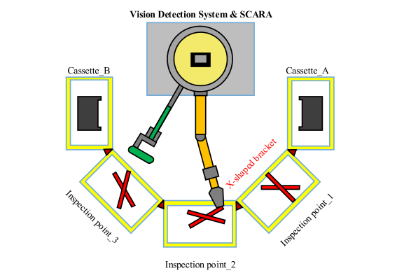
*그림 1 — 웨이퍼 검사 스케줄링에 적용한 비전-SCARA의 개략도.*

논문의 나머지 부분은 다음과 같이 구성된다. SCARA 설계와 환경 설정, 그리고 제안한 웨이퍼 검사 스케줄링 방법을 각각 III절과 IV절에서 설명한다. 실험은 V절에서 제시한다. 마지막으로 VI절에서 결론을 제시한다.

## II. 관련 연구 (RELATED WORK)

이 절은 제안 방법과 관련된 기술을 설명하며, SCARA 교시 및 보정 방법, 퍼지 추론(Fuzzy Inference), 스케줄링 최적화에 대해 각각 문헌 조사를 수행하였다.

### A. SCARA 교시 및 보정 방법 (SCARA TEACHING AND CALIBRATION METHOD)

인더스트리 4.0의 도래와 함께 많은 산업과 서비스, 특히 속도와 효율이 요구되는 생산 라인에서 자동화 기술의 역할이 더 중요해지고 있다. 많은 제조사가 비용 때문에 더 위험하고 반복적인 작업을 수행하도록 인력을 로봇으로 점차 대체하고 있다.

SCARA는 구조가 단순하고 하중이 작으며 속도가 빠르고 반복정밀도(repeatability)가 높아 생산 라인에서 정밀 3C 전자 부품의 조립과 빠른 분류에 적합하다. 예를 들어 SCARA 매니퓰레이터는 집적회로(IC) 공장의 웨이퍼·패널 핸들링과 식품·제약 생산 검사에 널리 적용된다. SCARA 매니퓰레이터는 일반적으로 4자유도를 가지며, 회전축 세 개와 상하축 하나로 나뉜다 [5]. SCARA는 원통 좌표계를 기계 구조의 기반으로 하는 산업용 로봇이다. 따라서 내부 기계 세부의 차이를 제외하면, 국내외 제조사가 제공하는 매니퓰레이터의 전체 기구와 축 설계는 거의 같다. 최근에는 변형이 더 많은 쌍팔(dual-arm) 기구의 SCARA 매니퓰레이터 연구 [6]와 5축 신형 매니퓰레이터 개발 [7]도 있었다. 또한 SCARA 매니퓰레이터의 기구학과 공간 궤적 계획에 관한 연구도 여럿 수행되었다. 예를 들어 Ken과 Yutaka의 연구 [8]에서는 신경망 유사 네트워크로 2링크 SCARA 로봇의 역기구학을 학습하였다.

산업용 로봇이 작업을 수행하려면 목표 지점의 위치를 정확히 알아야 한다. 현재 매니퓰레이터의 점대점(point-to-point) 보정 기법은 두 가지이다. 사용자가 티치박스를 조작하여 목표를 점대점으로 보정하는 방법과, 사용자가 매니퓰레이터를 손으로 끌어 보정하는 방법이다 [9]. 그림 2와 같다. 전통적인 교시 기법에서는 매니퓰레이터가 각 목표 지점을 하나씩 보정해야 하므로 많은 인력과 시간이 든다. 따라서 이 연구는 자동 보정 기술을 갖춘 매니퓰레이터를 제안한다. 비전 센서로 영상 인식을 통해 마커 좌표를 식별하고, 매니퓰레이터를 목표 지점까지 자율적으로 제어하여 자동 보정을 달성한다.

*그림 2 — 티치박스 조작을 통한 보정 [12].*

매니퓰레이터 엔드이펙터의 보정은 로봇이 물체를 집는 데 중요한 기술이다. 문헌 [10]은 다중 파라미터 보정 모델로 6축 산업용 매니퓰레이터의 위치 결정 정확도를 향상하였다. 문헌 [11]은 로봇 기구학 모델의 개선을 바탕으로 산업용 매니퓰레이터의 여러 자세를 이용해 엔드이펙터에 대한 카메라 위치를 구하고, 삼각법으로 위치를 식별하였다. 논문 [12]는 산업용 매니퓰레이터의 엔드이펙터 보정에 메타휴리스틱 알고리즘을 적용하여 실험 결과에서 좋은 오차 데이터를 얻었다. 위에서 언급한 엔드이펙터 보정 방법 대부분은 6축 매니퓰레이터용이며, 좋은 정확도를 얻으려면 고가의 감지 장비와 상당히 복잡한 알고리즘이 필요하다. 이 연구에서는 적절한 검사 지점 위치를 빠르고 자동으로 식별할 수 있는 특징 방법을 자동 보정에 사용하였다. 저가의 깊이 카메라로 특징을 포착하여 무작위로 놓인 물체의 위치 정보를 빠르게 얻으므로, 검사를 위한 웨이퍼의 적절한 배치가 쉬워진다.

### B. 퍼지 추론 시스템 (FUZZY INFERENCE SYSTEM)

퍼지 추론은 여러 학술·산업 분야에서 널리 쓰여 왔으며, 많은 학자가 이 기법으로 제안 방법을 검증하였다. SCARA 응용 분야에서는 일부 학자가 슬라이딩 퍼지 제어 이론(Sliding Fuzzy Control Theory)을 제어 방법으로 삼고 퍼지 규칙(Fuzzy Rule)으로 슬라이딩 모드 제어 신호에서 생길 수 있는 진동 문제를 극복하여, SCARA 시뮬레이션에서 만족스러운 실험 결과를 얻었다 [13]. 또한 일부 학자는 새로운 형태의 분산 강건 적응 퍼지 제어로 매니퓰레이터를 제어할 것을 제안하고, 제안 방법이 전통적인 적응 퍼지 제어(AFC)보다 안정성이 뛰어나다고 주장하였다 [14].

작업 스케줄링 문제에 대해서는, 일부 학자가 차분 진화(differential evolution)와 퍼지 이론을 이용하는 NSODE 방법의 통합을 제안하고 [15], 개미 군집 최적화(Ant Colony Optimization), 입자 군집 최적화(Particle Swarm Optimization), 뻐꾸기 탐색(Cuckoo Search) 같은 기존 알고리즘과 비교하였다. 실험 결과 NSODE가 더 나은 해를 얻을 수 있음을 보였다. 같은 해에 클라우드 제조 응용도 독창적 영감 알고리즘(original inspiration algorithms)을 써서 퍼지 이론과 통합되었으며, 복잡성, 이질성, 불확실성, 지리적 분산을 지닌 클라우드 기술 문제를 풀기 위해 네 가지 통합 모델이 제안되었다 [16].

마찬가지로 최근 전기차 [17]와 녹색 에너지 기술 [18]의 보급과 함께 퍼지 이론의 응용은 뛰어난 결과를 보일 수 있다. 이 연구에서는 앞서 검토한 문헌을 바탕으로, 웨이퍼 우선순위를 퍼지 추론으로 처리하고, SCARA와 검사 지점 사이의 상호 작업 소속도(membership)로 사용 가능한 특징을 선택하며, 경험 규칙(rule of thumb)으로 웨이퍼 우선순위를 식별하였다.

### C. 스케줄링 프로그램의 응용 (APPLICATION OF SCHEDULING PROBRAM)

[역주: 절 제목의 "PROBRAM"은 원문 그대로이며 "PROGRAM"의 오기로 보인다.]

정렬 이론(Sorting Theory)은 일상의 여러 사례에 적용되어 왔다. [19]에서 학자들은 정렬 방법으로 작업 절차를 배치(batch)로 나누고, 배치로 나눈 항목을 분류하여 기계의 용량 한계를 넘지 않으면서 일정을 단축하였다. [20]에서는 해상 석유 채취·운송 시스템 선단을 이용해 생산 저장·하역 탱크의 원유를 육상 저장 항구로 옮겼다.

그다음 정렬과 스케줄링 최적화로 총 운영 비용 문제를 풀고, 파레토 프런트(Pareto Fronts)로 시스템 신뢰성을 개선하였다. [21], [22]에서 학자들은 웨이퍼 재검사 문제가 웨이퍼 검사 공정에 심각한 문제를 일으킬 것이라고 언급하였다. 스케줄링 막힘(clogging) 문제를 풀기 위해 과도 공정(transient process) 방법을 적용할 수 있다. 수동 또는 순차 스케줄링의 사용은 여러 전문 분야에서 시간 순서에 상당한 영향을 줄 수 있다. 이에 따라 이 연구는 웨이퍼 이송용 SCARA와 웨이퍼 위치의 자동 보정 시스템을 설계하였다. 마지막으로 웨이퍼 검사를 위한 최적 스케줄링 방법도 설계하였다.

## III. SCARA 설계와 환경 설정 (SCARA DESIGN AND ENVIRONMENT SETTING)

설계한 로봇의 구조는 그림 3(a)와 같은 비전 기반 SCARA 시스템이다. 특히 SCARA는 알고리즘이 지정한 핸들링 절차를 수행하는 데 쓰이며, 높은 정밀도와 높은 토크 특성을 제공하기 위해 Dynamixel Pro 시리즈 모터 [23]를 구동 모터로 사용한다. 비전 프레임은 SCARA 매니퓰레이터에 통합되며, 한 높이 단위에서 아래쪽으로 검사 지점과 웨이퍼 카세트의 특징점을 검출한다. 마찬가지로 비전 프레임은 Dynamixel Pro 시리즈 모터 [24]를 구동 모터로 사용하여, 특징을 판단해야 하는 작업 영역 위로 깊이 카메라를 이동시킨다.

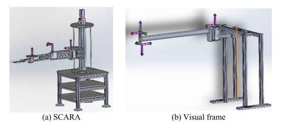
*그림 3 — SCARA와 비전 프레임의 전체 기구. (a) SCARA, (b) 비전 프레임(Visual frame).*

### A. SCARA 설계 (SCARA DESIGN)

SCARA 매니퓰레이터의 기구학 기호 개략도는 그림 4와 같다. 두 축과 직선 이동 하나만 가진 일반 SCARA 설계와 달리, 이 매니퓰레이터는 주로 3축 팔과 직선 이동 기구로 이루어지며, D-H 파라미터는 표 1과 같다. 3축 SCARA 설계를 바탕으로, 이 연구에서 설계한 매니퓰레이터는 일반 SCARA 설계보다 자유도가 높고, 해가 더 효율적이며, 이동 공간이 더 넓다. 작업 영역의 위치에 오차가 있다는 전제 아래, 설계한 매니퓰레이터는 2자유도 SCARA 설계보다 영상으로 판단한 목표 지점에 더 잘 도달할 것으로 기대된다.

**표 1.** SCARA D-H 파라미터.

| Joint | $\alpha_i$ | $a_i$ | $d_i$ | $\theta_i$ |
|---|---|---|---|---|
| 1 | 0 | $a_1$ | $d_1$ | $\theta_1$ |
| 2 | 0 | $a_2$ | 0 | $\theta_2$ |
| 3 | 0 | $a_3$ | 0 | $\theta_3$ |
| 4 | 0 | $a_4$ | 0 | $\theta_4$ |

ROBOTIS 모터 네 개로 4축 SCARA 매니퓰레이터의 관절을 구동한다 [25], [26]. 네 관절의 각도는 각각 $\theta_1, \theta_2, \theta_3, \theta_4$이다. 끝점 $P(P_x, P_y, P_z)$에 대해, 데나빗-하텐베르크(Denavit Harenbreg [역주: 원문 철자 그대로, Denavit–Hartenberg]) 표현 [27]을 써서 SCARA 매니퓰레이터의 기구학 모델을 수립하며, D-H 표는 표 1과 같다.

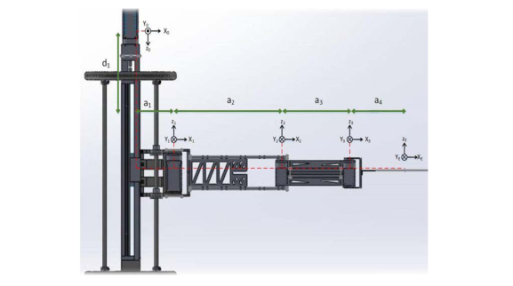
*그림 4 — SCARA의 개략도.*

표 1의 매니퓰레이터에 따라, 베이스 좌표계에 대한 SCARA 끝단 좌표계의 변환 행렬을 (1)과 같이 얻을 수 있다. 마지막으로 변환 행렬을 통해 끝점의 위치를 (2)와 같이 얻는다.

$$T_0^E = \begin{bmatrix} \cos(\theta_1+\theta_2+\theta_3) & -\sin(\theta_1+\theta_2+\theta_3) & 0 & P_x \\ \sin(\theta_1+\theta_2+\theta_3) & \cos(\theta_1+\theta_2+\theta_3) & 0 & P_y \\ 0 & 0 & 1 & P_z \\ 0 & 0 & 0 & 0 \end{bmatrix} \tag{1}$$

$$\begin{cases} P_x = a_3C_{123} + a_2C_{12} + a_1C_1 + a_1 \\ P_y = a_3S_{123} + a_2S_{12} + a_1S_1 \\ P_z = d_1 \end{cases}$$

여기서

$$\begin{cases} C_{123} = cos(\theta_1+\theta_2+\theta_3) \\ C_{12} = cos(\theta_1+\theta_2) \\ C_1 = cos(\theta_1) \end{cases}, \quad \begin{cases} S_{123} = sin(\theta_1+\theta_2+\theta_3) \\ S_{12} = sin(\theta_1+\theta_2) \\ S_1 = sin(\theta_1) \end{cases} \tag{2}$$

[역주: (1)의 마지막 행 $[0\ 0\ 0\ 0]$과 (2)의 $P_x$ 끝항 $+a_1$은 원문 표기 그대로이다.]

순기구학의 끝점 위치 $P(P_x, P_y, P_z)$를 얻은 뒤, 역기구학을 통해 각 관절의 각도를 유도하여 매니퓰레이터를 필요한 위치로 제어할 수 있다. 역기구학 파라미터 정보는 (3)으로 얻을 수 있다. (4)–(6)에서 SCARA 매니퓰레이터를 제어하기 위한 이 각도들을 얻을 수 있다.

$$\begin{aligned} d_1 &= P_z \\ r &= \sqrt{(a_2\cos\theta_2 + a_1)^2 + (a_2\sin\theta_2)^2} \end{aligned} \tag{3}$$

$$\begin{aligned} \phi &= \tan^{-1}2\left(\frac{a_2\sin\theta_2}{a_2\cos\theta_2 + a_1}\right) \\ \theta_1 &= -\phi + \tan^{-1}2\left[\frac{(P_y - a_3n_y)/r}{\sqrt{1 - (P_y - a_3n_y)/r^2}}\right] \\ \theta_2 &= \frac{\cos^{-1}[(P_x - a_3n_x - a_4)^2 + (P_y - a_3n_y)^2 - a_2^2 - a_1^2]}{2a_1a_2} \end{aligned} \tag{4}$$

$$\begin{aligned} \theta_3 &= \tan^{-1}2\left[\frac{A}{B}\right] \\ A &= P_y\cos(\theta_1+\theta_2) + a_4\sin(\theta_1+\theta_2) - P_x\sin(\theta_1+\theta_2) + a_2\sin\theta_2 \end{aligned} \tag{5}$$

$$B = P_x\sin(\theta_1+\theta_2) + a_4\cos(\theta_1+\theta_2) - P_y\sin(\theta_1+\theta_2) - a_1\cos\theta_2 - a_2 \tag{6}$$

[역주: $\tan^{-1}2$는 원문 표기 그대로이며 atan2 함수를 뜻하는 것으로 보인다.]

웨이퍼 검사에서 웨이퍼 카세트는 보통 물품을 꺼낼 수 있는 단일 공간이다. 또한 웨이퍼는 고가 물품이므로 운송 중 손실을 줄이기 위해 충격을 최대한 피하는 것이 중요하다. 충돌을 피하려면 매니퓰레이터가 지정된 목표 지점까지 일정한 속도로 직선을 따라 움직일 수 있어야 한다. 개발한 매니퓰레이터의 야코비 행렬(Jacobian matrix)을 이용하면, 매니퓰레이터는 순간마다 각 모터에 필요한 속도를 실시간으로 계산하여 손상을 피하도록 안정된 궤적으로 웨이퍼를 작업 영역 안팎으로 옮길 수 있다.

SCARA는 웨이퍼를 옮길 때 고정된 경로와 특정 속도로 움직여야 한다. 따라서 각 시점과 각 관절에서 모터가 회전해야 하는 속도를 구하기 위해 야코비 행렬 [28]을 계산해야 한다. 0번째 축이 직선 이동이고, 이 연구에서 개발한 동작은 먼저 Z축 높이 위치 결정을 수행한 다음 놓기·꺼내기 동작을 수행하므로, 야코비 행렬은 (7)과 같이 3축 속도 계획으로 단순화할 수 있다.

$$\begin{bmatrix} w_x \\ w_y \\ w_z \\ v_x \\ v_y \\ v_z \end{bmatrix} = \begin{pmatrix} z_{0_x} & z_{1x} & z_{2_x} \\ z_{0_y} & z_{1_y} & z_{2_y} \\ z_{0_z} & z_{1_z} & z_{2_z} \\ z_{0_x}\left[{}^0p_{n0}\right]_x & z_{1_x}\left[{}^0p_{n1}\right]_x & z_{2_x}\left[{}^0p_{n2}\right]_x \\ z_{0_y}\left[{}^0p_{n0}\right]_y & z_{1_y}\left[{}^0p_{n1}\right]_y & z_{2_y}\left[{}^0p_{n2}\right]_y \\ z_{0_z}\left[{}^0p_{n0}\right]_z & z_{1_z}\left[{}^0p_{n1}\right]_z & z_{2_z}\left[{}^0p_{n2}\right]_z \end{pmatrix} \begin{bmatrix} \dot{\theta}_0 \\ \dot{\theta}_1 \\ \dot{\theta}_2 \end{bmatrix} \tag{7}$$

특히 $z_n$은 베이스 좌표에서 $n$ 좌표계의 $z$축 벡터, ${}^nP_m$은 $n$ 좌표계 원점에서 $m$ 좌표계 원점까지의 거리, $w$는 회전 벡터, $v$는 변위 벡터, $\dot{\theta}_n$은 모터 n의 속도이다. 야코비 행렬은 현재 모터 위치와 DH 파라미터로 순간마다 계산할 수 있다. 그다음 역행렬에 따라, 끝단에서 기대하는 속도와 각속도가 주어지면 그에 대응하는 필요 회전 속도를 구하여 3차원 공간에서 기대하는 직선 이동 경로를 달성한다.

### B. 비전 프레임 (VISUAL FRAME)

이 연구에서는 작업 영역의 영상 획득원으로 비전 프레임을 설계하였다. 기구는 모터와 카메라를 잇는 연결 로드로 경량 소재를 써서, 카메라를 밀기 위해 모터에 필요한 흔들림과 토크를 줄일 수 있다.

검사 영역과 웨이퍼 카세트의 정확한 영상 보정을 위해, 카메라 렌즈 위치의 기본 각도는 작업 영역 평면에 직교해야 하며, 현재 보정 대상에 따라 다른 자세를 가질 수 있다. 이 연구를 위해 설계한 비전 프레임은 그림 3(b)와 같다. 축 모터로 카메라를 SCARA 위로 올리면, 카메라는 모든 작업 영역을 덮을 만큼 충분히 움직이면서 화면에 대해 수직인 작업 영역을 유지할 수 있다. 영상 추출 특징점을 SCARA가 쓸 수 있게 하기 위해, 매니퓰레이터에 대응하는 카메라의 좌표계를 로봇 순기구학과 DH 표로 구하여, 영상에서 추출한 데이터를 직접적이고 전략적으로 쓸 수 있게 한다. 표 2와 같다.

**표 2.** 비전 프레임의 DH 파라미터.

| $Joint_i$ | $\alpha_i$ | $a_i$ | $d_i$ | $\theta_i$ |
|---|---|---|---|---|
| $J_0$ | 0 | $a_0$ | $d_0$ | $\theta_0$ |
| $J_1$ | 0 | $a_1$ | 0 | 0 |
| $J_c$ | $\pi$ | $a_c$ | $d_c$ | $\pi$ |

순기구학을 수행할 때 DH 파라미터를 (8)에 직접 넣어 두 축 사이의 좌표 변환을 구하고, 그다음 (9)를 통해 베이스 좌표에서 카메라 좌표로의 변환 행렬을 얻어, 카메라에서 얻은 특징 좌표를 SCARA가 쓰는 좌표계로 직접 투영할 수 있게 한다.

$${}^{i}T_{i-1} = \begin{bmatrix} \cos\theta_i & -\cos\alpha_i\sin\theta_i & \sin\alpha_i\sin\theta_i & \gamma_i\cos\theta_i \\ \sin\theta_i & \cos\alpha_i\cos\theta_i & -\sin\alpha_i\cos\theta_i & \gamma_i\sin\theta_i \\ 0 & \sin\alpha_i & \cos\alpha_i & d_i \\ 0 & 0 & 0 & 1 \end{bmatrix} \tag{8}$$

$${}^{0}T_2 = {}^{0}T_1 {}^{1}T_2 \tag{9}$$

### C. 검사 환경의 정의와 위치 결정 (DEFINITION AND POSITIONING OF INSPECTION ENVIRONMENTS)

이 연구에서는 두 가지 검사 환경, 즉 웨이퍼 카세트와 웨이퍼 검사 지점을 정의한다. 특히 채택한 8인치 웨이퍼 카세트는 그림 5(a)와 같이 슬롯이 25개이다. 웨이퍼 검사 지점은 그림 5(b)와 같이 웨이퍼가 놓이는 받침대(bracket)에 돌기 네 개가 있는 X자형 받침대로 나타낸다. 웨이퍼 카세트와 검사 지점에는 위치 결정을 위한 원형 라벨이 붙어 있다. 라벨이 붙은 검사 지점은 그림 5(c-d)와 같다. 웨이퍼 카세트의 라벨은 빨간색이고, 웨이퍼 검사 지점의 라벨은 노란색이다.

장치와 관계없이, 부착된 모든 라벨은 다음 조건을 만족해야 한다.

1) 라벨의 총수는 세 개이다.
2) 세 라벨을 잇는 선은 둔각삼각형을 이루어야 한다.
3) 둔각삼각형은 이등변삼각형이어야 한다.
4) 둔각이 있는 점의 라벨 위치가 SCARA 끝단이 도달할 위치이다.
5) 둔각의 열린 쪽은 SCARA 끝단이 장치로 들어가는 위치를 향해야 한다.
6) 둔각삼각형에서, 나머지 두 점을 잇는 선은 SCARA 끝단의 진입 방향과 직교한다.

위에서 말한 조건 알고리즘 외에 소수의 파라미터가 필요하다. 웨이퍼 카세트 보정 시나리오에서는, 카세트를 완전히 정의할 수 있도록 알고리즘이 둔각에 해당하는 라벨과 웨이퍼 카세트의 가장 낮은 슬롯 사이의 높이 차를 알아야 한다. 웨이퍼 검사 지점 보정 시나리오에서는, SCARA 끝단이 움직여야 할 높이를 계산할 수 있도록 알고리즘이 둔각에 해당하는 라벨 정보와 웨이퍼 검사 지점의 웨이퍼 받침대 높이를 알아야 한다. 위에서 말한 여섯 조건이 충족되고 필요한 파라미터가 알려져 있으면, 위치 결정 기술로 위치를 결정할 수 있다. 작업 영역에 검사 지점을 추가할 때는 비전 프레임이 볼 수 있는 위치에 검사 지점을 두기만 하면 된다. 알고리즘은 검사 지점의 위치와 SCARA 끝단이 진입하는 방향을 자동으로 결정하며, SCARA 끝단의 진입 방향과 검사 지점의 라벨 위치 사이의 관계는 그림 6과 같다.

이 연구에서 쓴 웨이퍼 카세트와 웨이퍼 검사 지점의 라벨 위치는 그림 5(c-d)를 참고한다. 둔각에 해당하는 웨이퍼 카세트 라벨의 위치는 카세트 안 웨이퍼의 중심에 놓인다. 둔각에 해당하는 웨이퍼 검사 지점 라벨의 위치는 X자형 받침대의 중심에 있고, 나머지 라벨은 웨이퍼 받침대의 돌기 위에 있다.

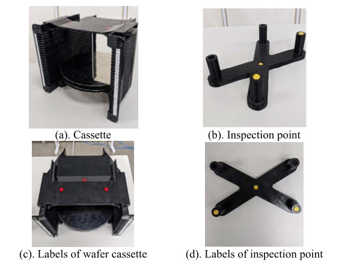
*그림 5 — 검사 지점의 여러 물품에 붙인 라벨. (a) 카세트, (b) 검사 지점, (c) 웨이퍼 카세트의 라벨, (d) 검사 지점의 라벨.*

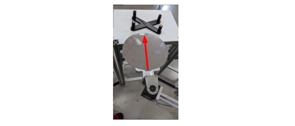
*그림 6 — SCARA 끝단의 진입 방향 개략도.*

이 연구는 검사 지점의 보정 알고리즘이 베이스 좌표 위에 표시된 좌표점과 높이 정보를 필요로 하므로, Intel Realsense D435i 깊이 카메라로 작업 스테이션의 영상과 깊이를 포착하여 작업 스테이션 위치의 각도 정보를 계산한다. 카메라 영상 평면이 지면과 평행하므로, 검사한 깊이 값은 베이스 좌표의 Z 좌표 값 위의 점을 나타낼 수 있다. 알고리즘은 먼저 깊이 영상과 컬러 영상을 포착하고, 포착한 깊이 영상을 컬러 영상에 매핑한다.

잡음 간섭을 줄이기 위해, 이 연구의 알고리즘은 먼저 중앙값 필터(median filter)로 컬러 영상을 처리한 다음, 색 마스크와 깊이 값 같은 파라미터로 라벨의 위치를 걸러 낸다. 알고리즘은 필터로 영상을 평활화한 뒤 HSV 색 공간으로 변환한다. HSV 색 공간의 특성 덕분에 서로 다른 색 사이의 임계값을 쉽게 정의할 수 있다. 미리 정한 임계값으로 알고리즘은 영상에서 라벨이 있는 영역을 걸러 이진 영상을 만들고, [29]의 알고리즘으로 라벨 영역의 윤곽선을 추출한다.

이 논문의 자동 보정 알고리즘은 임의 배치를 달성할 것으로 기대되지만, SCARA의 수평·수직 이동 범위에는 한계가 있다. 따라서 영상 평면에서 작업 스테이션 라벨의 크기에도 한계가 있다. 걸러 낸 라벨 영역의 윤곽선 면적도 알고리즘을 통해 윤곽선이 올바른지 점검하는 지표 중 하나로 쓰인다. 비전 알고리즘은 윤곽선 면적 계산에 OpenCV(Open-Source Computer Vision Library)가 제공하는 라이브러리를 쓴다 [30]. 윤곽선이 차지하는 화소 수가 일정 범위 안에 있으면 그 윤곽선을 허용 범위로 본다. 현재 알고리즘에서 윤곽선 면적 임계값의 단위는 여전히 화소 수에 기반한다. 미터 단위를 임계값으로 쓰면 관련 파라미터를 더 쉽게 설정할 수 있다.

윤곽선 면적의 유효성을 확인한 뒤, 알고리즘은 윤곽선으로 라벨의 좌표를 계산한다. 이 알고리즘은 기하학에서 자주 언급되는 도형의 기본 성질인 모멘트(moments) [31], [32]를 이용해 (10)과 같이 "모멘트"로 윤곽선의 중심을 유도한다.

$$\{x, y\} = \left\{ \frac{M_{10}}{M_{00}}, \frac{M_{01}}{M_{00}} \right\} \tag{10}$$

(10)에서 $M_{10}$, $M_{00}$, $M_{01}$은 윤곽선의 원시 모멘트(raw moments)이다. 컬러 영상에서 각 라벨의 좌표는 (10)으로 계산할 수 있다. 이 알고리즘은 SCARA의 작업 구간 제한 때문에, 검사한 라벨 깊이 값도 윤곽선을 선별하는 최종 조건으로 삼는다. 검사한 좌표의 깊이가 일정 범위 안에 있으면 그 좌표를 라벨을 나타내는 유효한 값으로 본다.

라벨 위치의 검사 알고리즘은 위에서 설명하였다. 그림 7의 절차에서, 알고리즘이 충분한 라벨 위치를 얻으면 작업 스테이션의 위치와 각도를 계산할 수 있다.

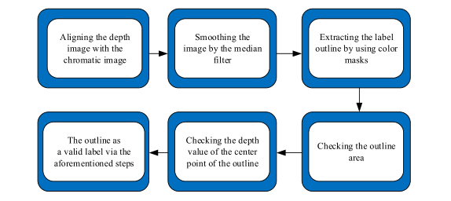
*그림 7 — 라벨 검사 절차. (깊이 영상을 컬러 영상에 정렬 → 중앙값 필터로 영상 평활화 → 색 마스크로 라벨 윤곽선 추출 → 윤곽선 면적 점검 → 윤곽선 중심점의 깊이 값 점검 → 위 단계를 거친 윤곽선을 유효 라벨로 판정)*

세 라벨 위치를 얻은 뒤, 영상에서 작업 스테이션의 위치와 방향을 정의할 수 있다. 작업 스테이션의 위치는 라벨들이 이루는 둔각삼각형에서 둔각에 해당하는 점이다. 작업 스테이션의 방향은 둔각 이등분선의 연장선과 나머지 두 점이 이루는 선분의 교점이다. 방향과 위치를 계산하기 전에, 작업 스테이션의 세 라벨은 높이가 같지 않을 수 있고, 그림 8과 같이 촬영 중 투영 때문에 라벨 점의 위치가 부정확할 수 있다. 그림의 빨간 영역이 라벨이며, 라벨의 올바른 좌표는 $X$여야 한다. 그러나 카메라 모델의 특성 때문에 라벨은 $X'$에 있는 것처럼 보인다. 이 둘 사이의 오차는 작업 스테이션 위치와 각도의 오독을 일으킬 수 있다. 이 알고리즘은 닮은 삼각형 접근으로 이 문제를 다룬다. 그림 8과 같이 실제 라벨 위치는 관측 위치를 영상 중심 쪽으로 줄인 것이어야 하며, 줄어드는 양은 $X' - X$이고, $X$의 값은 (11)로 계산할 수 있다.

$$X' : X = H_{station} : H_{camera} \tag{11}$$

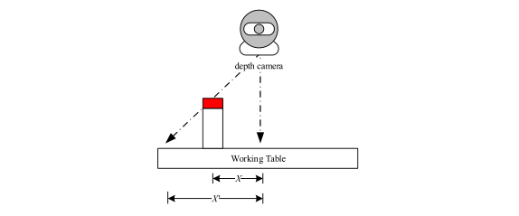
*그림 8 — 투영 개략도. (depth camera=깊이 카메라, Working Table=작업대)*

특히 $H_{station}$은 작업대에서 라벨까지의 높이이고, $H_{camera}$는 작업대에서 카메라까지의 높이이다. 투영 보정 결과는 그림 9와 같다. 그림의 초록 윤곽선은 검사한 라벨 위치이고, 윤곽선 안의 파란 점은 (10)으로 계산한 윤곽선의 중심이다. 보정하지 않은 좌표로 작업 스테이션의 각도를 계산하면 계산 오차가 생긴다. 그림에서 파란 점 세 개와 빨간 변으로 그린 둔각삼각형은 투영 보정한 점들로 만든 것이며, 세 점이 라벨의 실제 위치이다.

*그림 9 — 투영 보정 결과.*

투영을 보정한 뒤, 둔각의 이등분선으로부터 카메라 좌표에서 작업 스테이션의 방향 벡터를 얻는다. 이등분선이 셋째 변과 만나는 교점은 각의 이등분선 정리(Angle Bisector Theorem)로 얻을 수 있다. 그림 10을 예로 들면, 각 a의 이등분선은 (12)의 성질을 가진다.

*그림 10 — 각의 이등분선 정리.*

$\overrightarrow{ad}$는 작업 스테이션의 방향 벡터를 가리키며, 작업 스테이션의 각도는 (13)으로 얻을 수 있다. 그다음 얻은 최종 각도로 SCARA의 기구학을 이용해 베이스 좌표에서 작업 스테이션의 각도 값을 계산한다. 작업 스테이션 위치와 각도의 전체 계산 절차는 그림 11과 같다.

$$\overline{ab} : \overline{ac} = \overline{bd} : \overline{dc} \tag{12}$$

$$angle = atan2(\overrightarrow{ad}_y, \overrightarrow{ad}_x) \tag{13}$$

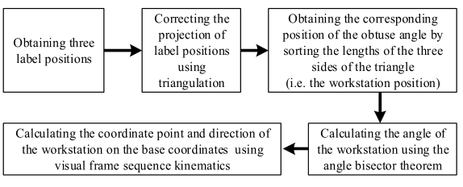
*그림 11 — 작업 스테이션 위치와 각도 계산 절차. (세 라벨 위치 획득 → 삼각측량으로 라벨 위치의 투영 보정 → 삼각형 세 변의 길이를 정렬하여 둔각에 해당하는 위치(즉 작업 스테이션 위치) 획득 → 각의 이등분선 정리로 작업 스테이션 각도 계산 → 비전 프레임 순서 기구학으로 베이스 좌표에서 작업 스테이션의 좌표점과 방향 계산)*

깊이 맵과 컬러 영상을 필터링과 투영 보정으로 처리하면, 영상 평면에서 작업 스테이션의 위치와 각도를 얻고, 순기구학으로 베이스 좌표 값을 계산한다. 오판을 피하기 위해 알고리즘은 라벨 윤곽선과 깊이 값으로 선별을 수행한다. 마지막으로 비전 프레임으로 작업 영역을 스캔하여 작업 스테이션 위치를 자동으로 검사할 수 있다. 이로써 SCARA 매니퓰레이터가 작업 스테이션의 위치와 각도를 자율적으로 판단하여, 수동 보정의 번거로운 단계를 줄일 수 있다.

## IV. 제안하는 웨이퍼 검사 스케줄링 방법 (PROPOSED METHOD OF WAFER INSPECTION SCHEDULING)

웨이퍼 검사 작업 중에는 각 검사 지점을 통과하게 된다. 이 연구에서는 각 검사 지점이 각 웨이퍼가 합격 기준을 충족하는지 판단하는 검사 방법과 시간을 서로 다르게 갖는다고 시뮬레이션한다. 그러나 검사 방법에 따라 웨이퍼마다 다른 절차를 채택할 수 있다.

지능형 스케줄링의 목적은 수동 처리 절차를 줄이는 것이다. 퍼지 추론 시스템과 최적 정렬을 통한 최적화 접근으로, SCARA 매니퓰레이터가 웨이퍼 검사에 필요한 스케줄링 시간을 효과적으로 줄이도록 강화한다. 최적 스케줄링 검사 절차의 개략도는 그림 12와 같다.

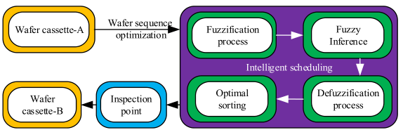
*그림 12 — 최적 스케줄링 검사 절차. (Wafer cassette-A → 웨이퍼 순서 최적화 → 지능형 스케줄링[퍼지화 과정 → 퍼지 추론 → 비퍼지화 과정 → 최적 정렬] → 검사 지점 → Wafer cassette-B)*

### A. 웨이퍼 검사 정보 (WAFER INSPECTION INFORMATION)

시중의 웨이퍼 크기는 다양하며, 그중 8인치가 공급이 부족하고 [33] 가격 면에서 가장 인기가 있다. 그림 13(a)와 같다. 웨이퍼 검사 과정에서 검사 시간을 줄이고 검사 수량을 효율적으로 늘릴 수 있다면, 공장의 경제적 효율을 위해 검사 센터의 산출 가치를 높일 수 있다.

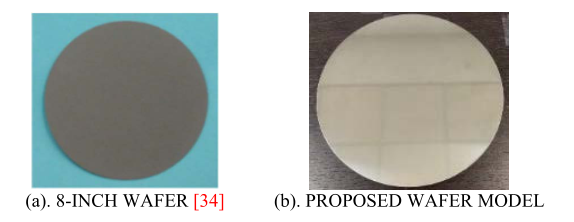
*그림 13 — 웨이퍼 모델. (a) 8인치 웨이퍼 [34], (b) 제안한 웨이퍼 모델.*

이 논문은 그림 13(b)와 같은 8인치 웨이퍼 모델을 채택하였다. 컴퓨터 시뮬레이션 과정에서는 검사 시간 주기가 서로 다른 세 검사 지점을 웨이퍼 검사의 기준으로 사용하였다. 각 웨이퍼가 검사 지점을 통과할 때, 검사 방법마다 필요한 시간으로 재료 품질이 검증 기준을 충족하는지 판단하였다. 그러나 웨이퍼 자체도 검사 방법에 따라 절차가 다르다. 수동 처리를 줄이기 위해, SCARA가 웨이퍼 검사에 필요로 하는 검사 절차를 개선하는 지능형 스케줄링 방법을 제안한다.

검사하는 웨이퍼 수는 웨이퍼 카세트 슬롯 수에 따라 달라진다. 더 많은 웨이퍼를 검사할 수 있는 시나리오에서 웨이퍼 스케줄링 알고리즘의 적응성을 시험하기 위해 25슬롯 카세트를 사용한다. 검사 절차에서 각 웨이퍼는 여러 검사 지점을 통과해야 한다. 산업에서의 웨이퍼 검사 공정을 구현하기 위해, 컴퓨터 시뮬레이션 과정으로 웨이퍼 수에 따라 검사 지점 수를 설정할 수 있는 시나리오 세트를 정하고, 설정한 시나리오를 각 웨이퍼에 구성하여 검사 스케줄링 과정을 거쳐 웨이퍼를 처리할 수 있게 한다. 각 스케줄링의 조건은 다음과 같다. (1) 각 웨이퍼는 컴퓨터 시뮬레이션으로 검사되며, 무작위로 통과하는 검사 지점 수를 시뮬레이션한다. (2) 검사 지점을 통과하는 웨이퍼는 순서대로 검사될 수 있다. (3) 검사가 끝나면 웨이퍼는 Cassette-B에 놓인다.

그림 14와 같이 Cassette-A는 처음 각 웨이퍼가 놓인 웨이퍼 카세트를, Wafer Chuck Table은 검사 지점을, Cassette-B는 각 웨이퍼 검사 후 놓는 웨이퍼 카세트를 나타낸다.

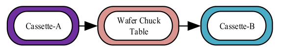
*그림 14 — 웨이퍼 검사 절차.*

### B. 퍼지 추론 시스템 (FUZZY INFERENCE SYSTEM)

#### 1) 퍼지 집합 (FUZZY SET)

일정 수의 웨이퍼를 검사하고 나면, 검사를 위해 카세트에서 어느 웨이퍼를 먼저 꺼내야 하는지 정하는 수동 또는 전산 과정이 필요하다. 이 문제에 대해 [35], [36]에서 학자들은 퍼지 집합으로 시험 시스템이나 영상을 통해 특징 인식에 유리한 결과를 선택하는 것을 언급하였다. 퍼지 추론으로 데이터베이스를 식별하면 만족스러운 결과를 얻을 수 있다.

퍼지 이론은 주로 1965년 Zadeh가 제안하였다. 이 이론의 퍼지 집합은 서로 다른 항목과 속성 사이의 비교 정도를 정의하는 데 쓸 수 있다. 웨이퍼 우선순위의 정도를 식별하는 퍼지 이론의 방법은 주로 그림 15와 같이 서로 다른 특징 수로 전체 집합을 구성하는 것이다. 그다음 퍼지 집합을 소속 함수(attribution function)로 정량화한다.

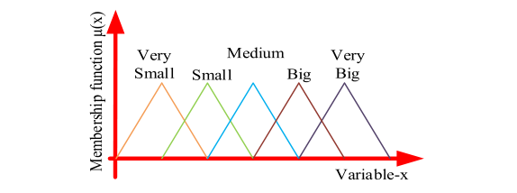
*그림 15 — 퍼지 집합 표현. (세로축: 소속 함수 μ(x), 가로축: 변수 x. Very Small, Small, Medium, Big, Very Big)*

퍼지 이론을 사용하기 위해, 먼저 표 3과 같이 퍼지 집합을 써서 여러 고유값의 논리적 성질로 검사 지점으로 옮길 수 있는 각 웨이퍼의 우선순위를 결정·분석한다.

**표 3.** 웨이퍼 선택을 위한 퍼지 집합 입력 파라미터와 소속 함수의 관계.

| 특징 (Features) | 소속 함수 범위 (Membership function) | 퍼지 부분집합 (Fuzzy subsets) | 소속 함수 파라미터 (Parameters of Membership function) |
|---|---|---|---|
| F₁ | [0 100] | VSD | [0 20 40] |
| | | SD | [15 35 55] |
| | | MD | [30 50 70] |
| | | LD | [45 65 85] |
| | | VLD | [60 80 100] |
| F₂ | [0 110] | VST | [0 20 40] |
| | | ST | [15 35 55] |
| | | MT | [30 50 70] |
| | | LT | [45 65 85] |
| | | VLT | [70 90 110] |

표 3에서는 웨이퍼 선택의 우선순위로 두 가지 유효 특징을 골랐다. 각 웨이퍼 카세트의 슬롯 위치와 첫 번째 웨이퍼 검사 지점에 놓인 웨이퍼 높이 사이의 거리 차 F₁, 그리고 시뮬레이션 과정에서 웨이퍼가 통과한 검사 지점 수에 대한 시간 F₂이다.

두 특징에 대해 소속 함수의 범위는 각각 F₁이 주로 백분율 단위의 [0–100], F₂가 시간 단위의 [0–110]이다. 마지막으로 퍼지 부분집합의 의미는, F₁은 매우 작은 차(VSD), 작은 차(SD), 중간 차(MD), 큰 차(LD), 매우 큰 차(VLD)를, F₂는 매우 짧은 시간(VST), 짧은 시간(ST), 중간 시간(MT), 긴 시간(LT), 매우 긴 시간(VLT)을 뜻한다.

표 4는 웨이퍼 우선순위를 위한 출력 파라미터와 소속 함수의 관계를 보여 준다. 출력 소속 함수의 범위는 [0 1]이며, 퍼지 부분집합은 이중 매우 작음(VVS), 매우 작음(VS), 작음(S), 중간(M), 큼(L), 매우 큼(VL), 이중 매우 큼(VVL)으로 정의한다.

#### 2) 소속 함수 (ATTRIBUTION FUNCTION)

퍼지 집합을 정량화하는 방법을 소속 함수(attribution function)라 하며, 이는 수학식으로 퍼지 집합 데이터를 결정하는 데 쓰인다. 연속 소속 함수는 무한한 퍼지 집합 속성을 기술하는 데 쓰인다. 흔히 쓰는 함수는 삼각형 MF, 가우스 MF, 사다리꼴 MF, 종형(Bell) MF, S자형 MF, Z자형 MF이다. 이 연구에서 쓴 소속 함수는 (14)와 같은 삼각형 MF이다.

**표 4.** 웨이퍼 우선순위를 위한 출력 파라미터와 소속 함수의 관계.

| 출력 결과 (Output result) | 소속 함수 범위 (Membership function) | 퍼지 부분집합 (Fuzzy subsets) | 소속 함수 파라미터 (Parameters of membership function) |
|---|---|---|---|
| Wafer prioritization | [0 1] | VVS | [0 0.090 0.181] |
| | | VS | [0.136 0.227 0.318] |
| | | S | [0.273 0.364 0.454] |
| | | M | [0.409 0.5 0.591] |
| | | L | [0.545 0.636 0.727] |
| | | VL | [0.682 0.773 0.864] |
| | | VVL | [0.8182 0.9091 1] |

$$\mu(x) = \begin{cases} 0, & if\ x < a \\ \dfrac{x - a}{b - a}, & if\ x \in [a, b] \\ \dfrac{c - x}{c - b}, & if\ x \in [b, c] \\ 0, & if\ x > c \end{cases} \tag{14}$$

#### 3) 퍼지 추론 시스템 (FUZZY INFERENCE SYSTEM)

퍼지 집합 소속 분포를 설계한 뒤, 소속 함수의 수학적 계산으로 명시적 값을 얻어 소속 함수의 그래프에 매핑할 수 있고, 퍼지 소속 정도를 생성할 수 있다. 이 과정을 퍼지화(fuzzification)라 한다. 각 특징의 소속 문제를 알기 위해 출력 결과에 퍼지 추론 과정을 써야 한다. 마지막으로 비퍼지화(defuzzification) 과정으로 출력 결과를 얻는다.

퍼지 추론 시스템(FIS)은 여러 추론 규칙으로 이루어진 퍼지 규칙 기반을 가리킨다. 이 프로젝트에는 다카기-스게노(Takagi–Sugeno) 퍼지 모델을 쓰며, 이 규칙 기반의 정의는 Takagi, Sugeno, Kang이 공동으로 개발하였다. 주된 목적은 입력 특징 정보로부터 필요한 우선순위의 출력 결과까지, 필요한 IF–THEN 규칙의 전건부와 후건부를 체계적으로 생성하는 것이다.

또한 웨이퍼 데이터에 따라 전건부와 후건부의 구조와 파라미터를 조정할 수 있다. 이 모델은 제어 시스템과 기타 분야에 자주 적용된다. 추론은 (15)와 같다. 이 식에서 $F_1$과 $F_2$는 입력 특징을, $A_1$과 $B_1$은 소속 함수에서 각 특징의 정도를 가리키며, 마지막으로 출력 $y$가 결과, 즉 웨이퍼 우선순위이다. 사용한 규칙 기반은 표 5와 같다.

$$\text{If } F_1 \text{ is } A_1 \quad \text{AND } F_2 \text{ is } B_1 \quad \text{THEN } y = f(F_1, F_2) \tag{15}$$

**표 5.** 퍼지 규칙 기반 (행: F₂, 열: F₁, 칸: Wafer prioritization).

| F₂ \ F₁ | VSD | SD | MD | LD | VLD |
|---|---|---|---|---|---|
| **VST** | VVL | VVL | VL | L | M |
| **ST** | VVL | VL | L | M | S |
| **MT** | VL | L | M | S | VS |
| **LT** | L | M | S | VS | VVS |
| **VLT** | M | S | VS | VVS | VVS |

#### 4) 비퍼지화 과정 (DEFUZZIFICATION PROCESS)

퍼지 추론의 마지막 절차는 비퍼지화이다. 이는 주로 퍼지 추론의 출력에서 추론한 퍼지화 결과를 변환하는 데, 즉 퍼지 집합을 명시적 값으로 바꾸는 데 쓰인다. 비퍼지화 방법은 많지만, 이 논문은 (16)과 같이 무게중심(center-of-gravity) 방법으로 계산한다.

이는 주로 소속 정도의 면적을 계산한 뒤 블록의 중심점을 기술한다. 이 식에서 $\mu(y_i)$는 $i$번째 규칙 출력 집합의 소속 정도, $y_i$는 $i$번째 규칙 출력 값, $m$은 규칙(specifications)의 총수이다.

$$y(x) = \frac{\sum_{i=1}^{m} y_i\mu(y_i)}{\sum_{i=1}^{m} \mu(y_i)} \tag{16}$$

#### 5) 웨이퍼 우선순위의 퍼지 검사 시스템 (FUZZY INSPECTION SYSTEM OF WAFER PRIORITIZATION)

웨이퍼 우선순위의 퍼지 검사 시스템에서 퍼지 제어기 입력은 두 특징 값이다. 카세트 슬롯에 놓인 각 웨이퍼의 위치와 첫 번째 웨이퍼 검사 지점의 놓는 높이 사이의 거리 차, 그리고 컴퓨터 생성 과정이 선택한 검사 지점을 웨이퍼가 통과하는 시간이다. 또한 그림 16과 같이 MATLAB R2020b 플랫폼에서 설계한 퍼지 논리 시스템의 전체 틀을 사용한다.

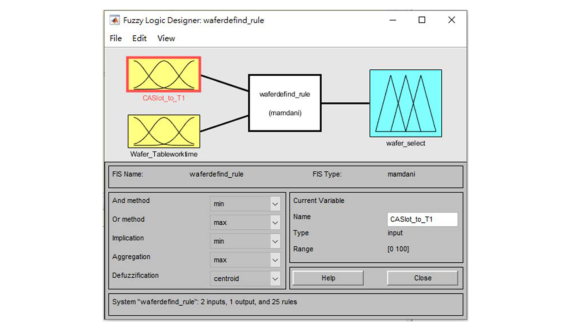
*그림 16 — 퍼지 논리 시스템. (MATLAB Fuzzy Logic Designer 화면: 입력 CASlot_to_T1, Wafer_Tableworktime, 출력 wafer_select, 2 inputs, 1 output, 25 rules)*

그림 17과 같이 입력 변수 분포 CASlot_to_T1의 퍼지 집합은 0과 100 사이에 집중되어 있고, 퍼지 집합 Wafer Table 작업 시간은 그림 18과 같이 0과 100 사이에 집중되어 있다. 따라서 각 입력 특징 변수는 VS, S, M, L, VL의 다섯 퍼지 집합으로 나뉜다. 웨이퍼 우선순위 wafer select의 변수 분포 퍼지 집합은 그림 19와 같이 0과 1 사이에 집중되어 있다. 마지막으로 각 퍼지 집합에 소속 함수의 범위를 할당하며, 입력 특징 수가 2이므로 그림 20과 같이 퍼지 규칙은 25개이다.

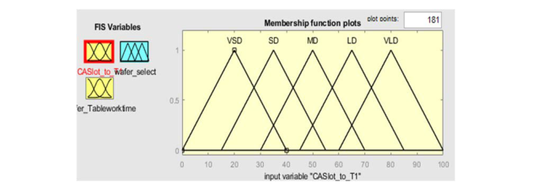
*그림 17 — 퍼지 집합 CASlot to T1.*

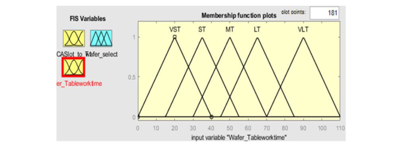
*그림 18 — 퍼지 집합 wafer tableworktime.*

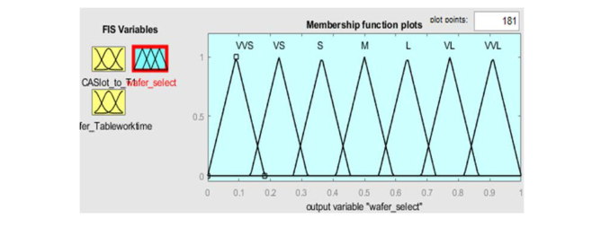
*그림 19 — 퍼지 집합 wafer tableworktime. [역주: 캡션은 원문 그대로이며, 그림 내용은 출력 변수 "wafer_select"의 퍼지 집합이다.]*

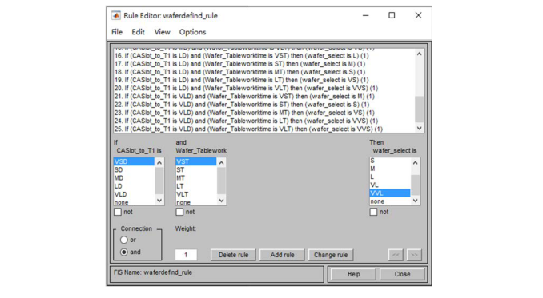
*그림 20 — 퍼지 규칙 표.*

### C. 지능형 정렬 (INTELLIGENT SORTING)

최적 정렬 단계에서는, 검사 시간 절차를 효과적으로 줄이기 위해 컴퓨터가 선택한 각 웨이퍼가 통과해야 하는 검사 지점에 주로 우선순위를 매긴다. 절차 설계에서 각 웨이퍼는 검사 과정 중 빈자리 채우기(vacancy filling), 교차 건너뛰기(cross-hopping), 검사 지점 제거, SCARA 시간 순서 빈자리 채우기의 웨이퍼 전달을 위한 웨이퍼 검사 대기 같은 문제를 만나게 된다. 스케줄링 흐름도는 그림 21과 같다.

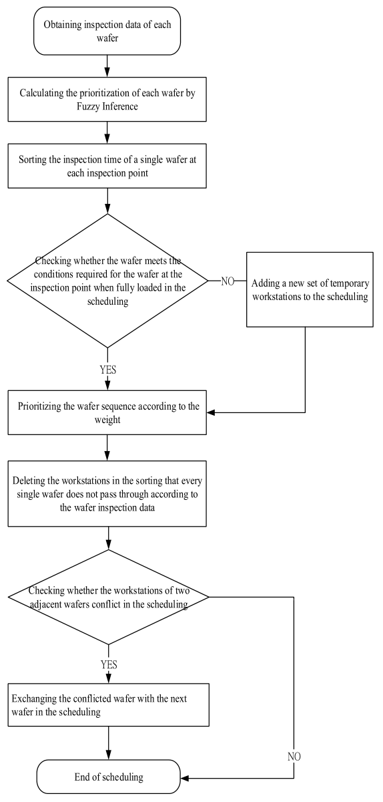
*그림 21 — 지능형 스케줄링 흐름도. (각 웨이퍼의 검사 데이터 획득 → 퍼지 추론으로 각 웨이퍼의 우선순위 계산 → 각 검사 지점에서 단일 웨이퍼의 검사 시간 정렬 → 스케줄링이 꽉 찼을 때 검사 지점에서 웨이퍼에 필요한 조건을 충족하는지 확인[NO: 스케줄링에 임시 작업 스테이션 세트 추가] → YES: 가중치에 따라 웨이퍼 순서 우선순위 결정 → 웨이퍼 검사 데이터에 따라 단일 웨이퍼가 통과하지 않는 작업 스테이션을 정렬에서 삭제 → 인접한 두 웨이퍼의 작업 스테이션이 스케줄링에서 충돌하는지 확인[YES: 충돌 웨이퍼를 스케줄링의 다음 웨이퍼와 교환] → NO: 스케줄링 종료)*

#### 1) 빈자리 채우기를 위한 검사 지점 (INSPECTION POINTS FOR VACANCY FILLING)

각 웨이퍼에는 통과해야 할 일정 수의 검사 지점이 있다. 그러나 세 검사 지점에서 적어도 두 웨이퍼를 동시에 검사할 수 있고, 각 웨이퍼는 최대 세 검사 지점만 통과한다. 그런데 두 웨이퍼 검사 시나리오에서는 검사 지점 경로가 최대 여섯 개가 된다. 따라서 카세트에 놓인 웨이퍼 수가 6의 배수보다 적으면, 스케줄링 설계 순서에서 부족을 피하도록 임시 보관 위치에 검사 지점 세 개를 추가해야 한다. 그림 22는 빈자리 채우기를 위한 검사 지점의 개략도이다.

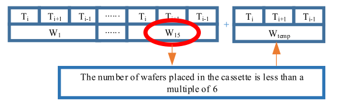
*그림 22 — 빈자리 채우기를 위한 검사 지점. (아래 상자: 카세트에 놓인 웨이퍼 수가 6의 배수보다 적은 경우)*

#### 2) 교차 건너뛰기 (CROSS-HOPPING)

교차 건너뛰기의 개략도는 그림 23과 같다. SCARA가 옮긴 검사 지점에 놓인 웨이퍼의 시험 정렬에서, 웨이퍼는 검사 지점에서 검사된다. 그러나 SCARA는 다음 웨이퍼의 스케줄링을 감지하여 나머지 두 검사 지점에 웨이퍼를 임의로 놓을 수 있다. 검사 지점이 웨이퍼로 가득 차면 SCARA는 검사 지점의 웨이퍼를 기다리거나 웨이퍼를 Cassette-B로 옮기는 것을 선택한다. 이 경우 같은 검사 지점에서 검사·배치되는 두 웨이퍼 사이에 충돌이 생길 가능성이 높으므로 우선순위 정렬 방식을 채택한다. 스케줄링 과정에서 두 웨이퍼가 같은 검사 지점에 있으면, SCARA가 웨이퍼를 다룰 때 같은 검사 지점의 충돌을 피하도록 순서상의 그 검사 지점을 다음 검사 지점과 교환한다.

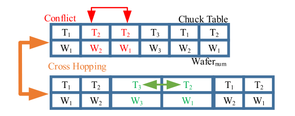
*그림 23 — 교차 건너뛰기. (Conflict=충돌, Chuck Table=척 테이블, Cross Hopping=교차 건너뛰기)*

#### 3) 검사 지점 제거 (INSPECTION POINT ELIMINATION)

웨이퍼가 검사 지점을 통과하는 순서는 주로 시뮬레이션 과정으로 계획한다. 이 시뮬레이션 방법은 컴퓨터가 웨이퍼가 통과해야 할 검사 지점 수를 무작위로 선택하게 한다. 통과할 필요가 없는 검사 지점이 있으면, 전체 웨이퍼 검사 시간을 위해 스케줄링에서 그것을 제거해야 한다. 불필요한 검사 지점을 제거할 때는 현재 검사 지점과 다음 검사 지점 사이에 충돌이 있는지도 고려하는 것이 중요하다. 검사 지점 제거의 개략도는 그림 24와 같다.

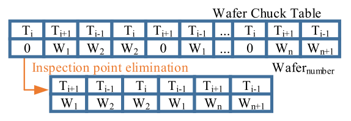
*그림 24 — 검사 지점 제거. (Wafer Chuck Table=웨이퍼 척 테이블, Inspection point elimination=검사 지점 제거)*

#### 4) SCARA 시간 순서 빈자리 채우기 (SCARA TIME SEQUENCE VACANCY FILLING)

시간 순서 빈자리 채우기는 검사 절차의 시간을 크게 개선할 수 있다. 웨이퍼 검사가 끝나면, 알고리즘은 검사하지 않은 웨이퍼를 다른 검사 지점으로 옮길지, 검사한 웨이퍼를 먼저 카세트로 옮길지 결정한다. 검사하지 않은 웨이퍼를 옮길 검사 지점이 검사가 끝난 웨이퍼의 현재 위치와 다르면, 알고리즘은 검사하지 않은 웨이퍼를 먼저 검사 지점으로 옮긴 다음 끝난 웨이퍼를 웨이퍼 카세트로 옮겨, 검사하지 않은 웨이퍼가 더 일찍 검사되게 한다. 검사하지 않은 웨이퍼를 옮길 검사 지점이 끝난 웨이퍼의 현재 위치와 같으면, SCARA가 먼저 그 웨이퍼를 Cassette-B로 옮겨 검사 절차를 마친 다음, 검사하지 않은 웨이퍼를 옮겨 빈자리를 채운다.

## V. 실험 결과 (EXPERIMENTAL RESULTS)

산업 현장에서 대부분의 SCARA는 작동 중 주변 벽이나 장애물에 부딪히지 않도록, 작동 전에 일련의 번거로운 보정 절차를 거쳐야 한다. 이 연구에서 개발한 자동 보정 절차는 보정 가속에 필요한 시간을 크게 개선할 수 있다.

### A. 보정 실험 (CALIBRATION EXPERIMENT)

#### 1) 수동 보정 (MANUAL CALIBRATION)

그림 25(a-h)와 같이, 수동 보정 절차에서는 작업자가 SCARA 매니퓰레이터를 올바른 위치로 옮기고, 위치를 기록한 다음, 다음 위치로 옮겨야 한다. 이 동작은 모든 작업 영역이 보정될 때까지 반복된다.

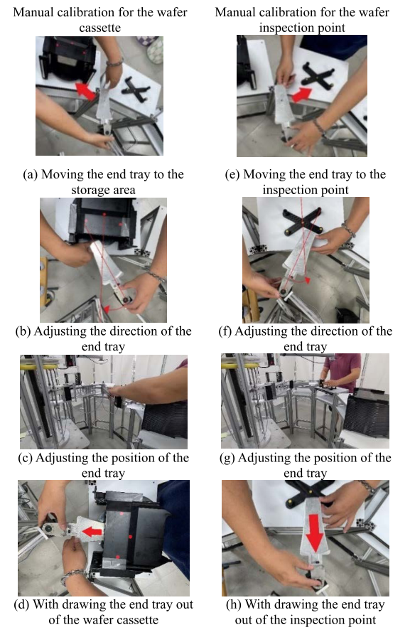
*그림 25 — 웨이퍼 카세트와 검사 지점의 수동 보정 절차. (왼쪽 열: 웨이퍼 카세트의 수동 보정, 오른쪽 열: 웨이퍼 검사 지점의 수동 보정. (a) 끝단 트레이를 보관 영역으로 이동, (b) 끝단 트레이의 방향 조정, (c) 끝단 트레이의 위치 조정, (d) 끝단 트레이를 웨이퍼 카세트에서 빼냄, (e) 끝단 트레이를 검사 지점으로 이동, (f) 끝단 트레이의 방향 조정, (g) 끝단 트레이의 위치 조정, (h) 끝단 트레이를 검사 지점에서 빼냄)*

#### 2) 자동 보정 (AUTOMATIC CALIBRATION)

자동 보정을 수행할 때 작업자는 직접 보정할 필요가 없다. 컴퓨터 시스템이 작업 구간에서 비전 프레임을 한 번에 자동으로 이동·스캔하며, 그림 26(a-e)와 같이 영상 인식 분석과 기구학으로 웨이퍼 검사 지점의 위치와 각도를 유도한다.

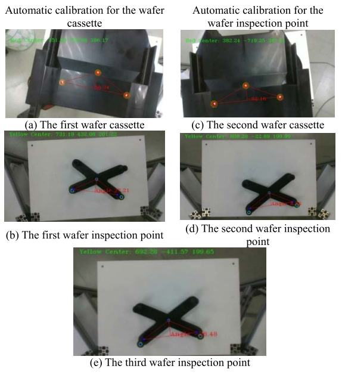
*그림 26 — 자동 보정 절차. (a) 첫째 웨이퍼 카세트, (b) 첫째 웨이퍼 검사 지점, (c) 둘째 웨이퍼 카세트, (d) 둘째 웨이퍼 검사 지점, (e) 셋째 웨이퍼 검사 지점*

실험 결과에서 자동 보정과 수동 보정 사이에는 차이가 있다. 수동 보정은 SCARA 끝단을 검사 지점까지 손으로 옮겨야 하고 기대 목표 값에 정렬되었는지 판단할 명확한 기준이 없으므로, SCARA 매니퓰레이터의 조작자는 정렬을 마친 뒤에도 검사 지점의 보정을 끝내기 위해 데이터를 기록해야 한다. 자체 개발한 자동 보정 기술의 시나리오에서는 비전 프레임이 위에서 각 검사 지점을 보고 작업 영역도 스캔한다. 구체적으로 각 검사 지점의 위치와 방향을 알 수 있어, 사람의 조작으로 인한 오차와 공공 안전상의 위험을 피할 수 있다. 또한 사람이 기록하는 시간도 절약되고 과정에 인력이 필요하지 않다.

이 실험에서는 수동 보정과 자동 보정에 필요한 시간을 비교하며, 보정할 대상은 웨이퍼 카세트 두 개와 웨이퍼 검사 지점 세 개이다. 수동 보정에는 번거로운 작업이 많고 검사 지점마다 처리해야 한다. 반면 자동 보정은 잠깐 멈추고 충분한 데이터를 획득하기만 하면 된다. 다섯 검사 지점의 보정에 쓴 시간은 표 6과 같다.

**표 6.** 수동 보정과 자동 보정에 필요한 시간표.

| 수동 보정 시간 (Time for manual calibration) | 자동 보정 시간 (Time for automatic calibration) |
|---|---|
| 166 seconds | 39 seconds |

### B. 스케줄링 실험 (SCHEDULING EXPERIMENT)

SCARA에서 단위 시간당 가장 많은 작업을 하려면, 시간을 절약하는 효과적인 스케줄을 어떻게 설계하느냐가 전체 작업의 완료 시간에 영향을 준다. 이 때문에 이 연구는 효율을 높이는 지능형 스케줄링 알고리즘을 개발하고, 이를 순차 검사 및 수동 스케줄링 검사와 비교한다.

#### 1) 지능형 스케줄링 검사 (INTELLIGENT SCHEDULING INSPECTION)

이 스케줄링은 퍼지 추론 방법과 스케줄링 휴리스틱 최적 정렬을 통한 최적화 접근으로 웨이퍼 검사에 최적화된다. 한편 유전 알고리즘과 신경망(GANN) 이진 하이브리드 방법으로 스케줄링을 조사하여 제안 방법과 비교한다. 알고리즘 계산에는 MATLAB 2020b를 사용하였다. 여기서 NN 파라미터는 선행 연구 [37], [38]을 참고하여(조정 포함) 설정하였다. NN 은닉층의 뉴런 수는 15, 반복 횟수(Iter.)는 10000, 학습률은 0.001이다. GA 파라미터는 선행 연구 [39], [40]을 참고하여(조정 포함) 설정하였다. 개체군 크기 = 50, 교차율 = 0.8, 돌연변이율 = 0.1이다. 알고리즘은 300회 반복 후 종료한다.

#### 2) 순차 검사 (SEQUENTIAL INSPECTION)

순차 검사 계획을 전제로 하면, SCARA는 웨이퍼를 옮긴 뒤 그 웨이퍼가 검사 시간을 마칠 때까지 기다린 다음에야 다음 웨이퍼의 검사 절차를 계속할 수 있다. 따라서 필요한 시간이 비교적 길어 비효율적으로 여겨진다.

#### 3) 수동 스케줄링 검사 (MANUAL SCHEDULING INSPECTION)

이 절에서는 검사를 위한 웨이퍼 배치 순서를 그대로 따르는 스케줄링, 수동 경험적 스케줄링, GANN 스케줄링 알고리즘, 제안한 지능형 스케줄링 알고리즘의 검사 시간을 서로 비교하였다. 모든 검사는 실험에서 첫 번째 웨이퍼 박스를 사용해 수행하였으며, 슬롯 2–9의 웨이퍼 8장을 세 작업 스테이션으로 옮겨야 하고 순서에 대한 요구 조건은 주지 않았다. 각 작업 스테이션의 검사 시간은 각각 30, 40, 35 s였다. 첫 번째 웨이퍼 박스에서 꺼낸 웨이퍼는 세 작업 스테이션을 거쳐 두 번째 웨이퍼 박스로 돌아갔다. 표 7은 이 시나리오에서 세 번 반복하여 얻은 네 스케줄링 방법의 평균 총 검사 시간을 보여 준다.

**표 7.** 스케줄별 검사 시간 비교 결과.

| 스케줄링 방법 (Scheduling methods) | 검사 시간 (Inspection time) (s) |
|---|---|
| Sequential scheduling (순차 스케줄링) | 1497 |
| Manual scheduling (수동 스케줄링) | 974 |
| Intelligent scheduling (GANN) (지능형 스케줄링, GANN) | 902 |
| Intelligent scheduling (Proposed method) (지능형 스케줄링, 제안 방법) | 879 |

네 스케줄링 방법의 작업 시간 순서는 그림 27과 같이 간트 차트(Gantt chart)로 나타내었다. 실험 결과에서 주황색 부분은 웨이퍼가 검사 지점에서 검사되고 있음을, 파란색 부분은 SCARA 매니퓰레이터가 웨이퍼를 옮기고 있음을, 회색 부분은 검사 지점에서 웨이퍼 검사가 끝나 전달 준비가 되었음을 나타낸다.

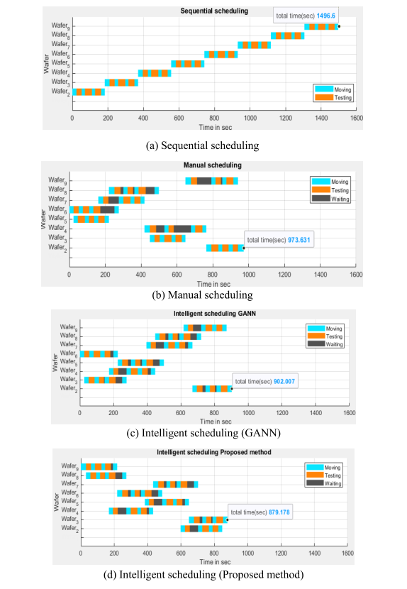
*그림 27 — SCARA 작업의 시간 순서 다이어그램. (a) 순차 스케줄링, (b) 수동 스케줄링, (c) 지능형 스케줄링(GANN), (d) 지능형 스케줄링(제안 방법). (범례: Moving=이동, Testing=검사, Waiting=대기. 각 그래프의 total time(sec): (a) 1496.6, (b) 973.631, (c) 902.007, (d) 879.178)*

결과 비교를 쉽게 하기 위해 그림 27(a–d)의 모든 시간 순서 다이어그램의 검사 시간 범위를 0–1600 s로 설정하였다. 그림 27(a–d)와 같이 지능형 알고리즘에 의한 스케줄링이 가장 효과적이며, 그 검사 시간은 순차 검사의 경우보다 절반으로 줄었다. 한편 네 간트 차트에서 파란색 부분은 SCARA 매니퓰레이터의 작업 시간을 나타낸다. 그림 27(c, d)의 지능형 스케줄링 동안 SCARA 매니퓰레이터는 거의 완전히 유효한 작업 상태에 있었으며, 이는 그림 27(a)의 순차 스케줄링 경우에 SCARA 매니퓰레이터가 웨이퍼 검사가 끝날 때까지 원래 자세에 머물러 있던 것과 다르다. 따라서 시간 스케줄링 실험 결과는 SCARA 매니퓰레이터의 작업 시간이 조밀할수록 웨이퍼 스케줄링이 더 성공적이며, 더 많은 웨이퍼를 검사하고 총 검사 시간을 효과적으로 줄일 수 있음을 보여 주었다.

**표 8.** 스케줄별 검사 시간 비교 결과. [역주: 캡션은 원문 그대로이며, 표 내용은 알고리즘별 평균 프로그래밍(계산) 시간이다.]

| 지능형 스케줄링 알고리즘 (Scheduling intelligent algorithm) | 평균 프로그래밍 시간 (Average Programming time) (s) |
|---|---|
| GANN | 4066.554 |
| Proposed method (제안 방법) | 0.603 |

또한 그림 27(c)의 GANN 지능형 스케줄링 방법과 그림 27(d)의 제안 방법의 검사 시간은 매우 일관되었으며(약 850–910 s), 두 방법 모두 SCARA 매니퓰레이터의 작업 시간을 효과적으로 활용할 수 있다. 그럼에도 GANN 방법은 알고리즘의 특성상 데이터로 학습·시험해야 하며, 전체 검사의 작업 결과는 여러 은닉층의 반복 연산을 통해서만 얻을 수 있다. 표 8은 GANN 방법과 제안 방법의 검사 시간을 보여 준다.

## VI. 결론 (CONCLUSION)

이 연구는 자동 보정과 최적화 스케줄링을 갖춘 웨이퍼 검사 시스템을 개발하였다. SCARA 매니퓰레이터에 영상 비전 보정 시스템을 추가하여, SCARA 매니퓰레이터를 새 작업 영역에 두면 검사 지점과 웨이퍼 카세트의 상대 위치에 따라 자동으로 보정되므로, SCARA 매니퓰레이터가 웨이퍼를 올바르게 옮길 수 있다. 그다음 지능형 스케줄링으로 모든 웨이퍼 작업을 최적화하여 모든 웨이퍼를 가장 짧은 시간에 검사하였다.

실험은 제안 방법이 스케줄링 시간을 크게 개선함을 보여 준다. 자동 보정 면에서는 자동 보정의 총 시간이 수동 보정보다 크게 짧으며, 자동 보정의 정확도는 수동 보정과 비슷하다. 스케줄링하지 않은 경우에 비해 지능형 스케줄링은 완료 시간이 더 짧고, 그림 27(c)에서 수동 스케줄링보다도 낫다. 전반적으로 보정부터 작업 완료까지의 시간을 크게 줄일 수 있다. 향후 연구에서는 시스템에 시험용 스테이션을 여러 개 설치하고, 웨이퍼 검사 스케줄링에 강화 학습 방법을 도입할 것이다.

## 참고문헌 (REFERENCES)

[1] TECHNICAL DEMO. Accessed: Oct. 20, 2021. [Online]. Available: https://video.universal-robots.com/technical-demo-part-1-on-robot-set-up
[2] S. M. Abbas, S. Hassan, and J. Yun, "Augmented reality based teaching pendant for industrial robot," in Proc. Conf. Control Autom. Syst., 2012, pp. 2210–2213.
[3] A. Albalasie, I. Hussain, M. Horoub, S. Khan, S. Ali, and D. Gan, "Design, prototype, and control design based on computed torque control of selective compliance assembly robot arm," in Proc. IEEE 9th Annu. Int. Conf. CYBER Technol. Autom., Control, Intell. Syst. (CYBER), Jul. 2019, pp. 70–75.
[4] B. Chen, J. Wan, L. Shu, P. Li, M. Mukherjee, and B. Yin, "Smart factory of industry 4.0: Key technologies, application case, and challenges," IEEE Access, vol. 6, pp. 6505–6519, 2018.
[5] M. T. Das and L. C. Dülger, "Mathematical modelling, simulation and experimental verification of a scara robot," Simul. Model. Pract. Theory, vol. 13, no. 3, pp. 257–271, Apr. 2005.
[6] Methods and Apparatus for Extending the Reach of a Dual SCARA Robot Linkage. Accessed: Oct. 20, 2021. [Online]. Available: https://patents.google.com/patent/US8016542B2/en
[7] F. Cao, J. Liu, C. Zhou, Y. Zhao, Z. Fu, and W. Yan, "A novel 5-DOF welding robot based on SCARA," in Proc. IEEE 10th Conf. Ind. Electron. Appl. (ICIEA), Jun. 2015, pp. 2016–2019.
[8] K. Onozato and Y. Maeda, "Learning of inverse-dynamics and inverse-kinematics for two-link SCARA robot using neural networks," in Proc. SICE Annu. Conf., Sep. 2007, pp. 1031–1034.
[9] Programmazione Robot. Accessed: Oct. 20, 2021. [Online]. Available: https://www.itasistemi.it/programmazione-robot-2
[10] C. Mao, S. Li, Z. Chen, H. Zu, Z. Wang, and Y. Wang, "A novel algorithm for robust calibration of kinematic manipulators and its experimental validation," IEEE Access, vol. 7, pp. 90487–90496, 2019.
[11] Z. Liu, X. Liu, Z. Cao, X. Gong, M. Tan, and J. Yu, "High precision calibration for 3D vision-guided robot system," IEEE Trans. Ind. Electron., early access, Feb. 23, 2022, doi: 10.1109/TIE.2022.3152026.
[12] X. Chen and Q. Zhan, "The kinematic calibration of an industrial robot with an improved beetle swarm optimization algorithm," IEEE Robot. Autom. Lett., vol. 7, no. 2, pp. 4694–4701, Apr. 2022.
[13] A. Nasirian and M. A. Khanesar, "Sliding mode fuzzy rule base bilateral teleoperation control of 2-DOF SCARA system," in Proc. Int. Conf. Autom. Control Dyn. Optim. Techn. (ICACDOT), Sep. 2016, pp. 7–12.
[14] International Federation of Robotics. Accessed: Oct. 20, 2021. [Online]. Available: https://ifr.org/robot-history
[15] Programmazione Robot. Accessed: Oct. 20, 2021. [Online]. Available: https://www.itasistemi.it/programmazione-robot-2/
[16] S. Fateh and M. M. Fateh, "Compensation of fuzzy approximation error in the control of robot manipulators," in Proc. Electr. Eng. (ICEE), May 2018, pp. 963–969.
[17] D. Gao, G.-G. Wang, and W. Pedrycz, "Solving fuzzy job-shop scheduling problem using DE algorithm improved by a selection mechanism," IEEE Trans. Fuzzy Syst., vol. 28, no. 12, pp. 3265–3275, Dec. 2020.
[18] F. Li, T. W. Liao, W. Cai, and L. Zhang, "Multitask scheduling in consideration of fuzzy uncertainty of multiple criteria in service-oriented manufacturing," IEEE Trans. Fuzzy Syst., vol. 28, no. 11, pp. 2759–2771, Nov. 2020.
[19] A. A. Stonier, S. Murugesan, R. Samikannu, V. Krishnamoorthy, S. K. Subburaj, G. Chinnaraj, and G. Mani, "Fuzzy logic control for solar PV fed modular multilevel inverter towards marine water pumping applications," IEEE Access, vol. 9, pp. 88524–88534, 2021.
[20] S. Zhou, L. Xing, X. Zheng, N. Du, L. Wang, and Q. Zhang, "A self-adaptive differential evolution algorithm for scheduling a single batch-processing machine with arbitrary job sizes and release times," IEEE Trans. Cybern., vol. 51, no. 3, pp. 1430–1442, Mar. 2021.
[21] A. Yang, R. Wang, Y. Sun, K. Chen, and Z. Chen, "Coastal shuttle tanker scheduling model considering inventory cost and system reliability," IEEE Access, vol. 8, pp. 193935–193954, 2020.
[22] J. Wang, H. Hu, C. Pan, and L. Li, "Transient process optimization for dual-arm cluster tools with wafer revisiting," IEEE Access, vol. 9, pp. 50093–50105, 2021.
[23] Y. Yan, H. Wang, Q. Tao, W. Fan, T. Lin, and Y. Xiao, "Noncyclic scheduling of multi-cluster tools with residency constraints based on Pareto optimization," IEEE Trans. Semicond. Manuf., vol. 33, no. 3, pp. 476–486, Aug. 2020.
[24] H42-20-S300-R(A). Accessed: Oct. 20, 2021. [Online]. Available: https://emanual.robotis.com/docs/en/dxl/pro/h42-20-s300-ra/
[25] H54-200-S500-R(A). Accessed: Oct. 20, 2021. [Online]. Available: https://emanual.robotis.com/docs/en/dxl/pro/h54-200-s500-ra/
[26] E. Bayro-Corrochano and D. Kähler, Kinematics of Robot Manipulators in the Motor Algebra. Berlin, Germany: Springer-Verlag, 2001.
[27] TS2-80 SCARA Robot. Accessed: Oct. 20, 2021. [Online]. Available: https://www.staubli.com/en-us/robotics/product-range/6-axis-scara-picker-industrial-robots/4-axis-scara-robots/ts2-80/
[28] C. R. Rocha, C. P. Tonetto, and A. Dias, "A comparison between the Denavit–Hartenberg and the screw-based methods used in kinematic modeling of robot manipulators," Robot. Comput.-Integr. Manuf., vol. 27, no. 4, pp. 723–728, Aug. 2011.
[29] H. Khan, S. J. Abbasi, and M. C. Lee, "DPSO and inverse jacobian-based real-time inverse kinematics with trajectory tracking using integral SMC for teleoperation," IEEE Access, vol. 8, pp. 159622–159638, 2020.
[30] S. Suzuki and K. Be, "Topological structural analysis of digitized binary images by border following," Comput. Vis., Graph., Image Process., vol. 30, no. 1, pp. 32–46, Apr. 1985.
[31] G. Bradski and A. Kaehler, Learning OpenCV: Comput. Vision with the OpenCV Library. Sebastopol, CA, USA: O'Reilly Media, 2008.
[32] M.-K. Hu, "Visual pattern recognition by moment invariants," IRE Trans. Inf. Theory, vol. 8, no. 2, pp. 179–187, Feb. 1962.
[33] Z. Huang and J. Leng, "Analysis of Hu's moment invariants on image scaling and rotation," in Proc. 2nd Int. Conf. Comput. Eng. Technol., 2010, pp. 476–480.
[34] 8-Inch Wafer Prices Rising by up to 40% in 2021. Accessed: Oct. 20, 2021. [Online]. Available: https://www.huayuansh.com/8-inch-wafer-prices-rising-by-up-to-40-in-2021/
[35] Dummy Wafer. Accessed: Oct. 20, 2021. [Online]. Available: https://www.entegris.com/shop/en/USD/products/specialty-materials/premium-silicon-carbide/supersic-silicon-carbide-components/Dummy-Wafers/p/DummyWafers
[36] S. Liu, S. Wang, X. Liu, C.-T. Lin, and Z. Lv, "Fuzzy detection aided real-time and robust visual tracking under complex environments," IEEE Trans. Fuzzy Syst., vol. 29, no. 1, pp. 90–102, Jan. 2021.
[37] G. F. Becerra, S. P. Martagon, M. A. D. E. Villasenor, E. T. Cuautle, L. G. de la Fraga, and I. G. Gomez, "Selection of the optimal sizes of analog integrated circuits by fuzzy sets intersection," IEEE Latin Amer. Trans., vol. 12, no. 6, pp. 1005–1011, Sep. 2014.
[38] C.-C. Lin, D.-J. Deng, Y.-L. Chih, and H.-T. Chiu, "Smart manufacturing scheduling with edge computing using multiclass deep Q network," IEEE Trans. Ind. Informat., vol. 15, no. 7, pp. 4276–4284, Jul. 2019.
[39] M. Abe, M. Matsumoto, and C. Kuroda, "An artificial neural network optimized by a genetic algorithm for real-time flow-shop scheduling," in Proc. 4th Int. Conf. Knowl.-Based Intell. Eng. Syst. Allied Technol. (KES), 2000, pp. 329–332.
[40] Y. Wang and Q. Zhu, "A hybrid genetic algorithm for flexible job shop scheduling problem with sequence-dependent setup times and job lag times," IEEE Access, vol. 9, pp. 104864–104873, 2021.
[41] I. Lee, R. Sikora, and M. J. Shaw, "A genetic algorithm-based approach to flexible flow-line scheduling with variable lot sizes," IEEE Trans. Syst., Man, Cybern., B (Cybern.), vol. 27, no. 1, pp. 36–54, Feb. 1997.
